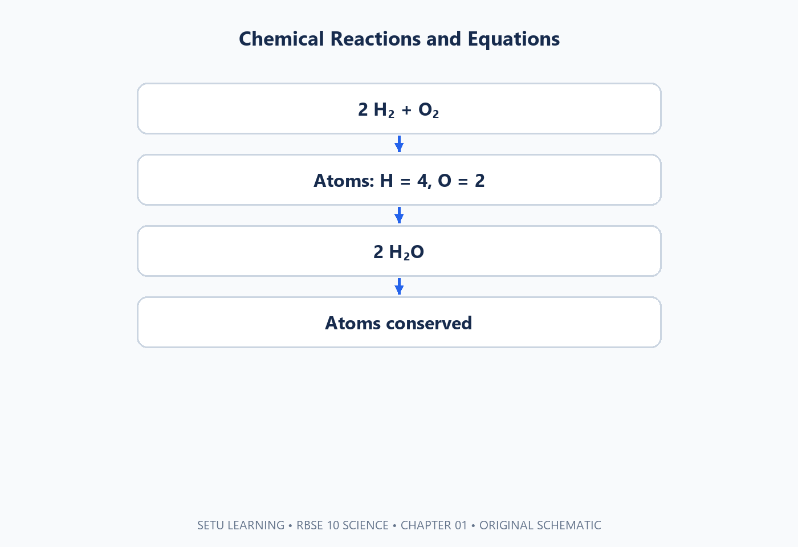

# अध्याय 1: रासायनिक अभिक्रियाएँ एवं समीकरण (Chemical Reactions and Equations)

## भाग 1: अध्याय प्रवेश एवं पाठ्यक्रम मैपिंग

> प्रथम संपादकीय प्रारूप। इस अध्याय का 2026–27 पाठ्यक्रम-क्षेत्र मिलाया गया है; NCERT के सभी प्रश्नों के हल तथा पूरा ऐतिहासिक PYQ संग्रह अभी स्रोत-परीक्षण में हैं।

**विषय कोड:** 07 · **श्रृंखला पुस्तक:** 2

**सत्यापित आधार:** RBSE 2026–27 · **अध्याय भार:** 6 अंक। यह आधिकारिक chapter weight है; वास्तविक प्रश्न-विभाजन की भविष्यवाणी नहीं।

**सीखने के लक्ष्य:** प्रेक्षण से रासायनिक परिवर्तन पहचानना; परमाणु गिनकर समीकरण संतुलित करना; अभिक्रियाओं का वर्गीकरण तथा दैनिक जीवन में ऑक्सीकरण समझना।

## भाग 2: शब्दावली एवं अवधारणा कैप्सूल

| शब्द / सूत्र | अर्थ / उपयोग |
|---|---|
| अभिकारक (Reactant) | अभिक्रिया में प्रारंभ में भाग लेने वाला पदार्थ। |
| उत्पाद (Product) | अभिक्रिया के बाद बनने वाला पदार्थ। |
| संतुलित समीकरण | दोनों पक्षों में प्रत्येक तत्व के परमाणुओं की संख्या समान। |
| संयोजन (Combination) | दो या अधिक पदार्थों से एक मुख्य उत्पाद बनना। |
| वियोजन (Decomposition) | एक यौगिक से दो या अधिक पदार्थ बनना। |
| विस्थापन (Displacement) | अधिक सक्रिय तत्व द्वारा कम सक्रिय तत्व को हटाना। |
| द्विविस्थापन | दो यौगिकों के आयनों का आदान-प्रदान। |
| उपचयन (Oxidation) | इस स्तर पर ऑक्सीजन जुड़ना या हाइड्रोजन हटना। |
| अपचयन (Reduction) | इस स्तर पर ऑक्सीजन हटना या हाइड्रोजन जुड़ना। |
| विकृतगंधिता (Rancidity) | वसा/तेल के ऑक्सीकरण से स्वाद और गंध बिगड़ना। |

## भाग 3: विस्तृत शिक्षण पाठ

### परिवर्तन से समीकरण तक
कागज काटने पर पदार्थ की पहचान कागज ही रहती है; जलाने पर नए पदार्थ बनते हैं। गैस निकलना, अवक्षेप, ताप या रंग में परिवर्तन अभिक्रिया का संकेत हो सकता है। अकेला संकेत निर्णायक नहीं: उबलते पानी में बुलबुले भौतिक परिवर्तन हैं। पदार्थ की पहचान बदलना मुख्य कसौटी है। मैग्नीशियम जलने पर सफेद मैग्नीशियम ऑक्साइड बनाता है: $2Mg + O_2 \rightarrow 2MgO$। प्रयोग शिक्षक की देखरेख में हो; जलती पट्टी को सीधे न देखें।

### संतुलन की विधि
पहले सही रासायनिक सूत्र लिखें। $Fe + H_2O \rightarrow Fe_3O_4 + H_2$ में Fe को 3, पानी को 4 और हाइड्रोजन को 4 का गुणांक दें। परिणाम $3Fe + 4H_2O \rightarrow Fe_3O_4 + 4H_2$ है; यहाँ जल भाप है। सूत्र का subscript बदलना पदार्थ बदल देता है। समीकरण में (s), (l), (g), (aq) अवस्था दिखाते हैं; तीर के ऊपर ताप, प्रकाश या उत्प्रेरक लिख सकते हैं। बंद व्यवस्था में द्रव्यमान संरक्षण संतुलन का आधार है।

### अभिक्रिया के प्रकार
बिना बुझा चूना पानी से बुझा चूना बनाता है: $CaO + H_2O \rightarrow Ca(OH)_2$; संयोजन और ऊष्माक्षेपी दोनों। $CaCO_3 \xrightarrow{heat} CaO + CO_2$ तापीय वियोजन है। जल के विद्युत अपघटन में हाइड्रोजन और ऑक्सीजन आयतन 2:1 होता है। $2AgCl \xrightarrow{sunlight} 2Ag + Cl_2$ प्रकाशीय वियोजन है। $Zn + CuSO_4 \rightarrow ZnSO_4 + Cu$ विस्थापन, जबकि $Na_2SO_4 + BaCl_2 \rightarrow BaSO_4\downarrow + 2NaCl$ द्विविस्थापन और अवक्षेपण है। वर्गीकरण परस्पर अनन्य नहीं है।

### Redox और जीवन
$CuO + H_2 \rightarrow Cu + H_2O$ में CuO ऑक्सीजन खोकर अपचयित, H₂ ऑक्सीजन पाकर उपचयित होता है। उपचायक दूसरे पदार्थ का उपचयन करता है और स्वयं अपचयित होता है। लोहे की जंग के लिए ऑक्सीजन तथा नमी दोनों महत्त्वपूर्ण हैं; जंग hydrated iron(III) oxide है, शुद्ध Fe₂O₃ मात्र नहीं। पेंट और जस्तीकरण संपर्क रोकते हैं। तेलयुक्त भोजन ठंडा रखना, वायुरुद्ध पैकिंग और nitrogen flushing विकृतगंधिता धीमी करते हैं; वे सभी सूक्ष्मजीवों को अनिवार्यतः समाप्त नहीं करते।

परमाणु-संरक्षण का सांकेतिक प्रवाह: संतुलित hydrogen–oxygen reaction; चित्र मात्रा-अनुपात दिखाता है, molecular geometry नहीं।

## भाग 4: पाठ्यपुस्तक-अवधारणाओं पर मौलिक हल किए उदाहरण

नीचे के प्रश्न लेखक के मौलिक मॉडल हैं। ये किसी NCERT edition के प्रश्न क्रमांक या संपूर्ण in-text/exercise solution bank होने का दावा नहीं करते।

**हल किया उदाहरण 1: Al + O₂ → Al₂O₃ संतुलित करें।**

O का LCM 6 लें: 3O₂ और 2Al₂O₃। अब Al दाईं ओर 4 हैं, अतः 4Al + 3O₂ → 2Al₂O₃। जाँच: Al 4–4, O 6–6।

**हल किया उदाहरण 2: CuO + H₂ में oxidising agent कौन है?**

CuO, क्योंकि वह H₂ को ऑक्सीजन देकर उसका उपचयन करता है। स्वयं CuO से ऑक्सीजन निकलकर Cu बनता है; इसलिए oxidising agent का स्वयं reduction होता है।

**हल किया उदाहरण 3: FeSO₄ गरम करने का समीकरण और प्रेक्षण दें।**

2FeSO₄ → Fe₂O₃ + SO₂ + SO₃। पहले hydrated salt का पानी निकलता है; आगे ताप पर भूरा oxide बनता है। Fe 2, S 2 और O 8 दोनों ओर हैं। यह तापीय वियोजन है।

## भाग 5: सत्यापित बोर्ड प्रश्न एवं स्रोत-स्थिति

2025, प्रश्न 1(xv), PDF पृष्ठ 6: PbO–carbon reaction में oxidation/reduction पहचान। उत्तर-संकेत: carbon का oxidation, PbO का reduction।

[RBSE 2025 मूल पेपर](https://rajeduboard.rajasthan.gov.in/books/PAPERS-2025/Sec/S-07.pdf)। प्रश्न का संक्षिप्त विषय-संदर्भ है; शब्दशः पुनर्मुद्रण नहीं।

## भाग 6: खंडवार मौलिक अभ्यास बैंक

**अभ्यास-अंक:** लेखक के स्व-अभ्यास के लिए हैं; RBSE की आधिकारिक marking scheme नहीं। उत्तर पहले स्वयं लिखें, फिर भाग 9 देखें।

## अ: बहुविकल्पीय प्रश्न — 15 × 1 अंक

**MCQ 1. 2Mg + O₂ → 2MgO का मुख्य वर्ग कौन-सा है?**

अ) वियोजन  
ब) द्विविस्थापन  
स) केवल भौतिक परिवर्तन  
द) संयोजन

**MCQ 2. संतुलन करते समय क्या बदलना चाहिए?**

अ) सूत्र के subscript  
ब) तत्व का नाम  
स) गुणांक  
द) परमाणु का प्रतीक

**MCQ 3. Zn + CuSO₄ में निकलने वाली धातु कौन-सी है?**

अ) Na  
ब) Cu  
स) Zn  
द) Fe

**MCQ 4. ताप से CaCO₃ टूटना कौन-सी अभिक्रिया है?**

अ) तापीय वियोजन  
ब) संयोजन  
स) उदासीनीकरण  
द) केवल विस्थापन

**MCQ 5. BaSO₄ अवक्षेप का रंग क्या है?**

अ) नीला  
ब) काला  
स) हरा  
द) सफेद

**MCQ 6. CuO + H₂ में अपचयित पदार्थ कौन है?**

अ) H₂O  
ब) दोनों अभिकारक  
स) CuO  
द) H₂

**MCQ 7. तेल की विकृतगंधिता मुख्यतः किससे जुड़ी है?**

अ) उर्ध्वपातन  
ब) ऑक्सीकरण  
स) संघनन  
द) जमना

**MCQ 8. जंग के लिए सामान्यतः क्या चाहिए?**

अ) ऑक्सीजन और नमी  
ब) केवल nitrogen  
स) केवल शुष्क CO₂  
द) केवल धूप

**MCQ 9. जल के विद्युत अपघटन में H₂:O₂ आयतन अनुपात क्या है?**

अ) 1:2  
ब) 1:1  
स) 3:1  
द) 2:1

**MCQ 10. CaO में पानी डालने पर ऊष्मा निकलना क्या दर्शाता है?**

अ) कोई अभिक्रिया नहीं  
ब) केवल वाष्पीकरण  
स) ऊष्माक्षेपी अभिक्रिया  
द) ऊष्माशोषी अभिक्रिया

**MCQ 11. AgCl प्रकाश में किस धातु को देता है?**

अ) Cu  
ब) Ag  
स) Al  
द) Mg

**MCQ 12. Fe + H₂O → Fe₃O₄ + H₂ में Fe का संतुलित गुणांक क्या है?**

अ) 3  
ब) 1  
स) 2  
द) 4

**MCQ 13. भोजन पैक में nitrogen क्यों भरी जाती है?**

अ) वसा को जलाने के लिए  
ब) नमी बढ़ाने के लिए  
स) भोजन को अम्ल बनाने के लिए  
द) ऑक्सीजन का संपर्क घटाने के लिए

**MCQ 14. द्विविस्थापन में मुख्यतः क्या बदलता है?**

अ) तत्व की पहचान  
ब) केवल ताप का संकेत  
स) आयनों के साथी  
द) परमाणुओं के नाभिक

**MCQ 15. गैस बुलबुले दिखना अकेले chemical change का प्रमाण क्यों नहीं?**

अ) गैसें प्रतिक्रिया नहीं करतीं  
ब) उबलते पानी में भी बुलबुले बनते हैं  
स) हर गैस hydrogen है  
द) हर बुलबुला ठोस है

## आ: रिक्त स्थान — 6 × 1 अंक

1. अभिक्रिया में प्रारंभ में भाग लेने वाला पदार्थ। — इस शब्द/सूत्र का नाम है: ____।  
2. अभिक्रिया के बाद बनने वाला पदार्थ। — इस शब्द/सूत्र का नाम है: ____।  
3. दोनों पक्षों में प्रत्येक तत्व के परमाणुओं की संख्या समान। — इस शब्द/सूत्र का नाम है: ____।  
4. दो या अधिक पदार्थों से एक मुख्य उत्पाद बनना। — इस शब्द/सूत्र का नाम है: ____।  
5. एक यौगिक से दो या अधिक पदार्थ बनना। — इस शब्द/सूत्र का नाम है: ____।  
6. अधिक सक्रिय तत्व द्वारा कम सक्रिय तत्व को हटाना। — इस शब्द/सूत्र का नाम है: ____।

## इ: अतिलघु उत्तर — 8 × 1 अंक

1. 2Mg + O₂ → 2MgO का मुख्य वर्ग कौन-सा है?  
2. संतुलन करते समय क्या बदलना चाहिए?  
3. Zn + CuSO₄ में निकलने वाली धातु कौन-सी है?  
4. ताप से CaCO₃ टूटना कौन-सी अभिक्रिया है?  
5. BaSO₄ अवक्षेप का रंग क्या है?  
6. CuO + H₂ में अपचयित पदार्थ कौन है?  
7. तेल की विकृतगंधिता मुख्यतः किससे जुड़ी है?  
8. जंग के लिए सामान्यतः क्या चाहिए?

## ई: लघु उत्तर — 6 × 2 अंक

**B1.** समीकरण संतुलित करना क्यों आवश्यक है?

**B2.** संयोजन और वियोजन में अंतर उदाहरण सहित दें।

**B3.** ऊष्माक्षेपी और ऊष्माशोषी में अंतर करें।

**B4.** लोहे को जंग से बचाने के दो उपाय समझाएँ।

**B5.** अवक्षेपण अभिक्रिया क्या है?

**B6.** विकृतगंधिता के दो निवारण क्यों प्रभावी हैं?

## उ: दीर्घ उत्तर — 4 × 3 अंक

आंतरिक विकल्प अभ्यास: C1 अथवा C2, तथा C3 अथवा C4 चुनें। पुनरावृत्ति में बचा विकल्प भी हल करें। यह लेखक की अभ्यास व्यवस्था है।

**C1.** Zn + CuSO₄ के प्रयोग को तीन बिंदुओं में समझाएँ।

**C2.** जल के विद्युत अपघटन का वर्णन करें।

**C3.** AgCl की प्रकाशीय अभिक्रिया समझाएँ।

**C4.** CuO + H₂ में oxidation, reduction और agents बताएँ।

## ऊ: विस्तृत उत्तर — 2 × 4 अंक

आंतरिक विकल्प अभ्यास: D1 अथवा D2 चुनें; बाद में दूसरा भी हल करें।

**D1.** एक छात्र H₂ + O₂ → H₂O₂ लिखकर पानी बनने का समीकरण संतुलित बताता है। त्रुटि, सही समीकरण और परमाणु-जाँच दें।

**D2.** भीगी लोहे की कील और खुले तेल के डिब्बे में परिवर्तन की तुलना तथा दो-दो बचाव बताएँ।

## भाग 7: सावधानियाँ एवं परीक्षा-त्रुटियाँ

- H₂O और H₂O₂ को एक पदार्थ न मानें।
- Oxidising agent स्वयं reduced होता है।
- अवक्षेप की अवस्था और तीर की शर्त लिखें।
- हर वियोजन को बिना शर्त ऊष्माशोषी न घोषित करें।
- तेल की विकृतगंधिता और धातु का संक्षारण अलग रखें।

## भाग 8: फटाफट पुनरावृत्ति — 25 बिंदु

1. अभिकारक (Reactant): अभिक्रिया में प्रारंभ में भाग लेने वाला पदार्थ।  
2. उत्पाद (Product): अभिक्रिया के बाद बनने वाला पदार्थ।  
3. संतुलित समीकरण: दोनों पक्षों में प्रत्येक तत्व के परमाणुओं की संख्या समान।  
4. संयोजन (Combination): दो या अधिक पदार्थों से एक मुख्य उत्पाद बनना।  
5. वियोजन (Decomposition): एक यौगिक से दो या अधिक पदार्थ बनना।  
6. विस्थापन (Displacement): अधिक सक्रिय तत्व द्वारा कम सक्रिय तत्व को हटाना।  
7. द्विविस्थापन: दो यौगिकों के आयनों का आदान-प्रदान।  
8. उपचयन (Oxidation): इस स्तर पर ऑक्सीजन जुड़ना या हाइड्रोजन हटना।  
9. अपचयन (Reduction): इस स्तर पर ऑक्सीजन हटना या हाइड्रोजन जुड़ना।  
10. विकृतगंधिता (Rancidity): वसा/तेल के ऑक्सीकरण से स्वाद और गंध बिगड़ना।  
11. दो अभिकारक मिलकर एक प्रकार का मुख्य उत्पाद MgO बनाते हैं।  
12. गुणांक पूरे अणु/सूत्र इकाई की संख्या बदलता है; subscript बदलने से पदार्थ बदल जाता है।  
13. Zinc copper से अधिक सक्रिय है और उसके लवण से copper विस्थापित करता है।  
14. एक यौगिक ताप के प्रभाव में CaO और CO₂ देता है।  
15. Barium sulfate जल में अत्यल्प विलेय सफेद ठोस है।  
16. CuO ऑक्सीजन खोकर Cu बनाता है; oxygen का हटना reduction है।  
17. तेल/वसा का oxidation गंध और स्वाद बदलने वाले उत्पाद बनाता है।  
18. नमी तथा oxygen की उपलब्धता लोहे के corrosion को बढ़ाती है।  
19. 2H₂O से 2H₂ और O₂ बनते हैं; समान दशाओं में आयतन अनुपात 2:1 है।  
20. CaO का hydration आसपास को ऊर्जा देता है और Ca(OH)₂ बनाता है।  
21. Silver chloride के photodecomposition में silver और chlorine बनते हैं।  
22. Fe₃O₄ में तीन iron atoms हैं; इसलिए बाईं ओर 3Fe चाहिए।  
23. Nitrogen flushing oxygen घटाकर वसा का oxidation धीमा करती है।  
24. दो ionic compounds आयनों का आदान-प्रदान करते हैं; नए उत्पाद बनते हैं।  
25. उबलना physical phase change है; नए पदार्थ बनने की जाँच भी चाहिए।

## भाग 9: संपूर्ण अभ्यास उत्तर-कुंजी

## MCQ: सही विकल्प और कारण

**1. द — संयोजन।** दो अभिकारक मिलकर एक प्रकार का मुख्य उत्पाद MgO बनाते हैं।

**2. स — गुणांक।** गुणांक पूरे अणु/सूत्र इकाई की संख्या बदलता है; subscript बदलने से पदार्थ बदल जाता है।

**3. ब — Cu।** Zinc copper से अधिक सक्रिय है और उसके लवण से copper विस्थापित करता है।

**4. अ — तापीय वियोजन।** एक यौगिक ताप के प्रभाव में CaO और CO₂ देता है।

**5. द — सफेद।** Barium sulfate जल में अत्यल्प विलेय सफेद ठोस है।

**6. स — CuO।** CuO ऑक्सीजन खोकर Cu बनाता है; oxygen का हटना reduction है।

**7. ब — ऑक्सीकरण।** तेल/वसा का oxidation गंध और स्वाद बदलने वाले उत्पाद बनाता है।

**8. अ — ऑक्सीजन और नमी।** नमी तथा oxygen की उपलब्धता लोहे के corrosion को बढ़ाती है।

**9. द — 2:1।** 2H₂O से 2H₂ और O₂ बनते हैं; समान दशाओं में आयतन अनुपात 2:1 है।

**10. स — ऊष्माक्षेपी अभिक्रिया।** CaO का hydration आसपास को ऊर्जा देता है और Ca(OH)₂ बनाता है।

**11. ब — Ag।** Silver chloride के photodecomposition में silver और chlorine बनते हैं।

**12. अ — 3।** Fe₃O₄ में तीन iron atoms हैं; इसलिए बाईं ओर 3Fe चाहिए।

**13. द — ऑक्सीजन का संपर्क घटाने के लिए।** Nitrogen flushing oxygen घटाकर वसा का oxidation धीमा करती है।

**14. स — आयनों के साथी।** दो ionic compounds आयनों का आदान-प्रदान करते हैं; नए उत्पाद बनते हैं।

**15. ब — उबलते पानी में भी बुलबुले बनते हैं।** उबलना physical phase change है; नए पदार्थ बनने की जाँच भी चाहिए।

**रिक्त स्थान:** 1. अभिकारक (Reactant); 2. उत्पाद (Product); 3. संतुलित समीकरण; 4. संयोजन (Combination); 5. वियोजन (Decomposition); 6. विस्थापन (Displacement)

**अतिलघु उत्तर:**

1. संयोजन। दो अभिकारक मिलकर एक प्रकार का मुख्य उत्पाद MgO बनाते हैं।

2. गुणांक। गुणांक पूरे अणु/सूत्र इकाई की संख्या बदलता है; subscript बदलने से पदार्थ बदल जाता है।

3. Cu। Zinc copper से अधिक सक्रिय है और उसके लवण से copper विस्थापित करता है।

4. तापीय वियोजन। एक यौगिक ताप के प्रभाव में CaO और CO₂ देता है।

5. सफेद। Barium sulfate जल में अत्यल्प विलेय सफेद ठोस है।

6. CuO। CuO ऑक्सीजन खोकर Cu बनाता है; oxygen का हटना reduction है।

7. ऑक्सीकरण। तेल/वसा का oxidation गंध और स्वाद बदलने वाले उत्पाद बनाता है।

8. ऑक्सीजन और नमी। नमी तथा oxygen की उपलब्धता लोहे के corrosion को बढ़ाती है।

**B1. समीकरण संतुलित करना क्यों आवश्यक है?**

अभिक्रिया में परमाणु नए नहीं बनते और नष्ट नहीं होते; केवल उनका पुनर्विन्यास होता है। दोनों पक्षों में हर तत्व की संख्या बराबर करना द्रव्यमान संरक्षण दर्शाता है। गुणांक बदलें, पदार्थ के सूत्र के subscript नहीं।

**B2. संयोजन और वियोजन में अंतर उदाहरण सहित दें।**

संयोजन में अनेक अभिकारक से एक मुख्य उत्पाद बनता है: CaO + H₂O → Ca(OH)₂। वियोजन में एक यौगिक कई पदार्थ देता है: CaCO₃ → CaO + CO₂। दूसरे उदाहरण के लिए ताप आवश्यक है।

**B3. ऊष्माक्षेपी और ऊष्माशोषी में अंतर करें।**

ऊष्माक्षेपी अभिक्रिया आसपास को ऊष्मा देती है, जैसे ईंधन का दहन। ऊष्माशोषी अभिक्रिया ऊर्जा ग्रहण करती है, जैसे CaCO₃ का तापीय वियोजन। ऊर्जा परिवर्तन और अभिकारक/उत्पाद की संख्या अलग वर्गीकरण हैं।

**B4. लोहे को जंग से बचाने के दो उपाय समझाएँ।**

पेंट की परत जल और ऑक्सीजन का संपर्क घटाती है। जस्तीकरण में zinc की परत लगती है; zinc लोहे से अधिक सक्रिय होने के कारण बलिदानी सुरक्षा भी देता है। सतह को सूखा रखने से भी जंग की गति घटती है।

**B5. अवक्षेपण अभिक्रिया क्या है?**

दो जलीय विलयनों से अघुलनशील ठोस बनना अवक्षेपण है। Na₂SO₄(aq) + BaCl₂(aq) → BaSO₄(s) + 2NaCl(aq)। सफेद BaSO₄ अवक्षेप है; पदार्थ की अवस्थाएँ पहचान के लिए लिखनी चाहिए।

**B6. विकृतगंधिता के दो निवारण क्यों प्रभावी हैं?**

वायुरुद्ध पैकिंग ऑक्सीजन का संपर्क घटाती है और refrigeration अभिक्रिया की गति कम करता है। दोनों उपाय वसा के ऑक्सीकरण को धीमा करते हैं। खराब भोजन को केवल गरम करके सुरक्षित मानना उचित निष्कर्ष नहीं।

**C1. Zn + CuSO₄ के प्रयोग को तीन बिंदुओं में समझाएँ।**

1. साफ zinc डालने पर copper का लाल-भूरा निक्षेप होता है। 2. Cu²⁺ कम होने से नीला रंग हल्का होता है। 3. Zn + CuSO₄ → ZnSO₄ + Cu; Zn अधिक सक्रिय है। Zinc का उपचयन और copper ion का अपचयन भी होता है।

**C2. जल के विद्युत अपघटन का वर्णन करें।**

1. उपयुक्त electrolyte युक्त जल में विद्युत प्रवाहित की जाती है। 2. Cathode पर H₂, anode पर O₂ मिलती है। 3. 2H₂O → 2H₂ + O₂; समान परिस्थितियों में गैस आयतन 2:1 है। अम्लीय electrolyte वाले प्रयोग में शिक्षक की देखरेख आवश्यक है।

**C3. AgCl की प्रकाशीय अभिक्रिया समझाएँ।**

1. सफेद silver chloride को प्रकाश मिलने पर वह धूसर पड़ता है। 2. धूसर रंग silver बनने से है। 3. 2AgCl → 2Ag + Cl₂; तीर पर sunlight लिखें। इसलिए प्रकाश-संवेदी silver salts का पुराने photographic उपयोगों से संबंध है।

**C4. CuO + H₂ में oxidation, reduction और agents बताएँ।**

1. CuO से Cu बनने पर oxygen हटती है: reduction। 2. H₂ से H₂O बनने पर oxygen जुड़ती है: oxidation। 3. CuO oxidising agent तथा H₂ reducing agent है। Agent का नाम उसके दूसरे पदार्थ पर प्रभाव से दिया जाता है।

**D1. एक छात्र H₂ + O₂ → H₂O₂ लिखकर पानी बनने का समीकरण संतुलित बताता है। त्रुटि, सही समीकरण और परमाणु-जाँच दें।**

1. H₂O₂ hydrogen peroxide है; पानी का सूत्र H₂O है। 2. सही समीकरण 2H₂ + O₂ → 2H₂O। 3. बाईं और दाईं ओर H 4 तथा O 2 हैं। 4. संतुलन में गुणांक बदलते हैं, subscript नहीं; यह द्रव्यमान संरक्षण का उपयोग है।

**D2. भीगी लोहे की कील और खुले तेल के डिब्बे में परिवर्तन की तुलना तथा दो-दो बचाव बताएँ।**

1. कील का संक्षारण धातु की पर्यावरण से अभिक्रिया है, जिसमें नमी और ऑक्सीजन मदद करते हैं। 2. तेल में वसा का ऑक्सीकरण विकृतगंधिता पैदा करता है। 3. लोहे को पेंट/जस्तीकरण दें। 4. तेल को वायुरुद्ध और ठंडे स्थान में रखें। दोनों oxidation से संबंधित हैं, पर corrosion और rancidity समान घटना नहीं।

## भाग 10: 10 मिनट / 10 अंक आत्म-मूल्यांकन एवं संदर्भ

समय: 10 मिनट। पहले पुस्तक बंद करें।

1. MCQ 3 और 11 हल करें। (1 + 1)
2. B2 और B5 के उत्तर लिखें। (2 + 2)
3. D1 हल करें। (4)

**कुंजी:** भाग 9 में संबंधित क्रमांक देखें। **स्व-मूल्यांकन:** 8–10: आगे बढ़ें; 5–7: छूटे कौशल का दोहराव; 0–4: भाग 2–4 फिर पढ़ें। यह अभ्यास-सुझाव है, बोर्ड grade नहीं।

[सत्यापित RBSE 2026–27 पाठ्यक्रम](https://rajeduboard.rajasthan.gov.in/anudeshika-etc/10_2026.pdf) · [NCERT विज्ञान अध्याय 1](https://ncert.nic.in/textbook/pdf/jesc101.pdf)

**आगे की कड़ी:** अम्ल-क्षारक अध्याय में इन्हीं समीकरणों से गैस और लवण बनना समझेंगे।
