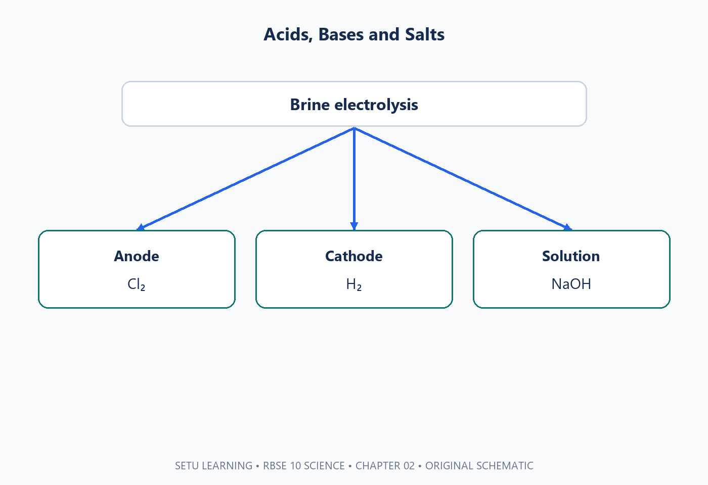

# अध्याय 2: अम्ल, क्षारक एवं लवण (Acids, Bases and Salts)

## भाग 1: अध्याय प्रवेश एवं पाठ्यक्रम मैपिंग

> इस अध्याय का 2026–27 पाठ्यक्रम-क्षेत्र मिलाया गया है; NCERT के सभी प्रश्नों के हल तथा पूरा ऐतिहासिक PYQ संग्रह अभी स्रोत-परीक्षण में हैं।

**विषय कोड:** 07 · **श्रृंखला पुस्तक:** 2

**सत्यापित आधार:** RBSE 2026–27 · **अध्याय भार:** 7 अंक। यह आधिकारिक chapter weight है; वास्तविक प्रश्न-विभाजन की भविष्यवाणी नहीं।

**सीखने के लक्ष्य:** सूचक और pH से विलयन पहचानना; अम्ल-क्षारक समीकरण लिखना; सामान्य लवणों के सूत्र, निर्माण और उपयोग समझना।

## भाग 2: शब्दावली एवं अवधारणा कैप्सूल

| शब्द / सूत्र | अर्थ / उपयोग |
|---|---|
| अम्ल (Acid) | जलीय विलयन में H₃O⁺ की मात्रा बढ़ाने वाला पदार्थ। |
| क्षारक (Base) | अम्ल को उदासीन करने वाला पदार्थ; कई जलीय क्षारक OH⁻ देते हैं। |
| क्षार (Alkali) | जल में घुलने वाला क्षारक। |
| सूचक (Indicator) | अम्लीय और क्षारकीय माध्यम में अलग रंग देने वाला पदार्थ। |
| उदासीनीकरण | अम्ल और क्षारक से लवण तथा सामान्यतः जल बनने की अभिक्रिया। |
| pH | जलीय विलयन की अम्लीयता/क्षारकीयता का माप। |
| बेकिंग सोडा | NaHCO₃; sodium hydrogencarbonate। |
| धावन सोडा | Na₂CO₃·10H₂O; sodium carbonate decahydrate। |
| विरंजक चूर्ण | विद्यालयी निरूपण CaOCl₂; disinfecting/bleaching उपयोग। |
| प्लास्टर ऑफ पेरिस | CaSO₄·½H₂O; calcium sulfate hemihydrate। |

## भाग 3: विस्तृत शिक्षण पाठ

### सूचक और आयन
अम्ल नीले लिटमस को लाल और क्षारक लाल लिटमस को नीला करते हैं। Phenolphthalein अम्ल में रंगहीन, क्षार में गुलाबी होता है। हल्दी क्षार में लाल-भूरी होती है। स्वाद चखना पहचान की विधि नहीं। HCl जल में H₃O⁺ देता है: $HCl + H_2O \rightarrow H_3O^+ + Cl^-$। सूखी HCl गैस सूखे लिटमस का रंग नहीं बदलती; आयन बनने के लिए जल आवश्यक है। सभी hydrogen वाले यौगिक अम्ल नहीं; glucose इसका उदाहरण है।

### अभिक्रियाओं की भाषा
$Zn + 2HCl \rightarrow ZnCl_2 + H_2$; सक्रिय धातु से hydrogen मिलता है। $Na_2CO_3 + 2HCl \rightarrow 2NaCl + H_2O + CO_2$; carbonate और hydrogencarbonate से CO₂ निकलती है। CO₂ चूने के पानी को दूधिया बनाती है: $Ca(OH)_2 + CO_2 \rightarrow CaCO_3 + H_2O$। $NaOH + HCl \rightarrow NaCl + H_2O$ उदासीनीकरण है। Metal oxides सामान्यतः basic, non-metal oxides सामान्यतः acidic होते हैं; exceptions आगे पढ़ेंगे।

### pH और dilution
25°C पर neutral aqueous solution का pH लगभग 7 है; 7 से कम acidic, अधिक basic। एक pH unit लगभग दस गुना H⁺ concentration का अंतर है। अम्ल dilute करने पर H⁺ concentration घटती है, pH बढ़ती है। अम्ल को धीरे-धीरे पानी में मिलाएँ; उल्टा करने से तीव्र ऊष्मा और छींटे पड़ सकते हैं। Strong acid और concentrated acid अलग धारणाएँ हैं: पहला ionisation, दूसरा प्रति आयतन मात्रा बताता है। दाँतों के enamel को अम्लीय वातावरण नुकसान पहुँचा सकता है; toothpaste में हल्के basic घटक अम्ल घटाते हैं।

### सामान्य नमक से उपयोगी रसायन
Brine के electrolysis में $2NaCl + 2H_2O \rightarrow 2NaOH + Cl_2 + H_2$। Chlorine anode, hydrogen cathode पर बनते हैं। Chlorine को dry slaked lime से अभिक्रिया कराकर bleaching powder मिलता है। Baking soda गरम करने पर $2NaHCO_3 \rightarrow Na_2CO_3 + H_2O + CO_2$; baking powder में इसके साथ edible acid होता है। Gypsum CaSO₄·2H₂O को लगभग 373 K पर आंशिक dehydration से POP मिलता है। POP पानी जोड़ने पर gypsum बनकर जमता है। Crystal water निश्चित अनुपात में संरचना का भाग है, केवल सतह का गीलापन नहीं।

सामान्य नमक से chlor-alkali उत्पादों का process schematic; गैसें अलग electrodes पर बनती हैं।

## भाग 4: पाठ्यपुस्तक-अवधारणाओं पर मौलिक हल किए उदाहरण

नीचे के प्रश्न लेखक के मौलिक मॉडल हैं। ये किसी NCERT edition के प्रश्न क्रमांक या संपूर्ण in-text/exercise solution bank होने का दावा नहीं करते।

**हल किया उदाहरण 1: pH 3 और pH 5 में किसकी H⁺ concentration अधिक है?**

pH 3 की; दो units अंतर से H⁺ concentration 10² = 100 गुना है। यह concentration की तुलना है; pH मात्र से कुल acid मात्रा नहीं मिलती।

**हल किया उदाहरण 2: NaHCO₃ और HCl का समीकरण लिखें।**

NaHCO₃ + HCl → NaCl + H₂O + CO₂। हर तत्व की गिनती दोनों ओर समान है। निकलती CO₂ की जाँच lime water से की जा सकती है।

**हल किया उदाहरण 3: Gypsum से POP का निर्माण लिखें।**

CaSO₄·2H₂O → CaSO₄·½H₂O + 1½H₂O; लगभग 373 K पर ताप। बिना fractions के: 2CaSO₄·2H₂O → 2CaSO₄·½H₂O + 3H₂O।

## भाग 5: सत्यापित बोर्ड प्रश्न एवं स्रोत-स्थिति

इस अध्याय का वर्षवार PYQ audit अभी पूरा नहीं है। अभ्यास प्रश्नों पर काल्पनिक परीक्षा-वर्ष नहीं लगाए गए हैं। [असली 2025 बोर्ड पेपर](https://rajeduboard.rajasthan.gov.in/books/PAPERS-2025/Sec/S-07.pdf) से प्रश्न, उपभाग और अंक मिलाकर ही नया PYQ जोड़ा जाए।

## भाग 6: खंडवार मौलिक अभ्यास बैंक

**अभ्यास-अंक:** लेखक के स्व-अभ्यास के लिए हैं; RBSE की आधिकारिक marking scheme नहीं। उत्तर पहले स्वयं लिखें, फिर भाग 9 देखें।

## अ: बहुविकल्पीय प्रश्न — 15 × 1 अंक

**MCQ 1. नीला litmus अम्ल में कैसा होता है?**

अ) हरा  
ब) बैंगनी  
स) लाल  
द) नीला

**MCQ 2. Phenolphthalein क्षारीय विलयन में कैसा होता है?**

अ) पीला  
ब) गुलाबी  
स) रंगहीन  
द) नीला

**MCQ 3. 25°C पर neutral solution का pH क्या है?**

अ) 7  
ब) 1  
स) 14  
द) 0

**MCQ 4. Carbonate और acid से कौन-सी गैस बनती है?**

अ) H₂  
ब) N₂  
स) Cl₂  
द) CO₂

**MCQ 5. Baking soda का सूत्र क्या है?**

अ) CaSO₄·½H₂O  
ब) NaOH  
स) NaHCO₃  
द) Na₂CO₃·10H₂O

**MCQ 6. Washing soda में crystal water कितने molecules हैं?**

अ) ½  
ब) 10  
स) 5  
द) 2

**MCQ 7. POP का सूत्र क्या है?**

अ) CaSO₄·½H₂O  
ब) CaSO₄·2H₂O  
स) CaCO₃  
द) Ca(OH)₂

**MCQ 8. Brine electrolysis के anode पर कौन-सी गैस मिलती है?**

अ) H₂  
ब) CO₂  
स) SO₂  
द) Cl₂

**MCQ 9. अम्ल को dilute करने पर pH सामान्यतः क्या करता है?**

अ) हमेशा शून्य होता है  
ब) हमेशा 14 होता है  
स) बढ़ता है  
द) घटता है

**MCQ 10. हर hydrogen युक्त compound acid है, इस दावे का counterexample कौन है?**

अ) H₂SO₄  
ब) Glucose  
स) HCl  
द) HNO₃

**MCQ 11. जल में घुलने वाले base को क्या कहते हैं?**

अ) Alkali  
ब) Ore  
स) Alloy  
द) Ester

**MCQ 12. अम्ल dilution का सुरक्षित क्रम क्या है?**

अ) पानी तेजी से अम्ल में  
ब) दोनों उबालकर  
स) बिना आँख सुरक्षा के  
द) अम्ल धीरे पानी में

**MCQ 13. CuSO₄·5H₂O का सामान्य रंग क्या है?**

अ) काला  
ब) पीला  
स) नीला  
द) सफेद

**MCQ 14. NaOH + HCl में कौन-सा salt बनता है?**

अ) NaHCO₃  
ब) NaCl  
स) Na₂SO₄  
द) CaCl₂

**MCQ 15. नमक का solution हमेशा neutral होता है क्या?**

अ) नहीं, acid/base पर निर्भर है  
ब) हाँ, सभी salts के लिए  
स) हाँ, केवल रंगीन salts के लिए  
द) नहीं, सभी acidic हैं

## आ: रिक्त स्थान — 6 × 1 अंक

1. जलीय विलयन में H₃O⁺ की मात्रा बढ़ाने वाला पदार्थ। — इस शब्द/सूत्र का नाम है: ____।  
2. अम्ल को उदासीन करने वाला पदार्थ; कई जलीय क्षारक OH⁻ देते हैं। — इस शब्द/सूत्र का नाम है: ____।  
3. जल में घुलने वाला क्षारक। — इस शब्द/सूत्र का नाम है: ____।  
4. अम्लीय और क्षारकीय माध्यम में अलग रंग देने वाला पदार्थ। — इस शब्द/सूत्र का नाम है: ____।  
5. अम्ल और क्षारक से लवण तथा सामान्यतः जल बनने की अभिक्रिया। — इस शब्द/सूत्र का नाम है: ____।  
6. जलीय विलयन की अम्लीयता/क्षारकीयता का माप। — इस शब्द/सूत्र का नाम है: ____।

## इ: अतिलघु उत्तर — 8 × 1 अंक

1. नीला litmus अम्ल में कैसा होता है?  
2. Phenolphthalein क्षारीय विलयन में कैसा होता है?  
3. 25°C पर neutral solution का pH क्या है?  
4. Carbonate और acid से कौन-सी गैस बनती है?  
5. Baking soda का सूत्र क्या है?  
6. Washing soda में crystal water कितने molecules हैं?  
7. POP का सूत्र क्या है?  
8. Brine electrolysis के anode पर कौन-सी गैस मिलती है?

## ई: लघु उत्तर — 6 × 2 अंक

**B1.** सूखी HCl सूखे लिटमस को लाल क्यों नहीं करती?

**B2.** Strong और concentrated acid का अंतर क्या है?

**B3.** Carbonate को अम्ल से कैसे पहचानेंगे?

**B4.** पेट के antacid का सिद्धांत बताएँ।

**B5.** Crystallisation water क्या है?

**B6.** Baking soda और washing soda अलग कैसे हैं?

## उ: दीर्घ उत्तर — 4 × 3 अंक

आंतरिक विकल्प अभ्यास: C1 अथवा C2, तथा C3 अथवा C4 चुनें। पुनरावृत्ति में बचा विकल्प भी हल करें। यह लेखक की अभ्यास व्यवस्था है।

**C1.** Chlor-alkali प्रक्रिया के उत्पाद और स्थान बताएँ।

**C2.** Dilution में pH परिवर्तन और सुरक्षा समझाएँ।

**C3.** POP के बनने और जमने की प्रक्रिया दें।

**C4.** लवण का pH हमेशा 7 क्यों नहीं होता?

## ऊ: विस्तृत उत्तर — 2 × 4 अंक

आंतरिक विकल्प अभ्यास: D1 अथवा D2 चुनें; बाद में दूसरा भी हल करें।

**D1.** चार बोतलों में dilute HCl, NaOH, NaCl solution और distilled water हैं। Litmus से कौन-सी पहचान संभव है और कौन-सी नहीं?

**D2.** सामान्य नमक से NaOH, bleaching powder और soda compounds की उपयोग-श्रृंखला समझाएँ।

## भाग 7: सावधानियाँ एवं परीक्षा-त्रुटियाँ

- pH और acid concentration को strength से न मिलाएँ।
- NaHCO₃ तथा Na₂CO₃·10H₂O के सूत्र अलग हैं।
- हर salt neutral नहीं।
- POP में ½ water है, gypsum में 2।
- अम्ल/क्षार को चखकर या हाथ लगाकर पहचानना प्रयोग नहीं।

## भाग 8: फटाफट पुनरावृत्ति — 25 बिंदु

1. अम्ल (Acid): जलीय विलयन में H₃O⁺ की मात्रा बढ़ाने वाला पदार्थ।  
2. क्षारक (Base): अम्ल को उदासीन करने वाला पदार्थ; कई जलीय क्षारक OH⁻ देते हैं।  
3. क्षार (Alkali): जल में घुलने वाला क्षारक।  
4. सूचक (Indicator): अम्लीय और क्षारकीय माध्यम में अलग रंग देने वाला पदार्थ।  
5. उदासीनीकरण: अम्ल और क्षारक से लवण तथा सामान्यतः जल बनने की अभिक्रिया।  
6. pH: जलीय विलयन की अम्लीयता/क्षारकीयता का माप।  
7. बेकिंग सोडा: NaHCO₃; sodium hydrogencarbonate।  
8. धावन सोडा: Na₂CO₃·10H₂O; sodium carbonate decahydrate।  
9. विरंजक चूर्ण: विद्यालयी निरूपण CaOCl₂; disinfecting/bleaching उपयोग।  
10. प्लास्टर ऑफ पेरिस: CaSO₄·½H₂O; calcium sulfate hemihydrate।  
11. अम्लीय माध्यम blue litmus को red करता है।  
12. Phenolphthalein alkaline medium में pink रंग देता है।  
13. Neutral water में H₃O⁺ और OH⁻ concentrations बराबर होने पर pH लगभग 7 है।  
14. Carbonate में acid डालने से salt, water और carbon dioxide बनते हैं।  
15. Baking soda sodium hydrogencarbonate है, washing soda नहीं।  
16. Na₂CO₃·10H₂O decahydrate है; दस water molecules सूत्र में शामिल हैं।  
17. POP hemihydrate है; gypsum dihydrate होता है।  
18. Chloride ions oxidation से anode पर chlorine बनाते हैं।  
19. H₃O⁺ concentration घटती है, इसलिए pH neutral की ओर बढ़ता है।  
20. Glucose में H होने पर भी जल में acid जैसा H₃O⁺ नहीं बनता।  
21. Alkali soluble base है; सभी bases soluble नहीं।  
22. Water का बड़ा आयतन ऊष्मा संभालता है; acid धीरे मिलाने से छींटे कम होते हैं।  
23. Hydrated copper sulfate blue होता है; anhydrous salt सामान्यतः white है।  
24. Sodium ion और chloride ion से sodium chloride बनता है।  
25. Salt solution का pH उसके ions की जल से प्रतिक्रिया पर निर्भर करता है।

## भाग 9: संपूर्ण अभ्यास उत्तर-कुंजी

## MCQ: सही विकल्प और कारण

**1. स — लाल।** अम्लीय माध्यम blue litmus को red करता है।

**2. ब — गुलाबी।** Phenolphthalein alkaline medium में pink रंग देता है।

**3. अ — 7।** Neutral water में H₃O⁺ और OH⁻ concentrations बराबर होने पर pH लगभग 7 है।

**4. द — CO₂।** Carbonate में acid डालने से salt, water और carbon dioxide बनते हैं।

**5. स — NaHCO₃।** Baking soda sodium hydrogencarbonate है, washing soda नहीं।

**6. ब — 10।** Na₂CO₃·10H₂O decahydrate है; दस water molecules सूत्र में शामिल हैं।

**7. अ — CaSO₄·½H₂O।** POP hemihydrate है; gypsum dihydrate होता है।

**8. द — Cl₂।** Chloride ions oxidation से anode पर chlorine बनाते हैं।

**9. स — बढ़ता है।** H₃O⁺ concentration घटती है, इसलिए pH neutral की ओर बढ़ता है।

**10. ब — Glucose।** Glucose में H होने पर भी जल में acid जैसा H₃O⁺ नहीं बनता।

**11. अ — Alkali।** Alkali soluble base है; सभी bases soluble नहीं।

**12. द — अम्ल धीरे पानी में।** Water का बड़ा आयतन ऊष्मा संभालता है; acid धीरे मिलाने से छींटे कम होते हैं।

**13. स — नीला।** Hydrated copper sulfate blue होता है; anhydrous salt सामान्यतः white है।

**14. ब — NaCl।** Sodium ion और chloride ion से sodium chloride बनता है।

**15. अ — नहीं, acid/base पर निर्भर है।** Salt solution का pH उसके ions की जल से प्रतिक्रिया पर निर्भर करता है।

**रिक्त स्थान:** 1. अम्ल (Acid); 2. क्षारक (Base); 3. क्षार (Alkali); 4. सूचक (Indicator); 5. उदासीनीकरण; 6. pH

**अतिलघु उत्तर:**

1. लाल। अम्लीय माध्यम blue litmus को red करता है।

2. गुलाबी। Phenolphthalein alkaline medium में pink रंग देता है।

3. 7। Neutral water में H₃O⁺ और OH⁻ concentrations बराबर होने पर pH लगभग 7 है।

4. CO₂। Carbonate में acid डालने से salt, water और carbon dioxide बनते हैं।

5. NaHCO₃। Baking soda sodium hydrogencarbonate है, washing soda नहीं।

6. 10। Na₂CO₃·10H₂O decahydrate है; दस water molecules सूत्र में शामिल हैं।

7. CaSO₄·½H₂O। POP hemihydrate है; gypsum dihydrate होता है।

8. Cl₂। Chloride ions oxidation से anode पर chlorine बनाते हैं।

**B1. सूखी HCl सूखे लिटमस को लाल क्यों नहीं करती?**

जल की अनुपस्थिति में पर्याप्त hydronium ions नहीं बनते। नम लिटमस की नमी में HCl आयनित होकर अम्लीयता दिखाती है। इसलिए अम्ल के विद्यालयी गुण मुख्यतः aqueous solution में समझे जाते हैं।

**B2. Strong और concentrated acid का अंतर क्या है?**

Strong acid जल में बड़ी सीमा तक ionise करता है। Concentrated acid में प्रति आयतन acid की मात्रा अधिक है। एक strong acid dilute भी हो सकता है और weak acid concentrated भी। दोनों शब्द एक-दूसरे के पर्याय नहीं।

**B3. Carbonate को अम्ल से कैसे पहचानेंगे?**

नमूने में dilute acid मिलाने पर CO₂ की effervescence होती है। गैस lime water में भेजने पर CaCO₃ के कारण दूधियापन आता है। यह प्रयोग शिक्षक की देखरेख में करें और गैस सीधे न सूँघें।

**B4. पेट के antacid का सिद्धांत बताएँ।**

Antacid के हल्के basic घटक अतिरिक्त gastric acid को neutralise करते हैं। यह उदासीनीकरण का उपयोग है। इससे हर पेट-दर्द का कारण acidity सिद्ध नहीं होता; यह अध्याय दवा की मात्रा या स्वयं उपचार का निर्देश नहीं देता।

**B5. Crystallisation water क्या है?**

Crystal structure में प्रति formula unit निश्चित संख्या के water molecules शामिल होना crystallisation water है। CuSO₄·5H₂O इसका उदाहरण है। गर्म करने पर hydrated और anhydrous salt के गुण तथा रंग बदल सकते हैं।

**B6. Baking soda और washing soda अलग कैसे हैं?**

Baking soda NaHCO₃ है; washing soda Na₂CO₃·10H₂O। पहला baking powder आदि में, दूसरा cleaning और स्थायी कठोरता घटाने में उपयोगी है। नाम की समानता से सूत्र या उपयोग परस्पर न बदलें।

**C1. Chlor-alkali प्रक्रिया के उत्पाद और स्थान बताएँ।**

1. Brine aqueous NaCl है। 2. Electrolysis से Cl₂ anode तथा H₂ cathode पर बनते हैं। 3. विलयन में NaOH रहता है: 2NaCl + 2H₂O → 2NaOH + Cl₂ + H₂। उत्पाद अलग रखना आवश्यक है।

**C2. Dilution में pH परिवर्तन और सुरक्षा समझाएँ।**

1. अम्ल में पानी मिलाने से प्रति आयतन H₃O⁺ घटता है, pH बढ़ता है। 2. क्षार dilute होने पर OH⁻ घटता है, pH neutral की ओर घटता है। 3. सांद्र अम्ल धीरे पानी में मिलाएँ; dilution ऊष्माक्षेपी हो सकता है।

**C3. POP के बनने और जमने की प्रक्रिया दें।**

1. Gypsum को नियंत्रित ताप पर आंशिक निर्जलीकरण करें। 2. CaSO₄·½H₂O मिलता है। 3. जल मिलाने पर CaSO₄·2H₂O दोबारा बनता है और कठोर हो जाता है। नमी से बचाकर भंडारण इसलिए जरूरी है।

**C4. लवण का pH हमेशा 7 क्यों नहीं होता?**

1. Strong acid–strong base salt सामान्यतः neutral होता है। 2. Strong acid–weak base salt का solution acidic हो सकता है, जैसे NH₄Cl। 3. Weak acid–strong base salt basic हो सकता है, जैसे Na₂CO₃। नमक शब्द का अर्थ neutral नहीं।

**D1. चार बोतलों में dilute HCl, NaOH, NaCl solution और distilled water हैं। Litmus से कौन-सी पहचान संभव है और कौन-सी नहीं?**

1. नीला litmus लाल करने वाली HCl है। 2. लाल litmus नीला करने वाली NaOH है। 3. NaCl और distilled water दोनों litmus अपरिवर्तित छोड़ सकते हैं। 4. इन दो neutral नमूनों को केवल litmus से अलग नहीं किया जा सकता; अतिरिक्त परीक्षण चाहिए। इसलिए सूचक की सीमा भी उत्तर में दें।

**D2. सामान्य नमक से NaOH, bleaching powder और soda compounds की उपयोग-श्रृंखला समझाएँ।**

1. Brine electrolysis से NaOH, Cl₂ और H₂ मिलते हैं। 2. Cl₂ तथा slaked lime से bleaching powder मिलता है। 3. NaHCO₃ ताप पर Na₂CO₃ देता है, जिसके crystallisation से washing soda बनता है। 4. इनके उपयोग क्रमशः chemical manufacture, disinfection और cleaning से जुड़े हैं; NaCl को अकेले गरम करने से ये सभी नहीं बनते।

## भाग 10: 10 मिनट / 10 अंक आत्म-मूल्यांकन एवं संदर्भ

समय: 10 मिनट। पहले पुस्तक बंद करें।

1. MCQ 3 और 11 हल करें। (1 + 1)
2. B2 और B5 के उत्तर लिखें। (2 + 2)
3. D1 हल करें। (4)

**कुंजी:** भाग 9 में संबंधित क्रमांक देखें। **स्व-मूल्यांकन:** 8–10: आगे बढ़ें; 5–7: छूटे कौशल का दोहराव; 0–4: भाग 2–4 फिर पढ़ें। यह अभ्यास-सुझाव है, बोर्ड grade नहीं।

[सत्यापित RBSE 2026–27 पाठ्यक्रम](https://rajeduboard.rajasthan.gov.in/anudeshika-etc/10_2026.pdf) · [NCERT विज्ञान अध्याय 2](https://ncert.nic.in/textbook/pdf/jesc102.pdf)

**आगे की कड़ी:** अगले अध्याय में धातुओं की acid, water और salt solutions से प्रतिक्रियाएँ आएँगी।
