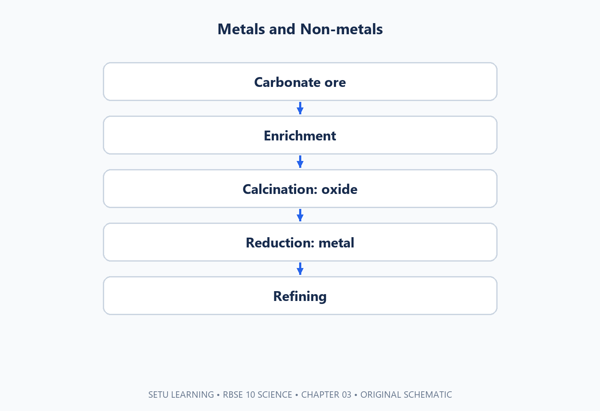

# अध्याय 3: धातु एवं अधातु (Metals and Non-metals)

## भाग 1: अध्याय प्रवेश एवं पाठ्यक्रम मैपिंग

> प्रथम संपादकीय प्रारूप। इस अध्याय का 2026–27 पाठ्यक्रम-क्षेत्र मिलाया गया है; NCERT के सभी प्रश्नों के हल तथा पूरा ऐतिहासिक PYQ संग्रह अभी स्रोत-परीक्षण में हैं।

**विषय कोड:** 07 · **श्रृंखला पुस्तक:** 2

**सत्यापित आधार:** RBSE 2026–27 · **अध्याय भार:** 5 अंक। यह आधिकारिक chapter weight है; वास्तविक प्रश्न-विभाजन की भविष्यवाणी नहीं।

**सीखने के लक्ष्य:** गुणों और exceptions की तुलना; activity series से प्रतिक्रिया का अनुमान; ionic compounds, extraction और corrosion protection समझना।

## भाग 2: शब्दावली एवं अवधारणा कैप्सूल

| शब्द / सूत्र | अर्थ / उपयोग |
|---|---|
| आघातवर्धनीयता (Malleability) | पीटकर चादर बनने का गुण। |
| तन्यता (Ductility) | खींचकर तार बनने का गुण। |
| ध्वानिकता (Sonority) | प्रहार पर ringing sound देने का गुण। |
| सक्रियता श्रेणी | धातुओं का घटती रासायनिक सक्रियता में क्रम। |
| आयनिक आबंध | इलेक्ट्रॉन transfer के बाद विपरीत ions का आकर्षण। |
| खनिज (Mineral) | प्राकृतिक रूप में मिलने वाला तत्व/यौगिकयुक्त पदार्थ। |
| अयस्क (Ore) | जिससे धातु का निष्कर्षण आर्थिक रूप से उपयुक्त हो। |
| निस्तापन (Calcination) | सीमित/अनुपस्थित वायु में carbonate ore का ताप। |
| भर्जन (Roasting) | अधिक वायु में sulfide ore का ताप। |
| मिश्रधातु (Alloy) | धातु का दूसरी धातु/अधातु के साथ मिश्रण। |

## भाग 3: विस्तृत शिक्षण पाठ

### गुण और अपवाद
धातुएँ सामान्यतः चमकीली, चालक, तन्य और आघातवर्धनीय होती हैं। Mercury room temperature पर liquid metal है। Sodium/potassium नरम होते हैं। अधातुएँ सामान्यतः कुचालक और भंगुर हैं; graphite विद्युत का चालक और iodine चमकीला है। इसलिए किसी एक गुण से अंतिम पहचान न करें। Oxides में Al₂O₃ और ZnO amphoteric हैं: acid और base दोनों से प्रतिक्रिया कर सकते हैं।

### प्रतिक्रियाओं का अनुमान
एक उपयोगी क्रम है K > Na > Ca > Mg > Al > Zn > Fe > Pb > H > Cu > Hg > Ag > Au। H धातु नहीं, acid से hydrogen विस्थापन का comparison reference है। Sodium ठंडे पानी से तीव्रता से, magnesium गर्म पानी/भाप से, iron भाप से प्रतिक्रिया करता है। Copper साधारण पानी से नहीं। Hydrogen से ऊपर की कई metals dilute non-oxidising acids से H₂ देती हैं। HNO₃ oxidising acid है; साधारण ‘metal + acid = H₂’ नियम उस पर बिना शर्त लागू न करें।

### Ionic compound की रचना
Na एक electron खोकर Na⁺, Cl एक electron लेकर Cl⁻ बनाता है। विपरीत charges के आकर्षण से NaCl ionic lattice बनता है। Solid में ions fixed हैं, इसलिए electrical conduction नहीं; molten या aqueous state में mobile ions current ले जाते हैं। Strong electrostatic attractions उच्च melting point का कारण हैं। MgCl₂ में Mg²⁺ को balance करने के लिए दो Cl⁻ चाहिए।

### अयस्क से धातु
Gangue हटाकर enrichment होता है। Medium-reactivity metals के sulfides roasting और carbonates calcination से oxides बनते हैं: $2ZnS + 3O_2 \rightarrow 2ZnO + 2SO_2$; $ZnCO_3 \rightarrow ZnO + CO_2$। फिर oxide reduction: $ZnO + C \rightarrow Zn + CO$। Highly reactive Na/Mg/Al के लिए molten salts/appropriate electrolytes का electrolysis उपयोगी है; carbon reduction सामान्यतः पर्याप्त नहीं। Copper electrolytic refining में impure Cu anode, pure Cu cathode और CuSO₄ electrolyte है। Alloying, galvanising और painting corrosion घटाते हैं।

Carbonate ore से metal तक process schematic; gangue removal और refining अलग चरण हैं।

## भाग 4: पाठ्यपुस्तक-अवधारणाओं पर मौलिक हल किए उदाहरण

नीचे के प्रश्न लेखक के मौलिक मॉडल हैं। ये किसी NCERT edition के प्रश्न क्रमांक या संपूर्ण in-text/exercise solution bank होने का दावा नहीं करते।

**हल किया उदाहरण 1: Fe की कील CuSO₄ में डालने पर क्या होगा?**

Fe + CuSO₄ → FeSO₄ + Cu। Iron अधिक active है; copper की coating और solution में Fe²⁺ बनते हैं। Zinc sulfate में iron डालकर यही displacement अपेक्षित नहीं।

**हल किया उदाहरण 2: Mg और Cl से बनने वाले ionic compound का सूत्र दें।**

Mg → Mg²⁺ + 2e⁻; दो Cl atoms दो electrons लेते हैं। Charges +2 तथा 2×−1 balance होते हैं; सूत्र MgCl₂ है, MgCl नहीं।

**हल किया उदाहरण 3: Thermite reaction संतुलित करें और उपयोग दें।**

Fe₂O₃ + 2Al → Al₂O₃ + 2Fe। Al iron oxide reduce करता है; बहुत ऊष्मा निकलती है। इसे rail joints welding जैसे उपयोगों से समझा जाता है; classroom में स्वयं न करें।

## भाग 5: सत्यापित बोर्ड प्रश्न एवं स्रोत-स्थिति

इस अध्याय का वर्षवार PYQ audit अभी पूरा नहीं है। अभ्यास प्रश्नों पर काल्पनिक परीक्षा-वर्ष नहीं लगाए गए हैं। [असली 2025 बोर्ड पेपर](https://rajeduboard.rajasthan.gov.in/books/PAPERS-2025/Sec/S-07.pdf) से प्रश्न, उपभाग और अंक मिलाकर ही नया PYQ जोड़ा जाए।

## भाग 6: खंडवार मौलिक अभ्यास बैंक

**अभ्यास-अंक:** लेखक के स्व-अभ्यास के लिए हैं; RBSE की आधिकारिक marking scheme नहीं। उत्तर पहले स्वयं लिखें, फिर भाग 9 देखें।

## अ: बहुविकल्पीय प्रश्न — 15 × 1 अंक

**MCQ 1. कमरे के ताप पर liquid metal कौन है?**

अ) Aluminium  
ब) Mercury  
स) Iron  
द) Copper

**MCQ 2. विद्युत-चालक अधातु का उदाहरण कौन है?**

अ) Graphite  
ब) Sulfur  
स) Phosphorus  
द) Bromine

**MCQ 3. Metal को तार में खींचने का गुण क्या है?**

अ) Malleability  
ब) Brittleness  
स) Transparency  
द) Ductility

**MCQ 4. Amphoteric oxide कौन है?**

अ) CO₂  
ब) SO₂  
स) Al₂O₃  
द) Na₂O

**MCQ 5. Fe किस solution से metal विस्थापित करेगा?**

अ) NaCl  
ब) CuSO₄  
स) ZnSO₄  
द) MgSO₄

**MCQ 6. MgCl₂ में Mg ion का charge क्या है?**

अ) +2  
ब) +1  
स) −1  
द) −2

**MCQ 7. Molten NaCl में current कौन carry करता है?**

अ) केवल neutral atoms  
ब) Fixed ions  
स) Photons  
द) Mobile ions

**MCQ 8. Sulfide ore को हवा में गरम करना क्या है?**

अ) Galvanising  
ब) Alloying  
स) Roasting  
द) Calcination

**MCQ 9. Carbonate ore में उपयुक्त प्रथम thermal प्रक्रिया क्या है?**

अ) Polymerisation  
ब) Calcination  
स) केवल electroplating  
द) Neutralisation

**MCQ 10. Copper refining का anode कौन है?**

अ) Impure copper  
ब) Pure copper sheet  
स) Graphite ही अनिवार्य  
द) Zinc sheet

**MCQ 11. Galvanising में iron पर कौन-सी metal चढ़ती है?**

अ) Gold  
ब) Mercury  
स) Silver  
द) Zinc

**MCQ 12. Brass के मुख्य metals क्या हैं?**

अ) Fe और Hg  
ब) Al और Ag  
स) Cu और Zn  
द) Cu और Sn

**MCQ 13. Na extraction में carbon reduction सामान्यतः पर्याप्त क्यों नहीं?**

अ) Na water में inert है  
ब) Na बहुत reactive है  
स) Na एक अधातु है  
द) Na में electrons नहीं

**MCQ 14. Mineral और ore का सही संबंध क्या है?**

अ) हर ore mineral है  
ब) हर mineral ore है  
स) दोनों हमेशा समान हैं  
द) Ore कृत्रिम ही होता है

**MCQ 15. Metal + HNO₃ से हमेशा H₂ मिलता है क्या?**

अ) हाँ, सभी metals से  
ब) हाँ, केवल Cu से  
स) हाँ, केवल Au से  
द) नहीं, HNO₃ oxidising acid है

## आ: रिक्त स्थान — 6 × 1 अंक

1. पीटकर चादर बनने का गुण। — इस शब्द/सूत्र का नाम है: ____।  
2. खींचकर तार बनने का गुण। — इस शब्द/सूत्र का नाम है: ____।  
3. प्रहार पर ringing sound देने का गुण। — इस शब्द/सूत्र का नाम है: ____।  
4. धातुओं का घटती रासायनिक सक्रियता में क्रम। — इस शब्द/सूत्र का नाम है: ____।  
5. इलेक्ट्रॉन transfer के बाद विपरीत ions का आकर्षण। — इस शब्द/सूत्र का नाम है: ____।  
6. प्राकृतिक रूप में मिलने वाला तत्व/यौगिकयुक्त पदार्थ। — इस शब्द/सूत्र का नाम है: ____।

## इ: अतिलघु उत्तर — 8 × 1 अंक

1. कमरे के ताप पर liquid metal कौन है?  
2. विद्युत-चालक अधातु का उदाहरण कौन है?  
3. Metal को तार में खींचने का गुण क्या है?  
4. Amphoteric oxide कौन है?  
5. Fe किस solution से metal विस्थापित करेगा?  
6. MgCl₂ में Mg ion का charge क्या है?  
7. Molten NaCl में current कौन carry करता है?  
8. Sulfide ore को हवा में गरम करना क्या है?

## ई: लघु उत्तर — 6 × 2 अंक

**B1.** धातुओं के गुण लिखते समय exceptions क्यों देने चाहिए?

**B2.** Solid NaCl बिजली क्यों नहीं चलाता?

**B3.** Ore और mineral में अंतर दें।

**B4.** भर्जन और निस्तापन की तुलना करें।

**B5.** Aluminium को जंग से कुछ सुरक्षा कैसे मिलती है?

**B6.** मिश्रधातु बनाने का लाभ बताएँ।

## उ: दीर्घ उत्तर — 4 × 3 अंक

आंतरिक विकल्प अभ्यास: C1 अथवा C2, तथा C3 अथवा C4 चुनें। पुनरावृत्ति में बचा विकल्प भी हल करें। यह लेखक की अभ्यास व्यवस्था है।

**C1.** Activity series से तीन salt-solution predictions दें।

**C2.** NaCl का electron transfer और conduction समझाएँ।

**C3.** Copper refining के electrodes और परिवर्तन दें।

**C4.** Reactive metals के extraction के तीन स्तर दें।

## ऊ: विस्तृत उत्तर — 2 × 4 अंक

आंतरिक विकल्प अभ्यास: D1 अथवा D2 चुनें; बाद में दूसरा भी हल करें।

**D1.** ZnCO₃ से zinc पाने के चरण, समीकरण और विधि का कारण लिखें।

**D2.** जस्तीकरण और electrolytic refining की तुलना करें।

## भाग 7: सावधानियाँ एवं परीक्षा-त्रुटियाँ

- Graphite/mercury जैसे exceptions याद रखें।
- H को activity series में metal न कहें।
- Solid salt में conduction का दावा न करें।
- Roasting और calcination को ore के अनुसार लिखें।
- Refining, extraction और corrosion protection अलग प्रक्रियाएँ हैं।

## भाग 8: फटाफट पुनरावृत्ति — 25 बिंदु

1. आघातवर्धनीयता (Malleability): पीटकर चादर बनने का गुण।  
2. तन्यता (Ductility): खींचकर तार बनने का गुण।  
3. ध्वानिकता (Sonority): प्रहार पर ringing sound देने का गुण।  
4. सक्रियता श्रेणी: धातुओं का घटती रासायनिक सक्रियता में क्रम।  
5. आयनिक आबंध: इलेक्ट्रॉन transfer के बाद विपरीत ions का आकर्षण।  
6. खनिज (Mineral): प्राकृतिक रूप में मिलने वाला तत्व/यौगिकयुक्त पदार्थ।  
7. अयस्क (Ore): जिससे धातु का निष्कर्षण आर्थिक रूप से उपयुक्त हो।  
8. निस्तापन (Calcination): सीमित/अनुपस्थित वायु में carbonate ore का ताप।  
9. भर्जन (Roasting): अधिक वायु में sulfide ore का ताप।  
10. मिश्रधातु (Alloy): धातु का दूसरी धातु/अधातु के साथ मिश्रण।  
11. Mercury सामान्य room temperature पर liquid है।  
12. Graphite में delocalised electrons conduction संभव बनाते हैं।  
13. Ductility तार बनाने का गुण है; malleability चादर बनाने का।  
14. Aluminium oxide acid और base दोनों से reaction कर सकता है।  
15. Iron copper से ऊपर है, पर zinc, magnesium और sodium से नीचे।  
16. Magnesium दो electrons खोकर Mg²⁺ बनाता है।  
17. Molten ionic salt में ions चल सकते हैं और charge ले जाते हैं।  
18. Roasting oxygen की उपस्थिति में sulfide को oxide में बदलता है।  
19. Calcination से carbonate टूटकर oxide और CO₂ देता है।  
20. Impure copper anode से Cu²⁺ solution में जाता है।  
21. Zinc layer और उसकी अधिक activity corrosion protection में मदद करती है।  
22. Brass copper–zinc alloy है; bronze copper–tin है।  
23. Highly reactive sodium के compounds से metal पाने के लिए electrolysis उपयोग होता है।  
24. Ore extraction के लिए economically useful mineral है।  
25. Nitric acid की oxidising nature सामान्य hydrogen-evolution rule को सीमित करती है।

## भाग 9: संपूर्ण अभ्यास उत्तर-कुंजी

## MCQ: सही विकल्प और कारण

**1. ब — Mercury।** Mercury सामान्य room temperature पर liquid है।

**2. अ — Graphite।** Graphite में delocalised electrons conduction संभव बनाते हैं।

**3. द — Ductility।** Ductility तार बनाने का गुण है; malleability चादर बनाने का।

**4. स — Al₂O₃।** Aluminium oxide acid और base दोनों से reaction कर सकता है।

**5. ब — CuSO₄।** Iron copper से ऊपर है, पर zinc, magnesium और sodium से नीचे।

**6. अ — +2।** Magnesium दो electrons खोकर Mg²⁺ बनाता है।

**7. द — Mobile ions।** Molten ionic salt में ions चल सकते हैं और charge ले जाते हैं।

**8. स — Roasting।** Roasting oxygen की उपस्थिति में sulfide को oxide में बदलता है।

**9. ब — Calcination।** Calcination से carbonate टूटकर oxide और CO₂ देता है।

**10. अ — Impure copper।** Impure copper anode से Cu²⁺ solution में जाता है।

**11. द — Zinc।** Zinc layer और उसकी अधिक activity corrosion protection में मदद करती है।

**12. स — Cu और Zn।** Brass copper–zinc alloy है; bronze copper–tin है।

**13. ब — Na बहुत reactive है।** Highly reactive sodium के compounds से metal पाने के लिए electrolysis उपयोग होता है।

**14. अ — हर ore mineral है।** Ore extraction के लिए economically useful mineral है।

**15. द — नहीं, HNO₃ oxidising acid है।** Nitric acid की oxidising nature सामान्य hydrogen-evolution rule को सीमित करती है।

**रिक्त स्थान:** 1. आघातवर्धनीयता (Malleability); 2. तन्यता (Ductility); 3. ध्वानिकता (Sonority); 4. सक्रियता श्रेणी; 5. आयनिक आबंध; 6. खनिज (Mineral)

**अतिलघु उत्तर:**

1. Mercury। Mercury सामान्य room temperature पर liquid है।

2. Graphite। Graphite में delocalised electrons conduction संभव बनाते हैं।

3. Ductility। Ductility तार बनाने का गुण है; malleability चादर बनाने का।

4. Al₂O₃। Aluminium oxide acid और base दोनों से reaction कर सकता है।

5. CuSO₄। Iron copper से ऊपर है, पर zinc, magnesium और sodium से नीचे।

6. +2। Magnesium दो electrons खोकर Mg²⁺ बनाता है।

7. Mobile ions। Molten ionic salt में ions चल सकते हैं और charge ले जाते हैं।

8. Roasting। Roasting oxygen की उपस्थिति में sulfide को oxide में बदलता है।

**B1. धातुओं के गुण लिखते समय exceptions क्यों देने चाहिए?**

‘सभी’ धातु कठोर और ठोस कहना गलत है। Sodium नरम और mercury liquid है। इसी तरह graphite अधातु होकर conductor है। सामान्य गुण उपयोगी हैं, पर classification को exceptions सहित लिखने से उत्तर वैज्ञानिक बनता है।

**B2. Solid NaCl बिजली क्यों नहीं चलाता?**

Solid ionic lattice में ions स्थान बदलकर charge carry नहीं कर सकते। पिघले या जलीय NaCl में ions mobile होते हैं, इसलिए conduction होती है। इसका कारण free electrons नहीं, mobile ions हैं।

**B3. Ore और mineral में अंतर दें।**

खनिज प्राकृतिक metal-bearing पदार्थ है। जिस mineral से extraction आर्थिक रूप से उपयुक्त हो, वह ore कहलाता है। इसलिए हर ore mineral है, लेकिन हर mineral ore नहीं; metal प्रतिशत के साथ लागत भी महत्त्वपूर्ण है।

**B4. भर्जन और निस्तापन की तुलना करें।**

Roasting में sulfide ore को पर्याप्त oxygen के साथ गरम कर oxide बनाते हैं। Calcination में carbonate ore को सीमित/बिना वायु गरम कर oxide और CO₂ बनाते हैं। Ore प्रकार और oxygen availability दो स्पष्ट अंतर हैं।

**B5. Aluminium को जंग से कुछ सुरक्षा कैसे मिलती है?**

Al की सतह पर पतली adherent Al₂O₃ layer बनती है, जो अंदर की metal का संपर्क घटाती है। Anodising इस oxide layer को मजबूत करता है। इसका अर्थ aluminium बिल्कुल प्रतिक्रिया नहीं करता, ऐसा नहीं।

**B6. मिश्रधातु बनाने का लाभ बताएँ।**

Alloying से hardness, corrosion resistance और उपयोगी गुण बदल सकते हैं। Brass Cu–Zn और bronze Cu–Sn हैं। Stainless steel में Fe के साथ chromium और अन्य घटक होते हैं; composition के अनुसार गुण बदलते हैं।

**C1. Activity series से तीन salt-solution predictions दें।**

1. Zn, CuSO₄ से Cu हटाता है। 2. Fe, ZnSO₄ से Zn नहीं हटाता क्योंकि Zn अधिक active है। 3. Cu, AgNO₃ से Ag हटाता है: Cu + 2AgNO₃ → Cu(NO₃)₂ + 2Ag। तुलना आवश्यक है, केवल metal होने से displacement नहीं।

**C2. NaCl का electron transfer और conduction समझाएँ।**

1. Na एक electron छोड़कर Na⁺ बनाता है। 2. Cl उसे लेकर Cl⁻ बनाता है; attraction ionic bond है। 3. Solid में fixed ions, molten/aqueous में mobile ions होते हैं। Neutral atoms का बनना conduction का कारण नहीं।

**C3. Copper refining के electrodes और परिवर्तन दें।**

1. Impure copper anode तथा pure copper sheet cathode है। 2. Anode का Cu, Cu²⁺ होकर solution में आता है। 3. Cathode पर Cu²⁺ electrons लेकर Cu जमता है; कुछ insoluble impurities anode mud बनती हैं।

**C4. Reactive metals के extraction के तीन स्तर दें।**

1. Low-reactivity metals के कुछ ores heating से metal दे सकते हैं। 2. Medium-reactivity metal oxides को carbon/appropriate reducing agents से reduce करते हैं। 3. High-reactivity metals को electrolysis चाहिए। प्रक्रिया ore और metal पर निर्भर है; एक ही विधि सब पर लागू नहीं।

**D1. ZnCO₃ से zinc पाने के चरण, समीकरण और विधि का कारण लिखें।**

1. Enrichment से gangue घटाएँ। 2. Calcination: ZnCO₃ → ZnO + CO₂। 3. Reduction: ZnO + C → Zn + CO। 4. Zinc की medium reactivity इस route को उपयुक्त बनाती है; प्राप्त metal का refining किया जाता है। पहले sulfide मानकर roasting लिखना इस ore के लिए गलत होगा।

**D2. जस्तीकरण और electrolytic refining की तुलना करें।**

1. Galvanising में iron पर zinc protective layer लगती है। 2. इसका उद्देश्य corrosion protection है। 3. Electrolytic refining में impure copper anode से copper pure cathode पर transfer होता है। 4. इसका उद्देश्य purity बढ़ाना है। दोनों metal treatment हैं, पर electrodes और उद्देश्यों को interchange नहीं करें।

## भाग 10: 10 मिनट / 10 अंक आत्म-मूल्यांकन एवं संदर्भ

समय: 10 मिनट। पहले पुस्तक बंद करें।

1. MCQ 3 और 11 हल करें। (1 + 1)
2. B2 और B5 के उत्तर लिखें। (2 + 2)
3. D1 हल करें। (4)

**कुंजी:** भाग 9 में संबंधित क्रमांक देखें। **स्व-मूल्यांकन:** 8–10: आगे बढ़ें; 5–7: छूटे कौशल का दोहराव; 0–4: भाग 2–4 फिर पढ़ें। यह अभ्यास-सुझाव है, बोर्ड grade नहीं।

[सत्यापित RBSE 2026–27 पाठ्यक्रम](https://rajeduboard.rajasthan.gov.in/anudeshika-etc/10_2026.pdf) · [NCERT विज्ञान अध्याय 3](https://ncert.nic.in/textbook/pdf/jesc103.pdf)

**आगे की कड़ी:** अगले अध्याय में electron transfer के बजाय carbon का electron sharing आएगा।
