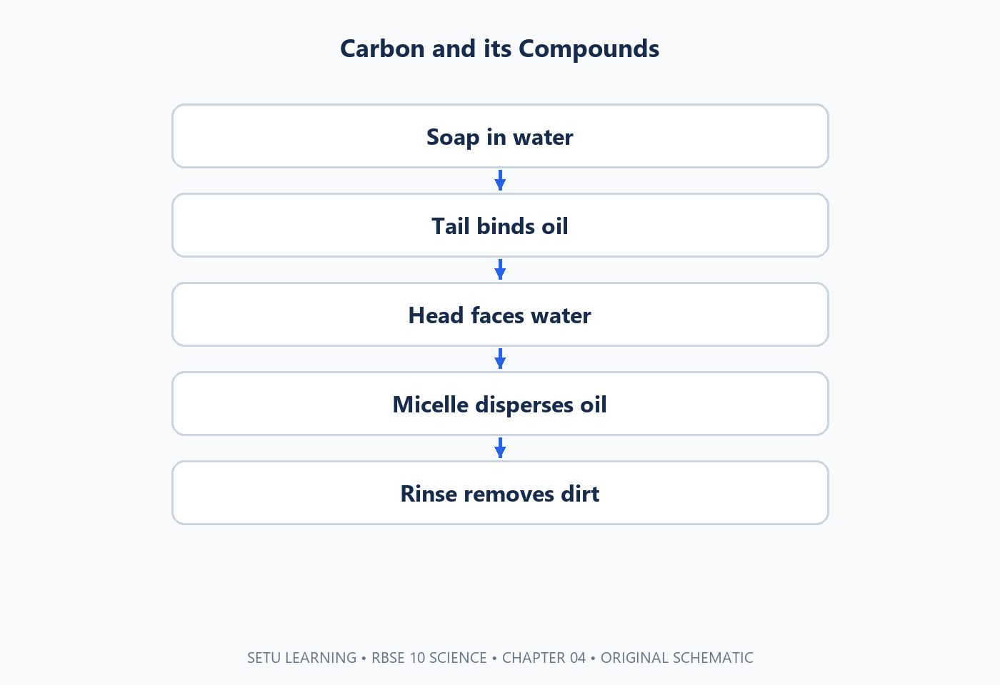

# अध्याय 4: कार्बन एवं उसके यौगिक (Carbon and its Compounds)

## भाग 1: अध्याय प्रवेश एवं पाठ्यक्रम मैपिंग

> इस अध्याय का 2026–27 पाठ्यक्रम-क्षेत्र मिलाया गया है; NCERT के सभी प्रश्नों के हल तथा पूरा ऐतिहासिक PYQ संग्रह अभी स्रोत-परीक्षण में हैं।

**विषय कोड:** 07 · **श्रृंखला पुस्तक:** 2

**सत्यापित आधार:** RBSE 2026–27 · **अध्याय भार:** 7 अंक। यह आधिकारिक chapter weight है; वास्तविक प्रश्न-विभाजन की भविष्यवाणी नहीं।

**सीखने के लक्ष्य:** Carbon bonding, homologous series और नामकरण समझना; ethanol/ethanoic acid reactions लिखना; soap cleaning का mechanism बताना।

## भाग 2: शब्दावली एवं अवधारणा कैप्सूल

| शब्द / सूत्र | अर्थ / उपयोग |
|---|---|
| चतुःसंयोजकता | Carbon की चार covalent bonds बनाने की क्षमता। |
| शृंखलन (Catenation) | Carbon atoms का आपस में chains/branches/rings बनाना। |
| सहसंयोजी आबंध | Atoms के बीच electron pairs का sharing। |
| संतृप्त hydrocarbon | Carbon–carbon bonds केवल single; open-chain alkane सूत्र CₙH₂ₙ₊₂। |
| असंतृप्त hydrocarbon | कम से कम एक C=C या C≡C bond वाला hydrocarbon। |
| समजातीय श्रेणी | समान functional group और समान सामान्य सूत्र वाले compounds की श्रेणी। |
| प्रकार्यात्मक समूह | Compound के characteristic chemical properties निर्धारित करने वाला group। |
| Ethanol | C₂H₅OH; alcohol functional group –OH। |
| Ethanoic acid | CH₃COOH; carboxylic acid functional group –COOH। |
| Micelle | Water में soap tails अंदर और ionic heads बाहर वाली aggregate संरचना। |

## भाग 3: विस्तृत शिक्षण पाठ

### Carbon इतना विविध क्यों है?
Carbon के valence shell में चार electrons हैं। चार electrons पूरी तरह खोना या पाना energetically कठिन है, इसलिए sharing से covalent bonds बनते हैं। Methane में चार C–H single bonds; ethene में C=C double bond, ethyne में C≡C triple bond है। Carbon–carbon bonds की स्थिरता catenation संभव करती है। Covalent compounds सामान्यतः low melting/boiling points और poor electrical conduction दिखाते हैं, पर सभी carbon compounds पर बिना exception यही कथन न लगाएँ।

### संरचना और नाम
Open-chain alkanes में CₙH₂ₙ₊₂, एक double bond वाले alkenes में CₙH₂ₙ, एक triple bond वाले alkynes में CₙH₂ₙ₋₂ सामान्य सूत्र है। Chain length prefixes meth-, eth-, prop-, but- हैं। Functional groups –OH alcohol, –CHO aldehyde, >C=O ketone और –COOH acid हैं। Successive homologues में –CH₂– तथा molecular mass में 14 u का अंतर होता है। Butane और isobutane same molecular formula पर different connectivity दिखाते हैं: structural isomerism।

### महत्वपूर्ण reactions
Complete combustion: $CH_4 + 2O_2 \rightarrow CO_2 + 2H_2O$। कम oxygen में CO/soot बन सकते हैं। Hydrogen addition: $CH_2=CH_2 + H_2 \xrightarrow{Ni} CH_3-CH_3$। Methane substitution: $CH_4 + Cl_2 \xrightarrow{sunlight} CH_3Cl + HCl$। Ethanol oxidation suitable oxidising agent से ethanoic acid देता है। $2C_2H_5OH + 2Na \rightarrow 2C_2H_5ONa + H_2$। Ethanoic acid और ethanol, acid catalyst की उपस्थिति में ester और water देते हैं; यह esterification है। Alkali से ester टूटना saponification कहलाता है।

### साबुन कैसे साफ करता है?
Soap long-chain fatty acid का sodium/potassium salt है। इसका hydrophobic tail grease से जुड़ता है और hydrophilic head water की ओर रहता है। Micelles dirt को water में disperse कर देते हैं, जिससे rinsing में निकलती है। Hard water के Ca²⁺/Mg²⁺ soap से insoluble scum बनाते हैं। Detergents ऐसी समस्या कम दिखाते हैं; लेकिन हर detergent biodegradable या pollution-free हो, ऐसा निष्कर्ष गलत है।

साबुन की cleaning का प्रक्रिया schematic; head/tail orientation का वर्णन पाठ में दिया है।

## भाग 4: पाठ्यपुस्तक-अवधारणाओं पर मौलिक हल किए उदाहरण

नीचे के प्रश्न लेखक के मौलिक मॉडल हैं। ये किसी NCERT edition के प्रश्न क्रमांक या संपूर्ण in-text/exercise solution bank होने का दावा नहीं करते।

**हल किया उदाहरण 1: C₃H₈ का नाम और hydrogen संख्या का कारण दें।**

तीन carbon वाला saturated open-chain compound propane है। Alkane formula CₙH₂ₙ₊₂ में n=3 देने पर H=8 मिलता है। सूत्र को alkene पर लागू न करें।

**हल किया उदाहरण 2: Ethanoic acid और carbonate का समीकरण लिखें।**

2CH₃COOH + Na₂CO₃ → 2CH₃COONa + H₂O + CO₂। Sodium ethanoate salt बनता है। Carbonate के दो negative charges के कारण acid के दो molecules चाहिए।

**हल किया उदाहरण 3: Ethanol से ester बनाने की reaction दें।**

CH₃COOH + C₂H₅OH ⇌ CH₃COOC₂H₅ + H₂O; concentrated H₂SO₄ catalyst और heat की उपस्थिति में ethyl ethanoate बनता है। यह equilibrium reaction है; ether बनने की reaction नहीं।

## भाग 5: सत्यापित बोर्ड प्रश्न एवं स्रोत-स्थिति

इस अध्याय का वर्षवार PYQ audit अभी पूरा नहीं है। अभ्यास प्रश्नों पर काल्पनिक परीक्षा-वर्ष नहीं लगाए गए हैं। [असली 2025 बोर्ड पेपर](https://rajeduboard.rajasthan.gov.in/books/PAPERS-2025/Sec/S-07.pdf) से प्रश्न, उपभाग और अंक मिलाकर ही नया PYQ जोड़ा जाए।

## भाग 6: खंडवार मौलिक अभ्यास बैंक

**अभ्यास-अंक:** लेखक के स्व-अभ्यास के लिए हैं; RBSE की आधिकारिक marking scheme नहीं। उत्तर पहले स्वयं लिखें, फिर भाग 9 देखें।

## अ: बहुविकल्पीय प्रश्न — 15 × 1 अंक

**MCQ 1. Carbon की सामान्य valency क्या है?**

अ) 4  
ब) 1  
स) 2  
द) 3

**MCQ 2. Carbon atoms के chain बनाने के गुण का नाम क्या है?**

अ) Ionisation  
ब) Neutralisation  
स) Corrosion  
द) Catenation

**MCQ 3. Ethene का formula क्या है?**

अ) C₂H₂  
ब) CH₄  
स) C₂H₄  
द) C₂H₆

**MCQ 4. Successive homologues के mass का अंतर कितना है?**

अ) 16 u  
ब) 14 u  
स) 2 u  
द) 12 u

**MCQ 5. Alcohol का functional group कौन है?**

अ) –OH  
ब) –COOH  
स) –CHO  
द) –Cl

**MCQ 6. Ethanoic acid का formula क्या है?**

अ) C₂H₅OH  
ब) CH₄  
स) CH₃CHO  
द) CH₃COOH

**MCQ 7. Methane में कितने single covalent bonds हैं?**

अ) 1  
ब) 8  
स) 4  
द) 2

**MCQ 8. Hydrogenation किसका उदाहरण है?**

अ) Precipitation  
ब) Addition  
स) Substitution  
द) Displacement

**MCQ 9. Methane chlorination में कौन-सी condition उपयोगी है?**

अ) Sunlight  
ब) केवल ice  
स) केवल vacuum  
द) बिना chlorine

**MCQ 10. Soap micelle में heads water की ओर क्यों होते हैं?**

अ) वे nonpolar हैं  
ब) वे metal sheets हैं  
स) वे gas बनाते हैं  
द) वे hydrophilic हैं

**MCQ 11. Hard water में soap का insoluble पदार्थ क्या कहलाता है?**

अ) Ozone  
ब) Alloy  
स) Scum  
द) Ester

**MCQ 12. Ester alkaline hydrolysis का नाम क्या है?**

अ) Galvanisation  
ब) Saponification  
स) Roasting  
द) Sublimation

**MCQ 13. Open-chain alkane का general formula क्या है?**

अ) CₙH₂ₙ₊₂  
ब) CₙH₂ₙ  
स) CₙH₂ₙ₋₂  
द) CₙHₙ

**MCQ 14. Same formula और अलग connectivity को क्या कहते हैं?**

अ) Homology  
ब) Neutralisation  
स) Dispersion  
द) Structural isomerism

**MCQ 15. कम oxygen में carbon combustion का toxic product कौन हो सकता है?**

अ) NaCl  
ब) H₂O ही अनिवार्य  
स) CO  
द) O₂

## आ: रिक्त स्थान — 6 × 1 अंक

1. Carbon की चार covalent bonds बनाने की क्षमता। — इस शब्द/सूत्र का नाम है: ____।  
2. Carbon atoms का आपस में chains/branches/rings बनाना। — इस शब्द/सूत्र का नाम है: ____।  
3. Atoms के बीच electron pairs का sharing। — इस शब्द/सूत्र का नाम है: ____।  
4. Carbon–carbon bonds केवल single; open-chain alkane सूत्र CₙH₂ₙ₊₂। — इस शब्द/सूत्र का नाम है: ____।  
5. कम से कम एक C=C या C≡C bond वाला hydrocarbon। — इस शब्द/सूत्र का नाम है: ____।  
6. समान functional group और समान सामान्य सूत्र वाले compounds की श्रेणी। — इस शब्द/सूत्र का नाम है: ____।

## इ: अतिलघु उत्तर — 8 × 1 अंक

1. Carbon की सामान्य valency क्या है?  
2. Carbon atoms के chain बनाने के गुण का नाम क्या है?  
3. Ethene का formula क्या है?  
4. Successive homologues के mass का अंतर कितना है?  
5. Alcohol का functional group कौन है?  
6. Ethanoic acid का formula क्या है?  
7. Methane में कितने single covalent bonds हैं?  
8. Hydrogenation किसका उदाहरण है?

## ई: लघु उत्तर — 6 × 2 अंक

**B1.** Carbon ionic bond की जगह sharing क्यों करता है?

**B2.** Homologous series की दो विशेषताएँ दें।

**B3.** Addition और substitution का अंतर दें।

**B4.** Ethanol और ethanoic acid में अंतर दें।

**B5.** Soap hard water में कम प्रभावी क्यों है?

**B6.** Incomplete combustion क्यों खतरनाक है?

## उ: दीर्घ उत्तर — 4 × 3 अंक

आंतरिक विकल्प अभ्यास: C1 अथवा C2, तथा C3 अथवा C4 चुनें। पुनरावृत्ति में बचा विकल्प भी हल करें। यह लेखक की अभ्यास व्यवस्था है।

**C1.** Methane का electron-sharing विवरण दें।

**C2.** Ethanol की तीन reactions समझाएँ।

**C3.** Esterification और saponification का संबंध दें।

**C4.** Micelle में orientation और cleaning समझाएँ।

## ऊ: विस्तृत उत्तर — 2 × 4 अंक

आंतरिक विकल्प अभ्यास: D1 अथवा D2 चुनें; बाद में दूसरा भी हल करें।

**D1.** Ethane, ethene और ethyne की bonding, formula और hydrogenation की तुलना करें।

**D2.** साबुन की cleaning का चित्रात्मक वर्णन तथा hard water की सीमा लिखें।

## भाग 7: सावधानियाँ एवं परीक्षा-त्रुटियाँ

- Alkane का formula ring compounds पर बिना जाँच न लगाएँ।
- –OH और –COOH अलग हैं।
- Esterification और ether formation न मिलाएँ।
- Soap head water की ओर होता है, tail नहीं।
- Detergent को हमेशा biodegradable न लिखें।

## भाग 8: फटाफट पुनरावृत्ति — 25 बिंदु

1. चतुःसंयोजकता: Carbon की चार covalent bonds बनाने की क्षमता।  
2. शृंखलन (Catenation): Carbon atoms का आपस में chains/branches/rings बनाना।  
3. सहसंयोजी आबंध: Atoms के बीच electron pairs का sharing।  
4. संतृप्त hydrocarbon: Carbon–carbon bonds केवल single; open-chain alkane सूत्र CₙH₂ₙ₊₂।  
5. असंतृप्त hydrocarbon: कम से कम एक C=C या C≡C bond वाला hydrocarbon।  
6. समजातीय श्रेणी: समान functional group और समान सामान्य सूत्र वाले compounds की श्रेणी।  
7. प्रकार्यात्मक समूह: Compound के characteristic chemical properties निर्धारित करने वाला group।  
8. Ethanol: C₂H₅OH; alcohol functional group –OH।  
9. Ethanoic acid: CH₃COOH; carboxylic acid functional group –COOH।  
10. Micelle: Water में soap tails अंदर और ionic heads बाहर वाली aggregate संरचना।  
11. Carbon चार electron pairs share करके सामान्यतः चार covalent bonds बनाता है।  
12. Catenation same element atoms के परस्पर जुड़ने की क्षमता है।  
13. Ethene के दो carbon के बीच double bond है और चार hydrogen हैं।  
14. CH₂ का mass 12 + 2 = 14 u है।  
15. Alcohol में hydroxyl group –OH characteristic है।  
16. Ethanoic acid में carboxyl group –COOH होता है।  
17. चार C–H shared pairs चार single covalent bonds बनाते हैं।  
18. Hydrogen unsaturated carbon bond पर जुड़कर saturation बढ़ाता है।  
19. Sunlight substitution reaction शुरू करने में सहायता करती है।  
20. Ionic heads water से interaction करते हैं और tails grease की ओर रहते हैं।  
21. Ca/Mg के insoluble fatty-acid salts scum बनाते हैं।  
22. Saponification ester का alkali से hydrolysis है।  
23. केवल acyclic saturated alkanes के लिए CₙH₂ₙ₊₂ लागू है।  
24. Structural isomers में molecular formula समान, atom connections अलग हैं।  
25. Incomplete combustion carbon monoxide दे सकती है, जो toxic है।

## भाग 9: संपूर्ण अभ्यास उत्तर-कुंजी

## MCQ: सही विकल्प और कारण

**1. अ — 4।** Carbon चार electron pairs share करके सामान्यतः चार covalent bonds बनाता है।

**2. द — Catenation।** Catenation same element atoms के परस्पर जुड़ने की क्षमता है।

**3. स — C₂H₄।** Ethene के दो carbon के बीच double bond है और चार hydrogen हैं।

**4. ब — 14 u।** CH₂ का mass 12 + 2 = 14 u है।

**5. अ — –OH।** Alcohol में hydroxyl group –OH characteristic है।

**6. द — CH₃COOH।** Ethanoic acid में carboxyl group –COOH होता है।

**7. स — 4।** चार C–H shared pairs चार single covalent bonds बनाते हैं।

**8. ब — Addition।** Hydrogen unsaturated carbon bond पर जुड़कर saturation बढ़ाता है।

**9. अ — Sunlight।** Sunlight substitution reaction शुरू करने में सहायता करती है।

**10. द — वे hydrophilic हैं।** Ionic heads water से interaction करते हैं और tails grease की ओर रहते हैं।

**11. स — Scum।** Ca/Mg के insoluble fatty-acid salts scum बनाते हैं।

**12. ब — Saponification।** Saponification ester का alkali से hydrolysis है।

**13. अ — CₙH₂ₙ₊₂।** केवल acyclic saturated alkanes के लिए CₙH₂ₙ₊₂ लागू है।

**14. द — Structural isomerism।** Structural isomers में molecular formula समान, atom connections अलग हैं।

**15. स — CO।** Incomplete combustion carbon monoxide दे सकती है, जो toxic है।

**रिक्त स्थान:** 1. चतुःसंयोजकता; 2. शृंखलन (Catenation); 3. सहसंयोजी आबंध; 4. संतृप्त hydrocarbon; 5. असंतृप्त hydrocarbon; 6. समजातीय श्रेणी

**अतिलघु उत्तर:**

1. 4। Carbon चार electron pairs share करके सामान्यतः चार covalent bonds बनाता है।

2. Catenation। Catenation same element atoms के परस्पर जुड़ने की क्षमता है।

3. C₂H₄। Ethene के दो carbon के बीच double bond है और चार hydrogen हैं।

4. 14 u। CH₂ का mass 12 + 2 = 14 u है।

5. –OH। Alcohol में hydroxyl group –OH characteristic है।

6. CH₃COOH। Ethanoic acid में carboxyl group –COOH होता है।

7. 4। चार C–H shared pairs चार single covalent bonds बनाते हैं।

8. Addition। Hydrogen unsaturated carbon bond पर जुड़कर saturation बढ़ाता है।

**B1. Carbon ionic bond की जगह sharing क्यों करता है?**

चार electrons खोने में बहुत ऊर्जा और चार पाने पर nucleus के लिए अतिरिक्त electrons संभालना कठिन है। Sharing से valence shell भरता है। इसलिए carbon compounds में covalent bonding प्रमुख है; यह carbon की tetravalency से जुड़ा है।

**B2. Homologous series की दो विशेषताएँ दें।**

सभी members का functional group और general formula समान होता है। पास-पास members में CH₂ और 14 u का अंतर होता है। Chemical properties समान दिशा में, physical properties क्रमिक ढंग से बदलती हैं।

**B3. Addition और substitution का अंतर दें।**

Addition में unsaturated bond पर atoms जुड़ते हैं, जैसे ethene + H₂ से ethane। Substitution में atom/group के स्थान पर दूसरा आता है, जैसे sunlight में methane का H chlorine से बदलता है। दोनों में reaction conditions लिखें।

**B4. Ethanol और ethanoic acid में अंतर दें।**

Ethanol में –OH और ethanoic acid में –COOH group है। Acid carbonate से CO₂ निकालता है, alcohol ऐसा सामान्यतः नहीं करता। दोनों organic compounds हैं, लेकिन उनके functional groups के कारण chemical properties अलग हैं।

**B5. Soap hard water में कम प्रभावी क्यों है?**

Ca²⁺ और Mg²⁺ soap के साथ insoluble salts बनाकर scum देते हैं। इससे cleaning के लिए उपलब्ध soap कम हो जाता है। Detergent formulation ऐसी insoluble precipitation को कम कर सकती है।

**B6. Incomplete combustion क्यों खतरनाक है?**

कम oxygen में carbon monoxide बन सकती है; यह रंगहीन gas रक्त की oxygen-carrying क्षमता को बाधित करती है। बंद कमरे में ईंधन जलाना खतरा बढ़ाता है। नीली/पीली flame से alone safety का पूर्ण निर्णय न लें।

**C1. Methane का electron-sharing विवरण दें।**

1. Carbon के चार valence electrons हैं। 2. चार H atoms अपना एक-एक electron share करते हैं। 3. चार shared pairs से चार single covalent bonds बनते हैं; carbon octet और हर H duplet प्राप्त करता है। CH₄ में double bond नहीं।

**C2. Ethanol की तीन reactions समझाएँ।**

1. Combustion: C₂H₅OH + 3O₂ → 2CO₂ + 3H₂O। 2. Sodium reaction hydrogen तथा sodium ethoxide देती है। 3. Suitable oxidant से ethanol का oxidation ethanoic acid तक होता है। Conditions और उत्पादों को अलग रखें।

**C3. Esterification और saponification का संबंध दें।**

1. Alcohol और carboxylic acid से ester + water बनते हैं। 2. उपयुक्त alkali से ester hydrolysis में alcohol और carboxylate salt मिलते हैं। 3. Fat/oil के alkaline hydrolysis से soap बनाना इसी प्रकार का उपयोग है।

**C4. Micelle में orientation और cleaning समझाएँ।**

1. Nonpolar tails grease/oil में भीतर की ओर। 2. Charged hydrophilic heads बाहर water में। 3. Grease droplets dispersed होकर rinsing में निकलते हैं। Soap dirt को chemical combustion से नष्ट नहीं करता।

**D1. Ethane, ethene और ethyne की bonding, formula और hydrogenation की तुलना करें।**

1. Ethane C₂H₆ में C–C single bond और saturation है। 2. Ethene C₂H₄ में double, ethyne C₂H₂ में triple bond है। 3. Unsaturated compounds hydrogen addition कर सकते हैं, catalyst सहित। 4. Ethene + H₂ → ethane; ethyne की पूर्ण hydrogenation में 2H₂ चाहिए। Hydrogen संख्या और bonds दोनों तुलना में दें।

**D2. साबुन की cleaning का चित्रात्मक वर्णन तथा hard water की सीमा लिखें।**

1. एक गोल grease droplet बनाएँ। 2. Tails droplet के भीतर, ionic heads बाहर water की ओर दिखाएँ। 3. Micelle oil को disperse करता है और rinsing हटाती है। 4. Hard-water ions insoluble scum बनाते हैं, इसलिए detergent विकल्प उपयोगी हो सकता है। चित्र surface aggregate का schematic है, single soap molecule का आकार नहीं।

## भाग 10: 10 मिनट / 10 अंक आत्म-मूल्यांकन एवं संदर्भ

समय: 10 मिनट। पहले पुस्तक बंद करें।

1. MCQ 3 और 11 हल करें। (1 + 1)
2. B2 और B5 के उत्तर लिखें। (2 + 2)
3. D1 हल करें। (4)

**कुंजी:** भाग 9 में संबंधित क्रमांक देखें। **स्व-मूल्यांकन:** 8–10: आगे बढ़ें; 5–7: छूटे कौशल का दोहराव; 0–4: भाग 2–4 फिर पढ़ें। यह अभ्यास-सुझाव है, बोर्ड grade नहीं।

[सत्यापित RBSE 2026–27 पाठ्यक्रम](https://rajeduboard.rajasthan.gov.in/anudeshika-etc/10_2026.pdf) · [NCERT विज्ञान अध्याय 4](https://ncert.nic.in/textbook/pdf/jesc104.pdf)

**आगे की कड़ी:** जैव प्रक्रम में carbohydrates, fats और energy release की भूमिका पढ़ेंगे।
