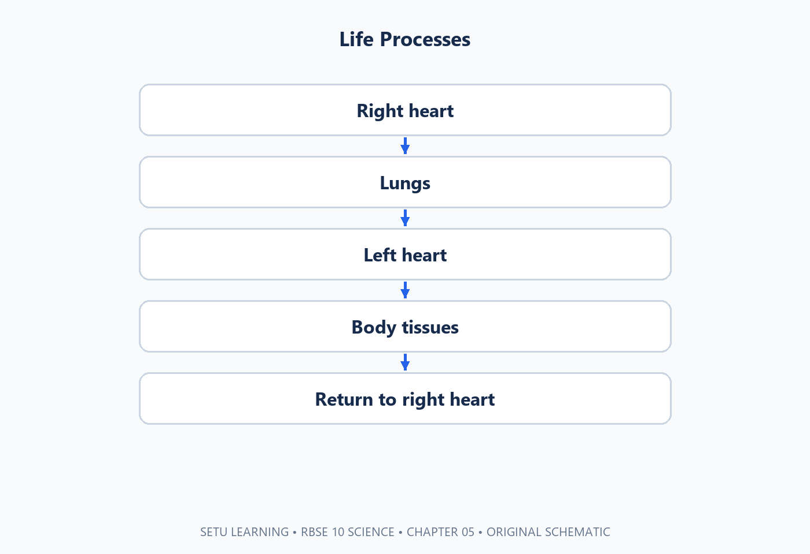

# अध्याय 5: जैव प्रक्रम (Life Processes)

## भाग 1: अध्याय प्रवेश एवं पाठ्यक्रम मैपिंग

> प्रथम संपादकीय प्रारूप। इस अध्याय का 2026–27 पाठ्यक्रम-क्षेत्र मिलाया गया है; NCERT के सभी प्रश्नों के हल तथा पूरा ऐतिहासिक PYQ संग्रह अभी स्रोत-परीक्षण में हैं।

**विषय कोड:** 07 · **श्रृंखला पुस्तक:** 2

**सत्यापित आधार:** RBSE 2026–27 · **अध्याय भार:** 8 अंक। यह आधिकारिक chapter weight है; वास्तविक प्रश्न-विभाजन की भविष्यवाणी नहीं।

**सीखने के लक्ष्य:** Nutrition, respiration, transport और excretion को जोड़ना; human और plant pathways की तुलना; heart तथा nephron के functional stages बताना।

## भाग 2: शब्दावली एवं अवधारणा कैप्सूल

| शब्द / सूत्र | अर्थ / उपयोग |
|---|---|
| स्वपोषण | Inorganic पदार्थों से अपना organic food बनाना। |
| प्रकाश संश्लेषण | Light energy से CO₂ और water से carbohydrate बनना। |
| रंध्र (Stomata) | पत्ती में guard cells द्वारा नियंत्रित pores। |
| पेरिस्टाल्सिस | Alimentary canal की wave-like contractions से food movement। |
| श्वसन (Respiration) | Food से usable energy प्राप्त करने की cellular प्रक्रिया। |
| Alveoli | Lungs में thin-walled air sacs, gas exchange का स्थल। |
| Double circulation | एक पूर्ण circuit में blood का heart से दो बार गुजरना। |
| Xylem | Water/minerals का मुख्य conducting tissue। |
| Phloem | Food का source से sink तक translocation tissue। |
| Nephron | Kidney की functional filtration/reabsorption unit। |

## भाग 3: विस्तृत शिक्षण पाठ

### जीवन बनाए रखने के प्रक्रम
जीवों को molecules, energy और waste removal लगातार चाहिए। Nutrition भोजन उपलब्ध करता है; respiration उसकी ऊर्जा usable रूप में देता है; transport सामग्री पहुँचाता है; excretion metabolic waste हटाता है। किसी जीव में बाहरी movement न दिखने पर भी cell-level activity जारी रह सकती है। पौधों में simplified photosynthesis equation $6CO_2 + 6H_2O \rightarrow C_6H_{12}O_6 + 6O_2$ है; light और chlorophyll आवश्यक conditions हैं। रंध्र CO₂ exchange और transpiration में काम करते हैं।

### भोजन से absorption तक
Mouth में chewing और salivary amylase starch breakdown शुरू करते हैं। Oesophagus में peristalsis भोजन ले जाता है। Stomach का HCl acidic medium देता है; pepsin protein पर काम करता है और mucus lining की रक्षा करता है। Small intestine में bile fat को छोटे droplets में emulsify करता है; bile enzyme नहीं है। Pancreatic enzymes और intestinal enzymes digestion आगे बढ़ाते हैं। Villi surface area बढ़ाकर nutrients absorb करते हैं। Large intestine मुख्यतः water absorption में मदद करता है।

### Respiration और gas exchange
Glucose पहले cytoplasm में 3-carbon pyruvate बनाता है। Oxygen की उपलब्धता में mitochondria में आगे breakdown से CO₂, H₂O और अधिक usable energy बनती है। Yeast में ethanol + CO₂, oxygen deficit में muscles में lactate बन सकता है। Breathing air movement है; respiration cellular chemical process। Alveolar thin walls, large area और capillaries diffusion में मदद करते हैं। Haemoglobin oxygen transport करता है; अधिकांश CO₂ अन्य रूपों सहित blood में transport होती है।

### Circulation, plants और excretion
Right heart deoxygenated blood lungs को और left heart oxygenated blood body को भेजता है। Valves backflow रोकते हैं। Pulmonary artery deoxygenated और pulmonary vein oxygenated blood लेती है; artery/vein नाम दिशा से है। Plants में root uptake और transpiration pull xylem transport में मदद करते हैं। Phloem source–sink movement ATP उपयोग कर सकता है और दिशा जरूरत के अनुसार होती है। Nephron में glomerular filtration, selective reabsorption तथा tubular secretion urine बनाते हैं। Urine kidney → ureter → bladder → urethra चलता है। Plants gases, storage, leaf shedding और resins/gums से wastes संभालते हैं।

Double circulation का क्रम-चित्र। यह मार्ग दिखाता है; anatomical heart diagram नहीं।

## भाग 4: पाठ्यपुस्तक-अवधारणाओं पर मौलिक हल किए उदाहरण

नीचे के प्रश्न लेखक के मौलिक मॉडल हैं। ये किसी NCERT edition के प्रश्न क्रमांक या संपूर्ण in-text/exercise solution bank होने का दावा नहीं करते।

**हल किया उदाहरण 1: Heart में blood का पूरा मार्ग लिखें।**

Body → venae cavae → right atrium → right ventricle → pulmonary artery → lungs → pulmonary veins → left atrium → left ventricle → aorta → body। हर chamber और lung passage को क्रम में रखें।

**हल किया उदाहरण 2: Yeast के anaerobic breakdown का result दें।**

Glucose → ethanol + CO₂ + energy। शुरू में glycolysis cytoplasm में होती है। Yeast के उत्पादों को human muscle से न मिलाएँ; muscle oxygen deficit में lactate बन सकता है।

**हल किया उदाहरण 3: Absorption के लिए villi उपयुक्त क्यों हैं?**

Villi और microvilli area बढ़ाते हैं। Thin epithelium तथा capillary supply nutrient uptake में मदद करते हैं। Digestion बड़े molecules को छोटे करता है; absorption छोटे molecules को body fluids तक पहुँचाता है।

## भाग 5: सत्यापित बोर्ड प्रश्न एवं स्रोत-स्थिति

इस अध्याय का वर्षवार PYQ audit अभी पूरा नहीं है। अभ्यास प्रश्नों पर काल्पनिक परीक्षा-वर्ष नहीं लगाए गए हैं। [असली 2025 बोर्ड पेपर](https://rajeduboard.rajasthan.gov.in/books/PAPERS-2025/Sec/S-07.pdf) से प्रश्न, उपभाग और अंक मिलाकर ही नया PYQ जोड़ा जाए।

## भाग 6: खंडवार मौलिक अभ्यास बैंक

**अभ्यास-अंक:** लेखक के स्व-अभ्यास के लिए हैं; RBSE की आधिकारिक marking scheme नहीं। उत्तर पहले स्वयं लिखें, फिर भाग 9 देखें।

## अ: बहुविकल्पीय प्रश्न — 15 × 1 अंक

**MCQ 1. Photosynthesis में carbon source क्या है?**

अ) O₂  
ब) N₂  
स) NaCl  
द) CO₂

**MCQ 2. Salivary amylase मुख्यतः किस पर काम करता है?**

अ) Cellulose  
ब) DNA  
स) Starch  
द) Fat

**MCQ 3. Bile कहाँ बनता है?**

अ) Lungs  
ब) Liver  
स) Stomach  
द) Kidney

**MCQ 4. Bile का मुख्य fat-related काम क्या है?**

अ) Emulsification  
ब) Protein digestion  
स) Urea formation  
द) Oxygen transport

**MCQ 5. Pyruvate का प्रथम निर्माण कहाँ होता है?**

अ) केवल nucleus  
ब) केवल lungs  
स) केवल kidney  
द) Cytoplasm

**MCQ 6. Yeast में anaerobic products कौन-से हैं?**

अ) O₂ और water  
ब) Urea और ammonia  
स) Ethanol और CO₂  
द) Lactate ही

**MCQ 7. Lungs में gas exchange का मुख्य स्थल क्या है?**

अ) Villi  
ब) Alveoli  
स) Oesophagus  
द) Ureter

**MCQ 8. Pulmonary artery blood कहाँ ले जाती है?**

अ) Heart से lungs  
ब) Lungs से heart  
स) Kidney से bladder  
द) Liver से stomach

**MCQ 9. Left ventricle से body में कौन-सी vessel जाती है?**

अ) Pulmonary vein  
ब) Vena cava  
स) Ureter  
द) Aorta

**MCQ 10. Water/minerals का मुख्य plant tissue क्या है?**

अ) Epidermis ही  
ब) Pollen  
स) Xylem  
द) Phloem

**MCQ 11. Plant food translocation का tissue क्या है?**

अ) Cartilage  
ब) Phloem  
स) Xylem  
द) Bone

**MCQ 12. Kidney की functional unit क्या है?**

अ) Nephron  
ब) Neuron  
स) Alveolus  
द) Villus

**MCQ 13. Kidney से bladder जाने वाली tube क्या है?**

अ) Urethra  
ब) Trachea  
स) Aorta  
द) Ureter

**MCQ 14. Undigested food का निष्कासन क्या है?**

अ) Photosynthesis  
ब) Transpiration  
स) Egestion  
द) Excretion ही

**MCQ 15. Villi का मुख्य लाभ क्या है?**

अ) Nerve impulses देना  
ब) Absorption area बढ़ाना  
स) Blood pump करना  
द) Urine बनाना

## आ: रिक्त स्थान — 6 × 1 अंक

1. Inorganic पदार्थों से अपना organic food बनाना। — इस शब्द/सूत्र का नाम है: ____।  
2. Light energy से CO₂ और water से carbohydrate बनना। — इस शब्द/सूत्र का नाम है: ____।  
3. पत्ती में guard cells द्वारा नियंत्रित pores। — इस शब्द/सूत्र का नाम है: ____।  
4. Alimentary canal की wave-like contractions से food movement। — इस शब्द/सूत्र का नाम है: ____।  
5. Food से usable energy प्राप्त करने की cellular प्रक्रिया। — इस शब्द/सूत्र का नाम है: ____।  
6. Lungs में thin-walled air sacs, gas exchange का स्थल। — इस शब्द/सूत्र का नाम है: ____।

## इ: अतिलघु उत्तर — 8 × 1 अंक

1. Photosynthesis में carbon source क्या है?  
2. Salivary amylase मुख्यतः किस पर काम करता है?  
3. Bile कहाँ बनता है?  
4. Bile का मुख्य fat-related काम क्या है?  
5. Pyruvate का प्रथम निर्माण कहाँ होता है?  
6. Yeast में anaerobic products कौन-से हैं?  
7. Lungs में gas exchange का मुख्य स्थल क्या है?  
8. Pulmonary artery blood कहाँ ले जाती है?

## ई: लघु उत्तर — 6 × 2 अंक

**B1.** Autotrophic और heterotrophic nutrition का अंतर दें।

**B2.** Bile का कार्य और enzyme से अंतर बताइए।

**B3.** Breathing और respiration का अंतर क्या है?

**B4.** Artery और vein की परिभाषा दें।

**B5.** Xylem और phloem की तुलना करें।

**B6.** Excretion और egestion अलग कैसे हैं?

## उ: दीर्घ उत्तर — 4 × 3 अंक

आंतरिक विकल्प अभ्यास: C1 अथवा C2, तथा C3 अथवा C4 चुनें। पुनरावृत्ति में बचा विकल्प भी हल करें। यह लेखक की अभ्यास व्यवस्था है।

**C1.** Human small intestine के digestion/absorption के तीन बिंदु दें।

**C2.** Double circulation की functional आवश्यकता बताएँ।

**C3.** Urine formation के तीन stages लिखें।

**C4.** Stomata के दो कार्य और guard cells की भूमिका दें।

## ऊ: विस्तृत उत्तर — 2 × 4 अंक

आंतरिक विकल्प अभ्यास: D1 अथवा D2 चुनें; बाद में दूसरा भी हल करें।

**D1.** Human oxygen supply को breathing से cellular energy तक चार चरणों में समझाएँ।

**D2.** Nephron का schematic बनाने के labels तथा function लिखें।

## भाग 7: सावधानियाँ एवं परीक्षा-त्रुटियाँ

- Bile enzyme नहीं है।
- Artery/vein को oxygen content से परिभाषित न करें।
- Ureter और urethra अलग हैं।
- Yeast में ethanol, muscles में lactate याद रखें।
- Excretion और egestion न मिलाएँ।

## भाग 8: फटाफट पुनरावृत्ति — 25 बिंदु

1. स्वपोषण: Inorganic पदार्थों से अपना organic food बनाना।  
2. प्रकाश संश्लेषण: Light energy से CO₂ और water से carbohydrate बनना।  
3. रंध्र (Stomata): पत्ती में guard cells द्वारा नियंत्रित pores।  
4. पेरिस्टाल्सिस: Alimentary canal की wave-like contractions से food movement।  
5. श्वसन (Respiration): Food से usable energy प्राप्त करने की cellular प्रक्रिया।  
6. Alveoli: Lungs में thin-walled air sacs, gas exchange का स्थल।  
7. Double circulation: एक पूर्ण circuit में blood का heart से दो बार गुजरना।  
8. Xylem: Water/minerals का मुख्य conducting tissue।  
9. Phloem: Food का source से sink तक translocation tissue।  
10. Nephron: Kidney की functional filtration/reabsorption unit।  
11. Plant carbohydrate का carbon atmospheric/available CO₂ से लेता है।  
12. Mouth में amylase starch digestion शुरू करता है।  
13. Bile liver में बनता और gall bladder में stored हो सकता है।  
14. Emulsification बड़े fat droplets छोटे करता है; bile enzyme नहीं।  
15. Glycolysis cytoplasm में glucose को pyruvate में बदलती है।  
16. Yeast fermentation ethanol तथा carbon dioxide देता है।  
17. Alveoli की बड़ी thin-walled surface gas diffusion में मदद करती है।  
18. Pulmonary artery right ventricle से lungs को deoxygenated blood ले जाती है।  
19. Aorta systemic circulation के लिए oxygenated blood ले जाती है।  
20. Xylem root से water और dissolved minerals का transport करता है।  
21. Phloem source से sink तक photosynthates ले जाता है।  
22. Nephron filtration, reabsorption और secretion में काम करता है।  
23. Ureter kidney का urine bladder तक पहुँचाता है; urethra बाहर ले जाती है।  
24. Egestion undigested food हटाना है, metabolic waste removal नहीं।  
25. Villi intestine का nutrient-absorbing surface area बढ़ाते हैं।

## भाग 9: संपूर्ण अभ्यास उत्तर-कुंजी

## MCQ: सही विकल्प और कारण

**1. द — CO₂।** Plant carbohydrate का carbon atmospheric/available CO₂ से लेता है।

**2. स — Starch।** Mouth में amylase starch digestion शुरू करता है।

**3. ब — Liver।** Bile liver में बनता और gall bladder में stored हो सकता है।

**4. अ — Emulsification।** Emulsification बड़े fat droplets छोटे करता है; bile enzyme नहीं।

**5. द — Cytoplasm।** Glycolysis cytoplasm में glucose को pyruvate में बदलती है।

**6. स — Ethanol और CO₂।** Yeast fermentation ethanol तथा carbon dioxide देता है।

**7. ब — Alveoli।** Alveoli की बड़ी thin-walled surface gas diffusion में मदद करती है।

**8. अ — Heart से lungs।** Pulmonary artery right ventricle से lungs को deoxygenated blood ले जाती है।

**9. द — Aorta।** Aorta systemic circulation के लिए oxygenated blood ले जाती है।

**10. स — Xylem।** Xylem root से water और dissolved minerals का transport करता है।

**11. ब — Phloem।** Phloem source से sink तक photosynthates ले जाता है।

**12. अ — Nephron।** Nephron filtration, reabsorption और secretion में काम करता है।

**13. द — Ureter।** Ureter kidney का urine bladder तक पहुँचाता है; urethra बाहर ले जाती है।

**14. स — Egestion।** Egestion undigested food हटाना है, metabolic waste removal नहीं।

**15. ब — Absorption area बढ़ाना।** Villi intestine का nutrient-absorbing surface area बढ़ाते हैं।

**रिक्त स्थान:** 1. स्वपोषण; 2. प्रकाश संश्लेषण; 3. रंध्र (Stomata); 4. पेरिस्टाल्सिस; 5. श्वसन (Respiration); 6. Alveoli

**अतिलघु उत्तर:**

1. CO₂। Plant carbohydrate का carbon atmospheric/available CO₂ से लेता है।

2. Starch। Mouth में amylase starch digestion शुरू करता है।

3. Liver। Bile liver में बनता और gall bladder में stored हो सकता है।

4. Emulsification। Emulsification बड़े fat droplets छोटे करता है; bile enzyme नहीं।

5. Cytoplasm। Glycolysis cytoplasm में glucose को pyruvate में बदलती है।

6. Ethanol और CO₂। Yeast fermentation ethanol तथा carbon dioxide देता है।

7. Alveoli। Alveoli की बड़ी thin-walled surface gas diffusion में मदद करती है।

8. Heart से lungs। Pulmonary artery right ventricle से lungs को deoxygenated blood ले जाती है।

**B1. Autotrophic और heterotrophic nutrition का अंतर दें।**

Autotrophs CO₂ जैसे inorganic sources से organic food बनाते हैं। Heterotrophs अन्य organisms से organic food लेते हैं। Green plants photosynthetic autotrophs हैं; humans heterotrophs। दोनों को cellular respiration से usable energy चाहिए।

**B2. Bile का कार्य और enzyme से अंतर बताइए।**

Bile liver में बनता और gall bladder में संग्रहित होता है। यह fats को छोटे droplets में emulsify करता तथा acidic chyme के neutralisation में मदद करता है। इसमें digestive enzymes नहीं; emulsification enzyme action के लिए area बढ़ाती है।

**B3. Breathing और respiration का अंतर क्या है?**

Breathing air को lungs में लाने-ले जाने की physical प्रक्रिया है। Cellular respiration food molecules से usable energy मिलने की chemical प्रक्रिया है। Aerobic respiration में oxygen उपयोगी है, पर हर respiration oxygen-dependent नहीं।

**B4. Artery और vein की परिभाषा दें।**

Arteries blood को heart से दूर और veins heart की ओर ले जाती हैं। Oxygen content पर परिभाषा आधारित नहीं। Pulmonary artery deoxygenated तथा pulmonary vein oxygenated blood लेती है, इसलिए ‘सभी arteries oxygenated’ गलत है।

**B5. Xylem और phloem की तुलना करें।**

Xylem water/minerals मुख्यतः roots से ऊपर transport करता है; transpiration pull महत्त्वपूर्ण है। Phloem organic food source से sink ले जाता है और ATP का उपयोग कर सकता है। Food movement केवल नीचे ही हो, ऐसा जरूरी नहीं।

**B6. Excretion और egestion अलग कैसे हैं?**

Excretion metabolic wastes हटाना है, जैसे kidney द्वारा nitrogenous waste। Egestion undigested food को anus से निकालना है। दोनों unwanted material हटाते हैं, पर उत्पत्ति तथा संबंधित organs अलग हैं।

**C1. Human small intestine के digestion/absorption के तीन बिंदु दें।**

1. Bile fat emulsification तथा pancreatic enzymes breakdown में मदद करते हैं। 2. Intestinal enzymes absorbable molecules बनाते हैं। 3. Villi large area और vessels देकर uptake संभव करते हैं; digestion और absorption क्रमशः chemical breakdown और transfer हैं।

**C2. Double circulation की functional आवश्यकता बताएँ।**

1. Pulmonary circuit right ventricle से lungs होकर left atrium आता है। 2. Systemic circuit left ventricle से body होकर right atrium आता है। 3. चार chambers oxygenated और deoxygenated blood का mixing घटाते हैं और oxygen supply कुशल बनाते हैं।

**C3. Urine formation के तीन stages लिखें।**

1. Glomerulus में pressure filtration से filtrate बनता है। 2. Tubule useful substances और आवश्यक water selectively reabsorb करता है। 3. Tubular secretion अतिरिक्त wastes/ions जोड़ सकती है; शेष fluid urine बनता है। सभी filtered water का निकलना आवश्यक नहीं।

**C4. Stomata के दो कार्य और guard cells की भूमिका दें।**

1. CO₂/O₂ exchange होता है। 2. Water vapour loss transpiration में योगदान करता है। 3. Guard-cell turgor aperture नियंत्रित करता है; opening–closing की परिस्थितियाँ species और environment पर निर्भर करती हैं।

**D1. Human oxygen supply को breathing से cellular energy तक चार चरणों में समझाएँ।**

1. Inhalation air alveoli तक लाती है। 2. Oxygen alveolar wall पार करके capillary blood में diffuses होती है। 3. Haemoglobin और circulation oxygen tissues तक ले जाते हैं। 4. Cells aerobic respiration में oxygen उपयोग कर food से energy प्राप्त करते हैं। CO₂ reverse दिशा से lungs लौटती है; breathing और respiration को एक stage न मानें।

**D2. Nephron का schematic बनाने के labels तथा function लिखें।**

1. Glomerulus को Bowman's capsule के भीतर filtration स्थल दिखाएँ। 2. Tubule और capillary interface पर reabsorption arrow दिखाएँ। 3. Tubule से collecting duct तथा urine flow का मार्ग दिखाएँ। 4. Tubular secretion को blood से tubule की ओर अलग arrow दें। यह functional schematic है; kidney का anatomical cross-section नहीं।

## भाग 10: 10 मिनट / 10 अंक आत्म-मूल्यांकन एवं संदर्भ

समय: 10 मिनट। पहले पुस्तक बंद करें।

1. MCQ 3 और 11 हल करें। (1 + 1)
2. B2 और B5 के उत्तर लिखें। (2 + 2)
3. D1 हल करें। (4)

**कुंजी:** भाग 9 में संबंधित क्रमांक देखें। **स्व-मूल्यांकन:** 8–10: आगे बढ़ें; 5–7: छूटे कौशल का दोहराव; 0–4: भाग 2–4 फिर पढ़ें। यह अभ्यास-सुझाव है, बोर्ड grade नहीं।

[सत्यापित RBSE 2026–27 पाठ्यक्रम](https://rajeduboard.rajasthan.gov.in/anudeshika-etc/10_2026.pdf) · [NCERT विज्ञान अध्याय 5](https://ncert.nic.in/textbook/pdf/jesc105.pdf)

**आगे की कड़ी:** अगले अध्याय में इन्हीं processes का nervous और hormonal नियंत्रण पढ़ेंगे।
