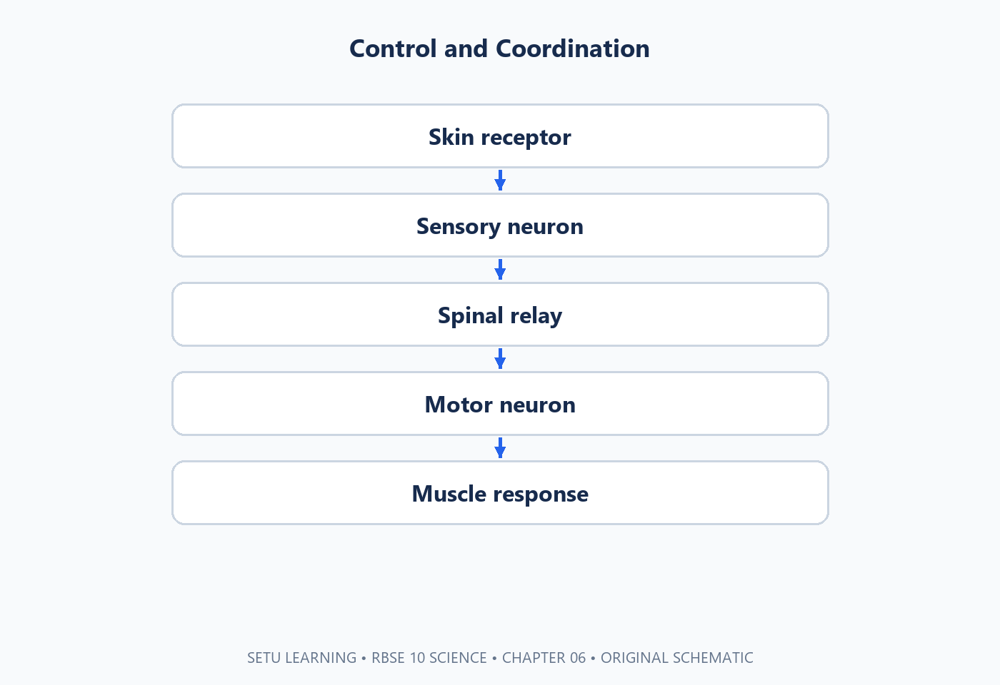

# अध्याय 6: नियंत्रण एवं समन्वय (Control and Coordination)

## भाग 1: अध्याय प्रवेश एवं पाठ्यक्रम मैपिंग

> इस अध्याय का 2026–27 पाठ्यक्रम-क्षेत्र मिलाया गया है; NCERT के सभी प्रश्नों के हल तथा पूरा ऐतिहासिक PYQ संग्रह अभी स्रोत-परीक्षण में हैं।

**विषय कोड:** 07 · **श्रृंखला पुस्तक:** 2

**सत्यापित आधार:** RBSE 2026–27 · **अध्याय भार:** 6 अंक। यह आधिकारिक chapter weight है; वास्तविक प्रश्न-विभाजन की भविष्यवाणी नहीं।

**सीखने के लक्ष्य:** Neuron और reflex pathway समझना; brain functions, plant movements और endocrine feedback की तुलना करना।

## भाग 2: शब्दावली एवं अवधारणा कैप्सूल

| शब्द / सूत्र | अर्थ / उपयोग |
|---|---|
| Neuron | Nervous system की impulse-transmitting cell। |
| Dendrite | Neuron का संकेत ग्रहण करने वाला branched भाग। |
| Axon | Cell body से impulse आगे ले जाने वाला लंबा भाग। |
| Synapse | दो neurons अथवा neuron और target के बीच functional junction। |
| Reflex action | उद्दीपन की तीव्र automatic प्रतिक्रिया। |
| Cerebrum | Forebrain का भाग; conscious activities और interpretation में भूमिका। |
| Cerebellum | Balance, posture और movements की precision में भूमिका। |
| Tropism | Stimulus की दिशा से संबंधित growth movement। |
| Hormone | Endocrine gland का chemical messenger, blood से target तक जाता है। |
| Feedback | Response के अनुसार hormone secretion का नियमन। |

## भाग 3: विस्तृत शिक्षण पाठ

### संकेत का मार्ग
Stimulus को receptor पहचानता है। Neuron में dendrite → cell body → axon दिशा में electrical signal आगे जाता है। Chemical synapse पर axon terminal neurotransmitter छोड़ता है; अगली cell के receptor signal ग्रहण करते हैं। इसलिए synaptic crossing chemical और cell के भीतर conduction electrical होती है। Motor neuron effector muscle/gland तक संदेश ले जाता है।

### Reflex और brain
गर्म वस्तु से हाथ हटाने में receptor → sensory neuron → spinal relay → motor neuron → muscle का reflex arc काम कर सकता है। Brain बाद में/साथ में जानकारी प्राप्त करता है; ‘brain को कभी पता नहीं चलता’ गलत है। Cerebrum conscious thinking और sensory interpretation में, cerebellum balance तथा precision में, medulla breathing जैसे involuntary functions में काम करता है। Skull, meninges और cerebrospinal fluid protection देते हैं।

### Plants में coordination
Shoot का light की ओर growth positive phototropism है। Auxin shaded side पर अधिक elongation कराकर shoot को light की ओर मोड़ सकता है। Root सामान्यतः positive gravitropism, shoot negative gravitropism दिखाता है। Tendril touch के अनुसार grows: thigmotropism। Mimosa leaf folding turgor change से होता है; यह growth-based tropism नहीं। Auxin elongation, gibberellin stem growth, cytokinin cell division और ABA growth inhibition/stomatal closure से जुड़े हैं।

### Hormones और feedback
Pituitary growth hormone, thyroid thyroxine, pancreas insulin और adrenal glands adrenaline देते हैं। Thyroxine synthesis के लिए iodine जरूरी है। Insulin blood glucose control में मदद करता है; हर diabetes केवल insulin की पूर्ण अनुपस्थिति नहीं। Adrenaline fight-or-flight में heart rate और respiratory activity जैसे responses बढ़ा सकता है। Blood glucose बढ़ने पर insulin secretion बढ़ना और glucose normal होने पर घटना feedback का उदाहरण है। Hormonal responses अक्सर nervous signalling से धीमे, पर लंबे समय तक प्रभावी होते हैं।

Withdrawal reflex का simplified functional path; arrows signal direction दिखाते हैं।

## भाग 4: पाठ्यपुस्तक-अवधारणाओं पर मौलिक हल किए उदाहरण

नीचे के प्रश्न लेखक के मौलिक मॉडल हैं। ये किसी NCERT edition के प्रश्न क्रमांक या संपूर्ण in-text/exercise solution bank होने का दावा नहीं करते।

**हल किया उदाहरण 1: गर्म तवे से हाथ हटाने का pathway दें।**

Skin receptor → sensory neuron → spinal cord relay → motor neuron → arm muscle। Withdrawal reflex तेज protective response है। Brain भी संकेत प्राप्त करता है; reflex होने का अर्थ consciousness हमेशा absent नहीं।

**हल किया उदाहरण 2: Shoot phototropism में shaded side की वृद्धि अधिक हो तो झुकाव कैसा होगा?**

Shaded side अधिक लंबी होने से shoot light की ओर bends करता है। Shoot में auxin का unequal distribution differential elongation करता है; light की ओर वाली side को ही अधिक बढ़ना लिखना उल्टा होगा।

**हल किया उदाहरण 3: Iodine deficiency और thyroid का संबंध दें।**

Iodine thyroxine synthesis का घटक है। कमी से thyroid function प्रभावित और gland enlargement/goitre हो सकता है। यह पाठ कारण-संबंध समझाता है; सभी neck swellings को goitre कहकर diagnosis नहीं करता।

## भाग 5: सत्यापित बोर्ड प्रश्न एवं स्रोत-स्थिति

2025, प्रश्न 1(iv), PDF पृष्ठ 3: plant hormone की पहचान। उत्तर-संकेत: cytokinin।

[RBSE 2025 मूल पेपर](https://rajeduboard.rajasthan.gov.in/books/PAPERS-2025/Sec/S-07.pdf)। प्रश्न का संक्षिप्त विषय-संदर्भ है; शब्दशः पुनर्मुद्रण नहीं।

## भाग 6: खंडवार मौलिक अभ्यास बैंक

**अभ्यास-अंक:** लेखक के स्व-अभ्यास के लिए हैं; RBSE की आधिकारिक marking scheme नहीं। उत्तर पहले स्वयं लिखें, फिर भाग 9 देखें।

## अ: बहुविकल्पीय प्रश्न — 15 × 1 अंक

**MCQ 1. Neuron में reception का प्रमुख branched भाग कौन है?**

अ) Myelin ही  
ब) Bone  
स) Dendrite  
द) Axon terminal ही

**MCQ 2. Chemical synapse पर messenger क्या है?**

अ) Haemoglobin  
ब) Neurotransmitter  
स) Urea  
द) Bile

**MCQ 3. Withdrawal reflex में common relay center क्या है?**

अ) Spinal cord  
ब) Kidney  
स) Liver  
द) Pancreas

**MCQ 4. Balance और movement precision में कौन-सा भाग काम करता है?**

अ) Thyroid  
ब) Medulla ही  
स) Retina  
द) Cerebellum

**MCQ 5. Breathing जैसे involuntary functions से कौन जुड़ा है?**

अ) Pituitary ही  
ब) Lens  
स) Medulla  
द) Cerebellum ही

**MCQ 6. Shoot का light की ओर growth क्या है?**

अ) Nastic folding  
ब) Positive phototropism  
स) Negative phototropism  
द) Positive hydrotropism

**MCQ 7. Root का gravity की ओर growth क्या है?**

अ) Positive gravitropism  
ब) Negative gravitropism  
स) Photolysis  
द) Chemolysis

**MCQ 8. Mimosa leaf folding का मुख्य immediate कारण क्या है?**

अ) नई bone बनना  
ब) केवल cell division  
स) Photosynthesis बंद होना  
द) Turgor change

**MCQ 9. Cell division को promote करने वाला plant hormone कौन है?**

अ) Thyroxine  
ब) Testosterone  
स) Cytokinin  
द) Insulin

**MCQ 10. Thyroxine synthesis के लिए कौन-सा element जरूरी है?**

अ) Calcium ही  
ब) Iodine  
स) Iron ही  
द) Sodium ही

**MCQ 11. Insulin का source कौन है?**

अ) Pancreas  
ब) Thyroid  
स) Testis  
द) Pituitary

**MCQ 12. Fight-or-flight hormone कौन है?**

अ) Auxin  
ब) Pepsin  
स) Bile  
द) Adrenaline

**MCQ 13. Growth-inhibiting plant hormone कौन है?**

अ) Cytokinin  
ब) Insulin  
स) ABA  
द) Gibberellin

**MCQ 14. Target cell hormone को कैसे पहचानती है?**

अ) हर cell एक जैसा respond करता है  
ब) Specific receptors  
स) केवल आकार बड़ा होने से  
द) Blood का रंग देखकर

**MCQ 15. Negative feedback में response मूल stimulus पर क्या करता है?**

अ) उसे घटाता है  
ब) हमेशा बढ़ाता है  
स) उसे metal बनाता है  
द) उससे कोई संबंध नहीं

## आ: रिक्त स्थान — 6 × 1 अंक

1. Nervous system की impulse-transmitting cell। — इस शब्द/सूत्र का नाम है: ____।  
2. Neuron का संकेत ग्रहण करने वाला branched भाग। — इस शब्द/सूत्र का नाम है: ____।  
3. Cell body से impulse आगे ले जाने वाला लंबा भाग। — इस शब्द/सूत्र का नाम है: ____।  
4. दो neurons अथवा neuron और target के बीच functional junction। — इस शब्द/सूत्र का नाम है: ____।  
5. उद्दीपन की तीव्र automatic प्रतिक्रिया। — इस शब्द/सूत्र का नाम है: ____।  
6. Forebrain का भाग; conscious activities और interpretation में भूमिका। — इस शब्द/सूत्र का नाम है: ____।

## इ: अतिलघु उत्तर — 8 × 1 अंक

1. Neuron में reception का प्रमुख branched भाग कौन है?  
2. Chemical synapse पर messenger क्या है?  
3. Withdrawal reflex में common relay center क्या है?  
4. Balance और movement precision में कौन-सा भाग काम करता है?  
5. Breathing जैसे involuntary functions से कौन जुड़ा है?  
6. Shoot का light की ओर growth क्या है?  
7. Root का gravity की ओर growth क्या है?  
8. Mimosa leaf folding का मुख्य immediate कारण क्या है?

## ई: लघु उत्तर — 6 × 2 अंक

**B1.** Electrical और chemical signals neuron में कहाँ काम करते हैं?

**B2.** Reflex और voluntary action में अंतर दें।

**B3.** Cerebellum और medulla की तुलना करें।

**B4.** Tropism और Mimosa folding में अंतर दें।

**B5.** Nervous और hormonal control की तुलना करें।

**B6.** Insulin feedback का सरल उदाहरण दें।

## उ: दीर्घ उत्तर — 4 × 3 अंक

आंतरिक विकल्प अभ्यास: C1 अथवा C2, तथा C3 अथवा C4 चुनें। पुनरावृत्ति में बचा विकल्प भी हल करें। यह लेखक की अभ्यास व्यवस्था है।

**C1.** Neuron के तीन मुख्य भाग और दिशा लिखें।

**C2.** Reflex arc का labelled schematic कैसे बनाएँ?

**C3.** चार plant hormones का एक-एक काम दें।

**C4.** Adrenaline response के तीन effects दें।

## ऊ: विस्तृत उत्तर — 2 × 4 अंक

आंतरिक विकल्प अभ्यास: D1 अथवा D2 चुनें; बाद में दूसरा भी हल करें।

**D1.** Nervous और endocrine coordination को भोजन के बाद glucose regulation तथा गर्म वस्तु छूने के उदाहरणों से समझाएँ।

**D2.** Shoot phototropism और root gravitropism की तुलना labelled arrows से करें।

## भाग 7: सावधानियाँ एवं परीक्षा-त्रुटियाँ

- Cerebellum को breathing center न लिखें।
- Reflex में brain को सूचना मिलती है।
- Mimosa folding growth tropism नहीं।
- Iodine gland नहीं, thyroxine का आवश्यक घटक है।
- Insulin feedback को positive feedback न कहें।

## भाग 8: फटाफट पुनरावृत्ति — 25 बिंदु

1. Neuron: Nervous system की impulse-transmitting cell।  
2. Dendrite: Neuron का संकेत ग्रहण करने वाला branched भाग।  
3. Axon: Cell body से impulse आगे ले जाने वाला लंबा भाग।  
4. Synapse: दो neurons अथवा neuron और target के बीच functional junction।  
5. Reflex action: उद्दीपन की तीव्र automatic प्रतिक्रिया।  
6. Cerebrum: Forebrain का भाग; conscious activities और interpretation में भूमिका।  
7. Cerebellum: Balance, posture और movements की precision में भूमिका।  
8. Tropism: Stimulus की दिशा से संबंधित growth movement।  
9. Hormone: Endocrine gland का chemical messenger, blood से target तक जाता है।  
10. Feedback: Response के अनुसार hormone secretion का नियमन।  
11. Dendrites incoming signals receive करते हैं।  
12. Neurotransmitter axon terminal से released होकर next cell receptors पर काम करता है।  
13. Spinal pathways तेज withdrawal response सम्भव करते हैं; brain को सूचना भी मिलती है।  
14. Cerebellum posture, balance और coordination में महत्त्वपूर्ण है।  
15. Medulla hindbrain का भाग है और involuntary control में भूमिका निभाता है।  
16. Stimulus light है और growth उसकी ओर, इसलिए positive phototropism।  
17. Root growth gravity की दिशा में होने से positive gravitropism है।  
18. Rapid leaf folding growth के बजाय cells के turgor changes से जुड़ा है।  
19. Cytokinins plant cell division को promote कर सकते हैं।  
20. Thyroxine molecule में iodine शामिल है।  
21. Pancreas के endocrine cells insulin secretion करते हैं।  
22. Adrenaline acute stress response में multiple physiological changes करता है।  
23. Abscisic acid growth inhibition और stress responses से जुड़ा है।  
24. Hormone response के लिए suitable receptors और cell machinery जरूरी हैं।  
25. Negative feedback initial change को counter करके regulation में मदद करता है।

## भाग 9: संपूर्ण अभ्यास उत्तर-कुंजी

## MCQ: सही विकल्प और कारण

**1. स — Dendrite।** Dendrites incoming signals receive करते हैं।

**2. ब — Neurotransmitter।** Neurotransmitter axon terminal से released होकर next cell receptors पर काम करता है।

**3. अ — Spinal cord।** Spinal pathways तेज withdrawal response सम्भव करते हैं; brain को सूचना भी मिलती है।

**4. द — Cerebellum।** Cerebellum posture, balance और coordination में महत्त्वपूर्ण है।

**5. स — Medulla।** Medulla hindbrain का भाग है और involuntary control में भूमिका निभाता है।

**6. ब — Positive phototropism।** Stimulus light है और growth उसकी ओर, इसलिए positive phototropism।

**7. अ — Positive gravitropism।** Root growth gravity की दिशा में होने से positive gravitropism है।

**8. द — Turgor change।** Rapid leaf folding growth के बजाय cells के turgor changes से जुड़ा है।

**9. स — Cytokinin।** Cytokinins plant cell division को promote कर सकते हैं।

**10. ब — Iodine।** Thyroxine molecule में iodine शामिल है।

**11. अ — Pancreas।** Pancreas के endocrine cells insulin secretion करते हैं।

**12. द — Adrenaline।** Adrenaline acute stress response में multiple physiological changes करता है।

**13. स — ABA।** Abscisic acid growth inhibition और stress responses से जुड़ा है।

**14. ब — Specific receptors।** Hormone response के लिए suitable receptors और cell machinery जरूरी हैं।

**15. अ — उसे घटाता है।** Negative feedback initial change को counter करके regulation में मदद करता है।

**रिक्त स्थान:** 1. Neuron; 2. Dendrite; 3. Axon; 4. Synapse; 5. Reflex action; 6. Cerebrum

**अतिलघु उत्तर:**

1. Dendrite। Dendrites incoming signals receive करते हैं।

2. Neurotransmitter। Neurotransmitter axon terminal से released होकर next cell receptors पर काम करता है।

3. Spinal cord। Spinal pathways तेज withdrawal response सम्भव करते हैं; brain को सूचना भी मिलती है।

4. Cerebellum। Cerebellum posture, balance और coordination में महत्त्वपूर्ण है।

5. Medulla। Medulla hindbrain का भाग है और involuntary control में भूमिका निभाता है।

6. Positive phototropism। Stimulus light है और growth उसकी ओर, इसलिए positive phototropism।

7. Positive gravitropism। Root growth gravity की दिशा में होने से positive gravitropism है।

8. Turgor change। Rapid leaf folding growth के बजाय cells के turgor changes से जुड़ा है।

**B1. Electrical और chemical signals neuron में कहाँ काम करते हैं?**

Neuron membrane के along impulse electrochemical changes से travels करता है। Chemical synapse पर neurotransmitter gap पार करके next cell को signal देता है। इसीलिए ‘impulse हर स्थान पर केवल electrical jump है’ उचित नहीं।

**B2. Reflex और voluntary action में अंतर दें।**

Reflex rapid automatic response है, जैसे withdrawal। Voluntary action conscious control से होता है, जैसे लिखना। दोनों में neurons और muscles काम करते हैं, लेकिन pathways और initiation अलग हो सकते हैं।

**B3. Cerebellum और medulla की तुलना करें।**

Cerebellum posture, balance और precise movement में भूमिका निभाता है। Medulla breathing तथा अन्य involuntary functions में भूमिका निभाता है। Brain भागों के कामों को एक-दूसरे पर न लिखें।

**B4. Tropism और Mimosa folding में अंतर दें।**

Tropism stimulus direction से संबंधित growth movement है। Mimosa folding mainly cell turgor change से rapid response है, growth से नहीं। इसलिए हर plant movement को tropism कहना गलत है।

**B5. Nervous और hormonal control की तुलना करें।**

Nervous control specific neural pathways से signals भेजता और सामान्यतः तेज response देता है। Hormones blood से target cells तक जाते और अक्सर धीमे/दीर्घकालीन effects देते हैं। Target receptors specificity देते हैं; blood सभी cells तक पहुँचना समान response का अर्थ नहीं।

**B6. Insulin feedback का सरल उदाहरण दें।**

Blood glucose बढ़ने पर pancreas की insulin secretion बढ़ सकती है। Cells glucose uptake/storage बढ़ाते हैं और glucose घटता है। फिर insulin stimulus कम हो जाता है। Response द्वारा initial signal घटाना negative feedback है।

**C1. Neuron के तीन मुख्य भाग और दिशा लिखें।**

1. Dendrites signals receive करते हैं। 2. Cell body cell metabolism और signal integration में भाग लेता है। 3. Axon terminal तक impulse ले जाता है, जहाँ neurotransmitter निकल सकता है। Diagram arrows dendrite से terminal की ओर दिखाएँ।

**C2. Reflex arc का labelled schematic कैसे बनाएँ?**

1. Receptor से sensory neuron का arrow spinal cord की ओर। 2. Cord में relay/interneuron junction दिखाएँ। 3. Motor neuron का arrow effector muscle की ओर और response लिखें। Brain connection छूटने पर ‘brain असंबद्ध’ का दावा न जोड़ें।

**C3. चार plant hormones का एक-एक काम दें।**

1. Auxin shoot cell elongation तथा tropic growth में मदद करता है। 2. Gibberellin stem growth और cytokinin cell division से जुड़े हैं। 3. ABA growth inhibition तथा water-stress में stomatal closing में भूमिका निभाता है। Effects tissue/conditions से बदलते हैं।

**C4. Adrenaline response के तीन effects दें।**

1. Heart rate/force बढ़ सकते हैं, tissues को blood supply बदलती है। 2. Airways और breathing-related responses oxygen availability बढ़ाते हैं। 3. Energy substrates की availability बढ़ती है। यह acute response है; hormone की हर भूमिका growth नहीं।

**D1. Nervous और endocrine coordination को भोजन के बाद glucose regulation तथा गर्म वस्तु छूने के उदाहरणों से समझाएँ।**

1. भोजन के बाद blood glucose signal pancreas तक पहुँचता है। 2. Insulin blood द्वारा target tissues पर uptake/storage बढ़ाता है; negative feedback secretion घटाता है। 3. गर्म वस्तु पर receptors और reflex neural pathway withdrawal कराते हैं। 4. दोनों communication systems हैं, पर messenger, route और timescale अलग हैं।

**D2. Shoot phototropism और root gravitropism की तुलना labelled arrows से करें।**

1. Light source एक ओर और shoot curvature उसकी ओर दिखाएँ: positive phototropism। 2. Shoot की shaded side पर relatively more elongation लिखें। 3. Root growth gravity की ओर दिखाएँ: positive gravitropism। 4. Shoot gravity से विपरीत: negative gravitropism। Stimulus direction और positive/negative relation स्पष्ट रखें।

## भाग 10: 10 मिनट / 10 अंक आत्म-मूल्यांकन एवं संदर्भ

समय: 10 मिनट। पहले पुस्तक बंद करें।

1. MCQ 3 और 11 हल करें। (1 + 1)
2. B2 और B5 के उत्तर लिखें। (2 + 2)
3. D1 हल करें। (4)

**कुंजी:** भाग 9 में संबंधित क्रमांक देखें। **स्व-मूल्यांकन:** 8–10: आगे बढ़ें; 5–7: छूटे कौशल का दोहराव; 0–4: भाग 2–4 फिर पढ़ें। यह अभ्यास-सुझाव है, बोर्ड grade नहीं।

[सत्यापित RBSE 2026–27 पाठ्यक्रम](https://rajeduboard.rajasthan.gov.in/anudeshika-etc/10_2026.pdf) · [NCERT विज्ञान अध्याय 6](https://ncert.nic.in/textbook/pdf/jesc106.pdf)

**आगे की कड़ी:** अगले अध्याय में reproductive hormones और नए organisms बनने के processes आएँगे।
