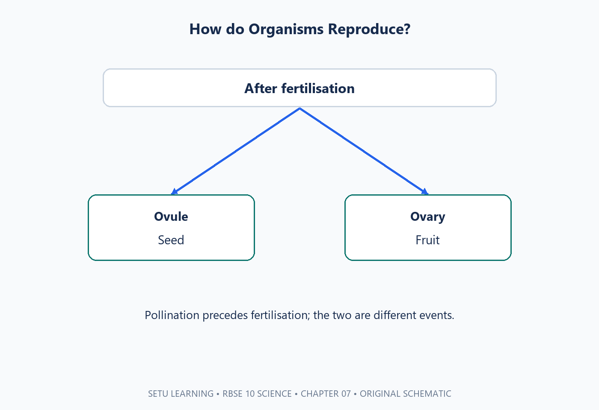

# अध्याय 7: जीव जनन कैसे करते हैं? (How do Organisms Reproduce?)

## भाग 1: अध्याय प्रवेश एवं पाठ्यक्रम मैपिंग

> प्रथम संपादकीय प्रारूप। इस अध्याय का 2026–27 पाठ्यक्रम-क्षेत्र मिलाया गया है; NCERT के सभी प्रश्नों के हल तथा पूरा ऐतिहासिक PYQ संग्रह अभी स्रोत-परीक्षण में हैं।

**विषय कोड:** 07 · **श्रृंखला पुस्तक:** 2

**सत्यापित आधार:** RBSE 2026–27 · **अध्याय भार:** 7 अंक। यह आधिकारिक chapter weight है; वास्तविक प्रश्न-विभाजन की भविष्यवाणी नहीं।

**सीखने के लक्ष्य:** Asexual/sexual reproduction अलग करना; flower और human reproductive pathways समझना; contraception और infection prevention की सीमाएँ बताना।

## भाग 2: शब्दावली एवं अवधारणा कैप्सूल

| शब्द / सूत्र | अर्थ / उपयोग |
|---|---|
| DNA copying | Genetic information की replication; reproduction में continuity का आधार। |
| Binary fission | एक cell का दो daughter cells में विभाजन। |
| Fragmentation | Body fragments से उपयुक्त organisms में नए individuals बनना। |
| Regeneration | Specialised cells से खोए भाग/कुछ organisms में पूरा organism पुनः बनना। |
| Budding | Parent पर outgrowth से नया individual बनना। |
| Vegetative propagation | Root/stem/leaf से नए plants बनना। |
| Pollination | Pollen का anther से stigma तक पहुँचना। |
| Fertilisation | Male और female gametes का fusion। |
| Placenta | Maternal–fetal exchange का interface। |
| Contraception | Pregnancy की संभावना घटाने की विधियाँ। |

## भाग 3: विस्तृत शिक्षण पाठ

### Continuity और variation
Reproduction individual survival के लिए अनिवार्य नहीं, species continuity के लिए महत्त्वपूर्ण है। DNA copying information आगे देती है, और copying differences variation ला सकते हैं। Sexual reproduction दो parents के genetic contributions मिलाकर variation बढ़ा सकता है; asexual offspring भी हमेशा absolutely identical नहीं होते।

### Asexual methods
Amoeba binary fission, Plasmodium multiple fission, yeast/Hydra budding, Spirogyra fragmentation तथा Rhizopus spores से reproduction के उदाहरण हैं। Planaria में suitable fragments specialised regenerative cells से नए individuals बना सकते हैं; हर cut body part ऐसा नहीं करता। Bryophyllum leaf buds और potato stem tuber vegetative propagation दिखाते हैं। यह plants के उपयोगी गुण जल्दी बनाए रखने में मदद कर सकता है।

### Flower में sexual reproduction
Stamen में anther pollen बनाता है। Pistil के stigma पर suitable pollen germinate होकर style से pollen tube भेजता है। Male gamete ovule में female gamete से fertilises करके zygote बनाता है। Ovule seed और ovary fruit बनता है। Pollination gamete fusion नहीं; fertilisation उसके बाद की अलग stage है। Flowering plants में embryo seed में विकसित होता है।

### Human reproduction और health
Testes sperm और testosterone बनाते हैं; scrotal location sperm formation के लिए suitable lower temperature देती है। Sperm ducts से urethra की ओर जाते हैं और glands के fluids semen बनाते हैं। Ovaries ova और hormones देते हैं। Fertilisation सामान्यतः oviduct में; embryo uterus lining में implants होता है। Placenta nutrients, oxygen और wastes exchange करता है; maternal और fetal blood normally सीधे एक common pool नहीं बनाते। Fertilisation न होने पर uterine lining का shedding menstruation है; cycle length व्यक्ति और समय के अनुसार बदल सकती है। Condoms pregnancy के साथ कई sexually transmitted infections का risk भी घटाते हैं। Hormonal pills/IUDs pregnancy prevention देते हैं लेकिन STI protection नहीं। Reproductive health में consent, reliable information, hygiene और clinical help शामिल हैं।

Flower में pollination से seed/fruit बनने का stage schematic; anatomical drawing नहीं।

## भाग 4: पाठ्यपुस्तक-अवधारणाओं पर मौलिक हल किए उदाहरण

नीचे के प्रश्न लेखक के मौलिक मॉडल हैं। ये किसी NCERT edition के प्रश्न क्रमांक या संपूर्ण in-text/exercise solution bank होने का दावा नहीं करते।

**हल किया उदाहरण 1: Pollination से seed बनने का क्रम दें।**

Anther → stigma पर pollen transfer → pollen tube growth → ovule में gamete fusion → zygote/embryo → seed। Ovary fruit बनती है। Pollen transfer और fertilisation को एक ही घटना न लिखें।

**हल किया उदाहरण 2: Potato और Bryophyllum में reproductive structures पहचानें।**

Potato के eyes stem tuber buds हैं, roots नहीं। Bryophyllum leaf margins पर buds नए plants बना सकते हैं। दोनों vegetative propagation हैं और seed formation आवश्यक नहीं।

**हल किया उदाहरण 3: Human fertilisation और implantation के स्थान दें।**

Fertilisation सामान्यतः oviduct/fallopian tube में होता है। विकसित embryo uterus की endometrium में implants होता है। Uterus में sperm और ovum का fusion होना सामान्य anatomical answer नहीं।

## भाग 5: सत्यापित बोर्ड प्रश्न एवं स्रोत-स्थिति

2025, प्रश्न 1(ii), PDF पृष्ठ 2: regeneration से नया organism बनने का उदाहरण। उत्तर-संकेत: Planaria।

[RBSE 2025 मूल पेपर](https://rajeduboard.rajasthan.gov.in/books/PAPERS-2025/Sec/S-07.pdf)। प्रश्न का संक्षिप्त विषय-संदर्भ है; शब्दशः पुनर्मुद्रण नहीं।

## भाग 6: खंडवार मौलिक अभ्यास बैंक

**अभ्यास-अंक:** लेखक के स्व-अभ्यास के लिए हैं; RBSE की आधिकारिक marking scheme नहीं। उत्तर पहले स्वयं लिखें, फिर भाग 9 देखें।

## अ: बहुविकल्पीय प्रश्न — 15 × 1 अंक

**MCQ 1. Amoeba का सामान्य reproduction mode क्या है?**

अ) Vegetative propagation  
ब) Binary fission  
स) Budding  
द) Seed formation

**MCQ 2. Yeast का सामान्य asexual mode क्या है?**

अ) Budding  
ब) Pollination  
स) Fertilisation  
द) Fragmentation ही

**MCQ 3. Spirogyra किस विधि का उदाहरण है?**

अ) Budding  
ब) Binary fission  
स) Seed formation  
द) Fragmentation

**MCQ 4. Rhizopus में dispersal reproductive structures क्या हैं?**

अ) Ovules  
ब) Potato eyes  
स) Spores  
द) Sperms

**MCQ 5. Bryophyllum vegetative propagation कहाँ से कर सकता है?**

अ) केवल seed coat  
ब) Leaf buds  
स) केवल flower pollen  
द) केवल roots ही

**MCQ 6. Pollen transfer anther से stigma तक क्या है?**

अ) Pollination  
ब) Fertilisation  
स) Implantation  
द) Menstruation

**MCQ 7. Fertilisation के बाद ovule क्या बनता है?**

अ) Fruit ही  
ब) Stigma  
स) Anther  
द) Seed

**MCQ 8. Human fertilisation का सामान्य स्थान क्या है?**

अ) Vagina  
ब) Ovary surface ही  
स) Oviduct  
द) Uterus ही

**MCQ 9. Embryo implantation का स्थान क्या है?**

अ) Anther  
ब) Uterus lining  
स) Testis  
द) Ureter

**MCQ 10. Sperm का production site कौन है?**

अ) Testes  
ब) Prostate  
स) Urethra  
द) Seminal vesicle

**MCQ 11. Testosterone का मुख्य male source कौन है?**

अ) Kidneys  
ब) Lungs  
स) Thyroid  
द) Testes

**MCQ 12. Maternal–fetal exchange interface क्या है?**

अ) Nephron  
ब) Villus ही  
स) Placenta  
द) Cerebellum

**MCQ 13. Pregnancy और कई STI risks दोनों घटाने का barrier कौन है?**

अ) Withdrawal की गारंटी  
ब) Condom  
स) Hormonal pill ही  
द) IUD ही

**MCQ 14. Potato के eyes क्या हैं?**

अ) Stem buds  
ब) Roots  
स) Pollen grains  
द) Ovules

**MCQ 15. Species continuity के लिए reproduction क्यों महत्त्वपूर्ण है?**

अ) हर individual तभी साँस लेता है  
ब) हर variation समान होता है  
स) DNA हमेशा बदलता ही नहीं  
द) नए individuals बनते हैं

## आ: रिक्त स्थान — 6 × 1 अंक

1. Genetic information की replication; reproduction में continuity का आधार। — इस शब्द/सूत्र का नाम है: ____।  
2. एक cell का दो daughter cells में विभाजन। — इस शब्द/सूत्र का नाम है: ____।  
3. Body fragments से उपयुक्त organisms में नए individuals बनना। — इस शब्द/सूत्र का नाम है: ____।  
4. Specialised cells से खोए भाग/कुछ organisms में पूरा organism पुनः बनना। — इस शब्द/सूत्र का नाम है: ____।  
5. Parent पर outgrowth से नया individual बनना। — इस शब्द/सूत्र का नाम है: ____।  
6. Root/stem/leaf से नए plants बनना। — इस शब्द/सूत्र का नाम है: ____।

## इ: अतिलघु उत्तर — 8 × 1 अंक

1. Amoeba का सामान्य reproduction mode क्या है?  
2. Yeast का सामान्य asexual mode क्या है?  
3. Spirogyra किस विधि का उदाहरण है?  
4. Rhizopus में dispersal reproductive structures क्या हैं?  
5. Bryophyllum vegetative propagation कहाँ से कर सकता है?  
6. Pollen transfer anther से stigma तक क्या है?  
7. Fertilisation के बाद ovule क्या बनता है?  
8. Human fertilisation का सामान्य स्थान क्या है?

## ई: लघु उत्तर — 6 × 2 अंक

**B1.** DNA copying के साथ variation क्यों उपयोगी है?

**B2.** Fission और budding की तुलना दें।

**B3.** Fragmentation और regeneration अलग कैसे हैं?

**B4.** Testes के दो functions तथा scrotum का महत्व दें।

**B5.** Placenta का function क्या है?

**B6.** Condom और pills की protection अलग कैसे है?

## उ: दीर्घ उत्तर — 4 × 3 अंक

आंतरिक विकल्प अभ्यास: C1 अथवा C2, तथा C3 अथवा C4 चुनें। पुनरावृत्ति में बचा विकल्प भी हल करें। यह लेखक की अभ्यास व्यवस्था है।

**C1.** Flower के reproductive parts और fertilisation समझाएँ।

**C2.** Human female pathway का labelled क्रम दें।

**C3.** Menstruation के कारण और cycle variation लिखें।

**C4.** Three contraception categories और सीमा दें।

## ऊ: विस्तृत उत्तर — 2 × 4 अंक

आंतरिक विकल्प अभ्यास: D1 अथवा D2 चुनें; बाद में दूसरा भी हल करें।

**D1.** Asexual reproduction की चार विधियाँ उदाहरण सहित दें।

**D2.** Fertilisation से birth तक simplified stages और placenta की भूमिका समझाएँ।

## भाग 7: सावधानियाँ एवं परीक्षा-त्रुटियाँ

- Pollination और fertilisation अलग stages हैं।
- Ovule से seed, ovary से fruit।
- Fertilisation oviduct, implantation uterus में।
- Placenta में दोनों blood systems का सामान्य direct mixing न लिखें।
- Pills को STI prevention न कहें।

## भाग 8: फटाफट पुनरावृत्ति — 25 बिंदु

1. DNA copying: Genetic information की replication; reproduction में continuity का आधार।  
2. Binary fission: एक cell का दो daughter cells में विभाजन।  
3. Fragmentation: Body fragments से उपयुक्त organisms में नए individuals बनना।  
4. Regeneration: Specialised cells से खोए भाग/कुछ organisms में पूरा organism पुनः बनना।  
5. Budding: Parent पर outgrowth से नया individual बनना।  
6. Vegetative propagation: Root/stem/leaf से नए plants बनना।  
7. Pollination: Pollen का anther से stigma तक पहुँचना।  
8. Fertilisation: Male और female gametes का fusion।  
9. Placenta: Maternal–fetal exchange का interface।  
10. Contraception: Pregnancy की संभावना घटाने की विधियाँ।  
11. Amoeba cell division से दो daughter cells बना सकता है।  
12. Yeast में parent पर bud निकलकर नया cell बन सकता है।  
13. Spirogyra filament के fragments suitable conditions में grow कर सकते हैं।  
14. Rhizopus sporangia में spores बनते हैं।  
15. Leaf margin buds नए plants बना सकते हैं।  
16. Pollination pollen transfer है; gamete fusion fertilisation है।  
17. Ovule seed बनता है; ovary fruit बनती है।  
18. Fertilisation सामान्यतः fallopian tube/oviduct में होता है।  
19. Endometrium embryo implantation का site है।  
20. Testes sperm बनाते हैं; accessory glands fluids देती हैं।  
21. Testes testosterone secrete करते हैं।  
22. Placenta fetus को nutrient/gas exchange interface देता है।  
23. Condom barrier protection देता है; सही उपयोग के बावजूद risk zero नहीं।  
24. Potato tuber modified stem है; eyes buds हैं।  
25. Reproduction generations के बीच population continuity रखता है।

## भाग 9: संपूर्ण अभ्यास उत्तर-कुंजी

## MCQ: सही विकल्प और कारण

**1. ब — Binary fission।** Amoeba cell division से दो daughter cells बना सकता है।

**2. अ — Budding।** Yeast में parent पर bud निकलकर नया cell बन सकता है।

**3. द — Fragmentation।** Spirogyra filament के fragments suitable conditions में grow कर सकते हैं।

**4. स — Spores।** Rhizopus sporangia में spores बनते हैं।

**5. ब — Leaf buds।** Leaf margin buds नए plants बना सकते हैं।

**6. अ — Pollination।** Pollination pollen transfer है; gamete fusion fertilisation है।

**7. द — Seed।** Ovule seed बनता है; ovary fruit बनती है।

**8. स — Oviduct।** Fertilisation सामान्यतः fallopian tube/oviduct में होता है।

**9. ब — Uterus lining।** Endometrium embryo implantation का site है।

**10. अ — Testes।** Testes sperm बनाते हैं; accessory glands fluids देती हैं।

**11. द — Testes।** Testes testosterone secrete करते हैं।

**12. स — Placenta।** Placenta fetus को nutrient/gas exchange interface देता है।

**13. ब — Condom।** Condom barrier protection देता है; सही उपयोग के बावजूद risk zero नहीं।

**14. अ — Stem buds।** Potato tuber modified stem है; eyes buds हैं।

**15. द — नए individuals बनते हैं।** Reproduction generations के बीच population continuity रखता है।

**रिक्त स्थान:** 1. DNA copying; 2. Binary fission; 3. Fragmentation; 4. Regeneration; 5. Budding; 6. Vegetative propagation

**अतिलघु उत्तर:**

1. Binary fission। Amoeba cell division से दो daughter cells बना सकता है।

2. Budding। Yeast में parent पर bud निकलकर नया cell बन सकता है।

3. Fragmentation। Spirogyra filament के fragments suitable conditions में grow कर सकते हैं।

4. Spores। Rhizopus sporangia में spores बनते हैं।

5. Leaf buds। Leaf margin buds नए plants बना सकते हैं।

6. Pollination। Pollination pollen transfer है; gamete fusion fertilisation है।

7. Seed। Ovule seed बनता है; ovary fruit बनती है।

8. Oviduct। Fertilisation सामान्यतः fallopian tube/oviduct में होता है।

**B1. DNA copying के साथ variation क्यों उपयोगी है?**

Copying genetic continuity देता है; occasional changes variation ला सकते हैं। Changing environment में कुछ variants survival/reproduction में लाभ दे सकते हैं। हर variation लाभदायक नहीं और reproduction individual के जीवित रहने की शर्त नहीं।

**B2. Fission और budding की तुलना दें।**

Binary fission में parent cell दो daughter cells में divides होता है। Budding में parent पर छोटा outgrowth विकसित होकर नया individual बन सकता है। Amoeba तथा yeast क्रमशः standard उदाहरण हैं।

**B3. Fragmentation और regeneration अलग कैसे हैं?**

Fragmentation में सरल body fragments से नए organisms बनते हैं, जैसे Spirogyra। Regeneration specialised cells द्वारा repair या कुछ organisms में पूरा नया organism बनना है। हर multicellular animal का टुकड़ा नया organism नहीं बना सकता।

**B4. Testes के दो functions तथा scrotum का महत्व दें।**

Testes sperms और testosterone बनाते हैं। Scrotum उन्हें body core से कुछ कम ताप पर रखने में मदद करता है, जो sperm formation के लिए उपयुक्त है। Ducts sperm बनाते नहीं; उनका transport करते हैं।

**B5. Placenta का function क्या है?**

Placenta maternal और fetal sides के बीच oxygen/nutrients तथा wastes exchange का interface है। यह embryo को nourishment और gas exchange उपलब्ध करता है। दोनों blood systems सामान्यतः सीधे मिश्रित common circulation नहीं बनाते।

**B6. Condom और pills की protection अलग कैसे है?**

Condom barrier method है जो pregnancy तथा कई STIs का risk कम करता है, पूर्ण गारंटी नहीं। Hormonal pills pregnancy prevention के लिए हैं और STI protection नहीं देतीं। Method choice trained health professional और informed consent से होनी चाहिए।

**C1. Flower के reproductive parts और fertilisation समझाएँ।**

1. Anther pollen बनाता है; stigma pollen ग्रहण करता है। 2. Pollen tube style से ovule तक male gamete पहुँचाती है। 3. Gamete fusion से zygote, आगे embryo बनता है; ovule seed और ovary fruit बनती है।

**C2. Human female pathway का labelled क्रम दें।**

1. Ovary से ovum release होता है। 2. Oviduct सामान्य fertilisation site है। 3. Embryo uterus lining में implantation करता है; cervix uterus का lower opening और vagina birth canal का भाग है। Diagram organs का connection दिखाए।

**C3. Menstruation के कारण और cycle variation लिखें।**

1. Cycle में uterus lining potential pregnancy के लिए तैयार होती है। 2. Pregnancy न होने पर hormonal changes से lining shed हो सकती है। 3. Blood और tissue vagina से बाहर आते हैं; duration/cycle length में variation है। इसे बीमारी या ‘impure blood’ न कहें।

**C4. Three contraception categories और सीमा दें।**

1. Barrier condom sperm entry घटाता और STI risk कम करता है। 2. Hormonal methods ovulation/अन्य reproductive processes बदल सकते हैं। 3. IUD/surgical methods pregnancy prevention में इस्तेमाल होते हैं; सभी methods STI protection नहीं देते। Clinical counselling जरूरी है।

**D1. Asexual reproduction की चार विधियाँ उदाहरण सहित दें।**

1. Amoeba: binary fission, एक cell से दो। 2. Yeast/Hydra: budding, parent पर outgrowth। 3. Spirogyra: fragmentation, body pieces से growth। 4. Rhizopus: spores, suitable conditions में germination। Examples और methods अलग लिखें; regeneration को हर organism का universal reproduction न बनाएँ।

**D2. Fertilisation से birth तक simplified stages और placenta की भूमिका समझाएँ।**

1. Oviduct में sperm–ovum fusion से zygote बनता है। 2. Divisions के बाद embryo uterus में implants करता है। 3. Placenta oxygen/nutrients देता और wastes transfer करता है; fetus uterus में grows करता है। 4. Birth पर baby बाहर आता है। Diagram stage order है, fetus या reproductive organs की anatomical scale नहीं।

## भाग 10: 10 मिनट / 10 अंक आत्म-मूल्यांकन एवं संदर्भ

समय: 10 मिनट। पहले पुस्तक बंद करें।

1. MCQ 3 और 11 हल करें। (1 + 1)
2. B2 और B5 के उत्तर लिखें। (2 + 2)
3. D1 हल करें। (4)

**कुंजी:** भाग 9 में संबंधित क्रमांक देखें। **स्व-मूल्यांकन:** 8–10: आगे बढ़ें; 5–7: छूटे कौशल का दोहराव; 0–4: भाग 2–4 फिर पढ़ें। यह अभ्यास-सुझाव है, बोर्ड grade नहीं।

[सत्यापित RBSE 2026–27 पाठ्यक्रम](https://rajeduboard.rajasthan.gov.in/anudeshika-etc/10_2026.pdf) · [NCERT विज्ञान अध्याय 7](https://ncert.nic.in/textbook/pdf/jesc107.pdf)

**आगे की कड़ी:** अगले अध्याय में reproduction से आने वाले inherited traits के ratios समझेंगे।
