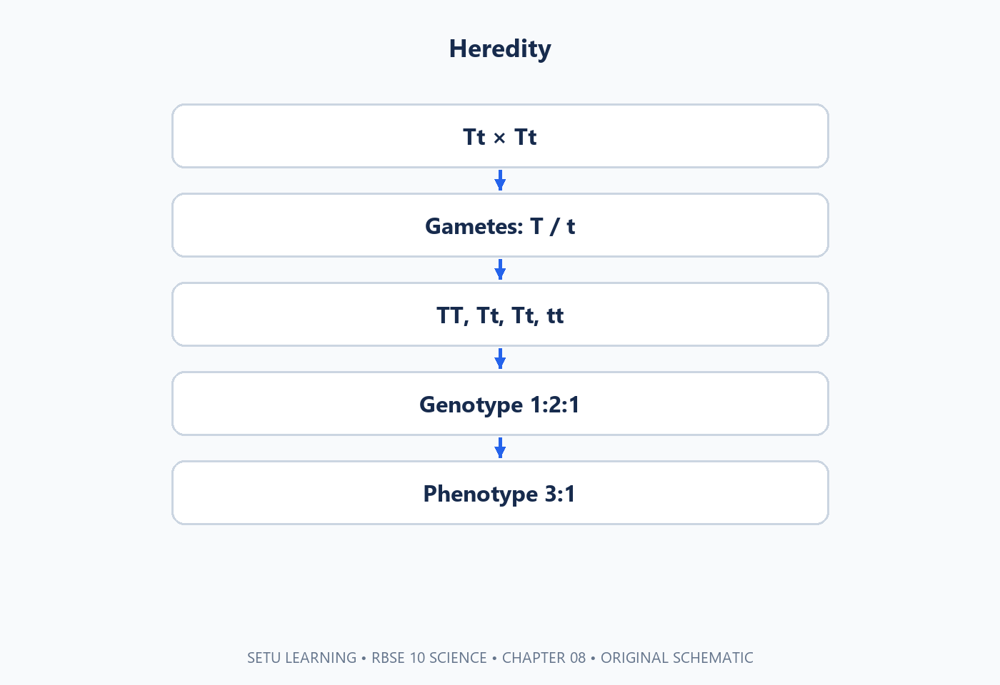

# अध्याय 8: आनुवंशिकता (Heredity)

## भाग 1: अध्याय प्रवेश एवं पाठ्यक्रम मैपिंग

> इस अध्याय का 2026–27 पाठ्यक्रम-क्षेत्र मिलाया गया है; NCERT के सभी प्रश्नों के हल तथा पूरा ऐतिहासिक PYQ संग्रह अभी स्रोत-परीक्षण में हैं।

**विषय कोड:** 07 · **श्रृंखला पुस्तक:** 2

**सत्यापित आधार:** RBSE 2026–27 · **अध्याय भार:** 4 अंक। यह आधिकारिक chapter weight है; वास्तविक प्रश्न-विभाजन की भविष्यवाणी नहीं।

**सीखने के लक्ष्य:** Genotype/phenotype अलग करना; mono/dihybrid crosses के ratios सही शर्तों सहित निकालना; human sex determination का वैज्ञानिक विवरण देना।

## भाग 2: शब्दावली एवं अवधारणा कैप्सूल

| शब्द / सूत्र | अर्थ / उपयोग |
|---|---|
| Heredity | Parents से offspring तक genetic traits का transmission। |
| Variation | Individuals के लक्षणों में differences। |
| Gene | DNA का functional hereditary information वाला segment। |
| Allele | Gene का alternative form। |
| Genotype | किसी trait के लिए genetic constitution, जैसे Tt। |
| Phenotype | Expressed/observable characteristic, जैसे tall। |
| Dominant allele | Heterozygous condition में recessive के ऊपर expressed allele। |
| Recessive allele | Simple complete dominance में homozygous होने पर expressed allele। |
| Monohybrid cross | एक trait के contrasting forms पर केंद्रित cross। |
| Segregation | Gamete formation में allele pair के अलग होना। |

## भाग 3: विस्तृत शिक्षण पाठ

### लक्षण का genetic आधार
DNA information से proteins बनते हैं; proteins और cellular processes traits के expression में भूमिका निभाते हैं। Environment भी phenotype को प्रभावित कर सकता है। Mendel ने peas में contrasting traits और controlled crosses का उपयोग किया। Dominant का अर्थ अधिक common, बेहतर या ताकतवर नहीं; heterozygote में expression का संबंध है। Bodybuilding से बढ़ी muscle जैसी acquired change स्वतः inherited gene change नहीं बन जाती।

### एक trait की गणना
Pure tall TT × dwarf tt से F₁ सभी Tt और complete dominance में tall होते हैं। F₁ selfing Tt × Tt में दोनों parents T और t gametes देते हैं। Punnett outcomes TT, Tt, Tt, tt हैं। Genotype ratio 1:2:1 और phenotype ratio 3 tall:1 dwarf। ये expected probabilities हैं, हर चार plants का exact count नहीं। Recessive allele F₁ में गायब नहीं हुआ; hidden expression था।

### दो traits और independence
RRYY × rryy से F₁ RrYy मिलता है। Unlinked/independently assorting traits और complete dominance की school model conditions में F₁ gametes RY, Ry, rY, ry equal probabilities से बनते हैं। Selfing में phenotype ratio 9:3:3:1 हो सकता है। हर pair of human genes पर यही ratio लागू नहीं; linkage और अन्य inheritance patterns अलग हो सकते हैं।

### Human sex determination
विद्यालयी XX–XY model में egg X देता है, sperm X या Y दे सकता है। X sperm से XX और Y sperm से XY outcome मिलता है; simplified expectation लगभग equal probabilities है। Child का chromosomal sex mother के X egg से तय करने का दावा गलत है। यह biological probability है; किसी parent को दोष देने का आधार नहीं। वास्तविक sex development में अन्य biological variation भी हो सकती है; यह model सभी complexities का वर्णन नहीं।

Monohybrid cross का simplified genotype summary; विस्तृत 2×2 Punnett square उत्तर में बनाने का निर्देश है।

## भाग 4: पाठ्यपुस्तक-अवधारणाओं पर मौलिक हल किए उदाहरण

नीचे के प्रश्न लेखक के मौलिक मॉडल हैं। ये किसी NCERT edition के प्रश्न क्रमांक या संपूर्ण in-text/exercise solution bank होने का दावा नहीं करते।

**हल किया उदाहरण 1: Tt × tt से offspring ratio निकालें।**

Tt parent T या t gametes, tt parent केवल t देता है। Outcomes Tt और tt समान expected probability से मिलते हैं। Complete dominance में tall:dwarf = 1:1, genotype Tt:tt = 1:1।

**हल किया उदाहरण 2: Tt × Tt में recessive phenotype की probability दें।**

Punnett square: TT, Tt, Tt, tt। केवल tt recessive phenotype देता है, इसलिए 1/4 = 25% expected probability। चार actual offspring में exactly एक recessive अनिवार्य नहीं।

**हल किया उदाहरण 3: XX–XY cross लिखें।**

Egg gametes X; sperm gametes X या Y। Outcomes XX और XY लगभग 1:1 expected हैं। Maternal contribution दोनों cases में X है; variation paternal gamete से आती है।

## भाग 5: सत्यापित बोर्ड प्रश्न एवं स्रोत-स्थिति

2025, प्रश्न 1(v), PDF पृष्ठ 3: monohybrid F₂ genotype ratio। उत्तर-संकेत: 1:2:1।

[RBSE 2025 मूल पेपर](https://rajeduboard.rajasthan.gov.in/books/PAPERS-2025/Sec/S-07.pdf)। प्रश्न का संक्षिप्त विषय-संदर्भ है; शब्दशः पुनर्मुद्रण नहीं।

## भाग 6: खंडवार मौलिक अभ्यास बैंक

**अभ्यास-अंक:** लेखक के स्व-अभ्यास के लिए हैं; RBSE की आधिकारिक marking scheme नहीं। उत्तर पहले स्वयं लिखें, फिर भाग 9 देखें।

## अ: बहुविकल्पीय प्रश्न — 15 × 1 अंक

**MCQ 1. Tt का genotype किस प्रकार का है?**

अ) Heterozygous  
ब) Homozygous dominant  
स) Homozygous recessive  
द) Gamete

**MCQ 2. TT × tt के F₁ genotype क्या होंगे?**

अ) सभी TT  
ब) सभी tt  
स) आधे TT आधे tt  
द) सभी Tt

**MCQ 3. Tt × Tt का genotype ratio क्या है?**

अ) 9:3:3:1  
ब) 1:1  
स) 1:2:1  
द) 3:1

**MCQ 4. Complete dominance में F₂ phenotype ratio क्या है?**

अ) 4:0  
ब) 3:1  
स) 1:2:1  
द) 1:1

**MCQ 5. Tt × tt का phenotype ratio क्या है?**

अ) 1:1  
ब) 3:1  
स) 9:3:3:1  
द) 1:2:1

**MCQ 6. Gene का alternative form क्या कहलाता है?**

अ) Neuron  
ब) Villus  
स) Hormone  
द) Allele

**MCQ 7. Expressed characteristic का नाम क्या है?**

अ) Gamete  
ब) Chromatid ही  
स) Phenotype  
द) Genotype ही

**MCQ 8. Dominant allele का सही अर्थ क्या है?**

अ) हमेशा बड़ा chromosome  
ब) Heterozygote में expressed  
स) हमेशा सबसे common  
द) हमेशा बेहतर

**MCQ 9. Tt से कौन-से gametes बनते हैं?**

अ) T और t  
ब) केवल Tt  
स) TT और tt  
द) केवल TT

**MCQ 10. Independent RrYy से gamete कौन हो सकता है?**

अ) Rr  
ब) Yy  
स) RrYy  
द) Ry

**MCQ 11. Dihybrid expected phenotype ratio क्या है?**

अ) 3:1  
ब) 2:2:2  
स) 9:3:3:1  
द) 1:2:1

**MCQ 12. Human egg में सामान्य sex chromosome कौन है?**

अ) कोई नहीं  
ब) X  
स) Y ही  
द) XY pair

**MCQ 13. XY outcome किस sperm से बनता है?**

अ) Y-containing sperm  
ब) X-containing sperm  
स) केवल XX sperm  
द) बिना sperm

**MCQ 14. Tt × Tt में tt की probability क्या है?**

अ) 50%  
ब) 75%  
स) 100%  
द) 25%

**MCQ 15. Training से muscle बढ़ना किसका उदाहरण है?**

अ) Sex chromosome  
ब) Allele segregation  
स) Acquired trait  
द) हर बार inherited mutation

## आ: रिक्त स्थान — 6 × 1 अंक

1. Parents से offspring तक genetic traits का transmission। — इस शब्द/सूत्र का नाम है: ____।  
2. Individuals के लक्षणों में differences। — इस शब्द/सूत्र का नाम है: ____।  
3. DNA का functional hereditary information वाला segment। — इस शब्द/सूत्र का नाम है: ____।  
4. Gene का alternative form। — इस शब्द/सूत्र का नाम है: ____।  
5. किसी trait के लिए genetic constitution, जैसे Tt। — इस शब्द/सूत्र का नाम है: ____।  
6. Expressed/observable characteristic, जैसे tall। — इस शब्द/सूत्र का नाम है: ____।

## इ: अतिलघु उत्तर — 8 × 1 अंक

1. Tt का genotype किस प्रकार का है?  
2. TT × tt के F₁ genotype क्या होंगे?  
3. Tt × Tt का genotype ratio क्या है?  
4. Complete dominance में F₂ phenotype ratio क्या है?  
5. Tt × tt का phenotype ratio क्या है?  
6. Gene का alternative form क्या कहलाता है?  
7. Expressed characteristic का नाम क्या है?  
8. Dominant allele का सही अर्थ क्या है?

## ई: लघु उत्तर — 6 × 2 अंक

**B1.** Genotype और phenotype में अंतर दें।

**B2.** Dominant का अर्थ stronger क्यों नहीं है?

**B3.** F₁ में recessive trait कहाँ गया?

**B4.** Inherited और acquired traits अलग कैसे हैं?

**B5.** Mendel का segregation नियम समझाएँ।

**B6.** 9:3:3:1 ratio की शर्तें बताइए।

## उ: दीर्घ उत्तर — 4 × 3 अंक

आंतरिक विकल्प अभ्यास: C1 अथवा C2, तथा C3 अथवा C4 चुनें। पुनरावृत्ति में बचा विकल्प भी हल करें। यह लेखक की अभ्यास व्यवस्था है।

**C1.** TT × tt और F₁ selfing का पूरा monohybrid result दें।

**C2.** Genotype से gametes निकालना समझाएँ।

**C3.** Sex determination के model की तीन बातें दें।

**C4.** Trait expression को protein से जोड़ें।

## ऊ: विस्तृत उत्तर — 2 × 4 अंक

आंतरिक विकल्प अभ्यास: D1 अथवा D2 चुनें; बाद में दूसरा भी हल करें।

**D1.** Tt × Tt का Punnett square बनाकर genotype, phenotype और probabilities दें।

**D2.** Independent dihybrid cross में 9:3:3:1 का अर्थ तथा सीमा लिखें।

## भाग 7: सावधानियाँ एवं परीक्षा-त्रुटियाँ

- 3:1 phenotype, 1:2:1 genotype है।
- Dominant का अर्थ श्रेष्ठ/अधिक common नहीं।
- Gamete में allele pair न रखें।
- Ratios probabilities हैं, छोटी sample की guarantee नहीं।
- Sex determination में mother को दोष देने का scientific आधार नहीं।

## भाग 8: फटाफट पुनरावृत्ति — 25 बिंदु

1. Heredity: Parents से offspring तक genetic traits का transmission।  
2. Variation: Individuals के लक्षणों में differences।  
3. Gene: DNA का functional hereditary information वाला segment।  
4. Allele: Gene का alternative form।  
5. Genotype: किसी trait के लिए genetic constitution, जैसे Tt।  
6. Phenotype: Expressed/observable characteristic, जैसे tall।  
7. Dominant allele: Heterozygous condition में recessive के ऊपर expressed allele।  
8. Recessive allele: Simple complete dominance में homozygous होने पर expressed allele।  
9. Monohybrid cross: एक trait के contrasting forms पर केंद्रित cross।  
10. Segregation: Gamete formation में allele pair के अलग होना।  
11. Tt में एक gene के दो अलग alleles हैं।  
12. Parents केवल T और t gametes देते हैं, इसलिए offspring Tt होते हैं।  
13. TT,Tt,Tt,tt से 1 TT : 2 Tt : 1 tt मिलता है।  
14. TT तथा दो Tt dominant, एक tt recessive phenotype देता है।  
15. एक parent T/t, दूसरा t gametes देता है, इसलिए Tt और tt बराबर expected हैं।  
16. Alleles एक gene के alternative versions हैं।  
17. Phenotype observable/expressed trait है।  
18. Dominance expression का संबंध है, quality या frequency का नहीं।  
19. Segregation gamete में pair का एक allele पहुँचाता है।  
20. Gamete में दोनों genes के लिए एक-एक allele चाहिए।  
21. Independent assortment और complete dominance में school dihybrid ratio 9:3:3:1 है।  
22. XX–XY school model में egg X-containing होता है।  
23. X egg और Y sperm के fusion से XY chromosome combination मिलता है।  
24. चार equal expected combinations में एक tt है।  
25. Training-related body change acquired है; gamete DNA में वही परिवर्तन जरूरी नहीं।

## भाग 9: संपूर्ण अभ्यास उत्तर-कुंजी

## MCQ: सही विकल्प और कारण

**1. अ — Heterozygous।** Tt में एक gene के दो अलग alleles हैं।

**2. द — सभी Tt।** Parents केवल T और t gametes देते हैं, इसलिए offspring Tt होते हैं।

**3. स — 1:2:1।** TT,Tt,Tt,tt से 1 TT : 2 Tt : 1 tt मिलता है।

**4. ब — 3:1।** TT तथा दो Tt dominant, एक tt recessive phenotype देता है।

**5. अ — 1:1।** एक parent T/t, दूसरा t gametes देता है, इसलिए Tt और tt बराबर expected हैं।

**6. द — Allele।** Alleles एक gene के alternative versions हैं।

**7. स — Phenotype।** Phenotype observable/expressed trait है।

**8. ब — Heterozygote में expressed।** Dominance expression का संबंध है, quality या frequency का नहीं।

**9. अ — T और t।** Segregation gamete में pair का एक allele पहुँचाता है।

**10. द — Ry।** Gamete में दोनों genes के लिए एक-एक allele चाहिए।

**11. स — 9:3:3:1।** Independent assortment और complete dominance में school dihybrid ratio 9:3:3:1 है।

**12. ब — X।** XX–XY school model में egg X-containing होता है।

**13. अ — Y-containing sperm।** X egg और Y sperm के fusion से XY chromosome combination मिलता है।

**14. द — 25%।** चार equal expected combinations में एक tt है।

**15. स — Acquired trait।** Training-related body change acquired है; gamete DNA में वही परिवर्तन जरूरी नहीं।

**रिक्त स्थान:** 1. Heredity; 2. Variation; 3. Gene; 4. Allele; 5. Genotype; 6. Phenotype

**अतिलघु उत्तर:**

1. Heterozygous। Tt में एक gene के दो अलग alleles हैं।

2. सभी Tt। Parents केवल T और t gametes देते हैं, इसलिए offspring Tt होते हैं।

3. 1:2:1। TT,Tt,Tt,tt से 1 TT : 2 Tt : 1 tt मिलता है।

4. 3:1। TT तथा दो Tt dominant, एक tt recessive phenotype देता है।

5. 1:1। एक parent T/t, दूसरा t gametes देता है, इसलिए Tt और tt बराबर expected हैं।

6. Allele। Alleles एक gene के alternative versions हैं।

7. Phenotype। Phenotype observable/expressed trait है।

8. Heterozygote में expressed। Dominance expression का संबंध है, quality या frequency का नहीं।

**B1. Genotype और phenotype में अंतर दें।**

Genotype genetic constitution है, जैसे TT या Tt। Phenotype expressed trait है, जैसे tall। Complete dominance में TT और Tt का phenotype समान हो सकता है; इसलिए केवल appearance से genotype हमेशा नहीं मिलता।

**B2. Dominant का अर्थ stronger क्यों नहीं है?**

Dominance heterozygote में allele expression बताती है। यह allele की physical strength, नैतिक श्रेष्ठता या population frequency का दावा नहीं। Rare allele भी dominant हो सकता है।

**B3. F₁ में recessive trait कहाँ गया?**

Tt genotype में recessive allele t मौजूद है, पर dominant T के साथ उसका phenotype expressed नहीं होता। Gamete formation पर t अलग होकर आगे जा सकता है; F₂ tt होने पर recessive phenotype लौटता है।

**B4. Inherited और acquired traits अलग कैसे हैं?**

Inherited genetic information offspring को gametes से मिलती है। Acquired body changes, जैसे training से muscle, अपने आप gamete DNA में समान बदलाव नहीं करतीं। इसलिए parent के अभ्यास का identical biological trait inheritance दावा गलत है।

**B5. Mendel का segregation नियम समझाएँ।**

Allele pair gamete formation के दौरान अलग होता है और प्रत्येक gamete में pair का एक allele जाता है। Tt individual T और t gametes दे सकता है। Fertilisation में दो gametes फिर pair बनाते हैं।

**B6. 9:3:3:1 ratio की शर्तें बताइए।**

दो independently assorting traits, complete dominance और suitable dihybrid self-cross की school model conditions में यह phenotype ratio है। Linked genes तथा अलग inheritance patterns में ratio बदल सकता है। इसे universal genetic ratio न लिखें।

**C1. TT × tt और F₁ selfing का पूरा monohybrid result दें।**

1. Parents TT और tt gametes T तथा t देते हैं। 2. F₁ सभी Tt, phenotype dominant। 3. Tt × Tt से TT:Tt:tt = 1:2:1 और phenotype 3:1। दोनों ratios को अलग label दें।

**C2. Genotype से gametes निकालना समझाएँ।**

1. TT केवल T allele वाले gametes देता है। 2. Tt, T और t gametes दे सकता है। 3. Independent assortment में RrYy चार प्रकार RY, Ry, rY, ry दे सकता है। Gamete में diploid pair पूरा न लिखें।

**C3. Sex determination के model की तीन बातें दें।**

1. XX parent के eggs X-containing हैं। 2. XY parent के sperms X अथवा Y-containing हो सकते हैं। 3. Fusion से XX/XY outcomes मिलते हैं; कोई parent ‘जानबूझकर’ outcome नहीं चुनता। Model और social blame को न जोड़ें।

**C4. Trait expression को protein से जोड़ें।**

1. Gene DNA information देता है। 2. इससे बनने वाले proteins/enzymes cell pathways को प्रभावित करते हैं। 3. Growth जैसे traits pathway activity और environment से प्रभावित हो सकते हैं। Gene को सीधे हर trait का अकेला visible particle न कहें।

**D1. Tt × Tt का Punnett square बनाकर genotype, phenotype और probabilities दें।**

1. ऊपर T,t तथा बाईं ओर T,t gametes लिखें। 2. Four boxes में TT, Tt, Tt, tt लिखें। 3. Genotype probabilities 1/4, 1/2, 1/4 हैं। 4. Complete dominance में tall 3/4 और dwarf 1/4। Small actual sample में ratio expected से अलग हो सकता है।

**D2. Independent dihybrid cross में 9:3:3:1 का अर्थ तथा सीमा लिखें।**

1. RrYy parents चार gamete types देते हैं। 2. 16-cell square में दोनों dominant phenotypes 9, पहला dominant/दूसरा recessive 3। 3. पहला recessive/दूसरा dominant 3 और दोनों recessive 1। 4. Independent assortment तथा complete dominance जरूरी हैं; यह genotype ratio नहीं और सभी genes पर लागू नहीं।

## भाग 10: 10 मिनट / 10 अंक आत्म-मूल्यांकन एवं संदर्भ

समय: 10 मिनट। पहले पुस्तक बंद करें।

1. MCQ 3 और 11 हल करें। (1 + 1)
2. B2 और B5 के उत्तर लिखें। (2 + 2)
3. D1 हल करें। (4)

**कुंजी:** भाग 9 में संबंधित क्रमांक देखें। **स्व-मूल्यांकन:** 8–10: आगे बढ़ें; 5–7: छूटे कौशल का दोहराव; 0–4: भाग 2–4 फिर पढ़ें। यह अभ्यास-सुझाव है, बोर्ड grade नहीं।

[सत्यापित RBSE 2026–27 पाठ्यक्रम](https://rajeduboard.rajasthan.gov.in/anudeshika-etc/10_2026.pdf) · [NCERT विज्ञान अध्याय 8](https://ncert.nic.in/textbook/pdf/jesc108.pdf)

**आगे की कड़ी:** अब genetics से optics की ओर: अगले अध्याय में signs और geometric rays की नई भाषा आएगी।
