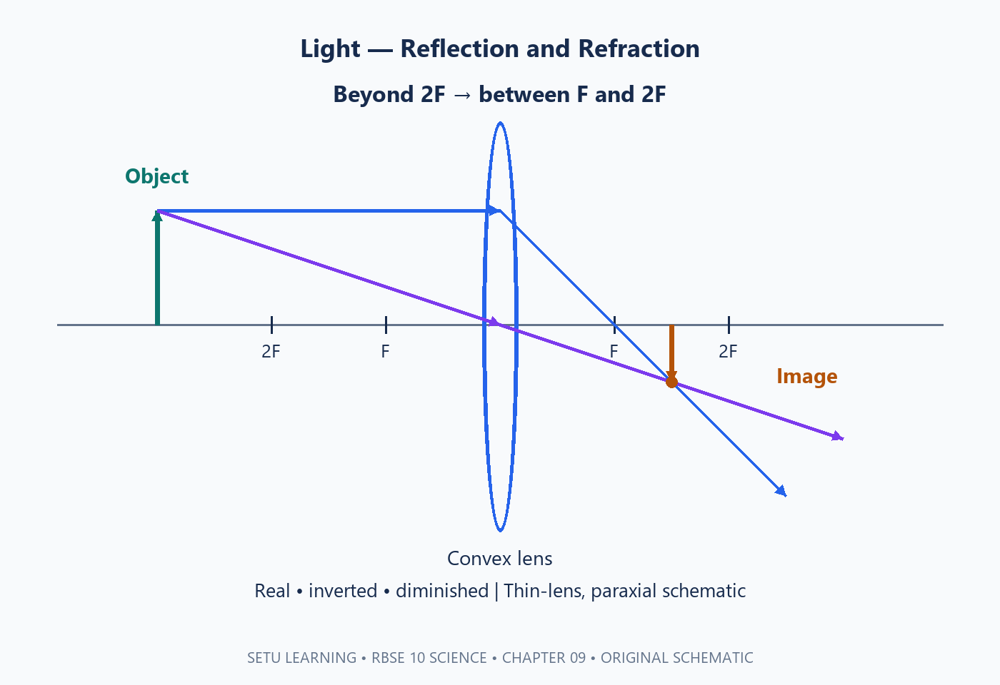

# अध्याय 9: प्रकाश: परावर्तन तथा अपवर्तन (Light — Reflection and Refraction)

## भाग 1: अध्याय प्रवेश एवं पाठ्यक्रम मैपिंग

> इस अध्याय का 2026–27 पाठ्यक्रम-क्षेत्र मिलाया गया है; NCERT के सभी प्रश्नों के हल तथा पूरा ऐतिहासिक PYQ संग्रह अभी स्रोत-परीक्षण में हैं।

**विषय कोड:** 07 · **श्रृंखला पुस्तक:** 2

**सत्यापित आधार:** RBSE 2026–27 · **अध्याय भार:** 8 अंक। यह आधिकारिक chapter weight है; वास्तविक प्रश्न-विभाजन की भविष्यवाणी नहीं।

**सीखने के लक्ष्य:** Reflection/refraction laws, mirror और lens signs का उपयोग; image cases समझना; distance, magnification और power की गणना करना।

## भाग 2: शब्दावली एवं अवधारणा कैप्सूल

| शब्द / सूत्र | अर्थ / उपयोग |
|---|---|
| परावर्तन | Light का उसी medium में surface से वापस लौटना। |
| अपवर्तन | Medium बदलने पर light speed और सामान्यतः direction बदलना। |
| Principal axis | Mirror pole/curvature center अथवा lens optical center से जाने वाली axis। |
| Focus | Axis-parallel paraxial rays का मिलने/मिलते प्रतीत होने वाला बिंदु। |
| Mirror formula | 1/f = 1/v + 1/u; Cartesian signs सहित। |
| Mirror magnification | m = −v/u = hᵢ/hₒ। |
| Lens formula | 1/f = 1/v − 1/u; Cartesian signs सहित। |
| Lens magnification | m = v/u = hᵢ/hₒ। |
| Refractive index | n = c/v; vacuum speed / medium speed। |
| Lens power | P = 1/f, f metre में; unit dioptre (D)। |

## भाग 3: विस्तृत शिक्षण पाठ

### नियम और conventions
Reflection में incident ray, reflected ray और normal एक plane में तथा angle i = angle r होता है। Angles normal से मापें, surface से नहीं। Refraction के लिए same plane और $\sin i/\sin r=n_{21}$, fixed media और wavelength के लिए। Normal incidence पर speed बदल सकती है जबकि direction नहीं बदलती। Optically denser में oblique ray normal की ओर और rarer में दूर bends करती है। Optical density mass density का पर्याय नहीं।

### Mirrors और image cases
New Cartesian convention में pole origin; incident light की दिशा positive, opposite negative; axis के ऊपर height positive। Left-side object के लिए u negative है। Concave mirror f negative, convex f positive। Concave में object beyond C: image F–C, real/inverted/diminished; at C: at C/same size; C–F: beyond C/enlarged; at F: infinity; F–P: virtual/erect/enlarged behind mirror। Convex finite object के लिए virtual/erect/diminished image P–F behind mirror देता है। Paraxial spherical mirrors में R = 2f।

### Lenses और rays
Convex lens positive f; concave negative f। Axis-parallel ray convex lens के far focus की ओर जाती है; optical-center ray thin-lens approximation में undeviated है। Convex object beyond 2F: image F–2F; at 2F: at 2F/same size; F–2F: beyond 2F/enlarged; at F: infinity; within F: virtual/erect/enlarged object side। Concave lens finite real object के लिए virtual/erect/diminished image object side O–F देता है। Image तभी बनती है जब rays intersect या backward extensions intersect करते हैं; अकेली ray पर्याप्त नहीं।

### Formula से उत्तर की जाँच
Mirror में $1/f=1/v+1/u$ और $m=-v/u$; lens में $1/f=1/v-1/u$ और $m=v/u$। Negative magnification inverted, positive erect image दर्शाता है। Distance units एक जैसी रखें। Lens power metre वाली focal length का reciprocal है: +0.5 m convex lens का +2 D। Rectangular slab emergent ray parallel लेकिन laterally displaced हो सकती है; normal incidence पर displacement शून्य है।

Thin convex lens ray diagram: object 2F से परे; image F और 2F के बीच real, inverted और छोटी। दूरी schematic है।

## भाग 4: पाठ्यपुस्तक-अवधारणाओं पर मौलिक हल किए उदाहरण

नीचे के प्रश्न लेखक के मौलिक मॉडल हैं। ये किसी NCERT edition के प्रश्न क्रमांक या संपूर्ण in-text/exercise solution bank होने का दावा नहीं करते।

**हल किया उदाहरण 1: Concave mirror: u = −30 cm, f = −15 cm। v और m निकालें।**

1/v = 1/f − 1/u = −1/15 + 1/30 = −1/30। v = −30 cm। m = −v/u = −1; image real, inverted और same size है, object C पर है।

**हल किया उदाहरण 2: Convex lens: u = −30 cm, f = +20 cm। v तथा m दें।**

1/v = 1/f + 1/u = 1/20 − 1/30 = 1/60। v = +60 cm। m = v/u = −2। Image lens के दूसरी ओर real, inverted, double height है।

**हल किया उदाहरण 3: Concave lens f = −25 cm की power निकालें।**

f = −0.25 m। P = 1/f = −4 D। Minus sign diverging lens दर्शाता है। 1/(−25) D लिखना cm को metre में न बदलने की गलती होगी।

## भाग 5: सत्यापित बोर्ड प्रश्न एवं स्रोत-स्थिति

इस अध्याय का वर्षवार PYQ audit अभी पूरा नहीं है। अभ्यास प्रश्नों पर काल्पनिक परीक्षा-वर्ष नहीं लगाए गए हैं। [असली 2025 बोर्ड पेपर](https://rajeduboard.rajasthan.gov.in/books/PAPERS-2025/Sec/S-07.pdf) से प्रश्न, उपभाग और अंक मिलाकर ही नया PYQ जोड़ा जाए।

## भाग 6: खंडवार मौलिक अभ्यास बैंक

**अभ्यास-अंक:** लेखक के स्व-अभ्यास के लिए हैं; RBSE की आधिकारिक marking scheme नहीं। उत्तर पहले स्वयं लिखें, फिर भाग 9 देखें।

## अ: बहुविकल्पीय प्रश्न — 15 × 1 अंक

**MCQ 1. Reflection में i और r का संबंध क्या है?**

अ) i = 2r  
ब) i + r = 180° हमेशा  
स) i = 0 हमेशा  
द) i = r

**MCQ 2. Concave mirror की f sign क्या है?**

अ) Zero हमेशा  
ब) कोई sign नहीं  
स) Negative  
द) Positive

**MCQ 3. Convex mirror finite object की image कैसी है?**

अ) Virtual inverted  
ब) Virtual erect diminished  
स) Real inverted enlarged  
द) Real erect same size

**MCQ 4. Mirror magnification formula कौन है?**

अ) −v/u  
ब) v/u  
स) u/v  
द) f/u

**MCQ 5. Lens magnification formula कौन है?**

अ) −v/u  
ब) −u/v  
स) f/v  
द) v/u

**MCQ 6. Convex lens की f sign क्या है?**

अ) Zero  
ब) हमेशा undefined  
स) Positive  
द) Negative

**MCQ 7. Lens power की unit क्या है?**

अ) Joule  
ब) Dioptre  
स) Ohm  
द) Ampere

**MCQ 8. f = +50 cm lens की power क्या है?**

अ) +2 D  
ब) +0.02 D  
स) −2 D  
द) +50 D

**MCQ 9. Vacuum से medium का refractive index क्या है?**

अ) v/c  
ब) c+v  
स) c−v  
द) c/v

**MCQ 10. Denser medium में oblique ray सामान्यतः कैसे bends करती है?**

अ) हमेशा वापस  
ब) कभी speed नहीं बदलती  
स) Normal की ओर  
द) Normal से दूर

**MCQ 11. Concave mirror में object C पर हो तो image कहाँ है?**

अ) Behind mirror F पर  
ब) C पर  
स) F पर  
द) P पर

**MCQ 12. Paraxial spherical mirror के R और f का संबंध क्या है?**

अ) R = 2f  
ब) R = f/2  
स) R = f  
द) R = 4f

**MCQ 13. Negative magnification का अर्थ क्या है?**

अ) Erect image  
ब) हमेशा virtual  
स) हमेशा enlarged  
द) Inverted image

**MCQ 14. Concave lens finite real object की image कैसी है?**

अ) Real same size  
ब) Virtual inverted  
स) Virtual erect diminished  
द) Real inverted enlarged

**MCQ 15. Normal incidence पर refraction में direction क्या कर सकती है?**

अ) Medium speed बराबर जरूरी  
ब) Unchanged रह सकती है  
स) हमेशा 90° घूमती है  
द) हमेशा वापस आती है

## आ: रिक्त स्थान — 6 × 1 अंक

1. Light का उसी medium में surface से वापस लौटना। — इस शब्द/सूत्र का नाम है: ____।  
2. Medium बदलने पर light speed और सामान्यतः direction बदलना। — इस शब्द/सूत्र का नाम है: ____।  
3. Mirror pole/curvature center अथवा lens optical center से जाने वाली axis। — इस शब्द/सूत्र का नाम है: ____।  
4. Axis-parallel paraxial rays का मिलने/मिलते प्रतीत होने वाला बिंदु। — इस शब्द/सूत्र का नाम है: ____।  
5. 1/f = 1/v + 1/u; Cartesian signs सहित। — इस शब्द/सूत्र का नाम है: ____।  
6. m = −v/u = hᵢ/hₒ। — इस शब्द/सूत्र का नाम है: ____।

## इ: अतिलघु उत्तर — 8 × 1 अंक

1. Reflection में i और r का संबंध क्या है?  
2. Concave mirror की f sign क्या है?  
3. Convex mirror finite object की image कैसी है?  
4. Mirror magnification formula कौन है?  
5. Lens magnification formula कौन है?  
6. Convex lens की f sign क्या है?  
7. Lens power की unit क्या है?  
8. f = +50 cm lens की power क्या है?

## ई: लघु उत्तर — 6 × 2 अंक

**B1.** Reflection angles normal से क्यों मापें?

**B2.** Real और virtual image का अंतर दें।

**B3.** Convex mirror vehicle rear-view में क्यों उपयोगी है?

**B4.** Lens और mirror magnification का अंतर बताइए।

**B5.** Optical density और mass density अलग कैसे हैं?

**B6.** Glass slab से emergent ray parallel क्यों होती है?

## उ: दीर्घ उत्तर — 4 × 3 अंक

आंतरिक विकल्प अभ्यास: C1 अथवा C2, तथा C3 अथवा C4 चुनें। पुनरावृत्ति में बचा विकल्प भी हल करें। यह लेखक की अभ्यास व्यवस्था है।

**C1.** Concave mirror के three standard construction rays दें।

**C2.** Convex lens beyond 2F case समझाएँ।

**C3.** Snell law और normal incidence की सीमा दें।

**C4.** Convex lens within-focus case समझाएँ।

## ऊ: विस्तृत उत्तर — 2 × 4 अंक

आंतरिक विकल्प अभ्यास: D1 अथवा D2 चुनें; बाद में दूसरा भी हल करें।

**D1.** Concave mirror f = −10 cm में u = −15 cm पर object है। v, m और nature दें।

**D2.** Convex lens f = +15 cm, u = −10 cm के लिए image दें तथा diagram steps लिखें।

## भाग 7: सावधानियाँ एवं परीक्षा-त्रुटियाँ

- Mirror और lens equations अलग हैं।
- Power में f metre में लें।
- Angle normal से मापें।
- Virtual image की backward extensions dashed रखें।
- v/m के signs के साथ ray-case मिलाएँ।

## भाग 8: फटाफट पुनरावृत्ति — 25 बिंदु

1. परावर्तन: Light का उसी medium में surface से वापस लौटना।  
2. अपवर्तन: Medium बदलने पर light speed और सामान्यतः direction बदलना।  
3. Principal axis: Mirror pole/curvature center अथवा lens optical center से जाने वाली axis।  
4. Focus: Axis-parallel paraxial rays का मिलने/मिलते प्रतीत होने वाला बिंदु।  
5. Mirror formula: 1/f = 1/v + 1/u; Cartesian signs सहित।  
6. Mirror magnification: m = −v/u = hᵢ/hₒ।  
7. Lens formula: 1/f = 1/v − 1/u; Cartesian signs सहित।  
8. Lens magnification: m = v/u = hᵢ/hₒ।  
9. Refractive index: n = c/v; vacuum speed / medium speed।  
10. Lens power: P = 1/f, f metre में; unit dioptre (D)।  
11. दोनों angles surface normal से मापने पर बराबर हैं।  
12. Incident-light direction positive रखने पर concave focus object side में negative है।  
13. Convex mirror reflected rays diverge करता है; extensions behind mirror मिलती हैं।  
14. Mirror geometry और Cartesian convention से m=−v/u मिलता है।  
15. Thin lens के लिए m=v/u है; mirror वाला minus न लगाएँ।  
16. Converging convex lens का far-side principal focus positive है।  
17. P=1/f metre में होने से unit m⁻¹ यानी dioptre है।  
18. 50 cm=0.5 m, reciprocal +2 D है।  
19. Absolute refractive index vacuum speed divided by medium speed है।  
20. Higher index में speed कम होती है और oblique ray normal की ओर मुड़ती है।  
21. C case में image real inverted और same size C पर बनती है।  
22. Spherical mirror का principal focal length radius का आधा है।  
23. m<0 image height का object से opposite sign दर्शाता है।  
24. Diverging lens object side focus और center के बीच virtual image देता है।  
25. Normal incidence पर ray straight चलती है, भले speed बदले।

## भाग 9: संपूर्ण अभ्यास उत्तर-कुंजी

## MCQ: सही विकल्प और कारण

**1. द — i = r।** दोनों angles surface normal से मापने पर बराबर हैं।

**2. स — Negative।** Incident-light direction positive रखने पर concave focus object side में negative है।

**3. ब — Virtual erect diminished।** Convex mirror reflected rays diverge करता है; extensions behind mirror मिलती हैं।

**4. अ — −v/u।** Mirror geometry और Cartesian convention से m=−v/u मिलता है।

**5. द — v/u।** Thin lens के लिए m=v/u है; mirror वाला minus न लगाएँ।

**6. स — Positive।** Converging convex lens का far-side principal focus positive है।

**7. ब — Dioptre।** P=1/f metre में होने से unit m⁻¹ यानी dioptre है।

**8. अ — +2 D।** 50 cm=0.5 m, reciprocal +2 D है।

**9. द — c/v।** Absolute refractive index vacuum speed divided by medium speed है।

**10. स — Normal की ओर।** Higher index में speed कम होती है और oblique ray normal की ओर मुड़ती है।

**11. ब — C पर।** C case में image real inverted और same size C पर बनती है।

**12. अ — R = 2f।** Spherical mirror का principal focal length radius का आधा है।

**13. द — Inverted image।** m<0 image height का object से opposite sign दर्शाता है।

**14. स — Virtual erect diminished।** Diverging lens object side focus और center के बीच virtual image देता है।

**15. ब — Unchanged रह सकती है।** Normal incidence पर ray straight चलती है, भले speed बदले।

**रिक्त स्थान:** 1. परावर्तन; 2. अपवर्तन; 3. Principal axis; 4. Focus; 5. Mirror formula; 6. Mirror magnification

**अतिलघु उत्तर:**

1. i = r। दोनों angles surface normal से मापने पर बराबर हैं।

2. Negative। Incident-light direction positive रखने पर concave focus object side में negative है।

3. Virtual erect diminished। Convex mirror reflected rays diverge करता है; extensions behind mirror मिलती हैं।

4. −v/u। Mirror geometry और Cartesian convention से m=−v/u मिलता है।

5. v/u। Thin lens के लिए m=v/u है; mirror वाला minus न लगाएँ।

6. Positive। Converging convex lens का far-side principal focus positive है।

7. Dioptre। P=1/f metre में होने से unit m⁻¹ यानी dioptre है।

8. +2 D। 50 cm=0.5 m, reciprocal +2 D है।

**B1. Reflection angles normal से क्यों मापें?**

Reflection law i=r में incidence/reflection angles normal और respective ray के बीच हैं। Surface से measured angles complementary होते हैं; question का angle किस reference से है, पहले पहचानें। Diagram में normal अलग dashed line दिखाएँ।

**B2. Real और virtual image का अंतर दें।**

Real image actual light rays के intersection से बनती है और screen पर प्राप्त हो सकती है। Virtual image backward extensions के apparent intersection से बनती है; उसे उसी स्थान पर screen से capture नहीं कर सकते। Orientation alone परिभाषा नहीं।

**B3. Convex mirror vehicle rear-view में क्यों उपयोगी है?**

यह finite objects की erect, diminished virtual image और wide field of view देता है। इसलिए अधिक पीछे का क्षेत्र दिखाई देता है। Objects छोटे दिखने से distance का गलत अनुमान हो सकता है; इसे magnifying mirror न कहें।

**B4. Lens और mirror magnification का अंतर बताइए।**

Mirror formula m=−v/u और thin lens formula m=v/u है। दोनों में m=hᵢ/hₒ; negative sign inverted image का संकेत है। Formula बदलने पर एक ही memorised sign न लगाएँ।

**B5. Optical density और mass density अलग कैसे हैं?**

Optical density light speed/refractive index से संबंधित है। Mass density mass per unit volume है। Mass-density comparison से refraction की दिशा का universal निर्णय नहीं किया जा सकता; refractive indices उपयोग करें।

**B6. Glass slab से emergent ray parallel क्यों होती है?**

Slab की opposite refracting faces parallel हैं। दूसरे interface का bending पहले के angular deviation को compensate करता है, इसलिए बाहर same medium में emergent ray incident ray के parallel होती है। Path में lateral shift रह सकता है।

**C1. Concave mirror के three standard construction rays दें।**

1. Parallel ray reflection के बाद F से गुजरती है। 2. F से होकर आने वाली ray axis parallel reflect होती है। 3. C की ओर ray normal incidence के कारण अपना path retrace करती है। कम से कम दो rays से image locate करें।

**C2. Convex lens beyond 2F case समझाएँ।**

1. Object को 2F से दूर रखें। 2. Top से axis-parallel ray far F की ओर और optical-center ray straight draw करें। 3. Rays lens की दूसरी ओर F–2F में मिलती हैं; image real, inverted और diminished है।

**C3. Snell law और normal incidence की सीमा दें।**

1. Fixed media के लिए sin i/sin r relative index है। 2. Denser medium में oblique ray normal की ओर मुड़ती है। 3. i=0 पर r=0, direction unchanged रहती है; speed/wavelength बदल सकती है। 0/0 को ordinary quotient की तरह न compute करें।

**C4. Convex lens within-focus case समझाएँ।**

1. Object lens और near F के बीच हो। 2. Refracted rays diverge; backward extensions object side पर मिलती हैं। 3. Image virtual, erect और magnified है; real rays सामने screen पर इस image को नहीं बनातीं।

**D1. Concave mirror f = −10 cm में u = −15 cm पर object है। v, m और nature दें।**

1. 1/v = −1/10 + 1/15 = −1/30। 2. v = −30 cm। 3. m = −(−30)/(−15) = −2। 4. Image real, inverted और twice size; C से परे बनती है। Sign, magnitude और qualitative ray case तीनों consistent हैं।

**D2. Convex lens f = +15 cm, u = −10 cm के लिए image दें तथा diagram steps लिखें।**

1. 1/v = 1/15 − 1/10 = −1/30, v = −30 cm। 2. m = (−30)/(−10) = +3। 3. Virtual, erect, three times size, object side। 4. Parallel-to-focus ray और optical-center ray की backward extensions draw करें; object F के भीतर है।

## भाग 10: 10 मिनट / 10 अंक आत्म-मूल्यांकन एवं संदर्भ

समय: 10 मिनट। पहले पुस्तक बंद करें।

1. MCQ 3 और 11 हल करें। (1 + 1)
2. B2 और B5 के उत्तर लिखें। (2 + 2)
3. D1 हल करें। (4)

**कुंजी:** भाग 9 में संबंधित क्रमांक देखें। **स्व-मूल्यांकन:** 8–10: आगे बढ़ें; 5–7: छूटे कौशल का दोहराव; 0–4: भाग 2–4 फिर पढ़ें। यह अभ्यास-सुझाव है, बोर्ड grade नहीं।

[सत्यापित RBSE 2026–27 पाठ्यक्रम](https://rajeduboard.rajasthan.gov.in/anudeshika-etc/10_2026.pdf) · [NCERT विज्ञान अध्याय 9](https://ncert.nic.in/textbook/pdf/jesc109.pdf)

**आगे की कड़ी:** अगले अध्याय में lens और refraction का उपयोग human eye और colour phenomena में करेंगे।
