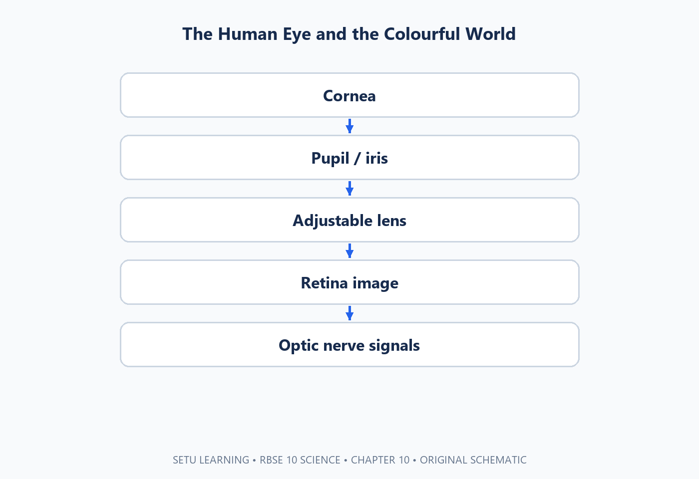

# अध्याय 10: मानव नेत्र तथा रंगबिरंगा संसार (The Human Eye and the Colourful World)

## भाग 1: अध्याय प्रवेश एवं पाठ्यक्रम मैपिंग

> प्रथम संपादकीय प्रारूप। इस अध्याय का 2026–27 पाठ्यक्रम-क्षेत्र मिलाया गया है; NCERT के सभी प्रश्नों के हल तथा पूरा ऐतिहासिक PYQ संग्रह अभी स्रोत-परीक्षण में हैं।

**विषय कोड:** 07 · **श्रृंखला पुस्तक:** 2

**सत्यापित आधार:** RBSE 2026–27 · **अध्याय भार:** 4 अंक। यह आधिकारिक chapter weight है; वास्तविक प्रश्न-विभाजन की भविष्यवाणी नहीं।

**सीखने के लक्ष्य:** Eye optics, accommodation और vision defects; prism dispersion, atmospheric refraction और scattering के कारण समझना।

## भाग 2: शब्दावली एवं अवधारणा कैप्सूल

| शब्द / सूत्र | अर्थ / उपयोग |
|---|---|
| Cornea | Eye का transparent front surface; refraction का बड़ा भाग यहाँ। |
| Iris | Pupil size नियंत्रित करने वाला coloured diaphragm। |
| Pupil | Light के प्रवेश का opening; iris से नियंत्रित। |
| Retina | Light-sensitive layer जहाँ optical image बनती है। |
| Accommodation | Ciliary muscles द्वारा lens curvature/focal length बदलना। |
| Myopia | Distant objects स्पष्ट नहीं; image retina के आगे बनती है। |
| Hypermetropia | Near objects स्पष्ट नहीं; image retina के पीछे बनने की प्रवृत्ति। |
| Presbyopia | Age-related accommodation decrease से near vision कठिन। |
| Dispersion | White light का constituent colours में separation। |
| Scattering | Particles द्वारा light को विभिन्न दिशाओं में भेजना। |

## भाग 3: विस्तृत शिक्षण पाठ

### Eye एक adjustable optical system
Cornea और lens light refract करके retina पर real, inverted image बनाते हैं। Optic nerve signals brain तक ले जाती है। Iris pupil का aperture नियंत्रित करता है, lens की focal length नहीं। Ciliary muscles lens curvature बदलते हैं। Near object पर lens अधिक convex होकर focal length घटाता है; distant object पर flatter होकर बढ़ाता है। Typical normal near point लगभग 25 cm और far point infinity school model में माना जाता है; यह हर व्यक्ति की exact measurement नहीं।

### Defects और correction
Myopia में distant-object image retina के आगे focus होती है; concave lens rays diverge कर corrected focusing में मदद करता है। Hypermetropia में near-object image retina के पीछे बनने की tendency है; convex lens convergence बढ़ाता है। Presbyopia में aging से accommodation घटती है; correction individual need के अनुसार होती है और combined defects में bifocal/progressive lenses useful हो सकते हैं। Cataract lens clouding है, केवल focal defect नहीं; clinical treatment अलग है।

### Prism और atmosphere
Glass prism different wavelengths को अलग refractive index से refract करता है; violet का deviation red से अधिक होता है। White light separation dispersion, लेकिन single-colour beam का bending refraction है। Rainbow में droplets का refraction, dispersion और internal reflection योगदान करते हैं। Atmosphere की changing optical density stars की apparent brightness/position fluctuation देती है। Planets extended apparent sources होने से scintillation काफी average out करते हैं। Atmospheric refraction sun को geometric sunrise से कुछ पहले visible बना सकती है।

### Sky blue क्यों?
Small-particle/molecular scattering short wavelengths के लिए अधिक है। Blue wavelengths red से अधिक scattered होती हैं; spectral distribution और eye response के साथ sky blue दिखाई देता है, केवल ‘violet नहीं मौजूद’ कारण नहीं। Larger colloidal particles के path-visible scattering को Tyndall effect कहते हैं। Red light relatively कम scattered होती है, इसलिए warning signals में useful है। Moon जैसे atmosphere-रहित स्थान पर sky dark दिखता है।

Eye optics का simplified route; accommodation और pupil control अलग mechanisms हैं।

## भाग 4: पाठ्यपुस्तक-अवधारणाओं पर मौलिक हल किए उदाहरण

नीचे के प्रश्न लेखक के मौलिक मॉडल हैं। ये किसी NCERT edition के प्रश्न क्रमांक या संपूर्ण in-text/exercise solution bank होने का दावा नहीं करते।

**हल किया उदाहरण 1: Myopic eye का far point 2 m है। Correction power का school-model estimate दें।**

Distant object u=−∞ की virtual image far point v=−2 m पर चाहिए। Lens equation 1/f=1/v−1/u≈−1/2, f=−2 m और P=−0.5 D। Prescription की वास्तविक जाँच clinician करता है।

**हल किया उदाहरण 2: Near object देखते समय ciliary muscles और lens कैसे बदलते हैं?**

Ciliary muscles contract, lens अधिक convex/thicker हो सकता है, focal length घटती और power बढ़ती है। इससे पास के object की rays retina पर focus हो पाती हैं।

**हल किया उदाहरण 3: Prism में red और violet का relative deviation दें।**

Normal glass prism में violet wavelength के लिए refractive index अधिक, इसलिए deviation अधिक है। Red का deviation सबसे कम होता है। यह dispersion का school-level pattern है।

## भाग 5: सत्यापित बोर्ड प्रश्न एवं स्रोत-स्थिति

इस अध्याय का वर्षवार PYQ audit अभी पूरा नहीं है। अभ्यास प्रश्नों पर काल्पनिक परीक्षा-वर्ष नहीं लगाए गए हैं। [असली 2025 बोर्ड पेपर](https://rajeduboard.rajasthan.gov.in/books/PAPERS-2025/Sec/S-07.pdf) से प्रश्न, उपभाग और अंक मिलाकर ही नया PYQ जोड़ा जाए।

## भाग 6: खंडवार मौलिक अभ्यास बैंक

**अभ्यास-अंक:** लेखक के स्व-अभ्यास के लिए हैं; RBSE की आधिकारिक marking scheme नहीं। उत्तर पहले स्वयं लिखें, फिर भाग 9 देखें।

## अ: बहुविकल्पीय प्रश्न — 15 × 1 अंक

**MCQ 1. Eye की light-sensitive layer कौन है?**

अ) Cornea ही  
ब) Pupil  
स) Retina  
द) Iris

**MCQ 2. Pupil size कौन नियंत्रित करता है?**

अ) Tear gland  
ब) Iris  
स) Retina  
द) Optic nerve ही

**MCQ 3. Accommodation मुख्यतः किससे होती है?**

अ) Lens curvature change  
ब) Retina की daily growth  
स) Eye colour change  
द) Pupil का lens बनना

**MCQ 4. Near object के लिए lens focal length सामान्यतः क्या करती है?**

अ) बढ़ती है  
ब) हमेशा infinity  
स) शून्य ही  
द) घटती है

**MCQ 5. Myopia correction का lens कौन है?**

अ) Plane glass ही  
ब) Prism ही  
स) Concave  
द) Convex

**MCQ 6. Hypermetropia correction का lens कौन है?**

अ) Opaque glass  
ब) Convex  
स) Concave  
द) Plane mirror

**MCQ 7. School model में normal near point लगभग कितना है?**

अ) 25 cm  
ब) 25 m  
स) 2.5 mm  
द) Infinity

**MCQ 8. Prism में least deviation colour कौन है?**

अ) Violet  
ब) Blue  
स) Indigo  
द) Red

**MCQ 9. White light का colour separation क्या है?**

अ) Neutralisation  
ब) Conduction  
स) Dispersion  
द) केवल reflection

**MCQ 10. Clear sky blue होने का मुख्य phenomenon क्या है?**

अ) Magnetism  
ब) Scattering  
स) केवल total reflection  
द) Nuclear fusion

**MCQ 11. Colloid में beam path दिखने का नाम क्या है?**

अ) Tyndall effect  
ब) Joule effect  
स) Ohm law  
द) Mendel law

**MCQ 12. Star twinkling मुख्यतः किससे जुड़ा है?**

अ) Star का रोज बुझना  
ब) Moon reflection ही  
स) Glass lens defect  
द) Atmospheric refraction fluctuations

**MCQ 13. Presbyopia मुख्यतः क्या है?**

अ) हर बार infection  
ब) Retina आगे बढ़ना  
स) Age-related accommodation decrease  
द) Pupil का रंग लाल

**MCQ 14. Cataract क्या है?**

अ) Pupil widening  
ब) Lens clouding  
स) केवल myopia  
द) केवल colour blindness

**MCQ 15. Retina पर optical image कैसी होती है?**

अ) Real inverted  
ब) Virtual erect  
स) Virtual inverted हमेशा  
द) Real erect

## आ: रिक्त स्थान — 6 × 1 अंक

1. Eye का transparent front surface; refraction का बड़ा भाग यहाँ। — इस शब्द/सूत्र का नाम है: ____।  
2. Pupil size नियंत्रित करने वाला coloured diaphragm। — इस शब्द/सूत्र का नाम है: ____।  
3. Light के प्रवेश का opening; iris से नियंत्रित। — इस शब्द/सूत्र का नाम है: ____।  
4. Light-sensitive layer जहाँ optical image बनती है। — इस शब्द/सूत्र का नाम है: ____।  
5. Ciliary muscles द्वारा lens curvature/focal length बदलना। — इस शब्द/सूत्र का नाम है: ____।  
6. Distant objects स्पष्ट नहीं; image retina के आगे बनती है। — इस शब्द/सूत्र का नाम है: ____।

## इ: अतिलघु उत्तर — 8 × 1 अंक

1. Eye की light-sensitive layer कौन है?  
2. Pupil size कौन नियंत्रित करता है?  
3. Accommodation मुख्यतः किससे होती है?  
4. Near object के लिए lens focal length सामान्यतः क्या करती है?  
5. Myopia correction का lens कौन है?  
6. Hypermetropia correction का lens कौन है?  
7. School model में normal near point लगभग कितना है?  
8. Prism में least deviation colour कौन है?

## ई: लघु उत्तर — 6 × 2 अंक

**B1.** Iris और ciliary muscles की भूमिकाएँ अलग करें।

**B2.** Myopia का cause और correction दें।

**B3.** Hypermetropia का cause और correction दें।

**B4.** Presbyopia और cataract का अंतर दें।

**B5.** Stars twinkle और planets कम क्यों करते हैं?

**B6.** Blue sky और Tyndall effect का संबंध और अंतर दें।

## उ: दीर्घ उत्तर — 4 × 3 अंक

आंतरिक विकल्प अभ्यास: C1 अथवा C2, तथा C3 अथवा C4 चुनें। पुनरावृत्ति में बचा विकल्प भी हल करें। यह लेखक की अभ्यास व्यवस्था है।

**C1.** Eye light path और retina image बताएँ।

**C2.** Myopia/hypermetropia का diagram कैसे अलग बनाएँ?

**C3.** Prism dispersion के तीन बिंदु दें।

**C4.** Atmospheric refraction के दो examples और mechanism दें।

## ऊ: विस्तृत उत्तर — 2 × 4 अंक

आंतरिक विकल्प अभ्यास: D1 अथवा D2 चुनें; बाद में दूसरा भी हल करें।

**D1.** Normal near vision, myopia और hypermetropia को image location और correction से तुलना करें।

**D2.** Sky colour, red warning signal और stars twinkling का कारण अलग-अलग समझाएँ।

## भाग 7: सावधानियाँ एवं परीक्षा-त्रुटियाँ

- Myopia concave, hypermetropia convex।
- Iris और ciliary muscle के काम अलग।
- Twinkling refraction, sky colour scattering।
- Cataract को presbyopia न कहें।
- 25 cm typical model है, सभी लोगों का fixed near point नहीं।

## भाग 8: फटाफट पुनरावृत्ति — 25 बिंदु

1. Cornea: Eye का transparent front surface; refraction का बड़ा भाग यहाँ।  
2. Iris: Pupil size नियंत्रित करने वाला coloured diaphragm।  
3. Pupil: Light के प्रवेश का opening; iris से नियंत्रित।  
4. Retina: Light-sensitive layer जहाँ optical image बनती है।  
5. Accommodation: Ciliary muscles द्वारा lens curvature/focal length बदलना।  
6. Myopia: Distant objects स्पष्ट नहीं; image retina के आगे बनती है।  
7. Hypermetropia: Near objects स्पष्ट नहीं; image retina के पीछे बनने की प्रवृत्ति।  
8. Presbyopia: Age-related accommodation decrease से near vision कठिन।  
9. Dispersion: White light का constituent colours में separation।  
10. Scattering: Particles द्वारा light को विभिन्न दिशाओं में भेजना।  
11. Retina में light-sensitive cells visual signals बनाती हैं।  
12. Iris aperture बदलकर pupil size नियंत्रित करता है।  
13. Ciliary muscles lens curvature बदलकर focal length adjust करते हैं।  
14. Lens अधिक convex होने से focal length घटती और power बढ़ती है।  
15. Concave lens rays diverge करके premature focusing सुधारता है।  
16. Convex lens convergence बढ़ाता है और near focusing में मदद करता है।  
17. Typical near point लगभग 25 cm लिया जाता है; individual variation होती है।  
18. Ordinary glass prism में red light least deviate करती है।  
19. Wavelength-dependent refraction components अलग करती है।  
20. Short visible wavelengths अधिक scattered होती हैं।  
21. Particles की scattering से beam path visible हो सकता है।  
22. Changing atmosphere star light के apparent intensity/position को बदलता है।  
23. Aging में lens elasticity/muscle-related accommodation घट सकती है।  
24. Cataract transparency का defect है, simple focusing error मात्र नहीं।  
25. Eye optics real inverted image retina पर बनाते हैं; brain signals interpret करता है।

## भाग 9: संपूर्ण अभ्यास उत्तर-कुंजी

## MCQ: सही विकल्प और कारण

**1. स — Retina।** Retina में light-sensitive cells visual signals बनाती हैं।

**2. ब — Iris।** Iris aperture बदलकर pupil size नियंत्रित करता है।

**3. अ — Lens curvature change।** Ciliary muscles lens curvature बदलकर focal length adjust करते हैं।

**4. द — घटती है।** Lens अधिक convex होने से focal length घटती और power बढ़ती है।

**5. स — Concave।** Concave lens rays diverge करके premature focusing सुधारता है।

**6. ब — Convex।** Convex lens convergence बढ़ाता है और near focusing में मदद करता है।

**7. अ — 25 cm।** Typical near point लगभग 25 cm लिया जाता है; individual variation होती है।

**8. द — Red।** Ordinary glass prism में red light least deviate करती है।

**9. स — Dispersion।** Wavelength-dependent refraction components अलग करती है।

**10. ब — Scattering।** Short visible wavelengths अधिक scattered होती हैं।

**11. अ — Tyndall effect।** Particles की scattering से beam path visible हो सकता है।

**12. द — Atmospheric refraction fluctuations।** Changing atmosphere star light के apparent intensity/position को बदलता है।

**13. स — Age-related accommodation decrease।** Aging में lens elasticity/muscle-related accommodation घट सकती है।

**14. ब — Lens clouding।** Cataract transparency का defect है, simple focusing error मात्र नहीं।

**15. अ — Real inverted।** Eye optics real inverted image retina पर बनाते हैं; brain signals interpret करता है।

**रिक्त स्थान:** 1. Cornea; 2. Iris; 3. Pupil; 4. Retina; 5. Accommodation; 6. Myopia

**अतिलघु उत्तर:**

1. Retina। Retina में light-sensitive cells visual signals बनाती हैं।

2. Iris। Iris aperture बदलकर pupil size नियंत्रित करता है।

3. Lens curvature change। Ciliary muscles lens curvature बदलकर focal length adjust करते हैं।

4. घटती है। Lens अधिक convex होने से focal length घटती और power बढ़ती है।

5. Concave। Concave lens rays diverge करके premature focusing सुधारता है।

6. Convex। Convex lens convergence बढ़ाता है और near focusing में मदद करता है।

7. 25 cm। Typical near point लगभग 25 cm लिया जाता है; individual variation होती है।

8. Red। Ordinary glass prism में red light least deviate करती है।

**B1. Iris और ciliary muscles की भूमिकाएँ अलग करें।**

Iris pupil opening बदलकर light entry नियंत्रित करता है। Ciliary muscles lens curvature बदलकर accommodation करते हैं। इसलिए brightness control और near/far focusing एक ही mechanism नहीं।

**B2. Myopia का cause और correction दें।**

Eyeball लंबा या optical power अधिक होने पर दूर object की image retina से पहले focus हो सकती है। Concave lens divergence देकर focus retina की ओर adjust करता है। Image retina के पीछे लिखना hypermetropia से मिश्रण होगा।

**B3. Hypermetropia का cause और correction दें।**

Eyeball छोटा या optical power कम होने पर near object की image retina के पीछे बनने की प्रवृत्ति होती है। Convex lens अतिरिक्त convergence देता है। Optical correction defect के measurement पर निर्भर है।

**B4. Presbyopia और cataract का अंतर दें।**

Presbyopia age-related accommodation loss है, जिससे near focusing कठिन होती है। Cataract lens clouding है, जिससे transmission और clarity प्रभावित होती है। दोनों aging से जुड़े हो सकते हैं, लेकिन cause और treatment समान नहीं।

**B5. Stars twinkle और planets कम क्यों करते हैं?**

Stars point-like sources हैं; changing atmosphere से intensity/position fluctuation स्पष्ट दिखती है। Planets का apparent disk extended होता है; अनेक points के fluctuations average होकर कम twinkling दिखाते हैं। दूरी अकेला पूर्ण कारण नहीं।

**B6. Blue sky और Tyndall effect का संबंध और अंतर दें।**

दोनों scattering से जुड़े हैं। Clear sky मुख्यतः molecules/small particles द्वारा short wavelengths के अधिक scattering से blue दिखता है। Tyndall effect colloidal/larger particles में beam path visible होने का उदाहरण है।

**C1. Eye light path और retina image बताएँ।**

1. Light cornea, pupil और lens से होकर अंदर जाती है। 2. Cornea/lens refraction retina पर real inverted optical image देता है। 3. Retinal cells signals बनाती हैं; optic nerve brain तक ले जाती है। Retina को convex lens न कहें।

**C2. Myopia/hypermetropia का diagram कैसे अलग बनाएँ?**

1. Uncorrected myopia focus retina के आगे। 2. Hypermetropia near-object focus पीछे। 3. Correction क्रमशः concave और convex external lenses से show करें; outgoing rays corrected case में retina पर meet हों। Labels में defect और lens दोनों दें।

**C3. Prism dispersion के तीन बिंदु दें।**

1. White light में अनेक wavelengths हैं। 2. Glass का refractive index wavelength-dependent है। 3. Violet अधिक और red कम deviate होकर spectrum बनाते हैं। Prism colours ‘बनाता’ नहीं, existing components अलग करता है।

**C4. Atmospheric refraction के दो examples और mechanism दें।**

1. Star apparent position बदल सकती है। 2. Sun geometric horizon के नीचे होने पर भी कुछ समय visible हो सकता है। 3. Atmosphere का refractive index altitude/conditions से बदलता है, जिससे light path bends करता है। यह reflection नहीं।

**D1. Normal near vision, myopia और hypermetropia को image location और correction से तुलना करें।**

1. Normal accommodated eye near object का focus retina पर रखती है। 2. Myopic eye में distant rays retina से पहले focus हो सकती हैं; concave lens उपयोगी। 3. Hypermetropic eye में near-object focus retina के पीछे की tendency; convex lens useful। 4. Diagrams में retina position स्थिर रखें और ray intersections सही स्थान दिखाएँ।

**D2. Sky colour, red warning signal और stars twinkling का कारण अलग-अलग समझाएँ।**

1. Short wavelengths का अधिक scattering blue sky में योगदान देता है। 2. Red wavelength का comparatively कम scattering warning visibility में मदद करता है। 3. Star twinkling atmospheric refractive-index fluctuations से है। 4. पहली दो scattering हैं, तीसरी refraction-related है; सभी को prism dispersion कहना गलत होगा।

## भाग 10: 10 मिनट / 10 अंक आत्म-मूल्यांकन एवं संदर्भ

समय: 10 मिनट। पहले पुस्तक बंद करें।

1. MCQ 3 और 11 हल करें। (1 + 1)
2. B2 और B5 के उत्तर लिखें। (2 + 2)
3. D1 हल करें। (4)

**कुंजी:** भाग 9 में संबंधित क्रमांक देखें। **स्व-मूल्यांकन:** 8–10: आगे बढ़ें; 5–7: छूटे कौशल का दोहराव; 0–4: भाग 2–4 फिर पढ़ें। यह अभ्यास-सुझाव है, बोर्ड grade नहीं।

[सत्यापित RBSE 2026–27 पाठ्यक्रम](https://rajeduboard.rajasthan.gov.in/anudeshika-etc/10_2026.pdf) · [NCERT विज्ञान अध्याय 10](https://ncert.nic.in/textbook/pdf/jesc110.pdf)

**आगे की कड़ी:** अगले अध्याय में current, potential difference और electric energy की गणना करेंगे।
