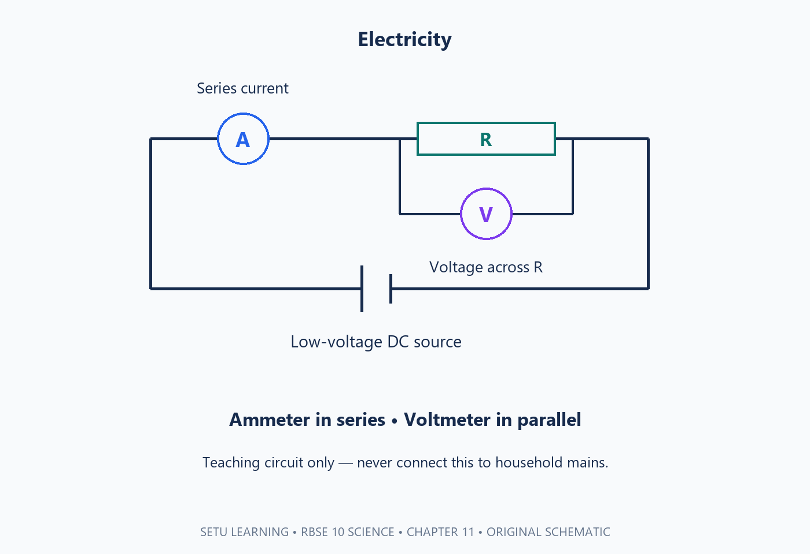

# अध्याय 11: विद्युत (Electricity)

## भाग 1: अध्याय प्रवेश एवं पाठ्यक्रम मैपिंग

> इस अध्याय का 2026–27 पाठ्यक्रम-क्षेत्र मिलाया गया है; NCERT के सभी प्रश्नों के हल तथा पूरा ऐतिहासिक PYQ संग्रह अभी स्रोत-परीक्षण में हैं।

**विषय कोड:** 07 · **श्रृंखला पुस्तक:** 2

**सत्यापित आधार:** RBSE 2026–27 · **अध्याय भार:** 7 अंक। यह आधिकारिक chapter weight है; वास्तविक प्रश्न-विभाजन की भविष्यवाणी नहीं।

**सीखने के लक्ष्य:** Current/voltage/resistance की units; circuit combinations, Ohm law और heating; power एवं commercial energy numericals हल करना।

## भाग 2: शब्दावली एवं अवधारणा कैप्सूल

| शब्द / सूत्र | अर्थ / उपयोग |
|---|---|
| Current | I = Q/t; unit ampere (A), 1 A = 1 C/s। |
| Potential difference | V = W/Q; unit volt (V), 1 V = 1 J/C। |
| Resistance | R = V/I; unit ohm (Ω)। |
| Ohm law | Fixed physical conditions में V = IR। |
| Resistivity | ρ = RA/l; material property, unit Ω·m। |
| Series resistance | Rₛ = R₁ + R₂ + …। |
| Parallel resistance | 1/Rₚ = 1/R₁ + 1/R₂ + …। |
| Joule heating | H = I²Rt; current ampere, resistance ohm, time second। |
| Power | P = VI = I²R = V²/R; unit watt। |
| Commercial energy | 1 kWh = 3.6 × 10⁶ J; kWh ऊर्जा है, power नहीं। |

## भाग 3: विस्तृत शिक्षण पाठ

### Charge से current तक
Potential difference charges को move करने का driving condition देता है; current charge-flow rate है। Conventional current positive-charge flow की direction है; metals में electrons उसके opposite drift करते हैं। Ammeter series में, voltmeter measured component के parallel में लगता है। Open circuit में steady current नहीं flows करता। Potential difference होने से बिना closed conductive path current हमेशा flows करेगा, ऐसा नहीं।

### Ohm और material
Ohm law fixed temperature और physical conditions पर V proportional I बताता है। $V=IR$; V–I graph में V vertical हो तो slope R है, I vertical हो तो slope 1/R। Wire resistance $R=\rho l/A$; length double हो और area constant तो R double। Area double हो तो half। Resistivity material तथा temperature से जुड़ी है; ordinary geometry बदलने से resistivity नहीं बदलती।

### Series और parallel
Series में current same, voltage drops add: Rₛ=R₁+R₂। Parallel में branch voltage same, currents add और reciprocal resistances add। Positive finite resistors का parallel equivalent smallest branch resistance से भी कम है। Household appliances parallel में लगते हैं ताकि rated voltage मिले और independently switch हो सकें। एक wire short circuit unintended low-resistance path बनाकर बहुत current दे सकता है।

### Heat, power और bill
Resistor heating $H=I^2Rt$ है। Power energy per time है: $P=VI$ तथा ohmic resistor के लिए $I^2R$ और $V^2/R$। Fixed current में larger R अधिक heat, fixed voltage में larger R कम power देता है; held-constant quantity पहचानें। Appliance bill energy kW × hours से निकलेगा। 1000 W=1 kW; 1 kWh=1000 J/s ×3600 s=3.6×10⁶ J। Electrical safety devices और household wiring अगले अध्याय में आएँगे; mains पर छात्र प्रयोग न करें।

Low-voltage resistor experiment: ammeter series और voltmeter resistor के parallel में।

## भाग 4: पाठ्यपुस्तक-अवधारणाओं पर मौलिक हल किए उदाहरण

नीचे के प्रश्न लेखक के मौलिक मॉडल हैं। ये किसी NCERT edition के प्रश्न क्रमांक या संपूर्ण in-text/exercise solution bank होने का दावा नहीं करते।

**हल किया उदाहरण 1: 2 Ω और 3 Ω resistors को 6 V पर series में लगाएँ। I और drops निकालें।**

R=2+3=5 Ω। I=6/5=1.2 A। V₁=1.2×2=2.4 V, V₂=1.2×3=3.6 V। Sum 6 V; series current दोनों में 1.2 A है।

**हल किया उदाहरण 2: 6 Ω और 3 Ω parallel में 6 V पर हैं। R और total current दें।**

1/R=1/6+1/3=1/2, R=2 Ω। Branch currents 1 A और 2 A; total=3 A। जाँच V/R=6/2=3 A।

**हल किया उदाहरण 3: 100 W lamp रोज 5 hours, 30 days चले तो energy और ₹6/unit पर cost दें।**

P=0.1 kW, t=150 h। E=15 kWh अर्थात 15 units। Energy charge=15×₹6=₹90; fixed charges/taxes इस illustrative calculation में शामिल नहीं।

## भाग 5: सत्यापित बोर्ड प्रश्न एवं स्रोत-स्थिति

इस अध्याय का वर्षवार PYQ audit अभी पूरा नहीं है। अभ्यास प्रश्नों पर काल्पनिक परीक्षा-वर्ष नहीं लगाए गए हैं। [असली 2025 बोर्ड पेपर](https://rajeduboard.rajasthan.gov.in/books/PAPERS-2025/Sec/S-07.pdf) से प्रश्न, उपभाग और अंक मिलाकर ही नया PYQ जोड़ा जाए।

## भाग 6: खंडवार मौलिक अभ्यास बैंक

**अभ्यास-अंक:** लेखक के स्व-अभ्यास के लिए हैं; RBSE की आधिकारिक marking scheme नहीं। उत्तर पहले स्वयं लिखें, फिर भाग 9 देखें।

## अ: बहुविकल्पीय प्रश्न — 15 × 1 अंक

**MCQ 1. Current की SI unit क्या है?**

अ) Watt  
ब) Ampere  
स) Volt  
द) Ohm

**MCQ 2. Potential difference का formula कौन है?**

अ) W/Q  
ब) Q/t  
स) I/t  
द) R/A

**MCQ 3. Ohm law किन conditions में लागू है?**

अ) हर device हर दशा में  
ब) केवल open circuit  
स) Resistance शून्य हो  
द) Temperature/physical conditions स्थिर

**MCQ 4. Ammeter circuit में कहाँ लगता है?**

अ) केवल earth  
ब) बिना wire  
स) Series  
द) Parallel across source सीधे

**MCQ 5. Voltmeter component के कैसे लगता है?**

अ) बिना terminals  
ब) Parallel  
स) Series हमेशा  
द) केवल neutral

**MCQ 6. Same material wire की length double, area same: R क्या होगा?**

अ) Double  
ब) Half  
स) Unchanged  
द) Four times

**MCQ 7. Resistivity की SI unit क्या है?**

अ) Ω/m  
ब) A/m  
स) V·s  
द) Ω·m

**MCQ 8. 2 Ω तथा 3 Ω series equivalent क्या है?**

अ) 6 Ω  
ब) 0.5 Ω  
स) 5 Ω  
द) 1.2 Ω

**MCQ 9. 6 Ω तथा 3 Ω parallel equivalent क्या है?**

अ) 6 Ω  
ब) 2 Ω  
स) 9 Ω  
द) 3 Ω

**MCQ 10. Joule heat formula कौन है?**

अ) I²Rt  
ब) IR/t  
स) V/t  
द) R²It

**MCQ 11. 1 kWh कितने joules हैं?**

अ) 3600 J  
ब) 1000 J  
स) 3.6×10⁵ J  
द) 3.6×10⁶ J

**MCQ 12. 220 V, 1100 W heater का current क्या है?**

अ) 242 A  
ब) 1100 A  
स) 5 A  
द) 0.2 A

**MCQ 13. House appliances सामान्यतः किस combination में हैं?**

अ) केवल short circuit  
ब) Parallel  
स) Series ही  
द) कोई circuit नहीं

**MCQ 14. V vertical, I horizontal graph का slope क्या है?**

अ) Resistance  
ब) Conductance  
स) Power  
द) Charge

**MCQ 15. Fixed voltage पर R double होने पर P क्या होगा?**

अ) Double  
ब) Four times  
स) Unchanged  
द) Half

## आ: रिक्त स्थान — 6 × 1 अंक

1. I = Q/t; unit ampere (A), 1 A = 1 C/s। — इस शब्द/सूत्र का नाम है: ____।  
2. V = W/Q; unit volt (V), 1 V = 1 J/C। — इस शब्द/सूत्र का नाम है: ____।  
3. R = V/I; unit ohm (Ω)। — इस शब्द/सूत्र का नाम है: ____।  
4. Fixed physical conditions में V = IR। — इस शब्द/सूत्र का नाम है: ____।  
5. ρ = RA/l; material property, unit Ω·m। — इस शब्द/सूत्र का नाम है: ____।  
6. Rₛ = R₁ + R₂ + …। — इस शब्द/सूत्र का नाम है: ____।

## इ: अतिलघु उत्तर — 8 × 1 अंक

1. Current की SI unit क्या है?  
2. Potential difference का formula कौन है?  
3. Ohm law किन conditions में लागू है?  
4. Ammeter circuit में कहाँ लगता है?  
5. Voltmeter component के कैसे लगता है?  
6. Same material wire की length double, area same: R क्या होगा?  
7. Resistivity की SI unit क्या है?  
8. 2 Ω तथा 3 Ω series equivalent क्या है?

## ई: लघु उत्तर — 6 × 2 अंक

**B1.** Current और potential difference की तुलना करें।

**B2.** Ammeter series और voltmeter parallel क्यों लगाते हैं?

**B3.** Resistance और resistivity अलग कैसे हैं?

**B4.** Series और parallel में voltage/current की तुलना दें।

**B5.** Fuse में heating का उपयोग कैसे है?

**B6.** kW और kWh का अंतर क्या है?

## उ: दीर्घ उत्तर — 4 × 3 अंक

आंतरिक विकल्प अभ्यास: C1 अथवा C2, तथा C3 अथवा C4 चुनें। पुनरावृत्ति में बचा विकल्प भी हल करें। यह लेखक की अभ्यास व्यवस्था है।

**C1.** Ohm law experiment के तीन measurement steps दें।

**C2.** Series equivalent resistance derive करें।

**C3.** Parallel equivalent resistance derive करें।

**C4.** Electrical power और energy के formulas जोड़ें।

## ऊ: विस्तृत उत्तर — 2 × 4 अंक

आंतरिक विकल्प अभ्यास: D1 अथवा D2 चुनें; बाद में दूसरा भी हल करें।

**D1.** 220 V पर 1100 W heater के current, resistance और 2 h energy निकालें।

**D2.** 2 Ω और 4 Ω को 12 V पर series तथा parallel में तुलना करें।

## भाग 7: सावधानियाँ एवं परीक्षा-त्रुटियाँ

- kWh energy है, power नहीं।
- Graph axes देखे बिना slope R न लिखें।
- Parallel में voltage same; series में current same।
- ρ और R की units अलग हैं।
- Fixed V या fixed I पहचानकर heating की तुलना करें।

## भाग 8: फटाफट पुनरावृत्ति — 25 बिंदु

1. Current: I = Q/t; unit ampere (A), 1 A = 1 C/s।  
2. Potential difference: V = W/Q; unit volt (V), 1 V = 1 J/C।  
3. Resistance: R = V/I; unit ohm (Ω)।  
4. Ohm law: Fixed physical conditions में V = IR।  
5. Resistivity: ρ = RA/l; material property, unit Ω·m।  
6. Series resistance: Rₛ = R₁ + R₂ + …।  
7. Parallel resistance: 1/Rₚ = 1/R₁ + 1/R₂ + …।  
8. Joule heating: H = I²Rt; current ampere, resistance ohm, time second।  
9. Power: P = VI = I²R = V²/R; unit watt।  
10. Commercial energy: 1 kWh = 3.6 × 10⁶ J; kWh ऊर्जा है, power नहीं।  
11. Current charge प्रति second है और SI unit ampere है।  
12. Volt work/energy प्रति charge का माप है।  
13. Ohmic proportionality physical conditions स्थिर होने पर लागू है।  
14. Ammeter मापी जाने वाली branch का current carry करता है।  
15. Potential difference component के दो terminals के across मापा जाता है।  
16. R=ρl/A से length double करने पर R double है।  
17. ρ=RA/l से ohm × square metre / metre = Ω·m।  
18. Series resistances add होकर 5 Ω होते हैं।  
19. 1/R=1/6+1/3=1/2, इसलिए R=2 Ω।  
20. Resistive heat current square, resistance और time के proportional है।  
21. 1000 W ×3600 s=3,600,000 J।  
22. P=VI से I=P/V=1100/220=5 A। Watt को volt से भाग देने पर ampere मिलता है।  
23. Parallel में same supply voltage और independent operation मिलता है।  
24. Slope ΔV/ΔI=R ohmic resistor के लिए है।  
25. P=V²/R में V स्थिर हो तो resistance double से power half है।

## भाग 9: संपूर्ण अभ्यास उत्तर-कुंजी

## MCQ: सही विकल्प और कारण

**1. ब — Ampere।** Current charge प्रति second है और SI unit ampere है।

**2. अ — W/Q।** Volt work/energy प्रति charge का माप है।

**3. द — Temperature/physical conditions स्थिर।** Ohmic proportionality physical conditions स्थिर होने पर लागू है।

**4. स — Series।** Ammeter मापी जाने वाली branch का current carry करता है।

**5. ब — Parallel।** Potential difference component के दो terminals के across मापा जाता है।

**6. अ — Double।** R=ρl/A से length double करने पर R double है।

**7. द — Ω·m।** ρ=RA/l से ohm × square metre / metre = Ω·m।

**8. स — 5 Ω।** Series resistances add होकर 5 Ω होते हैं।

**9. ब — 2 Ω।** 1/R=1/6+1/3=1/2, इसलिए R=2 Ω।

**10. अ — I²Rt।** Resistive heat current square, resistance और time के proportional है।

**11. द — 3.6×10⁶ J।** 1000 W ×3600 s=3,600,000 J।

**12. स — 5 A।** P=VI से I=P/V=1100/220=5 A। Watt को volt से भाग देने पर ampere मिलता है।

**13. ब — Parallel।** Parallel में same supply voltage और independent operation मिलता है।

**14. अ — Resistance।** Slope ΔV/ΔI=R ohmic resistor के लिए है।

**15. द — Half।** P=V²/R में V स्थिर हो तो resistance double से power half है।

**रिक्त स्थान:** 1. Current; 2. Potential difference; 3. Resistance; 4. Ohm law; 5. Resistivity; 6. Series resistance

**अतिलघु उत्तर:**

1. Ampere। Current charge प्रति second है और SI unit ampere है।

2. W/Q। Volt work/energy प्रति charge का माप है।

3. Temperature/physical conditions स्थिर। Ohmic proportionality physical conditions स्थिर होने पर लागू है।

4. Series। Ammeter मापी जाने वाली branch का current carry करता है।

5. Parallel। Potential difference component के दो terminals के across मापा जाता है।

6. Double। R=ρl/A से length double करने पर R double है।

7. Ω·m। ρ=RA/l से ohm × square metre / metre = Ω·m।

8. 5 Ω। Series resistances add होकर 5 Ω होते हैं।

**B1. Current और potential difference की तुलना करें।**

Current charge प्रति time, I=Q/t और unit ampere है। Potential difference energy/work प्रति charge, V=W/Q और unit volt है। दोनों related हैं पर समान quantity नहीं; 1 A को 1 J/C नहीं लिखें।

**B2. Ammeter series और voltmeter parallel क्यों लगाते हैं?**

Ammeter branch current मापने के लिए उसी current path में रहता है और ideal resistance low है। Voltmeter दो terminals का potential difference मापता है तथा ideal resistance high है। Ammeter को source के across सीधे जोड़ना unsafe है।

**B3. Resistance और resistivity अलग कैसे हैं?**

Resistance किसी conductor के geometry तथा material पर निर्भर R=ρl/A है। Resistivity material/temperature property है। Same material का longer wire larger R रखता है, लेकिन same temperature पर उसकी ρ length के कारण नहीं बदलती।

**B4. Series और parallel में voltage/current की तुलना दें।**

Series में current समान और voltage drops का sum source voltage है। Parallel में प्रत्येक branch पर voltage समान और branch currents का sum total है। दोनों rules interchange करने पर equivalent resistance तथा numericals गलत होंगे।

**B5. Fuse में heating का उपयोग कैसे है?**

Excess current से fuse element I²Rt heating के कारण melt होकर circuit खोल सकता है। Element rating, material और construction उपयुक्त होनी चाहिए। Fuse को मोटे साधारण wire से बदलना protection समाप्त कर सकता है।

**B6. kW और kWh का अंतर क्या है?**

kW power की unit, energy-use rate है। kWh energy की unit, 1 kW power के 1 hour में उपयोग की energy है। Electricity bill units kWh हैं; ‘kilowatt प्रति hour’ इसका समान अर्थ नहीं।

**C1. Ohm law experiment के तीन measurement steps दें।**

1. Low-voltage source, resistor और ammeter series; voltmeter resistor के parallel लगाएँ। 2. Voltage बदलकर V,I pairs लें, temperature लगभग constant रखें। 3. V/I लगभग constant हो तो ohmic behaviour है। Graph axes देखकर slope पहचानें।

**C2. Series equivalent resistance derive करें।**

1. हर resistor में same I होता है। 2. V=V₁+V₂=IR₁+IR₂। 3. V=IRₛ से Rₛ=R₁+R₂। Derivation positive fixed resistors के सामान्य series circuit पर लागू है।

**C3. Parallel equivalent resistance derive करें।**

1. हर branch पर same V है। 2. I=I₁+I₂=V/R₁+V/R₂। 3. I=V/Rₚ से 1/Rₚ=1/R₁+1/R₂। Equivalent smallest branch resistance से कम होना qualitative check है।

**C4. Electrical power और energy के formulas जोड़ें।**

1. W=VQ और Q=It से energy W=VIt। 2. P=W/t=VI। 3. Ohmic relation लगाने पर P=I²R=V²/R; energy E=Pt। Formula में variable W को watt unit के साथ confusion से बचाएँ।

**D1. 220 V पर 1100 W heater के current, resistance और 2 h energy निकालें।**

1. I=P/V=1100/220=5 A। 2. R=V²/P=48400/1100=44 Ω। 3. E=1.1 kW×2 h=2.2 kWh। 4. Joules में E=2.2×3.6×10⁶=7.92×10⁶ J। Rated values steady ideal calculation के लिए हैं।

**D2. 2 Ω और 4 Ω को 12 V पर series तथा parallel में तुलना करें।**

1. Series R=6 Ω और I=2 A। 2. Drops 4 V और 8 V। 3. Parallel R=(2×4)/(2+4)=4/3 Ω। 4. Branch currents 6 A और 3 A, total 9 A। Same voltage पर parallel total current अधिक है; voltage को resistance से बिना circuit पहचान divide न करें।

## भाग 10: 10 मिनट / 10 अंक आत्म-मूल्यांकन एवं संदर्भ

समय: 10 मिनट। पहले पुस्तक बंद करें।

1. MCQ 3 और 11 हल करें। (1 + 1)
2. B2 और B5 के उत्तर लिखें। (2 + 2)
3. D1 हल करें। (4)

**कुंजी:** भाग 9 में संबंधित क्रमांक देखें। **स्व-मूल्यांकन:** 8–10: आगे बढ़ें; 5–7: छूटे कौशल का दोहराव; 0–4: भाग 2–4 फिर पढ़ें। यह अभ्यास-सुझाव है, बोर्ड grade नहीं।

[सत्यापित RBSE 2026–27 पाठ्यक्रम](https://rajeduboard.rajasthan.gov.in/anudeshika-etc/10_2026.pdf) · [NCERT विज्ञान अध्याय 11](https://ncert.nic.in/textbook/pdf/jesc111.pdf)

**आगे की कड़ी:** अगले अध्याय में current से magnetic field और household protection आएँगे।
