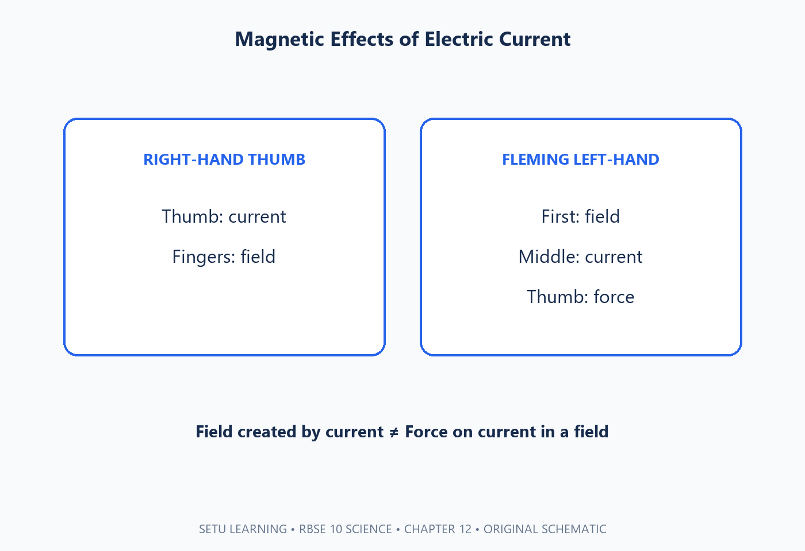

# अध्याय 12: विद्युत धारा के चुंबकीय प्रभाव (Magnetic Effects of Electric Current)

## भाग 1: अध्याय प्रवेश एवं पाठ्यक्रम मैपिंग

> इस अध्याय का 2026–27 पाठ्यक्रम-क्षेत्र मिलाया गया है; NCERT के सभी प्रश्नों के हल तथा पूरा ऐतिहासिक PYQ संग्रह अभी स्रोत-परीक्षण में हैं।

**विषय कोड:** 07 · **श्रृंखला पुस्तक:** 2

**सत्यापित आधार:** RBSE 2026–27 · **अध्याय भार:** 6 अंक। यह आधिकारिक chapter weight है; वास्तविक प्रश्न-विभाजन की भविष्यवाणी नहीं।

**सीखने के लक्ष्य:** Field direction, right-hand rule और solenoid समझना; current-carrying conductor पर force; domestic wiring में earth/fuse/parallel connections की भूमिका।

## भाग 2: शब्दावली एवं अवधारणा कैप्सूल

| शब्द / सूत्र | अर्थ / उपयोग |
|---|---|
| Magnetic field | वह क्षेत्र जहाँ magnetic influence अनुभव होता है। |
| Field line | Local tangent से field direction दर्शाने वाली कल्पित रेखा। |
| Right-hand thumb rule | Thumb current direction, curled fingers field direction। |
| Circular loop | Circular conductor में current से magnetic field बनता है। |
| Solenoid | Many closely wound turns वाला लंबा coil। |
| Electromagnet | Current-driven coil तथा suitable core से बनने वाला magnet। |
| Fleming left-hand rule | Forefinger field, middle finger current, thumb force/motion। |
| Live wire | Supply का hazardous potential वाला conductor। |
| Earth wire | Exposed metal body के लिए protective low-resistance fault path। |
| Overloading | Circuit rating से अधिक total current demand। |

## भाग 3: विस्तृत शिक्षण पाठ

### Field का चित्र
Compass field direction बताता है। Magnet के बाहर field lines N से S और अंदर S से N होकर closed loops होती हैं। Lines पास हों तो field comparatively strong। Two lines intersect नहीं करतीं, क्योंकि एक point पर field की direction unique है। Lines वास्तविक strings नहीं; drawing field representation है।

### Current से field
Straight current-carrying wire के आसपास concentric circles हैं। Right-hand thumb current की दिशा, fingers field की। Current reverse करने पर field reverse होता है; current बढ़ाने पर field बढ़ता, distance बढ़ाने पर घटता है। Circular loop में near-wire curved lines और center पर roughly axis-directed field होता है। Coil turns बढ़ाना field मजबूत कर सकता है। Solenoid के अंदर away from ends field लगभग uniform और outside pattern bar magnet जैसा है। Soft iron core suitable electromagnet को stronger बनाता है।

### Field में current-carrying wire पर force
Magnetic field में current-carrying conductor पर force direction field और current पर निर्भर है। Fleming left-hand rule में first finger B, middle finger I, thumb force है। Current या field अकेला reverse हो तो force reverse; दोनों reverse हों तो force direction same रह सकती है। Force perpendicular configuration में maximum, parallel में zero school model में है। Right-hand thumb rule field-from-current देता है; left-hand rule force direction देता है।

### घरेलू circuit
Appliances live–neutral के across parallel branches में लगे होते हैं। भारत की सामान्य single-phase घरेलू आपूर्ति का nominal voltage 230 V और frequency 50 Hz है ([BIS](https://www.bis.gov.in/wp-content/uploads/2023/08/Plugs-and-Sockets-20.pdf)); कुछ school numericals में 220 V दिया जाता है, इसलिए सवाल में दी गई supply लें। Switch/fuse live conductor में रखना isolation में मदद करता है; neutral को ‘हर समय safe’ न मानें। Earth exposed metal casing से protective fault path देता है जिससे suitable protection trip हो सकती है। Fuse/MCB excessive current protection देते हैं; leakage protection अलग device function है। Damaged insulation से short circuit, अधिक load से overloading हो सकती है। 2026–27 regular syllabus में motor, electromagnetic induction और generator अलग explicit topics नहीं हैं; उन्हें यहाँ board-core के रूप में नहीं जोड़ा गया।

Current से field और field में conductor force का functional schematic; दोनों नियमों का कार्य अलग है।

## भाग 4: पाठ्यपुस्तक-अवधारणाओं पर मौलिक हल किए उदाहरण

नीचे के प्रश्न लेखक के मौलिक मॉडल हैं। ये किसी NCERT edition के प्रश्न क्रमांक या संपूर्ण in-text/exercise solution bank होने का दावा नहीं करते।

**हल किया उदाहरण 1: Wire में current page से बाहर आ रहा है। Field direction बताइए।**

Right-hand thumb observer की ओर रखें; curled fingers anticlockwise हैं। इसलिए बाहर आते current के चारों ओर field anticlockwise; अंदर जाते current के लिए clockwise है।

**हल किया उदाहरण 2: Field right और conventional current up हो तो force कहाँ होगी?**

Fleming left-hand rule अथवा I×B दिशा से force page के भीतर है। Diagram symbols × into page और • out of page स्पष्ट रखें। Current down करने से force बाहर होगी।

**हल किया उदाहरण 3: 220 V पर 2 kW और 1 kW appliances साथ चलें तो total current estimate दें।**

Total P=3000 W। Ideal rated estimate I=P/V=3000/220≈13.64 A। 5 A-rated circuit के लिए यह load बहुत अधिक है; calculation protection को bypass करने का निर्देश नहीं।

## भाग 5: सत्यापित बोर्ड प्रश्न एवं स्रोत-स्थिति

2025, प्रश्न 1(xi), PDF पृष्ठ 5: right-hand thumb rule में thumb। उत्तर-संकेत: current direction।

[RBSE 2025 मूल पेपर](https://rajeduboard.rajasthan.gov.in/books/PAPERS-2025/Sec/S-07.pdf)। प्रश्न का संक्षिप्त विषय-संदर्भ है; शब्दशः पुनर्मुद्रण नहीं।

## भाग 6: खंडवार मौलिक अभ्यास बैंक

**अभ्यास-अंक:** लेखक के स्व-अभ्यास के लिए हैं; RBSE की आधिकारिक marking scheme नहीं। उत्तर पहले स्वयं लिखें, फिर भाग 9 देखें।

## अ: बहुविकल्पीय प्रश्न — 15 × 1 अंक

**MCQ 1. Magnet के बाहर field lines किस दिशा में हैं?**

अ) N से S  
ब) S से N  
स) हमेशा ऊपर  
द) हमेशा नीचे

**MCQ 2. Field-line tangent क्या बताता है?**

अ) केवल temperature  
ब) केवल charge mass  
स) केवल voltage  
द) Local field direction

**MCQ 3. Field lines intersect क्यों नहीं करतीं?**

अ) Field शून्य ही है  
ब) Compass नहीं चलता  
स) एक point पर field direction unique है  
द) Lines metal की हैं

**MCQ 4. Right-hand thumb क्या दिखाता है?**

अ) Resistance  
ब) Current direction  
स) Force ही  
द) Voltage

**MCQ 5. Page से बाहर current का field circulation क्या है?**

अ) Anticlockwise  
ब) Clockwise  
स) Straight ऊपर  
द) कोई field नहीं

**MCQ 6. Straight wire से distance बढ़ने पर field सामान्यतः कैसा होता है?**

अ) मजबूत  
ब) Unchanged हमेशा  
स) हमेशा zero  
द) कमजोर

**MCQ 7. Solenoid interior away from ends field कैसा है?**

अ) केवल random  
ब) केवल electric  
स) लगभग uniform  
द) हर जगह zero

**MCQ 8. Electromagnet में common suitable core कौन है?**

अ) Glass  
ब) Soft iron  
स) Wood  
द) Plastic

**MCQ 9. Fleming left-hand middle finger क्या देती है?**

अ) Current  
ब) Field  
स) Force  
द) Earth direction

**MCQ 10. Current और B parallel हों तो force का ideal value क्या है?**

अ) Maximum  
ब) हमेशा upward  
स) हमेशा 1 N  
द) Zero

**MCQ 11. Earth wire का primary function क्या है?**

अ) Current बढ़ाकर bill बनाना  
ब) Voltage double करना  
स) Protective fault path  
द) Normal neutral return ही

**MCQ 12. Household appliance connection सामान्यतः क्या है?**

अ) केवल open  
ब) Parallel  
स) Series  
द) केवल coil

**MCQ 13. Unintended low-resistance live-neutral path क्या है?**

अ) Short circuit  
ब) Normal loading  
स) Photosynthesis  
द) Refraction

**MCQ 14. Rated current से अधिक demand क्या कहलाती है?**

अ) Earthing  
ब) Polarisation  
स) Dispersion  
द) Overloading

**MCQ 15. School model domestic AC frequency क्या है?**

अ) 5000 Hz  
ब) 0 Hz  
स) 50 Hz  
द) 5 Hz

## आ: रिक्त स्थान — 6 × 1 अंक

1. वह क्षेत्र जहाँ magnetic influence अनुभव होता है। — इस शब्द/सूत्र का नाम है: ____।  
2. Local tangent से field direction दर्शाने वाली कल्पित रेखा। — इस शब्द/सूत्र का नाम है: ____।  
3. Thumb current direction, curled fingers field direction। — इस शब्द/सूत्र का नाम है: ____।  
4. Circular conductor में current से magnetic field बनता है। — इस शब्द/सूत्र का नाम है: ____।  
5. Many closely wound turns वाला लंबा coil। — इस शब्द/सूत्र का नाम है: ____।  
6. Current-driven coil तथा suitable core से बनने वाला magnet। — इस शब्द/सूत्र का नाम है: ____।

## इ: अतिलघु उत्तर — 8 × 1 अंक

1. Magnet के बाहर field lines किस दिशा में हैं?  
2. Field-line tangent क्या बताता है?  
3. Field lines intersect क्यों नहीं करतीं?  
4. Right-hand thumb क्या दिखाता है?  
5. Page से बाहर current का field circulation क्या है?  
6. Straight wire से distance बढ़ने पर field सामान्यतः कैसा होता है?  
7. Solenoid interior away from ends field कैसा है?  
8. Electromagnet में common suitable core कौन है?

## ई: लघु उत्तर — 6 × 2 अंक

**B1.** Field lines intersect क्यों नहीं करतीं?

**B2.** Straight wire में current reverse करने का effect दें।

**B3.** Solenoid को bar magnet जैसा क्यों कहते हैं?

**B4.** Right-hand thumb और left-hand rules अलग कैसे हैं?

**B5.** Earth wire की आवश्यकता क्या है?

**B6.** Short circuit और overload में अंतर दें।

## उ: दीर्घ उत्तर — 4 × 3 अंक

आंतरिक विकल्प अभ्यास: C1 अथवा C2, तथा C3 अथवा C4 चुनें। पुनरावृत्ति में बचा विकल्प भी हल करें। यह लेखक की अभ्यास व्यवस्था है।

**C1.** Magnetic field lines की तीन properties दें।

**C2.** Electromagnet की strength कैसे बदल सकती है?

**C3.** Force direction में reversals का प्रभाव दें।

**C4.** Domestic parallel wiring का schematic समझाएँ।

## ऊ: विस्तृत उत्तर — 2 × 4 अंक

आंतरिक विकल्प अभ्यास: D1 अथवा D2 चुनें; बाद में दूसरा भी हल करें।

**D1.** एक metal-cased appliance में live wire casing छूती है। Fault, earth path तथा protection समझाएँ।

**D2.** Straight wire और solenoid के field diagrams की तुलना करें।

## भाग 7: सावधानियाँ एवं परीक्षा-त्रुटियाँ

- Right-hand thumb और Fleming left-hand न मिलाएँ।
- • बाहर, × भीतर है।
- Field lines closed loops हैं।
- Earth और neutral अलग functions हैं।
- Mains wiring के diagrams learning के लिए हैं, स्वयं repair के लिए नहीं।

## भाग 8: फटाफट पुनरावृत्ति — 25 बिंदु

1. Magnetic field: वह क्षेत्र जहाँ magnetic influence अनुभव होता है।  
2. Field line: Local tangent से field direction दर्शाने वाली कल्पित रेखा।  
3. Right-hand thumb rule: Thumb current direction, curled fingers field direction।  
4. Circular loop: Circular conductor में current से magnetic field बनता है।  
5. Solenoid: Many closely wound turns वाला लंबा coil।  
6. Electromagnet: Current-driven coil तथा suitable core से बनने वाला magnet।  
7. Fleming left-hand rule: Forefinger field, middle finger current, thumb force/motion।  
8. Live wire: Supply का hazardous potential वाला conductor।  
9. Earth wire: Exposed metal body के लिए protective low-resistance fault path।  
10. Overloading: Circuit rating से अधिक total current demand।  
11. External field direction north pole से south pole है; अंदर return path होता है।  
12. किसी point पर tangent magnetic field direction दर्शाता है।  
13. Crossing दो directions imply करेगी, जो representation से असंगत है।  
14. Thumb current direction और fingers circular magnetic field direction देती हैं।  
15. Right-hand thumb observer की ओर रखने पर fingers anticlockwise curl करती हैं।  
16. Same current में wire से दूर field strength घटती है।  
17. Many turns interior में nearly parallel field देते हैं।  
18. Soft iron magnetic field को मजबूत करने में उपयोगी है।  
19. First finger field, middle current और thumb force है।  
20. Magnetic force direction factor parallel orientation में zero होता है।  
21. Earth exposed metal casing से fault current का protective route देती है।  
22. Parallel branches में समान supply voltage और independent control मिलता है।  
23. Short circuit से बहुत current तथा heating risk हो सकते हैं।  
24. Overloading circuit capacity से अधिक current demand है।  
25. भारत की सामान्य domestic AC supply के लिए 50 Hz school value है।

## भाग 9: संपूर्ण अभ्यास उत्तर-कुंजी

## MCQ: सही विकल्प और कारण

**1. अ — N से S।** External field direction north pole से south pole है; अंदर return path होता है।

**2. द — Local field direction।** किसी point पर tangent magnetic field direction दर्शाता है।

**3. स — एक point पर field direction unique है।** Crossing दो directions imply करेगी, जो representation से असंगत है।

**4. ब — Current direction।** Thumb current direction और fingers circular magnetic field direction देती हैं।

**5. अ — Anticlockwise।** Right-hand thumb observer की ओर रखने पर fingers anticlockwise curl करती हैं।

**6. द — कमजोर।** Same current में wire से दूर field strength घटती है।

**7. स — लगभग uniform।** Many turns interior में nearly parallel field देते हैं।

**8. ब — Soft iron।** Soft iron magnetic field को मजबूत करने में उपयोगी है।

**9. अ — Current।** First finger field, middle current और thumb force है।

**10. द — Zero।** Magnetic force direction factor parallel orientation में zero होता है।

**11. स — Protective fault path।** Earth exposed metal casing से fault current का protective route देती है।

**12. ब — Parallel।** Parallel branches में समान supply voltage और independent control मिलता है।

**13. अ — Short circuit।** Short circuit से बहुत current तथा heating risk हो सकते हैं।

**14. द — Overloading।** Overloading circuit capacity से अधिक current demand है।

**15. स — 50 Hz।** भारत की सामान्य domestic AC supply के लिए 50 Hz school value है।

**रिक्त स्थान:** 1. Magnetic field; 2. Field line; 3. Right-hand thumb rule; 4. Circular loop; 5. Solenoid; 6. Electromagnet

**अतिलघु उत्तर:**

1. N से S। External field direction north pole से south pole है; अंदर return path होता है।

2. Local field direction। किसी point पर tangent magnetic field direction दर्शाता है।

3. एक point पर field direction unique है। Crossing दो directions imply करेगी, जो representation से असंगत है।

4. Current direction। Thumb current direction और fingers circular magnetic field direction देती हैं।

5. Anticlockwise। Right-hand thumb observer की ओर रखने पर fingers anticlockwise curl करती हैं।

6. कमजोर। Same current में wire से दूर field strength घटती है।

7. लगभग uniform। Many turns interior में nearly parallel field देते हैं।

8. Soft iron। Soft iron magnetic field को मजबूत करने में उपयोगी है।

**B1. Field lines intersect क्यों नहीं करतीं?**

Intersection पर एक point में दो tangents और दो field directions बन जाएँगी। Magnetic field की local direction unique होती है। इसलिए field-line representation में crossing स्वीकार्य नहीं।

**B2. Straight wire में current reverse करने का effect दें।**

Magnetic field circulation reverse हो जाता है। Right-hand thumb opposite direction में रखने पर curled fingers भी उलटे घूमते हैं। Current magnitude same हो तो comparable position पर strength का magnitude समान हो सकता है।

**B3. Solenoid को bar magnet जैसा क्यों कहते हैं?**

Solenoid का outside field pattern north/south poles वाला bar magnet जैसा है। Interior में many turns का combined field approximately uniform होता है। Current reverse करने पर poles swap हो जाते हैं।

**B4. Right-hand thumb और left-hand rules अलग कैसे हैं?**

Right-hand thumb rule straight current के magnetic field की direction देता है। Fleming left-hand rule field में current-carrying conductor पर force की direction देता है। Thumb की भूमिका दोनों में अलग है; नाम के आधार पर arrows interchange न करें।

**B5. Earth wire की आवश्यकता क्या है?**

Metal casing fault से live हो जाए तो earth low-resistance protective path देता है। Suitable fuse/MCB/RCD arrangement fault को disconnect करने में मदद कर सकता है। Earth सामान्य appliance operating-current return path नहीं; neutral से अलग function है।

**B6. Short circuit और overload में अंतर दें।**

Short circuit unintended very low-resistance connection से current अचानक बढ़ना है। Overload अनेक/high-power loads से rated current exceed करना है। दोनों heating risk बढ़ाते हैं, लेकिन causes अलग हैं।

**C1. Magnetic field lines की तीन properties दें।**

1. Outside magnet N→S और अंदर S→N closed loops। 2. Tangent local field direction देता है। 3. Close spacing stronger field दर्शाती है और lines intersect नहीं करतीं। Pole के पास line density comparatively अधिक हो सकती है।

**C2. Electromagnet की strength कैसे बदल सकती है?**

1. Coil current बढ़ने पर field बढ़ सकता है। 2. Turns बढ़ाने से combined field मजबूत हो सकता है। 3. Suitable soft-iron core flux बढ़ा सकता है। Heating और device limits के कारण unlimited current उचित नहीं।

**C3. Force direction में reversals का प्रभाव दें।**

1. Current alone reverse करने पर force reverse। 2. Field alone reverse करने पर भी force reverse। 3. दोनों reverse करने पर force direction same; current parallel B हो तो ideal magnetic force zero। Left-hand rule से check करें।

**C4. Domestic parallel wiring का schematic समझाएँ।**

1. Each appliance live–neutral के across branch में हो। 2. Each branch switch live side पर दिखाएँ। 3. Exposed casing को earth से जोड़ें और suitable protection supply side पर दिखाएँ। Earth को heating element के series return की तरह न draw करें।

**D1. एक metal-cased appliance में live wire casing छूती है। Fault, earth path तथा protection समझाएँ।**

1. Insulation failure casing पर dangerous potential ला सकता है। 2. Protective earth low-resistance path देकर fault current route उपलब्ध करती है। 3. Correctly rated protection supply disconnect कर सकती है; leakage devices का function अलग है। 4. Appliance उपयोग रोककर qualified electrician से repair चाहिए; earth wire निकालना समाधान नहीं।

**D2. Straight wire और solenoid के field diagrams की तुलना करें।**

1. Straight wire cross-section पर concentric circles तथा current •/× दिखाएँ। 2. Right-hand rule से circulation arrows लगाएँ। 3. Solenoid में inside लगभग parallel field lines और outside return loops draw करें। 4. Current reverse करने पर solenoid poles तथा wire circulation बदलते हैं। दोनों current-generated fields हैं, geometry अलग है।

## भाग 10: 10 मिनट / 10 अंक आत्म-मूल्यांकन एवं संदर्भ

समय: 10 मिनट। पहले पुस्तक बंद करें।

1. MCQ 3 और 11 हल करें। (1 + 1)
2. B2 और B5 के उत्तर लिखें। (2 + 2)
3. D1 हल करें। (4)

**कुंजी:** भाग 9 में संबंधित क्रमांक देखें। **स्व-मूल्यांकन:** 8–10: आगे बढ़ें; 5–7: छूटे कौशल का दोहराव; 0–4: भाग 2–4 फिर पढ़ें। यह अभ्यास-सुझाव है, बोर्ड grade नहीं।

[सत्यापित RBSE 2026–27 पाठ्यक्रम](https://rajeduboard.rajasthan.gov.in/anudeshika-etc/10_2026.pdf) · [NCERT विज्ञान अध्याय 12](https://ncert.nic.in/textbook/pdf/jesc112.pdf)

**आगे की कड़ी:** अंतिम अध्याय में energy flow और human environmental impact को जोड़ेंगे।
