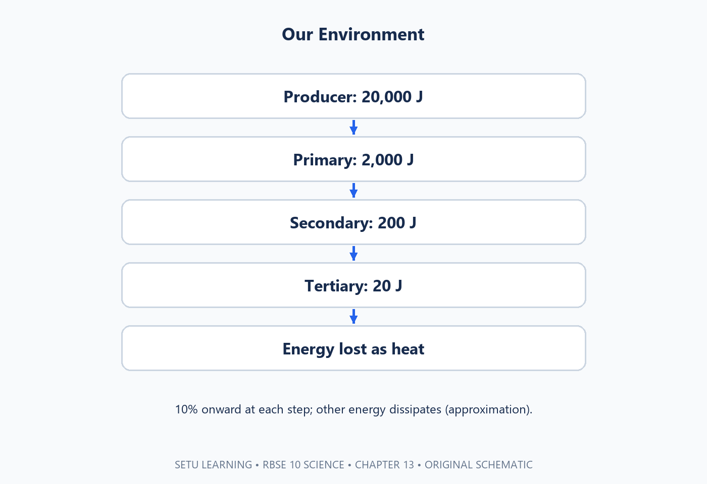

# अध्याय 13: हमारा पर्यावरण (Our Environment)

## भाग 1: अध्याय प्रवेश एवं पाठ्यक्रम मैपिंग

> इस अध्याय का 2026–27 पाठ्यक्रम-क्षेत्र मिलाया गया है; NCERT के सभी प्रश्नों के हल तथा पूरा ऐतिहासिक PYQ संग्रह अभी स्रोत-परीक्षण में हैं।

**विषय कोड:** 07 · **श्रृंखला पुस्तक:** 2

**सत्यापित आधार:** RBSE 2026–27 · **अध्याय भार:** 5 अंक। यह आधिकारिक chapter weight है; वास्तविक प्रश्न-विभाजन की भविष्यवाणी नहीं।

**सीखने के लक्ष्य:** Ecosystem components और food webs; trophic energy transfer तथा biomagnification; ozone depletion और waste-management choices समझना।

## भाग 2: शब्दावली एवं अवधारणा कैप्सूल

| शब्द / सूत्र | अर्थ / उपयोग |
|---|---|
| Ecosystem | Organisms और physical environment का interacting system। |
| Biotic component | Living organisms जैसे plants, animals और microbes। |
| Abiotic component | Nonliving conditions जैसे light, water, temperature। |
| Producer | Organic food बनाने वाला organism; green plants सामान्य उदाहरण। |
| Consumer | दूसरे organisms/organic material से food लेने वाला organism। |
| Decomposer | Dead matter breakdown करने वाले bacteria/fungi आदि। |
| Trophic level | Food chain में feeding position। |
| 10% model | अगले trophic level को लगभग 10% energy transfer का school approximation। |
| Biomagnification | Persistent pollutants की higher trophic levels पर concentration बढ़ना। |
| Ozone | O₃; stratospheric layer harmful UV का कुछ भाग absorb करती है। |

## भाग 3: विस्तृत शिक्षण पाठ

### Ecosystem में संबंध
Pond, forest या garden में organisms light, soil, water और temperature से interact करते हैं। Plants producers; herbivores primary consumers; predators secondary/higher consumers हो सकते हैं। Decomposers dead matter से nutrients recycle करते हैं और सभी trophic levels से जुड़े रहते हैं; उन्हें केवल ‘last animal’ न दिखाएँ। Artificial aquarium भी ecosystem है, लेकिन external maintenance की जरूरत हो सकती है।

### Food chain और energy
Food-chain arrows food/energy transfer source से recipient की ओर हैं: grass → grasshopper → frog → snake। Food web multiple interconnected chains है। Solar energy producers capture करते हैं; energy respiration/heat और activities में जाती है। लगभग 10% next level available energy का school model है, exact universal law नहीं। Energy flow one-way है; nutrients cycle कर सकते हैं। इसलिए ‘energy decomposers से sun को लौटती है’ गलत है।

### Pollutant और ozone
कुछ persistent, poorly metabolised chemicals organisms में accumulate हो सकते हैं। Higher consumers कई contaminated organisms खाते हैं, इसलिए concentration बढ़ सकती है: biomagnification। यह energy amplification नहीं। Stratosphere का ozone useful UV shielding देता है; ground-level ozone harmful pollutant हो सकता है। UV oxygen molecules तोड़ सकती है और O atoms O₂ से O₃ बनाते हैं। CFC-related chlorine chemistry stratospheric ozone depletion में भूमिका निभाती है। Ozone depletion और greenhouse warming अलग mechanisms हैं, भले कुछ substances दोनों से संबंधित हों।

### Waste का जिम्मेदार प्रबंधन
Biodegradable matter microorganisms द्वारा suitable conditions में breakdown हो सकता है; सभी biodegradable waste तुरन्त disappear या harmless नहीं। Plastic/glass जैसे non-biodegradable materials लंबे समय रह सकते हैं। Reduce, reuse, recycle तथा source segregation useful हैं। Clean wet organic waste composting, clean dry recyclables अलग collection, e-waste authorised handling में जाएँ। Plastic खुले में जलाने से harmful emissions हो सकती हैं। Waste-management choice material और local collection व्यवस्था पर निर्भर है।

चार trophic levels में 10% model का energy schematic; वास्तविक efficiency बदल सकती है।

## भाग 4: पाठ्यपुस्तक-अवधारणाओं पर मौलिक हल किए उदाहरण

नीचे के प्रश्न लेखक के मौलिक मॉडल हैं। ये किसी NCERT edition के प्रश्न क्रमांक या संपूर्ण in-text/exercise solution bank होने का दावा नहीं करते।

**हल किया उदाहरण 1: Producer level पर 20,000 J हों तो तीन transfers बाद energy estimate दें।**

10% model में primary consumers 2,000 J; secondary 200 J; tertiary 20 J। हर transfer पर previous level ×0.1 करें। 20 J fourth trophic level का estimate है, exact real ecosystem measurement नहीं।

**हल किया उदाहरण 2: Grass → deer → tiger में trophic levels पहचानें।**

Grass producer/level 1; deer primary consumer/level 2; tiger secondary consumer/level 3। Arrow deer की ओर grass energy transfer दिखाता है; predator से prey की ओर arrow उल्टा होगा।

**हल किया उदाहरण 3: Wet food waste और used batteries का management अलग करें।**

Suitable clean organic waste composting में जा सकता है। Batteries hazardous/e-waste collection channel में जाएँ; compost में न मिलाएँ। ‘सब biodegradable bin में’ sorting का सही उत्तर नहीं।

## भाग 5: सत्यापित बोर्ड प्रश्न एवं स्रोत-स्थिति

इस अध्याय का वर्षवार PYQ audit अभी पूरा नहीं है। अभ्यास प्रश्नों पर काल्पनिक परीक्षा-वर्ष नहीं लगाए गए हैं। [असली 2025 बोर्ड पेपर](https://rajeduboard.rajasthan.gov.in/books/PAPERS-2025/Sec/S-07.pdf) से प्रश्न, उपभाग और अंक मिलाकर ही नया PYQ जोड़ा जाए।

## भाग 6: खंडवार मौलिक अभ्यास बैंक

**अभ्यास-अंक:** लेखक के स्व-अभ्यास के लिए हैं; RBSE की आधिकारिक marking scheme नहीं। उत्तर पहले स्वयं लिखें, फिर भाग 9 देखें।

## अ: बहुविकल्पीय प्रश्न — 15 × 1 अंक

**MCQ 1. Ecosystem का abiotic component कौन है?**

अ) Grass  
ब) Frog  
स) Bacterium  
द) Temperature

**MCQ 2. Green plants का सामान्य trophic role क्या है?**

अ) Secondary consumer  
ब) केवल decomposer  
स) Producer  
द) Primary consumer

**MCQ 3. Herbivore किस consumer level पर है?**

अ) Producer  
ब) Primary  
स) Secondary  
द) Tertiary हमेशा

**MCQ 4. Food-chain arrow क्या दर्शाता है?**

अ) Food/energy transfer  
ब) केवल predator का hunting direction  
स) Wind direction  
द) Sex determination

**MCQ 5. Multiple food chains का interconnected रूप क्या है?**

अ) Reflex arc  
ब) Electric circuit  
स) Homologous series  
द) Food web

**MCQ 6. 20,000 J का 10% कितना है?**

अ) 20 J  
ब) 20,000 J  
स) 2,000 J  
द) 200 J

**MCQ 7. Energy flow की दिशा कैसी है?**

अ) केवल reverse  
ब) Unidirectional  
स) पूर्ण cycle वापस sun में  
द) सभी levels पर equal

**MCQ 8. Dead matter breakdown में common organisms कौन हैं?**

अ) Bacteria और fungi  
ब) केवल tiger  
स) केवल deer  
द) केवल fish

**MCQ 9. Ozone का molecular formula क्या है?**

अ) O₂  
ब) CO₂  
स) N₂  
द) O₃

**MCQ 10. Protective ozone layer मुख्यतः कहाँ है?**

अ) Earth core  
ब) केवल tropospheric street  
स) Stratosphere  
द) केवल ocean bottom

**MCQ 11. Ozone depletion से किस exposure का risk बढ़ सकता है?**

अ) केवल gravity  
ब) Ultraviolet  
स) केवल sound  
द) केवल radio

**MCQ 12. Biomagnification में क्या बढ़ता है?**

अ) Persistent pollutant concentration  
ब) Energy हर level पर  
स) Oxygen हर predator में  
द) सभी genes का आकार

**MCQ 13. Compost के लिए suitable material कौन है?**

अ) Used batteries  
ब) Glass shards  
स) Electronic boards  
द) Clean vegetable peels

**MCQ 14. Plastic को खुले में जलाना क्यों अनुचित है?**

अ) सब तुरंत harmless होता है  
ब) कोई smoke नहीं होता  
स) Harmful emissions हो सकती हैं  
द) हर plastic oxygen बनाता है

**MCQ 15. Ozone depletion और global warming समान हैं क्या?**

अ) हाँ, दोनों केवल litter  
ब) नहीं, mechanisms अलग हैं  
स) हाँ, पूर्ण synonyms  
द) हाँ, दोनों केवल acid rain

## आ: रिक्त स्थान — 6 × 1 अंक

1. Organisms और physical environment का interacting system। — इस शब्द/सूत्र का नाम है: ____।  
2. Living organisms जैसे plants, animals और microbes। — इस शब्द/सूत्र का नाम है: ____।  
3. Nonliving conditions जैसे light, water, temperature। — इस शब्द/सूत्र का नाम है: ____।  
4. Organic food बनाने वाला organism; green plants सामान्य उदाहरण। — इस शब्द/सूत्र का नाम है: ____।  
5. दूसरे organisms/organic material से food लेने वाला organism। — इस शब्द/सूत्र का नाम है: ____।  
6. Dead matter breakdown करने वाले bacteria/fungi आदि। — इस शब्द/सूत्र का नाम है: ____।

## इ: अतिलघु उत्तर — 8 × 1 अंक

1. Ecosystem का abiotic component कौन है?  
2. Green plants का सामान्य trophic role क्या है?  
3. Herbivore किस consumer level पर है?  
4. Food-chain arrow क्या दर्शाता है?  
5. Multiple food chains का interconnected रूप क्या है?  
6. 20,000 J का 10% कितना है?  
7. Energy flow की दिशा कैसी है?  
8. Dead matter breakdown में common organisms कौन हैं?

## ई: लघु उत्तर — 6 × 2 अंक

**B1.** Biotic और abiotic components उदाहरण सहित दें।

**B2.** Food chain और food web में अंतर करें।

**B3.** Decomposers क्यों आवश्यक हैं?

**B4.** 10% energy transfer model की सीमा दें।

**B5.** Biomagnification और bioaccumulation में अंतर दें।

**B6.** Biodegradable का अर्थ harmless क्यों नहीं है?

## उ: दीर्घ उत्तर — 4 × 3 अंक

आंतरिक विकल्प अभ्यास: C1 अथवा C2, तथा C3 अथवा C4 चुनें। पुनरावृत्ति में बचा विकल्प भी हल करें। यह लेखक की अभ्यास व्यवस्था है।

**C1.** Energy flow और nutrient cycle की तुलना दें।

**C2.** Ozone formation और protective function लिखें।

**C3.** Biomagnification food chain में कैसे बढ़ सकती है?

**C4.** घर के waste segregation के तीन streams दें।

## ऊ: विस्तृत उत्तर — 2 × 4 अंक

आंतरिक विकल्प अभ्यास: D1 अथवा D2 चुनें; बाद में दूसरा भी हल करें।

**D1.** 10% model से grass → insect → frog → snake में 50,000 J की energy तथा arrows समझाएँ।

**D2.** Ozone depletion, biomagnification और solid-waste pollution में अंतर और एक-एक निवारण दिशा दें।

## भाग 7: सावधानियाँ एवं परीक्षा-त्रुटियाँ

- Food arrow energy recipient की ओर है।
- Energy flow और nutrient cycle अलग हैं।
- 10% approximation है, exact universal constant नहीं।
- Ozone depletion और warming समान नहीं।
- Biodegradable waste को बिना management harmless न कहें।

## भाग 8: फटाफट पुनरावृत्ति — 25 बिंदु

1. Ecosystem: Organisms और physical environment का interacting system।  
2. Biotic component: Living organisms जैसे plants, animals और microbes।  
3. Abiotic component: Nonliving conditions जैसे light, water, temperature।  
4. Producer: Organic food बनाने वाला organism; green plants सामान्य उदाहरण।  
5. Consumer: दूसरे organisms/organic material से food लेने वाला organism।  
6. Decomposer: Dead matter breakdown करने वाले bacteria/fungi आदि।  
7. Trophic level: Food chain में feeding position।  
8. 10% model: अगले trophic level को लगभग 10% energy transfer का school approximation।  
9. Biomagnification: Persistent pollutants की higher trophic levels पर concentration बढ़ना।  
10. Ozone: O₃; stratospheric layer harmful UV का कुछ भाग absorb करती है।  
11. Temperature nonliving physical condition है।  
12. Plants photosynthesis से organic food बनाकर energy उपलब्ध करते हैं।  
13. Herbivore producer को खाकर primary consumer होता है।  
14. Arrow source organism से खाने वाले recipient की ओर है।  
15. Food web feeding relationships के कई routes जोड़ता है।  
16. एक transfer में 20,000×0.1=2,000 J estimated available energy है।  
17. Energy dissipates होकर heat बनती है; nutrients जैसे cycle नहीं करती।  
18. Decomposer microbes nutrient recycling में योगदान देते हैं।  
19. Ozone oxygen का triatomic form है।  
20. Stratospheric ozone harmful ultraviolet का कुछ भाग absorb करता है।  
21. Ozone shielding कम होने पर harmful UV reach बढ़ सकती है।  
22. Higher trophic levels में poorly eliminated pollutants की concentration बढ़ सकती है।  
23. Clean organic waste suitable conditions में compost हो सकता है।  
24. Uncontrolled burning harmful gases/particles दे सकता है।  
25. Ozone shielding loss और greenhouse energy trapping अलग environmental mechanisms हैं।

## भाग 9: संपूर्ण अभ्यास उत्तर-कुंजी

## MCQ: सही विकल्प और कारण

**1. द — Temperature।** Temperature nonliving physical condition है।

**2. स — Producer।** Plants photosynthesis से organic food बनाकर energy उपलब्ध करते हैं।

**3. ब — Primary।** Herbivore producer को खाकर primary consumer होता है।

**4. अ — Food/energy transfer।** Arrow source organism से खाने वाले recipient की ओर है।

**5. द — Food web।** Food web feeding relationships के कई routes जोड़ता है।

**6. स — 2,000 J।** एक transfer में 20,000×0.1=2,000 J estimated available energy है।

**7. ब — Unidirectional।** Energy dissipates होकर heat बनती है; nutrients जैसे cycle नहीं करती।

**8. अ — Bacteria और fungi।** Decomposer microbes nutrient recycling में योगदान देते हैं।

**9. द — O₃।** Ozone oxygen का triatomic form है।

**10. स — Stratosphere।** Stratospheric ozone harmful ultraviolet का कुछ भाग absorb करता है।

**11. ब — Ultraviolet।** Ozone shielding कम होने पर harmful UV reach बढ़ सकती है।

**12. अ — Persistent pollutant concentration।** Higher trophic levels में poorly eliminated pollutants की concentration बढ़ सकती है।

**13. द — Clean vegetable peels।** Clean organic waste suitable conditions में compost हो सकता है।

**14. स — Harmful emissions हो सकती हैं।** Uncontrolled burning harmful gases/particles दे सकता है।

**15. ब — नहीं, mechanisms अलग हैं।** Ozone shielding loss और greenhouse energy trapping अलग environmental mechanisms हैं।

**रिक्त स्थान:** 1. Ecosystem; 2. Biotic component; 3. Abiotic component; 4. Producer; 5. Consumer; 6. Decomposer

**अतिलघु उत्तर:**

1. Temperature। Temperature nonliving physical condition है।

2. Producer। Plants photosynthesis से organic food बनाकर energy उपलब्ध करते हैं।

3. Primary। Herbivore producer को खाकर primary consumer होता है।

4. Food/energy transfer। Arrow source organism से खाने वाले recipient की ओर है।

5. Food web। Food web feeding relationships के कई routes जोड़ता है।

6. 2,000 J। एक transfer में 20,000×0.1=2,000 J estimated available energy है।

7. Unidirectional। Energy dissipates होकर heat बनती है; nutrients जैसे cycle नहीं करती।

8. Bacteria और fungi। Decomposer microbes nutrient recycling में योगदान देते हैं।

**B1. Biotic और abiotic components उदाहरण सहित दें।**

Plants, animals और microbes living biotic components हैं। Water, light, soil conditions तथा temperature abiotic हैं। Ecosystem में दोनों interact करते हैं; केवल animals की list पूरी ecosystem definition नहीं।

**B2. Food chain और food web में अंतर करें।**

Food chain feeding transfer का एक linear route दिखाती है। Food web multiple interconnected routes दिखाता है, क्योंकि organisms के कई food sources/predators हो सकते हैं। Web वास्तविक feeding complexity को बेहतर दर्शा सकता है।

**B3. Decomposers क्यों आवश्यक हैं?**

Bacteria/fungi dead organic matter breakdown करके nutrients environment में उपलब्ध कराते हैं। इससे nutrient recycling में मदद मिलती है। Decomposition energy को नए sunlight में बदलना नहीं; energy dissipation जारी रहता है।

**B4. 10% energy transfer model की सीमा दें।**

यह school-level approximate model है, हर ecosystem में exactly 10.000% नहीं। Organism metabolism और ecological conditions transfer efficiency बदलते हैं। गणना में question का दिया assumption लें और result को estimate label करें।

**B5. Biomagnification और bioaccumulation में अंतर दें।**

Bioaccumulation एक organism में समय के साथ chemical build-up है। Biomagnification food chain के higher levels पर concentration बढ़ना है। दोनों persistent pollutants से जुड़े हो सकते हैं, पर comparison scale अलग है।

**B6. Biodegradable का अर्थ harmless क्यों नहीं है?**

Organic waste decomposition में oxygen demand, odour या disease-related problems हो सकती हैं। Breakdown conditions तथा समय महत्त्वपूर्ण हैं। इसलिए biodegradable waste भी segregation और उचित treatment माँगता है।

**C1. Energy flow और nutrient cycle की तुलना दें।**

1. Solar input से ecosystem energy आती है। 2. Trophic transfer में energy heat के रूप में dissipates होती है; flow unidirectional है। 3. Nutrients decomposition तथा uptake से circulate कर सकते हैं। ‘Energy cycle’ को nutrient cycle जैसा न draw करें।

**C2. Ozone formation और protective function लिखें।**

1. UV से O₂ टूटकर oxygen atoms बन सकते हैं। 2. O atoms O₂ से मिलकर O₃ देते हैं। 3. Stratospheric ozone harmful UV का कुछ भाग absorb करता है। Near-ground ozone की effects अलग और harmful हो सकती हैं।

**C3. Biomagnification food chain में कैसे बढ़ सकती है?**

1. Persistent chemical lower levels के tissues में रहता है। 2. Predator अनेक contaminated prey खाता है। 3. Higher level concentration बढ़ सकती है, यदि elimination/metabolism कम हो। इसे सभी biodegradable nutrients पर लागू न करें।

**C4. घर के waste segregation के तीन streams दें।**

1. Clean biodegradable wet waste compost/appropriate collection में। 2. Clean dry recyclables अलग रखें। 3. Batteries/e-waste तथा hazardous materials authorised channels में दें। Local rules के अनुसार streams adjust करें; mixed burning समाधान नहीं।

**D1. 10% model से grass → insect → frog → snake में 50,000 J की energy तथा arrows समझाएँ।**

1. Grass level 1 पर 50,000 J। 2. Insect 5,000 J और frog 500 J। 3. Snake 50 J। 4. Arrows grass से insect और आगे transfer recipient की ओर हैं। यह provided approximation की calculation है; प्रत्येक level को पूरा starting energy नहीं मिलता।

**D2. Ozone depletion, biomagnification और solid-waste pollution में अंतर और एक-एक निवारण दिशा दें।**

1. Ozone depletion stratospheric shielding loss है; ozone-depleting substances को नियंत्रित करना दिशा है। 2. Biomagnification persistent chemical concentration का trophic increase है; ऐसे pollutants का release घटाना जरूरी है। 3. Solid waste accumulation के लिए reduce/reuse/segregation/recycling useful हैं। 4. Problems जुड़े हो सकते हैं लेकिन एक ही mechanism नहीं; plastic recycling अकेले ozone को नहीं सुधारती।

## भाग 10: 10 मिनट / 10 अंक आत्म-मूल्यांकन एवं संदर्भ

समय: 10 मिनट। पहले पुस्तक बंद करें।

1. MCQ 3 और 11 हल करें। (1 + 1)
2. B2 और B5 के उत्तर लिखें। (2 + 2)
3. D1 हल करें। (4)

**कुंजी:** भाग 9 में संबंधित क्रमांक देखें। **स्व-मूल्यांकन:** 8–10: आगे बढ़ें; 5–7: छूटे कौशल का दोहराव; 0–4: भाग 2–4 फिर पढ़ें। यह अभ्यास-सुझाव है, बोर्ड grade नहीं।

[सत्यापित RBSE 2026–27 पाठ्यक्रम](https://rajeduboard.rajasthan.gov.in/anudeshika-etc/10_2026.pdf) · [NCERT विज्ञान अध्याय 13](https://ncert.nic.in/textbook/pdf/jesc113.pdf)

**आगे की कड़ी:** पूरी पुस्तक दोहराएँ: chemical reactions → biological energy → electricity → ecosystem energy; हर जगह quantities और mechanisms अलग रखें।
