# अध्याय 14: पिछले वर्षों के हल किए परीक्षा प्रश्न

**चयनित हल:** 361 · **आधिकारिक पेपर:** 18

## अध्याय का उपयोग और स्रोत सीमा

> 361 स्रोत-संदर्भित हल किए प्रश्न/उपभाग, 18 आधिकारिक मुख्य/पूरक पेपरों से। प्रश्नों के संक्षिप्त हिंदी सार और मौलिक solutions हैं; पूरे पेपरों का शब्दशः पुनर्मुद्रण या official answer key नहीं।

प्रश्न का year, main/supplementary, original question/subpart और PDF viewer page दिया है। Printed page और PDF page अलग हो सकते हैं। बड़े प्रश्न का selected part ही लिया गया हो तो उसका संक्षिप्त focus दिखता है; इसे पूरे प्रश्न का exhaustive solution न मानें। अंक source में दिए selected scope के हैं; अलग अंक स्पष्ट न हो तो “अलग सत्यापित नहीं” लिखा है।

Repeated exam occurrences अलग source references के साथ रखे हैं; यह distinct concepts की count नहीं। मुख्य अध्याय 1–13 के 80-अंक chapter weightage में यह अभ्यास अध्याय अलग अतिरिक्त weightage नहीं जोड़ता। 2021 archive PDF image-based है और यहाँ verified question source नहीं माना गया।

## वर्षवार स्रोत रजिस्टर

| वर्ष / परीक्षा | चुने प्रश्न/उपभाग | मूल स्रोत |
|---|---:|---|
| 2026 / मुख्य | 31 | [S-07 मूल पेपर](https://rajeduboard.rajasthan.gov.in/books/PAPERS-2026/Sec/S-07.pdf) |
| 2026 / पूरक | 22 | [S-07 मूल पेपर](https://rajeduboard.rajasthan.gov.in/books/PAPERS-2026/SecSUP/S-07.pdf) |
| 2025 / मुख्य | 30 | [S-07 मूल पेपर](https://rajeduboard.rajasthan.gov.in/books/PAPERS-2025/Sec/S-07.pdf) |
| 2025 / पूरक | 18 | [S-07 मूल पेपर](https://rajeduboard.rajasthan.gov.in/books/PAPERS-2025/SecSUP/S-07.pdf) |
| 2024 / मुख्य | 29 | [S-07 मूल पेपर](https://rajeduboard.rajasthan.gov.in/books/PAPERS-2024/Sec/S-07.pdf) |
| 2024 / पूरक | 15 | [S-07 मूल पेपर](https://rajeduboard.rajasthan.gov.in/books/PAPERS-2024/SecSUP/S-07.pdf) |
| 2023 / मुख्य | 21 | [S-07 मूल पेपर](https://rajeduboard.rajasthan.gov.in/books/PAPERS-2023/Sec/S-07.pdf) |
| 2022 / मुख्य | 19 | [S-07 मूल पेपर](https://rajeduboard.rajasthan.gov.in/books/PAPERS-2022/Sec/S-07.pdf) |
| 2020 / मुख्य | 16 | [S-07 मूल पेपर](https://rajeduboard.rajasthan.gov.in/books/PAPERS-2020/Sec/S-07-Science.pdf) |
| 2020 / पूरक | 12 | [S-07 मूल पेपर](https://rajeduboard.rajasthan.gov.in/books/PAPERS-2020/SecSUP/S-07.pdf) |
| 2019 / मुख्य | 9 | [S-07 मूल पेपर](https://rajeduboard.rajasthan.gov.in/books/PAPERS-2019/Sec/S-07-Science-E-H.pdf) |
| 2018 / मुख्य | 14 | [S-07 मूल पेपर](https://rajeduboard.rajasthan.gov.in/books/PAPERS-2018/Sec/S-07-Science-E-H.pdf) |
| 2018 / पूरक | 10 | [S-07 मूल पेपर](https://rajeduboard.rajasthan.gov.in/books/PAPERS-2018/SUPP/Sec/S-07-Science.pdf) |
| 2017 / मुख्य | 26 | [S-07 मूल पेपर](https://rajeduboard.rajasthan.gov.in/books/PAPERS-2017/Sec/S-07-Science-E-H.pdf) |
| 2017 / विशेष पूरक | 14 | [S-07 मूल पेपर](https://rajeduboard.rajasthan.gov.in/books/PAPERS-2017/SUPP/Sec/S-07-Science.pdf) |
| 2016 / मुख्य | 18 | [S-07 मूल पेपर](https://rajeduboard.rajasthan.gov.in/books/PAPERS-2016/Sec/S-07-Science.pdf) |
| 2015 / मुख्य | 29 | [S-07 मूल पेपर](https://rajeduboard.rajasthan.gov.in/books/PAPERS-2015/Sec/S-07-Science-15.pdf) |
| 2014 / मुख्य | 28 | [S-07 मूल पेपर](https://rajeduboard.rajasthan.gov.in/books/PAPERS-2014/Sec/S-07-Science-14.pdf) |

## लिखित उत्तर का तरीका

पहले source का पूरा प्रश्न पढ़ें, फिर answer छिपाकर हल करें। Numerical में given quantities → SI conversion → formula → substitution → result/unit लिखें। Diagram में labels, arrow direction और requested part दें। यहाँ दिए solutions लेखक के शिक्षण उत्तर हैं; अंक-वितरण का आधिकारिक मूल्यांकन दावा नहीं।

## 2026 — मुख्य परीक्षा

[2026 मुख्य: पूरा आधिकारिक प्रश्न-पत्र](https://rajeduboard.rajasthan.gov.in/books/PAPERS-2026/Sec/S-07.pdf)

## 1. Sugar-regulating endocrine gland।

**स्रोत:** 2026 मुख्य, प्रश्न 1(i), PDF पृष्ठ 2 · **अंक:** 1 अंक

**अध्याय-संबंध:** नियंत्रण एवं समन्वय

**हल:** Pancreas insulin सहित hormones से blood glucose regulation में भूमिका निभाता है। Thyroid metabolism और adrenal acute-stress responses से अलग हैं।

[मूल प्रश्न देखें](https://rajeduboard.rajasthan.gov.in/books/PAPERS-2026/Sec/S-07.pdf#page=2)

## 2. Binary-fission option।

**स्रोत:** 2026 मुख्य, प्रश्न 1(ii), PDF पृष्ठ 2 · **अंक:** 1 अंक

**अध्याय-संबंध:** जीव जनन कैसे करते हैं?

**हल:** दिए options में Leishmania binary fission करता है, सामान्यतः longitudinal orientation में। Amoeba भी binary fission का example है, लेकिन यहाँ source options में Leishmania है।

[मूल प्रश्न देखें](https://rajeduboard.rajasthan.gov.in/books/PAPERS-2026/Sec/S-07.pdf#page=2)

## 3. Aerobic pyruvate breakdown स्थल।

**स्रोत:** 2026 मुख्य, प्रश्न 1(iii), PDF पृष्ठ 2 · **अंक:** 1 अंक

**अध्याय-संबंध:** जैव प्रक्रम

**हल:** Aerobic pyruvate breakdown mitochondrial pathways में CO₂, water और usable energy देता है। Glycolysis cytoplasm में pyruvate बनाती है; दोनों stages अलग हैं।

[मूल प्रश्न देखें](https://rajeduboard.rajasthan.gov.in/books/PAPERS-2026/Sec/S-07.pdf#page=2)

## 4. Asexual reproduction का parent count।

**स्रोत:** 2026 मुख्य, प्रश्न 1(iv), PDF पृष्ठ 3 · **अंक:** 1 अंक

**अध्याय-संबंध:** जीव जनन कैसे करते हैं?

**हल:** School definition में asexual reproduction एक parent से होती है; gamete fusion नहीं। Offspring में occasional variation फिर भी संभव है।

[मूल प्रश्न देखें](https://rajeduboard.rajasthan.gov.in/books/PAPERS-2026/Sec/S-07.pdf#page=3)

## 5. Microbes का food-chain role।

**स्रोत:** 2026 मुख्य, प्रश्न 1(v), PDF पृष्ठ 3 · **अंक:** 1 अंक

**अध्याय-संबंध:** हमारा पर्यावरण

**हल:** इस MCQ में microbes की अपेक्षित प्रमुख भूमिका decomposers है; bacteria/fungi dead organic matter breakdown तथा nutrient recycling में काम करते हैं। सभी microorganisms केवल decomposer हैं, ऐसा universal statement नहीं।

[मूल प्रश्न देखें](https://rajeduboard.rajasthan.gov.in/books/PAPERS-2026/Sec/S-07.pdf#page=3)

## 6. Pesticide concentration का trophic increase।

**स्रोत:** 2026 मुख्य, प्रश्न 1(vi), PDF पृष्ठ 3 · **अंक:** 1 अंक

**अध्याय-संबंध:** हमारा पर्यावरण

**हल:** Persistent pesticide concentration का higher trophic levels पर बढ़ना biomagnification है। Individual में time-based buildup bioaccumulation है; food-chain energy बढ़ना नहीं।

[मूल प्रश्न देखें](https://rajeduboard.rajasthan.gov.in/books/PAPERS-2026/Sec/S-07.pdf#page=3)

## 7. Prism से white-light separation।

**स्रोत:** 2026 मुख्य, प्रश्न 1(vii), PDF पृष्ठ 3 · **अंक:** 1 अंक

**अध्याय-संबंध:** मानव नेत्र तथा रंगबिरंगा संसार

**हल:** White light का constituent wavelengths/colours में separation dispersion है। Prism का refractive index wavelength-dependent होने से colours अलग deviate करते हैं; ordinary glass में violet अधिक, red कम deviates है।

[मूल प्रश्न देखें](https://rajeduboard.rajasthan.gov.in/books/PAPERS-2026/Sec/S-07.pdf#page=3)

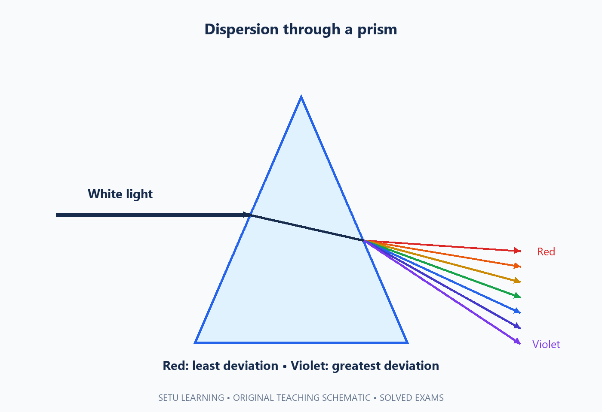

## 8. Star twinkling का mechanism।

**स्रोत:** 2026 मुख्य, प्रश्न 1(viii), PDF पृष्ठ 4 · **अंक:** 1 अंक

**अध्याय-संबंध:** मानव नेत्र तथा रंगबिरंगा संसार

**हल:** Stars की twinkling changing atmospheric refractive index से apparent brightness/position fluctuations है। Point-like source होने से effect prominent है; यह prism dispersion नहीं।

[मूल प्रश्न देखें](https://rajeduboard.rajasthan.gov.in/books/PAPERS-2026/Sec/S-07.pdf#page=4)

## 9. Wire length double: R,ρ।

**स्रोत:** 2026 मुख्य, प्रश्न 1(ix), PDF पृष्ठ 4 · **अंक:** 1 अंक

**अध्याय-संबंध:** विद्युत

**हल:** A=3 Ω resistance और B=7×10⁻⁵ Ω·m resistivity। Length double, area/material/temperature same: A=6 Ω, B unchanged। Units से quantities पहचानें।

[मूल प्रश्न देखें](https://rajeduboard.rajasthan.gov.in/books/PAPERS-2026/Sec/S-07.pdf#page=4)

## 10. Current की SI unit।

**स्रोत:** 2026 मुख्य, प्रश्न 1(x), PDF पृष्ठ 4 · **अंक:** 1 अंक

**अध्याय-संबंध:** विद्युत

**हल:** Electric current का SI unit ampere (A), 1 A=1 C/s है। Coulomb charge और joule energy की units हैं।

[मूल प्रश्न देखें](https://rajeduboard.rajasthan.gov.in/books/PAPERS-2026/Sec/S-07.pdf#page=4)

## 11. Magnet के अंदर field direction।

**स्रोत:** 2026 मुख्य, प्रश्न 1(xi), PDF पृष्ठ 5 · **अंक:** 1 अंक

**अध्याय-संबंध:** विद्युत धारा के चुंबकीय प्रभाव

**हल:** Bar magnet के भीतर field lines south→north, बाहर north→south हैं; मिलकर closed loops बनती हैं।

[मूल प्रश्न देखें](https://rajeduboard.rajasthan.gov.in/books/PAPERS-2026/Sec/S-07.pdf#page=5)

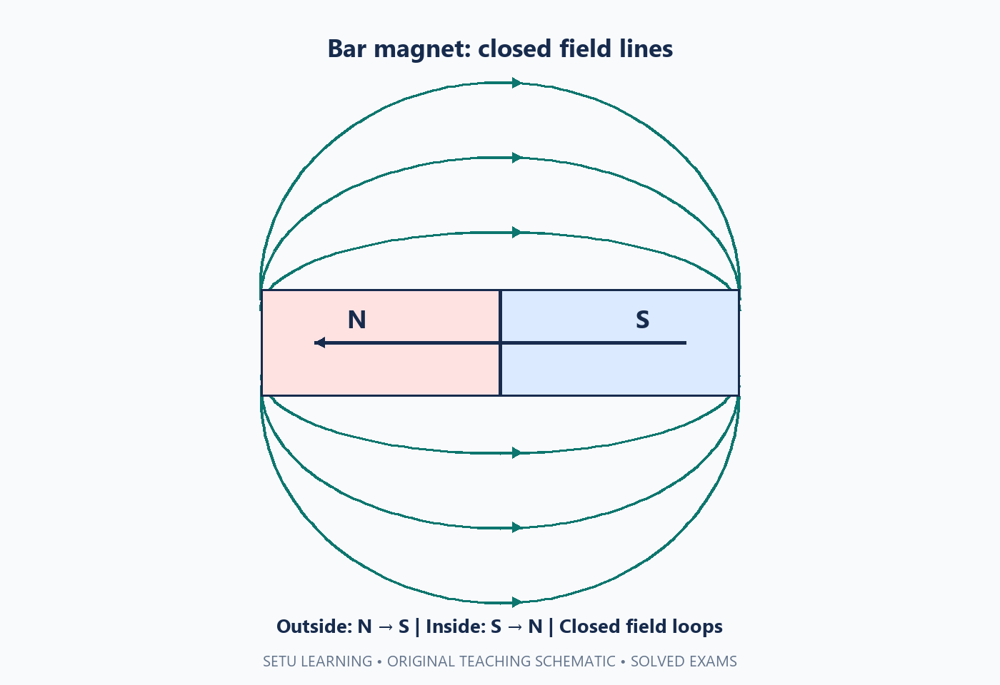

## 12. Fleming-rule fingers मिलान।

**स्रोत:** 2026 मुख्य, प्रश्न 1(xii), PDF पृष्ठ 5 · **अंक:** 1 अंक

**अध्याय-संबंध:** विद्युत धारा के चुंबकीय प्रभाव

**हल:** Left-hand thumb, forefinger और middle finger mutually perpendicular रखें। Forefinger B, middle conventional I तथा thumb force/motion देता है। Current या field अकेला reverse हो तो force reverse होता है।

[मूल प्रश्न देखें](https://rajeduboard.rajasthan.gov.in/books/PAPERS-2026/Sec/S-07.pdf#page=5)

## 13. Quicklime का formula।

**स्रोत:** 2026 मुख्य, प्रश्न 1(xiii), PDF पृष्ठ 5 · **अंक:** 1 अंक

**अध्याय-संबंध:** अम्ल, क्षारक एवं लवण

**हल:** Quicklime calcium oxide CaO है; slaked lime Ca(OH)₂। CaO+H₂O→Ca(OH)₂ heat-releasing combination है।

[मूल प्रश्न देखें](https://rajeduboard.rajasthan.gov.in/books/PAPERS-2026/Sec/S-07.pdf#page=5)

## 14. Balanced Fe coefficient।

**स्रोत:** 2026 मुख्य, प्रश्न 1(xiv), PDF पृष्ठ 6 · **अंक:** 1 अंक

**अध्याय-संबंध:** रासायनिक अभिक्रियाएँ एवं समीकरण

**हल:** 3Fe+4H₂O(steam)→Fe₃O₄+4H₂ में Fe coefficient 3 है। Fe 3, H 8, O 4 atoms दोनों sides पर equal हैं।

[मूल प्रश्न देखें](https://rajeduboard.rajasthan.gov.in/books/PAPERS-2026/Sec/S-07.pdf#page=6)

## 15. Cold-water H₂ देने वाला option।

**स्रोत:** 2026 मुख्य, प्रश्न 1(xv), PDF पृष्ठ 6 · **अंक:** 1 अंक

**अध्याय-संबंध:** धातु एवं अधातु

**हल:** दिए Na,Ag,Fe,Mn विकल्पों में sodium cold water से vigorous H₂ evolution देता है: 2Na+2H₂O→2NaOH+H₂।

[मूल प्रश्न देखें](https://rajeduboard.rajasthan.gov.in/books/PAPERS-2026/Sec/S-07.pdf#page=6)

## 16. Mg/Zn/Fe descending activity।

**स्रोत:** 2026 मुख्य, प्रश्न 1(xvi), PDF पृष्ठ 6 · **अंक:** 1 अंक

**अध्याय-संबंध:** धातु एवं अधातु

**हल:** Decreasing reactivity Mg > Zn > Fe है। Metals के activity-series क्रम के अनुसार अधिक active metal lower metal को suitable salt solution से हटा सकती है।

[मूल प्रश्न देखें](https://rajeduboard.rajasthan.gov.in/books/PAPERS-2026/Sec/S-07.pdf#page=6)

## 17. Carboxylic-acid group।

**स्रोत:** 2026 मुख्य, प्रश्न 1(xvii), PDF पृष्ठ 7 · **अंक:** 1 अंक

**अध्याय-संबंध:** कार्बन एवं उसके यौगिक

**हल:** Carboxylic acid का functional group –COOH है। Alcohol –OH, aldehyde –CHO और ketone >C=O से इसे अलग रखें।

[मूल प्रश्न देखें](https://rajeduboard.rajasthan.gov.in/books/PAPERS-2026/Sec/S-07.pdf#page=7)

## 18. Hydrogen atomic number।

**स्रोत:** 2026 मुख्य, प्रश्न 1(xviii), PDF पृष्ठ 7 · **अंक:** 1 अंक

**अध्याय-संबंध:** धातु एवं अधातु

**हल:** Hydrogen atomic number 1 है, यानी nucleus में एक proton। Atomic number को isotope mass number से न मिलाएँ।

[मूल प्रश्न देखें](https://rajeduboard.rajasthan.gov.in/books/PAPERS-2026/Sec/S-07.pdf#page=7)

## 19. Collective maintenance processes का नाम।

**स्रोत:** 2026 मुख्य, प्रश्न 2(i), PDF पृष्ठ 7 · **अंक:** 1 अंक

**अध्याय-संबंध:** जैव प्रक्रम

**हल:** Nutrition, respiration, transport, excretion जैसे collective maintenance functions life processes हैं। Reproduction species continuity के लिए है, individual maintenance की immediate शर्त नहीं।

[मूल प्रश्न देखें](https://rajeduboard.rajasthan.gov.in/books/PAPERS-2026/Sec/S-07.pdf#page=7)

## 20. Amoeba food enclosure।

**स्रोत:** 2026 मुख्य, प्रश्न 2(ii), PDF पृष्ठ 7 · **अंक:** 1 अंक

**अध्याय-संबंध:** जैव प्रक्रम

**हल:** Amoeba pseudopodia से food engulf करके food vacuole बनाता है। Vacuole में digestion और आगे nutrients का उपयोग होता है।

[मूल प्रश्न देखें](https://rajeduboard.rajasthan.gov.in/books/PAPERS-2026/Sec/S-07.pdf#page=7)

## 21. Inheritance rules के वैज्ञानिक।

**स्रोत:** 2026 मुख्य, प्रश्न 2(iii), PDF पृष्ठ 8 · **अंक:** 1 अंक

**अध्याय-संबंध:** आनुवंशिकता

**हल:** Gregor Mendel ने pea crosses से trait inheritance के महत्वपूर्ण rules निकाले। Dominance, segregation तथा suitable traits में independent assortment को अलग समझें।

[मूल प्रश्न देखें](https://rajeduboard.rajasthan.gov.in/books/PAPERS-2026/Sec/S-07.pdf#page=8)

## 22. HCl का aqueous anion।

**स्रोत:** 2026 मुख्य, प्रश्न 2(v), PDF पृष्ठ 8 · **अंक:** 1 अंक

**अध्याय-संबंध:** अम्ल, क्षारक एवं लवण

**हल:** HCl aqueous dissociation का anion chloride, Cl⁻ है। Cation का school representation H⁺/hydronium है; Cl₂ molecule नहीं बनता।

[मूल प्रश्न देखें](https://rajeduboard.rajasthan.gov.in/books/PAPERS-2026/Sec/S-07.pdf#page=8)

## 23. Nettle का school-level acid।

**स्रोत:** 2026 मुख्य, प्रश्न 2(vi), PDF पृष्ठ 8 · **अंक:** 1 अंक

**अध्याय-संबंध:** अम्ल, क्षारक एवं लवण

**हल:** विद्यालयी उत्तर methanoic/formic acid, HCOOH है। अम्लीय प्रभाव को उपयुक्त क्षारक द्वारा neutralisation से समझा जाता है।

[मूल प्रश्न देखें](https://rajeduboard.rajasthan.gov.in/books/PAPERS-2026/Sec/S-07.pdf#page=8)

## 24. Blood-pressure/salivation/vomiting का brain भाग।

**स्रोत:** 2026 मुख्य, प्रश्न 3(i), PDF पृष्ठ 8 · **अंक:** 1 अंक

**अध्याय-संबंध:** नियंत्रण एवं समन्वय

**हल:** इस board MCQ का अपेक्षित विकल्प medulla है, जो breathing, blood-pressure-related responses, salivation/vomiting जैसे involuntary functions में काम करता है। ‘सभी involuntary actions केवल medulla’ वैज्ञानिक रूप से अत्यधिक व्यापक कथन है।

[मूल प्रश्न देखें](https://rajeduboard.rajasthan.gov.in/books/PAPERS-2026/Sec/S-07.pdf#page=8)

## 25. Plant division-promoting hormone।

**स्रोत:** 2026 मुख्य, प्रश्न 3(ii), PDF पृष्ठ 8 · **अंक:** 1 अंक

**अध्याय-संबंध:** नियंत्रण एवं समन्वय

**हल:** Cytokinin plant cell division promote कर सकता है। Insulin, thyroxine और oestrogen animal hormones हैं, इसलिए plant-hormone MCQ में cytokinin चुनें।

[मूल प्रश्न देखें](https://rajeduboard.rajasthan.gov.in/books/PAPERS-2026/Sec/S-07.pdf#page=8)

## 26. Independent dihybrid F₂ ratio।

**स्रोत:** 2026 मुख्य, प्रश्न 3(iii), PDF पृष्ठ 8 · **अंक:** 1 अंक

**अध्याय-संबंध:** आनुवंशिकता

**हल:** Independent assortment और complete dominance के model में pure dominant × pure recessive से F₁ दोनों dominant traits वाला heterozygote है। F₁ selfing से expected F₂ phenotypes 9:3:3:1। यह universal genetic ratio नहीं।

[मूल प्रश्न देखें](https://rajeduboard.rajasthan.gov.in/books/PAPERS-2026/Sec/S-07.pdf#page=8)

## 27. Ozone layer की आवश्यकता।

**स्रोत:** 2026 मुख्य, प्रश्न 3(v), PDF पृष्ठ 9 · **अंक:** 1 अंक

**अध्याय-संबंध:** हमारा पर्यावरण

**हल:** Stratospheric ozone harmful ultraviolet radiation के कुछ हिस्से को absorb करता है। UV shielding घटने को ozone depletion से जोड़ें, visible colours के dispersion से नहीं।

[मूल प्रश्न देखें](https://rajeduboard.rajasthan.gov.in/books/PAPERS-2026/Sec/S-07.pdf#page=9)

## 28. Lens power का अर्थ।

**स्रोत:** 2026 मुख्य, प्रश्न 3(vii), PDF पृष्ठ 9 · **अंक:** 1 अंक

**अध्याय-संबंध:** प्रकाश: परावर्तन तथा अपवर्तन

**हल:** Lens power P=1/f है, f metre में; unit dioptre। Convex/converging lens positive, concave/diverging lens negative power रखता है। Centimetre में f का reciprocal सीधे dioptres नहीं देता।

[मूल प्रश्न देखें](https://rajeduboard.rajasthan.gov.in/books/PAPERS-2026/Sec/S-07.pdf#page=9)

## 29. Electromagnet की परिभाषा।

**स्रोत:** 2026 मुख्य, प्रश्न 3(viii), PDF पृष्ठ 9 · **अंक:** 1 अंक

**अध्याय-संबंध:** विद्युत धारा के चुंबकीय प्रभाव

**हल:** Current-carrying coil, प्रायः suitable soft-iron core सहित, temporary electromagnet बना सकती है। Current off/reverse से strength/polarity control हो सकती है। यह permanent bar magnet का identical construction नहीं।

[मूल प्रश्न देखें](https://rajeduboard.rajasthan.gov.in/books/PAPERS-2026/Sec/S-07.pdf#page=9)

## 30. Circuit fuse का काम।

**स्रोत:** 2026 मुख्य, प्रश्न 3(ix), PDF पृष्ठ 9 · **अंक:** 1 अंक

**अध्याय-संबंध:** विद्युत धारा के चुंबकीय प्रभाव

**हल:** Excess current से suitable fuse element heats और melts होकर circuit खोलता है। Correct current rating तथा live conductor placement जरूरी हैं; fuse को मोटे साधारण wire से replace न करें।

[मूल प्रश्न देखें](https://rajeduboard.rajasthan.gov.in/books/PAPERS-2026/Sec/S-07.pdf#page=9)

## 31. Zn–H₂SO₄ balanced equation।

**स्रोत:** 2026 मुख्य, प्रश्न 3(x), PDF पृष्ठ 9 · **अंक:** 1 अंक

**अध्याय-संबंध:** अम्ल, क्षारक एवं लवण

**हल:** Zn + H₂SO₄(dil.) → ZnSO₄ + H₂। Gas hydrogen है; prescribed supervised test में burning splint से characteristic pop मिल सकता है। Acid/gas experiment स्वयं न करें।

[मूल प्रश्न देखें](https://rajeduboard.rajasthan.gov.in/books/PAPERS-2026/Sec/S-07.pdf#page=9)

## 2026 — पूरक परीक्षा

[2026 पूरक: पूरा आधिकारिक प्रश्न-पत्र](https://rajeduboard.rajasthan.gov.in/books/PAPERS-2026/SecSUP/S-07.pdf)

## 32. Growth-stimulating gland का चयन।

**स्रोत:** 2026 पूरक, प्रश्न 1(i), PDF पृष्ठ 3 · **अंक:** 1 अंक

**अध्याय-संबंध:** नियंत्रण एवं समन्वय

**हल:** दिए विकल्पों में pituitary gland growth hormone से growth stimulate करती है। Board stem ‘all organs’ simplified है; actual tissue responses एवं अन्य hormones भी भूमिका रखते हैं।

[मूल प्रश्न देखें](https://rajeduboard.rajasthan.gov.in/books/PAPERS-2026/SecSUP/S-07.pdf#page=3)

## 33. Budding से नया organism।

**स्रोत:** 2026 पूरक, प्रश्न 1(ii), PDF पृष्ठ 3 · **अंक:** 1 अंक

**अध्याय-संबंध:** जीव जनन कैसे करते हैं?

**हल:** Hydra budding से asexual reproduction करता है; parent body पर outgrowth mature होकर नया individual बनता है।

[मूल प्रश्न देखें](https://rajeduboard.rajasthan.gov.in/books/PAPERS-2026/SecSUP/S-07.pdf#page=3)

## 34. Xylem का transported पदार्थ।

**स्रोत:** 2026 पूरक, प्रश्न 1(iii), PDF पृष्ठ 3 · **अंक:** 1 अंक

**अध्याय-संबंध:** जैव प्रक्रम

**हल:** Xylem roots से water तथा dissolved minerals transport करता है। Phloem photosynthates का source–sink transfer करता है।

[मूल प्रश्न देखें](https://rajeduboard.rajasthan.gov.in/books/PAPERS-2026/SecSUP/S-07.pdf#page=3)

## 35. Non-biodegradable option।

**स्रोत:** 2026 पूरक, प्रश्न 1(v), PDF पृष्ठ 4 · **अंक:** 1 अंक

**अध्याय-संबंध:** हमारा पर्यावरण

**हल:** दिए examples में conventional plastic non-biodegradable है; persistent waste अलग collect/recycle करें। सभी types/material formulations की degradation समान नहीं होती।

[मूल प्रश्न देखें](https://rajeduboard.rajasthan.gov.in/books/PAPERS-2026/SecSUP/S-07.pdf#page=4)

## 36. Ozone किस radiation को रोकती है?

**स्रोत:** 2026 पूरक, प्रश्न 1(vi), PDF पृष्ठ 4 · **अंक:** 1 अंक

**अध्याय-संबंध:** हमारा पर्यावरण

**हल:** Stratospheric ozone harmful ultraviolet radiation के कुछ हिस्से को absorb करता है। UV shielding घटने को ozone depletion से जोड़ें, visible colours के dispersion से नहीं।

[मूल प्रश्न देखें](https://rajeduboard.rajasthan.gov.in/books/PAPERS-2026/SecSUP/S-07.pdf#page=4)

## 37. Pupil size का नियंत्रण।

**स्रोत:** 2026 पूरक, प्रश्न 1(vii), PDF पृष्ठ 4 · **अंक:** 1 अंक

**अध्याय-संबंध:** मानव नेत्र तथा रंगबिरंगा संसार

**हल:** Iris की muscles pupil opening का size नियंत्रित करती हैं। Lens की curvature ciliary muscles बदलती हैं; light entry और accommodation के mechanisms अलग हैं।

[मूल प्रश्न देखें](https://rajeduboard.rajasthan.gov.in/books/PAPERS-2026/SecSUP/S-07.pdf#page=4)

## 38. Prism least bending colour।

**स्रोत:** 2026 पूरक, प्रश्न 1(viii), PDF पृष्ठ 5 · **अंक:** 1 अंक

**अध्याय-संबंध:** मानव नेत्र तथा रंगबिरंगा संसार

**हल:** Ordinary glass prism में red light least और violet greatest deviation देती है। Wavelength-dependent refractive index dispersion का कारण है।

[मूल प्रश्न देखें](https://rajeduboard.rajasthan.gov.in/books/PAPERS-2026/SecSUP/S-07.pdf#page=5)

## 39. Wire half length का R।

**स्रोत:** 2026 पूरक, प्रश्न 1(ix), PDF पृष्ठ 5 · **अंक:** 1 अंक

**अध्याय-संबंध:** विद्युत

**हल:** Same material, area और temperature पर R=ρl/A। Length half होने पर resistance half, resistivity unchanged होती है।

[मूल प्रश्न देखें](https://rajeduboard.rajasthan.gov.in/books/PAPERS-2026/SecSUP/S-07.pdf#page=5)

## 40. Potential difference unit।

**स्रोत:** 2026 पूरक, प्रश्न 1(x), PDF पृष्ठ 5 · **अंक:** 1 अंक

**अध्याय-संबंध:** विद्युत

**हल:** Potential difference की SI unit volt (V) है: 1 V=1 J/C। Current ampere और charge coulomb है।

[मूल प्रश्न देखें](https://rajeduboard.rajasthan.gov.in/books/PAPERS-2026/SecSUP/S-07.pdf#page=5)

## 41. Unlike poles का effect।

**स्रोत:** 2026 पूरक, प्रश्न 1(xi), PDF पृष्ठ 5 · **अंक:** 1 अंक

**अध्याय-संबंध:** विद्युत धारा के चुंबकीय प्रभाव

**हल:** Unlike poles attract; like poles repel। समान strength के bar magnets होने से यह polarity rule बदलता नहीं।

[मूल प्रश्न देखें](https://rajeduboard.rajasthan.gov.in/books/PAPERS-2026/SecSUP/S-07.pdf#page=5)

## 42. Left-hand rule की तीन quantities।

**स्रोत:** 2026 पूरक, प्रश्न 1(xii), PDF पृष्ठ 6 · **अंक:** 1 अंक

**अध्याय-संबंध:** विद्युत धारा के चुंबकीय प्रभाव

**हल:** Left-hand thumb, forefinger और middle finger mutually perpendicular रखें। Forefinger B, middle conventional I तथा thumb force/motion देता है। Current या field अकेला reverse हो तो force reverse होता है।

[मूल प्रश्न देखें](https://rajeduboard.rajasthan.gov.in/books/PAPERS-2026/SecSUP/S-07.pdf#page=6)

## 43. Limestone formula।

**स्रोत:** 2026 पूरक, प्रश्न 1(xiii), PDF पृष्ठ 6 · **अंक:** 1 अंक

**अध्याय-संबंध:** अम्ल, क्षारक एवं लवण

**हल:** Limestone का प्रमुख school formula calcium carbonate CaCO₃ है। Quicklime CaO और slaked lime Ca(OH)₂ हैं।

[मूल प्रश्न देखें](https://rajeduboard.rajasthan.gov.in/books/PAPERS-2026/SecSUP/S-07.pdf#page=6)

## 44. Fe₃O₄ coefficient।

**स्रोत:** 2026 पूरक, प्रश्न 1(xiv), PDF पृष्ठ 6 · **अंक:** 1 अंक

**अध्याय-संबंध:** रासायनिक अभिक्रियाएँ एवं समीकरण

**हल:** 3Fe+4H₂O→Fe₃O₄+4H₂। Fe₃O₄ coefficient 1, Fe coefficient 3 और H₂ coefficient 4 है। दिए compound को पहचानकर उत्तर दें।

[मूल प्रश्न देखें](https://rajeduboard.rajasthan.gov.in/books/PAPERS-2026/SecSUP/S-07.pdf#page=6)

## 45. Very dilute HNO₃ में H₂ option।

**स्रोत:** 2026 पूरक, प्रश्न 1(xv), PDF पृष्ठ 7 · **अंक:** 1 अंक

**अध्याय-संबंध:** धातु एवं अधातु

**हल:** दिए Ag,Mg,Au,Pt में Mg बहुत dilute HNO₃ से H₂ दे सकता है। Nitric acid सामान्यतः oxidising होने से सामान्य H₂ evolution rule की exception है; dilute condition अनिवार्य है।

[मूल प्रश्न देखें](https://rajeduboard.rajasthan.gov.in/books/PAPERS-2026/SecSUP/S-07.pdf#page=7)

## 46. Mg/Al/Fe decreasing activity।

**स्रोत:** 2026 पूरक, प्रश्न 1(xvi), PDF पृष्ठ 7 · **अंक:** 1 अंक

**अध्याय-संबंध:** धातु एवं अधातु

**हल:** Decreasing reactivity Mg > Al > Fe। केवल alphabetical order या atomic number से activity क्रम न निकालें।

[मूल प्रश्न देखें](https://rajeduboard.rajasthan.gov.in/books/PAPERS-2026/SecSUP/S-07.pdf#page=7)

## 47. Aldehyde functional group।

**स्रोत:** 2026 पूरक, प्रश्न 1(xvii), PDF पृष्ठ 7 · **अंक:** 1 अंक

**अध्याय-संबंध:** कार्बन एवं उसके यौगिक

**हल:** Aldehyde group –CHO है: terminal carbonyl carbon से hydrogen जुड़ा है। Ketone >C=O और carboxylic acid –COOH अलग हैं।

[मूल प्रश्न देखें](https://rajeduboard.rajasthan.gov.in/books/PAPERS-2026/SecSUP/S-07.pdf#page=7)

## 48. Nitrogen atomic number।

**स्रोत:** 2026 पूरक, प्रश्न 1(xviii), PDF पृष्ठ 7 · **अंक:** 1 अंक

**अध्याय-संबंध:** धातु एवं अधातु

**हल:** Nitrogen atomic number 7 है, nucleus में सात protons। Neutral atom में electrons भी सात; mass number अलग quantity है।

[मूल प्रश्न देखें](https://rajeduboard.rajasthan.gov.in/books/PAPERS-2026/SecSUP/S-07.pdf#page=7)

## 49. Blood का fluid medium।

**स्रोत:** 2026 पूरक, प्रश्न 2(i), PDF पृष्ठ 8 · **अंक:** 1 अंक

**अध्याय-संबंध:** जैव प्रक्रम

**हल:** Blood का fluid medium plasma है। इसमें blood cells suspended और dissolved substances transported होते हैं; RBC pigment haemoglobin plasma का नाम नहीं।

[मूल प्रश्न देखें](https://rajeduboard.rajasthan.gov.in/books/PAPERS-2026/SecSUP/S-07.pdf#page=8)

## 50. Two-gene F₂ phenotype ratio।

**स्रोत:** 2026 पूरक, प्रश्न 2(iii), PDF पृष्ठ 8 · **अंक:** 1 अंक

**अध्याय-संबंध:** आनुवंशिकता

**हल:** Independent assortment और complete dominance के model में pure dominant × pure recessive से F₁ दोनों dominant traits वाला heterozygote है। F₁ selfing से expected F₂ phenotypes 9:3:3:1। यह universal genetic ratio नहीं।

[मूल प्रश्न देखें](https://rajeduboard.rajasthan.gov.in/books/PAPERS-2026/SecSUP/S-07.pdf#page=8)

## 51. Human chromosome pairs।

**स्रोत:** 2026 पूरक, प्रश्न 2(iv), PDF पृष्ठ 8 · **अंक:** 1 अंक

**अध्याय-संबंध:** आनुवंशिकता

**हल:** Typical human somatic cells में 23 chromosome pairs (46 total) होते हैं। Gametes में 23 single chromosomes होते हैं; pairs और total न मिलाएँ।

[मूल प्रश्न देखें](https://rajeduboard.rajasthan.gov.in/books/PAPERS-2026/SecSUP/S-07.pdf#page=8)

## 52. Ethanoic-acid aqueous anion।

**स्रोत:** 2026 पूरक, प्रश्न 2(v), PDF पृष्ठ 8 · **अंक:** 1 अंक

**अध्याय-संबंध:** कार्बन एवं उसके यौगिक

**हल:** CH₃COOH के aqueous ionisation का anion CH₃COO⁻, acetate/ethanoate है। Acid weak होने से ionisation partial होता है; anion का charge −1।

[मूल प्रश्न देखें](https://rajeduboard.rajasthan.gov.in/books/PAPERS-2026/SecSUP/S-07.pdf#page=8)

## 53. Tamarind का sour acid।

**स्रोत:** 2026 पूरक, प्रश्न 2(vi), PDF पृष्ठ 8 · **अंक:** 1 अंक

**अध्याय-संबंध:** अम्ल, क्षारक एवं लवण

**हल:** Tamarind का characteristic school-level acid tartaric acid है। Orange का citric और curd का lactic acid इससे अलग हैं।

[मूल प्रश्न देखें](https://rajeduboard.rajasthan.gov.in/books/PAPERS-2026/SecSUP/S-07.pdf#page=8)

## 2025 — मुख्य परीक्षा

[2025 मुख्य: पूरा आधिकारिक प्रश्न-पत्र](https://rajeduboard.rajasthan.gov.in/books/PAPERS-2025/Sec/S-07.pdf)

## 54. Metabolism-for-growth gland।

**स्रोत:** 2025 मुख्य, प्रश्न 1(i), PDF पृष्ठ 2 · **अंक:** 1 अंक

**अध्याय-संबंध:** नियंत्रण एवं समन्वय

**हल:** Thyroid gland thyroxine के द्वारा metabolism regulate करती है और growth/development में सहयोग देती है। इसे pituitary growth hormone के सीधे नाम से न बदलें।

[मूल प्रश्न देखें](https://rajeduboard.rajasthan.gov.in/books/PAPERS-2025/Sec/S-07.pdf#page=2)

## 55. Regeneration वाला organism।

**स्रोत:** 2025 मुख्य, प्रश्न 1(ii), PDF पृष्ठ 2 · **अंक:** 1 अंक

**अध्याय-संबंध:** जीव जनन कैसे करते हैं?

**हल:** Planaria में suitable fragments regeneration से पूरा organism बना सकते हैं। Leishmania binary fission, Plasmodium multiple fission और Hydra budding के standard examples हैं।

[मूल प्रश्न देखें](https://rajeduboard.rajasthan.gov.in/books/PAPERS-2025/Sec/S-07.pdf#page=2)

## 56. Kidney का organ system।

**स्रोत:** 2025 मुख्य, प्रश्न 1(iii), PDF पृष्ठ 2 · **अंक:** 1 अंक

**अध्याय-संबंध:** जैव प्रक्रम

**हल:** Kidneys excretory system का भाग हैं; blood से filtrate, selective reabsorption तथा secretion के बाद urine बनता है। Nutrition, breathing और excretion अलग functions हैं।

[मूल प्रश्न देखें](https://rajeduboard.rajasthan.gov.in/books/PAPERS-2025/Sec/S-07.pdf#page=2)

## 57. Plant hormone का चयन।

**स्रोत:** 2025 मुख्य, प्रश्न 1(iv), PDF पृष्ठ 3 · **अंक:** 1 अंक

**अध्याय-संबंध:** नियंत्रण एवं समन्वय

**हल:** Cytokinin plant cell division promote कर सकता है। Insulin, thyroxine और oestrogen animal hormones हैं, इसलिए plant-hormone MCQ में cytokinin चुनें।

[मूल प्रश्न देखें](https://rajeduboard.rajasthan.gov.in/books/PAPERS-2025/Sec/S-07.pdf#page=3)

## 58. Monohybrid F₂ genotype ratio।

**स्रोत:** 2025 मुख्य, प्रश्न 1(v), PDF पृष्ठ 3 · **अंक:** 1 अंक

**अध्याय-संबंध:** आनुवंशिकता

**हल:** Tt×Tt से TT,Tt,Tt,tt; expected genotype ratio 1:2:1। Complete dominance का phenotype ratio 3:1 है। दोनों को swap न करें।

[मूल प्रश्न देखें](https://rajeduboard.rajasthan.gov.in/books/PAPERS-2025/Sec/S-07.pdf#page=3)

## 59. Solar energy fixing organisms।

**स्रोत:** 2025 मुख्य, प्रश्न 1(vi), PDF पृष्ठ 3 · **अंक:** 1 अंक

**अध्याय-संबंध:** हमारा पर्यावरण

**हल:** Photosynthetic producers solar energy को organic compounds में fix करते हैं, जो heterotrophs को food-chain transfer से उपलब्ध होती है। Primary consumers स्वयं producers नहीं।

[मूल प्रश्न देखें](https://rajeduboard.rajasthan.gov.in/books/PAPERS-2025/Sec/S-07.pdf#page=3)

## 60. Mirror R–f relation।

**स्रोत:** 2025 मुख्य, प्रश्न 1(vii), PDF पृष्ठ 4 · **अंक:** 1 अंक

**अध्याय-संबंध:** प्रकाश: परावर्तन तथा अपवर्तन

**हल:** Paraxial spherical mirror में R=2f अथवा f=R/2। Radius of curvature तथा focus distance समान units और signs में रखें।

[मूल प्रश्न देखें](https://rajeduboard.rajasthan.gov.in/books/PAPERS-2025/Sec/S-07.pdf#page=4)

## 61. Prism में least deviation।

**स्रोत:** 2025 मुख्य, प्रश्न 1(viii), PDF पृष्ठ 4 · **अंक:** 1 अंक

**अध्याय-संबंध:** मानव नेत्र तथा रंगबिरंगा संसार

**हल:** Ordinary glass prism में red light least और violet greatest deviation देती है। Wavelength-dependent refractive index dispersion का कारण है।

[मूल प्रश्न देखें](https://rajeduboard.rajasthan.gov.in/books/PAPERS-2025/Sec/S-07.pdf#page=4)

## 62. दिए metals में best conductor।

**स्रोत:** 2025 मुख्य, प्रश्न 1(x), PDF पृष्ठ 5 · **अंक:** 1 अंक

**अध्याय-संबंध:** धातु एवं अधातु

**हल:** दिए iron/aluminium/copper/silver विकल्पों में silver सबसे अच्छा electrical conductor है। Practical wires में cost, ductility और other factors से copper useful है।

[मूल प्रश्न देखें](https://rajeduboard.rajasthan.gov.in/books/PAPERS-2025/Sec/S-07.pdf#page=5)

## 63. Right-hand thumb direction।

**स्रोत:** 2025 मुख्य, प्रश्न 1(xi), PDF पृष्ठ 5 · **अंक:** 1 अंक

**अध्याय-संबंध:** विद्युत धारा के चुंबकीय प्रभाव

**हल:** Right-hand thumb conventional current की दिशा में रखें; curled fingers wire के circular magnetic field की direction देती हैं। Thumb force नहीं बताता; force के लिए Fleming left-hand rule है।

[मूल प्रश्न देखें](https://rajeduboard.rajasthan.gov.in/books/PAPERS-2025/Sec/S-07.pdf#page=5)

## 64. Zn–dilute H₂SO₄ की gas।

**स्रोत:** 2025 मुख्य, प्रश्न 1(xiii), PDF पृष्ठ 6 · **अंक:** 1 अंक

**अध्याय-संबंध:** अम्ल, क्षारक एवं लवण

**हल:** Zn + H₂SO₄(dil.) → ZnSO₄ + H₂। Gas hydrogen है; prescribed supervised test में burning splint से characteristic pop मिल सकता है। Acid/gas experiment स्वयं न करें।

[मूल प्रश्न देखें](https://rajeduboard.rajasthan.gov.in/books/PAPERS-2025/Sec/S-07.pdf#page=6)

## 65. Neutral solution का pH।

**स्रोत:** 2025 मुख्य, प्रश्न 1(xiv), PDF पृष्ठ 6 · **अंक:** 1 अंक

**अध्याय-संबंध:** अम्ल, क्षारक एवं लवण

**हल:** लगभग 25°C पर उदासीन जलीय विलयन का pH 7 होता है। इसमें H₃O⁺ और OH⁻ की concentrations समान होती हैं।

[मूल प्रश्न देखें](https://rajeduboard.rajasthan.gov.in/books/PAPERS-2025/Sec/S-07.pdf#page=6)

## 66. PbO–carbon के true redox statements।

**स्रोत:** 2025 मुख्य, प्रश्न 1(xv), PDF पृष्ठ 6 · **अंक:** 1 अंक

**अध्याय-संबंध:** रासायनिक अभिक्रियाएँ एवं समीकरण

**हल:** 2PbO+C→2Pb+CO₂ में carbon oxidised और PbO reduced होता है। Product CO₂ को फिर oxidised reactant कहना गलत है।

[मूल प्रश्न देखें](https://rajeduboard.rajasthan.gov.in/books/PAPERS-2025/Sec/S-07.pdf#page=6)

## 67. Phosphorus M-shell electrons।

**स्रोत:** 2025 मुख्य, प्रश्न 1(xvi), PDF पृष्ठ 7 · **अंक:** 1 अंक

**अध्याय-संबंध:** धातु एवं अधातु

**हल:** Phosphorus atomic number 15 का shell distribution 2,8,5 है; M shell में 5 electrons। यह electronic configuration का प्रश्न है।

[मूल प्रश्न देखें](https://rajeduboard.rajasthan.gov.in/books/PAPERS-2025/Sec/S-07.pdf#page=7)

## 68. दिए formula में saturated hydrocarbon।

**स्रोत:** 2025 मुख्य, प्रश्न 1(xvii), PDF पृष्ठ 7 · **अंक:** 1 अंक

**अध्याय-संबंध:** कार्बन एवं उसके यौगिक

**हल:** दिए C₂H₂,C₂H₄,C₂H₆,C₆H₆ विकल्पों में ethane C₂H₆ saturated acyclic hydrocarbon है; C–C single bond है।

[मूल प्रश्न देखें](https://rajeduboard.rajasthan.gov.in/books/PAPERS-2025/Sec/S-07.pdf#page=7)

## 69. CH₄ का covalent-bond count।

**स्रोत:** 2025 मुख्य, प्रश्न 1(xviii), PDF पृष्ठ 7 · **अंक:** 1 अंक

**अध्याय-संबंध:** कार्बन एवं उसके यौगिक

**हल:** Methane CH₄ में चार C–H covalent single bonds हैं। Carbon चार pairs share करके octet, हर H duplet पूरा करता है।

[मूल प्रश्न देखें](https://rajeduboard.rajasthan.gov.in/books/PAPERS-2025/Sec/S-07.pdf#page=7)

## 70. Hormone action regulation।

**स्रोत:** 2025 मुख्य, प्रश्न 2(i), PDF पृष्ठ 7 · **अंक:** 1 अंक

**अध्याय-संबंध:** नियंत्रण एवं समन्वय

**हल:** Feedback mechanism hormone release के time/amount को regulate कर सकता है। उदाहरण blood glucose बढ़ने से insulin stimulus बढ़ता, glucose घटने पर stimulus कम होता है।

[मूल प्रश्न देखें](https://rajeduboard.rajasthan.gov.in/books/PAPERS-2025/Sec/S-07.pdf#page=7)

## 71. Branching food-chain network।

**स्रोत:** 2025 मुख्य, प्रश्न 2(ii), PDF पृष्ठ 7 · **अंक:** 1 अंक

**अध्याय-संबंध:** हमारा पर्यावरण

**हल:** Branching/interconnected food chains का network food web है। One organism कई food sources/predators से जुड़ सकता है; arrows transfer source से recipient तक हों।

[मूल प्रश्न देखें](https://rajeduboard.rajasthan.gov.in/books/PAPERS-2025/Sec/S-07.pdf#page=7)

## 72. Coil turns बढ़ाने का effect।

**स्रोत:** 2025 मुख्य, प्रश्न 2(iv), PDF पृष्ठ 8 · **अंक:** 1 अंक

**अध्याय-संबंध:** विद्युत धारा के चुंबकीय प्रभाव

**हल:** Same geometry/current में turns बढ़ने पर loop/coil का combined magnetic field बढ़ सकता है। Individual turns का field contribution add होता है; current, core और dimensions भी महत्त्वपूर्ण हैं।

[मूल प्रश्न देखें](https://rajeduboard.rajasthan.gov.in/books/PAPERS-2025/Sec/S-07.pdf#page=8)

## 73. Burning magnesium का compound।

**स्रोत:** 2025 मुख्य, प्रश्न 2(v), PDF पृष्ठ 8 · **अंक:** 1 अंक

**अध्याय-संबंध:** रासायनिक अभिक्रियाएँ एवं समीकरण

**हल:** 2Mg + O₂ → 2MgO। Product magnesium oxide है, combination reaction का उदाहरण। Mg और O दोनों sides पर 2 atoms हैं।

[मूल प्रश्न देखें](https://rajeduboard.rajasthan.gov.in/books/PAPERS-2025/Sec/S-07.pdf#page=8)

## 74. Gold/iron में अधिक ductile।

**स्रोत:** 2025 मुख्य, प्रश्न 2(vi), PDF पृष्ठ 8 · **अंक:** 1 अंक

**अध्याय-संबंध:** धातु एवं अधातु

**हल:** दिए mercury,lead,gold,sodium विकल्पों में gold अत्यंत ductile है। Ductility तार बनाने और malleability sheet बनाने का गुण है।

[मूल प्रश्न देखें](https://rajeduboard.rajasthan.gov.in/books/PAPERS-2025/Sec/S-07.pdf#page=8)

## 75. Respiration का अर्थ।

**स्रोत:** 2025 मुख्य, प्रश्न 3(i), PDF पृष्ठ 8 · **अंक:** 1 अंक

**अध्याय-संबंध:** जैव प्रक्रम

**हल:** Cellular respiration food का breakdown करके usable energy release करने की प्रक्रिया है। Cytoplasm में glucose से pyruvate; aerobic mitochondrial route CO₂/water देता है। Yeast anaerobic route ethanol/CO₂ तथा oxygen-deficit muscles lactate दे सकते हैं।

[मूल प्रश्न देखें](https://rajeduboard.rajasthan.gov.in/books/PAPERS-2025/Sec/S-07.pdf#page=8)

## 76. Precise body movement का भाग।

**स्रोत:** 2025 मुख्य, प्रश्न 3(ii), PDF पृष्ठ 8 · **अंक:** 1 अंक

**अध्याय-संबंध:** नियंत्रण एवं समन्वय

**हल:** Cerebellum posture, balance तथा precise movement में मदद करता है। Walking straight/riding bicycle coordination के ऐसे examples हैं।

[मूल प्रश्न देखें](https://rajeduboard.rajasthan.gov.in/books/PAPERS-2025/Sec/S-07.pdf#page=8)

## 77. एक bisexual flower।

**स्रोत:** 2025 मुख्य, प्रश्न 3(iii), PDF पृष्ठ 8 · **अंक:** 1 अंक

**अध्याय-संबंध:** जीव जनन कैसे करते हैं?

**हल:** जिस flower में stamen और pistil दोनों हों, वह bisexual flower है। Hibiscus और mustard standard examples हैं; bisexual होना self-pollination की guarantee नहीं।

[मूल प्रश्न देखें](https://rajeduboard.rajasthan.gov.in/books/PAPERS-2025/Sec/S-07.pdf#page=8)

## 78. Vehicle rear-view mirror।

**स्रोत:** 2025 मुख्य, प्रश्न 3(v), PDF पृष्ठ 9 · **अंक:** 1 अंक

**अध्याय-संबंध:** प्रकाश: परावर्तन तथा अपवर्तन

**हल:** Convex mirror wide field of view तथा erect, diminished virtual image देता है। इसलिए vehicle rear-view में useful है; concave magnified-image case से अलग रखें।

[मूल प्रश्न देखें](https://rajeduboard.rajasthan.gov.in/books/PAPERS-2025/Sec/S-07.pdf#page=9)

## 79. Myopia का अर्थ।

**स्रोत:** 2025 मुख्य, प्रश्न 3(vi), PDF पृष्ठ 9 · **अंक:** 1 अंक

**अध्याय-संबंध:** मानव नेत्र तथा रंगबिरंगा संसार

**हल:** Myopia: दूर वस्तु की image retina के आगे; correction concave lens। Hypermetropia: near-object focus retina के पीछे की tendency; correction convex lens। Diagrams में retina और corrected focus label करें।

[मूल प्रश्न देखें](https://rajeduboard.rajasthan.gov.in/books/PAPERS-2025/Sec/S-07.pdf#page=9)

## 80. Voltage मापने का यंत्र।

**स्रोत:** 2025 मुख्य, प्रश्न 3(vii), PDF पृष्ठ 9 · **अंक:** 1 अंक

**अध्याय-संबंध:** विद्युत

**हल:** Voltmeter potential difference मापता है और measured component के parallel लगता है। Ammeter current के लिए series है; instruments के connections swap न करें।

[मूल प्रश्न देखें](https://rajeduboard.rajasthan.gov.in/books/PAPERS-2025/Sec/S-07.pdf#page=9)

## 81. CaO–water का product।

**स्रोत:** 2025 मुख्य, प्रश्न 3(ix), PDF पृष्ठ 9 · **अंक:** 1 अंक

**अध्याय-संबंध:** अम्ल, क्षारक एवं लवण

**हल:** CaO+H₂O→Ca(OH)₂+heat। Product calcium hydroxide/slaked lime है। Quicklime CaO reactant है; lime water aqueous Ca(OH)₂ होता है।

[मूल प्रश्न देखें](https://rajeduboard.rajasthan.gov.in/books/PAPERS-2025/Sec/S-07.pdf#page=9)

## 82. Acid functional-group formula।

**स्रोत:** 2025 मुख्य, प्रश्न 3(xi), PDF पृष्ठ 10 · **अंक:** 1 अंक

**अध्याय-संबंध:** कार्बन एवं उसके यौगिक

**हल:** Carboxylic acid का functional group –COOH है। Alcohol –OH, aldehyde –CHO और ketone >C=O से इसे अलग रखें।

[मूल प्रश्न देखें](https://rajeduboard.rajasthan.gov.in/books/PAPERS-2025/Sec/S-07.pdf#page=10)

## 83. Aqueous acid में bulb glow।

**स्रोत:** 2025 मुख्य, प्रश्न 3(xii), PDF पृष्ठ 10 · **अंक:** 1 अंक

**अध्याय-संबंध:** अम्ल, क्षारक एवं लवण

**हल:** Aqueous acids mobile ions बनाते हैं, जिनसे electrical conduction और bulb glow हो सकती है। H₃O⁺ तथा counter-anions charge ले जाते हैं; सभी H-containing molecules acids नहीं।

[मूल प्रश्न देखें](https://rajeduboard.rajasthan.gov.in/books/PAPERS-2025/Sec/S-07.pdf#page=10)

## 2025 — पूरक परीक्षा

[2025 पूरक: पूरा आधिकारिक प्रश्न-पत्र](https://rajeduboard.rajasthan.gov.in/books/PAPERS-2025/SecSUP/S-07.pdf)

## 84. Blood-sugar hormone।

**स्रोत:** 2025 पूरक, प्रश्न 1(i), PDF पृष्ठ 2 · **अंक:** 1 अंक

**अध्याय-संबंध:** नियंत्रण एवं समन्वय

**हल:** Pancreas insulin देता है; blood glucose regulation तथा uptake/storage में सहायता करता है। इसकी deficiency diabetes mellitus से जुड़ सकती है। सभी diabetes के cases केवल पूर्ण insulin absence से नहीं होते।

[मूल प्रश्न देखें](https://rajeduboard.rajasthan.gov.in/books/PAPERS-2025/SecSUP/S-07.pdf#page=2)

## 85. Multiple-fission option।

**स्रोत:** 2025 पूरक, प्रश्न 1(ii), PDF पृष्ठ 2 · **अंक:** 1 अंक

**अध्याय-संबंध:** जीव जनन कैसे करते हैं?

**हल:** Plasmodium में multiple fission: एक parent cell से अनेक daughter cells बन सकते हैं। Binary fission में केवल दो बनते हैं।

[मूल प्रश्न देखें](https://rajeduboard.rajasthan.gov.in/books/PAPERS-2025/SecSUP/S-07.pdf#page=2)

## 86. Alimentary canal का system।

**स्रोत:** 2025 पूरक, प्रश्न 1(iii), PDF पृष्ठ 2 · **अंक:** 1 अंक

**अध्याय-संबंध:** जैव प्रक्रम

**हल:** Alimentary canal digestive system का भाग है: food passage, digestion और nutrient absorption से जुड़ा है। Excretory urinary tract से इसकी संरचना अलग है।

[मूल प्रश्न देखें](https://rajeduboard.rajasthan.gov.in/books/PAPERS-2025/SecSUP/S-07.pdf#page=2)

## 87. Plant cell-division hormone।

**स्रोत:** 2025 पूरक, प्रश्न 1(iv), PDF पृष्ठ 3 · **अंक:** 1 अंक

**अध्याय-संबंध:** नियंत्रण एवं समन्वय

**हल:** Cytokinin plant cell division promote कर सकता है। Insulin, thyroxine और oestrogen animal hormones हैं, इसलिए plant-hormone MCQ में cytokinin चुनें।

[मूल प्रश्न देखें](https://rajeduboard.rajasthan.gov.in/books/PAPERS-2025/SecSUP/S-07.pdf#page=3)

## 88. Monohybrid F₂ genotype types।

**स्रोत:** 2025 पूरक, प्रश्न 1(v), PDF पृष्ठ 3 · **अंक:** 1 अंक

**अध्याय-संबंध:** आनुवंशिकता

**हल:** Tt×Tt से TT,Tt,Tt,tt; expected genotype ratio 1:2:1। Complete dominance का phenotype ratio 3:1 है। दोनों को swap न करें।

[मूल प्रश्न देखें](https://rajeduboard.rajasthan.gov.in/books/PAPERS-2025/SecSUP/S-07.pdf#page=3)

## 89. Natural ecosystem का चयन।

**स्रोत:** 2025 पूरक, प्रश्न 1(vi), PDF पृष्ठ 3 · **अंक:** 1 अंक

**अध्याय-संबंध:** हमारा पर्यावरण

**हल:** दिए garden,crop-field,aquarium,forest विकल्पों में forest natural ecosystem है। Other listed examples human-created/managed हैं; सभी forests आज बिना human influence हों, ऐसा दावा नहीं।

[मूल प्रश्न देखें](https://rajeduboard.rajasthan.gov.in/books/PAPERS-2025/SecSUP/S-07.pdf#page=3)

## 90. Concave enlarged virtual image: object site।

**स्रोत:** 2025 पूरक, प्रश्न 1(vii), PDF पृष्ठ 4 · **अंक:** 1 अंक

**अध्याय-संबंध:** प्रकाश: परावर्तन तथा अपवर्तन

**हल:** Concave mirror object को pole और focus के बीच रखने पर erect, enlarged virtual image देता है। Convex mirror finite real object की erect लेकिन diminished image देता है।

[मूल प्रश्न देखें](https://rajeduboard.rajasthan.gov.in/books/PAPERS-2025/SecSUP/S-07.pdf#page=4)

## 91. Lens focal change कराने वाली muscles।

**स्रोत:** 2025 पूरक, प्रश्न 1(viii), PDF पृष्ठ 4 · **अंक:** 1 अंक

**अध्याय-संबंध:** मानव नेत्र तथा रंगबिरंगा संसार

**हल:** Eye lens की focal length adjust करने की क्षमता accommodation है। Ciliary muscles curvature बदलती हैं: near object के लिए lens अधिक convex और focal length कम होती है।

[मूल प्रश्न देखें](https://rajeduboard.rajasthan.gov.in/books/PAPERS-2025/SecSUP/S-07.pdf#page=4)

## 92. 12 V,2 A,4 Ω: unknown R।

**स्रोत:** 2025 पूरक, प्रश्न 1(ix), PDF पृष्ठ 5 · **अंक:** 1 अंक

**अध्याय-संबंध:** विद्युत

**हल:** Source diagram में series total current 2 A और voltage 12 V: Rtotal=12/2=6 Ω। Known resistor 4 Ω हटाने पर unknown R=2 Ω।

[मूल प्रश्न देखें](https://rajeduboard.rajasthan.gov.in/books/PAPERS-2025/SecSUP/S-07.pdf#page=5)

## 93. 24 J/2 C: voltage।

**स्रोत:** 2025 पूरक, प्रश्न 1(x), PDF पृष्ठ 5 · **अंक:** 1 अंक

**अध्याय-संबंध:** विद्युत

**हल:** Work 24 J तथा charge 2 C। V=W/Q=24/2=12 V। Volt joule प्रति coulomb है।

[मूल प्रश्न देखें](https://rajeduboard.rajasthan.gov.in/books/PAPERS-2025/SecSUP/S-07.pdf#page=5)

## 94. West-moving positive charge, north force।

**स्रोत:** 2025 पूरक, प्रश्न 1(xii), PDF पृष्ठ 6 · **अंक:** 1 अंक

**अध्याय-संबंध:** विद्युत धारा के चुंबकीय प्रभाव

**हल:** Positive charge west velocity और north force के लिए B upward है: v×B दिशा north होनी चाहिए। Electron/negative charge हो तो force direction opposite होती।

[मूल प्रश्न देखें](https://rajeduboard.rajasthan.gov.in/books/PAPERS-2025/SecSUP/S-07.pdf#page=6)

## 95. AgCl photodecomposition की gas।

**स्रोत:** 2025 पूरक, प्रश्न 1(xiii), PDF पृष्ठ 6 · **अंक:** 1 अंक

**अध्याय-संबंध:** रासायनिक अभिक्रियाएँ एवं समीकरण

**हल:** 2AgCl→2Ag+Cl₂ (sunlight)। Gas chlorine है; धूसर appearance silver बनने से है।

[मूल प्रश्न देखें](https://rajeduboard.rajasthan.gov.in/books/PAPERS-2025/SecSUP/S-07.pdf#page=6)

## 96. Gastric-juice pH का चयन।

**स्रोत:** 2025 पूरक, प्रश्न 1(xiv), PDF पृष्ठ 7 · **अंक:** 1 अंक

**अध्याय-संबंध:** अम्ल, क्षारक एवं लवण

**हल:** Source options में gastric juice का pH लगभग 1.2 है, यानी strongly acidic। यह school typical value है; actual physiological measurements vary कर सकती हैं।

[मूल प्रश्न देखें](https://rajeduboard.rajasthan.gov.in/books/PAPERS-2025/SecSUP/S-07.pdf#page=7)

## 97. CuO–H₂ true redox statements।

**स्रोत:** 2025 पूरक, प्रश्न 1(xv), PDF पृष्ठ 7 · **अंक:** 1 अंक

**अध्याय-संबंध:** रासायनिक अभिक्रियाएँ एवं समीकरण

**हल:** CuO + H₂ → Cu + H₂O में H₂ oxygen पाकर oxidised, CuO oxygen खोकर reduced है। Oxidation तथा reduction एक साथ होना redox है; दूसरा उदाहरण ZnO + C → Zn + CO है।

[मूल प्रश्न देखें](https://rajeduboard.rajasthan.gov.in/books/PAPERS-2025/SecSUP/S-07.pdf#page=7)

## 98. Aluminium M-shell electrons।

**स्रोत:** 2025 पूरक, प्रश्न 1(xvi), PDF पृष्ठ 7 · **अंक:** 1 अंक

**अध्याय-संबंध:** धातु एवं अधातु

**हल:** Al atomic number 13 के shell electrons 2,8,3; M shell में 3 हैं। Shell electron count को isotope mass number से न मिलाएँ।

[मूल प्रश्न देखें](https://rajeduboard.rajasthan.gov.in/books/PAPERS-2025/SecSUP/S-07.pdf#page=7)

## 99. Butane covalent-bond count।

**स्रोत:** 2025 पूरक, प्रश्न 1(xviii), PDF पृष्ठ 8 · **अंक:** 1 अंक

**अध्याय-संबंध:** कार्बन एवं उसके यौगिक

**हल:** Butane C₄H₁₀ में 10 C–H तथा 3 C–C single bonds, total 13 covalent bonds हैं। Branching isomer में भी total single-bond count समान हो सकता है।

[मूल प्रश्न देखें](https://rajeduboard.rajasthan.gov.in/books/PAPERS-2025/SecSUP/S-07.pdf#page=8)

## 100. Thyroxine synthesis का element।

**स्रोत:** 2025 पूरक, प्रश्न 2(i), PDF पृष्ठ 8 · **अंक:** 1 अंक

**अध्याय-संबंध:** नियंत्रण एवं समन्वय

**हल:** Thyroid को thyroxine बनाने के लिए iodine आवश्यक है। Thyroxine metabolic regulation में भूमिका निभाता है; iodine gland या hormone का नाम नहीं है।

[मूल प्रश्न देखें](https://rajeduboard.rajasthan.gov.in/books/PAPERS-2025/SecSUP/S-07.pdf#page=8)

## 101. Complex organic waste breakdown organisms।

**स्रोत:** 2025 पूरक, प्रश्न 2(ii), PDF पृष्ठ 8 · **अंक:** 1 अंक

**अध्याय-संबंध:** हमारा पर्यावरण

**हल:** इस MCQ में microbes की अपेक्षित प्रमुख भूमिका decomposers है; bacteria/fungi dead organic matter breakdown तथा nutrient recycling में काम करते हैं। सभी microorganisms केवल decomposer हैं, ऐसा universal statement नहीं।

[मूल प्रश्न देखें](https://rajeduboard.rajasthan.gov.in/books/PAPERS-2025/SecSUP/S-07.pdf#page=8)

## 2024 — मुख्य परीक्षा

[2024 मुख्य: पूरा आधिकारिक प्रश्न-पत्र](https://rajeduboard.rajasthan.gov.in/books/PAPERS-2024/Sec/S-07.pdf)

## 102. Fe–steam reaction का Fe coefficient।

**स्रोत:** 2024 मुख्य, प्रश्न 1(i), PDF पृष्ठ 2 · **अंक:** 1 अंक

**अध्याय-संबंध:** रासायनिक अभिक्रियाएँ एवं समीकरण

**हल:** 3Fe+4H₂O(steam)→Fe₃O₄+4H₂ में Fe coefficient 3 है। Fe 3, H 8, O 4 atoms दोनों sides पर equal हैं।

[मूल प्रश्न देखें](https://rajeduboard.rajasthan.gov.in/books/PAPERS-2024/Sec/S-07.pdf#page=2)

## 103. Curd का acid।

**स्रोत:** 2024 मुख्य, प्रश्न 1(ii), PDF पृष्ठ 3 · **अंक:** 1 अंक

**अध्याय-संबंध:** अम्ल, क्षारक एवं लवण

**हल:** Curd में मुख्य school-level characteristic acid lactic acid है। Lactic, tartaric, oxalic तथा methanoic acids अलग नाम/formulas रखते हैं।

[मूल प्रश्न देखें](https://rajeduboard.rajasthan.gov.in/books/PAPERS-2024/Sec/S-07.pdf#page=3)

## 104. दिए metals में best heat conductor।

**स्रोत:** 2024 मुख्य, प्रश्न 1(iii), PDF पृष्ठ 3 · **अंक:** 1 अंक

**अध्याय-संबंध:** धातु एवं अधातु

**हल:** दिए copper,lead,mercury,zinc विकल्पों में copper heat का best conductor है। उत्तर source के विकल्पों के सापेक्ष है; silver को विकल्पों से बाहर जोड़कर चयन न करें।

[मूल प्रश्न देखें](https://rajeduboard.rajasthan.gov.in/books/PAPERS-2024/Sec/S-07.pdf#page=3)

## 105. Ketone का functional group।

**स्रोत:** 2024 मुख्य, प्रश्न 1(iv), PDF पृष्ठ 3 · **अंक:** 1 अंक

**अध्याय-संबंध:** कार्बन एवं उसके यौगिक

**हल:** Ketone का carbonyl group >C=O दो carbon-containing groups के बीच होता है। Aldehyde में –CHO और acid में –COOH है।

[मूल प्रश्न देखें](https://rajeduboard.rajasthan.gov.in/books/PAPERS-2024/Sec/S-07.pdf#page=3)

## 106. Heart का organ system।

**स्रोत:** 2024 मुख्य, प्रश्न 1(v), PDF पृष्ठ 4 · **अंक:** 1 अंक

**अध्याय-संबंध:** जैव प्रक्रम

**हल:** Heart circulatory system का pump है। Chambers blood को lungs और body circuits में भेजते हैं; यह kidney की तरह metabolic-waste filtration organ नहीं।

[मूल प्रश्न देखें](https://rajeduboard.rajasthan.gov.in/books/PAPERS-2024/Sec/S-07.pdf#page=4)

## 107. Leaf pore का नियंत्रण।

**स्रोत:** 2024 मुख्य, प्रश्न 1(vi), PDF पृष्ठ 4 · **अंक:** 1 अंक

**अध्याय-संबंध:** जैव प्रक्रम

**हल:** Guard cells के turgor changes stomatal aperture खोलते/बंद करते हैं। Chloroplast, xylem और phloem को pore-control cells न कहें।

[मूल प्रश्न देखें](https://rajeduboard.rajasthan.gov.in/books/PAPERS-2024/Sec/S-07.pdf#page=4)

## 108. Growth-stimulating endocrine gland।

**स्रोत:** 2024 मुख्य, प्रश्न 1(vii), PDF पृष्ठ 4 · **अंक:** 1 अंक

**अध्याय-संबंध:** नियंत्रण एवं समन्वय

**हल:** दिए विकल्पों में pituitary gland growth hormone से growth stimulate करती है। Board stem ‘all organs’ simplified है; actual tissue responses एवं अन्य hormones भी भूमिका रखते हैं।

[मूल प्रश्न देखें](https://rajeduboard.rajasthan.gov.in/books/PAPERS-2024/Sec/S-07.pdf#page=4)

## 109. Stamen+pistil वाला flower।

**स्रोत:** 2024 मुख्य, प्रश्न 1(viii), PDF पृष्ठ 4 · **अंक:** 1 अंक

**अध्याय-संबंध:** जीव जनन कैसे करते हैं?

**हल:** जिस flower में stamen और pistil दोनों हों, वह bisexual flower है। Hibiscus और mustard standard examples हैं; bisexual होना self-pollination की guarantee नहीं।

[मूल प्रश्न देखें](https://rajeduboard.rajasthan.gov.in/books/PAPERS-2024/Sec/S-07.pdf#page=4)

## 110. Male sex chromosomes।

**स्रोत:** 2024 मुख्य, प्रश्न 1(ix), PDF पृष्ठ 5 · **अंक:** 1 अंक

**अध्याय-संबंध:** आनुवंशिकता

**हल:** XX–XY school model में typical male sex chromosomes XY हैं। X/Y gametes से outcome probability समझते हैं; real biological variation को इस simplified answer में universal exclusion न मानें।

[मूल प्रश्न देखें](https://rajeduboard.rajasthan.gov.in/books/PAPERS-2024/Sec/S-07.pdf#page=5)

## 111. 3 m mirror distance: image separation।

**स्रोत:** 2024 मुख्य, प्रश्न 1(x), PDF पृष्ठ 5 · **अंक:** 1 अंक

**अध्याय-संबंध:** प्रकाश: परावर्तन तथा अपवर्तन

**हल:** Object mirror से 3 m, virtual image mirror के पीछे 3 m। Object–image separation=3+3=6 m। Mirror से image distance और object से image distance अलग हैं।

[मूल प्रश्न देखें](https://rajeduboard.rajasthan.gov.in/books/PAPERS-2024/Sec/S-07.pdf#page=5)

## 112. sin i=a,sin r=b: μ।

**स्रोत:** 2024 मुख्य, प्रश्न 1(xi), PDF पृष्ठ 5 · **अंक:** 1 अंक

**अध्याय-संबंध:** प्रकाश: परावर्तन तथा अपवर्तन

**हल:** Given sin i=a और sin r=b तो relative refractive index μ=a/b है, fixed media/wavelength और valid oblique incidence के लिए। Normal incidence के 0/0 को सीधे ratio न निकालें।

[मूल प्रश्न देखें](https://rajeduboard.rajasthan.gov.in/books/PAPERS-2024/Sec/S-07.pdf#page=5)

## 113. Advance sunrise का mechanism।

**स्रोत:** 2024 मुख्य, प्रश्न 1(xii), PDF पृष्ठ 6 · **अंक:** 1 अंक

**अध्याय-संबंध:** मानव नेत्र तथा रंगबिरंगा संसार

**हल:** Atmospheric refraction sun की apparent position ऊपर shift कर सकती है; sunrise advance और sunset delay visible होते हैं। यह reflection या scattering मात्र नहीं।

[मूल प्रश्न देखें](https://rajeduboard.rajasthan.gov.in/books/PAPERS-2024/Sec/S-07.pdf#page=6)

## 114. Earth-wire protection का उद्देश्य।

**स्रोत:** 2024 मुख्य, प्रश्न 1(xiv), PDF पृष्ठ 7 · **अंक:** 1 अंक

**अध्याय-संबंध:** विद्युत धारा के चुंबकीय प्रभाव

**हल:** Earth wire exposed metal body को protective low-resistance fault path देता है। Suitable protection fault पर disconnect कर सकती है; earth सामान्य working return current path नहीं।

[मूल प्रश्न देखें](https://rajeduboard.rajasthan.gov.in/books/PAPERS-2024/Sec/S-07.pdf#page=7)

## 115. Right-hand thumb का संकेत।

**स्रोत:** 2024 मुख्य, प्रश्न 1(xv), PDF पृष्ठ 7 · **अंक:** 1 अंक

**अध्याय-संबंध:** विद्युत धारा के चुंबकीय प्रभाव

**हल:** Right-hand thumb conventional current की दिशा में रखें; curled fingers wire के circular magnetic field की direction देती हैं। Thumb force नहीं बताता; force के लिए Fleming left-hand rule है।

[मूल प्रश्न देखें](https://rajeduboard.rajasthan.gov.in/books/PAPERS-2024/Sec/S-07.pdf#page=7)

## 116. Lead nitrate की nitrogen gas।

**स्रोत:** 2024 मुख्य, प्रश्न 2(i), PDF पृष्ठ 7 · **अंक:** 1 अंक

**अध्याय-संबंध:** रासायनिक अभिक्रियाएँ एवं समीकरण

**हल:** Lead nitrate thermal decomposition: 2Pb(NO₃)₂→2PbO+4NO₂+O₂। Nitrogen-containing brown gas NO₂ है, N₂ नहीं।

[मूल प्रश्न देखें](https://rajeduboard.rajasthan.gov.in/books/PAPERS-2024/Sec/S-07.pdf#page=7)

## 117. HCl का anion।

**स्रोत:** 2024 मुख्य, प्रश्न 2(ii), PDF पृष्ठ 7 · **अंक:** 1 अंक

**अध्याय-संबंध:** अम्ल, क्षारक एवं लवण

**हल:** HCl aqueous dissociation का anion chloride, Cl⁻ है। Cation का school representation H⁺/hydronium है; Cl₂ molecule नहीं बनता।

[मूल प्रश्न देखें](https://rajeduboard.rajasthan.gov.in/books/PAPERS-2024/Sec/S-07.pdf#page=7)

## 118. C₃H₈ covalent-bond count।

**स्रोत:** 2024 मुख्य, प्रश्न 2(iii), PDF पृष्ठ 7 · **अंक:** 1 अंक

**अध्याय-संबंध:** कार्बन एवं उसके यौगिक

**हल:** Propane C₃H₈ में 8 C–H तथा 2 C–C single bonds, total 10 covalent bonds हैं। Atom count 11 होने से bond count 11 नहीं हो जाता।

[मूल प्रश्न देखें](https://rajeduboard.rajasthan.gov.in/books/PAPERS-2024/Sec/S-07.pdf#page=7)

## 119. Artificial-kidney waste removal method।

**स्रोत:** 2024 मुख्य, प्रश्न 2(iv), PDF पृष्ठ 8 · **अंक:** 1 अंक

**अध्याय-संबंध:** जैव प्रक्रम

**हल:** Haemodialysis में blood semipermeable interface के across dialysing fluid से संपर्क करता है और wastes/अतिरिक्त solutes हटाए जा सकते हैं। Kidney failure में clinical use है; यह kidney के सभी functions का पूर्ण replacement नहीं।

[मूल प्रश्न देखें](https://rajeduboard.rajasthan.gov.in/books/PAPERS-2024/Sec/S-07.pdf#page=8)

## 120. Two neurons का junction।

**स्रोत:** 2024 मुख्य, प्रश्न 2(v), PDF पृष्ठ 8 · **अंक:** 1 अंक

**अध्याय-संबंध:** नियंत्रण एवं समन्वय

**हल:** दो neurons का functional junction synapse है; chemical synapse में छोटा synaptic cleft और neurotransmitter-mediated signalling होती है। इसे axon के भीतर की लंबाई न कहें।

[मूल प्रश्न देखें](https://rajeduboard.rajasthan.gov.in/books/PAPERS-2024/Sec/S-07.pdf#page=8)

## 121. hᵢ/hₒ का नाम।

**स्रोत:** 2024 मुख्य, प्रश्न 2(vi), PDF पृष्ठ 8 · **अंक:** 1 अंक

**अध्याय-संबंध:** प्रकाश: परावर्तन तथा अपवर्तन

**हल:** Linear magnification image height/object height, m=hᵢ/hₒ। Mirror में −v/u और lens में v/u। Magnitude relative size, sign orientation दर्शाता है।

[मूल प्रश्न देखें](https://rajeduboard.rajasthan.gov.in/books/PAPERS-2024/Sec/S-07.pdf#page=8)

## 122. Hypermetropia का corrective lens।

**स्रोत:** 2024 मुख्य, प्रश्न 2(vii), PDF पृष्ठ 8 · **अंक:** 1 अंक

**अध्याय-संबंध:** मानव नेत्र तथा रंगबिरंगा संसार

**हल:** Myopia: दूर वस्तु की image retina के आगे; correction concave lens। Hypermetropia: near-object focus retina के पीछे की tendency; correction convex lens। Diagrams में retina और corrected focus label करें।

[मूल प्रश्न देखें](https://rajeduboard.rajasthan.gov.in/books/PAPERS-2024/Sec/S-07.pdf#page=8)

## 123. Brass में copper का साथी।

**स्रोत:** 2024 मुख्य, प्रश्न 3(i), PDF पृष्ठ 8 · **अंक:** 1 अंक

**अध्याय-संबंध:** धातु एवं अधातु

**हल:** Brass copper और zinc की alloy है। Bronze copper–tin है; इन दोनों मिश्रधातुओं के घटक अलग हैं।

[मूल प्रश्न देखें](https://rajeduboard.rajasthan.gov.in/books/PAPERS-2024/Sec/S-07.pdf#page=8)

## 124. S,Br,I में liquid nonmetal।

**स्रोत:** 2024 मुख्य, प्रश्न 3(ii), PDF पृष्ठ 8 · **अंक:** 1 अंक

**अध्याय-संबंध:** धातु एवं अधातु

**हल:** दिए sulfur,bromine,iodine में bromine room temperature पर liquid nonmetal है। Mercury liquid metal है; दोनों को न बदलें।

[मूल प्रश्न देखें](https://rajeduboard.rajasthan.gov.in/books/PAPERS-2024/Sec/S-07.pdf#page=8)

## 125. CH₃–C≡CH का नाम।

**स्रोत:** 2024 मुख्य, प्रश्न 3(iii), PDF पृष्ठ 8 · **अंक:** 1 अंक

**अध्याय-संबंध:** कार्बन एवं उसके यौगिक

**हल:** CH₃–C≡CH का नाम propyne/prop-1-yne है। तीन carbon और terminal triple bond; suffix -yne प्रयोग करें।

[मूल प्रश्न देखें](https://rajeduboard.rajasthan.gov.in/books/PAPERS-2024/Sec/S-07.pdf#page=8)

## 126. Blood-pressure/salivation control।

**स्रोत:** 2024 मुख्य, प्रश्न 3(v), PDF पृष्ठ 9 · **अंक:** 1 अंक

**अध्याय-संबंध:** नियंत्रण एवं समन्वय

**हल:** इस board MCQ का अपेक्षित विकल्प medulla है, जो breathing, blood-pressure-related responses, salivation/vomiting जैसे involuntary functions में काम करता है। ‘सभी involuntary actions केवल medulla’ वैज्ञानिक रूप से अत्यधिक व्यापक कथन है।

[मूल प्रश्न देखें](https://rajeduboard.rajasthan.gov.in/books/PAPERS-2024/Sec/S-07.pdf#page=9)

## 127. Mendel F₂ dwarf percentage।

**स्रोत:** 2024 मुख्य, प्रश्न 3(vii), PDF पृष्ठ 9 · **अंक:** 1 अंक

**अध्याय-संबंध:** आनुवंशिकता

**हल:** TT×tt के F₁ selfing model में F₂ dwarf tt की expected proportion 1/4=25%। Actual small sample count ratio से भिन्न हो सकता है।

[मूल प्रश्न देखें](https://rajeduboard.rajasthan.gov.in/books/PAPERS-2024/Sec/S-07.pdf#page=9)

## 128. u,v,f का lens relation।

**स्रोत:** 2024 मुख्य, प्रश्न 3(viii), PDF पृष्ठ 9 · **अंक:** 1 अंक

**अध्याय-संबंध:** प्रकाश: परावर्तन तथा अपवर्तन

**हल:** Thin lens formula 1/f=1/v−1/u। Lens magnification v/u; mirror formula में plus और magnification में minus होता है।

[मूल प्रश्न देखें](https://rajeduboard.rajasthan.gov.in/books/PAPERS-2024/Sec/S-07.pdf#page=9)

## 129. Pupil-control eye part।

**स्रोत:** 2024 मुख्य, प्रश्न 3(ix), PDF पृष्ठ 9 · **अंक:** 1 अंक

**अध्याय-संबंध:** मानव नेत्र तथा रंगबिरंगा संसार

**हल:** Iris की muscles pupil opening का size नियंत्रित करती हैं। Lens की curvature ciliary muscles बदलती हैं; light entry और accommodation के mechanisms अलग हैं।

[मूल प्रश्न देखें](https://rajeduboard.rajasthan.gov.in/books/PAPERS-2024/Sec/S-07.pdf#page=9)

## 130. एक ecosystem consumer।

**स्रोत:** 2024 मुख्य, प्रश्न 3(x), PDF पृष्ठ 9 · **अंक:** 1 अंक

**अध्याय-संबंध:** हमारा पर्यावरण

**हल:** Deer/grasshopper जैसे herbivores consumers हैं; plants producers। Consumer अन्य organisms/organic food पर निर्भर होता है, trophic position diet से बदल सकती है।

[मूल प्रश्न देखें](https://rajeduboard.rajasthan.gov.in/books/PAPERS-2024/Sec/S-07.pdf#page=9)

## 2024 — पूरक परीक्षा

[2024 पूरक: पूरा आधिकारिक प्रश्न-पत्र](https://rajeduboard.rajasthan.gov.in/books/PAPERS-2024/SecSUP/S-07.pdf)

## 131. Fe–steam का H₂ coefficient।

**स्रोत:** 2024 पूरक, प्रश्न 1(i), PDF पृष्ठ 2 · **अंक:** 1 अंक

**अध्याय-संबंध:** रासायनिक अभिक्रियाएँ एवं समीकरण

**हल:** Balanced reaction 3Fe+4H₂O(steam)→Fe₃O₄+4H₂। Asked H₂ coefficient 4 है; Fe coefficient 3 को answer न लिखें।

[मूल प्रश्न देखें](https://rajeduboard.rajasthan.gov.in/books/PAPERS-2024/SecSUP/S-07.pdf#page=2)

## 132. Tamarind acid।

**स्रोत:** 2024 पूरक, प्रश्न 1(ii), PDF पृष्ठ 2 · **अंक:** 1 अंक

**अध्याय-संबंध:** अम्ल, क्षारक एवं लवण

**हल:** Tamarind का characteristic school-level acid tartaric acid है। Orange का citric और curd का lactic acid इससे अलग हैं।

[मूल प्रश्न देखें](https://rajeduboard.rajasthan.gov.in/books/PAPERS-2024/SecSUP/S-07.pdf#page=2)

## 133. दिए metals में maximum ductility।

**स्रोत:** 2024 पूरक, प्रश्न 1(iii), PDF पृष्ठ 2 · **अंक:** 1 अंक

**अध्याय-संबंध:** धातु एवं अधातु

**हल:** दिए mercury,lead,gold,sodium विकल्पों में gold अत्यंत ductile है। Ductility तार बनाने और malleability sheet बनाने का गुण है।

[मूल प्रश्न देखें](https://rajeduboard.rajasthan.gov.in/books/PAPERS-2024/SecSUP/S-07.pdf#page=2)

## 134. Carboxylic-acid functional group।

**स्रोत:** 2024 पूरक, प्रश्न 1(iv), PDF पृष्ठ 3 · **अंक:** 1 अंक

**अध्याय-संबंध:** कार्बन एवं उसके यौगिक

**हल:** Carboxylic acid का functional group –COOH है। Alcohol –OH, aldehyde –CHO और ketone >C=O से इसे अलग रखें।

[मूल प्रश्न देखें](https://rajeduboard.rajasthan.gov.in/books/PAPERS-2024/SecSUP/S-07.pdf#page=3)

## 135. Lungs का organ system।

**स्रोत:** 2024 पूरक, प्रश्न 1(v), PDF पृष्ठ 3 · **अंक:** 1 अंक

**अध्याय-संबंध:** जैव प्रक्रम

**हल:** Lungs respiratory system के organs हैं; alveoli gas exchange देते हैं। Cellular respiration का पूरा chemical breakdown केवल lungs में नहीं होता।

[मूल प्रश्न देखें](https://rajeduboard.rajasthan.gov.in/books/PAPERS-2024/SecSUP/S-07.pdf#page=3)

## 136. Pyruvate breakdown का organelle।

**स्रोत:** 2024 पूरक, प्रश्न 1(vi), PDF पृष्ठ 3 · **अंक:** 1 अंक

**अध्याय-संबंध:** जैव प्रक्रम

**हल:** Aerobic pyruvate breakdown mitochondrial pathways में CO₂, water और usable energy देता है। Glycolysis cytoplasm में pyruvate बनाती है; दोनों stages अलग हैं।

[मूल प्रश्न देखें](https://rajeduboard.rajasthan.gov.in/books/PAPERS-2024/SecSUP/S-07.pdf#page=3)

## 137. Growth-metabolism regulation gland।

**स्रोत:** 2024 पूरक, प्रश्न 1(vii), PDF पृष्ठ 3 · **अंक:** 1 अंक

**अध्याय-संबंध:** नियंत्रण एवं समन्वय

**हल:** Thyroid gland thyroxine के द्वारा metabolism regulate करती है और growth/development में सहयोग देती है। इसे pituitary growth hormone के सीधे नाम से न बदलें।

[मूल प्रश्न देखें](https://rajeduboard.rajasthan.gov.in/books/PAPERS-2024/SecSUP/S-07.pdf#page=3)

## 138. Budding organism का चयन।

**स्रोत:** 2024 पूरक, प्रश्न 1(viii), PDF पृष्ठ 4 · **अंक:** 1 अंक

**अध्याय-संबंध:** जीव जनन कैसे करते हैं?

**हल:** Hydra budding से asexual reproduction करता है; parent body पर outgrowth mature होकर नया individual बनता है।

[मूल प्रश्न देखें](https://rajeduboard.rajasthan.gov.in/books/PAPERS-2024/SecSUP/S-07.pdf#page=4)

## 139. Dominant pea traits का जोड़ा।

**स्रोत:** 2024 पूरक, प्रश्न 1(ix), PDF पृष्ठ 4 · **अंक:** 1 अंक

**अध्याय-संबंध:** आनुवंशिकता

**हल:** Mendel pea model में tall stem और round seed dominant traits हैं। Dwarf तथा wrinkled recessive; dominance heterozygote expression है, trait की श्रेष्ठता नहीं।

[मूल प्रश्न देखें](https://rajeduboard.rajasthan.gov.in/books/PAPERS-2024/SecSUP/S-07.pdf#page=4)

## 140. 5 m mirror distance: separation।

**स्रोत:** 2024 पूरक, प्रश्न 1(x), PDF पृष्ठ 4 · **अंक:** 1 अंक

**अध्याय-संबंध:** प्रकाश: परावर्तन तथा अपवर्तन

**हल:** Object plane mirror से 5 m, image पीछे 5 m। Total object–image distance 10 m। Plane mirror magnification +1, size same है।

[मूल प्रश्न देखें](https://rajeduboard.rajasthan.gov.in/books/PAPERS-2024/SecSUP/S-07.pdf#page=4)

## 141. sin i=c,sin r=d: μ।

**स्रोत:** 2024 पूरक, प्रश्न 1(xi), PDF पृष्ठ 4 · **अंक:** 1 अंक

**अध्याय-संबंध:** प्रकाश: परावर्तन तथा अपवर्तन

**हल:** Given sin i=c,sin r=d तो relative index μ=c/d। Fixed media/wavelength की Snell relation प्रयोग करें; c को यहाँ vacuum speed symbol न मानें क्योंकि source में यह sine value का label है।

[मूल प्रश्न देखें](https://rajeduboard.rajasthan.gov.in/books/PAPERS-2024/SecSUP/S-07.pdf#page=4)

## 142. Visible options में longest wavelength।

**स्रोत:** 2024 पूरक, प्रश्न 1(xii), PDF पृष्ठ 5 · **अंक:** 1 अंक

**अध्याय-संबंध:** मानव नेत्र तथा रंगबिरंगा संसार

**हल:** दिए yellow,red,violet,green में red की wavelength सबसे अधिक है। Ordinary prism में red कम deviation और small-particle scattering भी comparatively कम करता है।

[मूल प्रश्न देखें](https://rajeduboard.rajasthan.gov.in/books/PAPERS-2024/SecSUP/S-07.pdf#page=5)

## 143. Domestic appliance connection।

**स्रोत:** 2024 पूरक, प्रश्न 1(xiv), PDF पृष्ठ 6 · **अंक:** 1 अंक

**अध्याय-संबंध:** विद्युत

**हल:** Parallel branches पर समान supply voltage और independent switching मिलता है। एक appliance बंद/खराब होने पर अन्य branches चल सकती हैं। Series circuit में voltage sharing और common current होता है।

[मूल प्रश्न देखें](https://rajeduboard.rajasthan.gov.in/books/PAPERS-2024/SecSUP/S-07.pdf#page=6)

## 144. Fleming thumb का अर्थ।

**स्रोत:** 2024 पूरक, प्रश्न 1(xv), PDF पृष्ठ 6 · **अंक:** 1 अंक

**अध्याय-संबंध:** विद्युत धारा के चुंबकीय प्रभाव

**हल:** Left-hand thumb, forefinger और middle finger mutually perpendicular रखें। Forefinger B, middle conventional I तथा thumb force/motion देता है। Current या field अकेला reverse हो तो force reverse होता है।

[मूल प्रश्न देखें](https://rajeduboard.rajasthan.gov.in/books/PAPERS-2024/SecSUP/S-07.pdf#page=6)

## 145. Water anode की gas।

**स्रोत:** 2024 पूरक, प्रश्न 2(i), PDF पृष्ठ 7 · **अंक:** 1 अंक

**अध्याय-संबंध:** रासायनिक अभिक्रियाएँ एवं समीकरण

**हल:** 2H₂O → 2H₂ + O₂, electrical energy की उपस्थिति में। Diagram में electrolyte युक्त water, दो electrodes, DC source, cathode पर H₂ और anode पर O₂ दिखाएँ; समान परिस्थितियों में gas volumes 2:1 हैं।

[मूल प्रश्न देखें](https://rajeduboard.rajasthan.gov.in/books/PAPERS-2024/SecSUP/S-07.pdf#page=7)

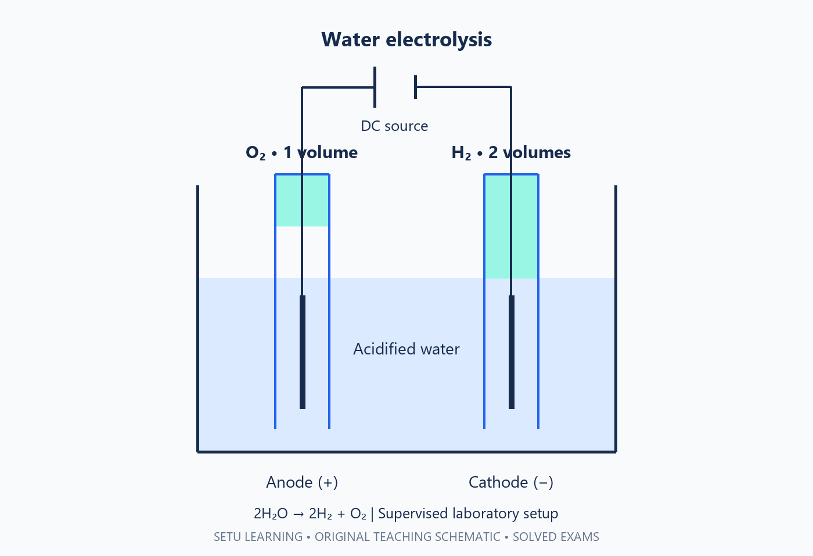

## 2023 — मुख्य परीक्षा

[2023 मुख्य: पूरा आधिकारिक प्रश्न-पत्र](https://rajeduboard.rajasthan.gov.in/books/PAPERS-2023/Sec/S-07.pdf)

## 146. Growth-inhibiting hormone।

**स्रोत:** 2023 मुख्य, प्रश्न 1(i), PDF पृष्ठ 2 · **अंक:** 1 अंक

**अध्याय-संबंध:** नियंत्रण एवं समन्वय

**हल:** Abscisic acid (ABA) growth inhibition और stress responses से संबंधित है। Water stress में stomatal closing में भी भूमिका निभाता है।

[मूल प्रश्न देखें](https://rajeduboard.rajasthan.gov.in/books/PAPERS-2023/Sec/S-07.pdf#page=2)

## 147. Posture/balance का brain भाग।

**स्रोत:** 2023 मुख्य, प्रश्न 1(ii), PDF पृष्ठ 2 · **अंक:** 1 अंक

**अध्याय-संबंध:** नियंत्रण एवं समन्वय

**हल:** Cerebellum posture, balance तथा precise movement में मदद करता है। Walking straight/riding bicycle coordination के ऐसे examples हैं।

[मूल प्रश्न देखें](https://rajeduboard.rajasthan.gov.in/books/PAPERS-2023/Sec/S-07.pdf#page=2)

## 148. RrYy का pea phenotype।

**स्रोत:** 2023 मुख्य, प्रश्न 1(iii), PDF पृष्ठ 3 · **अंक:** 1 अंक

**अध्याय-संबंध:** आनुवंशिकता

**हल:** Complete dominance के pea model में RrYy phenotype round और yellow है। R round, Y yellow dominant; genotype heterozygous होने पर recessive traits hidden हो सकते हैं।

[मूल प्रश्न देखें](https://rajeduboard.rajasthan.gov.in/books/PAPERS-2023/Sec/S-07.pdf#page=3)

## 149. Iris muscles का काम।

**स्रोत:** 2023 मुख्य, प्रश्न 1(vii), PDF पृष्ठ 5 · **अंक:** 1 अंक

**अध्याय-संबंध:** मानव नेत्र तथा रंगबिरंगा संसार

**हल:** Iris की muscles pupil opening का size नियंत्रित करती हैं। Lens की curvature ciliary muscles बदलती हैं; light entry और accommodation के mechanisms अलग हैं।

[मूल प्रश्न देखें](https://rajeduboard.rajasthan.gov.in/books/PAPERS-2023/Sec/S-07.pdf#page=5)

## 150. kWh किस quantity की unit?

**स्रोत:** 2023 मुख्य, प्रश्न 1(viii), PDF पृष्ठ 5 · **अंक:** 1 अंक

**अध्याय-संबंध:** विद्युत

**हल:** 1 kWh=3.6×10⁶ J और यह electric energy की unit है। kW power, kWh energy; 1 hour=3600 seconds।

[मूल प्रश्न देखें](https://rajeduboard.rajasthan.gov.in/books/PAPERS-2023/Sec/S-07.pdf#page=5)

## 151. Silver का black coating process।

**स्रोत:** 2023 मुख्य, प्रश्न 1(x), PDF पृष्ठ 6 · **अंक:** 1 अंक

**अध्याय-संबंध:** धातु एवं अधातु

**हल:** Silver की environmental black coating corrosion/tarnishing है; sulfur compounds के साथ Ag₂S बन सकता है। इसे fat rancidity या metal का केवल melting न कहें।

[मूल प्रश्न देखें](https://rajeduboard.rajasthan.gov.in/books/PAPERS-2023/Sec/S-07.pdf#page=6)

## 152. Al/Fe/Zn ascending activity।

**स्रोत:** 2023 मुख्य, प्रश्न 1(xi), PDF पृष्ठ 6 · **अंक:** 1 अंक

**अध्याय-संबंध:** धातु एवं अधातु

**हल:** Ascending reactivity: Fe < Zn < Al। Activity-series position displaced metal और reaction tendency के school predictions में उपयोगी है।

[मूल प्रश्न देखें](https://rajeduboard.rajasthan.gov.in/books/PAPERS-2023/Sec/S-07.pdf#page=6)

## 153. Acid+ethanol का ester।

**स्रोत:** 2023 मुख्य, प्रश्न 1(xii), PDF पृष्ठ 6 · **अंक:** 1 अंक

**अध्याय-संबंध:** कार्बन एवं उसके यौगिक

**हल:** Ethanoic acid+ethanol से CH₃COOC₂H₅ (ethyl ethanoate) और water बनते हैं, acid catalyst/heat सहित। Ester का group –COO– है; ether option सही नहीं।

[मूल प्रश्न देखें](https://rajeduboard.rajasthan.gov.in/books/PAPERS-2023/Sec/S-07.pdf#page=6)

## 154. Saliva enzyme का नाम।

**स्रोत:** 2023 मुख्य, प्रश्न 2(i), PDF पृष्ठ 7 · **अंक:** 1 अंक

**अध्याय-संबंध:** जैव प्रक्रम

**हल:** Salivary amylase/ptyalin saliva में starch breakdown शुरू करता है। यह fat emulsification नहीं करता; fat पर bile और lipase-related processes अलग हैं।

[मूल प्रश्न देखें](https://rajeduboard.rajasthan.gov.in/books/PAPERS-2023/Sec/S-07.pdf#page=7)

## 155. Vegetative offspring की similarity।

**स्रोत:** 2023 मुख्य, प्रश्न 2(ii), PDF पृष्ठ 7 · **अंक:** 1 अंक

**अध्याय-संबंध:** जीव जनन कैसे करते हैं?

**हल:** Vegetative offspring सामान्यतः parent जैसे genetically similar/clone होते हैं। DNA copying में mutations संभव हैं; ‘हर molecule बिल्कुल समान’ absolute claim से बचें।

[मूल प्रश्न देखें](https://rajeduboard.rajasthan.gov.in/books/PAPERS-2023/Sec/S-07.pdf#page=7)

## 156. Biological breakdown वाला material।

**स्रोत:** 2023 मुख्य, प्रश्न 2(iii), PDF पृष्ठ 7 · **अंक:** 1 अंक

**अध्याय-संबंध:** हमारा पर्यावरण

**हल:** Biological processes द्वारा breakdown होने वाले substances biodegradable हैं। Suitable conditions/समय चाहिए; biodegradable का अर्थ तत्काल harmless नहीं।

[मूल प्रश्न देखें](https://rajeduboard.rajasthan.gov.in/books/PAPERS-2023/Sec/S-07.pdf#page=7)

## 157. Like magnet poles का effect।

**स्रोत:** 2023 मुख्य, प्रश्न 2(iv), PDF पृष्ठ 7 · **अंक:** 1 अंक

**अध्याय-संबंध:** विद्युत धारा के चुंबकीय प्रभाव

**हल:** Like magnetic poles repel, unlike poles attract। Field-direction rules और poles के attraction को current direction का synonym न बनाएं।

[मूल प्रश्न देखें](https://rajeduboard.rajasthan.gov.in/books/PAPERS-2023/Sec/S-07.pdf#page=7)

## 158. Vinegar acid का नाम।

**स्रोत:** 2023 मुख्य, प्रश्न 2(v), PDF पृष्ठ 7 · **अंक:** 1 अंक

**अध्याय-संबंध:** कार्बन एवं उसके यौगिक

**हल:** Vinegar का प्रमुख characteristic acid ethanoic/acetic acid, CH₃COOH है। Dilute vinegar और pure glacial acetic acid की concentration अलग है।

[मूल प्रश्न देखें](https://rajeduboard.rajasthan.gov.in/books/PAPERS-2023/Sec/S-07.pdf#page=7)

## 159. Hormone action regulation।

**स्रोत:** 2023 मुख्य, प्रश्न 3(i), PDF पृष्ठ 8 · **अंक:** 1 अंक

**अध्याय-संबंध:** नियंत्रण एवं समन्वय

**हल:** Feedback mechanism hormone release के time/amount को regulate कर सकता है। उदाहरण blood glucose बढ़ने से insulin stimulus बढ़ता, glucose घटने पर stimulus कम होता है।

[मूल प्रश्न देखें](https://rajeduboard.rajasthan.gov.in/books/PAPERS-2023/Sec/S-07.pdf#page=8)

## 160. Multiple-fission organism।

**स्रोत:** 2023 मुख्य, प्रश्न 3(ii), PDF पृष्ठ 8 · **अंक:** 1 अंक

**अध्याय-संबंध:** जीव जनन कैसे करते हैं?

**हल:** Plasmodium में multiple fission: एक parent cell से अनेक daughter cells बन सकते हैं। Binary fission में केवल दो बनते हैं।

[मूल प्रश्न देखें](https://rajeduboard.rajasthan.gov.in/books/PAPERS-2023/Sec/S-07.pdf#page=8)

## 161. एक abiotic component।

**स्रोत:** 2023 मुख्य, प्रश्न 3(iv), PDF पृष्ठ 8 · **अंक:** 1 अंक

**अध्याय-संबंध:** हमारा पर्यावरण

**हल:** Water, sunlight या temperature ecosystem का abiotic component है। Plants/animals/bacteria biotic components हैं।

[मूल प्रश्न देखें](https://rajeduboard.rajasthan.gov.in/books/PAPERS-2023/Sec/S-07.pdf#page=8)

## 162. 5 Ω wire half length: R,ρ।

**स्रोत:** 2023 मुख्य, प्रश्न 3(v), PDF पृष्ठ 8 · **अंक:** 1 अंक

**अध्याय-संबंध:** विद्युत

**हल:** P resistance=5 Ω और Q resistivity=8×10⁻⁴ Ω·m। Length half, same A/material/temperature में P=2.5 Ω; Q unchanged 8×10⁻⁴ Ω·m।

[मूल प्रश्न देखें](https://rajeduboard.rajasthan.gov.in/books/PAPERS-2023/Sec/S-07.pdf#page=8)

## 163. Field lines क्यों नहीं cross?

**स्रोत:** 2023 मुख्य, प्रश्न 3(vi), PDF पृष्ठ 8 · **अंक:** 1 अंक

**अध्याय-संबंध:** विद्युत धारा के चुंबकीय प्रभाव

**हल:** एक point पर field की unique direction है। Two field lines crossing करें तो दो tangents/directions मिलेंगी; इसलिए magnetic field lines intersect नहीं करतीं।

[मूल प्रश्न देखें](https://rajeduboard.rajasthan.gov.in/books/PAPERS-2023/Sec/S-07.pdf#page=8)

## 164. Coil के भीतर-बाहर field।

**स्रोत:** 2023 मुख्य, प्रश्न 3(vii), PDF पृष्ठ 9 · **अंक:** 1 अंक

**अध्याय-संबंध:** विद्युत धारा के चुंबकीय प्रभाव

**हल:** Solenoid के भीतर, ends से दूर लगभग parallel equally spaced field lines draw करें; बाहर N→S तथा अंदर S→N return direction, closed loops। Current और coil turns field को प्रभावित करते हैं; suitable iron core से electromagnet बनाया जा सकता है।

[मूल प्रश्न देखें](https://rajeduboard.rajasthan.gov.in/books/PAPERS-2023/Sec/S-07.pdf#page=9)

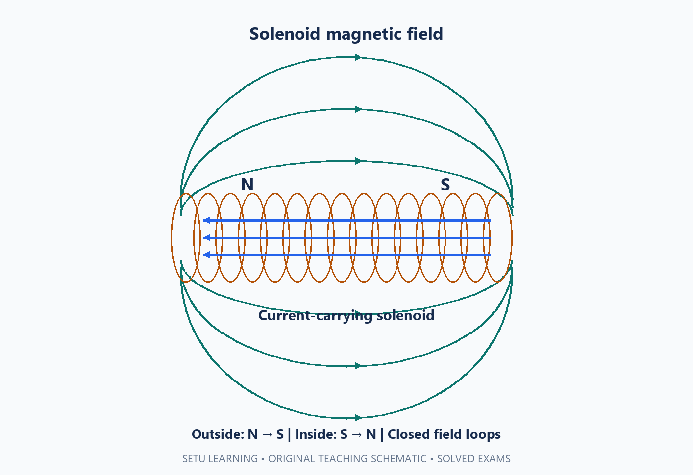

## 165. Neutralisation definition।

**स्रोत:** 2023 मुख्य, प्रश्न 3(viii), PDF पृष्ठ 9 · **अंक:** 1 अंक

**अध्याय-संबंध:** अम्ल, क्षारक एवं लवण

**हल:** Acid और base से salt और सामान्यतः water बनना neutralisation है। HCl+NaOH→NaCl+H₂O balanced example है।

[मूल प्रश्न देखें](https://rajeduboard.rajasthan.gov.in/books/PAPERS-2023/Sec/S-07.pdf#page=9)

## 166. CuO–H₂ में reduced reactant।

**स्रोत:** 2023 मुख्य, प्रश्न 3(x), PDF पृष्ठ 9 · **अंक:** 1 अंक

**अध्याय-संबंध:** रासायनिक अभिक्रियाएँ एवं समीकरण

**हल:** CuO + H₂ → Cu + H₂O में H₂ oxygen पाकर oxidised, CuO oxygen खोकर reduced है। Oxidation तथा reduction एक साथ होना redox है; दूसरा उदाहरण ZnO + C → Zn + CO है।

[मूल प्रश्न देखें](https://rajeduboard.rajasthan.gov.in/books/PAPERS-2023/Sec/S-07.pdf#page=9)

## 2022 — मुख्य परीक्षा

[2022 मुख्य: पूरा आधिकारिक प्रश्न-पत्र](https://rajeduboard.rajasthan.gov.in/books/PAPERS-2022/Sec/S-07.pdf)

## 167. Heart किस organ system में?

**स्रोत:** 2022 मुख्य, प्रश्न 1(i), PDF पृष्ठ 2 · **अंक:** 1 अंक

**अध्याय-संबंध:** जैव प्रक्रम

**हल:** Heart circulatory system का pump है। Chambers blood को lungs और body circuits में भेजते हैं; यह kidney की तरह metabolic-waste filtration organ नहीं।

[मूल प्रश्न देखें](https://rajeduboard.rajasthan.gov.in/books/PAPERS-2022/Sec/S-07.pdf#page=2)

## 168. Thyroxine का आवश्यक element।

**स्रोत:** 2022 मुख्य, प्रश्न 1(iii), PDF पृष्ठ 3 · **अंक:** 1 अंक

**अध्याय-संबंध:** नियंत्रण एवं समन्वय

**हल:** Thyroid को thyroxine बनाने के लिए iodine आवश्यक है। Thyroxine metabolic regulation में भूमिका निभाता है; iodine gland या hormone का नाम नहीं है।

[मूल प्रश्न देखें](https://rajeduboard.rajasthan.gov.in/books/PAPERS-2022/Sec/S-07.pdf#page=3)

## 169. Involuntary functions का brain भाग।

**स्रोत:** 2022 मुख्य, प्रश्न 1(iv), PDF पृष्ठ 3 · **अंक:** 1 अंक

**अध्याय-संबंध:** नियंत्रण एवं समन्वय

**हल:** इस board MCQ का अपेक्षित विकल्प medulla है, जो breathing, blood-pressure-related responses, salivation/vomiting जैसे involuntary functions में काम करता है। ‘सभी involuntary actions केवल medulla’ वैज्ञानिक रूप से अत्यधिक व्यापक कथन है।

[मूल प्रश्न देखें](https://rajeduboard.rajasthan.gov.in/books/PAPERS-2022/Sec/S-07.pdf#page=3)

## 170. किस salt में crystal water नहीं?

**स्रोत:** 2022 मुख्य, प्रश्न 1(v), PDF पृष्ठ 3 · **अंक:** 1 अंक

**अध्याय-संबंध:** अम्ल, क्षारक एवं लवण

**हल:** NaHCO₃ यानी baking soda में formula-bound water of crystallisation नहीं। Washing soda decahydrate, gypsum dihydrate और POP hemihydrate हैं।

[मूल प्रश्न देखें](https://rajeduboard.rajasthan.gov.in/books/PAPERS-2022/Sec/S-07.pdf#page=3)

## 171. Zn–dilute acid की gas।

**स्रोत:** 2022 मुख्य, प्रश्न 1(vi), PDF पृष्ठ 4 · **अंक:** 1 अंक

**अध्याय-संबंध:** अम्ल, क्षारक एवं लवण

**हल:** Zn + H₂SO₄(dil.) → ZnSO₄ + H₂। Gas hydrogen है; prescribed supervised test में burning splint से characteristic pop मिल सकता है। Acid/gas experiment स्वयं न करें।

[मूल प्रश्न देखें](https://rajeduboard.rajasthan.gov.in/books/PAPERS-2022/Sec/S-07.pdf#page=4)

## 172. Soft, cold-water-reactive option।

**स्रोत:** 2022 मुख्य, प्रश्न 1(vii), PDF पृष्ठ 4 · **अंक:** 1 अंक

**अध्याय-संबंध:** धातु एवं अधातु

**हल:** दिए K, Ag, Cu, Pb विकल्पों में K soft और cold water से vigorous reaction करता है। Alkali metals को lab में carefully handle करते हैं; यह self-experiment निर्देश नहीं।

[मूल प्रश्न देखें](https://rajeduboard.rajasthan.gov.in/books/PAPERS-2022/Sec/S-07.pdf#page=4)

## 173. Reflection laws किन mirrors पर?

**स्रोत:** 2022 मुख्य, प्रश्न 1(viii), PDF पृष्ठ 5 · **अंक:** 1 अंक

**अध्याय-संबंध:** प्रकाश: परावर्तन तथा अपवर्तन

**हल:** Reflection laws plane, concave और convex mirrors सभी के हर local surface point पर लागू हैं। Normal curved surface पर local perpendicular के अनुसार खींचें।

[मूल प्रश्न देखें](https://rajeduboard.rajasthan.gov.in/books/PAPERS-2022/Sec/S-07.pdf#page=5)

## 174. n=1.33: water में light speed।

**स्रोत:** 2022 मुख्य, प्रश्न 1(ix), PDF पृष्ठ 5 · **अंक:** 1 अंक

**अध्याय-संबंध:** प्रकाश: परावर्तन तथा अपवर्तन

**हल:** n=1.33,c≈3×10⁸ m/s। v=c/n≈2.26×10⁸ m/s। Medium में speed कम है; n को c से multiply करना गलत।

[मूल प्रश्न देखें](https://rajeduboard.rajasthan.gov.in/books/PAPERS-2022/Sec/S-07.pdf#page=5)

## 175. Charge का SI unit।

**स्रोत:** 2022 मुख्य, प्रश्न 1(x), PDF पृष्ठ 5 · **अंक:** 1 अंक

**अध्याय-संबंध:** विद्युत

**हल:** Electric charge का SI unit coulomb (C) है। Current ampere, potential difference volt और resistance ohm में मापते हैं।

[मूल प्रश्न देखें](https://rajeduboard.rajasthan.gov.in/books/PAPERS-2022/Sec/S-07.pdf#page=5)

## 176. Hormone amount/time regulation।

**स्रोत:** 2022 मुख्य, प्रश्न 2(i), PDF पृष्ठ 7 · **अंक:** 1 अंक

**अध्याय-संबंध:** नियंत्रण एवं समन्वय

**हल:** Feedback mechanism hormone release के time/amount को regulate कर सकता है। उदाहरण blood glucose बढ़ने से insulin stimulus बढ़ता, glucose घटने पर stimulus कम होता है।

[मूल प्रश्न देखें](https://rajeduboard.rajasthan.gov.in/books/PAPERS-2022/Sec/S-07.pdf#page=7)

## 177. Nerve message का प्रकार।

**स्रोत:** 2022 मुख्य, प्रश्न 2(ii), PDF पृष्ठ 7 · **अंक:** 1 अंक

**अध्याय-संबंध:** नियंत्रण एवं समन्वय

**हल:** Nervous tissue में electrical/electrochemical impulses messages transmit करते हैं; chemical synapses पर neurotransmitter crossing होती है। पूरे pathway को केवल chemical diffusion न कहें।

[मूल प्रश्न देखें](https://rajeduboard.rajasthan.gov.in/books/PAPERS-2022/Sec/S-07.pdf#page=7)

## 178. Trophic transfer में energy।

**स्रोत:** 2022 मुख्य, प्रश्न 2(iii), PDF पृष्ठ 7 · **अंक:** 1 अंक

**अध्याय-संबंध:** हमारा पर्यावरण

**हल:** Trophic transfer पर usable energy घटती है; respiration/heat/activities में losses होते हैं। लगभग 10% next level transfer school estimate है, सभी ecosystems में exact constant नहीं।

[मूल प्रश्न देखें](https://rajeduboard.rajasthan.gov.in/books/PAPERS-2022/Sec/S-07.pdf#page=7)

## 179. Lens v/u का अर्थ।

**स्रोत:** 2022 मुख्य, प्रश्न 2(v), PDF पृष्ठ 7 · **अंक:** 1 अंक

**अध्याय-संबंध:** प्रकाश: परावर्तन तथा अपवर्तन

**हल:** Linear magnification image height/object height, m=hᵢ/hₒ। Mirror में −v/u और lens में v/u। Magnitude relative size, sign orientation दर्शाता है।

[मूल प्रश्न देखें](https://rajeduboard.rajasthan.gov.in/books/PAPERS-2022/Sec/S-07.pdf#page=7)

## 180. Bulb filament का material।

**स्रोत:** 2022 मुख्य, प्रश्न 2(vi), PDF पृष्ठ 7 · **अंक:** 1 अंक

**अध्याय-संबंध:** विद्युत

**हल:** Filament incandescent bulbs में tungsten उपयोगी है क्योंकि melting point बहुत ऊँचा और heating पर incandescence मिलती है। यह modern LED का filament होने का दावा नहीं।

[मूल प्रश्न देखें](https://rajeduboard.rajasthan.gov.in/books/PAPERS-2022/Sec/S-07.pdf#page=7)

## 181. Nervous tissue का network।

**स्रोत:** 2022 मुख्य, प्रश्न 3(i), PDF पृष्ठ 7 · **अंक:** 1 अंक

**अध्याय-संबंध:** नियंत्रण एवं समन्वय

**हल:** Dendrites incoming signals ग्रहण, cell body integration और axon terminal तक conduction करता है। Chemical synapse पर neurotransmitter next cell तक signal पहुँचाता है। Diagram arrows dendrite → body → axon → terminal तथा labels दें।

[मूल प्रश्न देखें](https://rajeduboard.rajasthan.gov.in/books/PAPERS-2022/Sec/S-07.pdf#page=7)

## 182. Growth-regulating endocrine gland।

**स्रोत:** 2022 मुख्य, प्रश्न 3(ii), PDF पृष्ठ 7 · **अंक:** 1 अंक

**अध्याय-संबंध:** नियंत्रण एवं समन्वय

**हल:** दिए विकल्पों में pituitary gland growth hormone से growth stimulate करती है। Board stem ‘all organs’ simplified है; actual tissue responses एवं अन्य hormones भी भूमिका रखते हैं।

[मूल प्रश्न देखें](https://rajeduboard.rajasthan.gov.in/books/PAPERS-2022/Sec/S-07.pdf#page=7)

## 183. CFC का expansion।

**स्रोत:** 2022 मुख्य, प्रश्न 3(iii), PDF पृष्ठ 8 · **अंक:** 1 अंक

**अध्याय-संबंध:** हमारा पर्यावरण

**हल:** CFC का full form chlorofluorocarbon है। इनमें carbon, chlorine और fluorine वाले compounds शामिल हैं; कुछ CFCs stratospheric ozone depletion में भूमिका निभाते हैं।

[मूल प्रश्न देखें](https://rajeduboard.rajasthan.gov.in/books/PAPERS-2022/Sec/S-07.pdf#page=8)

## 184. Recycling का अर्थ।

**स्रोत:** 2022 मुख्य, प्रश्न 3(v), PDF पृष्ठ 8 · **अंक:** 1 अंक

**अध्याय-संबंध:** हमारा पर्यावरण

**हल:** Reduce: unnecessary consumption/waste घटाएँ। Reuse: वस्तु फिर उपयोग करें। Recycle: waste material से उपयोगी material बनाएं। उदाहरण bottle reuse, कम packaging और separated paper recycling हैं।

[मूल प्रश्न देखें](https://rajeduboard.rajasthan.gov.in/books/PAPERS-2022/Sec/S-07.pdf#page=8)

## 185. Orange का acid।

**स्रोत:** 2022 मुख्य, प्रश्न 3(vi), PDF पृष्ठ 8 · **अंक:** 1 अंक

**अध्याय-संबंध:** अम्ल, क्षारक एवं लवण

**हल:** Orange का characteristic school-level acid citric acid है। Tamarind tartaric और curd lactic acid examples हैं; fruit sample में कई acids मौजूद हो सकते हैं।

[मूल प्रश्न देखें](https://rajeduboard.rajasthan.gov.in/books/PAPERS-2022/Sec/S-07.pdf#page=8)

## 2020 — मुख्य परीक्षा

[2020 मुख्य: पूरा आधिकारिक प्रश्न-पत्र](https://rajeduboard.rajasthan.gov.in/books/PAPERS-2020/Sec/S-07-Science.pdf)

## 186. Catenation का अर्थ।

**स्रोत:** 2020 मुख्य, प्रश्न 3, PDF पृष्ठ 3 · **अंक:** 1 अंक

**अध्याय-संबंध:** कार्बन एवं उसके यौगिक

**हल:** Tetravalency से चार covalent bonds और catenation से chains/branches/rings बनते हैं। Stable C–C bonding carbon compounds की विविधता में मदद करती है। Organic compounds में electron sharing प्रमुख है।

[मूल प्रश्न देखें](https://rajeduboard.rajasthan.gov.in/books/PAPERS-2020/Sec/S-07-Science.pdf#page=3)

## 187. Bar-magnet field sketch।

**स्रोत:** 2020 मुख्य, प्रश्न 11, PDF पृष्ठ 4 · **अंक:** 1 अंक

**अध्याय-संबंध:** विद्युत धारा के चुंबकीय प्रभाव

**हल:** Bar magnet के भीतर field lines south→north, बाहर north→south हैं; मिलकर closed loops बनती हैं।

[मूल प्रश्न देखें](https://rajeduboard.rajasthan.gov.in/books/PAPERS-2020/Sec/S-07-Science.pdf#page=4)

चित्र सहायता: इसी अध्याय में इस अवधारणा का पहले दिया नामांकित schematic देखें।

## 188. Neutralisation example।

**स्रोत:** 2020 मुख्य, प्रश्न 17(b), PDF पृष्ठ 5 · **अंक:** 1 अंक

**अध्याय-संबंध:** अम्ल, क्षारक एवं लवण

**हल:** Acid और base से salt और सामान्यतः water बनना neutralisation है। HCl+NaOH→NaCl+H₂O balanced example है।

[मूल प्रश्न देखें](https://rajeduboard.rajasthan.gov.in/books/PAPERS-2020/Sec/S-07-Science.pdf#page=5)

## 189. Agricultural waste और disposal।

**स्रोत:** 2020 मुख्य, प्रश्न 21, PDF पृष्ठ 7 · **अंक:** 3 अंक

**अध्याय-संबंध:** हमारा पर्यावरण

**हल:** Discarded unwanted material waste है। Source segregation, reduce/reuse और suitable recycling/composting useful methods हैं। E-waste/batteries organic compost में न मिलाएँ।

[मूल प्रश्न देखें](https://rajeduboard.rajasthan.gov.in/books/PAPERS-2020/Sec/S-07-Science.pdf#page=7)

## 190. Fruit की परिभाषा।

**स्रोत:** 2020 मुख्य, प्रश्न 22(a), PDF पृष्ठ 7 · **अंक:** 1 अंक

**अध्याय-संबंध:** जीव जनन कैसे करते हैं?

**हल:** Flower का ovary fertilisation के बाद सामान्यतः fruit में विकसित होता है; ovules seeds बनते हैं। Seedless/parthenocarpic examples के कारण ‘हर fruit में fertilisation अनिवार्य’ absolute न जोड़ें।

[मूल प्रश्न देखें](https://rajeduboard.rajasthan.gov.in/books/PAPERS-2020/Sec/S-07-Science.pdf#page=7)

## 191. Backcross तथा testcross।

**स्रोत:** 2020 मुख्य, प्रश्न 23, PDF पृष्ठ 7 · **अंक:** 4 अंक

**अध्याय-संबंध:** आनुवंशिकता

**हल:** Backcross F₁ को किसी parent-type से cross करना है। Testcross unknown dominant phenotype को homozygous recessive से cross करता है; Tt×tt से expected 1:1, TT×tt से सभी dominant। Testcross backcross का special case हो सकता है।

[मूल प्रश्न देखें](https://rajeduboard.rajasthan.gov.in/books/PAPERS-2020/Sec/S-07-Science.pdf#page=7)

## 192. Bleaching powder name/formula।

**स्रोत:** 2020 मुख्य, प्रश्न 24(a), PDF पृष्ठ 7 · **अंक:** 1 अंक

**अध्याय-संबंध:** अम्ल, क्षारक एवं लवण

**हल:** Bleaching powder का school formula CaOCl₂; water disinfection/bleaching में उपयोग। POP CaSO₄·½H₂O, plaster/moulds के लिए; water जोड़कर gypsum CaSO₄·2H₂O बनकर जमता है।

[मूल प्रश्न देखें](https://rajeduboard.rajasthan.gov.in/books/PAPERS-2020/Sec/S-07-Science.pdf#page=7)

## 193. Aqueous acids/bases theory।

**स्रोत:** 2020 मुख्य, प्रश्न 24(b), PDF पृष्ठ 7 · **अंक:** 1 अंक

**अध्याय-संबंध:** अम्ल, क्षारक एवं लवण

**हल:** Arrhenius acid aqueous H⁺/H₃O⁺ बढ़ाता है, जैसे HCl; base OH⁻ बढ़ाता है, जैसे NaOH। NaOH+HCl→NaCl+H₂O neutralisation है। सभी hydrogen compounds aqueous acids नहीं।

[मूल प्रश्न देखें](https://rajeduboard.rajasthan.gov.in/books/PAPERS-2020/Sec/S-07-Science.pdf#page=7)

## 194. Respiration का अर्थ।

**स्रोत:** 2020 मुख्य, प्रश्न 28(a), प्रथम विकल्प, PDF पृष्ठ 9 · **अंक:** 1 अंक

**अध्याय-संबंध:** जैव प्रक्रम

**हल:** Cellular respiration food का breakdown करके usable energy release करने की प्रक्रिया है। Cytoplasm में glucose से pyruvate; aerobic mitochondrial route CO₂/water देता है। Yeast anaerobic route ethanol/CO₂ तथा oxygen-deficit muscles lactate दे सकते हैं।

[मूल प्रश्न देखें](https://rajeduboard.rajasthan.gov.in/books/PAPERS-2020/Sec/S-07-Science.pdf#page=9)

## 195. Male प्रमुख sex hormone।

**स्रोत:** 2020 मुख्य, प्रश्न 28(a), दूसरा विकल्प, PDF पृष्ठ 9 · **अंक:** 1 अंक

**अध्याय-संबंध:** नियंत्रण एवं समन्वय

**हल:** विद्यालयी प्रमुख male hormone testosterone है; female reproductive hormones में oestrogen और progesterone शामिल हैं। ये सामान्य sex characteristics तथा reproductive functions में भूमिका निभाते हैं; hormone केवल एक sex में ही पाया जाता है, ऐसा absolute दावा न करें।

[मूल प्रश्न देखें](https://rajeduboard.rajasthan.gov.in/books/PAPERS-2020/Sec/S-07-Science.pdf#page=9)

## 196. Magnification की परिभाषा।

**स्रोत:** 2020 मुख्य, प्रश्न 30(a), प्रथम विकल्प, PDF पृष्ठ 11 · **अंक:** 1 अंक

**अध्याय-संबंध:** प्रकाश: परावर्तन तथा अपवर्तन

**हल:** Linear magnification image height/object height, m=hᵢ/hₒ। Mirror में −v/u और lens में v/u। Magnitude relative size, sign orientation दर्शाता है।

[मूल प्रश्न देखें](https://rajeduboard.rajasthan.gov.in/books/PAPERS-2020/Sec/S-07-Science.pdf#page=11)

## 197. Positive m की image nature।

**स्रोत:** 2020 मुख्य, प्रश्न 30(c), प्रथम विकल्प, PDF पृष्ठ 11 · **अंक:** 1 अंक

**अध्याय-संबंध:** प्रकाश: परावर्तन तथा अपवर्तन

**हल:** Positive magnification का अर्थ erect image है। Standard concave-mirror real-object school case में ऐसी image virtual होती है और object P–F के बीच है। Positive का अर्थ अनिवार्य larger नहीं।

[मूल प्रश्न देखें](https://rajeduboard.rajasthan.gov.in/books/PAPERS-2020/Sec/S-07-Science.pdf#page=11)

## 198. CH₃–CH=CH₂ का नाम।

**स्रोत:** 2020 मुख्य, प्रश्न 20(a)(ii), PDF पृष्ठ 6 · **अंक:** 1 अंक

**अध्याय-संबंध:** कार्बन एवं उसके यौगिक

**हल:** CH₃–CH=CH₂ अथवा CH₂=CH–CH₃ का IUPAC नाम propene है। तीन carbon, one double bond; suffix -ene।

[मूल प्रश्न देखें](https://rajeduboard.rajasthan.gov.in/books/PAPERS-2020/Sec/S-07-Science.pdf#page=6)

## 199. 220 V,0.5 A: R और P।

**स्रोत:** 2020 मुख्य, प्रश्न 25, PDF पृष्ठ 8 · **अंक:** 4 अंक

**अध्याय-संबंध:** विद्युत

**हल:** V=220 V,I=0.5 A। P=VI=110 W। यदि resistance भी चाहिए तो R=V/I=440 Ω।

[मूल प्रश्न देखें](https://rajeduboard.rajasthan.gov.in/books/PAPERS-2020/Sec/S-07-Science.pdf#page=8)

## 200. 40 kg,5→10 m/s: work।

**स्रोत:** 2020 मुख्य, प्रश्न 26(a), PDF पृष्ठ 8 · **अंक:** 2 अंक

**अध्याय-संबंध:** पुराना पाठ्यक्रम / enrichment: वर्तमान core से बाहर

**पुराना पाठ्यक्रम:** **हल:** पुराना mechanics: W=½×40×(10²−5²)=20×75=1500 J। Work–energy theorem उपयोग होता है, current core scope से अलग।

[मूल प्रश्न देखें](https://rajeduboard.rajasthan.gov.in/books/PAPERS-2020/Sec/S-07-Science.pdf#page=8)

## 201. 200 J,10 m: force।

**स्रोत:** 2020 मुख्य, प्रश्न 26(b), PDF पृष्ठ 8 · **अंक:** 2 अंक

**अध्याय-संबंध:** पुराना पाठ्यक्रम / enrichment: वर्तमान core से बाहर

**पुराना पाठ्यक्रम:** **हल:** पुराना mechanics: maximum aligned work W=Fs। F=200/10=20 N। Angle 0° होने की maximum-work condition महत्वपूर्ण है।

[मूल प्रश्न देखें](https://rajeduboard.rajasthan.gov.in/books/PAPERS-2020/Sec/S-07-Science.pdf#page=8)

## 2020 — पूरक परीक्षा

[2020 पूरक: पूरा आधिकारिक प्रश्न-पत्र](https://rajeduboard.rajasthan.gov.in/books/PAPERS-2020/SecSUP/S-07.pdf)

## 202. दो crystalline carbon forms।

**स्रोत:** 2020 पूरक, प्रश्न 3, PDF पृष्ठ 3 · **अंक:** 1 अंक

**अध्याय-संबंध:** कार्बन एवं उसके यौगिक

**हल:** Diamond और graphite carbon के crystalline allotropes हैं। Atomic element same, bonding/structure अलग; graphite conductor जबकि diamond सामान्यतः electrical insulator है।

[मूल प्रश्न देखें](https://rajeduboard.rajasthan.gov.in/books/PAPERS-2020/SecSUP/S-07.pdf#page=3)

## 203. Current-wire field direction rule।

**स्रोत:** 2020 पूरक, प्रश्न 11, PDF पृष्ठ 4 · **अंक:** 1 अंक

**अध्याय-संबंध:** विद्युत धारा के चुंबकीय प्रभाव

**हल:** Right-hand thumb conventional current की दिशा में रखें; curled fingers wire के circular magnetic field की direction देती हैं। Thumb force नहीं बताता; force के लिए Fleming left-hand rule है।

[मूल प्रश्न देखें](https://rajeduboard.rajasthan.gov.in/books/PAPERS-2020/SecSUP/S-07.pdf#page=4)

## 204. Electron transfer से redox।

**स्रोत:** 2020 पूरक, प्रश्न 17(a), PDF पृष्ठ 5 · **अंक:** 2 अंक

**अध्याय-संबंध:** रासायनिक अभिक्रियाएँ एवं समीकरण

**हल:** Electron concept में oxidation electron loss, reduction electron gain है। Zn→Zn²⁺+2e⁻ तथा Cu²⁺+2e⁻→Cu; net Zn+Cu²⁺→Zn²⁺+Cu। दोनों half-reactions में electron संख्या समान रखकर जोड़ें।

[मूल प्रश्न देखें](https://rajeduboard.rajasthan.gov.in/books/PAPERS-2020/SecSUP/S-07.pdf#page=5)

## 205. एक enzyme-driven reaction।

**स्रोत:** 2020 पूरक, प्रश्न 17(b), PDF पृष्ठ 5 · **अंक:** 1 अंक

**अध्याय-संबंध:** जैव प्रक्रम

**हल:** Salivary amylase starch को छोटे carbohydrate products में hydrolyse करना शुरू करता है। Enzyme biological catalyst है; reaction में rate बढ़ाता है और खुद स्थायी रूप से consumed नहीं होता।

[मूल प्रश्न देखें](https://rajeduboard.rajasthan.gov.in/books/PAPERS-2020/SecSUP/S-07.pdf#page=5)

## 206. HC≡C–CH₃ का नाम।

**स्रोत:** 2020 पूरक, प्रश्न 20(a)(2), PDF पृष्ठ 6 · **अंक:** 1 अंक

**अध्याय-संबंध:** कार्बन एवं उसके यौगिक

**हल:** CH₃–C≡CH का नाम propyne/prop-1-yne है। तीन carbon और terminal triple bond; suffix -yne प्रयोग करें।

[मूल प्रश्न देखें](https://rajeduboard.rajasthan.gov.in/books/PAPERS-2020/SecSUP/S-07.pdf#page=6)

## 207. Non-biodegradable waste का अर्थ।

**स्रोत:** 2020 पूरक, प्रश्न 21, परिभाषा भाग, PDF पृष्ठ 6 · **अंक:** 1 अंक

**अध्याय-संबंध:** हमारा पर्यावरण

**हल:** दिए examples में conventional plastic non-biodegradable है; persistent waste अलग collect/recycle करें। सभी types/material formulations की degradation समान नहीं होती।

[मूल प्रश्न देखें](https://rajeduboard.rajasthan.gov.in/books/PAPERS-2020/SecSUP/S-07.pdf#page=6)

## 208. Mendel segregation और example।

**स्रोत:** 2020 पूरक, प्रश्न 23, PDF पृष्ठ 7 · **अंक:** 4 अंक

**अध्याय-संबंध:** आनुवंशिकता

**हल:** Tt organism gamete बनाते समय allele pair अलग करता है, इसलिए gametes T या t हैं। Tt×Tt में TT:Tt:tt=1:2:1 expected। Dominant allele होने पर भी recessive allele gamete तक जा सकता है।

[मूल प्रश्न देखें](https://rajeduboard.rajasthan.gov.in/books/PAPERS-2020/SecSUP/S-07.pdf#page=7)

## 209. Fracture plaster का compound।

**स्रोत:** 2020 पूरक, प्रश्न 24(a), PDF पृष्ठ 7 · **अंक:** 1 अंक

**अध्याय-संबंध:** अम्ल, क्षारक एवं लवण

**हल:** Plaster of Paris calcium sulfate hemihydrate, CaSO₄·½H₂O है। Water मिलाने पर gypsum बनकर hardens, इसलिए casts/moulds में उपयोगी। Gypsum का formula CaSO₄·2H₂O अलग है।

[मूल प्रश्न देखें](https://rajeduboard.rajasthan.gov.in/books/PAPERS-2020/SecSUP/S-07.pdf#page=7)

## 210. Zn–H₂SO₄ reaction का विन्यास।

**स्रोत:** 2020 पूरक, प्रश्न 24(c), PDF पृष्ठ 7 · **अंक:** 2 अंक

**अध्याय-संबंध:** अम्ल, क्षारक एवं लवण

**हल:** Zn + H₂SO₄(dil.) → ZnSO₄ + H₂। Gas hydrogen है; prescribed supervised test में burning splint से characteristic pop मिल सकता है। Acid/gas experiment स्वयं न करें।

[मूल प्रश्न देखें](https://rajeduboard.rajasthan.gov.in/books/PAPERS-2020/SecSUP/S-07.pdf#page=7)

## 211. तीन series resistors का equivalent।

**स्रोत:** 2020 पूरक, प्रश्न 25(a), PDF पृष्ठ 8 · **अंक:** 2 अंक

**अध्याय-संबंध:** विद्युत

**हल:** Series में same I और V=V₁+V₂+V₃। Ohm law से V=I(R₁+R₂+R₃)=IRₛ, इसलिए Rₛ=R₁+R₂+R₃। Circuit में resistors एक successive path में दिखाएँ, branches नहीं।

[मूल प्रश्न देखें](https://rajeduboard.rajasthan.gov.in/books/PAPERS-2020/SecSUP/S-07.pdf#page=8)

## 212. 6 V,30 Ω,1 h: heat।

**स्रोत:** 2020 पूरक, प्रश्न 25(b), PDF पृष्ठ 8 · **अंक:** 2 अंक

**अध्याय-संबंध:** विद्युत

**हल:** V=6 V,R=30 Ω,t=1 h=3600 s। H=V²t/R=36×3600/30=4320 J। Current 0.2 A है; hour को second में बदलें।

[मूल प्रश्न देखें](https://rajeduboard.rajasthan.gov.in/books/PAPERS-2020/SecSUP/S-07.pdf#page=8)

## 213. एक commercial unit की energy।

**स्रोत:** 2020 पूरक, प्रश्न 26(b), PDF पृष्ठ 8 · **अंक:** 2 अंक

**अध्याय-संबंध:** विद्युत

**हल:** 1 kWh=3.6×10⁶ J और यह electric energy की unit है। kW power, kWh energy; 1 hour=3600 seconds।

[मूल प्रश्न देखें](https://rajeduboard.rajasthan.gov.in/books/PAPERS-2020/SecSUP/S-07.pdf#page=8)

## 2019 — मुख्य परीक्षा

[2019 मुख्य: पूरा आधिकारिक प्रश्न-पत्र](https://rajeduboard.rajasthan.gov.in/books/PAPERS-2019/Sec/S-07-Science-E-H.pdf)

## 214. Genetic diversity का अर्थ।

**स्रोत:** 2019 मुख्य, प्रश्न 7, PDF पृष्ठ 3 · **अंक:** 1 अंक

**अध्याय-संबंध:** आनुवंशिकता

**हल:** Same species के individuals/populations में hereditary genetic differences genetic diversity हैं। Alleles तथा genotypes में variation इसके आधार हैं; सभी differences केवल training से acquired नहीं।

[मूल प्रश्न देखें](https://rajeduboard.rajasthan.gov.in/books/PAPERS-2019/Sec/S-07-Science-E-H.pdf#page=3)

## 215. V–I graph का आकार।

**स्रोत:** 2019 मुख्य, प्रश्न 11, PDF पृष्ठ 4 · **अंक:** 1 अंक

**अध्याय-संबंध:** विद्युत

**हल:** स्थिर temperature/physical conditions में V ∝ I, इसलिए V=IR। Low-voltage circuit में ammeter series, voltmeter resistor के parallel; कई V,I readings में V/I लगभग constant और V-vertical/I-horizontal graph straight line होता है।

[मूल प्रश्न देखें](https://rajeduboard.rajasthan.gov.in/books/PAPERS-2019/Sec/S-07-Science-E-H.pdf#page=4)

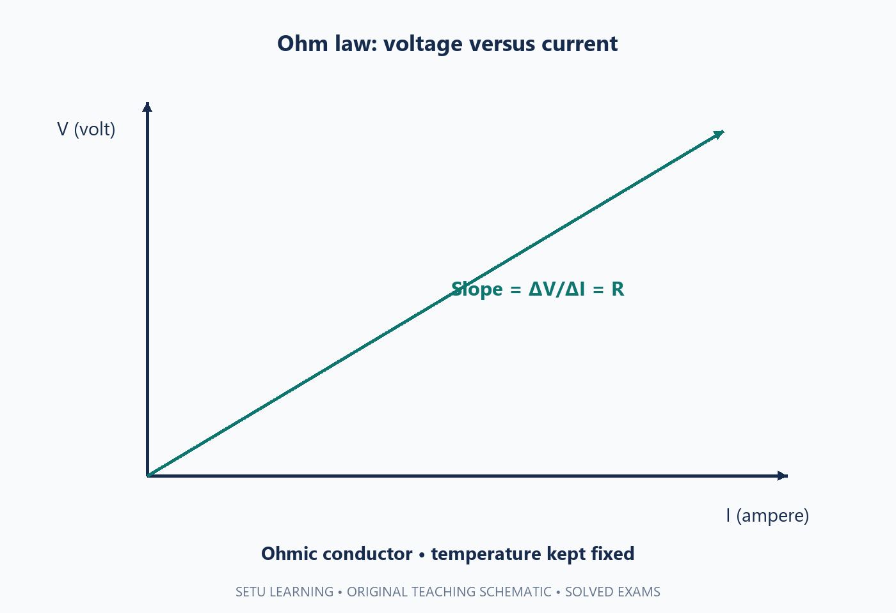

## 216. Headlight/rear-view mirror चयन।

**स्रोत:** 2019 मुख्य, प्रश्न 15(b), PDF पृष्ठ 5 · **अंक:** 2 अंक

**अध्याय-संबंध:** प्रकाश: परावर्तन तथा अपवर्तन

**हल:** School optics में headlight reflector concave, source near focus से roughly parallel beam देता है। Rear-view convex wide field तथा erect diminished virtual image देता है। Modern lamp designs अलग हो सकती हैं; उत्तर prescribed optical model का है।

[मूल प्रश्न देखें](https://rajeduboard.rajasthan.gov.in/books/PAPERS-2019/Sec/S-07-Science-E-H.pdf#page=5)

## 217. Carbon combustion और water splitting।

**स्रोत:** 2019 मुख्य, प्रश्न 17(a), PDF पृष्ठ 6 · **अंक:** 1 अंक

**अध्याय-संबंध:** रासायनिक अभिक्रियाएँ एवं समीकरण

**हल:** Combination: CaO + H₂O → Ca(OH)₂; अनेक reactants से एक मुख्य product। Decomposition: CaCO₃ → CaO + CO₂ (heat); एक compound कई products देता है। दोनों equations balanced रखें।

[मूल प्रश्न देखें](https://rajeduboard.rajasthan.gov.in/books/PAPERS-2019/Sec/S-07-Science-E-H.pdf#page=6)

## 218. दो reactions की तुलना।

**स्रोत:** 2019 मुख्य, प्रश्न 17(b), PDF पृष्ठ 6 · **अंक:** 1 अंक

**अध्याय-संबंध:** रासायनिक अभिक्रियाएँ एवं समीकरण

**हल:** Combination: CaO + H₂O → Ca(OH)₂; अनेक reactants से एक मुख्य product। Decomposition: CaCO₃ → CaO + CO₂ (heat); एक compound कई products देता है। दोनों equations balanced रखें।

[मूल प्रश्न देखें](https://rajeduboard.rajasthan.gov.in/books/PAPERS-2019/Sec/S-07-Science-E-H.pdf#page=6)

## 219. Marsh gas structure।

**स्रोत:** 2019 मुख्य, प्रश्न 20(b), PDF पृष्ठ 7 · **अंक:** 1 अंक

**अध्याय-संबंध:** कार्बन एवं उसके यौगिक

**हल:** Marsh gas methane CH₄ है। Structural diagram में central C से चार H single bonds लगाएँ; electron-dot form में चार shared pairs। इसे CH₃ radical या ethene न लिखें।

[मूल प्रश्न देखें](https://rajeduboard.rajasthan.gov.in/books/PAPERS-2019/Sec/S-07-Science-E-H.pdf#page=7)

## 220. Mendel dominance और उपयोगिता।

**स्रोत:** 2019 मुख्य, प्रश्न 23, PDF पृष्ठ 8 · **अंक:** 4 अंक

**अध्याय-संबंध:** आनुवंशिकता

**हल:** TT×tt से F₁ Tt सभी tall: heterozygote में T expressed, t hidden है। F₁ selfing में phenotype 3:1। Mendel rules trait transmission की predictions और recessive allele के फिर प्रकट होने को समझाते हैं। Dominant का अर्थ श्रेष्ठ नहीं।

[मूल प्रश्न देखें](https://rajeduboard.rajasthan.gov.in/books/PAPERS-2019/Sec/S-07-Science-E-H.pdf#page=8)

## 221. Milk of magnesia antacid क्यों?

**स्रोत:** 2019 मुख्य, प्रश्न 24(a)(i), PDF पृष्ठ 8 · **अंक:** 1 अंक

**अध्याय-संबंध:** अम्ल, क्षारक एवं लवण

**हल:** Milk of magnesia में magnesium hydroxide Mg(OH)₂ होता है। यह अतिरिक्त stomach acid neutralise करता है: Mg(OH)₂+2HCl→MgCl₂+2H₂O। यह chemical principle है, dose/self-treatment निर्देश नहीं।

[मूल प्रश्न देखें](https://rajeduboard.rajasthan.gov.in/books/PAPERS-2019/Sec/S-07-Science-E-H.pdf#page=8)

## 222. Excretion का अर्थ।

**स्रोत:** 2019 मुख्य, प्रश्न 28(a), प्रथम विकल्प, PDF पृष्ठ 9 · **अंक:** 1 अंक

**अध्याय-संबंध:** जैव प्रक्रम

**हल:** Metabolic wastes को body से हटाना excretion है, जैसे nitrogenous wastes urine में। Undigested food का removal egestion है; waste की उत्पत्ति दोनों में अलग है।

[मूल प्रश्न देखें](https://rajeduboard.rajasthan.gov.in/books/PAPERS-2019/Sec/S-07-Science-E-H.pdf#page=9)

## 2018 — मुख्य परीक्षा

[2018 मुख्य: पूरा आधिकारिक प्रश्न-पत्र](https://rajeduboard.rajasthan.gov.in/books/PAPERS-2018/Sec/S-07-Science-E-H.pdf)

## 223. Salivary gland का enzyme।

**स्रोत:** 2018 मुख्य, प्रश्न 1, PDF पृष्ठ 3 · **अंक:** 1 अंक

**अध्याय-संबंध:** जैव प्रक्रम

**हल:** Salivary amylase/ptyalin saliva में starch breakdown शुरू करता है। यह fat emulsification नहीं करता; fat पर bile और lipase-related processes अलग हैं।

[मूल प्रश्न देखें](https://rajeduboard.rajasthan.gov.in/books/PAPERS-2018/Sec/S-07-Science-E-H.pdf#page=3)

## 224. Alkyne general formula।

**स्रोत:** 2018 मुख्य, प्रश्न 3, PDF पृष्ठ 3 · **अंक:** 1 अंक

**अध्याय-संबंध:** कार्बन एवं उसके यौगिक

**हल:** एक triple bond वाले acyclic alkyne की general formula CₙH₂ₙ₋₂ है। Example ethyne C₂H₂; cyclic/multiple-unsaturation compounds पर formula बिना जाँच न लगाएँ।

[मूल प्रश्न देखें](https://rajeduboard.rajasthan.gov.in/books/PAPERS-2018/Sec/S-07-Science-E-H.pdf#page=3)

## 225. Equal-length wires का R–A graph।

**स्रोत:** 2018 मुख्य, प्रश्न 11, PDF पृष्ठ 4 · **अंक:** 1 अंक

**अध्याय-संबंध:** विद्युत

**हल:** Same material, length और temperature पर R=ρl/A, इसलिए R∝1/A। R vertical और A horizontal पर decreasing hyperbola; R बनाम 1/A plot linear है। Axes labels जरूरी हैं।

[मूल प्रश्न देखें](https://rajeduboard.rajasthan.gov.in/books/PAPERS-2018/Sec/S-07-Science-E-H.pdf#page=4)

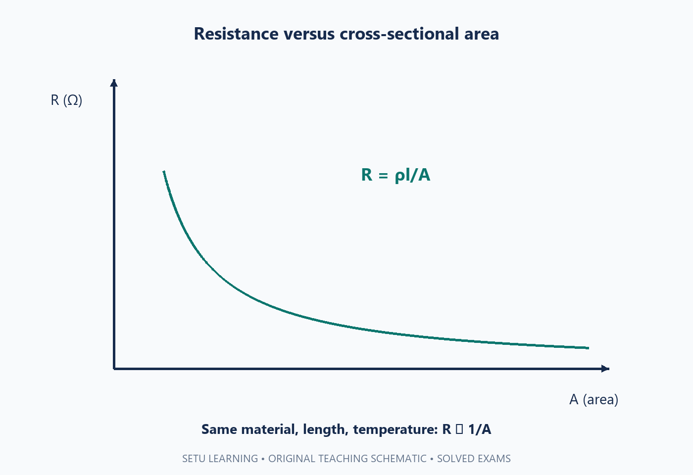

## 226. Thermal/electrical decomposition अंतर।

**स्रोत:** 2018 मुख्य, प्रश्न 17(b), PDF पृष्ठ 5 · **अंक:** 1 अंक

**अध्याय-संबंध:** रासायनिक अभिक्रियाएँ एवं समीकरण

**हल:** Thermolysis heat से decomposition, जैसे CaCO₃→CaO+CO₂। Electrolysis electrical energy से decomposition, जैसे 2H₂O→2H₂+O₂। Energy source तथा उदाहरण तुलना-बिंदु हैं।

[मूल प्रश्न देखें](https://rajeduboard.rajasthan.gov.in/books/PAPERS-2018/Sec/S-07-Science-E-H.pdf#page=5)

## 227. Waste तथा management के उपाय।

**स्रोत:** 2018 मुख्य, प्रश्न 21, PDF पृष्ठ 6 · **अंक:** 3 अंक

**अध्याय-संबंध:** हमारा पर्यावरण

**हल:** Discarded unwanted material waste है। Source segregation, reduce/reuse और suitable recycling/composting useful methods हैं। E-waste/batteries organic compost में न मिलाएँ।

[मूल प्रश्न देखें](https://rajeduboard.rajasthan.gov.in/books/PAPERS-2018/Sec/S-07-Science-E-H.pdf#page=6)

## 228. F₁ × dominant parent के ratios।

**स्रोत:** 2018 मुख्य, प्रश्न 23, cross भाग, PDF पृष्ठ 7 · **अंक:** 3 अंक

**अध्याय-संबंध:** आनुवंशिकता

**हल:** Monohybrid complete-dominance model में F₁ Tt × homozygous dominant TT से TT तथा Tt 1:1 genotype ratio। दोनों tall, इसलिए phenotype सभी dominant (1:0)। Reciprocal cross में sexes की parental roles interchange होती हैं; वह backcross का synonym नहीं।

[मूल प्रश्न देखें](https://rajeduboard.rajasthan.gov.in/books/PAPERS-2018/Sec/S-07-Science-E-H.pdf#page=7)

## 229. Bleaching powder formula।

**स्रोत:** 2018 मुख्य, प्रश्न 24(a), formula भाग, PDF पृष्ठ 7 · **अंक:** अलग अंक सत्यापित नहीं

**अध्याय-संबंध:** अम्ल, क्षारक एवं लवण

**हल:** Bleaching powder का school formula CaOCl₂; water disinfection/bleaching में उपयोग। POP CaSO₄·½H₂O, plaster/moulds के लिए; water जोड़कर gypsum CaSO₄·2H₂O बनकर जमता है।

[मूल प्रश्न देखें](https://rajeduboard.rajasthan.gov.in/books/PAPERS-2018/Sec/S-07-Science-E-H.pdf#page=7)

## 230. Respiration की परिभाषा।

**स्रोत:** 2018 मुख्य, प्रश्न 28(a), प्रथम विकल्प, PDF पृष्ठ 9 · **अंक:** 1 अंक

**अध्याय-संबंध:** जैव प्रक्रम

**हल:** Cellular respiration food का breakdown करके usable energy release करने की प्रक्रिया है। Cytoplasm में glucose से pyruvate; aerobic mitochondrial route CO₂/water देता है। Yeast anaerobic route ethanol/CO₂ तथा oxygen-deficit muscles lactate दे सकते हैं।

[मूल प्रश्न देखें](https://rajeduboard.rajasthan.gov.in/books/PAPERS-2018/Sec/S-07-Science-E-H.pdf#page=9)

## 231. Female primary sex organ।

**स्रोत:** 2018 मुख्य, प्रश्न 28(a), दूसरा विकल्प, PDF पृष्ठ 10 · **अंक:** 1 अंक

**अध्याय-संबंध:** जीव जनन कैसे करते हैं?

**हल:** Female primary reproductive organs ovaries हैं; ova तथा reproductive hormones बनाती हैं। Oviduct transport/fertilisation और uterus implantation/development से जुड़े हैं।

[मूल प्रश्न देखें](https://rajeduboard.rajasthan.gov.in/books/PAPERS-2018/Sec/S-07-Science-E-H.pdf#page=10)

## 232. kWh को joules में।

**स्रोत:** 2018 मुख्य, प्रश्न 4, PDF पृष्ठ 3 · **अंक:** 1 अंक

**अध्याय-संबंध:** विद्युत

**हल:** 1 kWh=3.6×10⁶ J और यह electric energy की unit है। kW power, kWh energy; 1 hour=3600 seconds।

[मूल प्रश्न देखें](https://rajeduboard.rajasthan.gov.in/books/PAPERS-2018/Sec/S-07-Science-E-H.pdf#page=3)

## 233. दो V–I readings से R।

**स्रोत:** 2018 मुख्य, प्रश्न 25(a), PDF पृष्ठ 8 · **अंक:** 2 अंक

**अध्याय-संबंध:** विद्युत

**हल:** दो readings: R=2/0.50=4 Ω और R=3/0.75=4 Ω। Constant V/I ohmic relation का support है, assuming temperature stable।

[मूल प्रश्न देखें](https://rajeduboard.rajasthan.gov.in/books/PAPERS-2018/Sec/S-07-Science-E-H.pdf#page=8)

## 234. 12 V,25 Ω,15 min: heat।

**स्रोत:** 2018 मुख्य, प्रश्न 25(b), PDF पृष्ठ 8 · **अंक:** 2 अंक

**अध्याय-संबंध:** विद्युत

**हल:** V=12 V,R=25 Ω,t=15 min=900 s। H=V²t/R=144×900/25=5184 J। I=0.48 A लेकर I²Rt से भी यही result।

[मूल प्रश्न देखें](https://rajeduboard.rajasthan.gov.in/books/PAPERS-2018/Sec/S-07-Science-E-H.pdf#page=8)

## 235. 40 kg,1→2 m/s: work।

**स्रोत:** 2018 मुख्य, प्रश्न 26(a), PDF पृष्ठ 9 · **अंक:** 2 अंक

**अध्याय-संबंध:** पुराना पाठ्यक्रम / enrichment: वर्तमान core से बाहर

**पुराना पाठ्यक्रम:** **हल:** पुराने mechanics पाठ्यक्रम: W=ΔK=½m(v²−u²)=½×40×(4−1)=60 J। यह current 13-chapter core का topic नहीं; historical practice label रखें।

[मूल प्रश्न देखें](https://rajeduboard.rajasthan.gov.in/books/PAPERS-2018/Sec/S-07-Science-E-H.pdf#page=9)

## 236. k=4000, x=2 cm: energy।

**स्रोत:** 2018 मुख्य, प्रश्न 26(b), PDF पृष्ठ 9 · **अंक:** 2 अंक

**अध्याय-संबंध:** पुराना पाठ्यक्रम / enrichment: वर्तमान core से बाहर

**पुराना पाठ्यक्रम:** **हल:** पुराना mechanics: x=2 cm=0.02 m। E=½kx²=½×4000×0.02²=0.8 J। Centimetre को metre में convert करना जरूरी है।

[मूल प्रश्न देखें](https://rajeduboard.rajasthan.gov.in/books/PAPERS-2018/Sec/S-07-Science-E-H.pdf#page=9)

## 2018 — पूरक परीक्षा

[2018 पूरक: पूरा आधिकारिक प्रश्न-पत्र](https://rajeduboard.rajasthan.gov.in/books/PAPERS-2018/SUPP/Sec/S-07-Science.pdf)

## 237. Bar magnet field की दिशा।

**स्रोत:** 2018 पूरक, प्रश्न 11, PDF पृष्ठ 4 · **अंक:** 1 अंक

**अध्याय-संबंध:** विद्युत धारा के चुंबकीय प्रभाव

**हल:** Bar magnet के भीतर field lines south→north, बाहर north→south हैं; मिलकर closed loops बनती हैं।

[मूल प्रश्न देखें](https://rajeduboard.rajasthan.gov.in/books/PAPERS-2018/SUPP/Sec/S-07-Science.pdf#page=4)

चित्र सहायता: इसी अध्याय में इस अवधारणा का पहले दिया नामांकित schematic देखें।

## 238. Vehicle mirror selection।

**स्रोत:** 2018 पूरक, प्रश्न 15(b), PDF पृष्ठ 5 · **अंक:** 1 अंक

**अध्याय-संबंध:** प्रकाश: परावर्तन तथा अपवर्तन

**हल:** Convex mirror wide field of view तथा erect, diminished virtual image देता है। इसलिए vehicle rear-view में useful है; concave magnified-image case से अलग रखें।

[मूल प्रश्न देखें](https://rajeduboard.rajasthan.gov.in/books/PAPERS-2018/SUPP/Sec/S-07-Science.pdf#page=5)

## 239. Displacement का उदाहरण।

**स्रोत:** 2018 पूरक, प्रश्न 17(a), PDF पृष्ठ 5 · **अंक:** 1 अंक

**अध्याय-संबंध:** रासायनिक अभिक्रियाएँ एवं समीकरण

**हल:** अधिक active element कम active को compound से हटाता है। Zn + CuSO₄ → ZnSO₄ + Cu उदाहरण है; zinc copper से अधिक active है।

[मूल प्रश्न देखें](https://rajeduboard.rajasthan.gov.in/books/PAPERS-2018/SUPP/Sec/S-07-Science.pdf#page=5)

## 240. Neutralisation का example।

**स्रोत:** 2018 पूरक, प्रश्न 17(b), PDF पृष्ठ 5 · **अंक:** 1 अंक

**अध्याय-संबंध:** अम्ल, क्षारक एवं लवण

**हल:** Acid और base से salt और सामान्यतः water बनना neutralisation है। HCl+NaOH→NaCl+H₂O balanced example है।

[मूल प्रश्न देखें](https://rajeduboard.rajasthan.gov.in/books/PAPERS-2018/SUPP/Sec/S-07-Science.pdf#page=5)

## 241. Redox का example।

**स्रोत:** 2018 पूरक, प्रश्न 17(c), PDF पृष्ठ 5 · **अंक:** 1 अंक

**अध्याय-संबंध:** रासायनिक अभिक्रियाएँ एवं समीकरण

**हल:** CuO + H₂ → Cu + H₂O में H₂ oxygen पाकर oxidised, CuO oxygen खोकर reduced है। Oxidation तथा reduction एक साथ होना redox है; दूसरा उदाहरण ZnO + C → Zn + CO है।

[मूल प्रश्न देखें](https://rajeduboard.rajasthan.gov.in/books/PAPERS-2018/SUPP/Sec/S-07-Science.pdf#page=5)

## 242. Biodegradable waste का अर्थ।

**स्रोत:** 2018 पूरक, प्रश्न 21, परिभाषा भाग, PDF पृष्ठ 7 · **अंक:** 1 अंक

**अध्याय-संबंध:** हमारा पर्यावरण

**हल:** Biological processes द्वारा breakdown होने वाले substances biodegradable हैं। Suitable conditions/समय चाहिए; biodegradable का अर्थ तत्काल harmless नहीं।

[मूल प्रश्न देखें](https://rajeduboard.rajasthan.gov.in/books/PAPERS-2018/SUPP/Sec/S-07-Science.pdf#page=7)

## 243. Dominance उदाहरण।

**स्रोत:** 2018 पूरक, प्रश्न 23, dominance भाग, PDF पृष्ठ 7 · **अंक:** 2 अंक

**अध्याय-संबंध:** आनुवंशिकता

**हल:** TT×tt से F₁ Tt सभी tall: heterozygote में T expressed, t hidden है। F₁ selfing में phenotype 3:1। Mendel rules trait transmission की predictions और recessive allele के फिर प्रकट होने को समझाते हैं। Dominant का अर्थ श्रेष्ठ नहीं।

[मूल प्रश्न देखें](https://rajeduboard.rajasthan.gov.in/books/PAPERS-2018/SUPP/Sec/S-07-Science.pdf#page=7)

## 244. Arrhenius acid/base examples।

**स्रोत:** 2018 पूरक, प्रश्न 24(a), PDF पृष्ठ 7 · **अंक:** 2 अंक

**अध्याय-संबंध:** अम्ल, क्षारक एवं लवण

**हल:** Arrhenius acid aqueous H⁺/H₃O⁺ बढ़ाता है, जैसे HCl; base OH⁻ बढ़ाता है, जैसे NaOH। NaOH+HCl→NaCl+H₂O neutralisation है। सभी hydrogen compounds aqueous acids नहीं।

[मूल प्रश्न देखें](https://rajeduboard.rajasthan.gov.in/books/PAPERS-2018/SUPP/Sec/S-07-Science.pdf#page=7)

## 245. CH₂=CH–CH₃ का नाम।

**स्रोत:** 2018 पूरक, प्रश्न 20(b), PDF पृष्ठ 6 · **अंक:** 1 अंक

**अध्याय-संबंध:** कार्बन एवं उसके यौगिक

**हल:** CH₃–CH=CH₂ अथवा CH₂=CH–CH₃ का IUPAC नाम propene है। तीन carbon, one double bond; suffix -ene।

[मूल प्रश्न देखें](https://rajeduboard.rajasthan.gov.in/books/PAPERS-2018/SUPP/Sec/S-07-Science.pdf#page=6)

## 246. 4 mA,0.05 s: charge।

**स्रोत:** 2018 पूरक, प्रश्न 25(b), PDF पृष्ठ 8 · **अंक:** 2 अंक

**अध्याय-संबंध:** विद्युत

**हल:** 4 mA=0.004 A,t=0.05 s। Q=It=0.0002 C=2×10⁻⁴ C। Milli-prefix तथा decimal दोनों सही convert करें।

[मूल प्रश्न देखें](https://rajeduboard.rajasthan.gov.in/books/PAPERS-2018/SUPP/Sec/S-07-Science.pdf#page=8)

## 2017 — मुख्य परीक्षा

[2017 मुख्य: पूरा आधिकारिक प्रश्न-पत्र](https://rajeduboard.rajasthan.gov.in/books/PAPERS-2017/Sec/S-07-Science-E-H.pdf)

## 247. Iron rust के दो बचाव।

**स्रोत:** 2017 मुख्य, प्रश्न 1, PDF पृष्ठ 2 · **अंक:** 1 अंक

**अध्याय-संबंध:** धातु एवं अधातु

**हल:** Painting और galvanising iron को moisture/oxygen से बचाते हैं। Zinc coating sacrificial protection भी दे सकती है; iron का corrosion नमी तथा oxygen से जुड़ा है।

[मूल प्रश्न देखें](https://rajeduboard.rajasthan.gov.in/books/PAPERS-2017/Sec/S-07-Science-E-H.pdf#page=2)

## 248. Mg combustion product।

**स्रोत:** 2017 मुख्य, प्रश्न 2, PDF पृष्ठ 2 · **अंक:** 1 अंक

**अध्याय-संबंध:** रासायनिक अभिक्रियाएँ एवं समीकरण

**हल:** 2Mg + O₂ → 2MgO। Product magnesium oxide है, combination reaction का उदाहरण। Mg और O दोनों sides पर 2 atoms हैं।

[मूल प्रश्न देखें](https://rajeduboard.rajasthan.gov.in/books/PAPERS-2017/Sec/S-07-Science-E-H.pdf#page=2)

## 249. Normal adult near point।

**स्रोत:** 2017 मुख्य, प्रश्न 6, PDF पृष्ठ 3 · **अंक:** 1 अंक

**अध्याय-संबंध:** मानव नेत्र तथा रंगबिरंगा संसार

**हल:** Normal young-adult school model में least distance of distinct vision लगभग 25 cm है। यह typical approximation है, हर individual का fixed measured near point नहीं।

[मूल प्रश्न देखें](https://rajeduboard.rajasthan.gov.in/books/PAPERS-2017/Sec/S-07-Science-E-H.pdf#page=3)

## 250. Roasting–calcination अंतर।

**स्रोत:** 2017 मुख्य, प्रश्न 9, PDF पृष्ठ 4 · **अंक:** 2 अंक

**अध्याय-संबंध:** धातु एवं अधातु

**हल:** Calcination में carbonate ore limited/no air पर oxide+CO₂ देता है। Roasting में sulfide ore excess air से oxide और SO₂ देता है। ZnCO₃ → ZnO+CO₂; 2ZnS+3O₂ → 2ZnO+2SO₂।

[मूल प्रश्न देखें](https://rajeduboard.rajasthan.gov.in/books/PAPERS-2017/Sec/S-07-Science-E-H.pdf#page=4)

## 251. Tall/round cross, F₂ ratio।

**स्रोत:** 2017 मुख्य, प्रश्न 11, PDF पृष्ठ 4 · **अंक:** 2 अंक

**अध्याय-संबंध:** आनुवंशिकता

**हल:** Independent assortment और complete dominance के model में pure dominant × pure recessive से F₁ दोनों dominant traits वाला heterozygote है। F₁ selfing से expected F₂ phenotypes 9:3:3:1। यह universal genetic ratio नहीं।

[मूल प्रश्न देखें](https://rajeduboard.rajasthan.gov.in/books/PAPERS-2017/Sec/S-07-Science-E-H.pdf#page=4)

## 252. Human sex-determination आधार।

**स्रोत:** 2017 मुख्य, प्रश्न 12, PDF पृष्ठ 5 · **अंक:** 2 अंक

**अध्याय-संबंध:** आनुवंशिकता

**हल:** XX–XY school model में egg X और sperm X या Y देता है। X+X → XX, X+Y → XY; expected probability लगभग बराबर। Mother को outcome के लिए दोष देने का scientific आधार नहीं।

[मूल प्रश्न देखें](https://rajeduboard.rajasthan.gov.in/books/PAPERS-2017/Sec/S-07-Science-E-H.pdf#page=5)

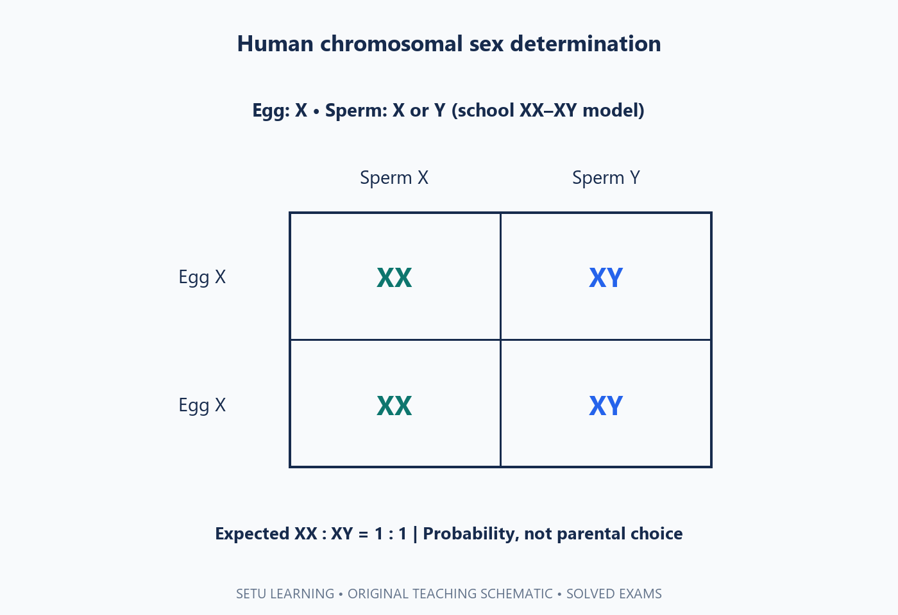

## 253. Vehicle rear-view mirror।

**स्रोत:** 2017 मुख्य, प्रश्न 13(a), PDF पृष्ठ 5 · **अंक:** 1 अंक

**अध्याय-संबंध:** प्रकाश: परावर्तन तथा अपवर्तन

**हल:** Convex mirror wide field of view तथा erect, diminished virtual image देता है। इसलिए vehicle rear-view में useful है; concave magnified-image case से अलग रखें।

[मूल प्रश्न देखें](https://rajeduboard.rajasthan.gov.in/books/PAPERS-2017/Sec/S-07-Science-E-H.pdf#page=5)

## 254. Household parallel का कारण।

**स्रोत:** 2017 मुख्य, प्रश्न 14, PDF पृष्ठ 5 · **अंक:** 2 अंक

**अध्याय-संबंध:** विद्युत

**हल:** Parallel branches पर समान supply voltage और independent switching मिलता है। एक appliance बंद/खराब होने पर अन्य branches चल सकती हैं। Series circuit में voltage sharing और common current होता है।

[मूल प्रश्न देखें](https://rajeduboard.rajasthan.gov.in/books/PAPERS-2017/Sec/S-07-Science-E-H.pdf#page=5)

## 255. Fat food oxidation रोकना।

**स्रोत:** 2017 मुख्य, प्रश्न 15(a), PDF पृष्ठ 5 · **अंक:** 1.5 अंक

**अध्याय-संबंध:** रासायनिक अभिक्रियाएँ एवं समीकरण

**हल:** Fat oxidation rancidity देती है। Airtight packs/nitrogen flushing oxygen exposure घटाते; refrigeration rate घटाती है। Rancid food को गरम करना हर hazard को खत्म करने की गारंटी नहीं।

[मूल प्रश्न देखें](https://rajeduboard.rajasthan.gov.in/books/PAPERS-2017/Sec/S-07-Science-E-H.pdf#page=5)

## 256. CuO–H₂ में oxidation/reduction।

**स्रोत:** 2017 मुख्य, प्रश्न 15(b), PDF पृष्ठ 5 · **अंक:** 1.5 अंक

**अध्याय-संबंध:** रासायनिक अभिक्रियाएँ एवं समीकरण

**हल:** CuO + H₂ → Cu + H₂O में H₂ oxygen पाकर oxidised, CuO oxygen खोकर reduced है। Oxidation तथा reduction एक साथ होना redox है; दूसरा उदाहरण ZnO + C → Zn + CO है।

[मूल प्रश्न देखें](https://rajeduboard.rajasthan.gov.in/books/PAPERS-2017/Sec/S-07-Science-E-H.pdf#page=5)

## 257. दो metal properties।

**स्रोत:** 2017 मुख्य, प्रश्न 17(a), PDF पृष्ठ 6 · **अंक:** 1 अंक

**अध्याय-संबंध:** धातु एवं अधातु

**हल:** Metals सामान्यतः lustrous, malleable, ductile तथा good conductors हैं। Sodium नरम और mercury liquid exceptions हैं। General property को ‘सभी’ के absolute statement में न बदलें।

[मूल प्रश्न देखें](https://rajeduboard.rajasthan.gov.in/books/PAPERS-2017/Sec/S-07-Science-E-H.pdf#page=6)

## 258. Alloy definition और examples।

**स्रोत:** 2017 मुख्य, प्रश्न 17(b), PDF पृष्ठ 6 · **अंक:** 1 अंक

**अध्याय-संबंध:** धातु एवं अधातु

**हल:** Alloy metal का दूसरे metal/nonmetal के साथ mixture है। Brass Cu–Zn, bronze Cu–Sn; composition से hardness, corrosion resistance आदि बदलते हैं।

[मूल प्रश्न देखें](https://rajeduboard.rajasthan.gov.in/books/PAPERS-2017/Sec/S-07-Science-E-H.pdf#page=6)

## 259. Metal/nonmetal oxides की प्रकृति।

**स्रोत:** 2017 मुख्य, प्रश्न 17(c), PDF पृष्ठ 6 · **अंक:** 1 अंक

**अध्याय-संबंध:** धातु एवं अधातु

**हल:** Metal oxides सामान्यतः basic, nonmetal oxides सामान्यतः acidic। Al₂O₃/ZnO amphoteric और CO जैसे neutral oxides exceptions हैं।

[मूल प्रश्न देखें](https://rajeduboard.rajasthan.gov.in/books/PAPERS-2017/Sec/S-07-Science-E-H.pdf#page=6)

## 260. Digestion में enzymes।

**स्रोत:** 2017 मुख्य, प्रश्न 18(a), PDF पृष्ठ 6 · **अंक:** 2 अंक

**अध्याय-संबंध:** जैव प्रक्रम

**हल:** Salivary amylase starch breakdown, stomach pepsin protein digestion और pancreatic/intestinal enzymes आगे digestion करते हैं। Lipase fat breakdown करता है; bile emulsification करता है लेकिन enzyme नहीं। Enzymes reaction-specific biological catalysts हैं।

[मूल प्रश्न देखें](https://rajeduboard.rajasthan.gov.in/books/PAPERS-2017/Sec/S-07-Science-E-H.pdf#page=6)

## 261. Pancreatic hormone और deficiency।

**स्रोत:** 2017 मुख्य, प्रश्न 19, PDF पृष्ठ 7 · **अंक:** 3 अंक

**अध्याय-संबंध:** नियंत्रण एवं समन्वय

**हल:** Pancreas insulin देता है; blood glucose regulation तथा uptake/storage में सहायता करता है। इसकी deficiency diabetes mellitus से जुड़ सकती है। सभी diabetes के cases केवल पूर्ण insulin absence से नहीं होते।

[मूल प्रश्न देखें](https://rajeduboard.rajasthan.gov.in/books/PAPERS-2017/Sec/S-07-Science-E-H.pdf#page=7)

## 262. Placenta damage का प्रभाव।

**स्रोत:** 2017 मुख्य, प्रश्न 21, PDF पृष्ठ 7 · **अंक:** 3 अंक

**अध्याय-संबंध:** जीव जनन कैसे करते हैं?

**हल:** Placenta maternal–fetal exchange interface है: oxygen/nutrients fetus को तथा metabolic wastes maternal side को transfer होते हैं। दोनों blood systems सामान्यतः सीधे common pool में नहीं मिलते। Damage से fetal nutrition/oxygen supply प्रभावित हो सकती है।

[मूल प्रश्न देखें](https://rajeduboard.rajasthan.gov.in/books/PAPERS-2017/Sec/S-07-Science-E-H.pdf#page=7)

## 263. Near-object defect और correction।

**स्रोत:** 2017 मुख्य, प्रश्न 22(a), PDF पृष्ठ 7 · **अंक:** 2 अंक

**अध्याय-संबंध:** मानव नेत्र तथा रंगबिरंगा संसार

**हल:** Myopia: दूर वस्तु की image retina के आगे; correction concave lens। Hypermetropia: near-object focus retina के पीछे की tendency; correction convex lens। Diagrams में retina और corrected focus label करें।

[मूल प्रश्न देखें](https://rajeduboard.rajasthan.gov.in/books/PAPERS-2017/Sec/S-07-Science-E-H.pdf#page=7)

## 264. Tyndall mechanism।

**स्रोत:** 2017 मुख्य, प्रश्न 22(b), PDF पृष्ठ 7 · **अंक:** 1 अंक

**अध्याय-संबंध:** मानव नेत्र तथा रंगबिरंगा संसार

**हल:** Colloidal/suitable small particles light scatter करके beam path visible करते हैं: Tyndall effect। Clear blue sky molecular scattering और star twinkling atmospheric refraction से जुड़े हैं।

[मूल प्रश्न देखें](https://rajeduboard.rajasthan.gov.in/books/PAPERS-2017/Sec/S-07-Science-E-H.pdf#page=7)

## 265. Ohm statement।

**स्रोत:** 2017 मुख्य, प्रश्न 23, नियम भाग, PDF पृष्ठ 8 · **अंक:** 1 अंक

**अध्याय-संबंध:** विद्युत

**हल:** स्थिर temperature/physical conditions में V ∝ I, इसलिए V=IR। Low-voltage circuit में ammeter series, voltmeter resistor के parallel; कई V,I readings में V/I लगभग constant और V-vertical/I-horizontal graph straight line होता है।

[मूल प्रश्न देखें](https://rajeduboard.rajasthan.gov.in/books/PAPERS-2017/Sec/S-07-Science-E-H.pdf#page=8)

चित्र सहायता: इसी अध्याय में इस अवधारणा का पहले दिया नामांकित schematic देखें।

## 266. Dilution का सुरक्षित क्रम क्यों?

**स्रोत:** 2017 मुख्य, प्रश्न 25(ii), PDF पृष्ठ 8 · **अंक:** 2 अंक

**अध्याय-संबंध:** अम्ल, क्षारक एवं लवण

**हल:** Acid dilution heat release कर सकता है। Acid धीरे large water volume में डालने से heat dissipation बेहतर और splashing कम; water को concentrated acid में अचानक न डालें।

[मूल प्रश्न देखें](https://rajeduboard.rajasthan.gov.in/books/PAPERS-2017/Sec/S-07-Science-E-H.pdf#page=8)

## 267. Chlor-alkali process।

**स्रोत:** 2017 मुख्य, प्रश्न 25(iv), PDF पृष्ठ 8 · **अंक:** 1 अंक

**अध्याय-संबंध:** अम्ल, क्षारक एवं लवण

**हल:** Brine electrolysis: 2NaCl+2H₂O → 2NaOH+Cl₂+H₂। Anode पर Cl₂, cathode पर H₂ और solution में NaOH; products को अलग रखें।

[मूल प्रश्न देखें](https://rajeduboard.rajasthan.gov.in/books/PAPERS-2017/Sec/S-07-Science-E-H.pdf#page=8)

## 268. Field-line representation के गुण।

**स्रोत:** 2017 मुख्य, प्रश्न 27(b), PDF पृष्ठ 9 · **अंक:** 2 अंक

**अध्याय-संबंध:** विद्युत धारा के चुंबकीय प्रभाव

**हल:** Field lines closed loops: बाहर N→S, अंदर S→N। Tangent local direction, close spacing stronger field; lines intersect नहीं करतीं। Diagram arrows और poles दोनों label करें।

[मूल प्रश्न देखें](https://rajeduboard.rajasthan.gov.in/books/PAPERS-2017/Sec/S-07-Science-E-H.pdf#page=9)

चित्र सहायता: इसी अध्याय में इस अवधारणा का पहले दिया नामांकित schematic देखें।

## 269. 220 V, 0.5 A: power।

**स्रोत:** 2017 मुख्य, प्रश्न 13(b), PDF पृष्ठ 5 · **अंक:** 1 अंक

**अध्याय-संबंध:** विद्युत

**हल:** V=220 V,I=0.5 A। P=VI=110 W। यदि resistance भी चाहिए तो R=V/I=440 Ω।

[मूल प्रश्न देखें](https://rajeduboard.rajasthan.gov.in/books/PAPERS-2017/Sec/S-07-Science-E-H.pdf#page=5)

## 270. 1 A, 30 s: charge।

**स्रोत:** 2017 मुख्य, प्रश्न 24, PDF पृष्ठ 8 · **अंक:** 3 अंक

**अध्याय-संबंध:** विद्युत

**हल:** I=1 A,t=30 s। Q=It=30 C। Current प्रति second charge flow है; I तथा Q अलग quantities हैं।

[मूल प्रश्न देखें](https://rajeduboard.rajasthan.gov.in/books/PAPERS-2017/Sec/S-07-Science-E-H.pdf#page=8)

## 271. f=0.5 m: lens power।

**स्रोत:** 2017 मुख्य, प्रश्न 30, प्रथम विकल्प अंतिम भाग, PDF पृष्ठ 11 · **अंक:** 1 अंक

**अध्याय-संबंध:** प्रकाश: परावर्तन तथा अपवर्तन

**हल:** f=0.5 m। P=1/f=2 D; given positive focal length school model में +2 D। यदि lens type/sign न दी हो तो power sign के लिए convention स्पष्ट करें।

[मूल प्रश्न देखें](https://rajeduboard.rajasthan.gov.in/books/PAPERS-2017/Sec/S-07-Science-E-H.pdf#page=11)

## 272. n=1.5: light speed।

**स्रोत:** 2017 मुख्य, प्रश्न 30, दूसरे विकल्प अंतिम भाग, PDF पृष्ठ 11 · **अंक:** 1 अंक

**अध्याय-संबंध:** प्रकाश: परावर्तन तथा अपवर्तन

**हल:** n=1.5,c=3×10⁸ m/s। v=c/n=2×10⁸ m/s। Refractive index dimensionless और speed की unit m/s है।

[मूल प्रश्न देखें](https://rajeduboard.rajasthan.gov.in/books/PAPERS-2017/Sec/S-07-Science-E-H.pdf#page=11)

## 2017 — विशेष पूरक परीक्षा

[2017 विशेष पूरक: पूरा आधिकारिक प्रश्न-पत्र](https://rajeduboard.rajasthan.gov.in/books/PAPERS-2017/SUPP/Sec/S-07-Science.pdf)

## 273. Copper–zinc alloy।

**स्रोत:** 2017 विशेष पूरक, प्रश्न 1, PDF पृष्ठ 2 · **अंक:** 1 अंक

**अध्याय-संबंध:** धातु एवं अधातु

**हल:** Brass copper और zinc की alloy है। Bronze copper–tin है; इन दोनों मिश्रधातुओं के घटक अलग हैं।

[मूल प्रश्न देखें](https://rajeduboard.rajasthan.gov.in/books/PAPERS-2017/SUPP/Sec/S-07-Science.pdf#page=2)

## 274. दो metal गुण।

**स्रोत:** 2017 विशेष पूरक, प्रश्न 4, PDF पृष्ठ 3 · **अंक:** 1 अंक

**अध्याय-संबंध:** धातु एवं अधातु

**हल:** Metals सामान्यतः lustrous, malleable, ductile तथा good conductors हैं। Sodium नरम और mercury liquid exceptions हैं। General property को ‘सभी’ के absolute statement में न बदलें।

[मूल प्रश्न देखें](https://rajeduboard.rajasthan.gov.in/books/PAPERS-2017/SUPP/Sec/S-07-Science.pdf#page=3)

## 275. Bisexual flower का अर्थ।

**स्रोत:** 2017 विशेष पूरक, प्रश्न 5, PDF पृष्ठ 3 · **अंक:** 1 अंक

**अध्याय-संबंध:** जीव जनन कैसे करते हैं?

**हल:** जिस flower में stamen और pistil दोनों हों, वह bisexual flower है। Hibiscus और mustard standard examples हैं; bisexual होना self-pollination की guarantee नहीं।

[मूल प्रश्न देखें](https://rajeduboard.rajasthan.gov.in/books/PAPERS-2017/SUPP/Sec/S-07-Science.pdf#page=3)

## 276. White light dispersion।

**स्रोत:** 2017 विशेष पूरक, प्रश्न 6, PDF पृष्ठ 3 · **अंक:** 1 अंक

**अध्याय-संबंध:** मानव नेत्र तथा रंगबिरंगा संसार

**हल:** White light का constituent wavelengths/colours में separation dispersion है। Prism का refractive index wavelength-dependent होने से colours अलग deviate करते हैं; ordinary glass में violet अधिक, red कम deviates है।

[मूल प्रश्न देखें](https://rajeduboard.rajasthan.gov.in/books/PAPERS-2017/SUPP/Sec/S-07-Science.pdf#page=3)

चित्र सहायता: इसी अध्याय में इस अवधारणा का पहले दिया नामांकित schematic देखें।

## 277. P–f संबंध।

**स्रोत:** 2017 विशेष पूरक, प्रश्न 7, PDF पृष्ठ 3 · **अंक:** 1 अंक

**अध्याय-संबंध:** प्रकाश: परावर्तन तथा अपवर्तन

**हल:** Lens power P=1/f है, f metre में; unit dioptre। Convex/converging lens positive, concave/diverging lens negative power रखता है। Centimetre में f का reciprocal सीधे dioptres नहीं देता।

[मूल प्रश्न देखें](https://rajeduboard.rajasthan.gov.in/books/PAPERS-2017/SUPP/Sec/S-07-Science.pdf#page=3)

## 278. Bleaching powder और POP उपयोग।

**स्रोत:** 2017 विशेष पूरक, प्रश्न 9, PDF पृष्ठ 4 · **अंक:** 2 अंक

**अध्याय-संबंध:** अम्ल, क्षारक एवं लवण

**हल:** Bleaching powder का school formula CaOCl₂; water disinfection/bleaching में उपयोग। POP CaSO₄·½H₂O, plaster/moulds के लिए; water जोड़कर gypsum CaSO₄·2H₂O बनकर जमता है।

[मूल प्रश्न देखें](https://rajeduboard.rajasthan.gov.in/books/PAPERS-2017/SUPP/Sec/S-07-Science.pdf#page=4)

## 279. Rear-view mirror।

**स्रोत:** 2017 विशेष पूरक, प्रश्न 13(a), PDF पृष्ठ 5 · **अंक:** 1 अंक

**अध्याय-संबंध:** प्रकाश: परावर्तन तथा अपवर्तन

**हल:** Convex mirror wide field of view तथा erect, diminished virtual image देता है। इसलिए vehicle rear-view में useful है; concave magnified-image case से अलग रखें।

[मूल प्रश्न देखें](https://rajeduboard.rajasthan.gov.in/books/PAPERS-2017/SUPP/Sec/S-07-Science.pdf#page=5)

## 280. Bar-magnet lines के गुण।

**स्रोत:** 2017 विशेष पूरक, प्रश्न 14, PDF पृष्ठ 5 · **अंक:** 2 अंक

**अध्याय-संबंध:** विद्युत धारा के चुंबकीय प्रभाव

**हल:** Field lines closed loops: बाहर N→S, अंदर S→N। Tangent local direction, close spacing stronger field; lines intersect नहीं करतीं। Diagram arrows और poles दोनों label करें।

[मूल प्रश्न देखें](https://rajeduboard.rajasthan.gov.in/books/PAPERS-2017/SUPP/Sec/S-07-Science.pdf#page=5)

चित्र सहायता: इसी अध्याय में इस अवधारणा का पहले दिया नामांकित schematic देखें।

## 281. Strong/weak acid का आधार।

**स्रोत:** 2017 विशेष पूरक, प्रश्न 15(b), PDF पृष्ठ 5 · **अंक:** 1 अंक

**अध्याय-संबंध:** अम्ल, क्षारक एवं लवण

**हल:** Strong acid जल में अधिक/लगभग पूर्ण ionisation, weak acid आंशिक ionisation करता है। HCl strong और ethanoic acid weak उदाहरण हैं। Strength तथा concentration अलग धारणाएँ हैं।

[मूल प्रश्न देखें](https://rajeduboard.rajasthan.gov.in/books/PAPERS-2017/SUPP/Sec/S-07-Science.pdf#page=5)

## 282. Crystal water क्या है?

**स्रोत:** 2017 विशेष पूरक, प्रश्न 15(c), PDF पृष्ठ 5 · **अंक:** 1 अंक

**अध्याय-संबंध:** अम्ल, क्षारक एवं लवण

**हल:** Salt crystal structure में निश्चित संख्या के water molecules crystallisation water हैं। CuSO₄·5H₂O तथा Na₂CO₃·10H₂O examples हैं; यह केवल बाहरी गीलापन नहीं।

[मूल प्रश्न देखें](https://rajeduboard.rajasthan.gov.in/books/PAPERS-2017/SUPP/Sec/S-07-Science.pdf#page=5)

## 283. Saliva और bile के काम।

**स्रोत:** 2017 विशेष पूरक, प्रश्न 18(a), PDF पृष्ठ 6 · **अंक:** 2 अंक

**अध्याय-संबंध:** जैव प्रक्रम

**हल:** Salivary amylase starch digestion शुरू करता है। Bile liver में बनता है; fat emulsification तथा intestinal medium में मदद करता है, digestive enzyme नहीं। Small intestine में fat digestion और absorption प्रमुख हैं।

[मूल प्रश्न देखें](https://rajeduboard.rajasthan.gov.in/books/PAPERS-2017/SUPP/Sec/S-07-Science.pdf#page=6)

## 284. Growth-inhibiting hormone का प्रभाव।

**स्रोत:** 2017 विशेष पूरक, प्रश्न 19(a), PDF पृष्ठ 7 · **अंक:** 2 अंक

**अध्याय-संबंध:** नियंत्रण एवं समन्वय

**हल:** Abscisic acid (ABA) growth inhibition और stress responses से संबंधित है। Water stress में stomatal closing में भी भूमिका निभाता है।

[मूल प्रश्न देखें](https://rajeduboard.rajasthan.gov.in/books/PAPERS-2017/SUPP/Sec/S-07-Science.pdf#page=7)

## 285. Division-promoting hormone।

**स्रोत:** 2017 विशेष पूरक, प्रश्न 19(b), PDF पृष्ठ 7 · **अंक:** 1 अंक

**अध्याय-संबंध:** नियंत्रण एवं समन्वय

**हल:** Cytokinin plant cell division promote कर सकता है। Insulin, thyroxine और oestrogen animal hormones हैं, इसलिए plant-hormone MCQ में cytokinin चुनें।

[मूल प्रश्न देखें](https://rajeduboard.rajasthan.gov.in/books/PAPERS-2017/SUPP/Sec/S-07-Science.pdf#page=7)

## 286. दो defects और corrective lenses।

**स्रोत:** 2017 विशेष पूरक, प्रश्न 22, PDF पृष्ठ 7 · **अंक:** 3 अंक

**अध्याय-संबंध:** मानव नेत्र तथा रंगबिरंगा संसार

**हल:** Myopia: दूर वस्तु की image retina के आगे; correction concave lens। Hypermetropia: near-object focus retina के पीछे की tendency; correction convex lens। Diagrams में retina और corrected focus label करें।

[मूल प्रश्न देखें](https://rajeduboard.rajasthan.gov.in/books/PAPERS-2017/SUPP/Sec/S-07-Science.pdf#page=7)

## 2016 — मुख्य परीक्षा

[2016 मुख्य: पूरा आधिकारिक प्रश्न-पत्र](https://rajeduboard.rajasthan.gov.in/books/PAPERS-2016/Sec/S-07-Science.pdf)

## 287. Baking powder के दो घटक।

**स्रोत:** 2016 मुख्य, प्रश्न 1, PDF पृष्ठ 2 · **अंक:** 1 अंक

**अध्याय-संबंध:** अम्ल, क्षारक एवं लवण

**हल:** Baking powder में NaHCO₃ तथा edible weak acid, जैसे tartaric acid, होते हैं। Heating पर CO₂ food को rise देती है; acid residual carbonate की bitter/basic effect कम करता है।

[मूल प्रश्न देखें](https://rajeduboard.rajasthan.gov.in/books/PAPERS-2016/Sec/S-07-Science.pdf#page=2)

## 288. Seed-loss plants का propagation।

**स्रोत:** 2016 मुख्य, प्रश्न 2, PDF पृष्ठ 2 · **अंक:** 1 अंक

**अध्याय-संबंध:** जीव जनन कैसे करते हैं?

**हल:** Root, stem अथवा leaf के vegetative parts से नए plants बनाना vegetative propagation है। Potato stem buds और Bryophyllum leaf buds उदाहरण हैं। Seed-less plants को बढ़ाने और useful traits बनाए रखने में उपयोगी है।

[मूल प्रश्न देखें](https://rajeduboard.rajasthan.gov.in/books/PAPERS-2016/Sec/S-07-Science.pdf#page=2)

## 289. Uniform magnetic field का चित्र।

**स्रोत:** 2016 मुख्य, प्रश्न 5, PDF पृष्ठ 2 · **अंक:** 1 अंक

**अध्याय-संबंध:** विद्युत धारा के चुंबकीय प्रभाव

**हल:** Uniform magnetic field को parallel, equally spaced straight lines और same direction arrowheads से draw करें। Lines की spacing uniform strength तथा tangent direction दर्शाती है।

[मूल प्रश्न देखें](https://rajeduboard.rajasthan.gov.in/books/PAPERS-2016/Sec/S-07-Science.pdf#page=2)

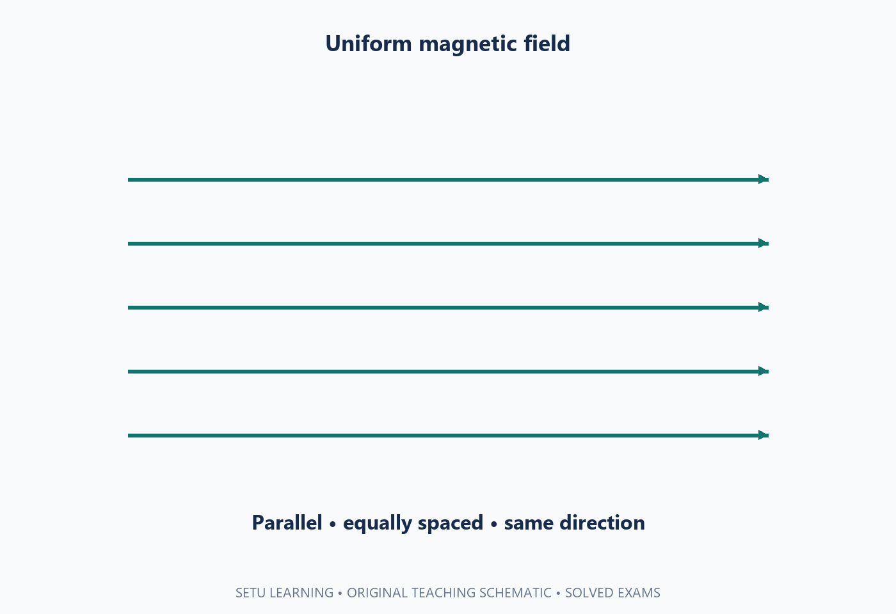

## 290. East→west wire के नीचे field।

**स्रोत:** 2016 मुख्य, प्रश्न 7, PDF पृष्ठ 2 · **अंक:** 1 अंक

**अध्याय-संबंध:** विद्युत धारा के चुंबकीय प्रभाव

**हल:** Current east→west और point सीधे नीचे हो तो right-hand rule से field south की ओर है। Directions को coordinate cross-product से check करें; above-wire point पर direction उलटी होगी।

[मूल प्रश्न देखें](https://rajeduboard.rajasthan.gov.in/books/PAPERS-2016/Sec/S-07-Science.pdf#page=2)

## 291. Quicklime–water combination।

**स्रोत:** 2016 मुख्य, प्रश्न 9, PDF पृष्ठ 3 · **अंक:** 2 अंक

**अध्याय-संबंध:** रासायनिक अभिक्रियाएँ एवं समीकरण

**हल:** Combination: CaO + H₂O → Ca(OH)₂; अनेक reactants से एक मुख्य product। Decomposition: CaCO₃ → CaO + CO₂ (heat); एक compound कई products देता है। दोनों equations balanced रखें।

[मूल प्रश्न देखें](https://rajeduboard.rajasthan.gov.in/books/PAPERS-2016/Sec/S-07-Science.pdf#page=3)

## 292. Photosynthesis equation तथा घटनाएँ।

**स्रोत:** 2016 मुख्य, प्रश्न 15(a), PDF पृष्ठ 4 · **अंक:** 2 अंक

**अध्याय-संबंध:** जैव प्रक्रम

**हल:** Light/chlorophyll energy absorb करते हैं; water से oxygen liberation तथा CO₂ का carbohydrate में reduction होता है। Simplified equation 6CO₂ + 6H₂O → C₆H₁₂O₆ + 6O₂ है; light/chlorophyll condition लिखें।

[मूल प्रश्न देखें](https://rajeduboard.rajasthan.gov.in/books/PAPERS-2016/Sec/S-07-Science.pdf#page=4)

## 293. ZnO–carbon redox analysis।

**स्रोत:** 2016 मुख्य, प्रश्न 17, PDF पृष्ठ 4 · **अंक:** 3 अंक

**अध्याय-संबंध:** रासायनिक अभिक्रियाएँ एवं समीकरण

**हल:** ZnO+C→Zn+CO में ZnO oxygen खोकर reduced और carbon oxygen पाकर oxidised होता है। ZnO oxidising agent, carbon reducing agent। दोनों transformations एक साथ होने से यह redox है।

[मूल प्रश्न देखें](https://rajeduboard.rajasthan.gov.in/books/PAPERS-2016/Sec/S-07-Science.pdf#page=4)

## 294. Mirror magnification formula।

**स्रोत:** 2016 मुख्य, प्रश्न 18(a), PDF पृष्ठ 4 · **अंक:** 1 अंक

**अध्याय-संबंध:** प्रकाश: परावर्तन तथा अपवर्तन

**हल:** Spherical mirror magnification m=hᵢ/hₒ=−v/u। New Cartesian signs लें; m<0 inverted और m>0 erect image दर्शाता है।

[मूल प्रश्न देखें](https://rajeduboard.rajasthan.gov.in/books/PAPERS-2016/Sec/S-07-Science.pdf#page=4)

## 295. Erect enlarged mirror पहचान।

**स्रोत:** 2016 मुख्य, प्रश्न 18(b), PDF पृष्ठ 4 · **अंक:** 1 अंक

**अध्याय-संबंध:** प्रकाश: परावर्तन तथा अपवर्तन

**हल:** Concave mirror object को pole और focus के बीच रखने पर erect, enlarged virtual image देता है। Convex mirror finite real object की erect लेकिन diminished image देता है।

[मूल प्रश्न देखें](https://rajeduboard.rajasthan.gov.in/books/PAPERS-2016/Sec/S-07-Science.pdf#page=4)

## 296. Reflex arc और response।

**स्रोत:** 2016 मुख्य, प्रश्न 19, PDF पृष्ठ 4 · **अंक:** 3 अंक

**अध्याय-संबंध:** नियंत्रण एवं समन्वय

**हल:** Receptor → sensory neuron → spinal relay → motor neuron → effector muscle। तेज automatic withdrawal response reflex है; brain को information भी मिलती है। Arc diagram में nerve direction और effector label करें।

[मूल प्रश्न देखें](https://rajeduboard.rajasthan.gov.in/books/PAPERS-2016/Sec/S-07-Science.pdf#page=4)

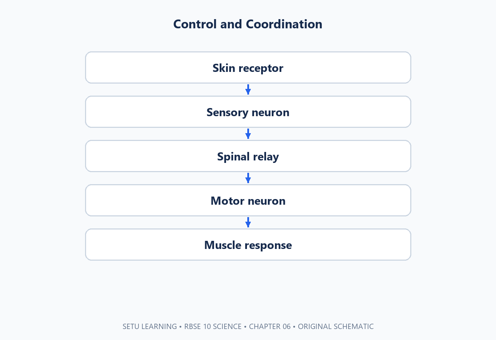

## 297. Current का सही formula।

**स्रोत:** 2016 मुख्य, प्रश्न 20(i), PDF पृष्ठ 5 · **अंक:** 0.5 अंक

**अध्याय-संबंध:** विद्युत

**हल:** Current I=Q/t। Q coulomb और t second में लेने पर I ampere मिलता है; 1 A=1 C/s।

[मूल प्रश्न देखें](https://rajeduboard.rajasthan.gov.in/books/PAPERS-2016/Sec/S-07-Science.pdf#page=5)

## 298. Potential difference formula।

**स्रोत:** 2016 मुख्य, प्रश्न 20(ii), PDF पृष्ठ 5 · **अंक:** 0.5 अंक

**अध्याय-संबंध:** विद्युत

**हल:** Potential difference V=W/Q। W joule और Q coulomb में होने पर V volt; 1 V=1 J/C।

[मूल प्रश्न देखें](https://rajeduboard.rajasthan.gov.in/books/PAPERS-2016/Sec/S-07-Science.pdf#page=5)

## 299. Ohm relation मिलान।

**स्रोत:** 2016 मुख्य, प्रश्न 20(iii), PDF पृष्ठ 5 · **अंक:** 0.5 अंक

**अध्याय-संबंध:** विद्युत

**हल:** स्थिर temperature/physical conditions में V ∝ I, इसलिए V=IR। Low-voltage circuit में ammeter series, voltmeter resistor के parallel; कई V,I readings में V/I लगभग constant और V-vertical/I-horizontal graph straight line होता है।

[मूल प्रश्न देखें](https://rajeduboard.rajasthan.gov.in/books/PAPERS-2016/Sec/S-07-Science.pdf#page=5)

चित्र सहायता: इसी अध्याय में इस अवधारणा का पहले दिया नामांकित schematic देखें।

## 300. Resistivity relation मिलान।

**स्रोत:** 2016 मुख्य, प्रश्न 20(iv), PDF पृष्ठ 5 · **अंक:** 0.5 अंक

**अध्याय-संबंध:** विद्युत

**हल:** R=ρl/A: length, cross-section, material तथा temperature matter करते हैं। ρ=RA/l, unit Ω·m। Same material/temperature में geometry बदलने से R बदलता है, intrinsic resistivity नहीं।

[मूल प्रश्न देखें](https://rajeduboard.rajasthan.gov.in/books/PAPERS-2016/Sec/S-07-Science.pdf#page=5)

## 301. Unfertilised egg के बाद प्रक्रिया।

**स्रोत:** 2016 मुख्य, प्रश्न 21, PDF पृष्ठ 5 · **अंक:** 3 अंक

**अध्याय-संबंध:** जीव जनन कैसे करते हैं?

**हल:** Ovum fertilised न हो और pregnancy न बने तो hormonal changes के साथ uterine lining shed हो सकती है। Blood/tissue vagina से बाहर आते हैं: menstruation। Cycle length vary करती है; इसे ‘impure blood’ नहीं कहें।

[मूल प्रश्न देखें](https://rajeduboard.rajasthan.gov.in/books/PAPERS-2016/Sec/S-07-Science.pdf#page=5)

## 302. Mouth pH और tooth decay।

**स्रोत:** 2016 मुख्य, प्रश्न 23, PDF पृष्ठ 5 · **अंक:** 3 अंक

**अध्याय-संबंध:** अम्ल, क्षारक एवं लवण

**हल:** Bacterial sugar metabolism acid बनाता है; mouth pH लगभग 5.5 से नीचे गिरने पर enamel demineralisation बढ़ सकती है। Mildly basic toothpaste acid neutralisation में मदद करता है। pH acid strength और total amount का अकेला प्रमाण नहीं।

[मूल प्रश्न देखें](https://rajeduboard.rajasthan.gov.in/books/PAPERS-2016/Sec/S-07-Science.pdf#page=5)

## 303. Grassland chain तथा energy।

**स्रोत:** 2016 मुख्य, प्रश्न 25, PDF पृष्ठ 5 · **अंक:** 5 अंक

**अध्याय-संबंध:** हमारा पर्यावरण

**हल:** Food chain organisms के बीच feeding/energy transfer दिखाती है: grass → grasshopper → frog → snake। Solar energy producer से consumers तक जाती है और हर step में heat/metabolism से घटती है; लगभग 10% transfer school model है। Nutrients cycle कर सकते हैं, energy flow one-way है।

[मूल प्रश्न देखें](https://rajeduboard.rajasthan.gov.in/books/PAPERS-2016/Sec/S-07-Science.pdf#page=5)

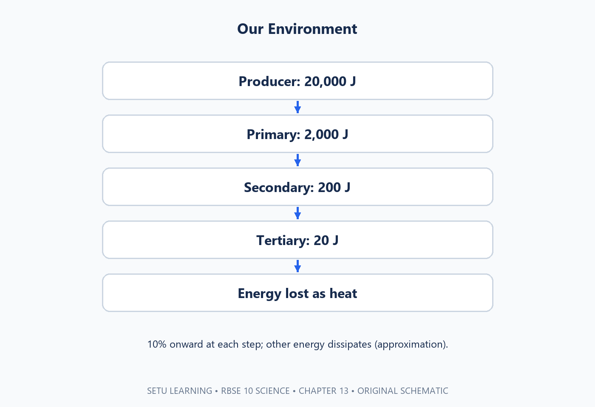

## 304. 600 W fridge, 30 दिन: bill।

**स्रोत:** 2016 मुख्य, प्रश्न 24, PDF पृष्ठ 5 · **अंक:** 3 अंक

**अध्याय-संबंध:** विद्युत

**हल:** P=600 W=0.6 kW; t=8×30=240 h। E=0.6×240=144 kWh। Rate ₹4/kWh पर charge ₹576; fixed fees/taxes शामिल नहीं।

[मूल प्रश्न देखें](https://rajeduboard.rajasthan.gov.in/books/PAPERS-2016/Sec/S-07-Science.pdf#page=5)

## 2015 — मुख्य परीक्षा

[2015 मुख्य: पूरा आधिकारिक प्रश्न-पत्र](https://rajeduboard.rajasthan.gov.in/books/PAPERS-2015/Sec/S-07-Science-15.pdf)

## 305. दो synthetic indicators।

**स्रोत:** 2015 मुख्य, प्रश्न 1, PDF पृष्ठ 2 · **अंक:** 1 अंक

**अध्याय-संबंध:** अम्ल, क्षारक एवं लवण

**हल:** Phenolphthalein और methyl orange दो synthetic indicators हैं। Phenolphthalein acidic medium में colourless और basic में pink है।

[मूल प्रश्न देखें](https://rajeduboard.rajasthan.gov.in/books/PAPERS-2015/Sec/S-07-Science-15.pdf#page=2)

## 306. Embryo nutrition का interface।

**स्रोत:** 2015 मुख्य, प्रश्न 2, PDF पृष्ठ 2 · **अंक:** 1 अंक

**अध्याय-संबंध:** जीव जनन कैसे करते हैं?

**हल:** Placenta maternal–fetal exchange interface है: oxygen/nutrients fetus को तथा metabolic wastes maternal side को transfer होते हैं। दोनों blood systems सामान्यतः सीधे common pool में नहीं मिलते। Damage से fetal nutrition/oxygen supply प्रभावित हो सकती है।

[मूल प्रश्न देखें](https://rajeduboard.rajasthan.gov.in/books/PAPERS-2015/Sec/S-07-Science-15.pdf#page=2)

## 307. दो जोड़ों का pH compare।

**स्रोत:** 2015 मुख्य, प्रश्न 4, PDF पृष्ठ 2 · **अंक:** 1 अंक

**अध्याय-संबंध:** अम्ल, क्षारक एवं लवण

**हल:** Blood का typical pH लगभग 7.4, distilled water लगभग 7; blood अधिक pH वाला है। Gastric juice का pH सामान्यतः lemon juice से कम, इसलिए lemon juice अपेक्षाकृत अधिक pH वाला है। Actual values conditions पर निर्भर हैं।

[मूल प्रश्न देखें](https://rajeduboard.rajasthan.gov.in/books/PAPERS-2015/Sec/S-07-Science-15.pdf#page=2)

## 308. Overload से दो बचाव।

**स्रोत:** 2015 मुख्य, प्रश्न 5, PDF पृष्ठ 2 · **अंक:** 1 अंक

**अध्याय-संबंध:** विद्युत धारा के चुंबकीय प्रभाव

**हल:** एक socket/circuit पर बहुत appliances से total current rating से अधिक हो सकता है: overloading। I²R heating बढ़ सकती है। Load rating मानें और suitable protective devices रखें; एक socket में high-power loads न जोड़ें।

[मूल प्रश्न देखें](https://rajeduboard.rajasthan.gov.in/books/PAPERS-2015/Sec/S-07-Science-15.pdf#page=2)

## 309. Eye focal adjustment का नाम।

**स्रोत:** 2015 मुख्य, प्रश्न 8, PDF पृष्ठ 3 · **अंक:** 1 अंक

**अध्याय-संबंध:** मानव नेत्र तथा रंगबिरंगा संसार

**हल:** Eye lens की focal length adjust करने की क्षमता accommodation है। Ciliary muscles curvature बदलती हैं: near object के लिए lens अधिक convex और focal length कम होती है।

[मूल प्रश्न देखें](https://rajeduboard.rajasthan.gov.in/books/PAPERS-2015/Sec/S-07-Science-15.pdf#page=3)

## 310. Combination/decomposition के examples।

**स्रोत:** 2015 मुख्य, प्रश्न 9, PDF पृष्ठ 3 · **अंक:** 2 अंक

**अध्याय-संबंध:** रासायनिक अभिक्रियाएँ एवं समीकरण

**हल:** Combination: CaO + H₂O → Ca(OH)₂; अनेक reactants से एक मुख्य product। Decomposition: CaCO₃ → CaO + CO₂ (heat); एक compound कई products देता है। दोनों equations balanced रखें।

[मूल प्रश्न देखें](https://rajeduboard.rajasthan.gov.in/books/PAPERS-2015/Sec/S-07-Science-15.pdf#page=3)

## 311. Ozone किस radiation से बचाती है?

**स्रोत:** 2015 मुख्य, प्रश्न 11(a), PDF पृष्ठ 3 · **अंक:** 1 अंक

**अध्याय-संबंध:** हमारा पर्यावरण

**हल:** Stratospheric ozone harmful ultraviolet radiation के कुछ हिस्से को absorb करता है। UV shielding घटने को ozone depletion से जोड़ें, visible colours के dispersion से नहीं।

[मूल प्रश्न देखें](https://rajeduboard.rajasthan.gov.in/books/PAPERS-2015/Sec/S-07-Science-15.pdf#page=3)

## 312. XX–XY determination schematic।

**स्रोत:** 2015 मुख्य, प्रश्न 14, PDF पृष्ठ 3 · **अंक:** 2 अंक

**अध्याय-संबंध:** आनुवंशिकता

**हल:** XX–XY school model में egg X और sperm X या Y देता है। X+X → XX, X+Y → XY; expected probability लगभग बराबर। Mother को outcome के लिए दोष देने का scientific आधार नहीं।

[मूल प्रश्न देखें](https://rajeduboard.rajasthan.gov.in/books/PAPERS-2015/Sec/S-07-Science-15.pdf#page=3)

चित्र सहायता: इसी अध्याय में इस अवधारणा का पहले दिया नामांकित schematic देखें।

## 313. Stomach acid का कार्य।

**स्रोत:** 2015 मुख्य, प्रश्न 15(a), PDF पृष्ठ 4 · **अंक:** 1 अंक

**अध्याय-संबंध:** जैव प्रक्रम

**हल:** HCl stomach में acidic environment बनाता है, pepsin action के अनुकूल है और कई microbes के विरुद्ध मदद करता है। Mucus lining रक्षा करती है; HCl स्वयं protein-digesting enzyme नहीं।

[मूल प्रश्न देखें](https://rajeduboard.rajasthan.gov.in/books/PAPERS-2015/Sec/S-07-Science-15.pdf#page=4)

## 314. दो nutrition modes में अंतर।

**स्रोत:** 2015 मुख्य, प्रश्न 15(b), PDF पृष्ठ 4 · **अंक:** 2 अंक

**अध्याय-संबंध:** जैव प्रक्रम

**हल:** Autotroph inorganic sources से organic food बनाते हैं; green plants photosynthesis से। Heterotroph दूसरे organisms से organic food लेते हैं; humans इसका उदाहरण हैं। दोनों usable energy के लिए cellular processes रखते हैं।

[मूल प्रश्न देखें](https://rajeduboard.rajasthan.gov.in/books/PAPERS-2015/Sec/S-07-Science-15.pdf#page=4)

## 315. Nerve और hormone control।

**स्रोत:** 2015 मुख्य, प्रश्न 16(b), PDF पृष्ठ 4 · **अंक:** 2 अंक

**अध्याय-संबंध:** नियंत्रण एवं समन्वय

**हल:** Nervous messages specific neural paths से सामान्यतः तेज और short-lived responses देते हैं। Hormones blood से receptor-bearing targets तक जाते और अक्सर slower/longer responses देते हैं। Messenger, route और timescale स्पष्ट तुलना-बिंदु हैं।

[मूल प्रश्न देखें](https://rajeduboard.rajasthan.gov.in/books/PAPERS-2015/Sec/S-07-Science-15.pdf#page=4)

## 316. CuO–H₂ redox तथा दूसरा उदाहरण।

**स्रोत:** 2015 मुख्य, प्रश्न 17, PDF पृष्ठ 4 · **अंक:** 3 अंक

**अध्याय-संबंध:** रासायनिक अभिक्रियाएँ एवं समीकरण

**हल:** CuO + H₂ → Cu + H₂O में H₂ oxygen पाकर oxidised, CuO oxygen खोकर reduced है। Oxidation तथा reduction एक साथ होना redox है; दूसरा उदाहरण ZnO + C → Zn + CO है।

[मूल प्रश्न देखें](https://rajeduboard.rajasthan.gov.in/books/PAPERS-2015/Sec/S-07-Science-15.pdf#page=4)

## 317. Mirrors और image types तुलना।

**स्रोत:** 2015 मुख्य, प्रश्न 18, PDF पृष्ठ 4 · **अंक:** 3 अंक

**अध्याय-संबंध:** प्रकाश: परावर्तन तथा अपवर्तन

**हल:** Spherical mirror का reflecting surface sphere के भाग जैसा है। Concave inward surface, convex outward surface। Real image actual rays की intersection से screen पर मिलती है; virtual image backward extensions का apparent intersection है।

[मूल प्रश्न देखें](https://rajeduboard.rajasthan.gov.in/books/PAPERS-2015/Sec/S-07-Science-15.pdf#page=4)

## 318. Insulin/thyroxine के functions।

**स्रोत:** 2015 मुख्य, प्रश्न 19(b), PDF पृष्ठ 4 · **अंक:** 2 अंक

**अध्याय-संबंध:** नियंत्रण एवं समन्वय

**हल:** Insulin pancreas से blood glucose regulation में सहायता करता है। Thyroxine thyroid से metabolic regulation में काम करता है और iodine चाहिए। Insulin deficiency diabetes mellitus से संबंधित हो सकती है; सभी diabetes केवल complete absence नहीं।

[मूल प्रश्न देखें](https://rajeduboard.rajasthan.gov.in/books/PAPERS-2015/Sec/S-07-Science-15.pdf#page=4)

## 319. White-light separation का कारण।

**स्रोत:** 2015 मुख्य, प्रश्न 20, PDF पृष्ठ 4 · **अंक:** 3 अंक

**अध्याय-संबंध:** मानव नेत्र तथा रंगबिरंगा संसार

**हल:** White light का constituent wavelengths/colours में separation dispersion है। Prism का refractive index wavelength-dependent होने से colours अलग deviate करते हैं; ordinary glass में violet अधिक, red कम deviates है।

[मूल प्रश्न देखें](https://rajeduboard.rajasthan.gov.in/books/PAPERS-2015/Sec/S-07-Science-15.pdf#page=4)

चित्र सहायता: इसी अध्याय में इस अवधारणा का पहले दिया नामांकित schematic देखें।

## 320. तीन asexual modes तुलना।

**स्रोत:** 2015 मुख्य, प्रश्न 21, PDF पृष्ठ 4 · **अंक:** 3 अंक

**अध्याय-संबंध:** जीव जनन कैसे करते हैं?

**हल:** Fragmentation: Spirogyra filament pieces नए individuals बन सकते हैं। Regeneration: Planaria suitable fragments से body पुनः बना सकती है। Budding: Hydra/yeast में outgrowth नया organism देता है। हर animal body fragment reproduce नहीं करता।

[मूल प्रश्न देखें](https://rajeduboard.rajasthan.gov.in/books/PAPERS-2015/Sec/S-07-Science-15.pdf#page=4)

## 321. Zn–acid गैस और test।

**स्रोत:** 2015 मुख्य, प्रश्न 23, PDF पृष्ठ 5 · **अंक:** 3 अंक

**अध्याय-संबंध:** अम्ल, क्षारक एवं लवण

**हल:** Zn + H₂SO₄(dil.) → ZnSO₄ + H₂। Gas hydrogen है; prescribed supervised test में burning splint से characteristic pop मिल सकता है। Acid/gas experiment स्वयं न करें।

[मूल प्रश्न देखें](https://rajeduboard.rajasthan.gov.in/books/PAPERS-2015/Sec/S-07-Science-15.pdf#page=5)

## 322. Air–glass–air ray path।

**स्रोत:** 2015 मुख्य, प्रश्न 24, PDF पृष्ठ 5 · **अंक:** 3 अंक

**अध्याय-संबंध:** प्रकाश: परावर्तन तथा अपवर्तन

**हल:** Parallel-sided glass slab में oblique ray entry पर normal की ओर और exit पर normal से दूर bends करती है। Same external medium में emergent ray incident के parallel लेकिन laterally displaced होती है; normal incidence पर displacement शून्य।

[मूल प्रश्न देखें](https://rajeduboard.rajasthan.gov.in/books/PAPERS-2015/Sec/S-07-Science-15.pdf#page=5)

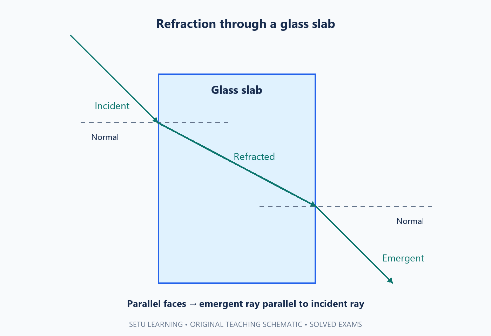

## 323. Ecosystem components।

**स्रोत:** 2015 मुख्य, प्रश्न 25(a), PDF पृष्ठ 5 · **अंक:** 3 अंक

**अध्याय-संबंध:** हमारा पर्यावरण

**हल:** Biotic: plants, animals, microbes। Abiotic: light, water, temperature, soil conditions। इनके interactions ecosystem बनाते हैं। उदाहरण pond में algae producer और organisms consumers हैं; decomposers nutrient recycling करते हैं।

[मूल प्रश्न देखें](https://rajeduboard.rajasthan.gov.in/books/PAPERS-2015/Sec/S-07-Science-15.pdf#page=5)

## 324. Room-temperature liquid metal।

**स्रोत:** 2015 मुख्य, प्रश्न 26(a), PDF पृष्ठ 5 · **अंक:** 1 अंक

**अध्याय-संबंध:** धातु एवं अधातु

**हल:** Mercury सामान्य room temperature पर liquid metal है। इसका अर्थ सभी metals liquid हैं या liquid पदार्थ metal ही है, ऐसा नहीं।

[मूल प्रश्न देखें](https://rajeduboard.rajasthan.gov.in/books/PAPERS-2015/Sec/S-07-Science-15.pdf#page=5)

## 325. MgCl₂ का electron transfer।

**स्रोत:** 2015 मुख्य, प्रश्न 26(b,c), PDF पृष्ठ 5 · **अंक:** 4 अंक

**अध्याय-संबंध:** धातु एवं अधातु

**हल:** Mg configuration 2,8,2 और Cl 2,8,7 है। Mg दो electrons खोकर Mg²⁺, दो Cl एक-एक लेकर Cl⁻ बनाते हैं। +2 तथा 2×−1 charges balance से MgCl₂ ionic lattice बनता है।

[मूल प्रश्न देखें](https://rajeduboard.rajasthan.gov.in/books/PAPERS-2015/Sec/S-07-Science-15.pdf#page=5)

## 326. Conductor force direction rule।

**स्रोत:** 2015 मुख्य, प्रश्न 27(a), PDF पृष्ठ 5 · **अंक:** 2 अंक

**अध्याय-संबंध:** विद्युत धारा के चुंबकीय प्रभाव

**हल:** Left-hand thumb, forefinger और middle finger mutually perpendicular रखें। Forefinger B, middle conventional I तथा thumb force/motion देता है। Current या field अकेला reverse हो तो force reverse होता है।

[मूल प्रश्न देखें](https://rajeduboard.rajasthan.gov.in/books/PAPERS-2015/Sec/S-07-Science-15.pdf#page=5)

## 327. Double circulation की आवश्यकता।

**स्रोत:** 2015 मुख्य, प्रश्न 28(b), प्रथम विकल्प, PDF पृष्ठ 6 · **अंक:** 2 अंक

**अध्याय-संबंध:** जैव प्रक्रम

**हल:** Body → right atrium/ventricle → lungs → left atrium/ventricle → body। Pulmonary तथा systemic circuits में blood heart से twice passes; चार chambers mixing घटाते और oxygen delivery कुशल करते हैं।

[मूल प्रश्न देखें](https://rajeduboard.rajasthan.gov.in/books/PAPERS-2015/Sec/S-07-Science-15.pdf#page=6)

## 328. Fat digestion और saliva।

**स्रोत:** 2015 मुख्य, प्रश्न 28(b,c), दूसरा विकल्प, PDF पृष्ठ 6 · **अंक:** 3 अंक

**अध्याय-संबंध:** जैव प्रक्रम

**हल:** Salivary amylase starch digestion शुरू करता है। Bile liver में बनता है; fat emulsification तथा intestinal medium में मदद करता है, digestive enzyme नहीं। Small intestine में fat digestion और absorption प्रमुख हैं।

[मूल प्रश्न देखें](https://rajeduboard.rajasthan.gov.in/books/PAPERS-2015/Sec/S-07-Science-15.pdf#page=6)

## 329. Wire resistance तथा resistivity।

**स्रोत:** 2015 मुख्य, प्रश्न 29(a), प्रथम विकल्प, PDF पृष्ठ 6 · **अंक:** 2.5 अंक

**अध्याय-संबंध:** विद्युत

**हल:** R=ρl/A: length, cross-section, material तथा temperature matter करते हैं। ρ=RA/l, unit Ω·m। Same material/temperature में geometry बदलने से R बदलता है, intrinsic resistivity नहीं।

[मूल प्रश्न देखें](https://rajeduboard.rajasthan.gov.in/books/PAPERS-2015/Sec/S-07-Science-15.pdf#page=6)

## 330. Homologous series के तीन गुण।

**स्रोत:** 2015 मुख्य, प्रश्न 30(a), प्रथम विकल्प, PDF पृष्ठ 7 · **अंक:** 3 अंक

**अध्याय-संबंध:** कार्बन एवं उसके यौगिक

**हल:** Same functional group/general formula; successive members differ by CH₂ (14 u)। Similar chemical properties और gradual physical-property changes होते हैं। Ethane के अगले homologues propane C₃H₈ तथा butane C₄H₁₀ हैं।

[मूल प्रश्न देखें](https://rajeduboard.rajasthan.gov.in/books/PAPERS-2015/Sec/S-07-Science-15.pdf#page=7)

## 331. 5 A fuse, 100 W bulbs संख्या।

**स्रोत:** 2015 मुख्य, प्रश्न 7, PDF पृष्ठ 3 · **अंक:** 1 अंक

**अध्याय-संबंध:** विद्युत

**हल:** School ideal rating: maximum power VI=220×5=1100 W। Each bulb 100 W, इसलिए 1100/100=11 bulbs। Real circuit design में safety margins/inrush/अन्य loads जाँचे जाते हैं; इसे installation instruction न मानें।

[मूल प्रश्न देखें](https://rajeduboard.rajasthan.gov.in/books/PAPERS-2015/Sec/S-07-Science-15.pdf#page=3)

## 332. 0.25 A, 20 min: charge।

**स्रोत:** 2015 मुख्य, प्रश्न 13, PDF पृष्ठ 3 · **अंक:** 2 अंक

**अध्याय-संबंध:** विद्युत

**हल:** I=0.25 A; t=20 min=1200 s। Q=It=0.25×1200=300 C। Electric charge unit coulomb है, ampere-hour को बिना conversion न लिखें।

[मूल प्रश्न देखें](https://rajeduboard.rajasthan.gov.in/books/PAPERS-2015/Sec/S-07-Science-15.pdf#page=3)

## 333. 840 W, 220 V: I,R।

**स्रोत:** 2015 मुख्य, प्रश्न 29(b), दूसरा विकल्प, PDF पृष्ठ 7 · **अंक:** 2.5 अंक

**अध्याय-संबंध:** विद्युत

**हल:** P=840 W,V=220 V। I=P/V=42/11≈3.82 A। R=V²/P=48400/840=1210/21≈57.62 Ω। P=VI तथा V/I से दो checks करें।

[मूल प्रश्न देखें](https://rajeduboard.rajasthan.gov.in/books/PAPERS-2015/Sec/S-07-Science-15.pdf#page=7)

## 2014 — मुख्य परीक्षा

[2014 मुख्य: पूरा आधिकारिक प्रश्न-पत्र](https://rajeduboard.rajasthan.gov.in/books/PAPERS-2014/Sec/S-07-Science-14.pdf)

## 334. उदासीन विलयन का pH।

**स्रोत:** 2014 मुख्य, प्रश्न 2, PDF पृष्ठ 2 · **अंक:** 1 अंक

**अध्याय-संबंध:** अम्ल, क्षारक एवं लवण

**हल:** लगभग 25°C पर उदासीन जलीय विलयन का pH 7 होता है। इसमें H₃O⁺ और OH⁻ की concentrations समान होती हैं।

[मूल प्रश्न देखें](https://rajeduboard.rajasthan.gov.in/books/PAPERS-2014/Sec/S-07-Science-14.pdf#page=2)

## 335. चींटी के डंक का अम्ल।

**स्रोत:** 2014 मुख्य, प्रश्न 3, PDF पृष्ठ 2 · **अंक:** 1 अंक

**अध्याय-संबंध:** अम्ल, क्षारक एवं लवण

**हल:** विद्यालयी उत्तर methanoic/formic acid, HCOOH है। अम्लीय प्रभाव को उपयुक्त क्षारक द्वारा neutralisation से समझा जाता है।

[मूल प्रश्न देखें](https://rajeduboard.rajasthan.gov.in/books/PAPERS-2014/Sec/S-07-Science-14.pdf#page=2)

## 336. Plasmodium का विखंडन।

**स्रोत:** 2014 मुख्य, प्रश्न 4, PDF पृष्ठ 3 · **अंक:** 1 अंक

**अध्याय-संबंध:** जीव जनन कैसे करते हैं?

**हल:** Plasmodium में multiple fission: एक parent cell से अनेक daughter cells बन सकते हैं। Binary fission में केवल दो बनते हैं।

[मूल प्रश्न देखें](https://rajeduboard.rajasthan.gov.in/books/PAPERS-2014/Sec/S-07-Science-14.pdf#page=3)

## 337. ओजोन गिरावट का प्रमुख कारण।

**स्रोत:** 2014 मुख्य, प्रश्न 5, PDF पृष्ठ 3 · **अंक:** 1 अंक

**अध्याय-संबंध:** हमारा पर्यावरण

**हल:** CFCs जैसे ozone-depleting substances से stratosphere में chlorine-related catalytic reactions ozone घटा सकती हैं। इससे UV shielding कम होती है; यह greenhouse warming का समानार्थी नहीं।

[मूल प्रश्न देखें](https://rajeduboard.rajasthan.gov.in/books/PAPERS-2014/Sec/S-07-Science-14.pdf#page=3)

## 338. एक socket पर बहुत उपकरण।

**स्रोत:** 2014 मुख्य, प्रश्न 7, PDF पृष्ठ 3 · **अंक:** 1 अंक

**अध्याय-संबंध:** विद्युत धारा के चुंबकीय प्रभाव

**हल:** एक socket/circuit पर बहुत appliances से total current rating से अधिक हो सकता है: overloading। I²R heating बढ़ सकती है। Load rating मानें और suitable protective devices रखें; एक socket में high-power loads न जोड़ें।

[मूल प्रश्न देखें](https://rajeduboard.rajasthan.gov.in/books/PAPERS-2014/Sec/S-07-Science-14.pdf#page=3)

## 339. एक redox उदाहरण।

**स्रोत:** 2014 मुख्य, प्रश्न 9(a), PDF पृष्ठ 4 · **अंक:** 1 अंक

**अध्याय-संबंध:** रासायनिक अभिक्रियाएँ एवं समीकरण

**हल:** CuO + H₂ → Cu + H₂O में H₂ oxygen पाकर oxidised, CuO oxygen खोकर reduced है। Oxidation तथा reduction एक साथ होना redox है; दूसरा उदाहरण ZnO + C → Zn + CO है।

[मूल प्रश्न देखें](https://rajeduboard.rajasthan.gov.in/books/PAPERS-2014/Sec/S-07-Science-14.pdf#page=4)

## 340. जल विद्युत-अपघटन का विन्यास।

**स्रोत:** 2014 मुख्य, प्रश्न 9(b), PDF पृष्ठ 4 · **अंक:** 1 अंक

**अध्याय-संबंध:** रासायनिक अभिक्रियाएँ एवं समीकरण

**हल:** 2H₂O → 2H₂ + O₂, electrical energy की उपस्थिति में। Diagram में electrolyte युक्त water, दो electrodes, DC source, cathode पर H₂ और anode पर O₂ दिखाएँ; समान परिस्थितियों में gas volumes 2:1 हैं।

[मूल प्रश्न देखें](https://rajeduboard.rajasthan.gov.in/books/PAPERS-2014/Sec/S-07-Science-14.pdf#page=4)

चित्र सहायता: इसी अध्याय में इस अवधारणा का पहले दिया नामांकित schematic देखें।

## 341. Photosynthesis के दो events।

**स्रोत:** 2014 मुख्य, प्रश्न 11, PDF पृष्ठ 4 · **अंक:** 2 अंक

**अध्याय-संबंध:** जैव प्रक्रम

**हल:** Light/chlorophyll energy absorb करते हैं; water से oxygen liberation तथा CO₂ का carbohydrate में reduction होता है। Simplified equation 6CO₂ + 6H₂O → C₆H₁₂O₆ + 6O₂ है; light/chlorophyll condition लिखें।

[मूल प्रश्न देखें](https://rajeduboard.rajasthan.gov.in/books/PAPERS-2014/Sec/S-07-Science-14.pdf#page=4)

## 342. कायिक जनन और लाभ।

**स्रोत:** 2014 मुख्य, प्रश्न 13, PDF पृष्ठ 4 · **अंक:** 2 अंक

**अध्याय-संबंध:** जीव जनन कैसे करते हैं?

**हल:** Root, stem अथवा leaf के vegetative parts से नए plants बनाना vegetative propagation है। Potato stem buds और Bryophyllum leaf buds उदाहरण हैं। Seed-less plants को बढ़ाने और useful traits बनाए रखने में उपयोगी है।

[मूल प्रश्न देखें](https://rajeduboard.rajasthan.gov.in/books/PAPERS-2014/Sec/S-07-Science-14.pdf#page=4)

## 343. Astronaut को dark sky क्यों?

**स्रोत:** 2014 मुख्य, प्रश्न 14(i), PDF पृष्ठ 4 · **अंक:** 1 अंक

**अध्याय-संबंध:** मानव नेत्र तथा रंगबिरंगा संसार

**हल:** Atmosphere न होने या अत्यल्प होने पर sunlight का scattering पर्याप्त नहीं होता। इसलिए atmosphere से बाहर astronaut को सूर्य चमकने के बावजूद background sky dark दिखाई देता है।

[मूल प्रश्न देखें](https://rajeduboard.rajasthan.gov.in/books/PAPERS-2014/Sec/S-07-Science-14.pdf#page=4)

## 344. Pupil का नियंत्रण।

**स्रोत:** 2014 मुख्य, प्रश्न 14(ii), PDF पृष्ठ 4 · **अंक:** 1 अंक

**अध्याय-संबंध:** मानव नेत्र तथा रंगबिरंगा संसार

**हल:** Iris की muscles pupil opening का size नियंत्रित करती हैं। Lens की curvature ciliary muscles बदलती हैं; light entry और accommodation के mechanisms अलग हैं।

[मूल प्रश्न देखें](https://rajeduboard.rajasthan.gov.in/books/PAPERS-2014/Sec/S-07-Science-14.pdf#page=4)

## 345. Zn–NaOH गैस और समीकरण।

**स्रोत:** 2014 मुख्य, प्रश्न 15(a), PDF पृष्ठ 5 · **अंक:** 1 अंक

**अध्याय-संबंध:** अम्ल, क्षारक एवं लवण

**हल:** Hydrogen निकलती है। विद्यालयी समीकरण: Zn + 2NaOH → Na₂ZnO₂ + H₂। Aqueous complex formulation में zincate को hydroxo-complex से भी लिखा जाता है; prescribed school representation का उपयोग करें।

[मूल प्रश्न देखें](https://rajeduboard.rajasthan.gov.in/books/PAPERS-2014/Sec/S-07-Science-14.pdf#page=5)

## 346. चार दैनिक उपयोग के रसायन।

**स्रोत:** 2014 मुख्य, प्रश्न 15(b), PDF पृष्ठ 5 · **अंक:** 2 अंक

**अध्याय-संबंध:** अम्ल, क्षारक एवं लवण

**हल:** Germ-free water के लिए bleaching powder, baking के लिए NaHCO₃, स्थायी कठोरता घटाने के लिए washing soda और moulds/toys के लिए POP। क्रमशः CaOCl₂, NaHCO₃, Na₂CO₃·10H₂O और CaSO₄·½H₂O लिखें।

[मूल प्रश्न देखें](https://rajeduboard.rajasthan.gov.in/books/PAPERS-2014/Sec/S-07-Science-14.pdf#page=5)

## 347. विस्थापन की परिभाषा।

**स्रोत:** 2014 मुख्य, प्रश्न 16(a), PDF पृष्ठ 5 · **अंक:** 1 अंक

**अध्याय-संबंध:** रासायनिक अभिक्रियाएँ एवं समीकरण

**हल:** अधिक active element कम active को compound से हटाता है। Zn + CuSO₄ → ZnSO₄ + Cu उदाहरण है; zinc copper से अधिक active है।

[मूल प्रश्न देखें](https://rajeduboard.rajasthan.gov.in/books/PAPERS-2014/Sec/S-07-Science-14.pdf#page=5)

## 348. Zn–CuSO₄ में missing product।

**स्रोत:** 2014 मुख्य, प्रश्न 16(b)(i), PDF पृष्ठ 5 · **अंक:** 1 अंक

**अध्याय-संबंध:** रासायनिक अभिक्रियाएँ एवं समीकरण

**हल:** ZnSO₄ बनता है: Zn + CuSO₄ → ZnSO₄ + Cu। यह displacement तथा redox दोनों है; Cu²⁺ reduced और zinc oxidised होता है।

[मूल प्रश्न देखें](https://rajeduboard.rajasthan.gov.in/books/PAPERS-2014/Sec/S-07-Science-14.pdf#page=5)

## 349. Na₂SO₄–BaCl₂ का precipitate।

**स्रोत:** 2014 मुख्य, प्रश्न 16(b)(ii), PDF पृष्ठ 5 · **अंक:** 1 अंक

**अध्याय-संबंध:** रासायनिक अभिक्रियाएँ एवं समीकरण

**हल:** BaSO₄ सफेद insoluble precipitate है: Na₂SO₄ + BaCl₂ → BaSO₄↓ + 2NaCl। यह double displacement तथा precipitation है।

[मूल प्रश्न देखें](https://rajeduboard.rajasthan.gov.in/books/PAPERS-2014/Sec/S-07-Science-14.pdf#page=5)

## 350. कृत्रिम वृक्क का उपयोग।

**स्रोत:** 2014 मुख्य, प्रश्न 18, PDF पृष्ठ 6 · **अंक:** 3 अंक

**अध्याय-संबंध:** जैव प्रक्रम

**हल:** Haemodialysis में blood semipermeable interface के across dialysing fluid से संपर्क करता है और wastes/अतिरिक्त solutes हटाए जा सकते हैं। Kidney failure में clinical use है; यह kidney के सभी functions का पूर्ण replacement नहीं।

[मूल प्रश्न देखें](https://rajeduboard.rajasthan.gov.in/books/PAPERS-2014/Sec/S-07-Science-14.pdf#page=6)

## 351. Hydra budding की अवस्थाएँ।

**स्रोत:** 2014 मुख्य, प्रश्न 19, PDF पृष्ठ 6 · **अंक:** 3 अंक

**अध्याय-संबंध:** जीव जनन कैसे करते हैं?

**हल:** Hydra में repeated cell division से body wall पर bud निकलता है, mouth/tentacles बनते हैं और mature bud अलग individual हो सकता है। Diagram में parent, bud, tentacles और detachment stages label करें।

[मूल प्रश्न देखें](https://rajeduboard.rajasthan.gov.in/books/PAPERS-2014/Sec/S-07-Science-14.pdf#page=6)

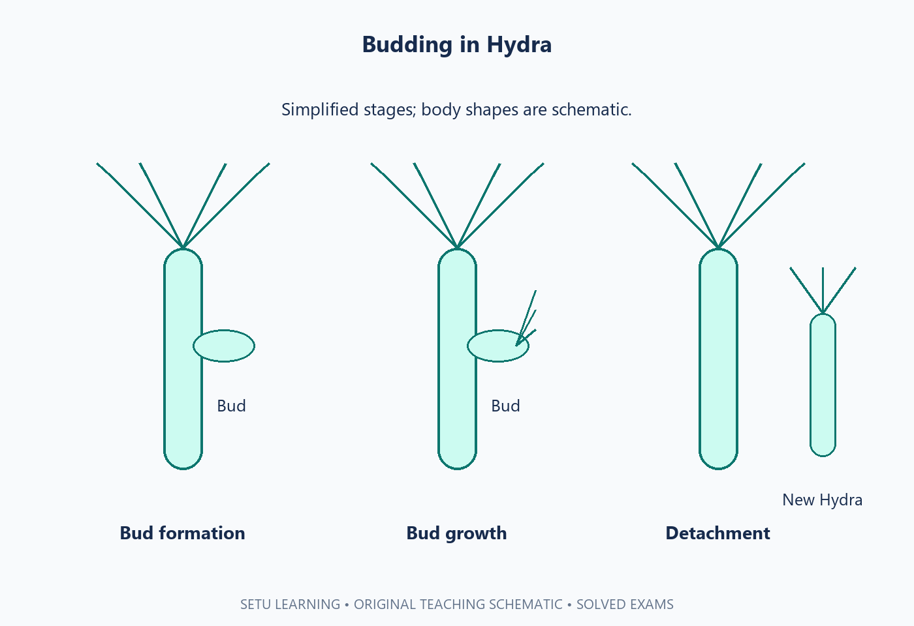

## 352. पर्यावरण के तीन R।

**स्रोत:** 2014 मुख्य, प्रश्न 21, PDF पृष्ठ 7 · **अंक:** 3 अंक

**अध्याय-संबंध:** हमारा पर्यावरण

**हल:** Reduce: unnecessary consumption/waste घटाएँ। Reuse: वस्तु फिर उपयोग करें। Recycle: waste material से उपयोगी material बनाएं। उदाहरण bottle reuse, कम packaging और separated paper recycling हैं।

[मूल प्रश्न देखें](https://rajeduboard.rajasthan.gov.in/books/PAPERS-2014/Sec/S-07-Science-14.pdf#page=7)

## 353. Concave focus, convex उपयोग।

**स्रोत:** 2014 मुख्य, प्रश्न 22, PDF पृष्ठ 7 · **अंक:** 3 अंक

**अध्याय-संबंध:** प्रकाश: परावर्तन तथा अपवर्तन

**हल:** Concave mirror पर principal axis के parallel paraxial rays reflect होकर principal focus पर मिलती हैं। Convex mirrors rear-view तथा wide-angle security viewing में useful हैं; virtual erect diminished image देते हैं।

[मूल प्रश्न देखें](https://rajeduboard.rajasthan.gov.in/books/PAPERS-2014/Sec/S-07-Science-14.pdf#page=7)

## 354. Ohm नियम तथा verification।

**स्रोत:** 2014 मुख्य, प्रश्न 23, PDF पृष्ठ 7 · **अंक:** 3 अंक

**अध्याय-संबंध:** विद्युत

**हल:** स्थिर temperature/physical conditions में V ∝ I, इसलिए V=IR। Low-voltage circuit में ammeter series, voltmeter resistor के parallel; कई V,I readings में V/I लगभग constant और V-vertical/I-horizontal graph straight line होता है।

[मूल प्रश्न देखें](https://rajeduboard.rajasthan.gov.in/books/PAPERS-2014/Sec/S-07-Science-14.pdf#page=7)

चित्र सहायता: इसी अध्याय में इस अवधारणा का पहले दिया नामांकित schematic देखें।

## 355. Amphoteric oxide का उदाहरण।

**स्रोत:** 2014 मुख्य, प्रश्न 25(b), PDF पृष्ठ 8 · **अंक:** 2 अंक

**अध्याय-संबंध:** धातु एवं अधातु

**हल:** Amphoteric oxides acids और bases दोनों से reaction करते हैं। Al₂O₃ तथा ZnO उदाहरण हैं। केवल सभी metal oxides acidic या सभी केवल basic लिखना उचित नहीं।

[मूल प्रश्न देखें](https://rajeduboard.rajasthan.gov.in/books/PAPERS-2014/Sec/S-07-Science-14.pdf#page=8)

## 356. Brass के घटक।

**स्रोत:** 2014 मुख्य, प्रश्न 25(c), PDF पृष्ठ 8 · **अंक:** 1 अंक

**अध्याय-संबंध:** धातु एवं अधातु

**हल:** Brass copper और zinc की alloy है। Bronze copper–tin है; इन दोनों मिश्रधातुओं के घटक अलग हैं।

[मूल प्रश्न देखें](https://rajeduboard.rajasthan.gov.in/books/PAPERS-2014/Sec/S-07-Science-14.pdf#page=8)

## 357. Food chain और energy flow।

**स्रोत:** 2014 मुख्य, प्रश्न 26, PDF पृष्ठ 8 · **अंक:** 5 अंक

**अध्याय-संबंध:** हमारा पर्यावरण

**हल:** Food chain organisms के बीच feeding/energy transfer दिखाती है: grass → grasshopper → frog → snake। Solar energy producer से consumers तक जाती है और हर step में heat/metabolism से घटती है; लगभग 10% transfer school model है। Nutrients cycle कर सकते हैं, energy flow one-way है।

[मूल प्रश्न देखें](https://rajeduboard.rajasthan.gov.in/books/PAPERS-2014/Sec/S-07-Science-14.pdf#page=8)

चित्र सहायता: इसी अध्याय में इस अवधारणा का पहले दिया नामांकित schematic देखें।

## 358. Covalent bond का अर्थ।

**स्रोत:** 2014 मुख्य, प्रश्न 28(a), PDF पृष्ठ 9 · **अंक:** 1 अंक

**अध्याय-संबंध:** कार्बन एवं उसके यौगिक

**हल:** Covalent bond electron pair के sharing से बनता है। CH₄ में चार C–H single bonds और ethene में C=C double bond है। Electron-dot diagram में हर shared pair दिखाएँ; ionic electron transfer की तरह पूर्ण charge formation न दिखाएँ।

[मूल प्रश्न देखें](https://rajeduboard.rajasthan.gov.in/books/PAPERS-2014/Sec/S-07-Science-14.pdf#page=9)

## 359. Normal incidence में दिशा।

**स्रोत:** 2014 मुख्य, प्रश्न 30(c), PDF पृष्ठ 11 · **अंक:** 1 अंक

**अध्याय-संबंध:** प्रकाश: परावर्तन तथा अपवर्तन

**हल:** Normal incidence पर ray की direction सामान्यतः unchanged रहती है, लेकिन medium बदलने से speed और wavelength बदल सकते हैं। Frequency interface पार करते समय unchanged रहती है।

[मूल प्रश्न देखें](https://rajeduboard.rajasthan.gov.in/books/PAPERS-2014/Sec/S-07-Science-14.pdf#page=11)

## 360. 300 C, 5 min: current।

**स्रोत:** 2014 मुख्य, प्रश्न 8, PDF पृष्ठ 3 · **अंक:** 1 अंक

**अध्याय-संबंध:** विद्युत

**हल:** Q=300 C; t=5 min=300 s। I=Q/t=300/300=1 A। Minute को second में बदले बिना 60 A निकालना गलत है।

[मूल प्रश्न देखें](https://rajeduboard.rajasthan.gov.in/books/PAPERS-2014/Sec/S-07-Science-14.pdf#page=3)

## 361. 60 W+40 W, 220 V: total I।

**स्रोत:** 2014 मुख्य, प्रश्न 24, PDF पृष्ठ 7 · **अंक:** 3 अंक

**अध्याय-संबंध:** विद्युत

**हल:** दोनों rated bulbs 220 V पर parallel: total P=60+40=100 W। I=P/V=100/220=5/11 A≈0.455 A। यह total current है, किसी एक bulb का नहीं।

[मूल प्रश्न देखें](https://rajeduboard.rajasthan.gov.in/books/PAPERS-2014/Sec/S-07-Science-14.pdf#page=7)

## PYQ आधारित पुनरावृत्ति क्विज़ — 18 प्रश्न

वर्ष-संदर्भ वास्तविक हैं। नीचे प्रश्न-सार और distractor विकल्प लेखक द्वारा पुनर्गठित हैं; इन्हें मूल पेपर के option letters का पुनर्मुद्रण न मानें।

**क्विज़ 1. [2026 मुख्य, Q 1(i)] Sugar-regulating endocrine gland।**

अ) Pancreas  
ब) Thyroid  
स) Pituitary  
द) Adrenal  

**उत्तर: अ — Pancreas।** Pancreas insulin सहित hormones से blood glucose regulation में भूमिका निभाता है। Thyroid metabolism और adrenal acute-stress responses से अलग हैं। स्रोत: प्रश्न 1(i), PDF पृष्ठ 2।

**क्विज़ 2. [2026 पूरक, Q 1(ii)] Budding से नया organism।**

अ) Amoeba  
ब) Spirogyra  
स) Rhizopus  
द) Hydra  

**उत्तर: द — Hydra।** Hydra budding से asexual reproduction करता है; parent body पर outgrowth mature होकर नया individual बनता है। स्रोत: प्रश्न 1(ii), PDF पृष्ठ 3।

**क्विज़ 3. [2025 मुख्य, Q 1(v)] Monohybrid F₂ genotype ratio।**

अ) 1:1  
ब) 9:3:3:1  
स) 1:2:1  
द) 3:1  

**उत्तर: स — 1:2:1।** Tt×Tt से TT,Tt,Tt,tt; expected genotype ratio 1:2:1। Complete dominance का phenotype ratio 3:1 है। दोनों को swap न करें। स्रोत: प्रश्न 1(v), PDF पृष्ठ 3।

**क्विज़ 4. [2025 पूरक, Q 1(x)] 24 J/2 C: voltage।**

अ) 48 V  
ब) 12 V  
स) 6 V  
द) 24 V  

**उत्तर: ब — 12 V।** Work 24 J तथा charge 2 C। V=W/Q=24/2=12 V। Volt joule प्रति coulomb है। स्रोत: प्रश्न 1(x), PDF पृष्ठ 5।

**क्विज़ 5. [2024 मुख्य, Q 1(x)] 3 m mirror distance: image separation।**

अ) 6 m  
ब) 3 m  
स) 1.5 m  
द) 9 m  

**उत्तर: अ — 6 m।** Object mirror से 3 m, virtual image mirror के पीछे 3 m। Object–image separation=3+3=6 m। Mirror से image distance और object से image distance अलग हैं। स्रोत: प्रश्न 1(x), PDF पृष्ठ 5।

**क्विज़ 6. [2024 पूरक, Q 1(x)] 5 m mirror distance: separation।**

अ) 5 m  
ब) 2.5 m  
स) 20 m  
द) 10 m  

**उत्तर: द — 10 m।** Object plane mirror से 5 m, image पीछे 5 m। Total object–image distance 10 m। Plane mirror magnification +1, size same है। स्रोत: प्रश्न 1(x), PDF पृष्ठ 4।

**क्विज़ 7. [2023 मुख्य, Q 1(ii)] Posture/balance का brain भाग।**

अ) Cerebrum  
ब) Spinal cord  
स) Cerebellum  
द) Medulla  

**उत्तर: स — Cerebellum।** Cerebellum posture, balance तथा precise movement में मदद करता है। Walking straight/riding bicycle coordination के ऐसे examples हैं। स्रोत: प्रश्न 1(ii), PDF पृष्ठ 2।

**क्विज़ 8. [2022 मुख्य, Q 1(ix)] n=1.33: water में light speed।**

अ) 3.99×10⁸ m/s  
ब) लगभग 2.26×10⁸ m/s  
स) 3×10⁸ m/s  
द) 1.33×10⁸ m/s  

**उत्तर: ब — लगभग 2.26×10⁸ m/s।** n=1.33,c≈3×10⁸ m/s। v=c/n≈2.26×10⁸ m/s। Medium में speed कम है; n को c से multiply करना गलत। स्रोत: प्रश्न 1(ix), PDF पृष्ठ 5।

**क्विज़ 9. [2020 मुख्य, Q 25] 220 V,0.5 A: R और P।**

अ) 440 Ω; 110 W  
ब) 110 Ω; 440 W  
स) 220 Ω; 220 W  
द) 440 Ω; 55 W  

**उत्तर: अ — 440 Ω; 110 W।** V=220 V,I=0.5 A। P=VI=110 W। यदि resistance भी चाहिए तो R=V/I=440 Ω। स्रोत: प्रश्न 25, PDF पृष्ठ 8।

**क्विज़ 10. [2020 पूरक, Q 25(b)] 6 V,30 Ω,1 h: heat।**

अ) 120 J  
ब) 72 J  
स) 3600 J  
द) 4320 J  

**उत्तर: द — 4320 J।** V=6 V,R=30 Ω,t=1 h=3600 s। H=V²t/R=36×3600/30=4320 J। Current 0.2 A है; hour को second में बदलें। स्रोत: प्रश्न 25(b), PDF पृष्ठ 8।

**क्विज़ 11. [2019 मुख्य, Q 20(b)] Marsh gas structure।**

अ) C₂H₄  
ब) C₂H₂  
स) CH₄  
द) C₂H₆  

**उत्तर: स — CH₄।** Marsh gas methane CH₄ है। Structural diagram में central C से चार H single bonds लगाएँ; electron-dot form में चार shared pairs। इसे CH₃ radical या ethene न लिखें। स्रोत: प्रश्न 20(b), PDF पृष्ठ 7।

**क्विज़ 12. [2018 मुख्य, Q 25(b)] 12 V,25 Ω,15 min: heat।**

अ) 25 J  
ब) 5184 J  
स) 144 J  
द) 129600 J  

**उत्तर: ब — 5184 J।** V=12 V,R=25 Ω,t=15 min=900 s। H=V²t/R=144×900/25=5184 J। I=0.48 A लेकर I²Rt से भी यही result। स्रोत: प्रश्न 25(b), PDF पृष्ठ 8।

**क्विज़ 13. [2018 पूरक, Q 25(b)] 4 mA,0.05 s: charge।**

अ) 2×10⁻⁴ C  
ब) 2×10⁻³ C  
स) 0.2 C  
द) 200 C  

**उत्तर: अ — 2×10⁻⁴ C।** 4 mA=0.004 A,t=0.05 s। Q=It=0.0002 C=2×10⁻⁴ C। Milli-prefix तथा decimal दोनों सही convert करें। स्रोत: प्रश्न 25(b), PDF पृष्ठ 8।

**क्विज़ 14. [2017 मुख्य, Q 24] 1 A, 30 s: charge।**

अ) 1 C  
ब) 30 A  
स) 0.033 C  
द) 30 C  

**उत्तर: द — 30 C।** I=1 A,t=30 s। Q=It=30 C। Current प्रति second charge flow है; I तथा Q अलग quantities हैं। स्रोत: प्रश्न 24, PDF पृष्ठ 8।

**क्विज़ 15. [2017 पूरक, Q 1] Copper–zinc alloy।**

अ) Steel  
ब) Solder  
स) Brass  
द) Bronze  

**उत्तर: स — Brass।** Brass copper और zinc की alloy है। Bronze copper–tin है; इन दोनों मिश्रधातुओं के घटक अलग हैं। स्रोत: प्रश्न 1, PDF पृष्ठ 2।

**क्विज़ 16. [2016 मुख्य, Q 24] 600 W fridge, 30 दिन: bill।**

अ) ₹57.60  
ब) ₹576  
स) ₹144  
द) ₹240  

**उत्तर: ब — ₹576।** P=600 W=0.6 kW; t=8×30=240 h। E=0.6×240=144 kWh। Rate ₹4/kWh पर charge ₹576; fixed fees/taxes शामिल नहीं। स्रोत: प्रश्न 24, PDF पृष्ठ 5।

**क्विज़ 17. [2015 मुख्य, Q 7] 5 A fuse, 100 W bulbs संख्या।**

अ) 11  
ब) 5  
स) 10  
द) 22  

**उत्तर: अ — 11।** School ideal rating: maximum power VI=220×5=1100 W। Each bulb 100 W, इसलिए 1100/100=11 bulbs। Real circuit design में safety margins/inrush/अन्य loads जाँचे जाते हैं; इसे installation instruction न मानें। स्रोत: प्रश्न 7, PDF पृष्ठ 3।

**क्विज़ 18. [2014 मुख्य, Q 8] 300 C, 5 min: current।**

अ) 60 A  
ब) 0.2 A  
स) 300 A  
द) 1 A  

**उत्तर: द — 1 A।** Q=300 C; t=5 min=300 s। I=Q/t=300/300=1 A। Minute को second में बदले बिना 60 A निकालना गलत है। स्रोत: प्रश्न 8, PDF पृष्ठ 3।

## अंतिम अभ्यास और आगे की कड़ी

किसी एक year का source paper खोलकर timer के साथ पूरा paper attempt करें। Selected solutions से covered parts check करें; unselected questions को इस bank के नाम पर solved न मानें। पुराने/removed topics को current syllabus से मिलाएँ। गलत उत्तरों को chemical equations, biology terms, optics signs और electrical units की चार lists में रखें।

**आगे की कड़ी:** मुख्य अध्याय 1–13 में कमजोर concept पर लौटें। यह अंतिम अभ्यास अध्याय है।
