# RBSE कक्षा 10 विज्ञान: अध्यायवार गाइड

**स्थिति:** प्रथम संपादकीय प्रारूप। 13 विषय-अध्याय और अंतिम solved-exam अध्याय शामिल हैं। संपूर्ण NCERT solutions तथा हर past paper के सभी प्रश्नों का दावा नहीं।

## विषय सूची

1. अध्याय 1: रासायनिक अभिक्रियाएँ एवं समीकरण (Chemical Reactions and Equations)
2. अध्याय 2: अम्ल, क्षारक एवं लवण (Acids, Bases and Salts)
3. अध्याय 3: धातु एवं अधातु (Metals and Non-metals)
4. अध्याय 4: कार्बन एवं उसके यौगिक (Carbon and its Compounds)
5. अध्याय 5: जैव प्रक्रम (Life Processes)
6. अध्याय 6: नियंत्रण एवं समन्वय (Control and Coordination)
7. अध्याय 7: जीव जनन कैसे करते हैं? (How do Organisms Reproduce?)
8. अध्याय 8: आनुवंशिकता (Heredity)
9. अध्याय 9: प्रकाश: परावर्तन तथा अपवर्तन (Light — Reflection and Refraction)
10. अध्याय 10: मानव नेत्र तथा रंगबिरंगा संसार (The Human Eye and the Colourful World)
11. अध्याय 11: विद्युत (Electricity)
12. अध्याय 12: विद्युत धारा के चुंबकीय प्रभाव (Magnetic Effects of Electric Current)
13. अध्याय 13: हमारा पर्यावरण (Our Environment)
14. अध्याय 14: पिछले वर्षों के हल किए परीक्षा प्रश्न

---

# अध्याय 1: रासायनिक अभिक्रियाएँ एवं समीकरण (Chemical Reactions and Equations)

## भाग 1: अध्याय प्रवेश एवं पाठ्यक्रम मैपिंग

> प्रथम संपादकीय प्रारूप। NCERT के सभी प्रश्नों के हल तथा पूरा ऐतिहासिक PYQ संग्रह अभी स्रोत-परीक्षण में हैं। सामान्य माध्यमिक 2026–27 पाठ्यक्रम की पुनः पुष्टि शेष है।

**विषय कोड:** 07 · **श्रृंखला पुस्तक:** 2

**सत्यापित आधार:** RBSE 2025–26 · **अध्याय भार:** 6 अंक। यह भार उसी संस्करण का है; वास्तविक प्रश्न-विभाजन की भविष्यवाणी नहीं।

**सीखने के लक्ष्य:** प्रेक्षण से रासायनिक परिवर्तन पहचानना; परमाणु गिनकर समीकरण संतुलित करना; अभिक्रियाओं का वर्गीकरण तथा दैनिक जीवन में ऑक्सीकरण समझना।

## भाग 2: शब्दावली एवं अवधारणा कैप्सूल

| शब्द / सूत्र | अर्थ / उपयोग |
|---|---|
| अभिकारक (Reactant) | अभिक्रिया में प्रारंभ में भाग लेने वाला पदार्थ। |
| उत्पाद (Product) | अभिक्रिया के बाद बनने वाला पदार्थ। |
| संतुलित समीकरण | दोनों पक्षों में प्रत्येक तत्व के परमाणुओं की संख्या समान। |
| संयोजन (Combination) | दो या अधिक पदार्थों से एक मुख्य उत्पाद बनना। |
| वियोजन (Decomposition) | एक यौगिक से दो या अधिक पदार्थ बनना। |
| विस्थापन (Displacement) | अधिक सक्रिय तत्व द्वारा कम सक्रिय तत्व को हटाना। |
| द्विविस्थापन | दो यौगिकों के आयनों का आदान-प्रदान। |
| उपचयन (Oxidation) | इस स्तर पर ऑक्सीजन जुड़ना या हाइड्रोजन हटना। |
| अपचयन (Reduction) | इस स्तर पर ऑक्सीजन हटना या हाइड्रोजन जुड़ना। |
| विकृतगंधिता (Rancidity) | वसा/तेल के ऑक्सीकरण से स्वाद और गंध बिगड़ना। |

## भाग 3: विस्तृत शिक्षण पाठ

### परिवर्तन से समीकरण तक
कागज काटने पर पदार्थ की पहचान कागज ही रहती है; जलाने पर नए पदार्थ बनते हैं। गैस निकलना, अवक्षेप, ताप या रंग में परिवर्तन अभिक्रिया का संकेत हो सकता है। अकेला संकेत निर्णायक नहीं: उबलते पानी में बुलबुले भौतिक परिवर्तन हैं। पदार्थ की पहचान बदलना मुख्य कसौटी है। मैग्नीशियम जलने पर सफेद मैग्नीशियम ऑक्साइड बनाता है: $2Mg + O_2 \rightarrow 2MgO$। प्रयोग शिक्षक की देखरेख में हो; जलती पट्टी को सीधे न देखें।

### संतुलन की विधि
पहले सही रासायनिक सूत्र लिखें। $Fe + H_2O \rightarrow Fe_3O_4 + H_2$ में Fe को 3, पानी को 4 और हाइड्रोजन को 4 का गुणांक दें। परिणाम $3Fe + 4H_2O \rightarrow Fe_3O_4 + 4H_2$ है; यहाँ जल भाप है। सूत्र का subscript बदलना पदार्थ बदल देता है। समीकरण में (s), (l), (g), (aq) अवस्था दिखाते हैं; तीर के ऊपर ताप, प्रकाश या उत्प्रेरक लिख सकते हैं। बंद व्यवस्था में द्रव्यमान संरक्षण संतुलन का आधार है।

### अभिक्रिया के प्रकार
बिना बुझा चूना पानी से बुझा चूना बनाता है: $CaO + H_2O \rightarrow Ca(OH)_2$; संयोजन और ऊष्माक्षेपी दोनों। $CaCO_3 \xrightarrow{heat} CaO + CO_2$ तापीय वियोजन है। जल के विद्युत अपघटन में हाइड्रोजन और ऑक्सीजन आयतन 2:1 होता है। $2AgCl \xrightarrow{sunlight} 2Ag + Cl_2$ प्रकाशीय वियोजन है। $Zn + CuSO_4 \rightarrow ZnSO_4 + Cu$ विस्थापन, जबकि $Na_2SO_4 + BaCl_2 \rightarrow BaSO_4\downarrow + 2NaCl$ द्विविस्थापन और अवक्षेपण है। वर्गीकरण परस्पर अनन्य नहीं है।

### Redox और जीवन
$CuO + H_2 \rightarrow Cu + H_2O$ में CuO ऑक्सीजन खोकर अपचयित, H₂ ऑक्सीजन पाकर उपचयित होता है। उपचायक दूसरे पदार्थ का उपचयन करता है और स्वयं अपचयित होता है। लोहे की जंग के लिए ऑक्सीजन तथा नमी दोनों महत्त्वपूर्ण हैं; जंग hydrated iron(III) oxide है, शुद्ध Fe₂O₃ मात्र नहीं। पेंट और जस्तीकरण संपर्क रोकते हैं। तेलयुक्त भोजन ठंडा रखना, वायुरुद्ध पैकिंग और nitrogen flushing विकृतगंधिता धीमी करते हैं; वे सभी सूक्ष्मजीवों को अनिवार्यतः समाप्त नहीं करते।

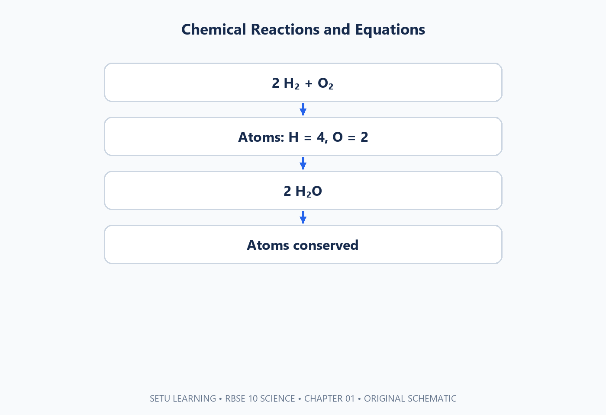

परमाणु-संरक्षण का सांकेतिक प्रवाह: संतुलित hydrogen–oxygen reaction; चित्र मात्रा-अनुपात दिखाता है, molecular geometry नहीं।

## भाग 4: पाठ्यपुस्तक-अवधारणाओं पर मौलिक हल किए उदाहरण

नीचे के प्रश्न लेखक के मौलिक मॉडल हैं। ये किसी NCERT edition के प्रश्न क्रमांक या संपूर्ण in-text/exercise solution bank होने का दावा नहीं करते।

**हल किया उदाहरण 1: Al + O₂ → Al₂O₃ संतुलित करें।**

O का LCM 6 लें: 3O₂ और 2Al₂O₃। अब Al दाईं ओर 4 हैं, अतः 4Al + 3O₂ → 2Al₂O₃। जाँच: Al 4–4, O 6–6।

**हल किया उदाहरण 2: CuO + H₂ में oxidising agent कौन है?**

CuO, क्योंकि वह H₂ को ऑक्सीजन देकर उसका उपचयन करता है। स्वयं CuO से ऑक्सीजन निकलकर Cu बनता है; इसलिए oxidising agent का स्वयं reduction होता है।

**हल किया उदाहरण 3: FeSO₄ गरम करने का समीकरण और प्रेक्षण दें।**

2FeSO₄ → Fe₂O₃ + SO₂ + SO₃। पहले hydrated salt का पानी निकलता है; आगे ताप पर भूरा oxide बनता है। Fe 2, S 2 और O 8 दोनों ओर हैं। यह तापीय वियोजन है।

## भाग 5: सत्यापित बोर्ड प्रश्न एवं स्रोत-स्थिति

2025, प्रश्न 1(xv), PDF पृष्ठ 6: PbO–carbon reaction में oxidation/reduction पहचान। उत्तर-संकेत: carbon का oxidation, PbO का reduction।

[RBSE 2025 मूल पेपर](https://rajeduboard.rajasthan.gov.in/books/PAPERS-2025/Sec/S-07.pdf)। प्रश्न का संक्षिप्त विषय-संदर्भ है; शब्दशः पुनर्मुद्रण नहीं।

## भाग 6: खंडवार मौलिक अभ्यास बैंक

**अभ्यास-अंक:** लेखक के स्व-अभ्यास के लिए हैं; RBSE की आधिकारिक marking scheme नहीं। उत्तर पहले स्वयं लिखें, फिर भाग 9 देखें।

## अ: बहुविकल्पीय प्रश्न — 15 × 1 अंक

**MCQ 1. 2Mg + O₂ → 2MgO का मुख्य वर्ग कौन-सा है?**

अ) वियोजन  
ब) द्विविस्थापन  
स) केवल भौतिक परिवर्तन  
द) संयोजन

**MCQ 2. संतुलन करते समय क्या बदलना चाहिए?**

अ) सूत्र के subscript  
ब) तत्व का नाम  
स) गुणांक  
द) परमाणु का प्रतीक

**MCQ 3. Zn + CuSO₄ में निकलने वाली धातु कौन-सी है?**

अ) Na  
ब) Cu  
स) Zn  
द) Fe

**MCQ 4. ताप से CaCO₃ टूटना कौन-सी अभिक्रिया है?**

अ) तापीय वियोजन  
ब) संयोजन  
स) उदासीनीकरण  
द) केवल विस्थापन

**MCQ 5. BaSO₄ अवक्षेप का रंग क्या है?**

अ) नीला  
ब) काला  
स) हरा  
द) सफेद

**MCQ 6. CuO + H₂ में अपचयित पदार्थ कौन है?**

अ) H₂O  
ब) दोनों अभिकारक  
स) CuO  
द) H₂

**MCQ 7. तेल की विकृतगंधिता मुख्यतः किससे जुड़ी है?**

अ) उर्ध्वपातन  
ब) ऑक्सीकरण  
स) संघनन  
द) जमना

**MCQ 8. जंग के लिए सामान्यतः क्या चाहिए?**

अ) ऑक्सीजन और नमी  
ब) केवल nitrogen  
स) केवल शुष्क CO₂  
द) केवल धूप

**MCQ 9. जल के विद्युत अपघटन में H₂:O₂ आयतन अनुपात क्या है?**

अ) 1:2  
ब) 1:1  
स) 3:1  
द) 2:1

**MCQ 10. CaO में पानी डालने पर ऊष्मा निकलना क्या दर्शाता है?**

अ) कोई अभिक्रिया नहीं  
ब) केवल वाष्पीकरण  
स) ऊष्माक्षेपी अभिक्रिया  
द) ऊष्माशोषी अभिक्रिया

**MCQ 11. AgCl प्रकाश में किस धातु को देता है?**

अ) Cu  
ब) Ag  
स) Al  
द) Mg

**MCQ 12. Fe + H₂O → Fe₃O₄ + H₂ में Fe का संतुलित गुणांक क्या है?**

अ) 3  
ब) 1  
स) 2  
द) 4

**MCQ 13. भोजन पैक में nitrogen क्यों भरी जाती है?**

अ) वसा को जलाने के लिए  
ब) नमी बढ़ाने के लिए  
स) भोजन को अम्ल बनाने के लिए  
द) ऑक्सीजन का संपर्क घटाने के लिए

**MCQ 14. द्विविस्थापन में मुख्यतः क्या बदलता है?**

अ) तत्व की पहचान  
ब) केवल ताप का संकेत  
स) आयनों के साथी  
द) परमाणुओं के नाभिक

**MCQ 15. गैस बुलबुले दिखना अकेले chemical change का प्रमाण क्यों नहीं?**

अ) गैसें प्रतिक्रिया नहीं करतीं  
ब) उबलते पानी में भी बुलबुले बनते हैं  
स) हर गैस hydrogen है  
द) हर बुलबुला ठोस है

## अ: रिक्त स्थान — 6 × 1 अंक

1. अभिक्रिया में प्रारंभ में भाग लेने वाला पदार्थ। — इस शब्द/सूत्र का नाम है: ____।  
2. अभिक्रिया के बाद बनने वाला पदार्थ। — इस शब्द/सूत्र का नाम है: ____।  
3. दोनों पक्षों में प्रत्येक तत्व के परमाणुओं की संख्या समान। — इस शब्द/सूत्र का नाम है: ____।  
4. दो या अधिक पदार्थों से एक मुख्य उत्पाद बनना। — इस शब्द/सूत्र का नाम है: ____।  
5. एक यौगिक से दो या अधिक पदार्थ बनना। — इस शब्द/सूत्र का नाम है: ____।  
6. अधिक सक्रिय तत्व द्वारा कम सक्रिय तत्व को हटाना। — इस शब्द/सूत्र का नाम है: ____।

## अ: अतिलघु उत्तर — 8 × 1 अंक

1. 2Mg + O₂ → 2MgO का मुख्य वर्ग कौन-सा है?  
2. संतुलन करते समय क्या बदलना चाहिए?  
3. Zn + CuSO₄ में निकलने वाली धातु कौन-सी है?  
4. ताप से CaCO₃ टूटना कौन-सी अभिक्रिया है?  
5. BaSO₄ अवक्षेप का रंग क्या है?  
6. CuO + H₂ में अपचयित पदार्थ कौन है?  
7. तेल की विकृतगंधिता मुख्यतः किससे जुड़ी है?  
8. जंग के लिए सामान्यतः क्या चाहिए?

## ब: लघु उत्तर — 6 × 2 अंक

**B1.** समीकरण संतुलित करना क्यों आवश्यक है?

**B2.** संयोजन और वियोजन में अंतर उदाहरण सहित दें।

**B3.** ऊष्माक्षेपी और ऊष्माशोषी में अंतर करें।

**B4.** लोहे को जंग से बचाने के दो उपाय समझाएँ।

**B5.** अवक्षेपण अभिक्रिया क्या है?

**B6.** विकृतगंधिता के दो निवारण क्यों प्रभावी हैं?

## स: दीर्घ उत्तर — 4 × 3 अंक

आंतरिक विकल्प अभ्यास: C1 अथवा C2, तथा C3 अथवा C4 चुनें। पुनरावृत्ति में बचा विकल्प भी हल करें। यह लेखक की अभ्यास व्यवस्था है।

**C1.** Zn + CuSO₄ के प्रयोग को तीन बिंदुओं में समझाएँ।

**C2.** जल के विद्युत अपघटन का वर्णन करें।

**C3.** AgCl की प्रकाशीय अभिक्रिया समझाएँ।

**C4.** CuO + H₂ में oxidation, reduction और agents बताएँ।

## द: विस्तृत उत्तर — 2 × 4 अंक

आंतरिक विकल्प अभ्यास: D1 अथवा D2 चुनें; बाद में दूसरा भी हल करें।

**D1.** एक छात्र H₂ + O₂ → H₂O₂ लिखकर पानी बनने का समीकरण संतुलित बताता है। त्रुटि, सही समीकरण और परमाणु-जाँच दें।

**D2.** भीगी लोहे की कील और खुले तेल के डिब्बे में परिवर्तन की तुलना तथा दो-दो बचाव बताएँ।

## भाग 7: सावधानियाँ एवं परीक्षा-त्रुटियाँ

- H₂O और H₂O₂ को एक पदार्थ न मानें।
- Oxidising agent स्वयं reduced होता है।
- अवक्षेप की अवस्था और तीर की शर्त लिखें।
- हर वियोजन को बिना शर्त ऊष्माशोषी न घोषित करें।
- तेल की विकृतगंधिता और धातु का संक्षारण अलग रखें।

## भाग 8: फटाफट पुनरावृत्ति — 25 बिंदु

1. अभिकारक (Reactant): अभिक्रिया में प्रारंभ में भाग लेने वाला पदार्थ।  
2. उत्पाद (Product): अभिक्रिया के बाद बनने वाला पदार्थ।  
3. संतुलित समीकरण: दोनों पक्षों में प्रत्येक तत्व के परमाणुओं की संख्या समान।  
4. संयोजन (Combination): दो या अधिक पदार्थों से एक मुख्य उत्पाद बनना।  
5. वियोजन (Decomposition): एक यौगिक से दो या अधिक पदार्थ बनना।  
6. विस्थापन (Displacement): अधिक सक्रिय तत्व द्वारा कम सक्रिय तत्व को हटाना।  
7. द्विविस्थापन: दो यौगिकों के आयनों का आदान-प्रदान।  
8. उपचयन (Oxidation): इस स्तर पर ऑक्सीजन जुड़ना या हाइड्रोजन हटना।  
9. अपचयन (Reduction): इस स्तर पर ऑक्सीजन हटना या हाइड्रोजन जुड़ना।  
10. विकृतगंधिता (Rancidity): वसा/तेल के ऑक्सीकरण से स्वाद और गंध बिगड़ना।  
11. दो अभिकारक मिलकर एक प्रकार का मुख्य उत्पाद MgO बनाते हैं।  
12. गुणांक पूरे अणु/सूत्र इकाई की संख्या बदलता है; subscript बदलने से पदार्थ बदल जाता है।  
13. Zinc copper से अधिक सक्रिय है और उसके लवण से copper विस्थापित करता है।  
14. एक यौगिक ताप के प्रभाव में CaO और CO₂ देता है।  
15. Barium sulfate जल में अत्यल्प विलेय सफेद ठोस है।  
16. CuO ऑक्सीजन खोकर Cu बनाता है; oxygen का हटना reduction है।  
17. तेल/वसा का oxidation गंध और स्वाद बदलने वाले उत्पाद बनाता है।  
18. नमी तथा oxygen की उपलब्धता लोहे के corrosion को बढ़ाती है।  
19. 2H₂O से 2H₂ और O₂ बनते हैं; समान दशाओं में आयतन अनुपात 2:1 है।  
20. CaO का hydration आसपास को ऊर्जा देता है और Ca(OH)₂ बनाता है।  
21. Silver chloride के photodecomposition में silver और chlorine बनते हैं।  
22. Fe₃O₄ में तीन iron atoms हैं; इसलिए बाईं ओर 3Fe चाहिए।  
23. Nitrogen flushing oxygen घटाकर वसा का oxidation धीमा करती है।  
24. दो ionic compounds आयनों का आदान-प्रदान करते हैं; नए उत्पाद बनते हैं।  
25. उबलना physical phase change है; नए पदार्थ बनने की जाँच भी चाहिए।

## भाग 9: संपूर्ण अभ्यास उत्तर-कुंजी

## MCQ: सही विकल्प और कारण

**1. द — संयोजन।** दो अभिकारक मिलकर एक प्रकार का मुख्य उत्पाद MgO बनाते हैं।

**2. स — गुणांक।** गुणांक पूरे अणु/सूत्र इकाई की संख्या बदलता है; subscript बदलने से पदार्थ बदल जाता है।

**3. ब — Cu।** Zinc copper से अधिक सक्रिय है और उसके लवण से copper विस्थापित करता है।

**4. अ — तापीय वियोजन।** एक यौगिक ताप के प्रभाव में CaO और CO₂ देता है।

**5. द — सफेद।** Barium sulfate जल में अत्यल्प विलेय सफेद ठोस है।

**6. स — CuO।** CuO ऑक्सीजन खोकर Cu बनाता है; oxygen का हटना reduction है।

**7. ब — ऑक्सीकरण।** तेल/वसा का oxidation गंध और स्वाद बदलने वाले उत्पाद बनाता है।

**8. अ — ऑक्सीजन और नमी।** नमी तथा oxygen की उपलब्धता लोहे के corrosion को बढ़ाती है।

**9. द — 2:1।** 2H₂O से 2H₂ और O₂ बनते हैं; समान दशाओं में आयतन अनुपात 2:1 है।

**10. स — ऊष्माक्षेपी अभिक्रिया।** CaO का hydration आसपास को ऊर्जा देता है और Ca(OH)₂ बनाता है।

**11. ब — Ag।** Silver chloride के photodecomposition में silver और chlorine बनते हैं।

**12. अ — 3।** Fe₃O₄ में तीन iron atoms हैं; इसलिए बाईं ओर 3Fe चाहिए।

**13. द — ऑक्सीजन का संपर्क घटाने के लिए।** Nitrogen flushing oxygen घटाकर वसा का oxidation धीमा करती है।

**14. स — आयनों के साथी।** दो ionic compounds आयनों का आदान-प्रदान करते हैं; नए उत्पाद बनते हैं।

**15. ब — उबलते पानी में भी बुलबुले बनते हैं।** उबलना physical phase change है; नए पदार्थ बनने की जाँच भी चाहिए।

**रिक्त स्थान:** 1. अभिकारक (Reactant); 2. उत्पाद (Product); 3. संतुलित समीकरण; 4. संयोजन (Combination); 5. वियोजन (Decomposition); 6. विस्थापन (Displacement)

**अतिलघु उत्तर:**

1. संयोजन। दो अभिकारक मिलकर एक प्रकार का मुख्य उत्पाद MgO बनाते हैं।

2. गुणांक। गुणांक पूरे अणु/सूत्र इकाई की संख्या बदलता है; subscript बदलने से पदार्थ बदल जाता है।

3. Cu। Zinc copper से अधिक सक्रिय है और उसके लवण से copper विस्थापित करता है।

4. तापीय वियोजन। एक यौगिक ताप के प्रभाव में CaO और CO₂ देता है।

5. सफेद। Barium sulfate जल में अत्यल्प विलेय सफेद ठोस है।

6. CuO। CuO ऑक्सीजन खोकर Cu बनाता है; oxygen का हटना reduction है।

7. ऑक्सीकरण। तेल/वसा का oxidation गंध और स्वाद बदलने वाले उत्पाद बनाता है।

8. ऑक्सीजन और नमी। नमी तथा oxygen की उपलब्धता लोहे के corrosion को बढ़ाती है।

**B1. समीकरण संतुलित करना क्यों आवश्यक है?**

अभिक्रिया में परमाणु नए नहीं बनते और नष्ट नहीं होते; केवल उनका पुनर्विन्यास होता है। दोनों पक्षों में हर तत्व की संख्या बराबर करना द्रव्यमान संरक्षण दर्शाता है। गुणांक बदलें, पदार्थ के सूत्र के subscript नहीं।

**B2. संयोजन और वियोजन में अंतर उदाहरण सहित दें।**

संयोजन में अनेक अभिकारक से एक मुख्य उत्पाद बनता है: CaO + H₂O → Ca(OH)₂। वियोजन में एक यौगिक कई पदार्थ देता है: CaCO₃ → CaO + CO₂। दूसरे उदाहरण के लिए ताप आवश्यक है।

**B3. ऊष्माक्षेपी और ऊष्माशोषी में अंतर करें।**

ऊष्माक्षेपी अभिक्रिया आसपास को ऊष्मा देती है, जैसे ईंधन का दहन। ऊष्माशोषी अभिक्रिया ऊर्जा ग्रहण करती है, जैसे CaCO₃ का तापीय वियोजन। ऊर्जा परिवर्तन और अभिकारक/उत्पाद की संख्या अलग वर्गीकरण हैं।

**B4. लोहे को जंग से बचाने के दो उपाय समझाएँ।**

पेंट की परत जल और ऑक्सीजन का संपर्क घटाती है। जस्तीकरण में zinc की परत लगती है; zinc लोहे से अधिक सक्रिय होने के कारण बलिदानी सुरक्षा भी देता है। सतह को सूखा रखने से भी जंग की गति घटती है।

**B5. अवक्षेपण अभिक्रिया क्या है?**

दो जलीय विलयनों से अघुलनशील ठोस बनना अवक्षेपण है। Na₂SO₄(aq) + BaCl₂(aq) → BaSO₄(s) + 2NaCl(aq)। सफेद BaSO₄ अवक्षेप है; पदार्थ की अवस्थाएँ पहचान के लिए लिखनी चाहिए।

**B6. विकृतगंधिता के दो निवारण क्यों प्रभावी हैं?**

वायुरुद्ध पैकिंग ऑक्सीजन का संपर्क घटाती है और refrigeration अभिक्रिया की गति कम करता है। दोनों उपाय वसा के ऑक्सीकरण को धीमा करते हैं। खराब भोजन को केवल गरम करके सुरक्षित मानना उचित निष्कर्ष नहीं।

**C1. Zn + CuSO₄ के प्रयोग को तीन बिंदुओं में समझाएँ।**

1. साफ zinc डालने पर copper का लाल-भूरा निक्षेप होता है। 2. Cu²⁺ कम होने से नीला रंग हल्का होता है। 3. Zn + CuSO₄ → ZnSO₄ + Cu; Zn अधिक सक्रिय है। Zinc का उपचयन और copper ion का अपचयन भी होता है।

**C2. जल के विद्युत अपघटन का वर्णन करें।**

1. उपयुक्त electrolyte युक्त जल में विद्युत प्रवाहित की जाती है। 2. Cathode पर H₂, anode पर O₂ मिलती है। 3. 2H₂O → 2H₂ + O₂; समान परिस्थितियों में गैस आयतन 2:1 है। अम्लीय electrolyte वाले प्रयोग में शिक्षक की देखरेख आवश्यक है।

**C3. AgCl की प्रकाशीय अभिक्रिया समझाएँ।**

1. सफेद silver chloride को प्रकाश मिलने पर वह धूसर पड़ता है। 2. धूसर रंग silver बनने से है। 3. 2AgCl → 2Ag + Cl₂; तीर पर sunlight लिखें। इसलिए प्रकाश-संवेदी silver salts का पुराने photographic उपयोगों से संबंध है।

**C4. CuO + H₂ में oxidation, reduction और agents बताएँ।**

1. CuO से Cu बनने पर oxygen हटती है: reduction। 2. H₂ से H₂O बनने पर oxygen जुड़ती है: oxidation। 3. CuO oxidising agent तथा H₂ reducing agent है। Agent का नाम उसके दूसरे पदार्थ पर प्रभाव से दिया जाता है।

**D1. एक छात्र H₂ + O₂ → H₂O₂ लिखकर पानी बनने का समीकरण संतुलित बताता है। त्रुटि, सही समीकरण और परमाणु-जाँच दें।**

1. H₂O₂ hydrogen peroxide है; पानी का सूत्र H₂O है। 2. सही समीकरण 2H₂ + O₂ → 2H₂O। 3. बाईं और दाईं ओर H 4 तथा O 2 हैं। 4. संतुलन में गुणांक बदलते हैं, subscript नहीं; यह द्रव्यमान संरक्षण का उपयोग है।

**D2. भीगी लोहे की कील और खुले तेल के डिब्बे में परिवर्तन की तुलना तथा दो-दो बचाव बताएँ।**

1. कील का संक्षारण धातु की पर्यावरण से अभिक्रिया है, जिसमें नमी और ऑक्सीजन मदद करते हैं। 2. तेल में वसा का ऑक्सीकरण विकृतगंधिता पैदा करता है। 3. लोहे को पेंट/जस्तीकरण दें। 4. तेल को वायुरुद्ध और ठंडे स्थान में रखें। दोनों oxidation से संबंधित हैं, पर corrosion और rancidity समान घटना नहीं।

## भाग 10: 10 मिनट / 10 अंक आत्म-मूल्यांकन एवं संदर्भ

समय: 10 मिनट। पहले पुस्तक बंद करें।

1. MCQ 3 और 11 हल करें। (1 + 1)
2. B2 और B5 के उत्तर लिखें। (2 + 2)
3. D1 हल करें। (4)

**कुंजी:** भाग 9 में संबंधित क्रमांक देखें। **स्व-मूल्यांकन:** 8–10: आगे बढ़ें; 5–7: छूटे कौशल का दोहराव; 0–4: भाग 2–4 फिर पढ़ें। यह अभ्यास-सुझाव है, बोर्ड grade नहीं।

[सत्यापित RBSE 2025–26 पाठ्यक्रम](https://rajeduboard.rajasthan.gov.in/anudeshika-etc/10_2026.pdf) · [NCERT विज्ञान अध्याय 1](https://ncert.nic.in/textbook/pdf/jesc101.pdf)

**आगे की कड़ी:** अम्ल-क्षारक अध्याय में इन्हीं समीकरणों से गैस और लवण बनना समझेंगे।

---

# अध्याय 2: अम्ल, क्षारक एवं लवण (Acids, Bases and Salts)

## भाग 1: अध्याय प्रवेश एवं पाठ्यक्रम मैपिंग

> प्रथम संपादकीय प्रारूप। NCERT के सभी प्रश्नों के हल तथा पूरा ऐतिहासिक PYQ संग्रह अभी स्रोत-परीक्षण में हैं। सामान्य माध्यमिक 2026–27 पाठ्यक्रम की पुनः पुष्टि शेष है।

**विषय कोड:** 07 · **श्रृंखला पुस्तक:** 2

**सत्यापित आधार:** RBSE 2025–26 · **अध्याय भार:** 7 अंक। यह भार उसी संस्करण का है; वास्तविक प्रश्न-विभाजन की भविष्यवाणी नहीं।

**सीखने के लक्ष्य:** सूचक और pH से विलयन पहचानना; अम्ल-क्षारक समीकरण लिखना; सामान्य लवणों के सूत्र, निर्माण और उपयोग समझना।

## भाग 2: शब्दावली एवं अवधारणा कैप्सूल

| शब्द / सूत्र | अर्थ / उपयोग |
|---|---|
| अम्ल (Acid) | जलीय विलयन में H₃O⁺ की मात्रा बढ़ाने वाला पदार्थ। |
| क्षारक (Base) | अम्ल को उदासीन करने वाला पदार्थ; कई जलीय क्षारक OH⁻ देते हैं। |
| क्षार (Alkali) | जल में घुलने वाला क्षारक। |
| सूचक (Indicator) | अम्लीय और क्षारकीय माध्यम में अलग रंग देने वाला पदार्थ। |
| उदासीनीकरण | अम्ल और क्षारक से लवण तथा सामान्यतः जल बनने की अभिक्रिया। |
| pH | जलीय विलयन की अम्लीयता/क्षारकीयता का माप। |
| बेकिंग सोडा | NaHCO₃; sodium hydrogencarbonate। |
| धावन सोडा | Na₂CO₃·10H₂O; sodium carbonate decahydrate। |
| विरंजक चूर्ण | विद्यालयी निरूपण CaOCl₂; disinfecting/bleaching उपयोग। |
| प्लास्टर ऑफ पेरिस | CaSO₄·½H₂O; calcium sulfate hemihydrate। |

## भाग 3: विस्तृत शिक्षण पाठ

### सूचक और आयन
अम्ल नीले लिटमस को लाल और क्षारक लाल लिटमस को नीला करते हैं। Phenolphthalein अम्ल में रंगहीन, क्षार में गुलाबी होता है। हल्दी क्षार में लाल-भूरी होती है। स्वाद चखना पहचान की विधि नहीं। HCl जल में H₃O⁺ देता है: $HCl + H_2O \rightarrow H_3O^+ + Cl^-$। सूखी HCl गैस सूखे लिटमस का रंग नहीं बदलती; आयन बनने के लिए जल आवश्यक है। सभी hydrogen वाले यौगिक अम्ल नहीं; glucose इसका उदाहरण है।

### अभिक्रियाओं की भाषा
$Zn + 2HCl \rightarrow ZnCl_2 + H_2$; सक्रिय धातु से hydrogen मिलता है। $Na_2CO_3 + 2HCl \rightarrow 2NaCl + H_2O + CO_2$; carbonate और hydrogencarbonate से CO₂ निकलती है। CO₂ चूने के पानी को दूधिया बनाती है: $Ca(OH)_2 + CO_2 \rightarrow CaCO_3 + H_2O$। $NaOH + HCl \rightarrow NaCl + H_2O$ उदासीनीकरण है। Metal oxides सामान्यतः basic, non-metal oxides सामान्यतः acidic होते हैं; exceptions आगे पढ़ेंगे।

### pH और dilution
25°C पर neutral aqueous solution का pH लगभग 7 है; 7 से कम acidic, अधिक basic। एक pH unit लगभग दस गुना H⁺ concentration का अंतर है। अम्ल dilute करने पर H⁺ concentration घटती है, pH बढ़ती है। अम्ल को धीरे-धीरे पानी में मिलाएँ; उल्टा करने से तीव्र ऊष्मा और छींटे पड़ सकते हैं। Strong acid और concentrated acid अलग धारणाएँ हैं: पहला ionisation, दूसरा प्रति आयतन मात्रा बताता है। दाँतों के enamel को अम्लीय वातावरण नुकसान पहुँचा सकता है; toothpaste में हल्के basic घटक अम्ल घटाते हैं।

### सामान्य नमक से उपयोगी रसायन
Brine के electrolysis में $2NaCl + 2H_2O \rightarrow 2NaOH + Cl_2 + H_2$। Chlorine anode, hydrogen cathode पर बनते हैं। Chlorine को dry slaked lime से अभिक्रिया कराकर bleaching powder मिलता है। Baking soda गरम करने पर $2NaHCO_3 \rightarrow Na_2CO_3 + H_2O + CO_2$; baking powder में इसके साथ edible acid होता है। Gypsum CaSO₄·2H₂O को लगभग 373 K पर आंशिक dehydration से POP मिलता है। POP पानी जोड़ने पर gypsum बनकर जमता है। Crystal water निश्चित अनुपात में संरचना का भाग है, केवल सतह का गीलापन नहीं।

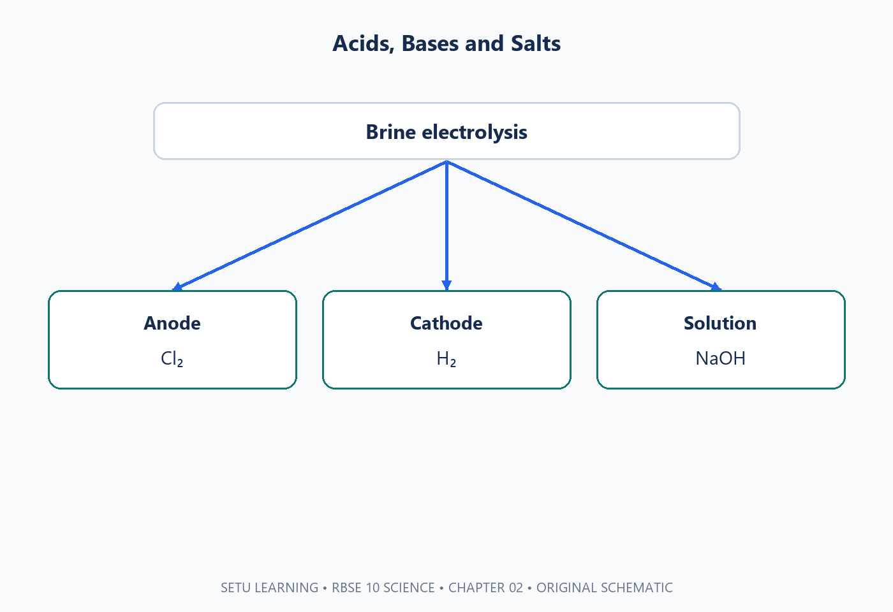

सामान्य नमक से chlor-alkali उत्पादों का process schematic; गैसें अलग electrodes पर बनती हैं।

## भाग 4: पाठ्यपुस्तक-अवधारणाओं पर मौलिक हल किए उदाहरण

नीचे के प्रश्न लेखक के मौलिक मॉडल हैं। ये किसी NCERT edition के प्रश्न क्रमांक या संपूर्ण in-text/exercise solution bank होने का दावा नहीं करते।

**हल किया उदाहरण 1: pH 3 और pH 5 में किसकी H⁺ concentration अधिक है?**

pH 3 की; दो units अंतर से H⁺ concentration 10² = 100 गुना है। यह concentration की तुलना है; pH मात्र से कुल acid मात्रा नहीं मिलती।

**हल किया उदाहरण 2: NaHCO₃ और HCl का समीकरण लिखें।**

NaHCO₃ + HCl → NaCl + H₂O + CO₂। हर तत्व की गिनती दोनों ओर समान है। निकलती CO₂ की जाँच lime water से की जा सकती है।

**हल किया उदाहरण 3: Gypsum से POP का निर्माण लिखें।**

CaSO₄·2H₂O → CaSO₄·½H₂O + 1½H₂O; लगभग 373 K पर ताप। बिना fractions के: 2CaSO₄·2H₂O → 2CaSO₄·½H₂O + 3H₂O।

## भाग 5: सत्यापित बोर्ड प्रश्न एवं स्रोत-स्थिति

इस अध्याय का वर्षवार PYQ audit अभी पूरा नहीं है। अभ्यास प्रश्नों पर काल्पनिक परीक्षा-वर्ष नहीं लगाए गए हैं। [असली 2025 बोर्ड पेपर](https://rajeduboard.rajasthan.gov.in/books/PAPERS-2025/Sec/S-07.pdf) से प्रश्न, उपभाग और अंक मिलाकर ही नया PYQ जोड़ा जाए।

## भाग 6: खंडवार मौलिक अभ्यास बैंक

**अभ्यास-अंक:** लेखक के स्व-अभ्यास के लिए हैं; RBSE की आधिकारिक marking scheme नहीं। उत्तर पहले स्वयं लिखें, फिर भाग 9 देखें।

## अ: बहुविकल्पीय प्रश्न — 15 × 1 अंक

**MCQ 1. नीला litmus अम्ल में कैसा होता है?**

अ) हरा  
ब) बैंगनी  
स) लाल  
द) नीला

**MCQ 2. Phenolphthalein क्षारीय विलयन में कैसा होता है?**

अ) पीला  
ब) गुलाबी  
स) रंगहीन  
द) नीला

**MCQ 3. 25°C पर neutral solution का pH क्या है?**

अ) 7  
ब) 1  
स) 14  
द) 0

**MCQ 4. Carbonate और acid से कौन-सी गैस बनती है?**

अ) H₂  
ब) N₂  
स) Cl₂  
द) CO₂

**MCQ 5. Baking soda का सूत्र क्या है?**

अ) CaSO₄·½H₂O  
ब) NaOH  
स) NaHCO₃  
द) Na₂CO₃·10H₂O

**MCQ 6. Washing soda में crystal water कितने molecules हैं?**

अ) ½  
ब) 10  
स) 5  
द) 2

**MCQ 7. POP का सूत्र क्या है?**

अ) CaSO₄·½H₂O  
ब) CaSO₄·2H₂O  
स) CaCO₃  
द) Ca(OH)₂

**MCQ 8. Brine electrolysis के anode पर कौन-सी गैस मिलती है?**

अ) H₂  
ब) CO₂  
स) SO₂  
द) Cl₂

**MCQ 9. अम्ल को dilute करने पर pH सामान्यतः क्या करता है?**

अ) हमेशा शून्य होता है  
ब) हमेशा 14 होता है  
स) बढ़ता है  
द) घटता है

**MCQ 10. हर hydrogen युक्त compound acid है, इस दावे का counterexample कौन है?**

अ) H₂SO₄  
ब) Glucose  
स) HCl  
द) HNO₃

**MCQ 11. जल में घुलने वाले base को क्या कहते हैं?**

अ) Alkali  
ब) Ore  
स) Alloy  
द) Ester

**MCQ 12. अम्ल dilution का सुरक्षित क्रम क्या है?**

अ) पानी तेजी से अम्ल में  
ब) दोनों उबालकर  
स) बिना आँख सुरक्षा के  
द) अम्ल धीरे पानी में

**MCQ 13. CuSO₄·5H₂O का सामान्य रंग क्या है?**

अ) काला  
ब) पीला  
स) नीला  
द) सफेद

**MCQ 14. NaOH + HCl में कौन-सा salt बनता है?**

अ) NaHCO₃  
ब) NaCl  
स) Na₂SO₄  
द) CaCl₂

**MCQ 15. नमक का solution हमेशा neutral होता है क्या?**

अ) नहीं, acid/base पर निर्भर है  
ब) हाँ, सभी salts के लिए  
स) हाँ, केवल रंगीन salts के लिए  
द) नहीं, सभी acidic हैं

## अ: रिक्त स्थान — 6 × 1 अंक

1. जलीय विलयन में H₃O⁺ की मात्रा बढ़ाने वाला पदार्थ। — इस शब्द/सूत्र का नाम है: ____।  
2. अम्ल को उदासीन करने वाला पदार्थ; कई जलीय क्षारक OH⁻ देते हैं। — इस शब्द/सूत्र का नाम है: ____।  
3. जल में घुलने वाला क्षारक। — इस शब्द/सूत्र का नाम है: ____।  
4. अम्लीय और क्षारकीय माध्यम में अलग रंग देने वाला पदार्थ। — इस शब्द/सूत्र का नाम है: ____।  
5. अम्ल और क्षारक से लवण तथा सामान्यतः जल बनने की अभिक्रिया। — इस शब्द/सूत्र का नाम है: ____।  
6. जलीय विलयन की अम्लीयता/क्षारकीयता का माप। — इस शब्द/सूत्र का नाम है: ____।

## अ: अतिलघु उत्तर — 8 × 1 अंक

1. नीला litmus अम्ल में कैसा होता है?  
2. Phenolphthalein क्षारीय विलयन में कैसा होता है?  
3. 25°C पर neutral solution का pH क्या है?  
4. Carbonate और acid से कौन-सी गैस बनती है?  
5. Baking soda का सूत्र क्या है?  
6. Washing soda में crystal water कितने molecules हैं?  
7. POP का सूत्र क्या है?  
8. Brine electrolysis के anode पर कौन-सी गैस मिलती है?

## ब: लघु उत्तर — 6 × 2 अंक

**B1.** सूखी HCl सूखे लिटमस को लाल क्यों नहीं करती?

**B2.** Strong और concentrated acid का अंतर क्या है?

**B3.** Carbonate को अम्ल से कैसे पहचानेंगे?

**B4.** पेट के antacid का सिद्धांत बताएँ।

**B5.** Crystallisation water क्या है?

**B6.** Baking soda और washing soda अलग कैसे हैं?

## स: दीर्घ उत्तर — 4 × 3 अंक

आंतरिक विकल्प अभ्यास: C1 अथवा C2, तथा C3 अथवा C4 चुनें। पुनरावृत्ति में बचा विकल्प भी हल करें। यह लेखक की अभ्यास व्यवस्था है।

**C1.** Chlor-alkali प्रक्रिया के उत्पाद और स्थान बताएँ।

**C2.** Dilution में pH परिवर्तन और सुरक्षा समझाएँ।

**C3.** POP के बनने और जमने की प्रक्रिया दें।

**C4.** लवण का pH हमेशा 7 क्यों नहीं होता?

## द: विस्तृत उत्तर — 2 × 4 अंक

आंतरिक विकल्प अभ्यास: D1 अथवा D2 चुनें; बाद में दूसरा भी हल करें।

**D1.** चार बोतलों में dilute HCl, NaOH, NaCl solution और distilled water हैं। Litmus से कौन-सी पहचान संभव है और कौन-सी नहीं?

**D2.** सामान्य नमक से NaOH, bleaching powder और soda compounds की उपयोग-श्रृंखला समझाएँ।

## भाग 7: सावधानियाँ एवं परीक्षा-त्रुटियाँ

- pH और acid concentration को strength से न मिलाएँ।
- NaHCO₃ तथा Na₂CO₃·10H₂O के सूत्र अलग हैं।
- हर salt neutral नहीं।
- POP में ½ water है, gypsum में 2।
- अम्ल/क्षार को चखकर या हाथ लगाकर पहचानना प्रयोग नहीं।

## भाग 8: फटाफट पुनरावृत्ति — 25 बिंदु

1. अम्ल (Acid): जलीय विलयन में H₃O⁺ की मात्रा बढ़ाने वाला पदार्थ।  
2. क्षारक (Base): अम्ल को उदासीन करने वाला पदार्थ; कई जलीय क्षारक OH⁻ देते हैं।  
3. क्षार (Alkali): जल में घुलने वाला क्षारक।  
4. सूचक (Indicator): अम्लीय और क्षारकीय माध्यम में अलग रंग देने वाला पदार्थ।  
5. उदासीनीकरण: अम्ल और क्षारक से लवण तथा सामान्यतः जल बनने की अभिक्रिया।  
6. pH: जलीय विलयन की अम्लीयता/क्षारकीयता का माप।  
7. बेकिंग सोडा: NaHCO₃; sodium hydrogencarbonate।  
8. धावन सोडा: Na₂CO₃·10H₂O; sodium carbonate decahydrate।  
9. विरंजक चूर्ण: विद्यालयी निरूपण CaOCl₂; disinfecting/bleaching उपयोग।  
10. प्लास्टर ऑफ पेरिस: CaSO₄·½H₂O; calcium sulfate hemihydrate।  
11. अम्लीय माध्यम blue litmus को red करता है।  
12. Phenolphthalein alkaline medium में pink रंग देता है।  
13. Neutral water में H₃O⁺ और OH⁻ concentrations बराबर होने पर pH लगभग 7 है।  
14. Carbonate में acid डालने से salt, water और carbon dioxide बनते हैं।  
15. Baking soda sodium hydrogencarbonate है, washing soda नहीं।  
16. Na₂CO₃·10H₂O decahydrate है; दस water molecules सूत्र में शामिल हैं।  
17. POP hemihydrate है; gypsum dihydrate होता है।  
18. Chloride ions oxidation से anode पर chlorine बनाते हैं।  
19. H₃O⁺ concentration घटती है, इसलिए pH neutral की ओर बढ़ता है।  
20. Glucose में H होने पर भी जल में acid जैसा H₃O⁺ नहीं बनता।  
21. Alkali soluble base है; सभी bases soluble नहीं।  
22. Water का बड़ा आयतन ऊष्मा संभालता है; acid धीरे मिलाने से छींटे कम होते हैं।  
23. Hydrated copper sulfate blue होता है; anhydrous salt सामान्यतः white है।  
24. Sodium ion और chloride ion से sodium chloride बनता है।  
25. Salt solution का pH उसके ions की जल से प्रतिक्रिया पर निर्भर करता है।

## भाग 9: संपूर्ण अभ्यास उत्तर-कुंजी

## MCQ: सही विकल्प और कारण

**1. स — लाल।** अम्लीय माध्यम blue litmus को red करता है।

**2. ब — गुलाबी।** Phenolphthalein alkaline medium में pink रंग देता है।

**3. अ — 7।** Neutral water में H₃O⁺ और OH⁻ concentrations बराबर होने पर pH लगभग 7 है।

**4. द — CO₂।** Carbonate में acid डालने से salt, water और carbon dioxide बनते हैं।

**5. स — NaHCO₃।** Baking soda sodium hydrogencarbonate है, washing soda नहीं।

**6. ब — 10।** Na₂CO₃·10H₂O decahydrate है; दस water molecules सूत्र में शामिल हैं।

**7. अ — CaSO₄·½H₂O।** POP hemihydrate है; gypsum dihydrate होता है।

**8. द — Cl₂।** Chloride ions oxidation से anode पर chlorine बनाते हैं।

**9. स — बढ़ता है।** H₃O⁺ concentration घटती है, इसलिए pH neutral की ओर बढ़ता है।

**10. ब — Glucose।** Glucose में H होने पर भी जल में acid जैसा H₃O⁺ नहीं बनता।

**11. अ — Alkali।** Alkali soluble base है; सभी bases soluble नहीं।

**12. द — अम्ल धीरे पानी में।** Water का बड़ा आयतन ऊष्मा संभालता है; acid धीरे मिलाने से छींटे कम होते हैं।

**13. स — नीला।** Hydrated copper sulfate blue होता है; anhydrous salt सामान्यतः white है।

**14. ब — NaCl।** Sodium ion और chloride ion से sodium chloride बनता है।

**15. अ — नहीं, acid/base पर निर्भर है।** Salt solution का pH उसके ions की जल से प्रतिक्रिया पर निर्भर करता है।

**रिक्त स्थान:** 1. अम्ल (Acid); 2. क्षारक (Base); 3. क्षार (Alkali); 4. सूचक (Indicator); 5. उदासीनीकरण; 6. pH

**अतिलघु उत्तर:**

1. लाल। अम्लीय माध्यम blue litmus को red करता है।

2. गुलाबी। Phenolphthalein alkaline medium में pink रंग देता है।

3. 7। Neutral water में H₃O⁺ और OH⁻ concentrations बराबर होने पर pH लगभग 7 है।

4. CO₂। Carbonate में acid डालने से salt, water और carbon dioxide बनते हैं।

5. NaHCO₃। Baking soda sodium hydrogencarbonate है, washing soda नहीं।

6. 10। Na₂CO₃·10H₂O decahydrate है; दस water molecules सूत्र में शामिल हैं।

7. CaSO₄·½H₂O। POP hemihydrate है; gypsum dihydrate होता है।

8. Cl₂। Chloride ions oxidation से anode पर chlorine बनाते हैं।

**B1. सूखी HCl सूखे लिटमस को लाल क्यों नहीं करती?**

जल की अनुपस्थिति में पर्याप्त hydronium ions नहीं बनते। नम लिटमस की नमी में HCl आयनित होकर अम्लीयता दिखाती है। इसलिए अम्ल के विद्यालयी गुण मुख्यतः aqueous solution में समझे जाते हैं।

**B2. Strong और concentrated acid का अंतर क्या है?**

Strong acid जल में बड़ी सीमा तक ionise करता है। Concentrated acid में प्रति आयतन acid की मात्रा अधिक है। एक strong acid dilute भी हो सकता है और weak acid concentrated भी। दोनों शब्द एक-दूसरे के पर्याय नहीं।

**B3. Carbonate को अम्ल से कैसे पहचानेंगे?**

नमूने में dilute acid मिलाने पर CO₂ की effervescence होती है। गैस lime water में भेजने पर CaCO₃ के कारण दूधियापन आता है। यह प्रयोग शिक्षक की देखरेख में करें और गैस सीधे न सूँघें।

**B4. पेट के antacid का सिद्धांत बताएँ।**

Antacid के हल्के basic घटक अतिरिक्त gastric acid को neutralise करते हैं। यह उदासीनीकरण का उपयोग है। इससे हर पेट-दर्द का कारण acidity सिद्ध नहीं होता; यह अध्याय दवा की मात्रा या स्वयं उपचार का निर्देश नहीं देता।

**B5. Crystallisation water क्या है?**

Crystal structure में प्रति formula unit निश्चित संख्या के water molecules शामिल होना crystallisation water है। CuSO₄·5H₂O इसका उदाहरण है। गर्म करने पर hydrated और anhydrous salt के गुण तथा रंग बदल सकते हैं।

**B6. Baking soda और washing soda अलग कैसे हैं?**

Baking soda NaHCO₃ है; washing soda Na₂CO₃·10H₂O। पहला baking powder आदि में, दूसरा cleaning और स्थायी कठोरता घटाने में उपयोगी है। नाम की समानता से सूत्र या उपयोग परस्पर न बदलें।

**C1. Chlor-alkali प्रक्रिया के उत्पाद और स्थान बताएँ।**

1. Brine aqueous NaCl है। 2. Electrolysis से Cl₂ anode तथा H₂ cathode पर बनते हैं। 3. विलयन में NaOH रहता है: 2NaCl + 2H₂O → 2NaOH + Cl₂ + H₂। उत्पाद अलग रखना आवश्यक है।

**C2. Dilution में pH परिवर्तन और सुरक्षा समझाएँ।**

1. अम्ल में पानी मिलाने से प्रति आयतन H₃O⁺ घटता है, pH बढ़ता है। 2. क्षार dilute होने पर OH⁻ घटता है, pH neutral की ओर घटता है। 3. सांद्र अम्ल धीरे पानी में मिलाएँ; dilution ऊष्माक्षेपी हो सकता है।

**C3. POP के बनने और जमने की प्रक्रिया दें।**

1. Gypsum को नियंत्रित ताप पर आंशिक निर्जलीकरण करें। 2. CaSO₄·½H₂O मिलता है। 3. जल मिलाने पर CaSO₄·2H₂O दोबारा बनता है और कठोर हो जाता है। नमी से बचाकर भंडारण इसलिए जरूरी है।

**C4. लवण का pH हमेशा 7 क्यों नहीं होता?**

1. Strong acid–strong base salt सामान्यतः neutral होता है। 2. Strong acid–weak base salt का solution acidic हो सकता है, जैसे NH₄Cl। 3. Weak acid–strong base salt basic हो सकता है, जैसे Na₂CO₃। नमक शब्द का अर्थ neutral नहीं।

**D1. चार बोतलों में dilute HCl, NaOH, NaCl solution और distilled water हैं। Litmus से कौन-सी पहचान संभव है और कौन-सी नहीं?**

1. नीला litmus लाल करने वाली HCl है। 2. लाल litmus नीला करने वाली NaOH है। 3. NaCl और distilled water दोनों litmus अपरिवर्तित छोड़ सकते हैं। 4. इन दो neutral नमूनों को केवल litmus से अलग नहीं किया जा सकता; अतिरिक्त परीक्षण चाहिए। इसलिए सूचक की सीमा भी उत्तर में दें।

**D2. सामान्य नमक से NaOH, bleaching powder और soda compounds की उपयोग-श्रृंखला समझाएँ।**

1. Brine electrolysis से NaOH, Cl₂ और H₂ मिलते हैं। 2. Cl₂ तथा slaked lime से bleaching powder मिलता है। 3. NaHCO₃ ताप पर Na₂CO₃ देता है, जिसके crystallisation से washing soda बनता है। 4. इनके उपयोग क्रमशः chemical manufacture, disinfection और cleaning से जुड़े हैं; NaCl को अकेले गरम करने से ये सभी नहीं बनते।

## भाग 10: 10 मिनट / 10 अंक आत्म-मूल्यांकन एवं संदर्भ

समय: 10 मिनट। पहले पुस्तक बंद करें।

1. MCQ 3 और 11 हल करें। (1 + 1)
2. B2 और B5 के उत्तर लिखें। (2 + 2)
3. D1 हल करें। (4)

**कुंजी:** भाग 9 में संबंधित क्रमांक देखें। **स्व-मूल्यांकन:** 8–10: आगे बढ़ें; 5–7: छूटे कौशल का दोहराव; 0–4: भाग 2–4 फिर पढ़ें। यह अभ्यास-सुझाव है, बोर्ड grade नहीं।

[सत्यापित RBSE 2025–26 पाठ्यक्रम](https://rajeduboard.rajasthan.gov.in/anudeshika-etc/10_2026.pdf) · [NCERT विज्ञान अध्याय 2](https://ncert.nic.in/textbook/pdf/jesc102.pdf)

**आगे की कड़ी:** अगले अध्याय में धातुओं की acid, water और salt solutions से प्रतिक्रियाएँ आएँगी।

---

# अध्याय 3: धातु एवं अधातु (Metals and Non-metals)

## भाग 1: अध्याय प्रवेश एवं पाठ्यक्रम मैपिंग

> प्रथम संपादकीय प्रारूप। NCERT के सभी प्रश्नों के हल तथा पूरा ऐतिहासिक PYQ संग्रह अभी स्रोत-परीक्षण में हैं। सामान्य माध्यमिक 2026–27 पाठ्यक्रम की पुनः पुष्टि शेष है।

**विषय कोड:** 07 · **श्रृंखला पुस्तक:** 2

**सत्यापित आधार:** RBSE 2025–26 · **अध्याय भार:** 5 अंक। यह भार उसी संस्करण का है; वास्तविक प्रश्न-विभाजन की भविष्यवाणी नहीं।

**सीखने के लक्ष्य:** गुणों और exceptions की तुलना; activity series से प्रतिक्रिया का अनुमान; ionic compounds, extraction और corrosion protection समझना।

## भाग 2: शब्दावली एवं अवधारणा कैप्सूल

| शब्द / सूत्र | अर्थ / उपयोग |
|---|---|
| आघातवर्धनीयता (Malleability) | पीटकर चादर बनने का गुण। |
| तन्यता (Ductility) | खींचकर तार बनने का गुण। |
| ध्वानिकता (Sonority) | प्रहार पर ringing sound देने का गुण। |
| सक्रियता श्रेणी | धातुओं का घटती रासायनिक सक्रियता में क्रम। |
| आयनिक आबंध | इलेक्ट्रॉन transfer के बाद विपरीत ions का आकर्षण। |
| खनिज (Mineral) | प्राकृतिक रूप में मिलने वाला तत्व/यौगिकयुक्त पदार्थ। |
| अयस्क (Ore) | जिससे धातु का निष्कर्षण आर्थिक रूप से उपयुक्त हो। |
| निस्तापन (Calcination) | सीमित/अनुपस्थित वायु में carbonate ore का ताप। |
| भर्जन (Roasting) | अधिक वायु में sulfide ore का ताप। |
| मिश्रधातु (Alloy) | धातु का दूसरी धातु/अधातु के साथ मिश्रण। |

## भाग 3: विस्तृत शिक्षण पाठ

### गुण और अपवाद
धातुएँ सामान्यतः चमकीली, चालक, तन्य और आघातवर्धनीय होती हैं। Mercury room temperature पर liquid metal है। Sodium/potassium नरम होते हैं। अधातुएँ सामान्यतः कुचालक और भंगुर हैं; graphite विद्युत का चालक और iodine चमकीला है। इसलिए किसी एक गुण से अंतिम पहचान न करें। Oxides में Al₂O₃ और ZnO amphoteric हैं: acid और base दोनों से प्रतिक्रिया कर सकते हैं।

### प्रतिक्रियाओं का अनुमान
एक उपयोगी क्रम है K > Na > Ca > Mg > Al > Zn > Fe > Pb > H > Cu > Hg > Ag > Au। H धातु नहीं, acid से hydrogen विस्थापन का comparison reference है। Sodium ठंडे पानी से तीव्रता से, magnesium गर्म पानी/भाप से, iron भाप से प्रतिक्रिया करता है। Copper साधारण पानी से नहीं। Hydrogen से ऊपर की कई metals dilute non-oxidising acids से H₂ देती हैं। HNO₃ oxidising acid है; साधारण ‘metal + acid = H₂’ नियम उस पर बिना शर्त लागू न करें।

### Ionic compound की रचना
Na एक electron खोकर Na⁺, Cl एक electron लेकर Cl⁻ बनाता है। विपरीत charges के आकर्षण से NaCl ionic lattice बनता है। Solid में ions fixed हैं, इसलिए electrical conduction नहीं; molten या aqueous state में mobile ions current ले जाते हैं। Strong electrostatic attractions उच्च melting point का कारण हैं। MgCl₂ में Mg²⁺ को balance करने के लिए दो Cl⁻ चाहिए।

### अयस्क से धातु
Gangue हटाकर enrichment होता है। Medium-reactivity metals के sulfides roasting और carbonates calcination से oxides बनते हैं: $2ZnS + 3O_2 \rightarrow 2ZnO + 2SO_2$; $ZnCO_3 \rightarrow ZnO + CO_2$। फिर oxide reduction: $ZnO + C \rightarrow Zn + CO$। Highly reactive Na/Mg/Al के लिए molten salts/appropriate electrolytes का electrolysis उपयोगी है; carbon reduction सामान्यतः पर्याप्त नहीं। Copper electrolytic refining में impure Cu anode, pure Cu cathode और CuSO₄ electrolyte है। Alloying, galvanising और painting corrosion घटाते हैं।

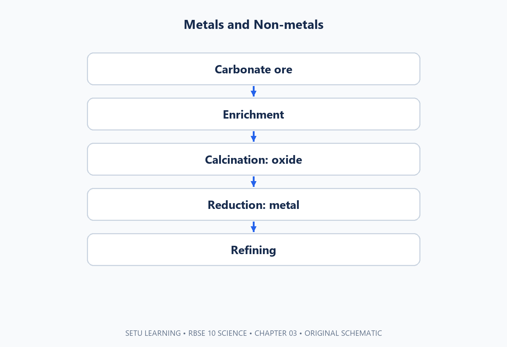

Carbonate ore से metal तक process schematic; gangue removal और refining अलग चरण हैं।

## भाग 4: पाठ्यपुस्तक-अवधारणाओं पर मौलिक हल किए उदाहरण

नीचे के प्रश्न लेखक के मौलिक मॉडल हैं। ये किसी NCERT edition के प्रश्न क्रमांक या संपूर्ण in-text/exercise solution bank होने का दावा नहीं करते।

**हल किया उदाहरण 1: Fe की कील CuSO₄ में डालने पर क्या होगा?**

Fe + CuSO₄ → FeSO₄ + Cu। Iron अधिक active है; copper की coating और solution में Fe²⁺ बनते हैं। Zinc sulfate में iron डालकर यही displacement अपेक्षित नहीं।

**हल किया उदाहरण 2: Mg और Cl से बनने वाले ionic compound का सूत्र दें।**

Mg → Mg²⁺ + 2e⁻; दो Cl atoms दो electrons लेते हैं। Charges +2 तथा 2×−1 balance होते हैं; सूत्र MgCl₂ है, MgCl नहीं।

**हल किया उदाहरण 3: Thermite reaction संतुलित करें और उपयोग दें।**

Fe₂O₃ + 2Al → Al₂O₃ + 2Fe। Al iron oxide reduce करता है; बहुत ऊष्मा निकलती है। इसे rail joints welding जैसे उपयोगों से समझा जाता है; classroom में स्वयं न करें।

## भाग 5: सत्यापित बोर्ड प्रश्न एवं स्रोत-स्थिति

इस अध्याय का वर्षवार PYQ audit अभी पूरा नहीं है। अभ्यास प्रश्नों पर काल्पनिक परीक्षा-वर्ष नहीं लगाए गए हैं। [असली 2025 बोर्ड पेपर](https://rajeduboard.rajasthan.gov.in/books/PAPERS-2025/Sec/S-07.pdf) से प्रश्न, उपभाग और अंक मिलाकर ही नया PYQ जोड़ा जाए।

## भाग 6: खंडवार मौलिक अभ्यास बैंक

**अभ्यास-अंक:** लेखक के स्व-अभ्यास के लिए हैं; RBSE की आधिकारिक marking scheme नहीं। उत्तर पहले स्वयं लिखें, फिर भाग 9 देखें।

## अ: बहुविकल्पीय प्रश्न — 15 × 1 अंक

**MCQ 1. कमरे के ताप पर liquid metal कौन है?**

अ) Aluminium  
ब) Mercury  
स) Iron  
द) Copper

**MCQ 2. विद्युत-चालक अधातु का उदाहरण कौन है?**

अ) Graphite  
ब) Sulfur  
स) Phosphorus  
द) Bromine

**MCQ 3. Metal को तार में खींचने का गुण क्या है?**

अ) Malleability  
ब) Brittleness  
स) Transparency  
द) Ductility

**MCQ 4. Amphoteric oxide कौन है?**

अ) CO₂  
ब) SO₂  
स) Al₂O₃  
द) Na₂O

**MCQ 5. Fe किस solution से metal विस्थापित करेगा?**

अ) NaCl  
ब) CuSO₄  
स) ZnSO₄  
द) MgSO₄

**MCQ 6. MgCl₂ में Mg ion का charge क्या है?**

अ) +2  
ब) +1  
स) −1  
द) −2

**MCQ 7. Molten NaCl में current कौन carry करता है?**

अ) केवल neutral atoms  
ब) Fixed ions  
स) Photons  
द) Mobile ions

**MCQ 8. Sulfide ore को हवा में गरम करना क्या है?**

अ) Galvanising  
ब) Alloying  
स) Roasting  
द) Calcination

**MCQ 9. Carbonate ore में उपयुक्त प्रथम thermal प्रक्रिया क्या है?**

अ) Polymerisation  
ब) Calcination  
स) केवल electroplating  
द) Neutralisation

**MCQ 10. Copper refining का anode कौन है?**

अ) Impure copper  
ब) Pure copper sheet  
स) Graphite ही अनिवार्य  
द) Zinc sheet

**MCQ 11. Galvanising में iron पर कौन-सी metal चढ़ती है?**

अ) Gold  
ब) Mercury  
स) Silver  
द) Zinc

**MCQ 12. Brass के मुख्य metals क्या हैं?**

अ) Fe और Hg  
ब) Al और Ag  
स) Cu और Zn  
द) Cu और Sn

**MCQ 13. Na extraction में carbon reduction सामान्यतः पर्याप्त क्यों नहीं?**

अ) Na water में inert है  
ब) Na बहुत reactive है  
स) Na एक अधातु है  
द) Na में electrons नहीं

**MCQ 14. Mineral और ore का सही संबंध क्या है?**

अ) हर ore mineral है  
ब) हर mineral ore है  
स) दोनों हमेशा समान हैं  
द) Ore कृत्रिम ही होता है

**MCQ 15. Metal + HNO₃ से हमेशा H₂ मिलता है क्या?**

अ) हाँ, सभी metals से  
ब) हाँ, केवल Cu से  
स) हाँ, केवल Au से  
द) नहीं, HNO₃ oxidising acid है

## अ: रिक्त स्थान — 6 × 1 अंक

1. पीटकर चादर बनने का गुण। — इस शब्द/सूत्र का नाम है: ____।  
2. खींचकर तार बनने का गुण। — इस शब्द/सूत्र का नाम है: ____।  
3. प्रहार पर ringing sound देने का गुण। — इस शब्द/सूत्र का नाम है: ____।  
4. धातुओं का घटती रासायनिक सक्रियता में क्रम। — इस शब्द/सूत्र का नाम है: ____।  
5. इलेक्ट्रॉन transfer के बाद विपरीत ions का आकर्षण। — इस शब्द/सूत्र का नाम है: ____।  
6. प्राकृतिक रूप में मिलने वाला तत्व/यौगिकयुक्त पदार्थ। — इस शब्द/सूत्र का नाम है: ____।

## अ: अतिलघु उत्तर — 8 × 1 अंक

1. कमरे के ताप पर liquid metal कौन है?  
2. विद्युत-चालक अधातु का उदाहरण कौन है?  
3. Metal को तार में खींचने का गुण क्या है?  
4. Amphoteric oxide कौन है?  
5. Fe किस solution से metal विस्थापित करेगा?  
6. MgCl₂ में Mg ion का charge क्या है?  
7. Molten NaCl में current कौन carry करता है?  
8. Sulfide ore को हवा में गरम करना क्या है?

## ब: लघु उत्तर — 6 × 2 अंक

**B1.** धातुओं के गुण लिखते समय exceptions क्यों देने चाहिए?

**B2.** Solid NaCl बिजली क्यों नहीं चलाता?

**B3.** Ore और mineral में अंतर दें।

**B4.** भर्जन और निस्तापन की तुलना करें।

**B5.** Aluminium को जंग से कुछ सुरक्षा कैसे मिलती है?

**B6.** मिश्रधातु बनाने का लाभ बताएँ।

## स: दीर्घ उत्तर — 4 × 3 अंक

आंतरिक विकल्प अभ्यास: C1 अथवा C2, तथा C3 अथवा C4 चुनें। पुनरावृत्ति में बचा विकल्प भी हल करें। यह लेखक की अभ्यास व्यवस्था है।

**C1.** Activity series से तीन salt-solution predictions दें।

**C2.** NaCl का electron transfer और conduction समझाएँ।

**C3.** Copper refining के electrodes और परिवर्तन दें।

**C4.** Reactive metals के extraction के तीन स्तर दें।

## द: विस्तृत उत्तर — 2 × 4 अंक

आंतरिक विकल्प अभ्यास: D1 अथवा D2 चुनें; बाद में दूसरा भी हल करें।

**D1.** ZnCO₃ से zinc पाने के चरण, समीकरण और विधि का कारण लिखें।

**D2.** जस्तीकरण और electrolytic refining की तुलना करें।

## भाग 7: सावधानियाँ एवं परीक्षा-त्रुटियाँ

- Graphite/mercury जैसे exceptions याद रखें।
- H को activity series में metal न कहें।
- Solid salt में conduction का दावा न करें।
- Roasting और calcination को ore के अनुसार लिखें।
- Refining, extraction और corrosion protection अलग प्रक्रियाएँ हैं।

## भाग 8: फटाफट पुनरावृत्ति — 25 बिंदु

1. आघातवर्धनीयता (Malleability): पीटकर चादर बनने का गुण।  
2. तन्यता (Ductility): खींचकर तार बनने का गुण।  
3. ध्वानिकता (Sonority): प्रहार पर ringing sound देने का गुण।  
4. सक्रियता श्रेणी: धातुओं का घटती रासायनिक सक्रियता में क्रम।  
5. आयनिक आबंध: इलेक्ट्रॉन transfer के बाद विपरीत ions का आकर्षण।  
6. खनिज (Mineral): प्राकृतिक रूप में मिलने वाला तत्व/यौगिकयुक्त पदार्थ।  
7. अयस्क (Ore): जिससे धातु का निष्कर्षण आर्थिक रूप से उपयुक्त हो।  
8. निस्तापन (Calcination): सीमित/अनुपस्थित वायु में carbonate ore का ताप।  
9. भर्जन (Roasting): अधिक वायु में sulfide ore का ताप।  
10. मिश्रधातु (Alloy): धातु का दूसरी धातु/अधातु के साथ मिश्रण।  
11. Mercury सामान्य room temperature पर liquid है।  
12. Graphite में delocalised electrons conduction संभव बनाते हैं।  
13. Ductility तार बनाने का गुण है; malleability चादर बनाने का।  
14. Aluminium oxide acid और base दोनों से reaction कर सकता है।  
15. Iron copper से ऊपर है, पर zinc, magnesium और sodium से नीचे।  
16. Magnesium दो electrons खोकर Mg²⁺ बनाता है।  
17. Molten ionic salt में ions चल सकते हैं और charge ले जाते हैं।  
18. Roasting oxygen की उपस्थिति में sulfide को oxide में बदलता है।  
19. Calcination से carbonate टूटकर oxide और CO₂ देता है।  
20. Impure copper anode से Cu²⁺ solution में जाता है।  
21. Zinc layer और उसकी अधिक activity corrosion protection में मदद करती है।  
22. Brass copper–zinc alloy है; bronze copper–tin है।  
23. Highly reactive sodium के compounds से metal पाने के लिए electrolysis उपयोग होता है।  
24. Ore extraction के लिए economically useful mineral है।  
25. Nitric acid की oxidising nature सामान्य hydrogen-evolution rule को सीमित करती है।

## भाग 9: संपूर्ण अभ्यास उत्तर-कुंजी

## MCQ: सही विकल्प और कारण

**1. ब — Mercury।** Mercury सामान्य room temperature पर liquid है।

**2. अ — Graphite।** Graphite में delocalised electrons conduction संभव बनाते हैं।

**3. द — Ductility।** Ductility तार बनाने का गुण है; malleability चादर बनाने का।

**4. स — Al₂O₃।** Aluminium oxide acid और base दोनों से reaction कर सकता है।

**5. ब — CuSO₄।** Iron copper से ऊपर है, पर zinc, magnesium और sodium से नीचे।

**6. अ — +2।** Magnesium दो electrons खोकर Mg²⁺ बनाता है।

**7. द — Mobile ions।** Molten ionic salt में ions चल सकते हैं और charge ले जाते हैं।

**8. स — Roasting।** Roasting oxygen की उपस्थिति में sulfide को oxide में बदलता है।

**9. ब — Calcination।** Calcination से carbonate टूटकर oxide और CO₂ देता है।

**10. अ — Impure copper।** Impure copper anode से Cu²⁺ solution में जाता है।

**11. द — Zinc।** Zinc layer और उसकी अधिक activity corrosion protection में मदद करती है।

**12. स — Cu और Zn।** Brass copper–zinc alloy है; bronze copper–tin है।

**13. ब — Na बहुत reactive है।** Highly reactive sodium के compounds से metal पाने के लिए electrolysis उपयोग होता है।

**14. अ — हर ore mineral है।** Ore extraction के लिए economically useful mineral है।

**15. द — नहीं, HNO₃ oxidising acid है।** Nitric acid की oxidising nature सामान्य hydrogen-evolution rule को सीमित करती है।

**रिक्त स्थान:** 1. आघातवर्धनीयता (Malleability); 2. तन्यता (Ductility); 3. ध्वानिकता (Sonority); 4. सक्रियता श्रेणी; 5. आयनिक आबंध; 6. खनिज (Mineral)

**अतिलघु उत्तर:**

1. Mercury। Mercury सामान्य room temperature पर liquid है।

2. Graphite। Graphite में delocalised electrons conduction संभव बनाते हैं।

3. Ductility। Ductility तार बनाने का गुण है; malleability चादर बनाने का।

4. Al₂O₃। Aluminium oxide acid और base दोनों से reaction कर सकता है।

5. CuSO₄। Iron copper से ऊपर है, पर zinc, magnesium और sodium से नीचे।

6. +2। Magnesium दो electrons खोकर Mg²⁺ बनाता है।

7. Mobile ions। Molten ionic salt में ions चल सकते हैं और charge ले जाते हैं।

8. Roasting। Roasting oxygen की उपस्थिति में sulfide को oxide में बदलता है।

**B1. धातुओं के गुण लिखते समय exceptions क्यों देने चाहिए?**

‘सभी’ धातु कठोर और ठोस कहना गलत है। Sodium नरम और mercury liquid है। इसी तरह graphite अधातु होकर conductor है। सामान्य गुण उपयोगी हैं, पर classification को exceptions सहित लिखने से उत्तर वैज्ञानिक बनता है।

**B2. Solid NaCl बिजली क्यों नहीं चलाता?**

Solid ionic lattice में ions स्थान बदलकर charge carry नहीं कर सकते। पिघले या जलीय NaCl में ions mobile होते हैं, इसलिए conduction होती है। इसका कारण free electrons नहीं, mobile ions हैं।

**B3. Ore और mineral में अंतर दें।**

खनिज प्राकृतिक metal-bearing पदार्थ है। जिस mineral से extraction आर्थिक रूप से उपयुक्त हो, वह ore कहलाता है। इसलिए हर ore mineral है, लेकिन हर mineral ore नहीं; metal प्रतिशत के साथ लागत भी महत्त्वपूर्ण है।

**B4. भर्जन और निस्तापन की तुलना करें।**

Roasting में sulfide ore को पर्याप्त oxygen के साथ गरम कर oxide बनाते हैं। Calcination में carbonate ore को सीमित/बिना वायु गरम कर oxide और CO₂ बनाते हैं। Ore प्रकार और oxygen availability दो स्पष्ट अंतर हैं।

**B5. Aluminium को जंग से कुछ सुरक्षा कैसे मिलती है?**

Al की सतह पर पतली adherent Al₂O₃ layer बनती है, जो अंदर की metal का संपर्क घटाती है। Anodising इस oxide layer को मजबूत करता है। इसका अर्थ aluminium बिल्कुल प्रतिक्रिया नहीं करता, ऐसा नहीं।

**B6. मिश्रधातु बनाने का लाभ बताएँ।**

Alloying से hardness, corrosion resistance और उपयोगी गुण बदल सकते हैं। Brass Cu–Zn और bronze Cu–Sn हैं। Stainless steel में Fe के साथ chromium और अन्य घटक होते हैं; composition के अनुसार गुण बदलते हैं।

**C1. Activity series से तीन salt-solution predictions दें।**

1. Zn, CuSO₄ से Cu हटाता है। 2. Fe, ZnSO₄ से Zn नहीं हटाता क्योंकि Zn अधिक active है। 3. Cu, AgNO₃ से Ag हटाता है: Cu + 2AgNO₃ → Cu(NO₃)₂ + 2Ag। तुलना आवश्यक है, केवल metal होने से displacement नहीं।

**C2. NaCl का electron transfer और conduction समझाएँ।**

1. Na एक electron छोड़कर Na⁺ बनाता है। 2. Cl उसे लेकर Cl⁻ बनाता है; attraction ionic bond है। 3. Solid में fixed ions, molten/aqueous में mobile ions होते हैं। Neutral atoms का बनना conduction का कारण नहीं।

**C3. Copper refining के electrodes और परिवर्तन दें।**

1. Impure copper anode तथा pure copper sheet cathode है। 2. Anode का Cu, Cu²⁺ होकर solution में आता है। 3. Cathode पर Cu²⁺ electrons लेकर Cu जमता है; कुछ insoluble impurities anode mud बनती हैं।

**C4. Reactive metals के extraction के तीन स्तर दें।**

1. Low-reactivity metals के कुछ ores heating से metal दे सकते हैं। 2. Medium-reactivity metal oxides को carbon/appropriate reducing agents से reduce करते हैं। 3. High-reactivity metals को electrolysis चाहिए। प्रक्रिया ore और metal पर निर्भर है; एक ही विधि सब पर लागू नहीं।

**D1. ZnCO₃ से zinc पाने के चरण, समीकरण और विधि का कारण लिखें।**

1. Enrichment से gangue घटाएँ। 2. Calcination: ZnCO₃ → ZnO + CO₂। 3. Reduction: ZnO + C → Zn + CO। 4. Zinc की medium reactivity इस route को उपयुक्त बनाती है; प्राप्त metal का refining किया जाता है। पहले sulfide मानकर roasting लिखना इस ore के लिए गलत होगा।

**D2. जस्तीकरण और electrolytic refining की तुलना करें।**

1. Galvanising में iron पर zinc protective layer लगती है। 2. इसका उद्देश्य corrosion protection है। 3. Electrolytic refining में impure copper anode से copper pure cathode पर transfer होता है। 4. इसका उद्देश्य purity बढ़ाना है। दोनों metal treatment हैं, पर electrodes और उद्देश्यों को interchange नहीं करें।

## भाग 10: 10 मिनट / 10 अंक आत्म-मूल्यांकन एवं संदर्भ

समय: 10 मिनट। पहले पुस्तक बंद करें।

1. MCQ 3 और 11 हल करें। (1 + 1)
2. B2 और B5 के उत्तर लिखें। (2 + 2)
3. D1 हल करें। (4)

**कुंजी:** भाग 9 में संबंधित क्रमांक देखें। **स्व-मूल्यांकन:** 8–10: आगे बढ़ें; 5–7: छूटे कौशल का दोहराव; 0–4: भाग 2–4 फिर पढ़ें। यह अभ्यास-सुझाव है, बोर्ड grade नहीं।

[सत्यापित RBSE 2025–26 पाठ्यक्रम](https://rajeduboard.rajasthan.gov.in/anudeshika-etc/10_2026.pdf) · [NCERT विज्ञान अध्याय 3](https://ncert.nic.in/textbook/pdf/jesc103.pdf)

**आगे की कड़ी:** अगले अध्याय में electron transfer के बजाय carbon का electron sharing आएगा।

---

# अध्याय 4: कार्बन एवं उसके यौगिक (Carbon and its Compounds)

## भाग 1: अध्याय प्रवेश एवं पाठ्यक्रम मैपिंग

> प्रथम संपादकीय प्रारूप। NCERT के सभी प्रश्नों के हल तथा पूरा ऐतिहासिक PYQ संग्रह अभी स्रोत-परीक्षण में हैं। सामान्य माध्यमिक 2026–27 पाठ्यक्रम की पुनः पुष्टि शेष है।

**विषय कोड:** 07 · **श्रृंखला पुस्तक:** 2

**सत्यापित आधार:** RBSE 2025–26 · **अध्याय भार:** 7 अंक। यह भार उसी संस्करण का है; वास्तविक प्रश्न-विभाजन की भविष्यवाणी नहीं।

**सीखने के लक्ष्य:** Carbon bonding, homologous series और नामकरण समझना; ethanol/ethanoic acid reactions लिखना; soap cleaning का mechanism बताना।

## भाग 2: शब्दावली एवं अवधारणा कैप्सूल

| शब्द / सूत्र | अर्थ / उपयोग |
|---|---|
| चतुःसंयोजकता | Carbon की चार covalent bonds बनाने की क्षमता। |
| शृंखलन (Catenation) | Carbon atoms का आपस में chains/branches/rings बनाना। |
| सहसंयोजी आबंध | Atoms के बीच electron pairs का sharing। |
| संतृप्त hydrocarbon | Carbon–carbon bonds केवल single; open-chain alkane सूत्र CₙH₂ₙ₊₂। |
| असंतृप्त hydrocarbon | कम से कम एक C=C या C≡C bond वाला hydrocarbon। |
| समजातीय श्रेणी | समान functional group और समान सामान्य सूत्र वाले compounds की श्रेणी। |
| प्रकार्यात्मक समूह | Compound के characteristic chemical properties निर्धारित करने वाला group। |
| Ethanol | C₂H₅OH; alcohol functional group –OH। |
| Ethanoic acid | CH₃COOH; carboxylic acid functional group –COOH। |
| Micelle | Water में soap tails अंदर और ionic heads बाहर वाली aggregate संरचना। |

## भाग 3: विस्तृत शिक्षण पाठ

### Carbon इतना विविध क्यों है?
Carbon के valence shell में चार electrons हैं। चार electrons पूरी तरह खोना या पाना energetically कठिन है, इसलिए sharing से covalent bonds बनते हैं। Methane में चार C–H single bonds; ethene में C=C double bond, ethyne में C≡C triple bond है। Carbon–carbon bonds की स्थिरता catenation संभव करती है। Covalent compounds सामान्यतः low melting/boiling points और poor electrical conduction दिखाते हैं, पर सभी carbon compounds पर बिना exception यही कथन न लगाएँ।

### संरचना और नाम
Open-chain alkanes में CₙH₂ₙ₊₂, एक double bond वाले alkenes में CₙH₂ₙ, एक triple bond वाले alkynes में CₙH₂ₙ₋₂ सामान्य सूत्र है। Chain length prefixes meth-, eth-, prop-, but- हैं। Functional groups –OH alcohol, –CHO aldehyde, >C=O ketone और –COOH acid हैं। Successive homologues में –CH₂– तथा molecular mass में 14 u का अंतर होता है। Butane और isobutane same molecular formula पर different connectivity दिखाते हैं: structural isomerism।

### महत्वपूर्ण reactions
Complete combustion: $CH_4 + 2O_2 \rightarrow CO_2 + 2H_2O$। कम oxygen में CO/soot बन सकते हैं। Hydrogen addition: $CH_2=CH_2 + H_2 \xrightarrow{Ni} CH_3-CH_3$। Methane substitution: $CH_4 + Cl_2 \xrightarrow{sunlight} CH_3Cl + HCl$। Ethanol oxidation suitable oxidising agent से ethanoic acid देता है। $2C_2H_5OH + 2Na \rightarrow 2C_2H_5ONa + H_2$। Ethanoic acid और ethanol, acid catalyst की उपस्थिति में ester और water देते हैं; यह esterification है। Alkali से ester टूटना saponification कहलाता है।

### साबुन कैसे साफ करता है?
Soap long-chain fatty acid का sodium/potassium salt है। इसका hydrophobic tail grease से जुड़ता है और hydrophilic head water की ओर रहता है। Micelles dirt को water में disperse कर देते हैं, जिससे rinsing में निकलती है। Hard water के Ca²⁺/Mg²⁺ soap से insoluble scum बनाते हैं। Detergents ऐसी समस्या कम दिखाते हैं; लेकिन हर detergent biodegradable या pollution-free हो, ऐसा निष्कर्ष गलत है।

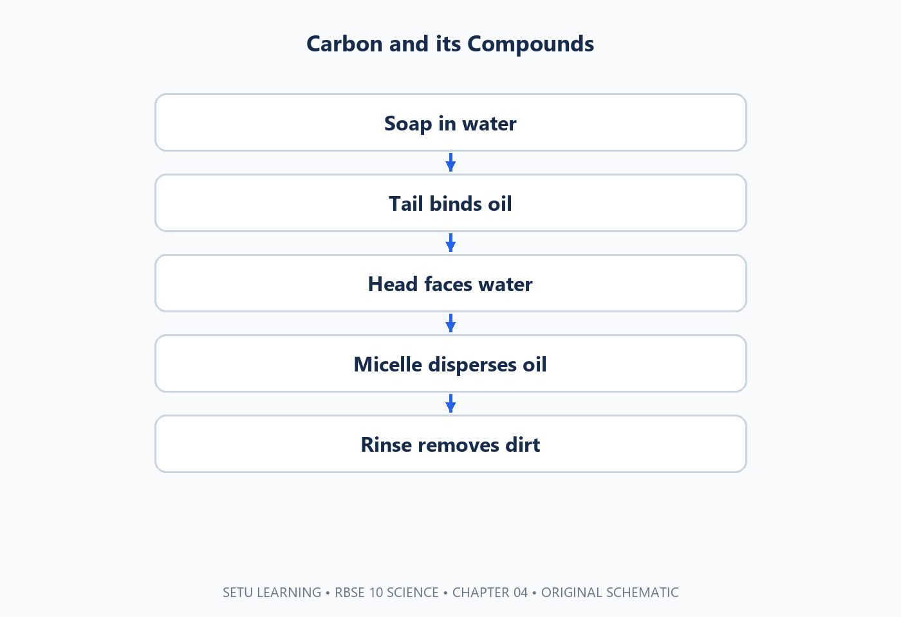

साबुन की cleaning का प्रक्रिया schematic; head/tail orientation का वर्णन पाठ में दिया है।

## भाग 4: पाठ्यपुस्तक-अवधारणाओं पर मौलिक हल किए उदाहरण

नीचे के प्रश्न लेखक के मौलिक मॉडल हैं। ये किसी NCERT edition के प्रश्न क्रमांक या संपूर्ण in-text/exercise solution bank होने का दावा नहीं करते।

**हल किया उदाहरण 1: C₃H₈ का नाम और hydrogen संख्या का कारण दें।**

तीन carbon वाला saturated open-chain compound propane है। Alkane formula CₙH₂ₙ₊₂ में n=3 देने पर H=8 मिलता है। सूत्र को alkene पर लागू न करें।

**हल किया उदाहरण 2: Ethanoic acid और carbonate का समीकरण लिखें।**

2CH₃COOH + Na₂CO₃ → 2CH₃COONa + H₂O + CO₂। Sodium ethanoate salt बनता है। Carbonate के दो negative charges के कारण acid के दो molecules चाहिए।

**हल किया उदाहरण 3: Ethanol से ester बनाने की reaction दें।**

CH₃COOH + C₂H₅OH ⇌ CH₃COOC₂H₅ + H₂O; concentrated H₂SO₄ catalyst और heat की उपस्थिति में ethyl ethanoate बनता है। यह equilibrium reaction है; ether बनने की reaction नहीं।

## भाग 5: सत्यापित बोर्ड प्रश्न एवं स्रोत-स्थिति

इस अध्याय का वर्षवार PYQ audit अभी पूरा नहीं है। अभ्यास प्रश्नों पर काल्पनिक परीक्षा-वर्ष नहीं लगाए गए हैं। [असली 2025 बोर्ड पेपर](https://rajeduboard.rajasthan.gov.in/books/PAPERS-2025/Sec/S-07.pdf) से प्रश्न, उपभाग और अंक मिलाकर ही नया PYQ जोड़ा जाए।

## भाग 6: खंडवार मौलिक अभ्यास बैंक

**अभ्यास-अंक:** लेखक के स्व-अभ्यास के लिए हैं; RBSE की आधिकारिक marking scheme नहीं। उत्तर पहले स्वयं लिखें, फिर भाग 9 देखें।

## अ: बहुविकल्पीय प्रश्न — 15 × 1 अंक

**MCQ 1. Carbon की सामान्य valency क्या है?**

अ) 4  
ब) 1  
स) 2  
द) 3

**MCQ 2. Carbon atoms के chain बनाने के गुण का नाम क्या है?**

अ) Ionisation  
ब) Neutralisation  
स) Corrosion  
द) Catenation

**MCQ 3. Ethene का formula क्या है?**

अ) C₂H₂  
ब) CH₄  
स) C₂H₄  
द) C₂H₆

**MCQ 4. Successive homologues के mass का अंतर कितना है?**

अ) 16 u  
ब) 14 u  
स) 2 u  
द) 12 u

**MCQ 5. Alcohol का functional group कौन है?**

अ) –OH  
ब) –COOH  
स) –CHO  
द) –Cl

**MCQ 6. Ethanoic acid का formula क्या है?**

अ) C₂H₅OH  
ब) CH₄  
स) CH₃CHO  
द) CH₃COOH

**MCQ 7. Methane में कितने single covalent bonds हैं?**

अ) 1  
ब) 8  
स) 4  
द) 2

**MCQ 8. Hydrogenation किसका उदाहरण है?**

अ) Precipitation  
ब) Addition  
स) Substitution  
द) Displacement

**MCQ 9. Methane chlorination में कौन-सी condition उपयोगी है?**

अ) Sunlight  
ब) केवल ice  
स) केवल vacuum  
द) बिना chlorine

**MCQ 10. Soap micelle में heads water की ओर क्यों होते हैं?**

अ) वे nonpolar हैं  
ब) वे metal sheets हैं  
स) वे gas बनाते हैं  
द) वे hydrophilic हैं

**MCQ 11. Hard water में soap का insoluble पदार्थ क्या कहलाता है?**

अ) Ozone  
ब) Alloy  
स) Scum  
द) Ester

**MCQ 12. Ester alkaline hydrolysis का नाम क्या है?**

अ) Galvanisation  
ब) Saponification  
स) Roasting  
द) Sublimation

**MCQ 13. Open-chain alkane का general formula क्या है?**

अ) CₙH₂ₙ₊₂  
ब) CₙH₂ₙ  
स) CₙH₂ₙ₋₂  
द) CₙHₙ

**MCQ 14. Same formula और अलग connectivity को क्या कहते हैं?**

अ) Homology  
ब) Neutralisation  
स) Dispersion  
द) Structural isomerism

**MCQ 15. कम oxygen में carbon combustion का toxic product कौन हो सकता है?**

अ) NaCl  
ब) H₂O ही अनिवार्य  
स) CO  
द) O₂

## अ: रिक्त स्थान — 6 × 1 अंक

1. Carbon की चार covalent bonds बनाने की क्षमता। — इस शब्द/सूत्र का नाम है: ____।  
2. Carbon atoms का आपस में chains/branches/rings बनाना। — इस शब्द/सूत्र का नाम है: ____।  
3. Atoms के बीच electron pairs का sharing। — इस शब्द/सूत्र का नाम है: ____।  
4. Carbon–carbon bonds केवल single; open-chain alkane सूत्र CₙH₂ₙ₊₂। — इस शब्द/सूत्र का नाम है: ____।  
5. कम से कम एक C=C या C≡C bond वाला hydrocarbon। — इस शब्द/सूत्र का नाम है: ____।  
6. समान functional group और समान सामान्य सूत्र वाले compounds की श्रेणी। — इस शब्द/सूत्र का नाम है: ____।

## अ: अतिलघु उत्तर — 8 × 1 अंक

1. Carbon की सामान्य valency क्या है?  
2. Carbon atoms के chain बनाने के गुण का नाम क्या है?  
3. Ethene का formula क्या है?  
4. Successive homologues के mass का अंतर कितना है?  
5. Alcohol का functional group कौन है?  
6. Ethanoic acid का formula क्या है?  
7. Methane में कितने single covalent bonds हैं?  
8. Hydrogenation किसका उदाहरण है?

## ब: लघु उत्तर — 6 × 2 अंक

**B1.** Carbon ionic bond की जगह sharing क्यों करता है?

**B2.** Homologous series की दो विशेषताएँ दें।

**B3.** Addition और substitution का अंतर दें।

**B4.** Ethanol और ethanoic acid में अंतर दें।

**B5.** Soap hard water में कम प्रभावी क्यों है?

**B6.** Incomplete combustion क्यों खतरनाक है?

## स: दीर्घ उत्तर — 4 × 3 अंक

आंतरिक विकल्प अभ्यास: C1 अथवा C2, तथा C3 अथवा C4 चुनें। पुनरावृत्ति में बचा विकल्प भी हल करें। यह लेखक की अभ्यास व्यवस्था है।

**C1.** Methane का electron-sharing विवरण दें।

**C2.** Ethanol की तीन reactions समझाएँ।

**C3.** Esterification और saponification का संबंध दें।

**C4.** Micelle में orientation और cleaning समझाएँ।

## द: विस्तृत उत्तर — 2 × 4 अंक

आंतरिक विकल्प अभ्यास: D1 अथवा D2 चुनें; बाद में दूसरा भी हल करें।

**D1.** Ethane, ethene और ethyne की bonding, formula और hydrogenation की तुलना करें।

**D2.** साबुन की cleaning का चित्रात्मक वर्णन तथा hard water की सीमा लिखें।

## भाग 7: सावधानियाँ एवं परीक्षा-त्रुटियाँ

- Alkane का formula ring compounds पर बिना जाँच न लगाएँ।
- –OH और –COOH अलग हैं।
- Esterification और ether formation न मिलाएँ।
- Soap head water की ओर होता है, tail नहीं।
- Detergent को हमेशा biodegradable न लिखें।

## भाग 8: फटाफट पुनरावृत्ति — 25 बिंदु

1. चतुःसंयोजकता: Carbon की चार covalent bonds बनाने की क्षमता।  
2. शृंखलन (Catenation): Carbon atoms का आपस में chains/branches/rings बनाना।  
3. सहसंयोजी आबंध: Atoms के बीच electron pairs का sharing।  
4. संतृप्त hydrocarbon: Carbon–carbon bonds केवल single; open-chain alkane सूत्र CₙH₂ₙ₊₂।  
5. असंतृप्त hydrocarbon: कम से कम एक C=C या C≡C bond वाला hydrocarbon।  
6. समजातीय श्रेणी: समान functional group और समान सामान्य सूत्र वाले compounds की श्रेणी।  
7. प्रकार्यात्मक समूह: Compound के characteristic chemical properties निर्धारित करने वाला group।  
8. Ethanol: C₂H₅OH; alcohol functional group –OH।  
9. Ethanoic acid: CH₃COOH; carboxylic acid functional group –COOH।  
10. Micelle: Water में soap tails अंदर और ionic heads बाहर वाली aggregate संरचना।  
11. Carbon चार electron pairs share करके सामान्यतः चार covalent bonds बनाता है।  
12. Catenation same element atoms के परस्पर जुड़ने की क्षमता है।  
13. Ethene के दो carbon के बीच double bond है और चार hydrogen हैं।  
14. CH₂ का mass 12 + 2 = 14 u है।  
15. Alcohol में hydroxyl group –OH characteristic है।  
16. Ethanoic acid में carboxyl group –COOH होता है।  
17. चार C–H shared pairs चार single covalent bonds बनाते हैं।  
18. Hydrogen unsaturated carbon bond पर जुड़कर saturation बढ़ाता है।  
19. Sunlight substitution reaction शुरू करने में सहायता करती है।  
20. Ionic heads water से interaction करते हैं और tails grease की ओर रहते हैं।  
21. Ca/Mg के insoluble fatty-acid salts scum बनाते हैं।  
22. Saponification ester का alkali से hydrolysis है।  
23. केवल acyclic saturated alkanes के लिए CₙH₂ₙ₊₂ लागू है।  
24. Structural isomers में molecular formula समान, atom connections अलग हैं।  
25. Incomplete combustion carbon monoxide दे सकती है, जो toxic है।

## भाग 9: संपूर्ण अभ्यास उत्तर-कुंजी

## MCQ: सही विकल्प और कारण

**1. अ — 4।** Carbon चार electron pairs share करके सामान्यतः चार covalent bonds बनाता है।

**2. द — Catenation।** Catenation same element atoms के परस्पर जुड़ने की क्षमता है।

**3. स — C₂H₄।** Ethene के दो carbon के बीच double bond है और चार hydrogen हैं।

**4. ब — 14 u।** CH₂ का mass 12 + 2 = 14 u है।

**5. अ — –OH।** Alcohol में hydroxyl group –OH characteristic है।

**6. द — CH₃COOH।** Ethanoic acid में carboxyl group –COOH होता है।

**7. स — 4।** चार C–H shared pairs चार single covalent bonds बनाते हैं।

**8. ब — Addition।** Hydrogen unsaturated carbon bond पर जुड़कर saturation बढ़ाता है।

**9. अ — Sunlight।** Sunlight substitution reaction शुरू करने में सहायता करती है।

**10. द — वे hydrophilic हैं।** Ionic heads water से interaction करते हैं और tails grease की ओर रहते हैं।

**11. स — Scum।** Ca/Mg के insoluble fatty-acid salts scum बनाते हैं।

**12. ब — Saponification।** Saponification ester का alkali से hydrolysis है।

**13. अ — CₙH₂ₙ₊₂।** केवल acyclic saturated alkanes के लिए CₙH₂ₙ₊₂ लागू है।

**14. द — Structural isomerism।** Structural isomers में molecular formula समान, atom connections अलग हैं।

**15. स — CO।** Incomplete combustion carbon monoxide दे सकती है, जो toxic है।

**रिक्त स्थान:** 1. चतुःसंयोजकता; 2. शृंखलन (Catenation); 3. सहसंयोजी आबंध; 4. संतृप्त hydrocarbon; 5. असंतृप्त hydrocarbon; 6. समजातीय श्रेणी

**अतिलघु उत्तर:**

1. 4। Carbon चार electron pairs share करके सामान्यतः चार covalent bonds बनाता है।

2. Catenation। Catenation same element atoms के परस्पर जुड़ने की क्षमता है।

3. C₂H₄। Ethene के दो carbon के बीच double bond है और चार hydrogen हैं।

4. 14 u। CH₂ का mass 12 + 2 = 14 u है।

5. –OH। Alcohol में hydroxyl group –OH characteristic है।

6. CH₃COOH। Ethanoic acid में carboxyl group –COOH होता है।

7. 4। चार C–H shared pairs चार single covalent bonds बनाते हैं।

8. Addition। Hydrogen unsaturated carbon bond पर जुड़कर saturation बढ़ाता है।

**B1. Carbon ionic bond की जगह sharing क्यों करता है?**

चार electrons खोने में बहुत ऊर्जा और चार पाने पर nucleus के लिए अतिरिक्त electrons संभालना कठिन है। Sharing से valence shell भरता है। इसलिए carbon compounds में covalent bonding प्रमुख है; यह carbon की tetravalency से जुड़ा है।

**B2. Homologous series की दो विशेषताएँ दें।**

सभी members का functional group और general formula समान होता है। पास-पास members में CH₂ और 14 u का अंतर होता है। Chemical properties समान दिशा में, physical properties क्रमिक ढंग से बदलती हैं।

**B3. Addition और substitution का अंतर दें।**

Addition में unsaturated bond पर atoms जुड़ते हैं, जैसे ethene + H₂ से ethane। Substitution में atom/group के स्थान पर दूसरा आता है, जैसे sunlight में methane का H chlorine से बदलता है। दोनों में reaction conditions लिखें।

**B4. Ethanol और ethanoic acid में अंतर दें।**

Ethanol में –OH और ethanoic acid में –COOH group है। Acid carbonate से CO₂ निकालता है, alcohol ऐसा सामान्यतः नहीं करता। दोनों organic compounds हैं, लेकिन उनके functional groups के कारण chemical properties अलग हैं।

**B5. Soap hard water में कम प्रभावी क्यों है?**

Ca²⁺ और Mg²⁺ soap के साथ insoluble salts बनाकर scum देते हैं। इससे cleaning के लिए उपलब्ध soap कम हो जाता है। Detergent formulation ऐसी insoluble precipitation को कम कर सकती है।

**B6. Incomplete combustion क्यों खतरनाक है?**

कम oxygen में carbon monoxide बन सकती है; यह रंगहीन gas रक्त की oxygen-carrying क्षमता को बाधित करती है। बंद कमरे में ईंधन जलाना खतरा बढ़ाता है। नीली/पीली flame से alone safety का पूर्ण निर्णय न लें।

**C1. Methane का electron-sharing विवरण दें।**

1. Carbon के चार valence electrons हैं। 2. चार H atoms अपना एक-एक electron share करते हैं। 3. चार shared pairs से चार single covalent bonds बनते हैं; carbon octet और हर H duplet प्राप्त करता है। CH₄ में double bond नहीं।

**C2. Ethanol की तीन reactions समझाएँ।**

1. Combustion: C₂H₅OH + 3O₂ → 2CO₂ + 3H₂O। 2. Sodium reaction hydrogen तथा sodium ethoxide देती है। 3. Suitable oxidant से ethanol का oxidation ethanoic acid तक होता है। Conditions और उत्पादों को अलग रखें।

**C3. Esterification और saponification का संबंध दें।**

1. Alcohol और carboxylic acid से ester + water बनते हैं। 2. उपयुक्त alkali से ester hydrolysis में alcohol और carboxylate salt मिलते हैं। 3. Fat/oil के alkaline hydrolysis से soap बनाना इसी प्रकार का उपयोग है।

**C4. Micelle में orientation और cleaning समझाएँ।**

1. Nonpolar tails grease/oil में भीतर की ओर। 2. Charged hydrophilic heads बाहर water में। 3. Grease droplets dispersed होकर rinsing में निकलते हैं। Soap dirt को chemical combustion से नष्ट नहीं करता।

**D1. Ethane, ethene और ethyne की bonding, formula और hydrogenation की तुलना करें।**

1. Ethane C₂H₆ में C–C single bond और saturation है। 2. Ethene C₂H₄ में double, ethyne C₂H₂ में triple bond है। 3. Unsaturated compounds hydrogen addition कर सकते हैं, catalyst सहित। 4. Ethene + H₂ → ethane; ethyne की पूर्ण hydrogenation में 2H₂ चाहिए। Hydrogen संख्या और bonds दोनों तुलना में दें।

**D2. साबुन की cleaning का चित्रात्मक वर्णन तथा hard water की सीमा लिखें।**

1. एक गोल grease droplet बनाएँ। 2. Tails droplet के भीतर, ionic heads बाहर water की ओर दिखाएँ। 3. Micelle oil को disperse करता है और rinsing हटाती है। 4. Hard-water ions insoluble scum बनाते हैं, इसलिए detergent विकल्प उपयोगी हो सकता है। चित्र surface aggregate का schematic है, single soap molecule का आकार नहीं।

## भाग 10: 10 मिनट / 10 अंक आत्म-मूल्यांकन एवं संदर्भ

समय: 10 मिनट। पहले पुस्तक बंद करें।

1. MCQ 3 और 11 हल करें। (1 + 1)
2. B2 और B5 के उत्तर लिखें। (2 + 2)
3. D1 हल करें। (4)

**कुंजी:** भाग 9 में संबंधित क्रमांक देखें। **स्व-मूल्यांकन:** 8–10: आगे बढ़ें; 5–7: छूटे कौशल का दोहराव; 0–4: भाग 2–4 फिर पढ़ें। यह अभ्यास-सुझाव है, बोर्ड grade नहीं।

[सत्यापित RBSE 2025–26 पाठ्यक्रम](https://rajeduboard.rajasthan.gov.in/anudeshika-etc/10_2026.pdf) · [NCERT विज्ञान अध्याय 4](https://ncert.nic.in/textbook/pdf/jesc104.pdf)

**आगे की कड़ी:** जैव प्रक्रम में carbohydrates, fats और energy release की भूमिका पढ़ेंगे।

---

# अध्याय 5: जैव प्रक्रम (Life Processes)

## भाग 1: अध्याय प्रवेश एवं पाठ्यक्रम मैपिंग

> प्रथम संपादकीय प्रारूप। NCERT के सभी प्रश्नों के हल तथा पूरा ऐतिहासिक PYQ संग्रह अभी स्रोत-परीक्षण में हैं। सामान्य माध्यमिक 2026–27 पाठ्यक्रम की पुनः पुष्टि शेष है।

**विषय कोड:** 07 · **श्रृंखला पुस्तक:** 2

**सत्यापित आधार:** RBSE 2025–26 · **अध्याय भार:** 8 अंक। यह भार उसी संस्करण का है; वास्तविक प्रश्न-विभाजन की भविष्यवाणी नहीं।

**सीखने के लक्ष्य:** Nutrition, respiration, transport और excretion को जोड़ना; human और plant pathways की तुलना; heart तथा nephron के functional stages बताना।

## भाग 2: शब्दावली एवं अवधारणा कैप्सूल

| शब्द / सूत्र | अर्थ / उपयोग |
|---|---|
| स्वपोषण | Inorganic पदार्थों से अपना organic food बनाना। |
| प्रकाश संश्लेषण | Light energy से CO₂ और water से carbohydrate बनना। |
| रंध्र (Stomata) | पत्ती में guard cells द्वारा नियंत्रित pores। |
| पेरिस्टाल्सिस | Alimentary canal की wave-like contractions से food movement। |
| श्वसन (Respiration) | Food से usable energy प्राप्त करने की cellular प्रक्रिया। |
| Alveoli | Lungs में thin-walled air sacs, gas exchange का स्थल। |
| Double circulation | एक पूर्ण circuit में blood का heart से दो बार गुजरना। |
| Xylem | Water/minerals का मुख्य conducting tissue। |
| Phloem | Food का source से sink तक translocation tissue। |
| Nephron | Kidney की functional filtration/reabsorption unit। |

## भाग 3: विस्तृत शिक्षण पाठ

### जीवन बनाए रखने के प्रक्रम
जीवों को molecules, energy और waste removal लगातार चाहिए। Nutrition भोजन उपलब्ध करता है; respiration उसकी ऊर्जा usable रूप में देता है; transport सामग्री पहुँचाता है; excretion metabolic waste हटाता है। किसी जीव में बाहरी movement न दिखने पर भी cell-level activity जारी रह सकती है। पौधों में simplified photosynthesis equation $6CO_2 + 6H_2O \rightarrow C_6H_{12}O_6 + 6O_2$ है; light और chlorophyll आवश्यक conditions हैं। रंध्र CO₂ exchange और transpiration में काम करते हैं।

### भोजन से absorption तक
Mouth में chewing और salivary amylase starch breakdown शुरू करते हैं। Oesophagus में peristalsis भोजन ले जाता है। Stomach का HCl acidic medium देता है; pepsin protein पर काम करता है और mucus lining की रक्षा करता है। Small intestine में bile fat को छोटे droplets में emulsify करता है; bile enzyme नहीं है। Pancreatic enzymes और intestinal enzymes digestion आगे बढ़ाते हैं। Villi surface area बढ़ाकर nutrients absorb करते हैं। Large intestine मुख्यतः water absorption में मदद करता है।

### Respiration और gas exchange
Glucose पहले cytoplasm में 3-carbon pyruvate बनाता है। Oxygen की उपलब्धता में mitochondria में आगे breakdown से CO₂, H₂O और अधिक usable energy बनती है। Yeast में ethanol + CO₂, oxygen deficit में muscles में lactate बन सकता है। Breathing air movement है; respiration cellular chemical process। Alveolar thin walls, large area और capillaries diffusion में मदद करते हैं। Haemoglobin oxygen transport करता है; अधिकांश CO₂ अन्य रूपों सहित blood में transport होती है।

### Circulation, plants और excretion
Right heart deoxygenated blood lungs को और left heart oxygenated blood body को भेजता है। Valves backflow रोकते हैं। Pulmonary artery deoxygenated और pulmonary vein oxygenated blood लेती है; artery/vein नाम दिशा से है। Plants में root uptake और transpiration pull xylem transport में मदद करते हैं। Phloem source–sink movement ATP उपयोग कर सकता है और दिशा जरूरत के अनुसार होती है। Nephron में glomerular filtration, selective reabsorption तथा tubular secretion urine बनाते हैं। Urine kidney → ureter → bladder → urethra चलता है। Plants gases, storage, leaf shedding और resins/gums से wastes संभालते हैं।

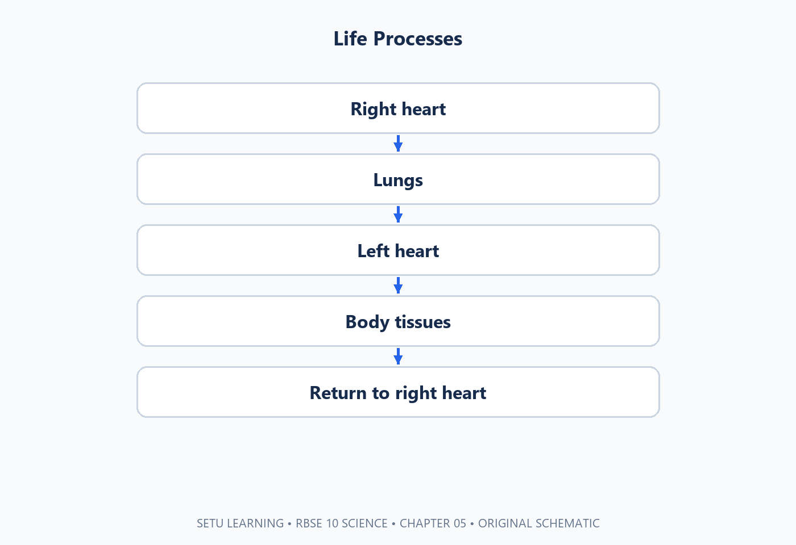

Double circulation का क्रम-चित्र। यह मार्ग दिखाता है; anatomical heart diagram नहीं।

## भाग 4: पाठ्यपुस्तक-अवधारणाओं पर मौलिक हल किए उदाहरण

नीचे के प्रश्न लेखक के मौलिक मॉडल हैं। ये किसी NCERT edition के प्रश्न क्रमांक या संपूर्ण in-text/exercise solution bank होने का दावा नहीं करते।

**हल किया उदाहरण 1: Heart में blood का पूरा मार्ग लिखें।**

Body → venae cavae → right atrium → right ventricle → pulmonary artery → lungs → pulmonary veins → left atrium → left ventricle → aorta → body। हर chamber और lung passage को क्रम में रखें।

**हल किया उदाहरण 2: Yeast के anaerobic breakdown का result दें।**

Glucose → ethanol + CO₂ + energy। शुरू में glycolysis cytoplasm में होती है। Yeast के उत्पादों को human muscle से न मिलाएँ; muscle oxygen deficit में lactate बन सकता है।

**हल किया उदाहरण 3: Absorption के लिए villi उपयुक्त क्यों हैं?**

Villi और microvilli area बढ़ाते हैं। Thin epithelium तथा capillary supply nutrient uptake में मदद करते हैं। Digestion बड़े molecules को छोटे करता है; absorption छोटे molecules को body fluids तक पहुँचाता है।

## भाग 5: सत्यापित बोर्ड प्रश्न एवं स्रोत-स्थिति

इस अध्याय का वर्षवार PYQ audit अभी पूरा नहीं है। अभ्यास प्रश्नों पर काल्पनिक परीक्षा-वर्ष नहीं लगाए गए हैं। [असली 2025 बोर्ड पेपर](https://rajeduboard.rajasthan.gov.in/books/PAPERS-2025/Sec/S-07.pdf) से प्रश्न, उपभाग और अंक मिलाकर ही नया PYQ जोड़ा जाए।

## भाग 6: खंडवार मौलिक अभ्यास बैंक

**अभ्यास-अंक:** लेखक के स्व-अभ्यास के लिए हैं; RBSE की आधिकारिक marking scheme नहीं। उत्तर पहले स्वयं लिखें, फिर भाग 9 देखें।

## अ: बहुविकल्पीय प्रश्न — 15 × 1 अंक

**MCQ 1. Photosynthesis में carbon source क्या है?**

अ) O₂  
ब) N₂  
स) NaCl  
द) CO₂

**MCQ 2. Salivary amylase मुख्यतः किस पर काम करता है?**

अ) Cellulose  
ब) DNA  
स) Starch  
द) Fat

**MCQ 3. Bile कहाँ बनता है?**

अ) Lungs  
ब) Liver  
स) Stomach  
द) Kidney

**MCQ 4. Bile का मुख्य fat-related काम क्या है?**

अ) Emulsification  
ब) Protein digestion  
स) Urea formation  
द) Oxygen transport

**MCQ 5. Pyruvate का प्रथम निर्माण कहाँ होता है?**

अ) केवल nucleus  
ब) केवल lungs  
स) केवल kidney  
द) Cytoplasm

**MCQ 6. Yeast में anaerobic products कौन-से हैं?**

अ) O₂ और water  
ब) Urea और ammonia  
स) Ethanol और CO₂  
द) Lactate ही

**MCQ 7. Lungs में gas exchange का मुख्य स्थल क्या है?**

अ) Villi  
ब) Alveoli  
स) Oesophagus  
द) Ureter

**MCQ 8. Pulmonary artery blood कहाँ ले जाती है?**

अ) Heart से lungs  
ब) Lungs से heart  
स) Kidney से bladder  
द) Liver से stomach

**MCQ 9. Left ventricle से body में कौन-सी vessel जाती है?**

अ) Pulmonary vein  
ब) Vena cava  
स) Ureter  
द) Aorta

**MCQ 10. Water/minerals का मुख्य plant tissue क्या है?**

अ) Epidermis ही  
ब) Pollen  
स) Xylem  
द) Phloem

**MCQ 11. Plant food translocation का tissue क्या है?**

अ) Cartilage  
ब) Phloem  
स) Xylem  
द) Bone

**MCQ 12. Kidney की functional unit क्या है?**

अ) Nephron  
ब) Neuron  
स) Alveolus  
द) Villus

**MCQ 13. Kidney से bladder जाने वाली tube क्या है?**

अ) Urethra  
ब) Trachea  
स) Aorta  
द) Ureter

**MCQ 14. Undigested food का निष्कासन क्या है?**

अ) Photosynthesis  
ब) Transpiration  
स) Egestion  
द) Excretion ही

**MCQ 15. Villi का मुख्य लाभ क्या है?**

अ) Nerve impulses देना  
ब) Absorption area बढ़ाना  
स) Blood pump करना  
द) Urine बनाना

## अ: रिक्त स्थान — 6 × 1 अंक

1. Inorganic पदार्थों से अपना organic food बनाना। — इस शब्द/सूत्र का नाम है: ____।  
2. Light energy से CO₂ और water से carbohydrate बनना। — इस शब्द/सूत्र का नाम है: ____।  
3. पत्ती में guard cells द्वारा नियंत्रित pores। — इस शब्द/सूत्र का नाम है: ____।  
4. Alimentary canal की wave-like contractions से food movement। — इस शब्द/सूत्र का नाम है: ____।  
5. Food से usable energy प्राप्त करने की cellular प्रक्रिया। — इस शब्द/सूत्र का नाम है: ____।  
6. Lungs में thin-walled air sacs, gas exchange का स्थल। — इस शब्द/सूत्र का नाम है: ____।

## अ: अतिलघु उत्तर — 8 × 1 अंक

1. Photosynthesis में carbon source क्या है?  
2. Salivary amylase मुख्यतः किस पर काम करता है?  
3. Bile कहाँ बनता है?  
4. Bile का मुख्य fat-related काम क्या है?  
5. Pyruvate का प्रथम निर्माण कहाँ होता है?  
6. Yeast में anaerobic products कौन-से हैं?  
7. Lungs में gas exchange का मुख्य स्थल क्या है?  
8. Pulmonary artery blood कहाँ ले जाती है?

## ब: लघु उत्तर — 6 × 2 अंक

**B1.** Autotrophic और heterotrophic nutrition का अंतर दें।

**B2.** Bile का कार्य और enzyme से अंतर बताइए।

**B3.** Breathing और respiration का अंतर क्या है?

**B4.** Artery और vein की परिभाषा दें।

**B5.** Xylem और phloem की तुलना करें।

**B6.** Excretion और egestion अलग कैसे हैं?

## स: दीर्घ उत्तर — 4 × 3 अंक

आंतरिक विकल्प अभ्यास: C1 अथवा C2, तथा C3 अथवा C4 चुनें। पुनरावृत्ति में बचा विकल्प भी हल करें। यह लेखक की अभ्यास व्यवस्था है।

**C1.** Human small intestine के digestion/absorption के तीन बिंदु दें।

**C2.** Double circulation की functional आवश्यकता बताएँ।

**C3.** Urine formation के तीन stages लिखें।

**C4.** Stomata के दो कार्य और guard cells की भूमिका दें।

## द: विस्तृत उत्तर — 2 × 4 अंक

आंतरिक विकल्प अभ्यास: D1 अथवा D2 चुनें; बाद में दूसरा भी हल करें।

**D1.** Human oxygen supply को breathing से cellular energy तक चार चरणों में समझाएँ।

**D2.** Nephron का schematic बनाने के labels तथा function लिखें।

## भाग 7: सावधानियाँ एवं परीक्षा-त्रुटियाँ

- Bile enzyme नहीं है।
- Artery/vein को oxygen content से परिभाषित न करें।
- Ureter और urethra अलग हैं।
- Yeast में ethanol, muscles में lactate याद रखें।
- Excretion और egestion न मिलाएँ।

## भाग 8: फटाफट पुनरावृत्ति — 25 बिंदु

1. स्वपोषण: Inorganic पदार्थों से अपना organic food बनाना।  
2. प्रकाश संश्लेषण: Light energy से CO₂ और water से carbohydrate बनना।  
3. रंध्र (Stomata): पत्ती में guard cells द्वारा नियंत्रित pores।  
4. पेरिस्टाल्सिस: Alimentary canal की wave-like contractions से food movement।  
5. श्वसन (Respiration): Food से usable energy प्राप्त करने की cellular प्रक्रिया।  
6. Alveoli: Lungs में thin-walled air sacs, gas exchange का स्थल।  
7. Double circulation: एक पूर्ण circuit में blood का heart से दो बार गुजरना।  
8. Xylem: Water/minerals का मुख्य conducting tissue।  
9. Phloem: Food का source से sink तक translocation tissue।  
10. Nephron: Kidney की functional filtration/reabsorption unit।  
11. Plant carbohydrate का carbon atmospheric/available CO₂ से लेता है।  
12. Mouth में amylase starch digestion शुरू करता है।  
13. Bile liver में बनता और gall bladder में stored हो सकता है।  
14. Emulsification बड़े fat droplets छोटे करता है; bile enzyme नहीं।  
15. Glycolysis cytoplasm में glucose को pyruvate में बदलती है।  
16. Yeast fermentation ethanol तथा carbon dioxide देता है।  
17. Alveoli की बड़ी thin-walled surface gas diffusion में मदद करती है।  
18. Pulmonary artery right ventricle से lungs को deoxygenated blood ले जाती है।  
19. Aorta systemic circulation के लिए oxygenated blood ले जाती है।  
20. Xylem root से water और dissolved minerals का transport करता है।  
21. Phloem source से sink तक photosynthates ले जाता है।  
22. Nephron filtration, reabsorption और secretion में काम करता है।  
23. Ureter kidney का urine bladder तक पहुँचाता है; urethra बाहर ले जाती है।  
24. Egestion undigested food हटाना है, metabolic waste removal नहीं।  
25. Villi intestine का nutrient-absorbing surface area बढ़ाते हैं।

## भाग 9: संपूर्ण अभ्यास उत्तर-कुंजी

## MCQ: सही विकल्प और कारण

**1. द — CO₂।** Plant carbohydrate का carbon atmospheric/available CO₂ से लेता है।

**2. स — Starch।** Mouth में amylase starch digestion शुरू करता है।

**3. ब — Liver।** Bile liver में बनता और gall bladder में stored हो सकता है।

**4. अ — Emulsification।** Emulsification बड़े fat droplets छोटे करता है; bile enzyme नहीं।

**5. द — Cytoplasm।** Glycolysis cytoplasm में glucose को pyruvate में बदलती है।

**6. स — Ethanol और CO₂।** Yeast fermentation ethanol तथा carbon dioxide देता है।

**7. ब — Alveoli।** Alveoli की बड़ी thin-walled surface gas diffusion में मदद करती है।

**8. अ — Heart से lungs।** Pulmonary artery right ventricle से lungs को deoxygenated blood ले जाती है।

**9. द — Aorta।** Aorta systemic circulation के लिए oxygenated blood ले जाती है।

**10. स — Xylem।** Xylem root से water और dissolved minerals का transport करता है।

**11. ब — Phloem।** Phloem source से sink तक photosynthates ले जाता है।

**12. अ — Nephron।** Nephron filtration, reabsorption और secretion में काम करता है।

**13. द — Ureter।** Ureter kidney का urine bladder तक पहुँचाता है; urethra बाहर ले जाती है।

**14. स — Egestion।** Egestion undigested food हटाना है, metabolic waste removal नहीं।

**15. ब — Absorption area बढ़ाना।** Villi intestine का nutrient-absorbing surface area बढ़ाते हैं।

**रिक्त स्थान:** 1. स्वपोषण; 2. प्रकाश संश्लेषण; 3. रंध्र (Stomata); 4. पेरिस्टाल्सिस; 5. श्वसन (Respiration); 6. Alveoli

**अतिलघु उत्तर:**

1. CO₂। Plant carbohydrate का carbon atmospheric/available CO₂ से लेता है।

2. Starch। Mouth में amylase starch digestion शुरू करता है।

3. Liver। Bile liver में बनता और gall bladder में stored हो सकता है।

4. Emulsification। Emulsification बड़े fat droplets छोटे करता है; bile enzyme नहीं।

5. Cytoplasm। Glycolysis cytoplasm में glucose को pyruvate में बदलती है।

6. Ethanol और CO₂। Yeast fermentation ethanol तथा carbon dioxide देता है।

7. Alveoli। Alveoli की बड़ी thin-walled surface gas diffusion में मदद करती है।

8. Heart से lungs। Pulmonary artery right ventricle से lungs को deoxygenated blood ले जाती है।

**B1. Autotrophic और heterotrophic nutrition का अंतर दें।**

Autotrophs CO₂ जैसे inorganic sources से organic food बनाते हैं। Heterotrophs अन्य organisms से organic food लेते हैं। Green plants photosynthetic autotrophs हैं; humans heterotrophs। दोनों को cellular respiration से usable energy चाहिए।

**B2. Bile का कार्य और enzyme से अंतर बताइए।**

Bile liver में बनता और gall bladder में संग्रहित होता है। यह fats को छोटे droplets में emulsify करता तथा acidic chyme के neutralisation में मदद करता है। इसमें digestive enzymes नहीं; emulsification enzyme action के लिए area बढ़ाती है।

**B3. Breathing और respiration का अंतर क्या है?**

Breathing air को lungs में लाने-ले जाने की physical प्रक्रिया है। Cellular respiration food molecules से usable energy मिलने की chemical प्रक्रिया है। Aerobic respiration में oxygen उपयोगी है, पर हर respiration oxygen-dependent नहीं।

**B4. Artery और vein की परिभाषा दें।**

Arteries blood को heart से दूर और veins heart की ओर ले जाती हैं। Oxygen content पर परिभाषा आधारित नहीं। Pulmonary artery deoxygenated तथा pulmonary vein oxygenated blood लेती है, इसलिए ‘सभी arteries oxygenated’ गलत है।

**B5. Xylem और phloem की तुलना करें।**

Xylem water/minerals मुख्यतः roots से ऊपर transport करता है; transpiration pull महत्त्वपूर्ण है। Phloem organic food source से sink ले जाता है और ATP का उपयोग कर सकता है। Food movement केवल नीचे ही हो, ऐसा जरूरी नहीं।

**B6. Excretion और egestion अलग कैसे हैं?**

Excretion metabolic wastes हटाना है, जैसे kidney द्वारा nitrogenous waste। Egestion undigested food को anus से निकालना है। दोनों unwanted material हटाते हैं, पर उत्पत्ति तथा संबंधित organs अलग हैं।

**C1. Human small intestine के digestion/absorption के तीन बिंदु दें।**

1. Bile fat emulsification तथा pancreatic enzymes breakdown में मदद करते हैं। 2. Intestinal enzymes absorbable molecules बनाते हैं। 3. Villi large area और vessels देकर uptake संभव करते हैं; digestion और absorption क्रमशः chemical breakdown और transfer हैं।

**C2. Double circulation की functional आवश्यकता बताएँ।**

1. Pulmonary circuit right ventricle से lungs होकर left atrium आता है। 2. Systemic circuit left ventricle से body होकर right atrium आता है। 3. चार chambers oxygenated और deoxygenated blood का mixing घटाते हैं और oxygen supply कुशल बनाते हैं।

**C3. Urine formation के तीन stages लिखें।**

1. Glomerulus में pressure filtration से filtrate बनता है। 2. Tubule useful substances और आवश्यक water selectively reabsorb करता है। 3. Tubular secretion अतिरिक्त wastes/ions जोड़ सकती है; शेष fluid urine बनता है। सभी filtered water का निकलना आवश्यक नहीं।

**C4. Stomata के दो कार्य और guard cells की भूमिका दें।**

1. CO₂/O₂ exchange होता है। 2. Water vapour loss transpiration में योगदान करता है। 3. Guard-cell turgor aperture नियंत्रित करता है; opening–closing की परिस्थितियाँ species और environment पर निर्भर करती हैं।

**D1. Human oxygen supply को breathing से cellular energy तक चार चरणों में समझाएँ।**

1. Inhalation air alveoli तक लाती है। 2. Oxygen alveolar wall पार करके capillary blood में diffuses होती है। 3. Haemoglobin और circulation oxygen tissues तक ले जाते हैं। 4. Cells aerobic respiration में oxygen उपयोग कर food से energy प्राप्त करते हैं। CO₂ reverse दिशा से lungs लौटती है; breathing और respiration को एक stage न मानें।

**D2. Nephron का schematic बनाने के labels तथा function लिखें।**

1. Glomerulus को Bowman's capsule के भीतर filtration स्थल दिखाएँ। 2. Tubule और capillary interface पर reabsorption arrow दिखाएँ। 3. Tubule से collecting duct तथा urine flow का मार्ग दिखाएँ। 4. Tubular secretion को blood से tubule की ओर अलग arrow दें। यह functional schematic है; kidney का anatomical cross-section नहीं।

## भाग 10: 10 मिनट / 10 अंक आत्म-मूल्यांकन एवं संदर्भ

समय: 10 मिनट। पहले पुस्तक बंद करें।

1. MCQ 3 और 11 हल करें। (1 + 1)
2. B2 और B5 के उत्तर लिखें। (2 + 2)
3. D1 हल करें। (4)

**कुंजी:** भाग 9 में संबंधित क्रमांक देखें। **स्व-मूल्यांकन:** 8–10: आगे बढ़ें; 5–7: छूटे कौशल का दोहराव; 0–4: भाग 2–4 फिर पढ़ें। यह अभ्यास-सुझाव है, बोर्ड grade नहीं।

[सत्यापित RBSE 2025–26 पाठ्यक्रम](https://rajeduboard.rajasthan.gov.in/anudeshika-etc/10_2026.pdf) · [NCERT विज्ञान अध्याय 5](https://ncert.nic.in/textbook/pdf/jesc105.pdf)

**आगे की कड़ी:** अगले अध्याय में इन्हीं processes का nervous और hormonal नियंत्रण पढ़ेंगे।

---

# अध्याय 6: नियंत्रण एवं समन्वय (Control and Coordination)

## भाग 1: अध्याय प्रवेश एवं पाठ्यक्रम मैपिंग

> प्रथम संपादकीय प्रारूप। NCERT के सभी प्रश्नों के हल तथा पूरा ऐतिहासिक PYQ संग्रह अभी स्रोत-परीक्षण में हैं। सामान्य माध्यमिक 2026–27 पाठ्यक्रम की पुनः पुष्टि शेष है।

**विषय कोड:** 07 · **श्रृंखला पुस्तक:** 2

**सत्यापित आधार:** RBSE 2025–26 · **अध्याय भार:** 6 अंक। यह भार उसी संस्करण का है; वास्तविक प्रश्न-विभाजन की भविष्यवाणी नहीं।

**सीखने के लक्ष्य:** Neuron और reflex pathway समझना; brain functions, plant movements और endocrine feedback की तुलना करना।

## भाग 2: शब्दावली एवं अवधारणा कैप्सूल

| शब्द / सूत्र | अर्थ / उपयोग |
|---|---|
| Neuron | Nervous system की impulse-transmitting cell। |
| Dendrite | Neuron का संकेत ग्रहण करने वाला branched भाग। |
| Axon | Cell body से impulse आगे ले जाने वाला लंबा भाग। |
| Synapse | दो neurons अथवा neuron और target के बीच functional junction। |
| Reflex action | उद्दीपन की तीव्र automatic प्रतिक्रिया। |
| Cerebrum | Forebrain का भाग; conscious activities और interpretation में भूमिका। |
| Cerebellum | Balance, posture और movements की precision में भूमिका। |
| Tropism | Stimulus की दिशा से संबंधित growth movement। |
| Hormone | Endocrine gland का chemical messenger, blood से target तक जाता है। |
| Feedback | Response के अनुसार hormone secretion का नियमन। |

## भाग 3: विस्तृत शिक्षण पाठ

### संकेत का मार्ग
Stimulus को receptor पहचानता है। Neuron में dendrite → cell body → axon दिशा में electrical signal आगे जाता है। Chemical synapse पर axon terminal neurotransmitter छोड़ता है; अगली cell के receptor signal ग्रहण करते हैं। इसलिए synaptic crossing chemical और cell के भीतर conduction electrical होती है। Motor neuron effector muscle/gland तक संदेश ले जाता है।

### Reflex और brain
गर्म वस्तु से हाथ हटाने में receptor → sensory neuron → spinal relay → motor neuron → muscle का reflex arc काम कर सकता है। Brain बाद में/साथ में जानकारी प्राप्त करता है; ‘brain को कभी पता नहीं चलता’ गलत है। Cerebrum conscious thinking और sensory interpretation में, cerebellum balance तथा precision में, medulla breathing जैसे involuntary functions में काम करता है। Skull, meninges और cerebrospinal fluid protection देते हैं।

### Plants में coordination
Shoot का light की ओर growth positive phototropism है। Auxin shaded side पर अधिक elongation कराकर shoot को light की ओर मोड़ सकता है। Root सामान्यतः positive gravitropism, shoot negative gravitropism दिखाता है। Tendril touch के अनुसार grows: thigmotropism। Mimosa leaf folding turgor change से होता है; यह growth-based tropism नहीं। Auxin elongation, gibberellin stem growth, cytokinin cell division और ABA growth inhibition/stomatal closure से जुड़े हैं।

### Hormones और feedback
Pituitary growth hormone, thyroid thyroxine, pancreas insulin और adrenal glands adrenaline देते हैं। Thyroxine synthesis के लिए iodine जरूरी है। Insulin blood glucose control में मदद करता है; हर diabetes केवल insulin की पूर्ण अनुपस्थिति नहीं। Adrenaline fight-or-flight में heart rate और respiratory activity जैसे responses बढ़ा सकता है। Blood glucose बढ़ने पर insulin secretion बढ़ना और glucose normal होने पर घटना feedback का उदाहरण है। Hormonal responses अक्सर nervous signalling से धीमे, पर लंबे समय तक प्रभावी होते हैं।

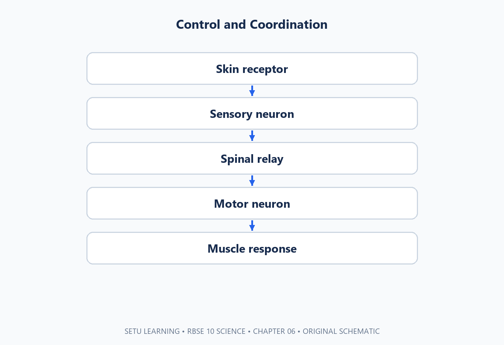

Withdrawal reflex का simplified functional path; arrows signal direction दिखाते हैं।

## भाग 4: पाठ्यपुस्तक-अवधारणाओं पर मौलिक हल किए उदाहरण

नीचे के प्रश्न लेखक के मौलिक मॉडल हैं। ये किसी NCERT edition के प्रश्न क्रमांक या संपूर्ण in-text/exercise solution bank होने का दावा नहीं करते।

**हल किया उदाहरण 1: गर्म तवे से हाथ हटाने का pathway दें।**

Skin receptor → sensory neuron → spinal cord relay → motor neuron → arm muscle। Withdrawal reflex तेज protective response है। Brain भी संकेत प्राप्त करता है; reflex होने का अर्थ consciousness हमेशा absent नहीं।

**हल किया उदाहरण 2: Shoot phototropism में shaded side की वृद्धि अधिक हो तो झुकाव कैसा होगा?**

Shaded side अधिक लंबी होने से shoot light की ओर bends करता है। Shoot में auxin का unequal distribution differential elongation करता है; light की ओर वाली side को ही अधिक बढ़ना लिखना उल्टा होगा।

**हल किया उदाहरण 3: Iodine deficiency और thyroid का संबंध दें।**

Iodine thyroxine synthesis का घटक है। कमी से thyroid function प्रभावित और gland enlargement/goitre हो सकता है। यह पाठ कारण-संबंध समझाता है; सभी neck swellings को goitre कहकर diagnosis नहीं करता।

## भाग 5: सत्यापित बोर्ड प्रश्न एवं स्रोत-स्थिति

2025, प्रश्न 1(iv), PDF पृष्ठ 3: plant hormone की पहचान। उत्तर-संकेत: cytokinin।

[RBSE 2025 मूल पेपर](https://rajeduboard.rajasthan.gov.in/books/PAPERS-2025/Sec/S-07.pdf)। प्रश्न का संक्षिप्त विषय-संदर्भ है; शब्दशः पुनर्मुद्रण नहीं।

## भाग 6: खंडवार मौलिक अभ्यास बैंक

**अभ्यास-अंक:** लेखक के स्व-अभ्यास के लिए हैं; RBSE की आधिकारिक marking scheme नहीं। उत्तर पहले स्वयं लिखें, फिर भाग 9 देखें।

## अ: बहुविकल्पीय प्रश्न — 15 × 1 अंक

**MCQ 1. Neuron में reception का प्रमुख branched भाग कौन है?**

अ) Myelin ही  
ब) Bone  
स) Dendrite  
द) Axon terminal ही

**MCQ 2. Chemical synapse पर messenger क्या है?**

अ) Haemoglobin  
ब) Neurotransmitter  
स) Urea  
द) Bile

**MCQ 3. Withdrawal reflex में common relay center क्या है?**

अ) Spinal cord  
ब) Kidney  
स) Liver  
द) Pancreas

**MCQ 4. Balance और movement precision में कौन-सा भाग काम करता है?**

अ) Thyroid  
ब) Medulla ही  
स) Retina  
द) Cerebellum

**MCQ 5. Breathing जैसे involuntary functions से कौन जुड़ा है?**

अ) Pituitary ही  
ब) Lens  
स) Medulla  
द) Cerebellum ही

**MCQ 6. Shoot का light की ओर growth क्या है?**

अ) Nastic folding  
ब) Positive phototropism  
स) Negative phototropism  
द) Positive hydrotropism

**MCQ 7. Root का gravity की ओर growth क्या है?**

अ) Positive gravitropism  
ब) Negative gravitropism  
स) Photolysis  
द) Chemolysis

**MCQ 8. Mimosa leaf folding का मुख्य immediate कारण क्या है?**

अ) नई bone बनना  
ब) केवल cell division  
स) Photosynthesis बंद होना  
द) Turgor change

**MCQ 9. Cell division को promote करने वाला plant hormone कौन है?**

अ) Thyroxine  
ब) Testosterone  
स) Cytokinin  
द) Insulin

**MCQ 10. Thyroxine synthesis के लिए कौन-सा element जरूरी है?**

अ) Calcium ही  
ब) Iodine  
स) Iron ही  
द) Sodium ही

**MCQ 11. Insulin का source कौन है?**

अ) Pancreas  
ब) Thyroid  
स) Testis  
द) Pituitary

**MCQ 12. Fight-or-flight hormone कौन है?**

अ) Auxin  
ब) Pepsin  
स) Bile  
द) Adrenaline

**MCQ 13. Growth-inhibiting plant hormone कौन है?**

अ) Cytokinin  
ब) Insulin  
स) ABA  
द) Gibberellin

**MCQ 14. Target cell hormone को कैसे पहचानती है?**

अ) हर cell एक जैसा respond करता है  
ब) Specific receptors  
स) केवल आकार बड़ा होने से  
द) Blood का रंग देखकर

**MCQ 15. Negative feedback में response मूल stimulus पर क्या करता है?**

अ) उसे घटाता है  
ब) हमेशा बढ़ाता है  
स) उसे metal बनाता है  
द) उससे कोई संबंध नहीं

## अ: रिक्त स्थान — 6 × 1 अंक

1. Nervous system की impulse-transmitting cell। — इस शब्द/सूत्र का नाम है: ____।  
2. Neuron का संकेत ग्रहण करने वाला branched भाग। — इस शब्द/सूत्र का नाम है: ____।  
3. Cell body से impulse आगे ले जाने वाला लंबा भाग। — इस शब्द/सूत्र का नाम है: ____।  
4. दो neurons अथवा neuron और target के बीच functional junction। — इस शब्द/सूत्र का नाम है: ____।  
5. उद्दीपन की तीव्र automatic प्रतिक्रिया। — इस शब्द/सूत्र का नाम है: ____।  
6. Forebrain का भाग; conscious activities और interpretation में भूमिका। — इस शब्द/सूत्र का नाम है: ____।

## अ: अतिलघु उत्तर — 8 × 1 अंक

1. Neuron में reception का प्रमुख branched भाग कौन है?  
2. Chemical synapse पर messenger क्या है?  
3. Withdrawal reflex में common relay center क्या है?  
4. Balance और movement precision में कौन-सा भाग काम करता है?  
5. Breathing जैसे involuntary functions से कौन जुड़ा है?  
6. Shoot का light की ओर growth क्या है?  
7. Root का gravity की ओर growth क्या है?  
8. Mimosa leaf folding का मुख्य immediate कारण क्या है?

## ब: लघु उत्तर — 6 × 2 अंक

**B1.** Electrical और chemical signals neuron में कहाँ काम करते हैं?

**B2.** Reflex और voluntary action में अंतर दें।

**B3.** Cerebellum और medulla की तुलना करें।

**B4.** Tropism और Mimosa folding में अंतर दें।

**B5.** Nervous और hormonal control की तुलना करें।

**B6.** Insulin feedback का सरल उदाहरण दें।

## स: दीर्घ उत्तर — 4 × 3 अंक

आंतरिक विकल्प अभ्यास: C1 अथवा C2, तथा C3 अथवा C4 चुनें। पुनरावृत्ति में बचा विकल्प भी हल करें। यह लेखक की अभ्यास व्यवस्था है।

**C1.** Neuron के तीन मुख्य भाग और दिशा लिखें।

**C2.** Reflex arc का labelled schematic कैसे बनाएँ?

**C3.** चार plant hormones का एक-एक काम दें।

**C4.** Adrenaline response के तीन effects दें।

## द: विस्तृत उत्तर — 2 × 4 अंक

आंतरिक विकल्प अभ्यास: D1 अथवा D2 चुनें; बाद में दूसरा भी हल करें।

**D1.** Nervous और endocrine coordination को भोजन के बाद glucose regulation तथा गर्म वस्तु छूने के उदाहरणों से समझाएँ।

**D2.** Shoot phototropism और root gravitropism की तुलना labelled arrows से करें।

## भाग 7: सावधानियाँ एवं परीक्षा-त्रुटियाँ

- Cerebellum को breathing center न लिखें।
- Reflex में brain को सूचना मिलती है।
- Mimosa folding growth tropism नहीं।
- Iodine gland नहीं, thyroxine का आवश्यक घटक है।
- Insulin feedback को positive feedback न कहें।

## भाग 8: फटाफट पुनरावृत्ति — 25 बिंदु

1. Neuron: Nervous system की impulse-transmitting cell।  
2. Dendrite: Neuron का संकेत ग्रहण करने वाला branched भाग।  
3. Axon: Cell body से impulse आगे ले जाने वाला लंबा भाग।  
4. Synapse: दो neurons अथवा neuron और target के बीच functional junction।  
5. Reflex action: उद्दीपन की तीव्र automatic प्रतिक्रिया।  
6. Cerebrum: Forebrain का भाग; conscious activities और interpretation में भूमिका।  
7. Cerebellum: Balance, posture और movements की precision में भूमिका।  
8. Tropism: Stimulus की दिशा से संबंधित growth movement।  
9. Hormone: Endocrine gland का chemical messenger, blood से target तक जाता है।  
10. Feedback: Response के अनुसार hormone secretion का नियमन।  
11. Dendrites incoming signals receive करते हैं।  
12. Neurotransmitter axon terminal से released होकर next cell receptors पर काम करता है।  
13. Spinal pathways तेज withdrawal response सम्भव करते हैं; brain को सूचना भी मिलती है।  
14. Cerebellum posture, balance और coordination में महत्त्वपूर्ण है।  
15. Medulla hindbrain का भाग है और involuntary control में भूमिका निभाता है।  
16. Stimulus light है और growth उसकी ओर, इसलिए positive phototropism।  
17. Root growth gravity की दिशा में होने से positive gravitropism है।  
18. Rapid leaf folding growth के बजाय cells के turgor changes से जुड़ा है।  
19. Cytokinins plant cell division को promote कर सकते हैं।  
20. Thyroxine molecule में iodine शामिल है।  
21. Pancreas के endocrine cells insulin secretion करते हैं।  
22. Adrenaline acute stress response में multiple physiological changes करता है।  
23. Abscisic acid growth inhibition और stress responses से जुड़ा है।  
24. Hormone response के लिए suitable receptors और cell machinery जरूरी हैं।  
25. Negative feedback initial change को counter करके regulation में मदद करता है।

## भाग 9: संपूर्ण अभ्यास उत्तर-कुंजी

## MCQ: सही विकल्प और कारण

**1. स — Dendrite।** Dendrites incoming signals receive करते हैं।

**2. ब — Neurotransmitter।** Neurotransmitter axon terminal से released होकर next cell receptors पर काम करता है।

**3. अ — Spinal cord।** Spinal pathways तेज withdrawal response सम्भव करते हैं; brain को सूचना भी मिलती है।

**4. द — Cerebellum।** Cerebellum posture, balance और coordination में महत्त्वपूर्ण है।

**5. स — Medulla।** Medulla hindbrain का भाग है और involuntary control में भूमिका निभाता है।

**6. ब — Positive phototropism।** Stimulus light है और growth उसकी ओर, इसलिए positive phototropism।

**7. अ — Positive gravitropism।** Root growth gravity की दिशा में होने से positive gravitropism है।

**8. द — Turgor change।** Rapid leaf folding growth के बजाय cells के turgor changes से जुड़ा है।

**9. स — Cytokinin।** Cytokinins plant cell division को promote कर सकते हैं।

**10. ब — Iodine।** Thyroxine molecule में iodine शामिल है।

**11. अ — Pancreas।** Pancreas के endocrine cells insulin secretion करते हैं।

**12. द — Adrenaline।** Adrenaline acute stress response में multiple physiological changes करता है।

**13. स — ABA।** Abscisic acid growth inhibition और stress responses से जुड़ा है।

**14. ब — Specific receptors।** Hormone response के लिए suitable receptors और cell machinery जरूरी हैं।

**15. अ — उसे घटाता है।** Negative feedback initial change को counter करके regulation में मदद करता है।

**रिक्त स्थान:** 1. Neuron; 2. Dendrite; 3. Axon; 4. Synapse; 5. Reflex action; 6. Cerebrum

**अतिलघु उत्तर:**

1. Dendrite। Dendrites incoming signals receive करते हैं।

2. Neurotransmitter। Neurotransmitter axon terminal से released होकर next cell receptors पर काम करता है।

3. Spinal cord। Spinal pathways तेज withdrawal response सम्भव करते हैं; brain को सूचना भी मिलती है।

4. Cerebellum। Cerebellum posture, balance और coordination में महत्त्वपूर्ण है।

5. Medulla। Medulla hindbrain का भाग है और involuntary control में भूमिका निभाता है।

6. Positive phototropism। Stimulus light है और growth उसकी ओर, इसलिए positive phototropism।

7. Positive gravitropism। Root growth gravity की दिशा में होने से positive gravitropism है।

8. Turgor change। Rapid leaf folding growth के बजाय cells के turgor changes से जुड़ा है।

**B1. Electrical और chemical signals neuron में कहाँ काम करते हैं?**

Neuron membrane के along impulse electrochemical changes से travels करता है। Chemical synapse पर neurotransmitter gap पार करके next cell को signal देता है। इसीलिए ‘impulse हर स्थान पर केवल electrical jump है’ उचित नहीं।

**B2. Reflex और voluntary action में अंतर दें।**

Reflex rapid automatic response है, जैसे withdrawal। Voluntary action conscious control से होता है, जैसे लिखना। दोनों में neurons और muscles काम करते हैं, लेकिन pathways और initiation अलग हो सकते हैं।

**B3. Cerebellum और medulla की तुलना करें।**

Cerebellum posture, balance और precise movement में भूमिका निभाता है। Medulla breathing तथा अन्य involuntary functions में भूमिका निभाता है। Brain भागों के कामों को एक-दूसरे पर न लिखें।

**B4. Tropism और Mimosa folding में अंतर दें।**

Tropism stimulus direction से संबंधित growth movement है। Mimosa folding mainly cell turgor change से rapid response है, growth से नहीं। इसलिए हर plant movement को tropism कहना गलत है।

**B5. Nervous और hormonal control की तुलना करें।**

Nervous control specific neural pathways से signals भेजता और सामान्यतः तेज response देता है। Hormones blood से target cells तक जाते और अक्सर धीमे/दीर्घकालीन effects देते हैं। Target receptors specificity देते हैं; blood सभी cells तक पहुँचना समान response का अर्थ नहीं।

**B6. Insulin feedback का सरल उदाहरण दें।**

Blood glucose बढ़ने पर pancreas की insulin secretion बढ़ सकती है। Cells glucose uptake/storage बढ़ाते हैं और glucose घटता है। फिर insulin stimulus कम हो जाता है। Response द्वारा initial signal घटाना negative feedback है।

**C1. Neuron के तीन मुख्य भाग और दिशा लिखें।**

1. Dendrites signals receive करते हैं। 2. Cell body cell metabolism और signal integration में भाग लेता है। 3. Axon terminal तक impulse ले जाता है, जहाँ neurotransmitter निकल सकता है। Diagram arrows dendrite से terminal की ओर दिखाएँ।

**C2. Reflex arc का labelled schematic कैसे बनाएँ?**

1. Receptor से sensory neuron का arrow spinal cord की ओर। 2. Cord में relay/interneuron junction दिखाएँ। 3. Motor neuron का arrow effector muscle की ओर और response लिखें। Brain connection छूटने पर ‘brain असंबद्ध’ का दावा न जोड़ें।

**C3. चार plant hormones का एक-एक काम दें।**

1. Auxin shoot cell elongation तथा tropic growth में मदद करता है। 2. Gibberellin stem growth और cytokinin cell division से जुड़े हैं। 3. ABA growth inhibition तथा water-stress में stomatal closing में भूमिका निभाता है। Effects tissue/conditions से बदलते हैं।

**C4. Adrenaline response के तीन effects दें।**

1. Heart rate/force बढ़ सकते हैं, tissues को blood supply बदलती है। 2. Airways और breathing-related responses oxygen availability बढ़ाते हैं। 3. Energy substrates की availability बढ़ती है। यह acute response है; hormone की हर भूमिका growth नहीं।

**D1. Nervous और endocrine coordination को भोजन के बाद glucose regulation तथा गर्म वस्तु छूने के उदाहरणों से समझाएँ।**

1. भोजन के बाद blood glucose signal pancreas तक पहुँचता है। 2. Insulin blood द्वारा target tissues पर uptake/storage बढ़ाता है; negative feedback secretion घटाता है। 3. गर्म वस्तु पर receptors और reflex neural pathway withdrawal कराते हैं। 4. दोनों communication systems हैं, पर messenger, route और timescale अलग हैं।

**D2. Shoot phototropism और root gravitropism की तुलना labelled arrows से करें।**

1. Light source एक ओर और shoot curvature उसकी ओर दिखाएँ: positive phototropism। 2. Shoot की shaded side पर relatively more elongation लिखें। 3. Root growth gravity की ओर दिखाएँ: positive gravitropism। 4. Shoot gravity से विपरीत: negative gravitropism। Stimulus direction और positive/negative relation स्पष्ट रखें।

## भाग 10: 10 मिनट / 10 अंक आत्म-मूल्यांकन एवं संदर्भ

समय: 10 मिनट। पहले पुस्तक बंद करें।

1. MCQ 3 और 11 हल करें। (1 + 1)
2. B2 और B5 के उत्तर लिखें। (2 + 2)
3. D1 हल करें। (4)

**कुंजी:** भाग 9 में संबंधित क्रमांक देखें। **स्व-मूल्यांकन:** 8–10: आगे बढ़ें; 5–7: छूटे कौशल का दोहराव; 0–4: भाग 2–4 फिर पढ़ें। यह अभ्यास-सुझाव है, बोर्ड grade नहीं।

[सत्यापित RBSE 2025–26 पाठ्यक्रम](https://rajeduboard.rajasthan.gov.in/anudeshika-etc/10_2026.pdf) · [NCERT विज्ञान अध्याय 6](https://ncert.nic.in/textbook/pdf/jesc106.pdf)

**आगे की कड़ी:** अगले अध्याय में reproductive hormones और नए organisms बनने के processes आएँगे।

---

# अध्याय 7: जीव जनन कैसे करते हैं? (How do Organisms Reproduce?)

## भाग 1: अध्याय प्रवेश एवं पाठ्यक्रम मैपिंग

> प्रथम संपादकीय प्रारूप। NCERT के सभी प्रश्नों के हल तथा पूरा ऐतिहासिक PYQ संग्रह अभी स्रोत-परीक्षण में हैं। सामान्य माध्यमिक 2026–27 पाठ्यक्रम की पुनः पुष्टि शेष है।

**विषय कोड:** 07 · **श्रृंखला पुस्तक:** 2

**सत्यापित आधार:** RBSE 2025–26 · **अध्याय भार:** 7 अंक। यह भार उसी संस्करण का है; वास्तविक प्रश्न-विभाजन की भविष्यवाणी नहीं।

**सीखने के लक्ष्य:** Asexual/sexual reproduction अलग करना; flower और human reproductive pathways समझना; contraception और infection prevention की सीमाएँ बताना।

## भाग 2: शब्दावली एवं अवधारणा कैप्सूल

| शब्द / सूत्र | अर्थ / उपयोग |
|---|---|
| DNA copying | Genetic information की replication; reproduction में continuity का आधार। |
| Binary fission | एक cell का दो daughter cells में विभाजन। |
| Fragmentation | Body fragments से उपयुक्त organisms में नए individuals बनना। |
| Regeneration | Specialised cells से खोए भाग/कुछ organisms में पूरा organism पुनः बनना। |
| Budding | Parent पर outgrowth से नया individual बनना। |
| Vegetative propagation | Root/stem/leaf से नए plants बनना। |
| Pollination | Pollen का anther से stigma तक पहुँचना। |
| Fertilisation | Male और female gametes का fusion। |
| Placenta | Maternal–fetal exchange का interface। |
| Contraception | Pregnancy की संभावना घटाने की विधियाँ। |

## भाग 3: विस्तृत शिक्षण पाठ

### Continuity और variation
Reproduction individual survival के लिए अनिवार्य नहीं, species continuity के लिए महत्त्वपूर्ण है। DNA copying information आगे देती है, और copying differences variation ला सकते हैं। Sexual reproduction दो parents के genetic contributions मिलाकर variation बढ़ा सकता है; asexual offspring भी हमेशा absolutely identical नहीं होते।

### Asexual methods
Amoeba binary fission, Plasmodium multiple fission, yeast/Hydra budding, Spirogyra fragmentation तथा Rhizopus spores से reproduction के उदाहरण हैं। Planaria में suitable fragments specialised regenerative cells से नए individuals बना सकते हैं; हर cut body part ऐसा नहीं करता। Bryophyllum leaf buds और potato stem tuber vegetative propagation दिखाते हैं। यह plants के उपयोगी गुण जल्दी बनाए रखने में मदद कर सकता है।

### Flower में sexual reproduction
Stamen में anther pollen बनाता है। Pistil के stigma पर suitable pollen germinate होकर style से pollen tube भेजता है। Male gamete ovule में female gamete से fertilises करके zygote बनाता है। Ovule seed और ovary fruit बनता है। Pollination gamete fusion नहीं; fertilisation उसके बाद की अलग stage है। Flowering plants में embryo seed में विकसित होता है।

### Human reproduction और health
Testes sperm और testosterone बनाते हैं; scrotal location sperm formation के लिए suitable lower temperature देती है। Sperm ducts से urethra की ओर जाते हैं और glands के fluids semen बनाते हैं। Ovaries ova और hormones देते हैं। Fertilisation सामान्यतः oviduct में; embryo uterus lining में implants होता है। Placenta nutrients, oxygen और wastes exchange करता है; maternal और fetal blood normally सीधे एक common pool नहीं बनाते। Fertilisation न होने पर uterine lining का shedding menstruation है; cycle length व्यक्ति और समय के अनुसार बदल सकती है। Condoms pregnancy के साथ कई sexually transmitted infections का risk भी घटाते हैं। Hormonal pills/IUDs pregnancy prevention देते हैं लेकिन STI protection नहीं। Reproductive health में consent, reliable information, hygiene और clinical help शामिल हैं।

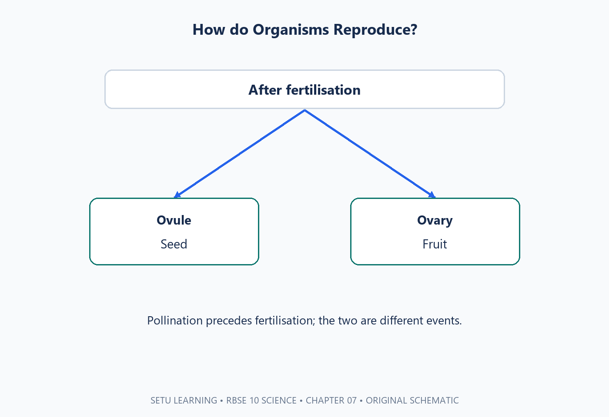

Flower में pollination से seed/fruit बनने का stage schematic; anatomical drawing नहीं।

## भाग 4: पाठ्यपुस्तक-अवधारणाओं पर मौलिक हल किए उदाहरण

नीचे के प्रश्न लेखक के मौलिक मॉडल हैं। ये किसी NCERT edition के प्रश्न क्रमांक या संपूर्ण in-text/exercise solution bank होने का दावा नहीं करते।

**हल किया उदाहरण 1: Pollination से seed बनने का क्रम दें।**

Anther → stigma पर pollen transfer → pollen tube growth → ovule में gamete fusion → zygote/embryo → seed। Ovary fruit बनती है। Pollen transfer और fertilisation को एक ही घटना न लिखें।

**हल किया उदाहरण 2: Potato और Bryophyllum में reproductive structures पहचानें।**

Potato के eyes stem tuber buds हैं, roots नहीं। Bryophyllum leaf margins पर buds नए plants बना सकते हैं। दोनों vegetative propagation हैं और seed formation आवश्यक नहीं।

**हल किया उदाहरण 3: Human fertilisation और implantation के स्थान दें।**

Fertilisation सामान्यतः oviduct/fallopian tube में होता है। विकसित embryo uterus की endometrium में implants होता है। Uterus में sperm और ovum का fusion होना सामान्य anatomical answer नहीं।

## भाग 5: सत्यापित बोर्ड प्रश्न एवं स्रोत-स्थिति

2025, प्रश्न 1(ii), PDF पृष्ठ 2: regeneration से नया organism बनने का उदाहरण। उत्तर-संकेत: Planaria।

[RBSE 2025 मूल पेपर](https://rajeduboard.rajasthan.gov.in/books/PAPERS-2025/Sec/S-07.pdf)। प्रश्न का संक्षिप्त विषय-संदर्भ है; शब्दशः पुनर्मुद्रण नहीं।

## भाग 6: खंडवार मौलिक अभ्यास बैंक

**अभ्यास-अंक:** लेखक के स्व-अभ्यास के लिए हैं; RBSE की आधिकारिक marking scheme नहीं। उत्तर पहले स्वयं लिखें, फिर भाग 9 देखें।

## अ: बहुविकल्पीय प्रश्न — 15 × 1 अंक

**MCQ 1. Amoeba का सामान्य reproduction mode क्या है?**

अ) Vegetative propagation  
ब) Binary fission  
स) Budding  
द) Seed formation

**MCQ 2. Yeast का सामान्य asexual mode क्या है?**

अ) Budding  
ब) Pollination  
स) Fertilisation  
द) Fragmentation ही

**MCQ 3. Spirogyra किस विधि का उदाहरण है?**

अ) Budding  
ब) Binary fission  
स) Seed formation  
द) Fragmentation

**MCQ 4. Rhizopus में dispersal reproductive structures क्या हैं?**

अ) Ovules  
ब) Potato eyes  
स) Spores  
द) Sperms

**MCQ 5. Bryophyllum vegetative propagation कहाँ से कर सकता है?**

अ) केवल seed coat  
ब) Leaf buds  
स) केवल flower pollen  
द) केवल roots ही

**MCQ 6. Pollen transfer anther से stigma तक क्या है?**

अ) Pollination  
ब) Fertilisation  
स) Implantation  
द) Menstruation

**MCQ 7. Fertilisation के बाद ovule क्या बनता है?**

अ) Fruit ही  
ब) Stigma  
स) Anther  
द) Seed

**MCQ 8. Human fertilisation का सामान्य स्थान क्या है?**

अ) Vagina  
ब) Ovary surface ही  
स) Oviduct  
द) Uterus ही

**MCQ 9. Embryo implantation का स्थान क्या है?**

अ) Anther  
ब) Uterus lining  
स) Testis  
द) Ureter

**MCQ 10. Sperm का production site कौन है?**

अ) Testes  
ब) Prostate  
स) Urethra  
द) Seminal vesicle

**MCQ 11. Testosterone का मुख्य male source कौन है?**

अ) Kidneys  
ब) Lungs  
स) Thyroid  
द) Testes

**MCQ 12. Maternal–fetal exchange interface क्या है?**

अ) Nephron  
ब) Villus ही  
स) Placenta  
द) Cerebellum

**MCQ 13. Pregnancy और कई STI risks दोनों घटाने का barrier कौन है?**

अ) Withdrawal की गारंटी  
ब) Condom  
स) Hormonal pill ही  
द) IUD ही

**MCQ 14. Potato के eyes क्या हैं?**

अ) Stem buds  
ब) Roots  
स) Pollen grains  
द) Ovules

**MCQ 15. Species continuity के लिए reproduction क्यों महत्त्वपूर्ण है?**

अ) हर individual तभी साँस लेता है  
ब) हर variation समान होता है  
स) DNA हमेशा बदलता ही नहीं  
द) नए individuals बनते हैं

## अ: रिक्त स्थान — 6 × 1 अंक

1. Genetic information की replication; reproduction में continuity का आधार। — इस शब्द/सूत्र का नाम है: ____।  
2. एक cell का दो daughter cells में विभाजन। — इस शब्द/सूत्र का नाम है: ____।  
3. Body fragments से उपयुक्त organisms में नए individuals बनना। — इस शब्द/सूत्र का नाम है: ____।  
4. Specialised cells से खोए भाग/कुछ organisms में पूरा organism पुनः बनना। — इस शब्द/सूत्र का नाम है: ____।  
5. Parent पर outgrowth से नया individual बनना। — इस शब्द/सूत्र का नाम है: ____।  
6. Root/stem/leaf से नए plants बनना। — इस शब्द/सूत्र का नाम है: ____।

## अ: अतिलघु उत्तर — 8 × 1 अंक

1. Amoeba का सामान्य reproduction mode क्या है?  
2. Yeast का सामान्य asexual mode क्या है?  
3. Spirogyra किस विधि का उदाहरण है?  
4. Rhizopus में dispersal reproductive structures क्या हैं?  
5. Bryophyllum vegetative propagation कहाँ से कर सकता है?  
6. Pollen transfer anther से stigma तक क्या है?  
7. Fertilisation के बाद ovule क्या बनता है?  
8. Human fertilisation का सामान्य स्थान क्या है?

## ब: लघु उत्तर — 6 × 2 अंक

**B1.** DNA copying के साथ variation क्यों उपयोगी है?

**B2.** Fission और budding की तुलना दें।

**B3.** Fragmentation और regeneration अलग कैसे हैं?

**B4.** Testes के दो functions तथा scrotum का महत्व दें।

**B5.** Placenta का function क्या है?

**B6.** Condom और pills की protection अलग कैसे है?

## स: दीर्घ उत्तर — 4 × 3 अंक

आंतरिक विकल्प अभ्यास: C1 अथवा C2, तथा C3 अथवा C4 चुनें। पुनरावृत्ति में बचा विकल्प भी हल करें। यह लेखक की अभ्यास व्यवस्था है।

**C1.** Flower के reproductive parts और fertilisation समझाएँ।

**C2.** Human female pathway का labelled क्रम दें।

**C3.** Menstruation के कारण और cycle variation लिखें।

**C4.** Three contraception categories और सीमा दें।

## द: विस्तृत उत्तर — 2 × 4 अंक

आंतरिक विकल्प अभ्यास: D1 अथवा D2 चुनें; बाद में दूसरा भी हल करें।

**D1.** Asexual reproduction की चार विधियाँ उदाहरण सहित दें।

**D2.** Fertilisation से birth तक simplified stages और placenta की भूमिका समझाएँ।

## भाग 7: सावधानियाँ एवं परीक्षा-त्रुटियाँ

- Pollination और fertilisation अलग stages हैं।
- Ovule से seed, ovary से fruit।
- Fertilisation oviduct, implantation uterus में।
- Placenta में दोनों blood systems का सामान्य direct mixing न लिखें।
- Pills को STI prevention न कहें।

## भाग 8: फटाफट पुनरावृत्ति — 25 बिंदु

1. DNA copying: Genetic information की replication; reproduction में continuity का आधार।  
2. Binary fission: एक cell का दो daughter cells में विभाजन।  
3. Fragmentation: Body fragments से उपयुक्त organisms में नए individuals बनना।  
4. Regeneration: Specialised cells से खोए भाग/कुछ organisms में पूरा organism पुनः बनना।  
5. Budding: Parent पर outgrowth से नया individual बनना।  
6. Vegetative propagation: Root/stem/leaf से नए plants बनना।  
7. Pollination: Pollen का anther से stigma तक पहुँचना।  
8. Fertilisation: Male और female gametes का fusion।  
9. Placenta: Maternal–fetal exchange का interface।  
10. Contraception: Pregnancy की संभावना घटाने की विधियाँ।  
11. Amoeba cell division से दो daughter cells बना सकता है।  
12. Yeast में parent पर bud निकलकर नया cell बन सकता है।  
13. Spirogyra filament के fragments suitable conditions में grow कर सकते हैं।  
14. Rhizopus sporangia में spores बनते हैं।  
15. Leaf margin buds नए plants बना सकते हैं।  
16. Pollination pollen transfer है; gamete fusion fertilisation है।  
17. Ovule seed बनता है; ovary fruit बनती है।  
18. Fertilisation सामान्यतः fallopian tube/oviduct में होता है।  
19. Endometrium embryo implantation का site है।  
20. Testes sperm बनाते हैं; accessory glands fluids देती हैं।  
21. Testes testosterone secrete करते हैं।  
22. Placenta fetus को nutrient/gas exchange interface देता है।  
23. Condom barrier protection देता है; सही उपयोग के बावजूद risk zero नहीं।  
24. Potato tuber modified stem है; eyes buds हैं।  
25. Reproduction generations के बीच population continuity रखता है।

## भाग 9: संपूर्ण अभ्यास उत्तर-कुंजी

## MCQ: सही विकल्प और कारण

**1. ब — Binary fission।** Amoeba cell division से दो daughter cells बना सकता है।

**2. अ — Budding।** Yeast में parent पर bud निकलकर नया cell बन सकता है।

**3. द — Fragmentation।** Spirogyra filament के fragments suitable conditions में grow कर सकते हैं।

**4. स — Spores।** Rhizopus sporangia में spores बनते हैं।

**5. ब — Leaf buds।** Leaf margin buds नए plants बना सकते हैं।

**6. अ — Pollination।** Pollination pollen transfer है; gamete fusion fertilisation है।

**7. द — Seed।** Ovule seed बनता है; ovary fruit बनती है।

**8. स — Oviduct।** Fertilisation सामान्यतः fallopian tube/oviduct में होता है।

**9. ब — Uterus lining।** Endometrium embryo implantation का site है।

**10. अ — Testes।** Testes sperm बनाते हैं; accessory glands fluids देती हैं।

**11. द — Testes।** Testes testosterone secrete करते हैं।

**12. स — Placenta।** Placenta fetus को nutrient/gas exchange interface देता है।

**13. ब — Condom।** Condom barrier protection देता है; सही उपयोग के बावजूद risk zero नहीं।

**14. अ — Stem buds।** Potato tuber modified stem है; eyes buds हैं।

**15. द — नए individuals बनते हैं।** Reproduction generations के बीच population continuity रखता है।

**रिक्त स्थान:** 1. DNA copying; 2. Binary fission; 3. Fragmentation; 4. Regeneration; 5. Budding; 6. Vegetative propagation

**अतिलघु उत्तर:**

1. Binary fission। Amoeba cell division से दो daughter cells बना सकता है।

2. Budding। Yeast में parent पर bud निकलकर नया cell बन सकता है।

3. Fragmentation। Spirogyra filament के fragments suitable conditions में grow कर सकते हैं।

4. Spores। Rhizopus sporangia में spores बनते हैं।

5. Leaf buds। Leaf margin buds नए plants बना सकते हैं।

6. Pollination। Pollination pollen transfer है; gamete fusion fertilisation है।

7. Seed। Ovule seed बनता है; ovary fruit बनती है।

8. Oviduct। Fertilisation सामान्यतः fallopian tube/oviduct में होता है।

**B1. DNA copying के साथ variation क्यों उपयोगी है?**

Copying genetic continuity देता है; occasional changes variation ला सकते हैं। Changing environment में कुछ variants survival/reproduction में लाभ दे सकते हैं। हर variation लाभदायक नहीं और reproduction individual के जीवित रहने की शर्त नहीं।

**B2. Fission और budding की तुलना दें।**

Binary fission में parent cell दो daughter cells में divides होता है। Budding में parent पर छोटा outgrowth विकसित होकर नया individual बन सकता है। Amoeba तथा yeast क्रमशः standard उदाहरण हैं।

**B3. Fragmentation और regeneration अलग कैसे हैं?**

Fragmentation में सरल body fragments से नए organisms बनते हैं, जैसे Spirogyra। Regeneration specialised cells द्वारा repair या कुछ organisms में पूरा नया organism बनना है। हर multicellular animal का टुकड़ा नया organism नहीं बना सकता।

**B4. Testes के दो functions तथा scrotum का महत्व दें।**

Testes sperms और testosterone बनाते हैं। Scrotum उन्हें body core से कुछ कम ताप पर रखने में मदद करता है, जो sperm formation के लिए उपयुक्त है। Ducts sperm बनाते नहीं; उनका transport करते हैं।

**B5. Placenta का function क्या है?**

Placenta maternal और fetal sides के बीच oxygen/nutrients तथा wastes exchange का interface है। यह embryo को nourishment और gas exchange उपलब्ध करता है। दोनों blood systems सामान्यतः सीधे मिश्रित common circulation नहीं बनाते।

**B6. Condom और pills की protection अलग कैसे है?**

Condom barrier method है जो pregnancy तथा कई STIs का risk कम करता है, पूर्ण गारंटी नहीं। Hormonal pills pregnancy prevention के लिए हैं और STI protection नहीं देतीं। Method choice trained health professional और informed consent से होनी चाहिए।

**C1. Flower के reproductive parts और fertilisation समझाएँ।**

1. Anther pollen बनाता है; stigma pollen ग्रहण करता है। 2. Pollen tube style से ovule तक male gamete पहुँचाती है। 3. Gamete fusion से zygote, आगे embryo बनता है; ovule seed और ovary fruit बनती है।

**C2. Human female pathway का labelled क्रम दें।**

1. Ovary से ovum release होता है। 2. Oviduct सामान्य fertilisation site है। 3. Embryo uterus lining में implantation करता है; cervix uterus का lower opening और vagina birth canal का भाग है। Diagram organs का connection दिखाए।

**C3. Menstruation के कारण और cycle variation लिखें।**

1. Cycle में uterus lining potential pregnancy के लिए तैयार होती है। 2. Pregnancy न होने पर hormonal changes से lining shed हो सकती है। 3. Blood और tissue vagina से बाहर आते हैं; duration/cycle length में variation है। इसे बीमारी या ‘impure blood’ न कहें।

**C4. Three contraception categories और सीमा दें।**

1. Barrier condom sperm entry घटाता और STI risk कम करता है। 2. Hormonal methods ovulation/अन्य reproductive processes बदल सकते हैं। 3. IUD/surgical methods pregnancy prevention में इस्तेमाल होते हैं; सभी methods STI protection नहीं देते। Clinical counselling जरूरी है।

**D1. Asexual reproduction की चार विधियाँ उदाहरण सहित दें।**

1. Amoeba: binary fission, एक cell से दो। 2. Yeast/Hydra: budding, parent पर outgrowth। 3. Spirogyra: fragmentation, body pieces से growth। 4. Rhizopus: spores, suitable conditions में germination। Examples और methods अलग लिखें; regeneration को हर organism का universal reproduction न बनाएँ।

**D2. Fertilisation से birth तक simplified stages और placenta की भूमिका समझाएँ।**

1. Oviduct में sperm–ovum fusion से zygote बनता है। 2. Divisions के बाद embryo uterus में implants करता है। 3. Placenta oxygen/nutrients देता और wastes transfer करता है; fetus uterus में grows करता है। 4. Birth पर baby बाहर आता है। Diagram stage order है, fetus या reproductive organs की anatomical scale नहीं।

## भाग 10: 10 मिनट / 10 अंक आत्म-मूल्यांकन एवं संदर्भ

समय: 10 मिनट। पहले पुस्तक बंद करें।

1. MCQ 3 और 11 हल करें। (1 + 1)
2. B2 और B5 के उत्तर लिखें। (2 + 2)
3. D1 हल करें। (4)

**कुंजी:** भाग 9 में संबंधित क्रमांक देखें। **स्व-मूल्यांकन:** 8–10: आगे बढ़ें; 5–7: छूटे कौशल का दोहराव; 0–4: भाग 2–4 फिर पढ़ें। यह अभ्यास-सुझाव है, बोर्ड grade नहीं।

[सत्यापित RBSE 2025–26 पाठ्यक्रम](https://rajeduboard.rajasthan.gov.in/anudeshika-etc/10_2026.pdf) · [NCERT विज्ञान अध्याय 7](https://ncert.nic.in/textbook/pdf/jesc107.pdf)

**आगे की कड़ी:** अगले अध्याय में reproduction से आने वाले inherited traits के ratios समझेंगे।

---

# अध्याय 8: आनुवंशिकता (Heredity)

## भाग 1: अध्याय प्रवेश एवं पाठ्यक्रम मैपिंग

> प्रथम संपादकीय प्रारूप। NCERT के सभी प्रश्नों के हल तथा पूरा ऐतिहासिक PYQ संग्रह अभी स्रोत-परीक्षण में हैं। सामान्य माध्यमिक 2026–27 पाठ्यक्रम की पुनः पुष्टि शेष है।

**विषय कोड:** 07 · **श्रृंखला पुस्तक:** 2

**सत्यापित आधार:** RBSE 2025–26 · **अध्याय भार:** 4 अंक। यह भार उसी संस्करण का है; वास्तविक प्रश्न-विभाजन की भविष्यवाणी नहीं।

**सीखने के लक्ष्य:** Genotype/phenotype अलग करना; mono/dihybrid crosses के ratios सही शर्तों सहित निकालना; human sex determination का वैज्ञानिक विवरण देना।

## भाग 2: शब्दावली एवं अवधारणा कैप्सूल

| शब्द / सूत्र | अर्थ / उपयोग |
|---|---|
| Heredity | Parents से offspring तक genetic traits का transmission। |
| Variation | Individuals के लक्षणों में differences। |
| Gene | DNA का functional hereditary information वाला segment। |
| Allele | Gene का alternative form। |
| Genotype | किसी trait के लिए genetic constitution, जैसे Tt। |
| Phenotype | Expressed/observable characteristic, जैसे tall। |
| Dominant allele | Heterozygous condition में recessive के ऊपर expressed allele। |
| Recessive allele | Simple complete dominance में homozygous होने पर expressed allele। |
| Monohybrid cross | एक trait के contrasting forms पर केंद्रित cross। |
| Segregation | Gamete formation में allele pair के अलग होना। |

## भाग 3: विस्तृत शिक्षण पाठ

### लक्षण का genetic आधार
DNA information से proteins बनते हैं; proteins और cellular processes traits के expression में भूमिका निभाते हैं। Environment भी phenotype को प्रभावित कर सकता है। Mendel ने peas में contrasting traits और controlled crosses का उपयोग किया। Dominant का अर्थ अधिक common, बेहतर या ताकतवर नहीं; heterozygote में expression का संबंध है। Bodybuilding से बढ़ी muscle जैसी acquired change स्वतः inherited gene change नहीं बन जाती।

### एक trait की गणना
Pure tall TT × dwarf tt से F₁ सभी Tt और complete dominance में tall होते हैं। F₁ selfing Tt × Tt में दोनों parents T और t gametes देते हैं। Punnett outcomes TT, Tt, Tt, tt हैं। Genotype ratio 1:2:1 और phenotype ratio 3 tall:1 dwarf। ये expected probabilities हैं, हर चार plants का exact count नहीं। Recessive allele F₁ में गायब नहीं हुआ; hidden expression था।

### दो traits और independence
RRYY × rryy से F₁ RrYy मिलता है। Unlinked/independently assorting traits और complete dominance की school model conditions में F₁ gametes RY, Ry, rY, ry equal probabilities से बनते हैं। Selfing में phenotype ratio 9:3:3:1 हो सकता है। हर pair of human genes पर यही ratio लागू नहीं; linkage और अन्य inheritance patterns अलग हो सकते हैं।

### Human sex determination
विद्यालयी XX–XY model में egg X देता है, sperm X या Y दे सकता है। X sperm से XX और Y sperm से XY outcome मिलता है; simplified expectation लगभग equal probabilities है। Child का chromosomal sex mother के X egg से तय करने का दावा गलत है। यह biological probability है; किसी parent को दोष देने का आधार नहीं। वास्तविक sex development में अन्य biological variation भी हो सकती है; यह model सभी complexities का वर्णन नहीं।

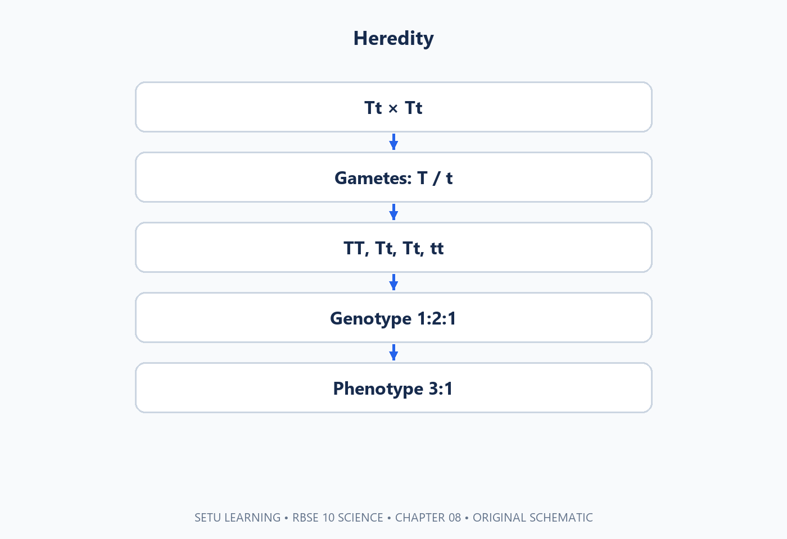

Monohybrid cross का simplified genotype summary; विस्तृत 2×2 Punnett square उत्तर में बनाने का निर्देश है।

## भाग 4: पाठ्यपुस्तक-अवधारणाओं पर मौलिक हल किए उदाहरण

नीचे के प्रश्न लेखक के मौलिक मॉडल हैं। ये किसी NCERT edition के प्रश्न क्रमांक या संपूर्ण in-text/exercise solution bank होने का दावा नहीं करते।

**हल किया उदाहरण 1: Tt × tt से offspring ratio निकालें।**

Tt parent T या t gametes, tt parent केवल t देता है। Outcomes Tt और tt समान expected probability से मिलते हैं। Complete dominance में tall:dwarf = 1:1, genotype Tt:tt = 1:1।

**हल किया उदाहरण 2: Tt × Tt में recessive phenotype की probability दें।**

Punnett square: TT, Tt, Tt, tt। केवल tt recessive phenotype देता है, इसलिए 1/4 = 25% expected probability। चार actual offspring में exactly एक recessive अनिवार्य नहीं।

**हल किया उदाहरण 3: XX–XY cross लिखें।**

Egg gametes X; sperm gametes X या Y। Outcomes XX और XY लगभग 1:1 expected हैं। Maternal contribution दोनों cases में X है; variation paternal gamete से आती है।

## भाग 5: सत्यापित बोर्ड प्रश्न एवं स्रोत-स्थिति

2025, प्रश्न 1(v), PDF पृष्ठ 3: monohybrid F₂ genotype ratio। उत्तर-संकेत: 1:2:1।

[RBSE 2025 मूल पेपर](https://rajeduboard.rajasthan.gov.in/books/PAPERS-2025/Sec/S-07.pdf)। प्रश्न का संक्षिप्त विषय-संदर्भ है; शब्दशः पुनर्मुद्रण नहीं।

## भाग 6: खंडवार मौलिक अभ्यास बैंक

**अभ्यास-अंक:** लेखक के स्व-अभ्यास के लिए हैं; RBSE की आधिकारिक marking scheme नहीं। उत्तर पहले स्वयं लिखें, फिर भाग 9 देखें।

## अ: बहुविकल्पीय प्रश्न — 15 × 1 अंक

**MCQ 1. Tt का genotype किस प्रकार का है?**

अ) Heterozygous  
ब) Homozygous dominant  
स) Homozygous recessive  
द) Gamete

**MCQ 2. TT × tt के F₁ genotype क्या होंगे?**

अ) सभी TT  
ब) सभी tt  
स) आधे TT आधे tt  
द) सभी Tt

**MCQ 3. Tt × Tt का genotype ratio क्या है?**

अ) 9:3:3:1  
ब) 1:1  
स) 1:2:1  
द) 3:1

**MCQ 4. Complete dominance में F₂ phenotype ratio क्या है?**

अ) 4:0  
ब) 3:1  
स) 1:2:1  
द) 1:1

**MCQ 5. Tt × tt का phenotype ratio क्या है?**

अ) 1:1  
ब) 3:1  
स) 9:3:3:1  
द) 1:2:1

**MCQ 6. Gene का alternative form क्या कहलाता है?**

अ) Neuron  
ब) Villus  
स) Hormone  
द) Allele

**MCQ 7. Expressed characteristic का नाम क्या है?**

अ) Gamete  
ब) Chromatid ही  
स) Phenotype  
द) Genotype ही

**MCQ 8. Dominant allele का सही अर्थ क्या है?**

अ) हमेशा बड़ा chromosome  
ब) Heterozygote में expressed  
स) हमेशा सबसे common  
द) हमेशा बेहतर

**MCQ 9. Tt से कौन-से gametes बनते हैं?**

अ) T और t  
ब) केवल Tt  
स) TT और tt  
द) केवल TT

**MCQ 10. Independent RrYy से gamete कौन हो सकता है?**

अ) Rr  
ब) Yy  
स) RrYy  
द) Ry

**MCQ 11. Dihybrid expected phenotype ratio क्या है?**

अ) 3:1  
ब) 2:2:2  
स) 9:3:3:1  
द) 1:2:1

**MCQ 12. Human egg में सामान्य sex chromosome कौन है?**

अ) कोई नहीं  
ब) X  
स) Y ही  
द) XY pair

**MCQ 13. XY outcome किस sperm से बनता है?**

अ) Y-containing sperm  
ब) X-containing sperm  
स) केवल XX sperm  
द) बिना sperm

**MCQ 14. Tt × Tt में tt की probability क्या है?**

अ) 50%  
ब) 75%  
स) 100%  
द) 25%

**MCQ 15. Training से muscle बढ़ना किसका उदाहरण है?**

अ) Sex chromosome  
ब) Allele segregation  
स) Acquired trait  
द) हर बार inherited mutation

## अ: रिक्त स्थान — 6 × 1 अंक

1. Parents से offspring तक genetic traits का transmission। — इस शब्द/सूत्र का नाम है: ____।  
2. Individuals के लक्षणों में differences। — इस शब्द/सूत्र का नाम है: ____।  
3. DNA का functional hereditary information वाला segment। — इस शब्द/सूत्र का नाम है: ____।  
4. Gene का alternative form। — इस शब्द/सूत्र का नाम है: ____।  
5. किसी trait के लिए genetic constitution, जैसे Tt। — इस शब्द/सूत्र का नाम है: ____।  
6. Expressed/observable characteristic, जैसे tall। — इस शब्द/सूत्र का नाम है: ____।

## अ: अतिलघु उत्तर — 8 × 1 अंक

1. Tt का genotype किस प्रकार का है?  
2. TT × tt के F₁ genotype क्या होंगे?  
3. Tt × Tt का genotype ratio क्या है?  
4. Complete dominance में F₂ phenotype ratio क्या है?  
5. Tt × tt का phenotype ratio क्या है?  
6. Gene का alternative form क्या कहलाता है?  
7. Expressed characteristic का नाम क्या है?  
8. Dominant allele का सही अर्थ क्या है?

## ब: लघु उत्तर — 6 × 2 अंक

**B1.** Genotype और phenotype में अंतर दें।

**B2.** Dominant का अर्थ stronger क्यों नहीं है?

**B3.** F₁ में recessive trait कहाँ गया?

**B4.** Inherited और acquired traits अलग कैसे हैं?

**B5.** Mendel का segregation नियम समझाएँ।

**B6.** 9:3:3:1 ratio की शर्तें बताइए।

## स: दीर्घ उत्तर — 4 × 3 अंक

आंतरिक विकल्प अभ्यास: C1 अथवा C2, तथा C3 अथवा C4 चुनें। पुनरावृत्ति में बचा विकल्प भी हल करें। यह लेखक की अभ्यास व्यवस्था है।

**C1.** TT × tt और F₁ selfing का पूरा monohybrid result दें।

**C2.** Genotype से gametes निकालना समझाएँ।

**C3.** Sex determination के model की तीन बातें दें।

**C4.** Trait expression को protein से जोड़ें।

## द: विस्तृत उत्तर — 2 × 4 अंक

आंतरिक विकल्प अभ्यास: D1 अथवा D2 चुनें; बाद में दूसरा भी हल करें।

**D1.** Tt × Tt का Punnett square बनाकर genotype, phenotype और probabilities दें।

**D2.** Independent dihybrid cross में 9:3:3:1 का अर्थ तथा सीमा लिखें।

## भाग 7: सावधानियाँ एवं परीक्षा-त्रुटियाँ

- 3:1 phenotype, 1:2:1 genotype है।
- Dominant का अर्थ श्रेष्ठ/अधिक common नहीं।
- Gamete में allele pair न रखें।
- Ratios probabilities हैं, छोटी sample की guarantee नहीं।
- Sex determination में mother को दोष देने का scientific आधार नहीं।

## भाग 8: फटाफट पुनरावृत्ति — 25 बिंदु

1. Heredity: Parents से offspring तक genetic traits का transmission।  
2. Variation: Individuals के लक्षणों में differences।  
3. Gene: DNA का functional hereditary information वाला segment।  
4. Allele: Gene का alternative form।  
5. Genotype: किसी trait के लिए genetic constitution, जैसे Tt।  
6. Phenotype: Expressed/observable characteristic, जैसे tall।  
7. Dominant allele: Heterozygous condition में recessive के ऊपर expressed allele।  
8. Recessive allele: Simple complete dominance में homozygous होने पर expressed allele।  
9. Monohybrid cross: एक trait के contrasting forms पर केंद्रित cross।  
10. Segregation: Gamete formation में allele pair के अलग होना।  
11. Tt में एक gene के दो अलग alleles हैं।  
12. Parents केवल T और t gametes देते हैं, इसलिए offspring Tt होते हैं।  
13. TT,Tt,Tt,tt से 1 TT : 2 Tt : 1 tt मिलता है।  
14. TT तथा दो Tt dominant, एक tt recessive phenotype देता है।  
15. एक parent T/t, दूसरा t gametes देता है, इसलिए Tt और tt बराबर expected हैं।  
16. Alleles एक gene के alternative versions हैं।  
17. Phenotype observable/expressed trait है।  
18. Dominance expression का संबंध है, quality या frequency का नहीं।  
19. Segregation gamete में pair का एक allele पहुँचाता है।  
20. Gamete में दोनों genes के लिए एक-एक allele चाहिए।  
21. Independent assortment और complete dominance में school dihybrid ratio 9:3:3:1 है।  
22. XX–XY school model में egg X-containing होता है।  
23. X egg और Y sperm के fusion से XY chromosome combination मिलता है।  
24. चार equal expected combinations में एक tt है।  
25. Training-related body change acquired है; gamete DNA में वही परिवर्तन जरूरी नहीं।

## भाग 9: संपूर्ण अभ्यास उत्तर-कुंजी

## MCQ: सही विकल्प और कारण

**1. अ — Heterozygous।** Tt में एक gene के दो अलग alleles हैं।

**2. द — सभी Tt।** Parents केवल T और t gametes देते हैं, इसलिए offspring Tt होते हैं।

**3. स — 1:2:1।** TT,Tt,Tt,tt से 1 TT : 2 Tt : 1 tt मिलता है।

**4. ब — 3:1।** TT तथा दो Tt dominant, एक tt recessive phenotype देता है।

**5. अ — 1:1।** एक parent T/t, दूसरा t gametes देता है, इसलिए Tt और tt बराबर expected हैं।

**6. द — Allele।** Alleles एक gene के alternative versions हैं।

**7. स — Phenotype।** Phenotype observable/expressed trait है।

**8. ब — Heterozygote में expressed।** Dominance expression का संबंध है, quality या frequency का नहीं।

**9. अ — T और t।** Segregation gamete में pair का एक allele पहुँचाता है।

**10. द — Ry।** Gamete में दोनों genes के लिए एक-एक allele चाहिए।

**11. स — 9:3:3:1।** Independent assortment और complete dominance में school dihybrid ratio 9:3:3:1 है।

**12. ब — X।** XX–XY school model में egg X-containing होता है।

**13. अ — Y-containing sperm।** X egg और Y sperm के fusion से XY chromosome combination मिलता है।

**14. द — 25%।** चार equal expected combinations में एक tt है।

**15. स — Acquired trait।** Training-related body change acquired है; gamete DNA में वही परिवर्तन जरूरी नहीं।

**रिक्त स्थान:** 1. Heredity; 2. Variation; 3. Gene; 4. Allele; 5. Genotype; 6. Phenotype

**अतिलघु उत्तर:**

1. Heterozygous। Tt में एक gene के दो अलग alleles हैं।

2. सभी Tt। Parents केवल T और t gametes देते हैं, इसलिए offspring Tt होते हैं।

3. 1:2:1। TT,Tt,Tt,tt से 1 TT : 2 Tt : 1 tt मिलता है।

4. 3:1। TT तथा दो Tt dominant, एक tt recessive phenotype देता है।

5. 1:1। एक parent T/t, दूसरा t gametes देता है, इसलिए Tt और tt बराबर expected हैं।

6. Allele। Alleles एक gene के alternative versions हैं।

7. Phenotype। Phenotype observable/expressed trait है।

8. Heterozygote में expressed। Dominance expression का संबंध है, quality या frequency का नहीं।

**B1. Genotype और phenotype में अंतर दें।**

Genotype genetic constitution है, जैसे TT या Tt। Phenotype expressed trait है, जैसे tall। Complete dominance में TT और Tt का phenotype समान हो सकता है; इसलिए केवल appearance से genotype हमेशा नहीं मिलता।

**B2. Dominant का अर्थ stronger क्यों नहीं है?**

Dominance heterozygote में allele expression बताती है। यह allele की physical strength, नैतिक श्रेष्ठता या population frequency का दावा नहीं। Rare allele भी dominant हो सकता है।

**B3. F₁ में recessive trait कहाँ गया?**

Tt genotype में recessive allele t मौजूद है, पर dominant T के साथ उसका phenotype expressed नहीं होता। Gamete formation पर t अलग होकर आगे जा सकता है; F₂ tt होने पर recessive phenotype लौटता है।

**B4. Inherited और acquired traits अलग कैसे हैं?**

Inherited genetic information offspring को gametes से मिलती है। Acquired body changes, जैसे training से muscle, अपने आप gamete DNA में समान बदलाव नहीं करतीं। इसलिए parent के अभ्यास का identical biological trait inheritance दावा गलत है।

**B5. Mendel का segregation नियम समझाएँ।**

Allele pair gamete formation के दौरान अलग होता है और प्रत्येक gamete में pair का एक allele जाता है। Tt individual T और t gametes दे सकता है। Fertilisation में दो gametes फिर pair बनाते हैं।

**B6. 9:3:3:1 ratio की शर्तें बताइए।**

दो independently assorting traits, complete dominance और suitable dihybrid self-cross की school model conditions में यह phenotype ratio है। Linked genes तथा अलग inheritance patterns में ratio बदल सकता है। इसे universal genetic ratio न लिखें।

**C1. TT × tt और F₁ selfing का पूरा monohybrid result दें।**

1. Parents TT और tt gametes T तथा t देते हैं। 2. F₁ सभी Tt, phenotype dominant। 3. Tt × Tt से TT:Tt:tt = 1:2:1 और phenotype 3:1। दोनों ratios को अलग label दें।

**C2. Genotype से gametes निकालना समझाएँ।**

1. TT केवल T allele वाले gametes देता है। 2. Tt, T और t gametes दे सकता है। 3. Independent assortment में RrYy चार प्रकार RY, Ry, rY, ry दे सकता है। Gamete में diploid pair पूरा न लिखें।

**C3. Sex determination के model की तीन बातें दें।**

1. XX parent के eggs X-containing हैं। 2. XY parent के sperms X अथवा Y-containing हो सकते हैं। 3. Fusion से XX/XY outcomes मिलते हैं; कोई parent ‘जानबूझकर’ outcome नहीं चुनता। Model और social blame को न जोड़ें।

**C4. Trait expression को protein से जोड़ें।**

1. Gene DNA information देता है। 2. इससे बनने वाले proteins/enzymes cell pathways को प्रभावित करते हैं। 3. Growth जैसे traits pathway activity और environment से प्रभावित हो सकते हैं। Gene को सीधे हर trait का अकेला visible particle न कहें।

**D1. Tt × Tt का Punnett square बनाकर genotype, phenotype और probabilities दें।**

1. ऊपर T,t तथा बाईं ओर T,t gametes लिखें। 2. Four boxes में TT, Tt, Tt, tt लिखें। 3. Genotype probabilities 1/4, 1/2, 1/4 हैं। 4. Complete dominance में tall 3/4 और dwarf 1/4। Small actual sample में ratio expected से अलग हो सकता है।

**D2. Independent dihybrid cross में 9:3:3:1 का अर्थ तथा सीमा लिखें।**

1. RrYy parents चार gamete types देते हैं। 2. 16-cell square में दोनों dominant phenotypes 9, पहला dominant/दूसरा recessive 3। 3. पहला recessive/दूसरा dominant 3 और दोनों recessive 1। 4. Independent assortment तथा complete dominance जरूरी हैं; यह genotype ratio नहीं और सभी genes पर लागू नहीं।

## भाग 10: 10 मिनट / 10 अंक आत्म-मूल्यांकन एवं संदर्भ

समय: 10 मिनट। पहले पुस्तक बंद करें।

1. MCQ 3 और 11 हल करें। (1 + 1)
2. B2 और B5 के उत्तर लिखें। (2 + 2)
3. D1 हल करें। (4)

**कुंजी:** भाग 9 में संबंधित क्रमांक देखें। **स्व-मूल्यांकन:** 8–10: आगे बढ़ें; 5–7: छूटे कौशल का दोहराव; 0–4: भाग 2–4 फिर पढ़ें। यह अभ्यास-सुझाव है, बोर्ड grade नहीं।

[सत्यापित RBSE 2025–26 पाठ्यक्रम](https://rajeduboard.rajasthan.gov.in/anudeshika-etc/10_2026.pdf) · [NCERT विज्ञान अध्याय 8](https://ncert.nic.in/textbook/pdf/jesc108.pdf)

**आगे की कड़ी:** अब genetics से optics की ओर: अगले अध्याय में signs और geometric rays की नई भाषा आएगी।

---

# अध्याय 9: प्रकाश: परावर्तन तथा अपवर्तन (Light — Reflection and Refraction)

## भाग 1: अध्याय प्रवेश एवं पाठ्यक्रम मैपिंग

> प्रथम संपादकीय प्रारूप। NCERT के सभी प्रश्नों के हल तथा पूरा ऐतिहासिक PYQ संग्रह अभी स्रोत-परीक्षण में हैं। सामान्य माध्यमिक 2026–27 पाठ्यक्रम की पुनः पुष्टि शेष है।

**विषय कोड:** 07 · **श्रृंखला पुस्तक:** 2

**सत्यापित आधार:** RBSE 2025–26 · **अध्याय भार:** 8 अंक। यह भार उसी संस्करण का है; वास्तविक प्रश्न-विभाजन की भविष्यवाणी नहीं।

**सीखने के लक्ष्य:** Reflection/refraction laws, mirror और lens signs का उपयोग; image cases समझना; distance, magnification और power की गणना करना।

## भाग 2: शब्दावली एवं अवधारणा कैप्सूल

| शब्द / सूत्र | अर्थ / उपयोग |
|---|---|
| परावर्तन | Light का उसी medium में surface से वापस लौटना। |
| अपवर्तन | Medium बदलने पर light speed और सामान्यतः direction बदलना। |
| Principal axis | Mirror pole/curvature center अथवा lens optical center से जाने वाली axis। |
| Focus | Axis-parallel paraxial rays का मिलने/मिलते प्रतीत होने वाला बिंदु। |
| Mirror formula | 1/f = 1/v + 1/u; Cartesian signs सहित। |
| Mirror magnification | m = −v/u = hᵢ/hₒ। |
| Lens formula | 1/f = 1/v − 1/u; Cartesian signs सहित। |
| Lens magnification | m = v/u = hᵢ/hₒ। |
| Refractive index | n = c/v; vacuum speed / medium speed। |
| Lens power | P = 1/f, f metre में; unit dioptre (D)। |

## भाग 3: विस्तृत शिक्षण पाठ

### नियम और conventions
Reflection में incident ray, reflected ray और normal एक plane में तथा angle i = angle r होता है। Angles normal से मापें, surface से नहीं। Refraction के लिए same plane और $\sin i/\sin r=n_{21}$, fixed media और wavelength के लिए। Normal incidence पर speed बदल सकती है जबकि direction नहीं बदलती। Optically denser में oblique ray normal की ओर और rarer में दूर bends करती है। Optical density mass density का पर्याय नहीं।

### Mirrors और image cases
New Cartesian convention में pole origin; incident light की दिशा positive, opposite negative; axis के ऊपर height positive। Left-side object के लिए u negative है। Concave mirror f negative, convex f positive। Concave में object beyond C: image F–C, real/inverted/diminished; at C: at C/same size; C–F: beyond C/enlarged; at F: infinity; F–P: virtual/erect/enlarged behind mirror। Convex finite object के लिए virtual/erect/diminished image P–F behind mirror देता है। Paraxial spherical mirrors में R = 2f।

### Lenses और rays
Convex lens positive f; concave negative f। Axis-parallel ray convex lens के far focus की ओर जाती है; optical-center ray thin-lens approximation में undeviated है। Convex object beyond 2F: image F–2F; at 2F: at 2F/same size; F–2F: beyond 2F/enlarged; at F: infinity; within F: virtual/erect/enlarged object side। Concave lens finite real object के लिए virtual/erect/diminished image object side O–F देता है। Image तभी बनती है जब rays intersect या backward extensions intersect करते हैं; अकेली ray पर्याप्त नहीं।

### Formula से उत्तर की जाँच
Mirror में $1/f=1/v+1/u$ और $m=-v/u$; lens में $1/f=1/v-1/u$ और $m=v/u$। Negative magnification inverted, positive erect image दर्शाता है। Distance units एक जैसी रखें। Lens power metre वाली focal length का reciprocal है: +0.5 m convex lens का +2 D। Rectangular slab emergent ray parallel लेकिन laterally displaced हो सकती है; normal incidence पर displacement शून्य है।

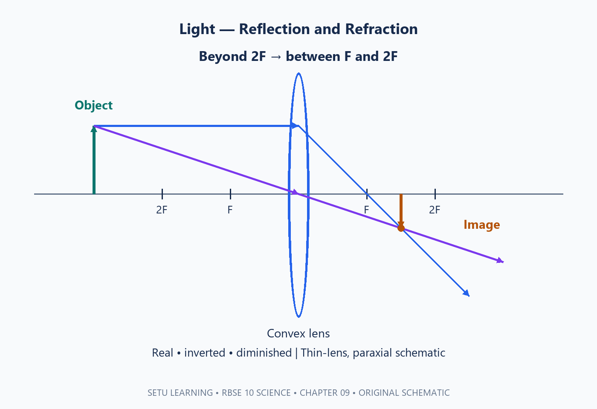

Thin convex lens ray diagram: object 2F से परे; image F और 2F के बीच real, inverted और छोटी। दूरी schematic है।

## भाग 4: पाठ्यपुस्तक-अवधारणाओं पर मौलिक हल किए उदाहरण

नीचे के प्रश्न लेखक के मौलिक मॉडल हैं। ये किसी NCERT edition के प्रश्न क्रमांक या संपूर्ण in-text/exercise solution bank होने का दावा नहीं करते।

**हल किया उदाहरण 1: Concave mirror: u = −30 cm, f = −15 cm। v और m निकालें।**

1/v = 1/f − 1/u = −1/15 + 1/30 = −1/30। v = −30 cm। m = −v/u = −1; image real, inverted और same size है, object C पर है।

**हल किया उदाहरण 2: Convex lens: u = −30 cm, f = +20 cm। v तथा m दें।**

1/v = 1/f + 1/u = 1/20 − 1/30 = 1/60। v = +60 cm। m = v/u = −2। Image lens के दूसरी ओर real, inverted, double height है।

**हल किया उदाहरण 3: Concave lens f = −25 cm की power निकालें।**

f = −0.25 m। P = 1/f = −4 D। Minus sign diverging lens दर्शाता है। 1/(−25) D लिखना cm को metre में न बदलने की गलती होगी।

## भाग 5: सत्यापित बोर्ड प्रश्न एवं स्रोत-स्थिति

इस अध्याय का वर्षवार PYQ audit अभी पूरा नहीं है। अभ्यास प्रश्नों पर काल्पनिक परीक्षा-वर्ष नहीं लगाए गए हैं। [असली 2025 बोर्ड पेपर](https://rajeduboard.rajasthan.gov.in/books/PAPERS-2025/Sec/S-07.pdf) से प्रश्न, उपभाग और अंक मिलाकर ही नया PYQ जोड़ा जाए।

## भाग 6: खंडवार मौलिक अभ्यास बैंक

**अभ्यास-अंक:** लेखक के स्व-अभ्यास के लिए हैं; RBSE की आधिकारिक marking scheme नहीं। उत्तर पहले स्वयं लिखें, फिर भाग 9 देखें।

## अ: बहुविकल्पीय प्रश्न — 15 × 1 अंक

**MCQ 1. Reflection में i और r का संबंध क्या है?**

अ) i = 2r  
ब) i + r = 180° हमेशा  
स) i = 0 हमेशा  
द) i = r

**MCQ 2. Concave mirror की f sign क्या है?**

अ) Zero हमेशा  
ब) कोई sign नहीं  
स) Negative  
द) Positive

**MCQ 3. Convex mirror finite object की image कैसी है?**

अ) Virtual inverted  
ब) Virtual erect diminished  
स) Real inverted enlarged  
द) Real erect same size

**MCQ 4. Mirror magnification formula कौन है?**

अ) −v/u  
ब) v/u  
स) u/v  
द) f/u

**MCQ 5. Lens magnification formula कौन है?**

अ) −v/u  
ब) −u/v  
स) f/v  
द) v/u

**MCQ 6. Convex lens की f sign क्या है?**

अ) Zero  
ब) हमेशा undefined  
स) Positive  
द) Negative

**MCQ 7. Lens power की unit क्या है?**

अ) Joule  
ब) Dioptre  
स) Ohm  
द) Ampere

**MCQ 8. f = +50 cm lens की power क्या है?**

अ) +2 D  
ब) +0.02 D  
स) −2 D  
द) +50 D

**MCQ 9. Vacuum से medium का refractive index क्या है?**

अ) v/c  
ब) c+v  
स) c−v  
द) c/v

**MCQ 10. Denser medium में oblique ray सामान्यतः कैसे bends करती है?**

अ) हमेशा वापस  
ब) कभी speed नहीं बदलती  
स) Normal की ओर  
द) Normal से दूर

**MCQ 11. Concave mirror में object C पर हो तो image कहाँ है?**

अ) Behind mirror F पर  
ब) C पर  
स) F पर  
द) P पर

**MCQ 12. Paraxial spherical mirror के R और f का संबंध क्या है?**

अ) R = 2f  
ब) R = f/2  
स) R = f  
द) R = 4f

**MCQ 13. Negative magnification का अर्थ क्या है?**

अ) Erect image  
ब) हमेशा virtual  
स) हमेशा enlarged  
द) Inverted image

**MCQ 14. Concave lens finite real object की image कैसी है?**

अ) Real same size  
ब) Virtual inverted  
स) Virtual erect diminished  
द) Real inverted enlarged

**MCQ 15. Normal incidence पर refraction में direction क्या कर सकती है?**

अ) Medium speed बराबर जरूरी  
ब) Unchanged रह सकती है  
स) हमेशा 90° घूमती है  
द) हमेशा वापस आती है

## अ: रिक्त स्थान — 6 × 1 अंक

1. Light का उसी medium में surface से वापस लौटना। — इस शब्द/सूत्र का नाम है: ____।  
2. Medium बदलने पर light speed और सामान्यतः direction बदलना। — इस शब्द/सूत्र का नाम है: ____।  
3. Mirror pole/curvature center अथवा lens optical center से जाने वाली axis। — इस शब्द/सूत्र का नाम है: ____।  
4. Axis-parallel paraxial rays का मिलने/मिलते प्रतीत होने वाला बिंदु। — इस शब्द/सूत्र का नाम है: ____।  
5. 1/f = 1/v + 1/u; Cartesian signs सहित। — इस शब्द/सूत्र का नाम है: ____।  
6. m = −v/u = hᵢ/hₒ। — इस शब्द/सूत्र का नाम है: ____।

## अ: अतिलघु उत्तर — 8 × 1 अंक

1. Reflection में i और r का संबंध क्या है?  
2. Concave mirror की f sign क्या है?  
3. Convex mirror finite object की image कैसी है?  
4. Mirror magnification formula कौन है?  
5. Lens magnification formula कौन है?  
6. Convex lens की f sign क्या है?  
7. Lens power की unit क्या है?  
8. f = +50 cm lens की power क्या है?

## ब: लघु उत्तर — 6 × 2 अंक

**B1.** Reflection angles normal से क्यों मापें?

**B2.** Real और virtual image का अंतर दें।

**B3.** Convex mirror vehicle rear-view में क्यों उपयोगी है?

**B4.** Lens और mirror magnification का अंतर बताइए।

**B5.** Optical density और mass density अलग कैसे हैं?

**B6.** Glass slab से emergent ray parallel क्यों होती है?

## स: दीर्घ उत्तर — 4 × 3 अंक

आंतरिक विकल्प अभ्यास: C1 अथवा C2, तथा C3 अथवा C4 चुनें। पुनरावृत्ति में बचा विकल्प भी हल करें। यह लेखक की अभ्यास व्यवस्था है।

**C1.** Concave mirror के three standard construction rays दें।

**C2.** Convex lens beyond 2F case समझाएँ।

**C3.** Snell law और normal incidence की सीमा दें।

**C4.** Convex lens within-focus case समझाएँ।

## द: विस्तृत उत्तर — 2 × 4 अंक

आंतरिक विकल्प अभ्यास: D1 अथवा D2 चुनें; बाद में दूसरा भी हल करें।

**D1.** Concave mirror f = −10 cm में u = −15 cm पर object है। v, m और nature दें।

**D2.** Convex lens f = +15 cm, u = −10 cm के लिए image दें तथा diagram steps लिखें।

## भाग 7: सावधानियाँ एवं परीक्षा-त्रुटियाँ

- Mirror और lens equations अलग हैं।
- Power में f metre में लें।
- Angle normal से मापें।
- Virtual image की backward extensions dashed रखें।
- v/m के signs के साथ ray-case मिलाएँ।

## भाग 8: फटाफट पुनरावृत्ति — 25 बिंदु

1. परावर्तन: Light का उसी medium में surface से वापस लौटना।  
2. अपवर्तन: Medium बदलने पर light speed और सामान्यतः direction बदलना।  
3. Principal axis: Mirror pole/curvature center अथवा lens optical center से जाने वाली axis।  
4. Focus: Axis-parallel paraxial rays का मिलने/मिलते प्रतीत होने वाला बिंदु।  
5. Mirror formula: 1/f = 1/v + 1/u; Cartesian signs सहित।  
6. Mirror magnification: m = −v/u = hᵢ/hₒ।  
7. Lens formula: 1/f = 1/v − 1/u; Cartesian signs सहित।  
8. Lens magnification: m = v/u = hᵢ/hₒ।  
9. Refractive index: n = c/v; vacuum speed / medium speed।  
10. Lens power: P = 1/f, f metre में; unit dioptre (D)।  
11. दोनों angles surface normal से मापने पर बराबर हैं।  
12. Incident-light direction positive रखने पर concave focus object side में negative है।  
13. Convex mirror reflected rays diverge करता है; extensions behind mirror मिलती हैं।  
14. Mirror geometry और Cartesian convention से m=−v/u मिलता है।  
15. Thin lens के लिए m=v/u है; mirror वाला minus न लगाएँ।  
16. Converging convex lens का far-side principal focus positive है।  
17. P=1/f metre में होने से unit m⁻¹ यानी dioptre है।  
18. 50 cm=0.5 m, reciprocal +2 D है।  
19. Absolute refractive index vacuum speed divided by medium speed है।  
20. Higher index में speed कम होती है और oblique ray normal की ओर मुड़ती है।  
21. C case में image real inverted और same size C पर बनती है।  
22. Spherical mirror का principal focal length radius का आधा है।  
23. m<0 image height का object से opposite sign दर्शाता है।  
24. Diverging lens object side focus और center के बीच virtual image देता है।  
25. Normal incidence पर ray straight चलती है, भले speed बदले।

## भाग 9: संपूर्ण अभ्यास उत्तर-कुंजी

## MCQ: सही विकल्प और कारण

**1. द — i = r।** दोनों angles surface normal से मापने पर बराबर हैं।

**2. स — Negative।** Incident-light direction positive रखने पर concave focus object side में negative है।

**3. ब — Virtual erect diminished।** Convex mirror reflected rays diverge करता है; extensions behind mirror मिलती हैं।

**4. अ — −v/u।** Mirror geometry और Cartesian convention से m=−v/u मिलता है।

**5. द — v/u।** Thin lens के लिए m=v/u है; mirror वाला minus न लगाएँ।

**6. स — Positive।** Converging convex lens का far-side principal focus positive है।

**7. ब — Dioptre।** P=1/f metre में होने से unit m⁻¹ यानी dioptre है।

**8. अ — +2 D।** 50 cm=0.5 m, reciprocal +2 D है।

**9. द — c/v।** Absolute refractive index vacuum speed divided by medium speed है।

**10. स — Normal की ओर।** Higher index में speed कम होती है और oblique ray normal की ओर मुड़ती है।

**11. ब — C पर।** C case में image real inverted और same size C पर बनती है।

**12. अ — R = 2f।** Spherical mirror का principal focal length radius का आधा है।

**13. द — Inverted image।** m<0 image height का object से opposite sign दर्शाता है।

**14. स — Virtual erect diminished।** Diverging lens object side focus और center के बीच virtual image देता है।

**15. ब — Unchanged रह सकती है।** Normal incidence पर ray straight चलती है, भले speed बदले।

**रिक्त स्थान:** 1. परावर्तन; 2. अपवर्तन; 3. Principal axis; 4. Focus; 5. Mirror formula; 6. Mirror magnification

**अतिलघु उत्तर:**

1. i = r। दोनों angles surface normal से मापने पर बराबर हैं।

2. Negative। Incident-light direction positive रखने पर concave focus object side में negative है।

3. Virtual erect diminished। Convex mirror reflected rays diverge करता है; extensions behind mirror मिलती हैं।

4. −v/u। Mirror geometry और Cartesian convention से m=−v/u मिलता है।

5. v/u। Thin lens के लिए m=v/u है; mirror वाला minus न लगाएँ।

6. Positive। Converging convex lens का far-side principal focus positive है।

7. Dioptre। P=1/f metre में होने से unit m⁻¹ यानी dioptre है।

8. +2 D। 50 cm=0.5 m, reciprocal +2 D है।

**B1. Reflection angles normal से क्यों मापें?**

Reflection law i=r में incidence/reflection angles normal और respective ray के बीच हैं। Surface से measured angles complementary होते हैं; question का angle किस reference से है, पहले पहचानें। Diagram में normal अलग dashed line दिखाएँ।

**B2. Real और virtual image का अंतर दें।**

Real image actual light rays के intersection से बनती है और screen पर प्राप्त हो सकती है। Virtual image backward extensions के apparent intersection से बनती है; उसे उसी स्थान पर screen से capture नहीं कर सकते। Orientation alone परिभाषा नहीं।

**B3. Convex mirror vehicle rear-view में क्यों उपयोगी है?**

यह finite objects की erect, diminished virtual image और wide field of view देता है। इसलिए अधिक पीछे का क्षेत्र दिखाई देता है। Objects छोटे दिखने से distance का गलत अनुमान हो सकता है; इसे magnifying mirror न कहें।

**B4. Lens और mirror magnification का अंतर बताइए।**

Mirror formula m=−v/u और thin lens formula m=v/u है। दोनों में m=hᵢ/hₒ; negative sign inverted image का संकेत है। Formula बदलने पर एक ही memorised sign न लगाएँ।

**B5. Optical density और mass density अलग कैसे हैं?**

Optical density light speed/refractive index से संबंधित है। Mass density mass per unit volume है। Mass-density comparison से refraction की दिशा का universal निर्णय नहीं किया जा सकता; refractive indices उपयोग करें।

**B6. Glass slab से emergent ray parallel क्यों होती है?**

Slab की opposite refracting faces parallel हैं। दूसरे interface का bending पहले के angular deviation को compensate करता है, इसलिए बाहर same medium में emergent ray incident ray के parallel होती है। Path में lateral shift रह सकता है।

**C1. Concave mirror के three standard construction rays दें।**

1. Parallel ray reflection के बाद F से गुजरती है। 2. F से होकर आने वाली ray axis parallel reflect होती है। 3. C की ओर ray normal incidence के कारण अपना path retrace करती है। कम से कम दो rays से image locate करें।

**C2. Convex lens beyond 2F case समझाएँ।**

1. Object को 2F से दूर रखें। 2. Top से axis-parallel ray far F की ओर और optical-center ray straight draw करें। 3. Rays lens की दूसरी ओर F–2F में मिलती हैं; image real, inverted और diminished है।

**C3. Snell law और normal incidence की सीमा दें।**

1. Fixed media के लिए sin i/sin r relative index है। 2. Denser medium में oblique ray normal की ओर मुड़ती है। 3. i=0 पर r=0, direction unchanged रहती है; speed/wavelength बदल सकती है। 0/0 को ordinary quotient की तरह न compute करें।

**C4. Convex lens within-focus case समझाएँ।**

1. Object lens और near F के बीच हो। 2. Refracted rays diverge; backward extensions object side पर मिलती हैं। 3. Image virtual, erect और magnified है; real rays सामने screen पर इस image को नहीं बनातीं।

**D1. Concave mirror f = −10 cm में u = −15 cm पर object है। v, m और nature दें।**

1. 1/v = −1/10 + 1/15 = −1/30। 2. v = −30 cm। 3. m = −(−30)/(−15) = −2। 4. Image real, inverted और twice size; C से परे बनती है। Sign, magnitude और qualitative ray case तीनों consistent हैं।

**D2. Convex lens f = +15 cm, u = −10 cm के लिए image दें तथा diagram steps लिखें।**

1. 1/v = 1/15 − 1/10 = −1/30, v = −30 cm। 2. m = (−30)/(−10) = +3। 3. Virtual, erect, three times size, object side। 4. Parallel-to-focus ray और optical-center ray की backward extensions draw करें; object F के भीतर है।

## भाग 10: 10 मिनट / 10 अंक आत्म-मूल्यांकन एवं संदर्भ

समय: 10 मिनट। पहले पुस्तक बंद करें।

1. MCQ 3 और 11 हल करें। (1 + 1)
2. B2 और B5 के उत्तर लिखें। (2 + 2)
3. D1 हल करें। (4)

**कुंजी:** भाग 9 में संबंधित क्रमांक देखें। **स्व-मूल्यांकन:** 8–10: आगे बढ़ें; 5–7: छूटे कौशल का दोहराव; 0–4: भाग 2–4 फिर पढ़ें। यह अभ्यास-सुझाव है, बोर्ड grade नहीं।

[सत्यापित RBSE 2025–26 पाठ्यक्रम](https://rajeduboard.rajasthan.gov.in/anudeshika-etc/10_2026.pdf) · [NCERT विज्ञान अध्याय 9](https://ncert.nic.in/textbook/pdf/jesc109.pdf)

**आगे की कड़ी:** अगले अध्याय में lens और refraction का उपयोग human eye और colour phenomena में करेंगे।

---

# अध्याय 10: मानव नेत्र तथा रंगबिरंगा संसार (The Human Eye and the Colourful World)

## भाग 1: अध्याय प्रवेश एवं पाठ्यक्रम मैपिंग

> प्रथम संपादकीय प्रारूप। NCERT के सभी प्रश्नों के हल तथा पूरा ऐतिहासिक PYQ संग्रह अभी स्रोत-परीक्षण में हैं। सामान्य माध्यमिक 2026–27 पाठ्यक्रम की पुनः पुष्टि शेष है।

**विषय कोड:** 07 · **श्रृंखला पुस्तक:** 2

**सत्यापित आधार:** RBSE 2025–26 · **अध्याय भार:** 4 अंक। यह भार उसी संस्करण का है; वास्तविक प्रश्न-विभाजन की भविष्यवाणी नहीं।

**सीखने के लक्ष्य:** Eye optics, accommodation और vision defects; prism dispersion, atmospheric refraction और scattering के कारण समझना।

## भाग 2: शब्दावली एवं अवधारणा कैप्सूल

| शब्द / सूत्र | अर्थ / उपयोग |
|---|---|
| Cornea | Eye का transparent front surface; refraction का बड़ा भाग यहाँ। |
| Iris | Pupil size नियंत्रित करने वाला coloured diaphragm। |
| Pupil | Light के प्रवेश का opening; iris से नियंत्रित। |
| Retina | Light-sensitive layer जहाँ optical image बनती है। |
| Accommodation | Ciliary muscles द्वारा lens curvature/focal length बदलना। |
| Myopia | Distant objects स्पष्ट नहीं; image retina के आगे बनती है। |
| Hypermetropia | Near objects स्पष्ट नहीं; image retina के पीछे बनने की प्रवृत्ति। |
| Presbyopia | Age-related accommodation decrease से near vision कठिन। |
| Dispersion | White light का constituent colours में separation। |
| Scattering | Particles द्वारा light को विभिन्न दिशाओं में भेजना। |

## भाग 3: विस्तृत शिक्षण पाठ

### Eye एक adjustable optical system
Cornea और lens light refract करके retina पर real, inverted image बनाते हैं। Optic nerve signals brain तक ले जाती है। Iris pupil का aperture नियंत्रित करता है, lens की focal length नहीं। Ciliary muscles lens curvature बदलते हैं। Near object पर lens अधिक convex होकर focal length घटाता है; distant object पर flatter होकर बढ़ाता है। Typical normal near point लगभग 25 cm और far point infinity school model में माना जाता है; यह हर व्यक्ति की exact measurement नहीं।

### Defects और correction
Myopia में distant-object image retina के आगे focus होती है; concave lens rays diverge कर corrected focusing में मदद करता है। Hypermetropia में near-object image retina के पीछे बनने की tendency है; convex lens convergence बढ़ाता है। Presbyopia में aging से accommodation घटती है; correction individual need के अनुसार होती है और combined defects में bifocal/progressive lenses useful हो सकते हैं। Cataract lens clouding है, केवल focal defect नहीं; clinical treatment अलग है।

### Prism और atmosphere
Glass prism different wavelengths को अलग refractive index से refract करता है; violet का deviation red से अधिक होता है। White light separation dispersion, लेकिन single-colour beam का bending refraction है। Rainbow में droplets का refraction, dispersion और internal reflection योगदान करते हैं। Atmosphere की changing optical density stars की apparent brightness/position fluctuation देती है। Planets extended apparent sources होने से scintillation काफी average out करते हैं। Atmospheric refraction sun को geometric sunrise से कुछ पहले visible बना सकती है।

### Sky blue क्यों?
Small-particle/molecular scattering short wavelengths के लिए अधिक है। Blue wavelengths red से अधिक scattered होती हैं; spectral distribution और eye response के साथ sky blue दिखाई देता है, केवल ‘violet नहीं मौजूद’ कारण नहीं। Larger colloidal particles के path-visible scattering को Tyndall effect कहते हैं। Red light relatively कम scattered होती है, इसलिए warning signals में useful है। Moon जैसे atmosphere-रहित स्थान पर sky dark दिखता है।

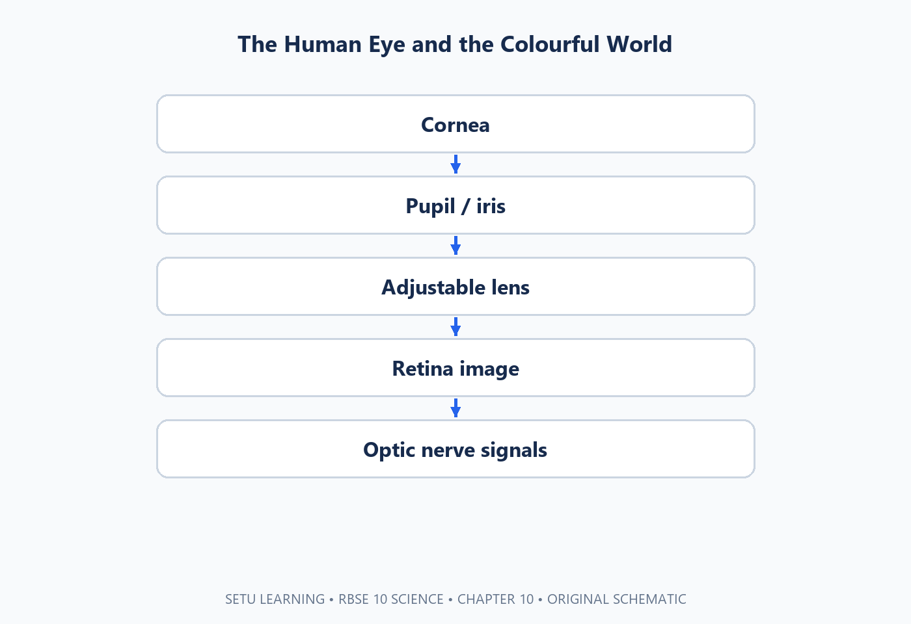

Eye optics का simplified route; accommodation और pupil control अलग mechanisms हैं।

## भाग 4: पाठ्यपुस्तक-अवधारणाओं पर मौलिक हल किए उदाहरण

नीचे के प्रश्न लेखक के मौलिक मॉडल हैं। ये किसी NCERT edition के प्रश्न क्रमांक या संपूर्ण in-text/exercise solution bank होने का दावा नहीं करते।

**हल किया उदाहरण 1: Myopic eye का far point 2 m है। Correction power का school-model estimate दें।**

Distant object u=−∞ की virtual image far point v=−2 m पर चाहिए। Lens equation 1/f=1/v−1/u≈−1/2, f=−2 m और P=−0.5 D। Prescription की वास्तविक जाँच clinician करता है।

**हल किया उदाहरण 2: Near object देखते समय ciliary muscles और lens कैसे बदलते हैं?**

Ciliary muscles contract, lens अधिक convex/thicker हो सकता है, focal length घटती और power बढ़ती है। इससे पास के object की rays retina पर focus हो पाती हैं।

**हल किया उदाहरण 3: Prism में red और violet का relative deviation दें।**

Normal glass prism में violet wavelength के लिए refractive index अधिक, इसलिए deviation अधिक है। Red का deviation सबसे कम होता है। यह dispersion का school-level pattern है।

## भाग 5: सत्यापित बोर्ड प्रश्न एवं स्रोत-स्थिति

इस अध्याय का वर्षवार PYQ audit अभी पूरा नहीं है। अभ्यास प्रश्नों पर काल्पनिक परीक्षा-वर्ष नहीं लगाए गए हैं। [असली 2025 बोर्ड पेपर](https://rajeduboard.rajasthan.gov.in/books/PAPERS-2025/Sec/S-07.pdf) से प्रश्न, उपभाग और अंक मिलाकर ही नया PYQ जोड़ा जाए।

## भाग 6: खंडवार मौलिक अभ्यास बैंक

**अभ्यास-अंक:** लेखक के स्व-अभ्यास के लिए हैं; RBSE की आधिकारिक marking scheme नहीं। उत्तर पहले स्वयं लिखें, फिर भाग 9 देखें।

## अ: बहुविकल्पीय प्रश्न — 15 × 1 अंक

**MCQ 1. Eye की light-sensitive layer कौन है?**

अ) Cornea ही  
ब) Pupil  
स) Retina  
द) Iris

**MCQ 2. Pupil size कौन नियंत्रित करता है?**

अ) Tear gland  
ब) Iris  
स) Retina  
द) Optic nerve ही

**MCQ 3. Accommodation मुख्यतः किससे होती है?**

अ) Lens curvature change  
ब) Retina की daily growth  
स) Eye colour change  
द) Pupil का lens बनना

**MCQ 4. Near object के लिए lens focal length सामान्यतः क्या करती है?**

अ) बढ़ती है  
ब) हमेशा infinity  
स) शून्य ही  
द) घटती है

**MCQ 5. Myopia correction का lens कौन है?**

अ) Plane glass ही  
ब) Prism ही  
स) Concave  
द) Convex

**MCQ 6. Hypermetropia correction का lens कौन है?**

अ) Opaque glass  
ब) Convex  
स) Concave  
द) Plane mirror

**MCQ 7. School model में normal near point लगभग कितना है?**

अ) 25 cm  
ब) 25 m  
स) 2.5 mm  
द) Infinity

**MCQ 8. Prism में least deviation colour कौन है?**

अ) Violet  
ब) Blue  
स) Indigo  
द) Red

**MCQ 9. White light का colour separation क्या है?**

अ) Neutralisation  
ब) Conduction  
स) Dispersion  
द) केवल reflection

**MCQ 10. Clear sky blue होने का मुख्य phenomenon क्या है?**

अ) Magnetism  
ब) Scattering  
स) केवल total reflection  
द) Nuclear fusion

**MCQ 11. Colloid में beam path दिखने का नाम क्या है?**

अ) Tyndall effect  
ब) Joule effect  
स) Ohm law  
द) Mendel law

**MCQ 12. Star twinkling मुख्यतः किससे जुड़ा है?**

अ) Star का रोज बुझना  
ब) Moon reflection ही  
स) Glass lens defect  
द) Atmospheric refraction fluctuations

**MCQ 13. Presbyopia मुख्यतः क्या है?**

अ) हर बार infection  
ब) Retina आगे बढ़ना  
स) Age-related accommodation decrease  
द) Pupil का रंग लाल

**MCQ 14. Cataract क्या है?**

अ) Pupil widening  
ब) Lens clouding  
स) केवल myopia  
द) केवल colour blindness

**MCQ 15. Retina पर optical image कैसी होती है?**

अ) Real inverted  
ब) Virtual erect  
स) Virtual inverted हमेशा  
द) Real erect

## अ: रिक्त स्थान — 6 × 1 अंक

1. Eye का transparent front surface; refraction का बड़ा भाग यहाँ। — इस शब्द/सूत्र का नाम है: ____।  
2. Pupil size नियंत्रित करने वाला coloured diaphragm। — इस शब्द/सूत्र का नाम है: ____।  
3. Light के प्रवेश का opening; iris से नियंत्रित। — इस शब्द/सूत्र का नाम है: ____।  
4. Light-sensitive layer जहाँ optical image बनती है। — इस शब्द/सूत्र का नाम है: ____।  
5. Ciliary muscles द्वारा lens curvature/focal length बदलना। — इस शब्द/सूत्र का नाम है: ____।  
6. Distant objects स्पष्ट नहीं; image retina के आगे बनती है। — इस शब्द/सूत्र का नाम है: ____।

## अ: अतिलघु उत्तर — 8 × 1 अंक

1. Eye की light-sensitive layer कौन है?  
2. Pupil size कौन नियंत्रित करता है?  
3. Accommodation मुख्यतः किससे होती है?  
4. Near object के लिए lens focal length सामान्यतः क्या करती है?  
5. Myopia correction का lens कौन है?  
6. Hypermetropia correction का lens कौन है?  
7. School model में normal near point लगभग कितना है?  
8. Prism में least deviation colour कौन है?

## ब: लघु उत्तर — 6 × 2 अंक

**B1.** Iris और ciliary muscles की भूमिकाएँ अलग करें।

**B2.** Myopia का cause और correction दें।

**B3.** Hypermetropia का cause और correction दें।

**B4.** Presbyopia और cataract का अंतर दें।

**B5.** Stars twinkle और planets कम क्यों करते हैं?

**B6.** Blue sky और Tyndall effect का संबंध और अंतर दें।

## स: दीर्घ उत्तर — 4 × 3 अंक

आंतरिक विकल्प अभ्यास: C1 अथवा C2, तथा C3 अथवा C4 चुनें। पुनरावृत्ति में बचा विकल्प भी हल करें। यह लेखक की अभ्यास व्यवस्था है।

**C1.** Eye light path और retina image बताएँ।

**C2.** Myopia/hypermetropia का diagram कैसे अलग बनाएँ?

**C3.** Prism dispersion के तीन बिंदु दें।

**C4.** Atmospheric refraction के दो examples और mechanism दें।

## द: विस्तृत उत्तर — 2 × 4 अंक

आंतरिक विकल्प अभ्यास: D1 अथवा D2 चुनें; बाद में दूसरा भी हल करें।

**D1.** Normal near vision, myopia और hypermetropia को image location और correction से तुलना करें।

**D2.** Sky colour, red warning signal और stars twinkling का कारण अलग-अलग समझाएँ।

## भाग 7: सावधानियाँ एवं परीक्षा-त्रुटियाँ

- Myopia concave, hypermetropia convex।
- Iris और ciliary muscle के काम अलग।
- Twinkling refraction, sky colour scattering।
- Cataract को presbyopia न कहें।
- 25 cm typical model है, सभी लोगों का fixed near point नहीं।

## भाग 8: फटाफट पुनरावृत्ति — 25 बिंदु

1. Cornea: Eye का transparent front surface; refraction का बड़ा भाग यहाँ।  
2. Iris: Pupil size नियंत्रित करने वाला coloured diaphragm।  
3. Pupil: Light के प्रवेश का opening; iris से नियंत्रित।  
4. Retina: Light-sensitive layer जहाँ optical image बनती है।  
5. Accommodation: Ciliary muscles द्वारा lens curvature/focal length बदलना।  
6. Myopia: Distant objects स्पष्ट नहीं; image retina के आगे बनती है।  
7. Hypermetropia: Near objects स्पष्ट नहीं; image retina के पीछे बनने की प्रवृत्ति।  
8. Presbyopia: Age-related accommodation decrease से near vision कठिन।  
9. Dispersion: White light का constituent colours में separation।  
10. Scattering: Particles द्वारा light को विभिन्न दिशाओं में भेजना।  
11. Retina में light-sensitive cells visual signals बनाती हैं।  
12. Iris aperture बदलकर pupil size नियंत्रित करता है।  
13. Ciliary muscles lens curvature बदलकर focal length adjust करते हैं।  
14. Lens अधिक convex होने से focal length घटती और power बढ़ती है।  
15. Concave lens rays diverge करके premature focusing सुधारता है।  
16. Convex lens convergence बढ़ाता है और near focusing में मदद करता है।  
17. Typical near point लगभग 25 cm लिया जाता है; individual variation होती है।  
18. Ordinary glass prism में red light least deviate करती है।  
19. Wavelength-dependent refraction components अलग करती है।  
20. Short visible wavelengths अधिक scattered होती हैं।  
21. Particles की scattering से beam path visible हो सकता है।  
22. Changing atmosphere star light के apparent intensity/position को बदलता है।  
23. Aging में lens elasticity/muscle-related accommodation घट सकती है।  
24. Cataract transparency का defect है, simple focusing error मात्र नहीं।  
25. Eye optics real inverted image retina पर बनाते हैं; brain signals interpret करता है।

## भाग 9: संपूर्ण अभ्यास उत्तर-कुंजी

## MCQ: सही विकल्प और कारण

**1. स — Retina।** Retina में light-sensitive cells visual signals बनाती हैं।

**2. ब — Iris।** Iris aperture बदलकर pupil size नियंत्रित करता है।

**3. अ — Lens curvature change।** Ciliary muscles lens curvature बदलकर focal length adjust करते हैं।

**4. द — घटती है।** Lens अधिक convex होने से focal length घटती और power बढ़ती है।

**5. स — Concave।** Concave lens rays diverge करके premature focusing सुधारता है।

**6. ब — Convex।** Convex lens convergence बढ़ाता है और near focusing में मदद करता है।

**7. अ — 25 cm।** Typical near point लगभग 25 cm लिया जाता है; individual variation होती है।

**8. द — Red।** Ordinary glass prism में red light least deviate करती है।

**9. स — Dispersion।** Wavelength-dependent refraction components अलग करती है।

**10. ब — Scattering।** Short visible wavelengths अधिक scattered होती हैं।

**11. अ — Tyndall effect।** Particles की scattering से beam path visible हो सकता है।

**12. द — Atmospheric refraction fluctuations।** Changing atmosphere star light के apparent intensity/position को बदलता है।

**13. स — Age-related accommodation decrease।** Aging में lens elasticity/muscle-related accommodation घट सकती है।

**14. ब — Lens clouding।** Cataract transparency का defect है, simple focusing error मात्र नहीं।

**15. अ — Real inverted।** Eye optics real inverted image retina पर बनाते हैं; brain signals interpret करता है।

**रिक्त स्थान:** 1. Cornea; 2. Iris; 3. Pupil; 4. Retina; 5. Accommodation; 6. Myopia

**अतिलघु उत्तर:**

1. Retina। Retina में light-sensitive cells visual signals बनाती हैं।

2. Iris। Iris aperture बदलकर pupil size नियंत्रित करता है।

3. Lens curvature change। Ciliary muscles lens curvature बदलकर focal length adjust करते हैं।

4. घटती है। Lens अधिक convex होने से focal length घटती और power बढ़ती है।

5. Concave। Concave lens rays diverge करके premature focusing सुधारता है।

6. Convex। Convex lens convergence बढ़ाता है और near focusing में मदद करता है।

7. 25 cm। Typical near point लगभग 25 cm लिया जाता है; individual variation होती है।

8. Red। Ordinary glass prism में red light least deviate करती है।

**B1. Iris और ciliary muscles की भूमिकाएँ अलग करें।**

Iris pupil opening बदलकर light entry नियंत्रित करता है। Ciliary muscles lens curvature बदलकर accommodation करते हैं। इसलिए brightness control और near/far focusing एक ही mechanism नहीं।

**B2. Myopia का cause और correction दें।**

Eyeball लंबा या optical power अधिक होने पर दूर object की image retina से पहले focus हो सकती है। Concave lens divergence देकर focus retina की ओर adjust करता है। Image retina के पीछे लिखना hypermetropia से मिश्रण होगा।

**B3. Hypermetropia का cause और correction दें।**

Eyeball छोटा या optical power कम होने पर near object की image retina के पीछे बनने की प्रवृत्ति होती है। Convex lens अतिरिक्त convergence देता है। Optical correction defect के measurement पर निर्भर है।

**B4. Presbyopia और cataract का अंतर दें।**

Presbyopia age-related accommodation loss है, जिससे near focusing कठिन होती है। Cataract lens clouding है, जिससे transmission और clarity प्रभावित होती है। दोनों aging से जुड़े हो सकते हैं, लेकिन cause और treatment समान नहीं।

**B5. Stars twinkle और planets कम क्यों करते हैं?**

Stars point-like sources हैं; changing atmosphere से intensity/position fluctuation स्पष्ट दिखती है। Planets का apparent disk extended होता है; अनेक points के fluctuations average होकर कम twinkling दिखाते हैं। दूरी अकेला पूर्ण कारण नहीं।

**B6. Blue sky और Tyndall effect का संबंध और अंतर दें।**

दोनों scattering से जुड़े हैं। Clear sky मुख्यतः molecules/small particles द्वारा short wavelengths के अधिक scattering से blue दिखता है। Tyndall effect colloidal/larger particles में beam path visible होने का उदाहरण है।

**C1. Eye light path और retina image बताएँ।**

1. Light cornea, pupil और lens से होकर अंदर जाती है। 2. Cornea/lens refraction retina पर real inverted optical image देता है। 3. Retinal cells signals बनाती हैं; optic nerve brain तक ले जाती है। Retina को convex lens न कहें।

**C2. Myopia/hypermetropia का diagram कैसे अलग बनाएँ?**

1. Uncorrected myopia focus retina के आगे। 2. Hypermetropia near-object focus पीछे। 3. Correction क्रमशः concave और convex external lenses से show करें; outgoing rays corrected case में retina पर meet हों। Labels में defect और lens दोनों दें।

**C3. Prism dispersion के तीन बिंदु दें।**

1. White light में अनेक wavelengths हैं। 2. Glass का refractive index wavelength-dependent है। 3. Violet अधिक और red कम deviate होकर spectrum बनाते हैं। Prism colours ‘बनाता’ नहीं, existing components अलग करता है।

**C4. Atmospheric refraction के दो examples और mechanism दें।**

1. Star apparent position बदल सकती है। 2. Sun geometric horizon के नीचे होने पर भी कुछ समय visible हो सकता है। 3. Atmosphere का refractive index altitude/conditions से बदलता है, जिससे light path bends करता है। यह reflection नहीं।

**D1. Normal near vision, myopia और hypermetropia को image location और correction से तुलना करें।**

1. Normal accommodated eye near object का focus retina पर रखती है। 2. Myopic eye में distant rays retina से पहले focus हो सकती हैं; concave lens उपयोगी। 3. Hypermetropic eye में near-object focus retina के पीछे की tendency; convex lens useful। 4. Diagrams में retina position स्थिर रखें और ray intersections सही स्थान दिखाएँ।

**D2. Sky colour, red warning signal और stars twinkling का कारण अलग-अलग समझाएँ।**

1. Short wavelengths का अधिक scattering blue sky में योगदान देता है। 2. Red wavelength का comparatively कम scattering warning visibility में मदद करता है। 3. Star twinkling atmospheric refractive-index fluctuations से है। 4. पहली दो scattering हैं, तीसरी refraction-related है; सभी को prism dispersion कहना गलत होगा।

## भाग 10: 10 मिनट / 10 अंक आत्म-मूल्यांकन एवं संदर्भ

समय: 10 मिनट। पहले पुस्तक बंद करें।

1. MCQ 3 और 11 हल करें। (1 + 1)
2. B2 और B5 के उत्तर लिखें। (2 + 2)
3. D1 हल करें। (4)

**कुंजी:** भाग 9 में संबंधित क्रमांक देखें। **स्व-मूल्यांकन:** 8–10: आगे बढ़ें; 5–7: छूटे कौशल का दोहराव; 0–4: भाग 2–4 फिर पढ़ें। यह अभ्यास-सुझाव है, बोर्ड grade नहीं।

[सत्यापित RBSE 2025–26 पाठ्यक्रम](https://rajeduboard.rajasthan.gov.in/anudeshika-etc/10_2026.pdf) · [NCERT विज्ञान अध्याय 10](https://ncert.nic.in/textbook/pdf/jesc110.pdf)

**आगे की कड़ी:** अगले अध्याय में current, potential difference और electric energy की गणना करेंगे।

---

# अध्याय 11: विद्युत (Electricity)

## भाग 1: अध्याय प्रवेश एवं पाठ्यक्रम मैपिंग

> प्रथम संपादकीय प्रारूप। NCERT के सभी प्रश्नों के हल तथा पूरा ऐतिहासिक PYQ संग्रह अभी स्रोत-परीक्षण में हैं। सामान्य माध्यमिक 2026–27 पाठ्यक्रम की पुनः पुष्टि शेष है।

**विषय कोड:** 07 · **श्रृंखला पुस्तक:** 2

**सत्यापित आधार:** RBSE 2025–26 · **अध्याय भार:** 7 अंक। यह भार उसी संस्करण का है; वास्तविक प्रश्न-विभाजन की भविष्यवाणी नहीं।

**सीखने के लक्ष्य:** Current/voltage/resistance की units; circuit combinations, Ohm law और heating; power एवं commercial energy numericals हल करना।

## भाग 2: शब्दावली एवं अवधारणा कैप्सूल

| शब्द / सूत्र | अर्थ / उपयोग |
|---|---|
| Current | I = Q/t; unit ampere (A), 1 A = 1 C/s। |
| Potential difference | V = W/Q; unit volt (V), 1 V = 1 J/C। |
| Resistance | R = V/I; unit ohm (Ω)। |
| Ohm law | Fixed physical conditions में V = IR। |
| Resistivity | ρ = RA/l; material property, unit Ω·m। |
| Series resistance | Rₛ = R₁ + R₂ + …। |
| Parallel resistance | 1/Rₚ = 1/R₁ + 1/R₂ + …। |
| Joule heating | H = I²Rt; current ampere, resistance ohm, time second। |
| Power | P = VI = I²R = V²/R; unit watt। |
| Commercial energy | 1 kWh = 3.6 × 10⁶ J; kWh ऊर्जा है, power नहीं। |

## भाग 3: विस्तृत शिक्षण पाठ

### Charge से current तक
Potential difference charges को move करने का driving condition देता है; current charge-flow rate है। Conventional current positive-charge flow की direction है; metals में electrons उसके opposite drift करते हैं। Ammeter series में, voltmeter measured component के parallel में लगता है। Open circuit में steady current नहीं flows करता। Potential difference होने से बिना closed conductive path current हमेशा flows करेगा, ऐसा नहीं।

### Ohm और material
Ohm law fixed temperature और physical conditions पर V proportional I बताता है। $V=IR$; V–I graph में V vertical हो तो slope R है, I vertical हो तो slope 1/R। Wire resistance $R=\rho l/A$; length double हो और area constant तो R double। Area double हो तो half। Resistivity material तथा temperature से जुड़ी है; ordinary geometry बदलने से resistivity नहीं बदलती।

### Series और parallel
Series में current same, voltage drops add: Rₛ=R₁+R₂। Parallel में branch voltage same, currents add और reciprocal resistances add। Positive finite resistors का parallel equivalent smallest branch resistance से भी कम है। Household appliances parallel में लगते हैं ताकि rated voltage मिले और independently switch हो सकें। एक wire short circuit unintended low-resistance path बनाकर बहुत current दे सकता है।

### Heat, power और bill
Resistor heating $H=I^2Rt$ है। Power energy per time है: $P=VI$ तथा ohmic resistor के लिए $I^2R$ और $V^2/R$। Fixed current में larger R अधिक heat, fixed voltage में larger R कम power देता है; held-constant quantity पहचानें। Appliance bill energy kW × hours से निकलेगा। 1000 W=1 kW; 1 kWh=1000 J/s ×3600 s=3.6×10⁶ J। Electrical safety devices और household wiring अगले अध्याय में आएँगे; mains पर छात्र प्रयोग न करें।

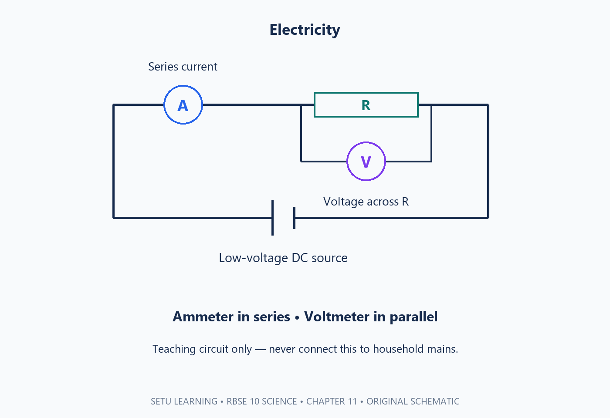

Low-voltage resistor experiment: ammeter series और voltmeter resistor के parallel में।

## भाग 4: पाठ्यपुस्तक-अवधारणाओं पर मौलिक हल किए उदाहरण

नीचे के प्रश्न लेखक के मौलिक मॉडल हैं। ये किसी NCERT edition के प्रश्न क्रमांक या संपूर्ण in-text/exercise solution bank होने का दावा नहीं करते।

**हल किया उदाहरण 1: 2 Ω और 3 Ω resistors को 6 V पर series में लगाएँ। I और drops निकालें।**

R=2+3=5 Ω। I=6/5=1.2 A। V₁=1.2×2=2.4 V, V₂=1.2×3=3.6 V। Sum 6 V; series current दोनों में 1.2 A है।

**हल किया उदाहरण 2: 6 Ω और 3 Ω parallel में 6 V पर हैं। R और total current दें।**

1/R=1/6+1/3=1/2, R=2 Ω। Branch currents 1 A और 2 A; total=3 A। जाँच V/R=6/2=3 A।

**हल किया उदाहरण 3: 100 W lamp रोज 5 hours, 30 days चले तो energy और ₹6/unit पर cost दें।**

P=0.1 kW, t=150 h। E=15 kWh अर्थात 15 units। Energy charge=15×₹6=₹90; fixed charges/taxes इस illustrative calculation में शामिल नहीं।

## भाग 5: सत्यापित बोर्ड प्रश्न एवं स्रोत-स्थिति

इस अध्याय का वर्षवार PYQ audit अभी पूरा नहीं है। अभ्यास प्रश्नों पर काल्पनिक परीक्षा-वर्ष नहीं लगाए गए हैं। [असली 2025 बोर्ड पेपर](https://rajeduboard.rajasthan.gov.in/books/PAPERS-2025/Sec/S-07.pdf) से प्रश्न, उपभाग और अंक मिलाकर ही नया PYQ जोड़ा जाए।

## भाग 6: खंडवार मौलिक अभ्यास बैंक

**अभ्यास-अंक:** लेखक के स्व-अभ्यास के लिए हैं; RBSE की आधिकारिक marking scheme नहीं। उत्तर पहले स्वयं लिखें, फिर भाग 9 देखें।

## अ: बहुविकल्पीय प्रश्न — 15 × 1 अंक

**MCQ 1. Current की SI unit क्या है?**

अ) Watt  
ब) Ampere  
स) Volt  
द) Ohm

**MCQ 2. Potential difference का formula कौन है?**

अ) W/Q  
ब) Q/t  
स) I/t  
द) R/A

**MCQ 3. Ohm law किन conditions में लागू है?**

अ) हर device हर दशा में  
ब) केवल open circuit  
स) Resistance शून्य हो  
द) Temperature/physical conditions स्थिर

**MCQ 4. Ammeter circuit में कहाँ लगता है?**

अ) केवल earth  
ब) बिना wire  
स) Series  
द) Parallel across source सीधे

**MCQ 5. Voltmeter component के कैसे लगता है?**

अ) बिना terminals  
ब) Parallel  
स) Series हमेशा  
द) केवल neutral

**MCQ 6. Same material wire की length double, area same: R क्या होगा?**

अ) Double  
ब) Half  
स) Unchanged  
द) Four times

**MCQ 7. Resistivity की SI unit क्या है?**

अ) Ω/m  
ब) A/m  
स) V·s  
द) Ω·m

**MCQ 8. 2 Ω तथा 3 Ω series equivalent क्या है?**

अ) 6 Ω  
ब) 0.5 Ω  
स) 5 Ω  
द) 1.2 Ω

**MCQ 9. 6 Ω तथा 3 Ω parallel equivalent क्या है?**

अ) 6 Ω  
ब) 2 Ω  
स) 9 Ω  
द) 3 Ω

**MCQ 10. Joule heat formula कौन है?**

अ) I²Rt  
ब) IR/t  
स) V/t  
द) R²It

**MCQ 11. 1 kWh कितने joules हैं?**

अ) 3600 J  
ब) 1000 J  
स) 3.6×10³ J  
द) 3.6×10⁶ J

**MCQ 12. 220 V, 1100 W heater का current क्या है?**

अ) 242 A  
ब) 1100 A  
स) 5 A  
द) 0.2 A

**MCQ 13. House appliances सामान्यतः किस combination में हैं?**

अ) केवल short circuit  
ब) Parallel  
स) Series ही  
द) कोई circuit नहीं

**MCQ 14. V vertical, I horizontal graph का slope क्या है?**

अ) Resistance  
ब) Conductance  
स) Power  
द) Charge

**MCQ 15. Fixed voltage पर R double होने पर P क्या होगा?**

अ) Double  
ब) Four times  
स) Unchanged  
द) Half

## अ: रिक्त स्थान — 6 × 1 अंक

1. I = Q/t; unit ampere (A), 1 A = 1 C/s। — इस शब्द/सूत्र का नाम है: ____।  
2. V = W/Q; unit volt (V), 1 V = 1 J/C। — इस शब्द/सूत्र का नाम है: ____।  
3. R = V/I; unit ohm (Ω)। — इस शब्द/सूत्र का नाम है: ____।  
4. Fixed physical conditions में V = IR। — इस शब्द/सूत्र का नाम है: ____।  
5. ρ = RA/l; material property, unit Ω·m। — इस शब्द/सूत्र का नाम है: ____।  
6. Rₛ = R₁ + R₂ + …। — इस शब्द/सूत्र का नाम है: ____।

## अ: अतिलघु उत्तर — 8 × 1 अंक

1. Current की SI unit क्या है?  
2. Potential difference का formula कौन है?  
3. Ohm law किन conditions में लागू है?  
4. Ammeter circuit में कहाँ लगता है?  
5. Voltmeter component के कैसे लगता है?  
6. Same material wire की length double, area same: R क्या होगा?  
7. Resistivity की SI unit क्या है?  
8. 2 Ω तथा 3 Ω series equivalent क्या है?

## ब: लघु उत्तर — 6 × 2 अंक

**B1.** Current और potential difference की तुलना करें।

**B2.** Ammeter series और voltmeter parallel क्यों लगाते हैं?

**B3.** Resistance और resistivity अलग कैसे हैं?

**B4.** Series और parallel में voltage/current की तुलना दें।

**B5.** Fuse में heating का उपयोग कैसे है?

**B6.** kW और kWh का अंतर क्या है?

## स: दीर्घ उत्तर — 4 × 3 अंक

आंतरिक विकल्प अभ्यास: C1 अथवा C2, तथा C3 अथवा C4 चुनें। पुनरावृत्ति में बचा विकल्प भी हल करें। यह लेखक की अभ्यास व्यवस्था है।

**C1.** Ohm law experiment के तीन measurement steps दें।

**C2.** Series equivalent resistance derive करें।

**C3.** Parallel equivalent resistance derive करें।

**C4.** Electrical power और energy के formulas जोड़ें।

## द: विस्तृत उत्तर — 2 × 4 अंक

आंतरिक विकल्प अभ्यास: D1 अथवा D2 चुनें; बाद में दूसरा भी हल करें।

**D1.** 220 V पर 1100 W heater के current, resistance और 2 h energy निकालें।

**D2.** 2 Ω और 4 Ω को 12 V पर series तथा parallel में तुलना करें।

## भाग 7: सावधानियाँ एवं परीक्षा-त्रुटियाँ

- kWh energy है, power नहीं।
- Graph axes देखे बिना slope R न लिखें।
- Parallel में voltage same; series में current same।
- ρ और R की units अलग हैं।
- Fixed V या fixed I पहचानकर heating की तुलना करें।

## भाग 8: फटाफट पुनरावृत्ति — 25 बिंदु

1. Current: I = Q/t; unit ampere (A), 1 A = 1 C/s।  
2. Potential difference: V = W/Q; unit volt (V), 1 V = 1 J/C।  
3. Resistance: R = V/I; unit ohm (Ω)।  
4. Ohm law: Fixed physical conditions में V = IR।  
5. Resistivity: ρ = RA/l; material property, unit Ω·m।  
6. Series resistance: Rₛ = R₁ + R₂ + …।  
7. Parallel resistance: 1/Rₚ = 1/R₁ + 1/R₂ + …।  
8. Joule heating: H = I²Rt; current ampere, resistance ohm, time second।  
9. Power: P = VI = I²R = V²/R; unit watt।  
10. Commercial energy: 1 kWh = 3.6 × 10⁶ J; kWh ऊर्जा है, power नहीं।  
11. Current charge प्रति second है और SI unit ampere है।  
12. Volt work/energy प्रति charge का माप है।  
13. Ohmic proportionality physical conditions स्थिर होने पर लागू है।  
14. Ammeter मापी जाने वाली branch का current carry करता है।  
15. Potential difference component के दो terminals के across मापा जाता है।  
16. R=ρl/A से length double करने पर R double है।  
17. ρ=RA/l से ohm × square metre / metre = Ω·m।  
18. Series resistances add होकर 5 Ω होते हैं।  
19. 1/R=1/6+1/3=1/2, इसलिए R=2 Ω।  
20. Resistive heat current square, resistance और time के proportional है।  
21. 1000 W ×3600 s=3,600,000 J।  
22. P=VI से I=P/V=1100/220=5 A। Watt को volt से भाग देने पर ampere मिलता है।  
23. Parallel में same supply voltage और independent operation मिलता है।  
24. Slope ΔV/ΔI=R ohmic resistor के लिए है।  
25. P=V²/R में V स्थिर हो तो resistance double से power half है।

## भाग 9: संपूर्ण अभ्यास उत्तर-कुंजी

## MCQ: सही विकल्प और कारण

**1. ब — Ampere।** Current charge प्रति second है और SI unit ampere है।

**2. अ — W/Q।** Volt work/energy प्रति charge का माप है।

**3. द — Temperature/physical conditions स्थिर।** Ohmic proportionality physical conditions स्थिर होने पर लागू है।

**4. स — Series।** Ammeter मापी जाने वाली branch का current carry करता है।

**5. ब — Parallel।** Potential difference component के दो terminals के across मापा जाता है।

**6. अ — Double।** R=ρl/A से length double करने पर R double है।

**7. द — Ω·m।** ρ=RA/l से ohm × square metre / metre = Ω·m।

**8. स — 5 Ω।** Series resistances add होकर 5 Ω होते हैं।

**9. ब — 2 Ω।** 1/R=1/6+1/3=1/2, इसलिए R=2 Ω।

**10. अ — I²Rt।** Resistive heat current square, resistance और time के proportional है।

**11. द — 3.6×10⁶ J।** 1000 W ×3600 s=3,600,000 J।

**12. स — 5 A।** P=VI से I=P/V=1100/220=5 A। Watt को volt से भाग देने पर ampere मिलता है।

**13. ब — Parallel।** Parallel में same supply voltage और independent operation मिलता है।

**14. अ — Resistance।** Slope ΔV/ΔI=R ohmic resistor के लिए है।

**15. द — Half।** P=V²/R में V स्थिर हो तो resistance double से power half है।

**रिक्त स्थान:** 1. Current; 2. Potential difference; 3. Resistance; 4. Ohm law; 5. Resistivity; 6. Series resistance

**अतिलघु उत्तर:**

1. Ampere। Current charge प्रति second है और SI unit ampere है।

2. W/Q। Volt work/energy प्रति charge का माप है।

3. Temperature/physical conditions स्थिर। Ohmic proportionality physical conditions स्थिर होने पर लागू है।

4. Series। Ammeter मापी जाने वाली branch का current carry करता है।

5. Parallel। Potential difference component के दो terminals के across मापा जाता है।

6. Double। R=ρl/A से length double करने पर R double है।

7. Ω·m। ρ=RA/l से ohm × square metre / metre = Ω·m।

8. 5 Ω। Series resistances add होकर 5 Ω होते हैं।

**B1. Current और potential difference की तुलना करें।**

Current charge प्रति time, I=Q/t और unit ampere है। Potential difference energy/work प्रति charge, V=W/Q और unit volt है। दोनों related हैं पर समान quantity नहीं; 1 A को 1 J/C नहीं लिखें।

**B2. Ammeter series और voltmeter parallel क्यों लगाते हैं?**

Ammeter branch current मापने के लिए उसी current path में रहता है और ideal resistance low है। Voltmeter दो terminals का potential difference मापता है तथा ideal resistance high है। Ammeter को source के across सीधे जोड़ना unsafe है।

**B3. Resistance और resistivity अलग कैसे हैं?**

Resistance किसी conductor के geometry तथा material पर निर्भर R=ρl/A है। Resistivity material/temperature property है। Same material का longer wire larger R रखता है, लेकिन same temperature पर उसकी ρ length के कारण नहीं बदलती।

**B4. Series और parallel में voltage/current की तुलना दें।**

Series में current समान और voltage drops का sum source voltage है। Parallel में प्रत्येक branch पर voltage समान और branch currents का sum total है। दोनों rules interchange करने पर equivalent resistance तथा numericals गलत होंगे।

**B5. Fuse में heating का उपयोग कैसे है?**

Excess current से fuse element I²Rt heating के कारण melt होकर circuit खोल सकता है। Element rating, material और construction उपयुक्त होनी चाहिए। Fuse को मोटे साधारण wire से बदलना protection समाप्त कर सकता है।

**B6. kW और kWh का अंतर क्या है?**

kW power की unit, energy-use rate है। kWh energy की unit, 1 kW power के 1 hour में उपयोग की energy है। Electricity bill units kWh हैं; ‘kilowatt प्रति hour’ इसका समान अर्थ नहीं।

**C1. Ohm law experiment के तीन measurement steps दें।**

1. Low-voltage source, resistor और ammeter series; voltmeter resistor के parallel लगाएँ। 2. Voltage बदलकर V,I pairs लें, temperature लगभग constant रखें। 3. V/I लगभग constant हो तो ohmic behaviour है। Graph axes देखकर slope पहचानें।

**C2. Series equivalent resistance derive करें।**

1. हर resistor में same I होता है। 2. V=V₁+V₂=IR₁+IR₂। 3. V=IRₛ से Rₛ=R₁+R₂। Derivation positive fixed resistors के सामान्य series circuit पर लागू है।

**C3. Parallel equivalent resistance derive करें।**

1. हर branch पर same V है। 2. I=I₁+I₂=V/R₁+V/R₂। 3. I=V/Rₚ से 1/Rₚ=1/R₁+1/R₂। Equivalent smallest branch resistance से कम होना qualitative check है।

**C4. Electrical power और energy के formulas जोड़ें।**

1. W=VQ और Q=It से energy W=VIt। 2. P=W/t=VI। 3. Ohmic relation लगाने पर P=I²R=V²/R; energy E=Pt। Formula में variable W को watt unit के साथ confusion से बचाएँ।

**D1. 220 V पर 1100 W heater के current, resistance और 2 h energy निकालें।**

1. I=P/V=1100/220=5 A। 2. R=V²/P=48400/1100=44 Ω। 3. E=1.1 kW×2 h=2.2 kWh। 4. Joules में E=2.2×3.6×10⁶=7.92×10⁶ J। Rated values steady ideal calculation के लिए हैं।

**D2. 2 Ω और 4 Ω को 12 V पर series तथा parallel में तुलना करें।**

1. Series R=6 Ω और I=2 A। 2. Drops 4 V और 8 V। 3. Parallel R=(2×4)/(2+4)=4/3 Ω। 4. Branch currents 6 A और 3 A, total 9 A। Same voltage पर parallel total current अधिक है; voltage को resistance से बिना circuit पहचान divide न करें।

## भाग 10: 10 मिनट / 10 अंक आत्म-मूल्यांकन एवं संदर्भ

समय: 10 मिनट। पहले पुस्तक बंद करें।

1. MCQ 3 और 11 हल करें। (1 + 1)
2. B2 और B5 के उत्तर लिखें। (2 + 2)
3. D1 हल करें। (4)

**कुंजी:** भाग 9 में संबंधित क्रमांक देखें। **स्व-मूल्यांकन:** 8–10: आगे बढ़ें; 5–7: छूटे कौशल का दोहराव; 0–4: भाग 2–4 फिर पढ़ें। यह अभ्यास-सुझाव है, बोर्ड grade नहीं।

[सत्यापित RBSE 2025–26 पाठ्यक्रम](https://rajeduboard.rajasthan.gov.in/anudeshika-etc/10_2026.pdf) · [NCERT विज्ञान अध्याय 11](https://ncert.nic.in/textbook/pdf/jesc111.pdf)

**आगे की कड़ी:** अगले अध्याय में current से magnetic field और household protection आएँगे।

---

# अध्याय 12: विद्युत धारा के चुंबकीय प्रभाव (Magnetic Effects of Electric Current)

## भाग 1: अध्याय प्रवेश एवं पाठ्यक्रम मैपिंग

> प्रथम संपादकीय प्रारूप। NCERT के सभी प्रश्नों के हल तथा पूरा ऐतिहासिक PYQ संग्रह अभी स्रोत-परीक्षण में हैं। सामान्य माध्यमिक 2026–27 पाठ्यक्रम की पुनः पुष्टि शेष है।

**विषय कोड:** 07 · **श्रृंखला पुस्तक:** 2

**सत्यापित आधार:** RBSE 2025–26 · **अध्याय भार:** 6 अंक। यह भार उसी संस्करण का है; वास्तविक प्रश्न-विभाजन की भविष्यवाणी नहीं।

**सीखने के लक्ष्य:** Field direction, right-hand rule और solenoid समझना; current-carrying conductor पर force; domestic wiring में earth/fuse/parallel connections की भूमिका।

## भाग 2: शब्दावली एवं अवधारणा कैप्सूल

| शब्द / सूत्र | अर्थ / उपयोग |
|---|---|
| Magnetic field | वह क्षेत्र जहाँ magnetic influence अनुभव होता है। |
| Field line | Local tangent से field direction दर्शाने वाली कल्पित रेखा। |
| Right-hand thumb rule | Thumb current direction, curled fingers field direction। |
| Circular loop | Circular conductor में current से magnetic field बनता है। |
| Solenoid | Many closely wound turns वाला लंबा coil। |
| Electromagnet | Current-driven coil तथा suitable core से बनने वाला magnet। |
| Fleming left-hand rule | Forefinger field, middle finger current, thumb force/motion। |
| Live wire | Supply का hazardous potential वाला conductor। |
| Earth wire | Exposed metal body के लिए protective low-resistance fault path। |
| Overloading | Circuit rating से अधिक total current demand। |

## भाग 3: विस्तृत शिक्षण पाठ

### Field का चित्र
Compass field direction बताता है। Magnet के बाहर field lines N से S और अंदर S से N होकर closed loops होती हैं। Lines पास हों तो field comparatively strong। Two lines intersect नहीं करतीं, क्योंकि एक point पर field की direction unique है। Lines वास्तविक strings नहीं; drawing field representation है।

### Current से field
Straight current-carrying wire के आसपास concentric circles हैं। Right-hand thumb current की दिशा, fingers field की। Current reverse करने पर field reverse होता है; current बढ़ाने पर field बढ़ता, distance बढ़ाने पर घटता है। Circular loop में near-wire curved lines और center पर roughly axis-directed field होता है। Coil turns बढ़ाना field मजबूत कर सकता है। Solenoid के अंदर away from ends field लगभग uniform और outside pattern bar magnet जैसा है। Soft iron core suitable electromagnet को stronger बनाता है।

### Field में current-carrying wire पर force
Magnetic field में current-carrying conductor पर force direction field और current पर निर्भर है। Fleming left-hand rule में first finger B, middle finger I, thumb force है। Current या field अकेला reverse हो तो force reverse; दोनों reverse हों तो force direction same रह सकती है। Force perpendicular configuration में maximum, parallel में zero school model में है। Right-hand thumb rule field-from-current देता है; left-hand rule force direction देता है।

### घरेलू circuit
Appliances live–neutral के across parallel branches में लगे होते हैं। सामान्य भारतीय domestic supply school model लगभग 220 V, 50 Hz AC है। Switch/fuse live conductor में रखना isolation में मदद करता है; neutral को ‘हर समय safe’ न मानें। Earth exposed metal casing से protective fault path देता है जिससे suitable protection trip हो सकती है। Fuse/MCB excessive current protection देते हैं; leakage protection अलग device function है। Damaged insulation से short circuit, अधिक load से overloading हो सकती है। 2025–26 regular syllabus में motor, electromagnetic induction और generator अलग explicit topics नहीं हैं; उन्हें यहाँ board-core के रूप में नहीं जोड़ा गया।

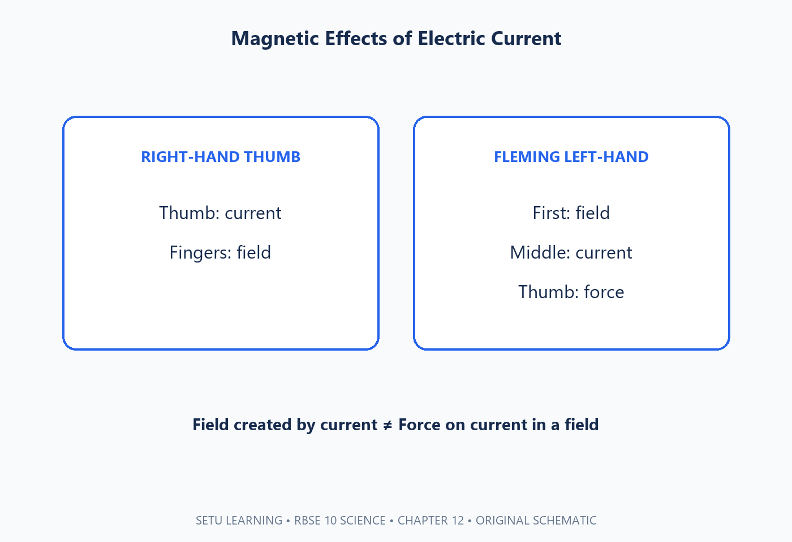

Current से field और field में conductor force का functional schematic; दोनों नियमों का कार्य अलग है।

## भाग 4: पाठ्यपुस्तक-अवधारणाओं पर मौलिक हल किए उदाहरण

नीचे के प्रश्न लेखक के मौलिक मॉडल हैं। ये किसी NCERT edition के प्रश्न क्रमांक या संपूर्ण in-text/exercise solution bank होने का दावा नहीं करते।

**हल किया उदाहरण 1: Wire में current page से बाहर आ रहा है। Field direction बताइए।**

Right-hand thumb observer की ओर रखें; curled fingers anticlockwise हैं। इसलिए बाहर आते current के चारों ओर field anticlockwise; अंदर जाते current के लिए clockwise है।

**हल किया उदाहरण 2: Field right और conventional current up हो तो force कहाँ होगी?**

Fleming left-hand rule अथवा I×B दिशा से force page के भीतर है। Diagram symbols × into page और • out of page स्पष्ट रखें। Current down करने से force बाहर होगी।

**हल किया उदाहरण 3: 220 V पर 2 kW और 1 kW appliances साथ चलें तो total current estimate दें।**

Total P=3000 W। Ideal rated estimate I=P/V=3000/220≈13.64 A। 5 A-rated circuit के लिए यह load बहुत अधिक है; calculation protection को bypass करने का निर्देश नहीं।

## भाग 5: सत्यापित बोर्ड प्रश्न एवं स्रोत-स्थिति

2025, प्रश्न 1(xi), PDF पृष्ठ 5: right-hand thumb rule में thumb। उत्तर-संकेत: current direction।

[RBSE 2025 मूल पेपर](https://rajeduboard.rajasthan.gov.in/books/PAPERS-2025/Sec/S-07.pdf)। प्रश्न का संक्षिप्त विषय-संदर्भ है; शब्दशः पुनर्मुद्रण नहीं।

## भाग 6: खंडवार मौलिक अभ्यास बैंक

**अभ्यास-अंक:** लेखक के स्व-अभ्यास के लिए हैं; RBSE की आधिकारिक marking scheme नहीं। उत्तर पहले स्वयं लिखें, फिर भाग 9 देखें।

## अ: बहुविकल्पीय प्रश्न — 15 × 1 अंक

**MCQ 1. Magnet के बाहर field lines किस दिशा में हैं?**

अ) N से S  
ब) S से N  
स) हमेशा ऊपर  
द) हमेशा नीचे

**MCQ 2. Field-line tangent क्या बताता है?**

अ) केवल temperature  
ब) केवल charge mass  
स) केवल voltage  
द) Local field direction

**MCQ 3. Field lines intersect क्यों नहीं करतीं?**

अ) Field शून्य ही है  
ब) Compass नहीं चलता  
स) एक point पर field direction unique है  
द) Lines metal की हैं

**MCQ 4. Right-hand thumb क्या दिखाता है?**

अ) Resistance  
ब) Current direction  
स) Force ही  
द) Voltage

**MCQ 5. Page से बाहर current का field circulation क्या है?**

अ) Anticlockwise  
ब) Clockwise  
स) Straight ऊपर  
द) कोई field नहीं

**MCQ 6. Straight wire से distance बढ़ने पर field सामान्यतः कैसा होता है?**

अ) मजबूत  
ब) Unchanged हमेशा  
स) हमेशा zero  
द) कमजोर

**MCQ 7. Solenoid interior away from ends field कैसा है?**

अ) केवल random  
ब) केवल electric  
स) लगभग uniform  
द) हर जगह zero

**MCQ 8. Electromagnet में common suitable core कौन है?**

अ) Glass  
ब) Soft iron  
स) Wood  
द) Plastic

**MCQ 9. Fleming left-hand middle finger क्या देती है?**

अ) Current  
ब) Field  
स) Force  
द) Earth direction

**MCQ 10. Current और B parallel हों तो force का ideal value क्या है?**

अ) Maximum  
ब) हमेशा upward  
स) हमेशा 1 N  
द) Zero

**MCQ 11. Earth wire का primary function क्या है?**

अ) Current बढ़ाकर bill बनाना  
ब) Voltage double करना  
स) Protective fault path  
द) Normal neutral return ही

**MCQ 12. Household appliance connection सामान्यतः क्या है?**

अ) केवल open  
ब) Parallel  
स) Series  
द) केवल coil

**MCQ 13. Unintended low-resistance live-neutral path क्या है?**

अ) Short circuit  
ब) Normal loading  
स) Photosynthesis  
द) Refraction

**MCQ 14. Rated current से अधिक demand क्या कहलाती है?**

अ) Earthing  
ब) Polarisation  
स) Dispersion  
द) Overloading

**MCQ 15. School model domestic AC frequency क्या है?**

अ) 5000 Hz  
ब) 0 Hz  
स) 50 Hz  
द) 5 Hz

## अ: रिक्त स्थान — 6 × 1 अंक

1. वह क्षेत्र जहाँ magnetic influence अनुभव होता है। — इस शब्द/सूत्र का नाम है: ____।  
2. Local tangent से field direction दर्शाने वाली कल्पित रेखा। — इस शब्द/सूत्र का नाम है: ____।  
3. Thumb current direction, curled fingers field direction। — इस शब्द/सूत्र का नाम है: ____।  
4. Circular conductor में current से magnetic field बनता है। — इस शब्द/सूत्र का नाम है: ____।  
5. Many closely wound turns वाला लंबा coil। — इस शब्द/सूत्र का नाम है: ____।  
6. Current-driven coil तथा suitable core से बनने वाला magnet। — इस शब्द/सूत्र का नाम है: ____।

## अ: अतिलघु उत्तर — 8 × 1 अंक

1. Magnet के बाहर field lines किस दिशा में हैं?  
2. Field-line tangent क्या बताता है?  
3. Field lines intersect क्यों नहीं करतीं?  
4. Right-hand thumb क्या दिखाता है?  
5. Page से बाहर current का field circulation क्या है?  
6. Straight wire से distance बढ़ने पर field सामान्यतः कैसा होता है?  
7. Solenoid interior away from ends field कैसा है?  
8. Electromagnet में common suitable core कौन है?

## ब: लघु उत्तर — 6 × 2 अंक

**B1.** Field lines intersect क्यों नहीं करतीं?

**B2.** Straight wire में current reverse करने का effect दें।

**B3.** Solenoid को bar magnet जैसा क्यों कहते हैं?

**B4.** Right-hand thumb और left-hand rules अलग कैसे हैं?

**B5.** Earth wire की आवश्यकता क्या है?

**B6.** Short circuit और overload में अंतर दें।

## स: दीर्घ उत्तर — 4 × 3 अंक

आंतरिक विकल्प अभ्यास: C1 अथवा C2, तथा C3 अथवा C4 चुनें। पुनरावृत्ति में बचा विकल्प भी हल करें। यह लेखक की अभ्यास व्यवस्था है।

**C1.** Magnetic field lines की तीन properties दें।

**C2.** Electromagnet की strength कैसे बदल सकती है?

**C3.** Force direction में reversals का प्रभाव दें।

**C4.** Domestic parallel wiring का schematic समझाएँ।

## द: विस्तृत उत्तर — 2 × 4 अंक

आंतरिक विकल्प अभ्यास: D1 अथवा D2 चुनें; बाद में दूसरा भी हल करें।

**D1.** एक metal-cased appliance में live wire casing छूती है। Fault, earth path तथा protection समझाएँ।

**D2.** Straight wire और solenoid के field diagrams की तुलना करें।

## भाग 7: सावधानियाँ एवं परीक्षा-त्रुटियाँ

- Right-hand thumb और Fleming left-hand न मिलाएँ।
- • बाहर, × भीतर है।
- Field lines closed loops हैं।
- Earth और neutral अलग functions हैं।
- Mains wiring के diagrams learning के लिए हैं, स्वयं repair के लिए नहीं।

## भाग 8: फटाफट पुनरावृत्ति — 25 बिंदु

1. Magnetic field: वह क्षेत्र जहाँ magnetic influence अनुभव होता है।  
2. Field line: Local tangent से field direction दर्शाने वाली कल्पित रेखा।  
3. Right-hand thumb rule: Thumb current direction, curled fingers field direction।  
4. Circular loop: Circular conductor में current से magnetic field बनता है।  
5. Solenoid: Many closely wound turns वाला लंबा coil।  
6. Electromagnet: Current-driven coil तथा suitable core से बनने वाला magnet।  
7. Fleming left-hand rule: Forefinger field, middle finger current, thumb force/motion।  
8. Live wire: Supply का hazardous potential वाला conductor।  
9. Earth wire: Exposed metal body के लिए protective low-resistance fault path।  
10. Overloading: Circuit rating से अधिक total current demand।  
11. External field direction north pole से south pole है; अंदर return path होता है।  
12. किसी point पर tangent magnetic field direction दर्शाता है।  
13. Crossing दो directions imply करेगी, जो representation से असंगत है।  
14. Thumb current direction और fingers circular magnetic field direction देती हैं।  
15. Right-hand thumb observer की ओर रखने पर fingers anticlockwise curl करती हैं।  
16. Same current में wire से दूर field strength घटती है।  
17. Many turns interior में nearly parallel field देते हैं।  
18. Soft iron magnetic field को मजबूत करने में उपयोगी है।  
19. First finger field, middle current और thumb force है।  
20. Magnetic force direction factor parallel orientation में zero होता है।  
21. Earth exposed metal casing से fault current का protective route देती है।  
22. Parallel branches में समान supply voltage और independent control मिलता है।  
23. Short circuit से बहुत current तथा heating risk हो सकते हैं।  
24. Overloading circuit capacity से अधिक current demand है।  
25. भारत की सामान्य domestic AC supply के लिए 50 Hz school value है।

## भाग 9: संपूर्ण अभ्यास उत्तर-कुंजी

## MCQ: सही विकल्प और कारण

**1. अ — N से S।** External field direction north pole से south pole है; अंदर return path होता है।

**2. द — Local field direction।** किसी point पर tangent magnetic field direction दर्शाता है।

**3. स — एक point पर field direction unique है।** Crossing दो directions imply करेगी, जो representation से असंगत है।

**4. ब — Current direction।** Thumb current direction और fingers circular magnetic field direction देती हैं।

**5. अ — Anticlockwise।** Right-hand thumb observer की ओर रखने पर fingers anticlockwise curl करती हैं।

**6. द — कमजोर।** Same current में wire से दूर field strength घटती है।

**7. स — लगभग uniform।** Many turns interior में nearly parallel field देते हैं।

**8. ब — Soft iron।** Soft iron magnetic field को मजबूत करने में उपयोगी है।

**9. अ — Current।** First finger field, middle current और thumb force है।

**10. द — Zero।** Magnetic force direction factor parallel orientation में zero होता है।

**11. स — Protective fault path।** Earth exposed metal casing से fault current का protective route देती है।

**12. ब — Parallel।** Parallel branches में समान supply voltage और independent control मिलता है।

**13. अ — Short circuit।** Short circuit से बहुत current तथा heating risk हो सकते हैं।

**14. द — Overloading।** Overloading circuit capacity से अधिक current demand है।

**15. स — 50 Hz।** भारत की सामान्य domestic AC supply के लिए 50 Hz school value है।

**रिक्त स्थान:** 1. Magnetic field; 2. Field line; 3. Right-hand thumb rule; 4. Circular loop; 5. Solenoid; 6. Electromagnet

**अतिलघु उत्तर:**

1. N से S। External field direction north pole से south pole है; अंदर return path होता है।

2. Local field direction। किसी point पर tangent magnetic field direction दर्शाता है।

3. एक point पर field direction unique है। Crossing दो directions imply करेगी, जो representation से असंगत है।

4. Current direction। Thumb current direction और fingers circular magnetic field direction देती हैं।

5. Anticlockwise। Right-hand thumb observer की ओर रखने पर fingers anticlockwise curl करती हैं।

6. कमजोर। Same current में wire से दूर field strength घटती है।

7. लगभग uniform। Many turns interior में nearly parallel field देते हैं।

8. Soft iron। Soft iron magnetic field को मजबूत करने में उपयोगी है।

**B1. Field lines intersect क्यों नहीं करतीं?**

Intersection पर एक point में दो tangents और दो field directions बन जाएँगी। Magnetic field की local direction unique होती है। इसलिए field-line representation में crossing स्वीकार्य नहीं।

**B2. Straight wire में current reverse करने का effect दें।**

Magnetic field circulation reverse हो जाता है। Right-hand thumb opposite direction में रखने पर curled fingers भी उलटे घूमते हैं। Current magnitude same हो तो comparable position पर strength का magnitude समान हो सकता है।

**B3. Solenoid को bar magnet जैसा क्यों कहते हैं?**

Solenoid का outside field pattern north/south poles वाला bar magnet जैसा है। Interior में many turns का combined field approximately uniform होता है। Current reverse करने पर poles swap हो जाते हैं।

**B4. Right-hand thumb और left-hand rules अलग कैसे हैं?**

Right-hand thumb rule straight current के magnetic field की direction देता है। Fleming left-hand rule field में current-carrying conductor पर force की direction देता है। Thumb की भूमिका दोनों में अलग है; नाम के आधार पर arrows interchange न करें।

**B5. Earth wire की आवश्यकता क्या है?**

Metal casing fault से live हो जाए तो earth low-resistance protective path देता है। Suitable fuse/MCB/RCD arrangement fault को disconnect करने में मदद कर सकता है। Earth सामान्य appliance operating-current return path नहीं; neutral से अलग function है।

**B6. Short circuit और overload में अंतर दें।**

Short circuit unintended very low-resistance connection से current अचानक बढ़ना है। Overload अनेक/high-power loads से rated current exceed करना है। दोनों heating risk बढ़ाते हैं, लेकिन causes अलग हैं।

**C1. Magnetic field lines की तीन properties दें।**

1. Outside magnet N→S और अंदर S→N closed loops। 2. Tangent local field direction देता है। 3. Close spacing stronger field दर्शाती है और lines intersect नहीं करतीं। Pole के पास line density comparatively अधिक हो सकती है।

**C2. Electromagnet की strength कैसे बदल सकती है?**

1. Coil current बढ़ने पर field बढ़ सकता है। 2. Turns बढ़ाने से combined field मजबूत हो सकता है। 3. Suitable soft-iron core flux बढ़ा सकता है। Heating और device limits के कारण unlimited current उचित नहीं।

**C3. Force direction में reversals का प्रभाव दें।**

1. Current alone reverse करने पर force reverse। 2. Field alone reverse करने पर भी force reverse। 3. दोनों reverse करने पर force direction same; current parallel B हो तो ideal magnetic force zero। Left-hand rule से check करें।

**C4. Domestic parallel wiring का schematic समझाएँ।**

1. Each appliance live–neutral के across branch में हो। 2. Each branch switch live side पर दिखाएँ। 3. Exposed casing को earth से जोड़ें और suitable protection supply side पर दिखाएँ। Earth को heating element के series return की तरह न draw करें।

**D1. एक metal-cased appliance में live wire casing छूती है। Fault, earth path तथा protection समझाएँ।**

1. Insulation failure casing पर dangerous potential ला सकता है। 2. Protective earth low-resistance path देकर fault current route उपलब्ध करती है। 3. Correctly rated protection supply disconnect कर सकती है; leakage devices का function अलग है। 4. Appliance उपयोग रोककर qualified electrician से repair चाहिए; earth wire निकालना समाधान नहीं।

**D2. Straight wire और solenoid के field diagrams की तुलना करें।**

1. Straight wire cross-section पर concentric circles तथा current •/× दिखाएँ। 2. Right-hand rule से circulation arrows लगाएँ। 3. Solenoid में inside लगभग parallel field lines और outside return loops draw करें। 4. Current reverse करने पर solenoid poles तथा wire circulation बदलते हैं। दोनों current-generated fields हैं, geometry अलग है।

## भाग 10: 10 मिनट / 10 अंक आत्म-मूल्यांकन एवं संदर्भ

समय: 10 मिनट। पहले पुस्तक बंद करें।

1. MCQ 3 और 11 हल करें। (1 + 1)
2. B2 और B5 के उत्तर लिखें। (2 + 2)
3. D1 हल करें। (4)

**कुंजी:** भाग 9 में संबंधित क्रमांक देखें। **स्व-मूल्यांकन:** 8–10: आगे बढ़ें; 5–7: छूटे कौशल का दोहराव; 0–4: भाग 2–4 फिर पढ़ें। यह अभ्यास-सुझाव है, बोर्ड grade नहीं।

[सत्यापित RBSE 2025–26 पाठ्यक्रम](https://rajeduboard.rajasthan.gov.in/anudeshika-etc/10_2026.pdf) · [NCERT विज्ञान अध्याय 12](https://ncert.nic.in/textbook/pdf/jesc112.pdf)

**आगे की कड़ी:** अंतिम अध्याय में energy flow और human environmental impact को जोड़ेंगे।

---

# अध्याय 13: हमारा पर्यावरण (Our Environment)

## भाग 1: अध्याय प्रवेश एवं पाठ्यक्रम मैपिंग

> प्रथम संपादकीय प्रारूप। NCERT के सभी प्रश्नों के हल तथा पूरा ऐतिहासिक PYQ संग्रह अभी स्रोत-परीक्षण में हैं। सामान्य माध्यमिक 2026–27 पाठ्यक्रम की पुनः पुष्टि शेष है।

**विषय कोड:** 07 · **श्रृंखला पुस्तक:** 2

**सत्यापित आधार:** RBSE 2025–26 · **अध्याय भार:** 5 अंक। यह भार उसी संस्करण का है; वास्तविक प्रश्न-विभाजन की भविष्यवाणी नहीं।

**सीखने के लक्ष्य:** Ecosystem components और food webs; trophic energy transfer तथा biomagnification; ozone depletion और waste-management choices समझना।

## भाग 2: शब्दावली एवं अवधारणा कैप्सूल

| शब्द / सूत्र | अर्थ / उपयोग |
|---|---|
| Ecosystem | Organisms और physical environment का interacting system। |
| Biotic component | Living organisms जैसे plants, animals और microbes। |
| Abiotic component | Nonliving conditions जैसे light, water, temperature। |
| Producer | Organic food बनाने वाला organism; green plants सामान्य उदाहरण। |
| Consumer | दूसरे organisms/organic material से food लेने वाला organism। |
| Decomposer | Dead matter breakdown करने वाले bacteria/fungi आदि। |
| Trophic level | Food chain में feeding position। |
| 10% model | अगले trophic level को लगभग 10% energy transfer का school approximation। |
| Biomagnification | Persistent pollutants की higher trophic levels पर concentration बढ़ना। |
| Ozone | O₃; stratospheric layer harmful UV का कुछ भाग absorb करती है। |

## भाग 3: विस्तृत शिक्षण पाठ

### Ecosystem में संबंध
Pond, forest या garden में organisms light, soil, water और temperature से interact करते हैं। Plants producers; herbivores primary consumers; predators secondary/higher consumers हो सकते हैं। Decomposers dead matter से nutrients recycle करते हैं और सभी trophic levels से जुड़े रहते हैं; उन्हें केवल ‘last animal’ न दिखाएँ। Artificial aquarium भी ecosystem है, लेकिन external maintenance की जरूरत हो सकती है।

### Food chain और energy
Food-chain arrows food/energy transfer source से recipient की ओर हैं: grass → grasshopper → frog → snake। Food web multiple interconnected chains है। Solar energy producers capture करते हैं; energy respiration/heat और activities में जाती है। लगभग 10% next level available energy का school model है, exact universal law नहीं। Energy flow one-way है; nutrients cycle कर सकते हैं। इसलिए ‘energy decomposers से sun को लौटती है’ गलत है।

### Pollutant और ozone
कुछ persistent, poorly metabolised chemicals organisms में accumulate हो सकते हैं। Higher consumers कई contaminated organisms खाते हैं, इसलिए concentration बढ़ सकती है: biomagnification। यह energy amplification नहीं। Stratosphere का ozone useful UV shielding देता है; ground-level ozone harmful pollutant हो सकता है। UV oxygen molecules तोड़ सकती है और O atoms O₂ से O₃ बनाते हैं। CFC-related chlorine chemistry stratospheric ozone depletion में भूमिका निभाती है। Ozone depletion और greenhouse warming अलग mechanisms हैं, भले कुछ substances दोनों से संबंधित हों।

### Waste का जिम्मेदार प्रबंधन
Biodegradable matter microorganisms द्वारा suitable conditions में breakdown हो सकता है; सभी biodegradable waste तुरन्त disappear या harmless नहीं। Plastic/glass जैसे non-biodegradable materials लंबे समय रह सकते हैं। Reduce, reuse, recycle तथा source segregation useful हैं। Clean wet organic waste composting, clean dry recyclables अलग collection, e-waste authorised handling में जाएँ। Plastic खुले में जलाने से harmful emissions हो सकती हैं। Waste-management choice material और local collection व्यवस्था पर निर्भर है।

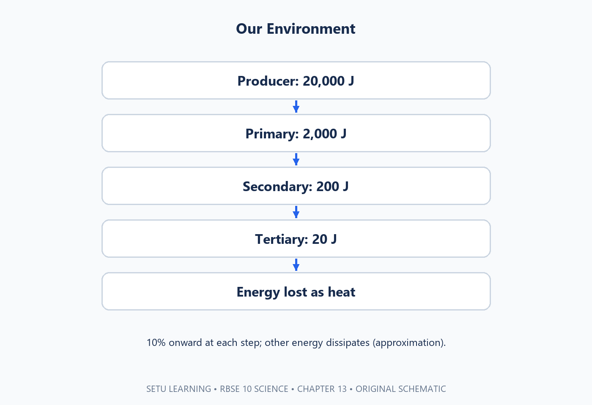

चार trophic levels में 10% model का energy schematic; वास्तविक efficiency बदल सकती है।

## भाग 4: पाठ्यपुस्तक-अवधारणाओं पर मौलिक हल किए उदाहरण

नीचे के प्रश्न लेखक के मौलिक मॉडल हैं। ये किसी NCERT edition के प्रश्न क्रमांक या संपूर्ण in-text/exercise solution bank होने का दावा नहीं करते।

**हल किया उदाहरण 1: Producer level पर 20,000 J हों तो तीन transfers बाद energy estimate दें।**

10% model में primary consumers 2,000 J; secondary 200 J; tertiary 20 J। हर transfer पर previous level ×0.1 करें। 20 J fourth trophic level का estimate है, exact real ecosystem measurement नहीं।

**हल किया उदाहरण 2: Grass → deer → tiger में trophic levels पहचानें।**

Grass producer/level 1; deer primary consumer/level 2; tiger secondary consumer/level 3। Arrow deer की ओर grass energy transfer दिखाता है; predator से prey की ओर arrow उल्टा होगा।

**हल किया उदाहरण 3: Wet food waste और used batteries का management अलग करें।**

Suitable clean organic waste composting में जा सकता है। Batteries hazardous/e-waste collection channel में जाएँ; compost में न मिलाएँ। ‘सब biodegradable bin में’ sorting का सही उत्तर नहीं।

## भाग 5: सत्यापित बोर्ड प्रश्न एवं स्रोत-स्थिति

इस अध्याय का वर्षवार PYQ audit अभी पूरा नहीं है। अभ्यास प्रश्नों पर काल्पनिक परीक्षा-वर्ष नहीं लगाए गए हैं। [असली 2025 बोर्ड पेपर](https://rajeduboard.rajasthan.gov.in/books/PAPERS-2025/Sec/S-07.pdf) से प्रश्न, उपभाग और अंक मिलाकर ही नया PYQ जोड़ा जाए।

## भाग 6: खंडवार मौलिक अभ्यास बैंक

**अभ्यास-अंक:** लेखक के स्व-अभ्यास के लिए हैं; RBSE की आधिकारिक marking scheme नहीं। उत्तर पहले स्वयं लिखें, फिर भाग 9 देखें।

## अ: बहुविकल्पीय प्रश्न — 15 × 1 अंक

**MCQ 1. Ecosystem का abiotic component कौन है?**

अ) Grass  
ब) Frog  
स) Bacterium  
द) Temperature

**MCQ 2. Green plants का सामान्य trophic role क्या है?**

अ) Secondary consumer  
ब) केवल decomposer  
स) Producer  
द) Primary consumer

**MCQ 3. Herbivore किस consumer level पर है?**

अ) Producer  
ब) Primary  
स) Secondary  
द) Tertiary हमेशा

**MCQ 4. Food-chain arrow क्या दर्शाता है?**

अ) Food/energy transfer  
ब) केवल predator का hunting direction  
स) Wind direction  
द) Sex determination

**MCQ 5. Multiple food chains का interconnected रूप क्या है?**

अ) Reflex arc  
ब) Electric circuit  
स) Homologous series  
द) Food web

**MCQ 6. 20,000 J का 10% कितना है?**

अ) 20 J  
ब) 20,000 J  
स) 2,000 J  
द) 200 J

**MCQ 7. Energy flow की दिशा कैसी है?**

अ) केवल reverse  
ब) Unidirectional  
स) पूर्ण cycle वापस sun में  
द) सभी levels पर equal

**MCQ 8. Dead matter breakdown में common organisms कौन हैं?**

अ) Bacteria और fungi  
ब) केवल tiger  
स) केवल deer  
द) केवल fish

**MCQ 9. Ozone का molecular formula क्या है?**

अ) O₂  
ब) CO₂  
स) N₂  
द) O₃

**MCQ 10. Protective ozone layer मुख्यतः कहाँ है?**

अ) Earth core  
ब) केवल tropospheric street  
स) Stratosphere  
द) केवल ocean bottom

**MCQ 11. Ozone depletion से किस exposure का risk बढ़ सकता है?**

अ) केवल gravity  
ब) Ultraviolet  
स) केवल sound  
द) केवल radio

**MCQ 12. Biomagnification में क्या बढ़ता है?**

अ) Persistent pollutant concentration  
ब) Energy हर level पर  
स) Oxygen हर predator में  
द) सभी genes का आकार

**MCQ 13. Compost के लिए suitable material कौन है?**

अ) Used batteries  
ब) Glass shards  
स) Electronic boards  
द) Clean vegetable peels

**MCQ 14. Plastic को खुले में जलाना क्यों अनुचित है?**

अ) सब तुरंत harmless होता है  
ब) कोई smoke नहीं होता  
स) Harmful emissions हो सकती हैं  
द) हर plastic oxygen बनाता है

**MCQ 15. Ozone depletion और global warming समान हैं क्या?**

अ) हाँ, दोनों केवल litter  
ब) नहीं, mechanisms अलग हैं  
स) हाँ, पूर्ण synonyms  
द) हाँ, दोनों केवल acid rain

## अ: रिक्त स्थान — 6 × 1 अंक

1. Organisms और physical environment का interacting system। — इस शब्द/सूत्र का नाम है: ____।  
2. Living organisms जैसे plants, animals और microbes। — इस शब्द/सूत्र का नाम है: ____।  
3. Nonliving conditions जैसे light, water, temperature। — इस शब्द/सूत्र का नाम है: ____।  
4. Organic food बनाने वाला organism; green plants सामान्य उदाहरण। — इस शब्द/सूत्र का नाम है: ____।  
5. दूसरे organisms/organic material से food लेने वाला organism। — इस शब्द/सूत्र का नाम है: ____।  
6. Dead matter breakdown करने वाले bacteria/fungi आदि। — इस शब्द/सूत्र का नाम है: ____।

## अ: अतिलघु उत्तर — 8 × 1 अंक

1. Ecosystem का abiotic component कौन है?  
2. Green plants का सामान्य trophic role क्या है?  
3. Herbivore किस consumer level पर है?  
4. Food-chain arrow क्या दर्शाता है?  
5. Multiple food chains का interconnected रूप क्या है?  
6. 20,000 J का 10% कितना है?  
7. Energy flow की दिशा कैसी है?  
8. Dead matter breakdown में common organisms कौन हैं?

## ब: लघु उत्तर — 6 × 2 अंक

**B1.** Biotic और abiotic components उदाहरण सहित दें।

**B2.** Food chain और food web में अंतर करें।

**B3.** Decomposers क्यों आवश्यक हैं?

**B4.** 10% energy transfer model की सीमा दें।

**B5.** Biomagnification और bioaccumulation में अंतर दें।

**B6.** Biodegradable का अर्थ harmless क्यों नहीं है?

## स: दीर्घ उत्तर — 4 × 3 अंक

आंतरिक विकल्प अभ्यास: C1 अथवा C2, तथा C3 अथवा C4 चुनें। पुनरावृत्ति में बचा विकल्प भी हल करें। यह लेखक की अभ्यास व्यवस्था है।

**C1.** Energy flow और nutrient cycle की तुलना दें।

**C2.** Ozone formation और protective function लिखें।

**C3.** Biomagnification food chain में कैसे बढ़ सकती है?

**C4.** घर के waste segregation के तीन streams दें।

## द: विस्तृत उत्तर — 2 × 4 अंक

आंतरिक विकल्प अभ्यास: D1 अथवा D2 चुनें; बाद में दूसरा भी हल करें।

**D1.** 10% model से grass → insect → frog → snake में 50,000 J की energy तथा arrows समझाएँ।

**D2.** Ozone depletion, biomagnification और solid-waste pollution में अंतर और एक-एक निवारण दिशा दें।

## भाग 7: सावधानियाँ एवं परीक्षा-त्रुटियाँ

- Food arrow energy recipient की ओर है।
- Energy flow और nutrient cycle अलग हैं।
- 10% approximation है, exact universal constant नहीं।
- Ozone depletion और warming समान नहीं।
- Biodegradable waste को बिना management harmless न कहें।

## भाग 8: फटाफट पुनरावृत्ति — 25 बिंदु

1. Ecosystem: Organisms और physical environment का interacting system।  
2. Biotic component: Living organisms जैसे plants, animals और microbes।  
3. Abiotic component: Nonliving conditions जैसे light, water, temperature।  
4. Producer: Organic food बनाने वाला organism; green plants सामान्य उदाहरण।  
5. Consumer: दूसरे organisms/organic material से food लेने वाला organism।  
6. Decomposer: Dead matter breakdown करने वाले bacteria/fungi आदि।  
7. Trophic level: Food chain में feeding position।  
8. 10% model: अगले trophic level को लगभग 10% energy transfer का school approximation।  
9. Biomagnification: Persistent pollutants की higher trophic levels पर concentration बढ़ना।  
10. Ozone: O₃; stratospheric layer harmful UV का कुछ भाग absorb करती है।  
11. Temperature nonliving physical condition है।  
12. Plants photosynthesis से organic food बनाकर energy उपलब्ध करते हैं।  
13. Herbivore producer को खाकर primary consumer होता है।  
14. Arrow source organism से खाने वाले recipient की ओर है।  
15. Food web feeding relationships के कई routes जोड़ता है।  
16. एक transfer में 20,000×0.1=2,000 J estimated available energy है।  
17. Energy dissipates होकर heat बनती है; nutrients जैसे cycle नहीं करती।  
18. Decomposer microbes nutrient recycling में योगदान देते हैं।  
19. Ozone oxygen का triatomic form है।  
20. Stratospheric ozone harmful ultraviolet का कुछ भाग absorb करता है।  
21. Ozone shielding कम होने पर harmful UV reach बढ़ सकती है।  
22. Higher trophic levels में poorly eliminated pollutants की concentration बढ़ सकती है।  
23. Clean organic waste suitable conditions में compost हो सकता है।  
24. Uncontrolled burning harmful gases/particles दे सकता है।  
25. Ozone shielding loss और greenhouse energy trapping अलग environmental mechanisms हैं।

## भाग 9: संपूर्ण अभ्यास उत्तर-कुंजी

## MCQ: सही विकल्प और कारण

**1. द — Temperature।** Temperature nonliving physical condition है।

**2. स — Producer।** Plants photosynthesis से organic food बनाकर energy उपलब्ध करते हैं।

**3. ब — Primary।** Herbivore producer को खाकर primary consumer होता है।

**4. अ — Food/energy transfer।** Arrow source organism से खाने वाले recipient की ओर है।

**5. द — Food web।** Food web feeding relationships के कई routes जोड़ता है।

**6. स — 2,000 J।** एक transfer में 20,000×0.1=2,000 J estimated available energy है।

**7. ब — Unidirectional।** Energy dissipates होकर heat बनती है; nutrients जैसे cycle नहीं करती।

**8. अ — Bacteria और fungi।** Decomposer microbes nutrient recycling में योगदान देते हैं।

**9. द — O₃।** Ozone oxygen का triatomic form है।

**10. स — Stratosphere।** Stratospheric ozone harmful ultraviolet का कुछ भाग absorb करता है।

**11. ब — Ultraviolet।** Ozone shielding कम होने पर harmful UV reach बढ़ सकती है।

**12. अ — Persistent pollutant concentration।** Higher trophic levels में poorly eliminated pollutants की concentration बढ़ सकती है।

**13. द — Clean vegetable peels।** Clean organic waste suitable conditions में compost हो सकता है।

**14. स — Harmful emissions हो सकती हैं।** Uncontrolled burning harmful gases/particles दे सकता है।

**15. ब — नहीं, mechanisms अलग हैं।** Ozone shielding loss और greenhouse energy trapping अलग environmental mechanisms हैं।

**रिक्त स्थान:** 1. Ecosystem; 2. Biotic component; 3. Abiotic component; 4. Producer; 5. Consumer; 6. Decomposer

**अतिलघु उत्तर:**

1. Temperature। Temperature nonliving physical condition है।

2. Producer। Plants photosynthesis से organic food बनाकर energy उपलब्ध करते हैं।

3. Primary। Herbivore producer को खाकर primary consumer होता है।

4. Food/energy transfer। Arrow source organism से खाने वाले recipient की ओर है।

5. Food web। Food web feeding relationships के कई routes जोड़ता है।

6. 2,000 J। एक transfer में 20,000×0.1=2,000 J estimated available energy है।

7. Unidirectional। Energy dissipates होकर heat बनती है; nutrients जैसे cycle नहीं करती।

8. Bacteria और fungi। Decomposer microbes nutrient recycling में योगदान देते हैं।

**B1. Biotic और abiotic components उदाहरण सहित दें।**

Plants, animals और microbes living biotic components हैं। Water, light, soil conditions तथा temperature abiotic हैं। Ecosystem में दोनों interact करते हैं; केवल animals की list पूरी ecosystem definition नहीं।

**B2. Food chain और food web में अंतर करें।**

Food chain feeding transfer का एक linear route दिखाती है। Food web multiple interconnected routes दिखाता है, क्योंकि organisms के कई food sources/predators हो सकते हैं। Web वास्तविक feeding complexity को बेहतर दर्शा सकता है।

**B3. Decomposers क्यों आवश्यक हैं?**

Bacteria/fungi dead organic matter breakdown करके nutrients environment में उपलब्ध कराते हैं। इससे nutrient recycling में मदद मिलती है। Decomposition energy को नए sunlight में बदलना नहीं; energy dissipation जारी रहता है।

**B4. 10% energy transfer model की सीमा दें।**

यह school-level approximate model है, हर ecosystem में exactly 10.000% नहीं। Organism metabolism और ecological conditions transfer efficiency बदलते हैं। गणना में question का दिया assumption लें और result को estimate label करें।

**B5. Biomagnification और bioaccumulation में अंतर दें।**

Bioaccumulation एक organism में समय के साथ chemical build-up है। Biomagnification food chain के higher levels पर concentration बढ़ना है। दोनों persistent pollutants से जुड़े हो सकते हैं, पर comparison scale अलग है।

**B6. Biodegradable का अर्थ harmless क्यों नहीं है?**

Organic waste decomposition में oxygen demand, odour या disease-related problems हो सकती हैं। Breakdown conditions तथा समय महत्त्वपूर्ण हैं। इसलिए biodegradable waste भी segregation और उचित treatment माँगता है।

**C1. Energy flow और nutrient cycle की तुलना दें।**

1. Solar input से ecosystem energy आती है। 2. Trophic transfer में energy heat के रूप में dissipates होती है; flow unidirectional है। 3. Nutrients decomposition तथा uptake से circulate कर सकते हैं। ‘Energy cycle’ को nutrient cycle जैसा न draw करें।

**C2. Ozone formation और protective function लिखें।**

1. UV से O₂ टूटकर oxygen atoms बन सकते हैं। 2. O atoms O₂ से मिलकर O₃ देते हैं। 3. Stratospheric ozone harmful UV का कुछ भाग absorb करता है। Near-ground ozone की effects अलग और harmful हो सकती हैं।

**C3. Biomagnification food chain में कैसे बढ़ सकती है?**

1. Persistent chemical lower levels के tissues में रहता है। 2. Predator अनेक contaminated prey खाता है। 3. Higher level concentration बढ़ सकती है, यदि elimination/metabolism कम हो। इसे सभी biodegradable nutrients पर लागू न करें।

**C4. घर के waste segregation के तीन streams दें।**

1. Clean biodegradable wet waste compost/appropriate collection में। 2. Clean dry recyclables अलग रखें। 3. Batteries/e-waste तथा hazardous materials authorised channels में दें। Local rules के अनुसार streams adjust करें; mixed burning समाधान नहीं।

**D1. 10% model से grass → insect → frog → snake में 50,000 J की energy तथा arrows समझाएँ।**

1. Grass level 1 पर 50,000 J। 2. Insect 5,000 J और frog 500 J। 3. Snake 50 J। 4. Arrows grass से insect और आगे transfer recipient की ओर हैं। यह provided approximation की calculation है; प्रत्येक level को पूरा starting energy नहीं मिलता।

**D2. Ozone depletion, biomagnification और solid-waste pollution में अंतर और एक-एक निवारण दिशा दें।**

1. Ozone depletion stratospheric shielding loss है; ozone-depleting substances को नियंत्रित करना दिशा है। 2. Biomagnification persistent chemical concentration का trophic increase है; ऐसे pollutants का release घटाना जरूरी है। 3. Solid waste accumulation के लिए reduce/reuse/segregation/recycling useful हैं। 4. Problems जुड़े हो सकते हैं लेकिन एक ही mechanism नहीं; plastic recycling अकेले ozone को नहीं सुधारती।

## भाग 10: 10 मिनट / 10 अंक आत्म-मूल्यांकन एवं संदर्भ

समय: 10 मिनट। पहले पुस्तक बंद करें।

1. MCQ 3 और 11 हल करें। (1 + 1)
2. B2 और B5 के उत्तर लिखें। (2 + 2)
3. D1 हल करें। (4)

**कुंजी:** भाग 9 में संबंधित क्रमांक देखें। **स्व-मूल्यांकन:** 8–10: आगे बढ़ें; 5–7: छूटे कौशल का दोहराव; 0–4: भाग 2–4 फिर पढ़ें। यह अभ्यास-सुझाव है, बोर्ड grade नहीं।

[सत्यापित RBSE 2025–26 पाठ्यक्रम](https://rajeduboard.rajasthan.gov.in/anudeshika-etc/10_2026.pdf) · [NCERT विज्ञान अध्याय 13](https://ncert.nic.in/textbook/pdf/jesc113.pdf)

**आगे की कड़ी:** पूरी पुस्तक दोहराएँ: chemical reactions → biological energy → electricity → ecosystem energy; हर जगह quantities और mechanisms अलग रखें।

---

# अध्याय 14: पिछले वर्षों के हल किए परीक्षा प्रश्न

**चयनित हल:** 361 · **आधिकारिक पेपर:** 18

## अध्याय का उपयोग और स्रोत सीमा

> 361 स्रोत-संदर्भित हल किए प्रश्न/उपभाग, 18 आधिकारिक मुख्य/पूरक पेपरों से। प्रश्नों के संक्षिप्त हिंदी सार और मौलिक solutions हैं; पूरे पेपरों का शब्दशः पुनर्मुद्रण या official answer key नहीं।

प्रश्न का year, main/supplementary, original question/subpart और PDF viewer page दिया है। Printed page और PDF page अलग हो सकते हैं। बड़े प्रश्न का selected part ही लिया गया हो तो उसका संक्षिप्त focus दिखता है; इसे पूरे प्रश्न का exhaustive solution न मानें। अंक source में दिए selected scope के हैं; अलग अंक स्पष्ट न हो तो “अलग सत्यापित नहीं” लिखा है।

Repeated exam occurrences अलग source references के साथ रखे हैं; यह distinct concepts की count नहीं। मुख्य अध्याय 1–13 के 80-अंक chapter weightage में यह अभ्यास अध्याय अलग अतिरिक्त weightage नहीं जोड़ता। 2021 archive PDF image-based है और यहाँ verified question source नहीं माना गया।

## वर्षवार स्रोत रजिस्टर

| वर्ष / परीक्षा | चुने प्रश्न/उपभाग | मूल स्रोत |
|---|---:|---|
| 2026 / मुख्य | 31 | [S-07 मूल पेपर](https://rajeduboard.rajasthan.gov.in/books/PAPERS-2026/Sec/S-07.pdf) |
| 2026 / पूरक | 22 | [S-07 मूल पेपर](https://rajeduboard.rajasthan.gov.in/books/PAPERS-2026/SecSUP/S-07.pdf) |
| 2025 / मुख्य | 30 | [S-07 मूल पेपर](https://rajeduboard.rajasthan.gov.in/books/PAPERS-2025/Sec/S-07.pdf) |
| 2025 / पूरक | 18 | [S-07 मूल पेपर](https://rajeduboard.rajasthan.gov.in/books/PAPERS-2025/SecSUP/S-07.pdf) |
| 2024 / मुख्य | 29 | [S-07 मूल पेपर](https://rajeduboard.rajasthan.gov.in/books/PAPERS-2024/Sec/S-07.pdf) |
| 2024 / पूरक | 15 | [S-07 मूल पेपर](https://rajeduboard.rajasthan.gov.in/books/PAPERS-2024/SecSUP/S-07.pdf) |
| 2023 / मुख्य | 21 | [S-07 मूल पेपर](https://rajeduboard.rajasthan.gov.in/books/PAPERS-2023/Sec/S-07.pdf) |
| 2022 / मुख्य | 19 | [S-07 मूल पेपर](https://rajeduboard.rajasthan.gov.in/books/PAPERS-2022/Sec/S-07.pdf) |
| 2020 / मुख्य | 16 | [S-07 मूल पेपर](https://rajeduboard.rajasthan.gov.in/books/PAPERS-2020/Sec/S-07-Science.pdf) |
| 2020 / पूरक | 12 | [S-07 मूल पेपर](https://rajeduboard.rajasthan.gov.in/books/PAPERS-2020/SecSUP/S-07.pdf) |
| 2019 / मुख्य | 9 | [S-07 मूल पेपर](https://rajeduboard.rajasthan.gov.in/books/PAPERS-2019/Sec/S-07-Science-E-H.pdf) |
| 2018 / मुख्य | 14 | [S-07 मूल पेपर](https://rajeduboard.rajasthan.gov.in/books/PAPERS-2018/Sec/S-07-Science-E-H.pdf) |
| 2018 / पूरक | 10 | [S-07 मूल पेपर](https://rajeduboard.rajasthan.gov.in/books/PAPERS-2018/SUPP/Sec/S-07-Science.pdf) |
| 2017 / मुख्य | 26 | [S-07 मूल पेपर](https://rajeduboard.rajasthan.gov.in/books/PAPERS-2017/Sec/S-07-Science-E-H.pdf) |
| 2017 / विशेष पूरक | 14 | [S-07 मूल पेपर](https://rajeduboard.rajasthan.gov.in/books/PAPERS-2017/SUPP/Sec/S-07-Science.pdf) |
| 2016 / मुख्य | 18 | [S-07 मूल पेपर](https://rajeduboard.rajasthan.gov.in/books/PAPERS-2016/Sec/S-07-Science.pdf) |
| 2015 / मुख्य | 29 | [S-07 मूल पेपर](https://rajeduboard.rajasthan.gov.in/books/PAPERS-2015/Sec/S-07-Science-15.pdf) |
| 2014 / मुख्य | 28 | [S-07 मूल पेपर](https://rajeduboard.rajasthan.gov.in/books/PAPERS-2014/Sec/S-07-Science-14.pdf) |

## लिखित उत्तर का तरीका

पहले source का पूरा प्रश्न पढ़ें, फिर answer छिपाकर हल करें। Numerical में given quantities → SI conversion → formula → substitution → result/unit लिखें। Diagram में labels, arrow direction और requested part दें। यहाँ दिए solutions लेखक के शिक्षण उत्तर हैं; अंक-वितरण का आधिकारिक मूल्यांकन दावा नहीं।

## 2026 — मुख्य परीक्षा

[2026 मुख्य: पूरा आधिकारिक प्रश्न-पत्र](https://rajeduboard.rajasthan.gov.in/books/PAPERS-2026/Sec/S-07.pdf)

## 1. Sugar-regulating endocrine gland।

**स्रोत:** 2026 मुख्य, प्रश्न 1(i), PDF पृष्ठ 2 · **अंक:** 1 अंक

**अध्याय-संबंध:** नियंत्रण एवं समन्वय

**हल:** Pancreas insulin सहित hormones से blood glucose regulation में भूमिका निभाता है। Thyroid metabolism और adrenal acute-stress responses से अलग हैं।

[मूल प्रश्न देखें](https://rajeduboard.rajasthan.gov.in/books/PAPERS-2026/Sec/S-07.pdf#page=2)

## 2. Binary-fission option।

**स्रोत:** 2026 मुख्य, प्रश्न 1(ii), PDF पृष्ठ 2 · **अंक:** 1 अंक

**अध्याय-संबंध:** जीव जनन कैसे करते हैं?

**हल:** दिए options में Leishmania binary fission करता है, सामान्यतः longitudinal orientation में। Amoeba भी binary fission का example है, लेकिन यहाँ source options में Leishmania है।

[मूल प्रश्न देखें](https://rajeduboard.rajasthan.gov.in/books/PAPERS-2026/Sec/S-07.pdf#page=2)

## 3. Aerobic pyruvate breakdown स्थल।

**स्रोत:** 2026 मुख्य, प्रश्न 1(iii), PDF पृष्ठ 2 · **अंक:** 1 अंक

**अध्याय-संबंध:** जैव प्रक्रम

**हल:** Aerobic pyruvate breakdown mitochondrial pathways में CO₂, water और usable energy देता है। Glycolysis cytoplasm में pyruvate बनाती है; दोनों stages अलग हैं।

[मूल प्रश्न देखें](https://rajeduboard.rajasthan.gov.in/books/PAPERS-2026/Sec/S-07.pdf#page=2)

## 4. Asexual reproduction का parent count।

**स्रोत:** 2026 मुख्य, प्रश्न 1(iv), PDF पृष्ठ 3 · **अंक:** 1 अंक

**अध्याय-संबंध:** जीव जनन कैसे करते हैं?

**हल:** School definition में asexual reproduction एक parent से होती है; gamete fusion नहीं। Offspring में occasional variation फिर भी संभव है।

[मूल प्रश्न देखें](https://rajeduboard.rajasthan.gov.in/books/PAPERS-2026/Sec/S-07.pdf#page=3)

## 5. Microbes का food-chain role।

**स्रोत:** 2026 मुख्य, प्रश्न 1(v), PDF पृष्ठ 3 · **अंक:** 1 अंक

**अध्याय-संबंध:** हमारा पर्यावरण

**हल:** इस MCQ में microbes की अपेक्षित प्रमुख भूमिका decomposers है; bacteria/fungi dead organic matter breakdown तथा nutrient recycling में काम करते हैं। सभी microorganisms केवल decomposer हैं, ऐसा universal statement नहीं।

[मूल प्रश्न देखें](https://rajeduboard.rajasthan.gov.in/books/PAPERS-2026/Sec/S-07.pdf#page=3)

## 6. Pesticide concentration का trophic increase।

**स्रोत:** 2026 मुख्य, प्रश्न 1(vi), PDF पृष्ठ 3 · **अंक:** 1 अंक

**अध्याय-संबंध:** हमारा पर्यावरण

**हल:** Persistent pesticide concentration का higher trophic levels पर बढ़ना biomagnification है। Individual में time-based buildup bioaccumulation है; food-chain energy बढ़ना नहीं।

[मूल प्रश्न देखें](https://rajeduboard.rajasthan.gov.in/books/PAPERS-2026/Sec/S-07.pdf#page=3)

## 7. Prism से white-light separation।

**स्रोत:** 2026 मुख्य, प्रश्न 1(vii), PDF पृष्ठ 3 · **अंक:** 1 अंक

**अध्याय-संबंध:** मानव नेत्र तथा रंगबिरंगा संसार

**हल:** White light का constituent wavelengths/colours में separation dispersion है। Prism का refractive index wavelength-dependent होने से colours अलग deviate करते हैं; ordinary glass में violet अधिक, red कम deviates है।

[मूल प्रश्न देखें](https://rajeduboard.rajasthan.gov.in/books/PAPERS-2026/Sec/S-07.pdf#page=3)

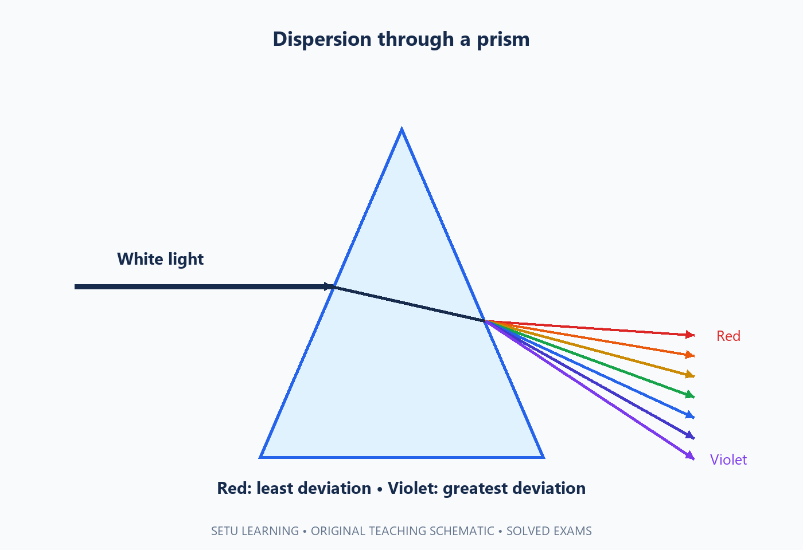

## 8. Star twinkling का mechanism।

**स्रोत:** 2026 मुख्य, प्रश्न 1(viii), PDF पृष्ठ 4 · **अंक:** 1 अंक

**अध्याय-संबंध:** मानव नेत्र तथा रंगबिरंगा संसार

**हल:** Stars की twinkling changing atmospheric refractive index से apparent brightness/position fluctuations है। Point-like source होने से effect prominent है; यह prism dispersion नहीं।

[मूल प्रश्न देखें](https://rajeduboard.rajasthan.gov.in/books/PAPERS-2026/Sec/S-07.pdf#page=4)

## 9. Wire length double: R,ρ।

**स्रोत:** 2026 मुख्य, प्रश्न 1(ix), PDF पृष्ठ 4 · **अंक:** 1 अंक

**अध्याय-संबंध:** विद्युत

**हल:** A=3 Ω resistance और B=7×10⁻⁵ Ω·m resistivity। Length double, area/material/temperature same: A=6 Ω, B unchanged। Units से quantities पहचानें।

[मूल प्रश्न देखें](https://rajeduboard.rajasthan.gov.in/books/PAPERS-2026/Sec/S-07.pdf#page=4)

## 10. Current की SI unit।

**स्रोत:** 2026 मुख्य, प्रश्न 1(x), PDF पृष्ठ 4 · **अंक:** 1 अंक

**अध्याय-संबंध:** विद्युत

**हल:** Electric current का SI unit ampere (A), 1 A=1 C/s है। Coulomb charge और joule energy की units हैं।

[मूल प्रश्न देखें](https://rajeduboard.rajasthan.gov.in/books/PAPERS-2026/Sec/S-07.pdf#page=4)

## 11. Magnet के अंदर field direction।

**स्रोत:** 2026 मुख्य, प्रश्न 1(xi), PDF पृष्ठ 5 · **अंक:** 1 अंक

**अध्याय-संबंध:** विद्युत धारा के चुंबकीय प्रभाव

**हल:** Bar magnet के भीतर field lines south→north, बाहर north→south हैं; मिलकर closed loops बनती हैं।

[मूल प्रश्न देखें](https://rajeduboard.rajasthan.gov.in/books/PAPERS-2026/Sec/S-07.pdf#page=5)

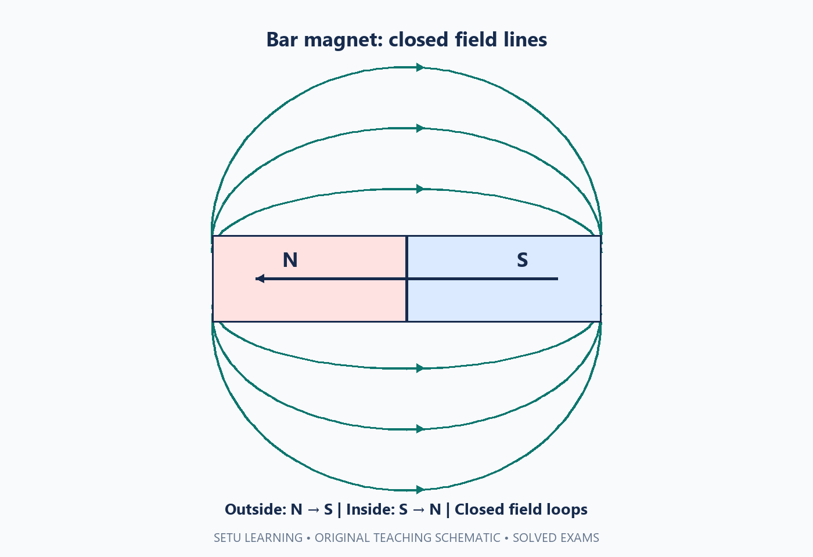

## 12. Fleming-rule fingers मिलान।

**स्रोत:** 2026 मुख्य, प्रश्न 1(xii), PDF पृष्ठ 5 · **अंक:** 1 अंक

**अध्याय-संबंध:** विद्युत धारा के चुंबकीय प्रभाव

**हल:** Left-hand thumb, forefinger और middle finger mutually perpendicular रखें। Forefinger B, middle conventional I तथा thumb force/motion देता है। Current या field अकेला reverse हो तो force reverse होता है।

[मूल प्रश्न देखें](https://rajeduboard.rajasthan.gov.in/books/PAPERS-2026/Sec/S-07.pdf#page=5)

## 13. Quicklime का formula।

**स्रोत:** 2026 मुख्य, प्रश्न 1(xiii), PDF पृष्ठ 5 · **अंक:** 1 अंक

**अध्याय-संबंध:** अम्ल, क्षारक एवं लवण

**हल:** Quicklime calcium oxide CaO है; slaked lime Ca(OH)₂। CaO+H₂O→Ca(OH)₂ heat-releasing combination है।

[मूल प्रश्न देखें](https://rajeduboard.rajasthan.gov.in/books/PAPERS-2026/Sec/S-07.pdf#page=5)

## 14. Balanced Fe coefficient।

**स्रोत:** 2026 मुख्य, प्रश्न 1(xiv), PDF पृष्ठ 6 · **अंक:** 1 अंक

**अध्याय-संबंध:** रासायनिक अभिक्रियाएँ एवं समीकरण

**हल:** 3Fe+4H₂O(steam)→Fe₃O₄+4H₂ में Fe coefficient 3 है। Fe 3, H 8, O 4 atoms दोनों sides पर equal हैं।

[मूल प्रश्न देखें](https://rajeduboard.rajasthan.gov.in/books/PAPERS-2026/Sec/S-07.pdf#page=6)

## 15. Cold-water H₂ देने वाला option।

**स्रोत:** 2026 मुख्य, प्रश्न 1(xv), PDF पृष्ठ 6 · **अंक:** 1 अंक

**अध्याय-संबंध:** धातु एवं अधातु

**हल:** दिए Na,Ag,Fe,Mn विकल्पों में sodium cold water से vigorous H₂ evolution देता है: 2Na+2H₂O→2NaOH+H₂।

[मूल प्रश्न देखें](https://rajeduboard.rajasthan.gov.in/books/PAPERS-2026/Sec/S-07.pdf#page=6)

## 16. Mg/Zn/Fe descending activity।

**स्रोत:** 2026 मुख्य, प्रश्न 1(xvi), PDF पृष्ठ 6 · **अंक:** 1 अंक

**अध्याय-संबंध:** धातु एवं अधातु

**हल:** Decreasing reactivity Mg > Zn > Fe है। Metals के activity-series क्रम के अनुसार अधिक active metal lower metal को suitable salt solution से हटा सकती है।

[मूल प्रश्न देखें](https://rajeduboard.rajasthan.gov.in/books/PAPERS-2026/Sec/S-07.pdf#page=6)

## 17. Carboxylic-acid group।

**स्रोत:** 2026 मुख्य, प्रश्न 1(xvii), PDF पृष्ठ 7 · **अंक:** 1 अंक

**अध्याय-संबंध:** कार्बन एवं उसके यौगिक

**हल:** Carboxylic acid का functional group –COOH है। Alcohol –OH, aldehyde –CHO और ketone >C=O से इसे अलग रखें।

[मूल प्रश्न देखें](https://rajeduboard.rajasthan.gov.in/books/PAPERS-2026/Sec/S-07.pdf#page=7)

## 18. Hydrogen atomic number।

**स्रोत:** 2026 मुख्य, प्रश्न 1(xviii), PDF पृष्ठ 7 · **अंक:** 1 अंक

**अध्याय-संबंध:** धातु एवं अधातु

**हल:** Hydrogen atomic number 1 है, यानी nucleus में एक proton। Atomic number को isotope mass number से न मिलाएँ।

[मूल प्रश्न देखें](https://rajeduboard.rajasthan.gov.in/books/PAPERS-2026/Sec/S-07.pdf#page=7)

## 19. Collective maintenance processes का नाम।

**स्रोत:** 2026 मुख्य, प्रश्न 2(i), PDF पृष्ठ 7 · **अंक:** 1 अंक

**अध्याय-संबंध:** जैव प्रक्रम

**हल:** Nutrition, respiration, transport, excretion जैसे collective maintenance functions life processes हैं। Reproduction species continuity के लिए है, individual maintenance की immediate शर्त नहीं।

[मूल प्रश्न देखें](https://rajeduboard.rajasthan.gov.in/books/PAPERS-2026/Sec/S-07.pdf#page=7)

## 20. Amoeba food enclosure।

**स्रोत:** 2026 मुख्य, प्रश्न 2(ii), PDF पृष्ठ 7 · **अंक:** 1 अंक

**अध्याय-संबंध:** जैव प्रक्रम

**हल:** Amoeba pseudopodia से food engulf करके food vacuole बनाता है। Vacuole में digestion और आगे nutrients का उपयोग होता है।

[मूल प्रश्न देखें](https://rajeduboard.rajasthan.gov.in/books/PAPERS-2026/Sec/S-07.pdf#page=7)

## 21. Inheritance rules के वैज्ञानिक।

**स्रोत:** 2026 मुख्य, प्रश्न 2(iii), PDF पृष्ठ 8 · **अंक:** 1 अंक

**अध्याय-संबंध:** आनुवंशिकता

**हल:** Gregor Mendel ने pea crosses से trait inheritance के महत्वपूर्ण rules निकाले। Dominance, segregation तथा suitable traits में independent assortment को अलग समझें।

[मूल प्रश्न देखें](https://rajeduboard.rajasthan.gov.in/books/PAPERS-2026/Sec/S-07.pdf#page=8)

## 22. HCl का aqueous anion।

**स्रोत:** 2026 मुख्य, प्रश्न 2(v), PDF पृष्ठ 8 · **अंक:** 1 अंक

**अध्याय-संबंध:** अम्ल, क्षारक एवं लवण

**हल:** HCl aqueous dissociation का anion chloride, Cl⁻ है। Cation का school representation H⁺/hydronium है; Cl₂ molecule नहीं बनता।

[मूल प्रश्न देखें](https://rajeduboard.rajasthan.gov.in/books/PAPERS-2026/Sec/S-07.pdf#page=8)

## 23. Nettle का school-level acid।

**स्रोत:** 2026 मुख्य, प्रश्न 2(vi), PDF पृष्ठ 8 · **अंक:** 1 अंक

**अध्याय-संबंध:** अम्ल, क्षारक एवं लवण

**हल:** विद्यालयी उत्तर methanoic/formic acid, HCOOH है। अम्लीय प्रभाव को उपयुक्त क्षारक द्वारा neutralisation से समझा जाता है।

[मूल प्रश्न देखें](https://rajeduboard.rajasthan.gov.in/books/PAPERS-2026/Sec/S-07.pdf#page=8)

## 24. Blood-pressure/salivation/vomiting का brain भाग।

**स्रोत:** 2026 मुख्य, प्रश्न 3(i), PDF पृष्ठ 8 · **अंक:** 1 अंक

**अध्याय-संबंध:** नियंत्रण एवं समन्वय

**हल:** इस board MCQ का अपेक्षित विकल्प medulla है, जो breathing, blood-pressure-related responses, salivation/vomiting जैसे involuntary functions में काम करता है। ‘सभी involuntary actions केवल medulla’ वैज्ञानिक रूप से अत्यधिक व्यापक कथन है।

[मूल प्रश्न देखें](https://rajeduboard.rajasthan.gov.in/books/PAPERS-2026/Sec/S-07.pdf#page=8)

## 25. Plant division-promoting hormone।

**स्रोत:** 2026 मुख्य, प्रश्न 3(ii), PDF पृष्ठ 8 · **अंक:** 1 अंक

**अध्याय-संबंध:** नियंत्रण एवं समन्वय

**हल:** Cytokinin plant cell division promote कर सकता है। Insulin, thyroxine और oestrogen animal hormones हैं, इसलिए plant-hormone MCQ में cytokinin चुनें।

[मूल प्रश्न देखें](https://rajeduboard.rajasthan.gov.in/books/PAPERS-2026/Sec/S-07.pdf#page=8)

## 26. Independent dihybrid F₂ ratio।

**स्रोत:** 2026 मुख्य, प्रश्न 3(iii), PDF पृष्ठ 8 · **अंक:** 1 अंक

**अध्याय-संबंध:** आनुवंशिकता

**हल:** Independent assortment और complete dominance के model में pure dominant × pure recessive से F₁ दोनों dominant traits वाला heterozygote है। F₁ selfing से expected F₂ phenotypes 9:3:3:1। यह universal genetic ratio नहीं।

[मूल प्रश्न देखें](https://rajeduboard.rajasthan.gov.in/books/PAPERS-2026/Sec/S-07.pdf#page=8)

## 27. Ozone layer की आवश्यकता।

**स्रोत:** 2026 मुख्य, प्रश्न 3(v), PDF पृष्ठ 9 · **अंक:** 1 अंक

**अध्याय-संबंध:** हमारा पर्यावरण

**हल:** Stratospheric ozone harmful ultraviolet radiation के कुछ हिस्से को absorb करता है। UV shielding घटने को ozone depletion से जोड़ें, visible colours के dispersion से नहीं।

[मूल प्रश्न देखें](https://rajeduboard.rajasthan.gov.in/books/PAPERS-2026/Sec/S-07.pdf#page=9)

## 28. Lens power का अर्थ।

**स्रोत:** 2026 मुख्य, प्रश्न 3(vii), PDF पृष्ठ 9 · **अंक:** 1 अंक

**अध्याय-संबंध:** प्रकाश: परावर्तन तथा अपवर्तन

**हल:** Lens power P=1/f है, f metre में; unit dioptre। Convex/converging lens positive, concave/diverging lens negative power रखता है। Centimetre में f का reciprocal सीधे dioptres नहीं देता।

[मूल प्रश्न देखें](https://rajeduboard.rajasthan.gov.in/books/PAPERS-2026/Sec/S-07.pdf#page=9)

## 29. Electromagnet की परिभाषा।

**स्रोत:** 2026 मुख्य, प्रश्न 3(viii), PDF पृष्ठ 9 · **अंक:** 1 अंक

**अध्याय-संबंध:** विद्युत धारा के चुंबकीय प्रभाव

**हल:** Current-carrying coil, प्रायः suitable soft-iron core सहित, temporary electromagnet बना सकती है। Current off/reverse से strength/polarity control हो सकती है। यह permanent bar magnet का identical construction नहीं।

[मूल प्रश्न देखें](https://rajeduboard.rajasthan.gov.in/books/PAPERS-2026/Sec/S-07.pdf#page=9)

## 30. Circuit fuse का काम।

**स्रोत:** 2026 मुख्य, प्रश्न 3(ix), PDF पृष्ठ 9 · **अंक:** 1 अंक

**अध्याय-संबंध:** विद्युत धारा के चुंबकीय प्रभाव

**हल:** Excess current से suitable fuse element heats और melts होकर circuit खोलता है। Correct current rating तथा live conductor placement जरूरी हैं; fuse को मोटे साधारण wire से replace न करें।

[मूल प्रश्न देखें](https://rajeduboard.rajasthan.gov.in/books/PAPERS-2026/Sec/S-07.pdf#page=9)

## 31. Zn–H₂SO₄ balanced equation।

**स्रोत:** 2026 मुख्य, प्रश्न 3(x), PDF पृष्ठ 9 · **अंक:** 1 अंक

**अध्याय-संबंध:** अम्ल, क्षारक एवं लवण

**हल:** Zn + H₂SO₄(dil.) → ZnSO₄ + H₂। Gas hydrogen है; prescribed supervised test में burning splint से characteristic pop मिल सकता है। Acid/gas experiment स्वयं न करें।

[मूल प्रश्न देखें](https://rajeduboard.rajasthan.gov.in/books/PAPERS-2026/Sec/S-07.pdf#page=9)

## 2026 — पूरक परीक्षा

[2026 पूरक: पूरा आधिकारिक प्रश्न-पत्र](https://rajeduboard.rajasthan.gov.in/books/PAPERS-2026/SecSUP/S-07.pdf)

## 32. Growth-stimulating gland का चयन।

**स्रोत:** 2026 पूरक, प्रश्न 1(i), PDF पृष्ठ 3 · **अंक:** 1 अंक

**अध्याय-संबंध:** नियंत्रण एवं समन्वय

**हल:** दिए विकल्पों में pituitary gland growth hormone से growth stimulate करती है। Board stem ‘all organs’ simplified है; actual tissue responses एवं अन्य hormones भी भूमिका रखते हैं।

[मूल प्रश्न देखें](https://rajeduboard.rajasthan.gov.in/books/PAPERS-2026/SecSUP/S-07.pdf#page=3)

## 33. Budding से नया organism।

**स्रोत:** 2026 पूरक, प्रश्न 1(ii), PDF पृष्ठ 3 · **अंक:** 1 अंक

**अध्याय-संबंध:** जीव जनन कैसे करते हैं?

**हल:** Hydra budding से asexual reproduction करता है; parent body पर outgrowth mature होकर नया individual बनता है।

[मूल प्रश्न देखें](https://rajeduboard.rajasthan.gov.in/books/PAPERS-2026/SecSUP/S-07.pdf#page=3)

## 34. Xylem का transported पदार्थ।

**स्रोत:** 2026 पूरक, प्रश्न 1(iii), PDF पृष्ठ 3 · **अंक:** 1 अंक

**अध्याय-संबंध:** जैव प्रक्रम

**हल:** Xylem roots से water तथा dissolved minerals transport करता है। Phloem photosynthates का source–sink transfer करता है।

[मूल प्रश्न देखें](https://rajeduboard.rajasthan.gov.in/books/PAPERS-2026/SecSUP/S-07.pdf#page=3)

## 35. Non-biodegradable option।

**स्रोत:** 2026 पूरक, प्रश्न 1(v), PDF पृष्ठ 4 · **अंक:** 1 अंक

**अध्याय-संबंध:** हमारा पर्यावरण

**हल:** दिए examples में conventional plastic non-biodegradable है; persistent waste अलग collect/recycle करें। सभी types/material formulations की degradation समान नहीं होती।

[मूल प्रश्न देखें](https://rajeduboard.rajasthan.gov.in/books/PAPERS-2026/SecSUP/S-07.pdf#page=4)

## 36. Ozone किस radiation को रोकती है?

**स्रोत:** 2026 पूरक, प्रश्न 1(vi), PDF पृष्ठ 4 · **अंक:** 1 अंक

**अध्याय-संबंध:** हमारा पर्यावरण

**हल:** Stratospheric ozone harmful ultraviolet radiation के कुछ हिस्से को absorb करता है। UV shielding घटने को ozone depletion से जोड़ें, visible colours के dispersion से नहीं।

[मूल प्रश्न देखें](https://rajeduboard.rajasthan.gov.in/books/PAPERS-2026/SecSUP/S-07.pdf#page=4)

## 37. Pupil size का नियंत्रण।

**स्रोत:** 2026 पूरक, प्रश्न 1(vii), PDF पृष्ठ 4 · **अंक:** 1 अंक

**अध्याय-संबंध:** मानव नेत्र तथा रंगबिरंगा संसार

**हल:** Iris की muscles pupil opening का size नियंत्रित करती हैं। Lens की curvature ciliary muscles बदलती हैं; light entry और accommodation के mechanisms अलग हैं।

[मूल प्रश्न देखें](https://rajeduboard.rajasthan.gov.in/books/PAPERS-2026/SecSUP/S-07.pdf#page=4)

## 38. Prism least bending colour।

**स्रोत:** 2026 पूरक, प्रश्न 1(viii), PDF पृष्ठ 5 · **अंक:** 1 अंक

**अध्याय-संबंध:** मानव नेत्र तथा रंगबिरंगा संसार

**हल:** Ordinary glass prism में red light least और violet greatest deviation देती है। Wavelength-dependent refractive index dispersion का कारण है।

[मूल प्रश्न देखें](https://rajeduboard.rajasthan.gov.in/books/PAPERS-2026/SecSUP/S-07.pdf#page=5)

## 39. Wire half length का R।

**स्रोत:** 2026 पूरक, प्रश्न 1(ix), PDF पृष्ठ 5 · **अंक:** 1 अंक

**अध्याय-संबंध:** विद्युत

**हल:** Same material, area और temperature पर R=ρl/A। Length half होने पर resistance half, resistivity unchanged होती है।

[मूल प्रश्न देखें](https://rajeduboard.rajasthan.gov.in/books/PAPERS-2026/SecSUP/S-07.pdf#page=5)

## 40. Potential difference unit।

**स्रोत:** 2026 पूरक, प्रश्न 1(x), PDF पृष्ठ 5 · **अंक:** 1 अंक

**अध्याय-संबंध:** विद्युत

**हल:** Potential difference की SI unit volt (V) है: 1 V=1 J/C। Current ampere और charge coulomb है।

[मूल प्रश्न देखें](https://rajeduboard.rajasthan.gov.in/books/PAPERS-2026/SecSUP/S-07.pdf#page=5)

## 41. Unlike poles का effect।

**स्रोत:** 2026 पूरक, प्रश्न 1(xi), PDF पृष्ठ 5 · **अंक:** 1 अंक

**अध्याय-संबंध:** विद्युत धारा के चुंबकीय प्रभाव

**हल:** Unlike poles attract; like poles repel। समान strength के bar magnets होने से यह polarity rule बदलता नहीं।

[मूल प्रश्न देखें](https://rajeduboard.rajasthan.gov.in/books/PAPERS-2026/SecSUP/S-07.pdf#page=5)

## 42. Left-hand rule की तीन quantities।

**स्रोत:** 2026 पूरक, प्रश्न 1(xii), PDF पृष्ठ 6 · **अंक:** 1 अंक

**अध्याय-संबंध:** विद्युत धारा के चुंबकीय प्रभाव

**हल:** Left-hand thumb, forefinger और middle finger mutually perpendicular रखें। Forefinger B, middle conventional I तथा thumb force/motion देता है। Current या field अकेला reverse हो तो force reverse होता है।

[मूल प्रश्न देखें](https://rajeduboard.rajasthan.gov.in/books/PAPERS-2026/SecSUP/S-07.pdf#page=6)

## 43. Limestone formula।

**स्रोत:** 2026 पूरक, प्रश्न 1(xiii), PDF पृष्ठ 6 · **अंक:** 1 अंक

**अध्याय-संबंध:** अम्ल, क्षारक एवं लवण

**हल:** Limestone का प्रमुख school formula calcium carbonate CaCO₃ है। Quicklime CaO और slaked lime Ca(OH)₂ हैं।

[मूल प्रश्न देखें](https://rajeduboard.rajasthan.gov.in/books/PAPERS-2026/SecSUP/S-07.pdf#page=6)

## 44. Fe₃O₄ coefficient।

**स्रोत:** 2026 पूरक, प्रश्न 1(xiv), PDF पृष्ठ 6 · **अंक:** 1 अंक

**अध्याय-संबंध:** रासायनिक अभिक्रियाएँ एवं समीकरण

**हल:** 3Fe+4H₂O→Fe₃O₄+4H₂। Fe₃O₄ coefficient 1, Fe coefficient 3 और H₂ coefficient 4 है। दिए compound को पहचानकर उत्तर दें।

[मूल प्रश्न देखें](https://rajeduboard.rajasthan.gov.in/books/PAPERS-2026/SecSUP/S-07.pdf#page=6)

## 45. Very dilute HNO₃ में H₂ option।

**स्रोत:** 2026 पूरक, प्रश्न 1(xv), PDF पृष्ठ 7 · **अंक:** 1 अंक

**अध्याय-संबंध:** धातु एवं अधातु

**हल:** दिए Ag,Mg,Au,Pt में Mg बहुत dilute HNO₃ से H₂ दे सकता है। Nitric acid सामान्यतः oxidising होने से सामान्य H₂ evolution rule की exception है; dilute condition अनिवार्य है।

[मूल प्रश्न देखें](https://rajeduboard.rajasthan.gov.in/books/PAPERS-2026/SecSUP/S-07.pdf#page=7)

## 46. Mg/Al/Fe decreasing activity।

**स्रोत:** 2026 पूरक, प्रश्न 1(xvi), PDF पृष्ठ 7 · **अंक:** 1 अंक

**अध्याय-संबंध:** धातु एवं अधातु

**हल:** Decreasing reactivity Mg > Al > Fe। केवल alphabetical order या atomic number से activity क्रम न निकालें।

[मूल प्रश्न देखें](https://rajeduboard.rajasthan.gov.in/books/PAPERS-2026/SecSUP/S-07.pdf#page=7)

## 47. Aldehyde functional group।

**स्रोत:** 2026 पूरक, प्रश्न 1(xvii), PDF पृष्ठ 7 · **अंक:** 1 अंक

**अध्याय-संबंध:** कार्बन एवं उसके यौगिक

**हल:** Aldehyde group –CHO है: terminal carbonyl carbon से hydrogen जुड़ा है। Ketone >C=O और carboxylic acid –COOH अलग हैं।

[मूल प्रश्न देखें](https://rajeduboard.rajasthan.gov.in/books/PAPERS-2026/SecSUP/S-07.pdf#page=7)

## 48. Nitrogen atomic number।

**स्रोत:** 2026 पूरक, प्रश्न 1(xviii), PDF पृष्ठ 7 · **अंक:** 1 अंक

**अध्याय-संबंध:** धातु एवं अधातु

**हल:** Nitrogen atomic number 7 है, nucleus में सात protons। Neutral atom में electrons भी सात; mass number अलग quantity है।

[मूल प्रश्न देखें](https://rajeduboard.rajasthan.gov.in/books/PAPERS-2026/SecSUP/S-07.pdf#page=7)

## 49. Blood का fluid medium।

**स्रोत:** 2026 पूरक, प्रश्न 2(i), PDF पृष्ठ 8 · **अंक:** 1 अंक

**अध्याय-संबंध:** जैव प्रक्रम

**हल:** Blood का fluid medium plasma है। इसमें blood cells suspended और dissolved substances transported होते हैं; RBC pigment haemoglobin plasma का नाम नहीं।

[मूल प्रश्न देखें](https://rajeduboard.rajasthan.gov.in/books/PAPERS-2026/SecSUP/S-07.pdf#page=8)

## 50. Two-gene F₂ phenotype ratio।

**स्रोत:** 2026 पूरक, प्रश्न 2(iii), PDF पृष्ठ 8 · **अंक:** 1 अंक

**अध्याय-संबंध:** आनुवंशिकता

**हल:** Independent assortment और complete dominance के model में pure dominant × pure recessive से F₁ दोनों dominant traits वाला heterozygote है। F₁ selfing से expected F₂ phenotypes 9:3:3:1। यह universal genetic ratio नहीं।

[मूल प्रश्न देखें](https://rajeduboard.rajasthan.gov.in/books/PAPERS-2026/SecSUP/S-07.pdf#page=8)

## 51. Human chromosome pairs।

**स्रोत:** 2026 पूरक, प्रश्न 2(iv), PDF पृष्ठ 8 · **अंक:** 1 अंक

**अध्याय-संबंध:** आनुवंशिकता

**हल:** Typical human somatic cells में 23 chromosome pairs (46 total) होते हैं। Gametes में 23 single chromosomes होते हैं; pairs और total न मिलाएँ।

[मूल प्रश्न देखें](https://rajeduboard.rajasthan.gov.in/books/PAPERS-2026/SecSUP/S-07.pdf#page=8)

## 52. Ethanoic-acid aqueous anion।

**स्रोत:** 2026 पूरक, प्रश्न 2(v), PDF पृष्ठ 8 · **अंक:** 1 अंक

**अध्याय-संबंध:** कार्बन एवं उसके यौगिक

**हल:** CH₃COOH के aqueous ionisation का anion CH₃COO⁻, acetate/ethanoate है। Acid weak होने से ionisation partial होता है; anion का charge −1।

[मूल प्रश्न देखें](https://rajeduboard.rajasthan.gov.in/books/PAPERS-2026/SecSUP/S-07.pdf#page=8)

## 53. Tamarind का sour acid।

**स्रोत:** 2026 पूरक, प्रश्न 2(vi), PDF पृष्ठ 8 · **अंक:** 1 अंक

**अध्याय-संबंध:** अम्ल, क्षारक एवं लवण

**हल:** Tamarind का characteristic school-level acid tartaric acid है। Orange का citric और curd का lactic acid इससे अलग हैं।

[मूल प्रश्न देखें](https://rajeduboard.rajasthan.gov.in/books/PAPERS-2026/SecSUP/S-07.pdf#page=8)

## 2025 — मुख्य परीक्षा

[2025 मुख्य: पूरा आधिकारिक प्रश्न-पत्र](https://rajeduboard.rajasthan.gov.in/books/PAPERS-2025/Sec/S-07.pdf)

## 54. Metabolism-for-growth gland।

**स्रोत:** 2025 मुख्य, प्रश्न 1(i), PDF पृष्ठ 2 · **अंक:** 1 अंक

**अध्याय-संबंध:** नियंत्रण एवं समन्वय

**हल:** Thyroid gland thyroxine के द्वारा metabolism regulate करती है और growth/development में सहयोग देती है। इसे pituitary growth hormone के सीधे नाम से न बदलें।

[मूल प्रश्न देखें](https://rajeduboard.rajasthan.gov.in/books/PAPERS-2025/Sec/S-07.pdf#page=2)

## 55. Regeneration वाला organism।

**स्रोत:** 2025 मुख्य, प्रश्न 1(ii), PDF पृष्ठ 2 · **अंक:** 1 अंक

**अध्याय-संबंध:** जीव जनन कैसे करते हैं?

**हल:** Planaria में suitable fragments regeneration से पूरा organism बना सकते हैं। Leishmania binary fission, Plasmodium multiple fission और Hydra budding के standard examples हैं।

[मूल प्रश्न देखें](https://rajeduboard.rajasthan.gov.in/books/PAPERS-2025/Sec/S-07.pdf#page=2)

## 56. Kidney का organ system।

**स्रोत:** 2025 मुख्य, प्रश्न 1(iii), PDF पृष्ठ 2 · **अंक:** 1 अंक

**अध्याय-संबंध:** जैव प्रक्रम

**हल:** Kidneys excretory system का भाग हैं; blood से filtrate, selective reabsorption तथा secretion के बाद urine बनता है। Nutrition, breathing और excretion अलग functions हैं।

[मूल प्रश्न देखें](https://rajeduboard.rajasthan.gov.in/books/PAPERS-2025/Sec/S-07.pdf#page=2)

## 57. Plant hormone का चयन।

**स्रोत:** 2025 मुख्य, प्रश्न 1(iv), PDF पृष्ठ 3 · **अंक:** 1 अंक

**अध्याय-संबंध:** नियंत्रण एवं समन्वय

**हल:** Cytokinin plant cell division promote कर सकता है। Insulin, thyroxine और oestrogen animal hormones हैं, इसलिए plant-hormone MCQ में cytokinin चुनें।

[मूल प्रश्न देखें](https://rajeduboard.rajasthan.gov.in/books/PAPERS-2025/Sec/S-07.pdf#page=3)

## 58. Monohybrid F₂ genotype ratio।

**स्रोत:** 2025 मुख्य, प्रश्न 1(v), PDF पृष्ठ 3 · **अंक:** 1 अंक

**अध्याय-संबंध:** आनुवंशिकता

**हल:** Tt×Tt से TT,Tt,Tt,tt; expected genotype ratio 1:2:1। Complete dominance का phenotype ratio 3:1 है। दोनों को swap न करें।

[मूल प्रश्न देखें](https://rajeduboard.rajasthan.gov.in/books/PAPERS-2025/Sec/S-07.pdf#page=3)

## 59. Solar energy fixing organisms।

**स्रोत:** 2025 मुख्य, प्रश्न 1(vi), PDF पृष्ठ 3 · **अंक:** 1 अंक

**अध्याय-संबंध:** हमारा पर्यावरण

**हल:** Photosynthetic producers solar energy को organic compounds में fix करते हैं, जो heterotrophs को food-chain transfer से उपलब्ध होती है। Primary consumers स्वयं producers नहीं।

[मूल प्रश्न देखें](https://rajeduboard.rajasthan.gov.in/books/PAPERS-2025/Sec/S-07.pdf#page=3)

## 60. Mirror R–f relation।

**स्रोत:** 2025 मुख्य, प्रश्न 1(vii), PDF पृष्ठ 4 · **अंक:** 1 अंक

**अध्याय-संबंध:** प्रकाश: परावर्तन तथा अपवर्तन

**हल:** Paraxial spherical mirror में R=2f अथवा f=R/2। Radius of curvature तथा focus distance समान units और signs में रखें।

[मूल प्रश्न देखें](https://rajeduboard.rajasthan.gov.in/books/PAPERS-2025/Sec/S-07.pdf#page=4)

## 61. Prism में least deviation।

**स्रोत:** 2025 मुख्य, प्रश्न 1(viii), PDF पृष्ठ 4 · **अंक:** 1 अंक

**अध्याय-संबंध:** मानव नेत्र तथा रंगबिरंगा संसार

**हल:** Ordinary glass prism में red light least और violet greatest deviation देती है। Wavelength-dependent refractive index dispersion का कारण है।

[मूल प्रश्न देखें](https://rajeduboard.rajasthan.gov.in/books/PAPERS-2025/Sec/S-07.pdf#page=4)

## 62. दिए metals में best conductor।

**स्रोत:** 2025 मुख्य, प्रश्न 1(x), PDF पृष्ठ 5 · **अंक:** 1 अंक

**अध्याय-संबंध:** धातु एवं अधातु

**हल:** दिए iron/aluminium/copper/silver विकल्पों में silver सबसे अच्छा electrical conductor है। Practical wires में cost, ductility और other factors से copper useful है।

[मूल प्रश्न देखें](https://rajeduboard.rajasthan.gov.in/books/PAPERS-2025/Sec/S-07.pdf#page=5)

## 63. Right-hand thumb direction।

**स्रोत:** 2025 मुख्य, प्रश्न 1(xi), PDF पृष्ठ 5 · **अंक:** 1 अंक

**अध्याय-संबंध:** विद्युत धारा के चुंबकीय प्रभाव

**हल:** Right-hand thumb conventional current की दिशा में रखें; curled fingers wire के circular magnetic field की direction देती हैं। Thumb force नहीं बताता; force के लिए Fleming left-hand rule है।

[मूल प्रश्न देखें](https://rajeduboard.rajasthan.gov.in/books/PAPERS-2025/Sec/S-07.pdf#page=5)

## 64. Zn–dilute H₂SO₄ की gas।

**स्रोत:** 2025 मुख्य, प्रश्न 1(xiii), PDF पृष्ठ 6 · **अंक:** 1 अंक

**अध्याय-संबंध:** अम्ल, क्षारक एवं लवण

**हल:** Zn + H₂SO₄(dil.) → ZnSO₄ + H₂। Gas hydrogen है; prescribed supervised test में burning splint से characteristic pop मिल सकता है। Acid/gas experiment स्वयं न करें।

[मूल प्रश्न देखें](https://rajeduboard.rajasthan.gov.in/books/PAPERS-2025/Sec/S-07.pdf#page=6)

## 65. Neutral solution का pH।

**स्रोत:** 2025 मुख्य, प्रश्न 1(xiv), PDF पृष्ठ 6 · **अंक:** 1 अंक

**अध्याय-संबंध:** अम्ल, क्षारक एवं लवण

**हल:** लगभग 25°C पर उदासीन जलीय विलयन का pH 7 होता है। इसमें H₃O⁺ और OH⁻ की concentrations समान होती हैं।

[मूल प्रश्न देखें](https://rajeduboard.rajasthan.gov.in/books/PAPERS-2025/Sec/S-07.pdf#page=6)

## 66. PbO–carbon के true redox statements।

**स्रोत:** 2025 मुख्य, प्रश्न 1(xv), PDF पृष्ठ 6 · **अंक:** 1 अंक

**अध्याय-संबंध:** रासायनिक अभिक्रियाएँ एवं समीकरण

**हल:** 2PbO+C→2Pb+CO₂ में carbon oxidised और PbO reduced होता है। Product CO₂ को फिर oxidised reactant कहना गलत है।

[मूल प्रश्न देखें](https://rajeduboard.rajasthan.gov.in/books/PAPERS-2025/Sec/S-07.pdf#page=6)

## 67. Phosphorus M-shell electrons।

**स्रोत:** 2025 मुख्य, प्रश्न 1(xvi), PDF पृष्ठ 7 · **अंक:** 1 अंक

**अध्याय-संबंध:** धातु एवं अधातु

**हल:** Phosphorus atomic number 15 का shell distribution 2,8,5 है; M shell में 5 electrons। यह electronic configuration का प्रश्न है।

[मूल प्रश्न देखें](https://rajeduboard.rajasthan.gov.in/books/PAPERS-2025/Sec/S-07.pdf#page=7)

## 68. दिए formula में saturated hydrocarbon।

**स्रोत:** 2025 मुख्य, प्रश्न 1(xvii), PDF पृष्ठ 7 · **अंक:** 1 अंक

**अध्याय-संबंध:** कार्बन एवं उसके यौगिक

**हल:** दिए C₂H₂,C₂H₄,C₂H₆,C₆H₆ विकल्पों में ethane C₂H₆ saturated acyclic hydrocarbon है; C–C single bond है।

[मूल प्रश्न देखें](https://rajeduboard.rajasthan.gov.in/books/PAPERS-2025/Sec/S-07.pdf#page=7)

## 69. CH₄ का covalent-bond count।

**स्रोत:** 2025 मुख्य, प्रश्न 1(xviii), PDF पृष्ठ 7 · **अंक:** 1 अंक

**अध्याय-संबंध:** कार्बन एवं उसके यौगिक

**हल:** Methane CH₄ में चार C–H covalent single bonds हैं। Carbon चार pairs share करके octet, हर H duplet पूरा करता है।

[मूल प्रश्न देखें](https://rajeduboard.rajasthan.gov.in/books/PAPERS-2025/Sec/S-07.pdf#page=7)

## 70. Hormone action regulation।

**स्रोत:** 2025 मुख्य, प्रश्न 2(i), PDF पृष्ठ 7 · **अंक:** 1 अंक

**अध्याय-संबंध:** नियंत्रण एवं समन्वय

**हल:** Feedback mechanism hormone release के time/amount को regulate कर सकता है। उदाहरण blood glucose बढ़ने से insulin stimulus बढ़ता, glucose घटने पर stimulus कम होता है।

[मूल प्रश्न देखें](https://rajeduboard.rajasthan.gov.in/books/PAPERS-2025/Sec/S-07.pdf#page=7)

## 71. Branching food-chain network।

**स्रोत:** 2025 मुख्य, प्रश्न 2(ii), PDF पृष्ठ 7 · **अंक:** 1 अंक

**अध्याय-संबंध:** हमारा पर्यावरण

**हल:** Branching/interconnected food chains का network food web है। One organism कई food sources/predators से जुड़ सकता है; arrows transfer source से recipient तक हों।

[मूल प्रश्न देखें](https://rajeduboard.rajasthan.gov.in/books/PAPERS-2025/Sec/S-07.pdf#page=7)

## 72. Coil turns बढ़ाने का effect।

**स्रोत:** 2025 मुख्य, प्रश्न 2(iv), PDF पृष्ठ 8 · **अंक:** 1 अंक

**अध्याय-संबंध:** विद्युत धारा के चुंबकीय प्रभाव

**हल:** Same geometry/current में turns बढ़ने पर loop/coil का combined magnetic field बढ़ सकता है। Individual turns का field contribution add होता है; current, core और dimensions भी महत्त्वपूर्ण हैं।

[मूल प्रश्न देखें](https://rajeduboard.rajasthan.gov.in/books/PAPERS-2025/Sec/S-07.pdf#page=8)

## 73. Burning magnesium का compound।

**स्रोत:** 2025 मुख्य, प्रश्न 2(v), PDF पृष्ठ 8 · **अंक:** 1 अंक

**अध्याय-संबंध:** रासायनिक अभिक्रियाएँ एवं समीकरण

**हल:** 2Mg + O₂ → 2MgO। Product magnesium oxide है, combination reaction का उदाहरण। Mg और O दोनों sides पर 2 atoms हैं।

[मूल प्रश्न देखें](https://rajeduboard.rajasthan.gov.in/books/PAPERS-2025/Sec/S-07.pdf#page=8)

## 74. Gold/iron में अधिक ductile।

**स्रोत:** 2025 मुख्य, प्रश्न 2(vi), PDF पृष्ठ 8 · **अंक:** 1 अंक

**अध्याय-संबंध:** धातु एवं अधातु

**हल:** दिए mercury,lead,gold,sodium विकल्पों में gold अत्यंत ductile है। Ductility तार बनाने और malleability sheet बनाने का गुण है।

[मूल प्रश्न देखें](https://rajeduboard.rajasthan.gov.in/books/PAPERS-2025/Sec/S-07.pdf#page=8)

## 75. Respiration का अर्थ।

**स्रोत:** 2025 मुख्य, प्रश्न 3(i), PDF पृष्ठ 8 · **अंक:** 1 अंक

**अध्याय-संबंध:** जैव प्रक्रम

**हल:** Cellular respiration food का breakdown करके usable energy release करने की प्रक्रिया है। Cytoplasm में glucose से pyruvate; aerobic mitochondrial route CO₂/water देता है। Yeast anaerobic route ethanol/CO₂ तथा oxygen-deficit muscles lactate दे सकते हैं।

[मूल प्रश्न देखें](https://rajeduboard.rajasthan.gov.in/books/PAPERS-2025/Sec/S-07.pdf#page=8)

## 76. Precise body movement का भाग।

**स्रोत:** 2025 मुख्य, प्रश्न 3(ii), PDF पृष्ठ 8 · **अंक:** 1 अंक

**अध्याय-संबंध:** नियंत्रण एवं समन्वय

**हल:** Cerebellum posture, balance तथा precise movement में मदद करता है। Walking straight/riding bicycle coordination के ऐसे examples हैं।

[मूल प्रश्न देखें](https://rajeduboard.rajasthan.gov.in/books/PAPERS-2025/Sec/S-07.pdf#page=8)

## 77. एक bisexual flower।

**स्रोत:** 2025 मुख्य, प्रश्न 3(iii), PDF पृष्ठ 8 · **अंक:** 1 अंक

**अध्याय-संबंध:** जीव जनन कैसे करते हैं?

**हल:** जिस flower में stamen और pistil दोनों हों, वह bisexual flower है। Hibiscus और mustard standard examples हैं; bisexual होना self-pollination की guarantee नहीं।

[मूल प्रश्न देखें](https://rajeduboard.rajasthan.gov.in/books/PAPERS-2025/Sec/S-07.pdf#page=8)

## 78. Vehicle rear-view mirror।

**स्रोत:** 2025 मुख्य, प्रश्न 3(v), PDF पृष्ठ 9 · **अंक:** 1 अंक

**अध्याय-संबंध:** प्रकाश: परावर्तन तथा अपवर्तन

**हल:** Convex mirror wide field of view तथा erect, diminished virtual image देता है। इसलिए vehicle rear-view में useful है; concave magnified-image case से अलग रखें।

[मूल प्रश्न देखें](https://rajeduboard.rajasthan.gov.in/books/PAPERS-2025/Sec/S-07.pdf#page=9)

## 79. Myopia का अर्थ।

**स्रोत:** 2025 मुख्य, प्रश्न 3(vi), PDF पृष्ठ 9 · **अंक:** 1 अंक

**अध्याय-संबंध:** मानव नेत्र तथा रंगबिरंगा संसार

**हल:** Myopia: दूर वस्तु की image retina के आगे; correction concave lens। Hypermetropia: near-object focus retina के पीछे की tendency; correction convex lens। Diagrams में retina और corrected focus label करें।

[मूल प्रश्न देखें](https://rajeduboard.rajasthan.gov.in/books/PAPERS-2025/Sec/S-07.pdf#page=9)

## 80. Voltage मापने का यंत्र।

**स्रोत:** 2025 मुख्य, प्रश्न 3(vii), PDF पृष्ठ 9 · **अंक:** 1 अंक

**अध्याय-संबंध:** विद्युत

**हल:** Voltmeter potential difference मापता है और measured component के parallel लगता है। Ammeter current के लिए series है; instruments के connections swap न करें।

[मूल प्रश्न देखें](https://rajeduboard.rajasthan.gov.in/books/PAPERS-2025/Sec/S-07.pdf#page=9)

## 81. CaO–water का product।

**स्रोत:** 2025 मुख्य, प्रश्न 3(ix), PDF पृष्ठ 9 · **अंक:** 1 अंक

**अध्याय-संबंध:** अम्ल, क्षारक एवं लवण

**हल:** CaO+H₂O→Ca(OH)₂+heat। Product calcium hydroxide/slaked lime है। Quicklime CaO reactant है; lime water aqueous Ca(OH)₂ होता है।

[मूल प्रश्न देखें](https://rajeduboard.rajasthan.gov.in/books/PAPERS-2025/Sec/S-07.pdf#page=9)

## 82. Acid functional-group formula।

**स्रोत:** 2025 मुख्य, प्रश्न 3(xi), PDF पृष्ठ 10 · **अंक:** 1 अंक

**अध्याय-संबंध:** कार्बन एवं उसके यौगिक

**हल:** Carboxylic acid का functional group –COOH है। Alcohol –OH, aldehyde –CHO और ketone >C=O से इसे अलग रखें।

[मूल प्रश्न देखें](https://rajeduboard.rajasthan.gov.in/books/PAPERS-2025/Sec/S-07.pdf#page=10)

## 83. Aqueous acid में bulb glow।

**स्रोत:** 2025 मुख्य, प्रश्न 3(xii), PDF पृष्ठ 10 · **अंक:** 1 अंक

**अध्याय-संबंध:** अम्ल, क्षारक एवं लवण

**हल:** Aqueous acids mobile ions बनाते हैं, जिनसे electrical conduction और bulb glow हो सकती है। H₃O⁺ तथा counter-anions charge ले जाते हैं; सभी H-containing molecules acids नहीं।

[मूल प्रश्न देखें](https://rajeduboard.rajasthan.gov.in/books/PAPERS-2025/Sec/S-07.pdf#page=10)

## 2025 — पूरक परीक्षा

[2025 पूरक: पूरा आधिकारिक प्रश्न-पत्र](https://rajeduboard.rajasthan.gov.in/books/PAPERS-2025/SecSUP/S-07.pdf)

## 84. Blood-sugar hormone।

**स्रोत:** 2025 पूरक, प्रश्न 1(i), PDF पृष्ठ 2 · **अंक:** 1 अंक

**अध्याय-संबंध:** नियंत्रण एवं समन्वय

**हल:** Pancreas insulin देता है; blood glucose regulation तथा uptake/storage में सहायता करता है। इसकी deficiency diabetes mellitus से जुड़ सकती है। सभी diabetes के cases केवल पूर्ण insulin absence से नहीं होते।

[मूल प्रश्न देखें](https://rajeduboard.rajasthan.gov.in/books/PAPERS-2025/SecSUP/S-07.pdf#page=2)

## 85. Multiple-fission option।

**स्रोत:** 2025 पूरक, प्रश्न 1(ii), PDF पृष्ठ 2 · **अंक:** 1 अंक

**अध्याय-संबंध:** जीव जनन कैसे करते हैं?

**हल:** Plasmodium में multiple fission: एक parent cell से अनेक daughter cells बन सकते हैं। Binary fission में केवल दो बनते हैं।

[मूल प्रश्न देखें](https://rajeduboard.rajasthan.gov.in/books/PAPERS-2025/SecSUP/S-07.pdf#page=2)

## 86. Alimentary canal का system।

**स्रोत:** 2025 पूरक, प्रश्न 1(iii), PDF पृष्ठ 2 · **अंक:** 1 अंक

**अध्याय-संबंध:** जैव प्रक्रम

**हल:** Alimentary canal digestive system का भाग है: food passage, digestion और nutrient absorption से जुड़ा है। Excretory urinary tract से इसकी संरचना अलग है।

[मूल प्रश्न देखें](https://rajeduboard.rajasthan.gov.in/books/PAPERS-2025/SecSUP/S-07.pdf#page=2)

## 87. Plant cell-division hormone।

**स्रोत:** 2025 पूरक, प्रश्न 1(iv), PDF पृष्ठ 3 · **अंक:** 1 अंक

**अध्याय-संबंध:** नियंत्रण एवं समन्वय

**हल:** Cytokinin plant cell division promote कर सकता है। Insulin, thyroxine और oestrogen animal hormones हैं, इसलिए plant-hormone MCQ में cytokinin चुनें।

[मूल प्रश्न देखें](https://rajeduboard.rajasthan.gov.in/books/PAPERS-2025/SecSUP/S-07.pdf#page=3)

## 88. Monohybrid F₂ genotype types।

**स्रोत:** 2025 पूरक, प्रश्न 1(v), PDF पृष्ठ 3 · **अंक:** 1 अंक

**अध्याय-संबंध:** आनुवंशिकता

**हल:** Tt×Tt से TT,Tt,Tt,tt; expected genotype ratio 1:2:1। Complete dominance का phenotype ratio 3:1 है। दोनों को swap न करें।

[मूल प्रश्न देखें](https://rajeduboard.rajasthan.gov.in/books/PAPERS-2025/SecSUP/S-07.pdf#page=3)

## 89. Natural ecosystem का चयन।

**स्रोत:** 2025 पूरक, प्रश्न 1(vi), PDF पृष्ठ 3 · **अंक:** 1 अंक

**अध्याय-संबंध:** हमारा पर्यावरण

**हल:** दिए garden,crop-field,aquarium,forest विकल्पों में forest natural ecosystem है। Other listed examples human-created/managed हैं; सभी forests आज बिना human influence हों, ऐसा दावा नहीं।

[मूल प्रश्न देखें](https://rajeduboard.rajasthan.gov.in/books/PAPERS-2025/SecSUP/S-07.pdf#page=3)

## 90. Concave enlarged virtual image: object site।

**स्रोत:** 2025 पूरक, प्रश्न 1(vii), PDF पृष्ठ 4 · **अंक:** 1 अंक

**अध्याय-संबंध:** प्रकाश: परावर्तन तथा अपवर्तन

**हल:** Concave mirror object को pole और focus के बीच रखने पर erect, enlarged virtual image देता है। Convex mirror finite real object की erect लेकिन diminished image देता है।

[मूल प्रश्न देखें](https://rajeduboard.rajasthan.gov.in/books/PAPERS-2025/SecSUP/S-07.pdf#page=4)

## 91. Lens focal change कराने वाली muscles।

**स्रोत:** 2025 पूरक, प्रश्न 1(viii), PDF पृष्ठ 4 · **अंक:** 1 अंक

**अध्याय-संबंध:** मानव नेत्र तथा रंगबिरंगा संसार

**हल:** Eye lens की focal length adjust करने की क्षमता accommodation है। Ciliary muscles curvature बदलती हैं: near object के लिए lens अधिक convex और focal length कम होती है।

[मूल प्रश्न देखें](https://rajeduboard.rajasthan.gov.in/books/PAPERS-2025/SecSUP/S-07.pdf#page=4)

## 92. 12 V,2 A,4 Ω: unknown R।

**स्रोत:** 2025 पूरक, प्रश्न 1(ix), PDF पृष्ठ 5 · **अंक:** 1 अंक

**अध्याय-संबंध:** विद्युत

**हल:** Source diagram में series total current 2 A और voltage 12 V: Rtotal=12/2=6 Ω। Known resistor 4 Ω हटाने पर unknown R=2 Ω।

[मूल प्रश्न देखें](https://rajeduboard.rajasthan.gov.in/books/PAPERS-2025/SecSUP/S-07.pdf#page=5)

## 93. 24 J/2 C: voltage।

**स्रोत:** 2025 पूरक, प्रश्न 1(x), PDF पृष्ठ 5 · **अंक:** 1 अंक

**अध्याय-संबंध:** विद्युत

**हल:** Work 24 J तथा charge 2 C। V=W/Q=24/2=12 V। Volt joule प्रति coulomb है।

[मूल प्रश्न देखें](https://rajeduboard.rajasthan.gov.in/books/PAPERS-2025/SecSUP/S-07.pdf#page=5)

## 94. West-moving positive charge, north force।

**स्रोत:** 2025 पूरक, प्रश्न 1(xii), PDF पृष्ठ 6 · **अंक:** 1 अंक

**अध्याय-संबंध:** विद्युत धारा के चुंबकीय प्रभाव

**हल:** Positive charge west velocity और north force के लिए B upward है: v×B दिशा north होनी चाहिए। Electron/negative charge हो तो force direction opposite होती।

[मूल प्रश्न देखें](https://rajeduboard.rajasthan.gov.in/books/PAPERS-2025/SecSUP/S-07.pdf#page=6)

## 95. AgCl photodecomposition की gas।

**स्रोत:** 2025 पूरक, प्रश्न 1(xiii), PDF पृष्ठ 6 · **अंक:** 1 अंक

**अध्याय-संबंध:** रासायनिक अभिक्रियाएँ एवं समीकरण

**हल:** 2AgCl→2Ag+Cl₂ (sunlight)। Gas chlorine है; धूसर appearance silver बनने से है।

[मूल प्रश्न देखें](https://rajeduboard.rajasthan.gov.in/books/PAPERS-2025/SecSUP/S-07.pdf#page=6)

## 96. Gastric-juice pH का चयन।

**स्रोत:** 2025 पूरक, प्रश्न 1(xiv), PDF पृष्ठ 7 · **अंक:** 1 अंक

**अध्याय-संबंध:** अम्ल, क्षारक एवं लवण

**हल:** Source options में gastric juice का pH लगभग 1.2 है, यानी strongly acidic। यह school typical value है; actual physiological measurements vary कर सकती हैं।

[मूल प्रश्न देखें](https://rajeduboard.rajasthan.gov.in/books/PAPERS-2025/SecSUP/S-07.pdf#page=7)

## 97. CuO–H₂ true redox statements।

**स्रोत:** 2025 पूरक, प्रश्न 1(xv), PDF पृष्ठ 7 · **अंक:** 1 अंक

**अध्याय-संबंध:** रासायनिक अभिक्रियाएँ एवं समीकरण

**हल:** CuO + H₂ → Cu + H₂O में H₂ oxygen पाकर oxidised, CuO oxygen खोकर reduced है। Oxidation तथा reduction एक साथ होना redox है; दूसरा उदाहरण ZnO + C → Zn + CO है।

[मूल प्रश्न देखें](https://rajeduboard.rajasthan.gov.in/books/PAPERS-2025/SecSUP/S-07.pdf#page=7)

## 98. Aluminium M-shell electrons।

**स्रोत:** 2025 पूरक, प्रश्न 1(xvi), PDF पृष्ठ 7 · **अंक:** 1 अंक

**अध्याय-संबंध:** धातु एवं अधातु

**हल:** Al atomic number 13 के shell electrons 2,8,3; M shell में 3 हैं। Shell electron count को isotope mass number से न मिलाएँ।

[मूल प्रश्न देखें](https://rajeduboard.rajasthan.gov.in/books/PAPERS-2025/SecSUP/S-07.pdf#page=7)

## 99. Butane covalent-bond count।

**स्रोत:** 2025 पूरक, प्रश्न 1(xviii), PDF पृष्ठ 8 · **अंक:** 1 अंक

**अध्याय-संबंध:** कार्बन एवं उसके यौगिक

**हल:** Butane C₄H₁₀ में 10 C–H तथा 3 C–C single bonds, total 13 covalent bonds हैं। Branching isomer में भी total single-bond count समान हो सकता है।

[मूल प्रश्न देखें](https://rajeduboard.rajasthan.gov.in/books/PAPERS-2025/SecSUP/S-07.pdf#page=8)

## 100. Thyroxine synthesis का element।

**स्रोत:** 2025 पूरक, प्रश्न 2(i), PDF पृष्ठ 8 · **अंक:** 1 अंक

**अध्याय-संबंध:** नियंत्रण एवं समन्वय

**हल:** Thyroid को thyroxine बनाने के लिए iodine आवश्यक है। Thyroxine metabolic regulation में भूमिका निभाता है; iodine gland या hormone का नाम नहीं है।

[मूल प्रश्न देखें](https://rajeduboard.rajasthan.gov.in/books/PAPERS-2025/SecSUP/S-07.pdf#page=8)

## 101. Complex organic waste breakdown organisms।

**स्रोत:** 2025 पूरक, प्रश्न 2(ii), PDF पृष्ठ 8 · **अंक:** 1 अंक

**अध्याय-संबंध:** हमारा पर्यावरण

**हल:** इस MCQ में microbes की अपेक्षित प्रमुख भूमिका decomposers है; bacteria/fungi dead organic matter breakdown तथा nutrient recycling में काम करते हैं। सभी microorganisms केवल decomposer हैं, ऐसा universal statement नहीं।

[मूल प्रश्न देखें](https://rajeduboard.rajasthan.gov.in/books/PAPERS-2025/SecSUP/S-07.pdf#page=8)

## 2024 — मुख्य परीक्षा

[2024 मुख्य: पूरा आधिकारिक प्रश्न-पत्र](https://rajeduboard.rajasthan.gov.in/books/PAPERS-2024/Sec/S-07.pdf)

## 102. Fe–steam reaction का Fe coefficient।

**स्रोत:** 2024 मुख्य, प्रश्न 1(i), PDF पृष्ठ 2 · **अंक:** 1 अंक

**अध्याय-संबंध:** रासायनिक अभिक्रियाएँ एवं समीकरण

**हल:** 3Fe+4H₂O(steam)→Fe₃O₄+4H₂ में Fe coefficient 3 है। Fe 3, H 8, O 4 atoms दोनों sides पर equal हैं।

[मूल प्रश्न देखें](https://rajeduboard.rajasthan.gov.in/books/PAPERS-2024/Sec/S-07.pdf#page=2)

## 103. Curd का acid।

**स्रोत:** 2024 मुख्य, प्रश्न 1(ii), PDF पृष्ठ 3 · **अंक:** 1 अंक

**अध्याय-संबंध:** अम्ल, क्षारक एवं लवण

**हल:** Curd में मुख्य school-level characteristic acid lactic acid है। Lactic, tartaric, oxalic तथा methanoic acids अलग नाम/formulas रखते हैं।

[मूल प्रश्न देखें](https://rajeduboard.rajasthan.gov.in/books/PAPERS-2024/Sec/S-07.pdf#page=3)

## 104. दिए metals में best heat conductor।

**स्रोत:** 2024 मुख्य, प्रश्न 1(iii), PDF पृष्ठ 3 · **अंक:** 1 अंक

**अध्याय-संबंध:** धातु एवं अधातु

**हल:** दिए copper,lead,mercury,zinc विकल्पों में copper heat का best conductor है। उत्तर source के विकल्पों के सापेक्ष है; silver को विकल्पों से बाहर जोड़कर चयन न करें।

[मूल प्रश्न देखें](https://rajeduboard.rajasthan.gov.in/books/PAPERS-2024/Sec/S-07.pdf#page=3)

## 105. Ketone का functional group।

**स्रोत:** 2024 मुख्य, प्रश्न 1(iv), PDF पृष्ठ 3 · **अंक:** 1 अंक

**अध्याय-संबंध:** कार्बन एवं उसके यौगिक

**हल:** Ketone का carbonyl group >C=O दो carbon-containing groups के बीच होता है। Aldehyde में –CHO और acid में –COOH है।

[मूल प्रश्न देखें](https://rajeduboard.rajasthan.gov.in/books/PAPERS-2024/Sec/S-07.pdf#page=3)

## 106. Heart का organ system।

**स्रोत:** 2024 मुख्य, प्रश्न 1(v), PDF पृष्ठ 4 · **अंक:** 1 अंक

**अध्याय-संबंध:** जैव प्रक्रम

**हल:** Heart circulatory system का pump है। Chambers blood को lungs और body circuits में भेजते हैं; यह kidney की तरह metabolic-waste filtration organ नहीं।

[मूल प्रश्न देखें](https://rajeduboard.rajasthan.gov.in/books/PAPERS-2024/Sec/S-07.pdf#page=4)

## 107. Leaf pore का नियंत्रण।

**स्रोत:** 2024 मुख्य, प्रश्न 1(vi), PDF पृष्ठ 4 · **अंक:** 1 अंक

**अध्याय-संबंध:** जैव प्रक्रम

**हल:** Guard cells के turgor changes stomatal aperture खोलते/बंद करते हैं। Chloroplast, xylem और phloem को pore-control cells न कहें।

[मूल प्रश्न देखें](https://rajeduboard.rajasthan.gov.in/books/PAPERS-2024/Sec/S-07.pdf#page=4)

## 108. Growth-stimulating endocrine gland।

**स्रोत:** 2024 मुख्य, प्रश्न 1(vii), PDF पृष्ठ 4 · **अंक:** 1 अंक

**अध्याय-संबंध:** नियंत्रण एवं समन्वय

**हल:** दिए विकल्पों में pituitary gland growth hormone से growth stimulate करती है। Board stem ‘all organs’ simplified है; actual tissue responses एवं अन्य hormones भी भूमिका रखते हैं।

[मूल प्रश्न देखें](https://rajeduboard.rajasthan.gov.in/books/PAPERS-2024/Sec/S-07.pdf#page=4)

## 109. Stamen+pistil वाला flower।

**स्रोत:** 2024 मुख्य, प्रश्न 1(viii), PDF पृष्ठ 4 · **अंक:** 1 अंक

**अध्याय-संबंध:** जीव जनन कैसे करते हैं?

**हल:** जिस flower में stamen और pistil दोनों हों, वह bisexual flower है। Hibiscus और mustard standard examples हैं; bisexual होना self-pollination की guarantee नहीं।

[मूल प्रश्न देखें](https://rajeduboard.rajasthan.gov.in/books/PAPERS-2024/Sec/S-07.pdf#page=4)

## 110. Male sex chromosomes।

**स्रोत:** 2024 मुख्य, प्रश्न 1(ix), PDF पृष्ठ 5 · **अंक:** 1 अंक

**अध्याय-संबंध:** आनुवंशिकता

**हल:** XX–XY school model में typical male sex chromosomes XY हैं। X/Y gametes से outcome probability समझते हैं; real biological variation को इस simplified answer में universal exclusion न मानें।

[मूल प्रश्न देखें](https://rajeduboard.rajasthan.gov.in/books/PAPERS-2024/Sec/S-07.pdf#page=5)

## 111. 3 m mirror distance: image separation।

**स्रोत:** 2024 मुख्य, प्रश्न 1(x), PDF पृष्ठ 5 · **अंक:** 1 अंक

**अध्याय-संबंध:** प्रकाश: परावर्तन तथा अपवर्तन

**हल:** Object mirror से 3 m, virtual image mirror के पीछे 3 m। Object–image separation=3+3=6 m। Mirror से image distance और object से image distance अलग हैं।

[मूल प्रश्न देखें](https://rajeduboard.rajasthan.gov.in/books/PAPERS-2024/Sec/S-07.pdf#page=5)

## 112. sin i=a,sin r=b: μ।

**स्रोत:** 2024 मुख्य, प्रश्न 1(xi), PDF पृष्ठ 5 · **अंक:** 1 अंक

**अध्याय-संबंध:** प्रकाश: परावर्तन तथा अपवर्तन

**हल:** Given sin i=a और sin r=b तो relative refractive index μ=a/b है, fixed media/wavelength और valid oblique incidence के लिए। Normal incidence के 0/0 को सीधे ratio न निकालें।

[मूल प्रश्न देखें](https://rajeduboard.rajasthan.gov.in/books/PAPERS-2024/Sec/S-07.pdf#page=5)

## 113. Advance sunrise का mechanism।

**स्रोत:** 2024 मुख्य, प्रश्न 1(xii), PDF पृष्ठ 6 · **अंक:** 1 अंक

**अध्याय-संबंध:** मानव नेत्र तथा रंगबिरंगा संसार

**हल:** Atmospheric refraction sun की apparent position ऊपर shift कर सकती है; sunrise advance और sunset delay visible होते हैं। यह reflection या scattering मात्र नहीं।

[मूल प्रश्न देखें](https://rajeduboard.rajasthan.gov.in/books/PAPERS-2024/Sec/S-07.pdf#page=6)

## 114. Earth-wire protection का उद्देश्य।

**स्रोत:** 2024 मुख्य, प्रश्न 1(xiv), PDF पृष्ठ 7 · **अंक:** 1 अंक

**अध्याय-संबंध:** विद्युत धारा के चुंबकीय प्रभाव

**हल:** Earth wire exposed metal body को protective low-resistance fault path देता है। Suitable protection fault पर disconnect कर सकती है; earth सामान्य working return current path नहीं।

[मूल प्रश्न देखें](https://rajeduboard.rajasthan.gov.in/books/PAPERS-2024/Sec/S-07.pdf#page=7)

## 115. Right-hand thumb का संकेत।

**स्रोत:** 2024 मुख्य, प्रश्न 1(xv), PDF पृष्ठ 7 · **अंक:** 1 अंक

**अध्याय-संबंध:** विद्युत धारा के चुंबकीय प्रभाव

**हल:** Right-hand thumb conventional current की दिशा में रखें; curled fingers wire के circular magnetic field की direction देती हैं। Thumb force नहीं बताता; force के लिए Fleming left-hand rule है।

[मूल प्रश्न देखें](https://rajeduboard.rajasthan.gov.in/books/PAPERS-2024/Sec/S-07.pdf#page=7)

## 116. Lead nitrate की nitrogen gas।

**स्रोत:** 2024 मुख्य, प्रश्न 2(i), PDF पृष्ठ 7 · **अंक:** 1 अंक

**अध्याय-संबंध:** रासायनिक अभिक्रियाएँ एवं समीकरण

**हल:** Lead nitrate thermal decomposition: 2Pb(NO₃)₂→2PbO+4NO₂+O₂। Nitrogen-containing brown gas NO₂ है, N₂ नहीं।

[मूल प्रश्न देखें](https://rajeduboard.rajasthan.gov.in/books/PAPERS-2024/Sec/S-07.pdf#page=7)

## 117. HCl का anion।

**स्रोत:** 2024 मुख्य, प्रश्न 2(ii), PDF पृष्ठ 7 · **अंक:** 1 अंक

**अध्याय-संबंध:** अम्ल, क्षारक एवं लवण

**हल:** HCl aqueous dissociation का anion chloride, Cl⁻ है। Cation का school representation H⁺/hydronium है; Cl₂ molecule नहीं बनता।

[मूल प्रश्न देखें](https://rajeduboard.rajasthan.gov.in/books/PAPERS-2024/Sec/S-07.pdf#page=7)

## 118. C₃H₈ covalent-bond count।

**स्रोत:** 2024 मुख्य, प्रश्न 2(iii), PDF पृष्ठ 7 · **अंक:** 1 अंक

**अध्याय-संबंध:** कार्बन एवं उसके यौगिक

**हल:** Propane C₃H₈ में 8 C–H तथा 2 C–C single bonds, total 10 covalent bonds हैं। Atom count 11 होने से bond count 11 नहीं हो जाता।

[मूल प्रश्न देखें](https://rajeduboard.rajasthan.gov.in/books/PAPERS-2024/Sec/S-07.pdf#page=7)

## 119. Artificial-kidney waste removal method।

**स्रोत:** 2024 मुख्य, प्रश्न 2(iv), PDF पृष्ठ 8 · **अंक:** 1 अंक

**अध्याय-संबंध:** जैव प्रक्रम

**हल:** Haemodialysis में blood semipermeable interface के across dialysing fluid से संपर्क करता है और wastes/अतिरिक्त solutes हटाए जा सकते हैं। Kidney failure में clinical use है; यह kidney के सभी functions का पूर्ण replacement नहीं।

[मूल प्रश्न देखें](https://rajeduboard.rajasthan.gov.in/books/PAPERS-2024/Sec/S-07.pdf#page=8)

## 120. Two neurons का junction।

**स्रोत:** 2024 मुख्य, प्रश्न 2(v), PDF पृष्ठ 8 · **अंक:** 1 अंक

**अध्याय-संबंध:** नियंत्रण एवं समन्वय

**हल:** दो neurons का functional junction synapse है; chemical synapse में छोटा synaptic cleft और neurotransmitter-mediated signalling होती है। इसे axon के भीतर की लंबाई न कहें।

[मूल प्रश्न देखें](https://rajeduboard.rajasthan.gov.in/books/PAPERS-2024/Sec/S-07.pdf#page=8)

## 121. hᵢ/hₒ का नाम।

**स्रोत:** 2024 मुख्य, प्रश्न 2(vi), PDF पृष्ठ 8 · **अंक:** 1 अंक

**अध्याय-संबंध:** प्रकाश: परावर्तन तथा अपवर्तन

**हल:** Linear magnification image height/object height, m=hᵢ/hₒ। Mirror में −v/u और lens में v/u। Magnitude relative size, sign orientation दर्शाता है।

[मूल प्रश्न देखें](https://rajeduboard.rajasthan.gov.in/books/PAPERS-2024/Sec/S-07.pdf#page=8)

## 122. Hypermetropia का corrective lens।

**स्रोत:** 2024 मुख्य, प्रश्न 2(vii), PDF पृष्ठ 8 · **अंक:** 1 अंक

**अध्याय-संबंध:** मानव नेत्र तथा रंगबिरंगा संसार

**हल:** Myopia: दूर वस्तु की image retina के आगे; correction concave lens। Hypermetropia: near-object focus retina के पीछे की tendency; correction convex lens। Diagrams में retina और corrected focus label करें।

[मूल प्रश्न देखें](https://rajeduboard.rajasthan.gov.in/books/PAPERS-2024/Sec/S-07.pdf#page=8)

## 123. Brass में copper का साथी।

**स्रोत:** 2024 मुख्य, प्रश्न 3(i), PDF पृष्ठ 8 · **अंक:** 1 अंक

**अध्याय-संबंध:** धातु एवं अधातु

**हल:** Brass copper और zinc की alloy है। Bronze copper–tin है; इन दोनों मिश्रधातुओं के घटक अलग हैं।

[मूल प्रश्न देखें](https://rajeduboard.rajasthan.gov.in/books/PAPERS-2024/Sec/S-07.pdf#page=8)

## 124. S,Br,I में liquid nonmetal।

**स्रोत:** 2024 मुख्य, प्रश्न 3(ii), PDF पृष्ठ 8 · **अंक:** 1 अंक

**अध्याय-संबंध:** धातु एवं अधातु

**हल:** दिए sulfur,bromine,iodine में bromine room temperature पर liquid nonmetal है। Mercury liquid metal है; दोनों को न बदलें।

[मूल प्रश्न देखें](https://rajeduboard.rajasthan.gov.in/books/PAPERS-2024/Sec/S-07.pdf#page=8)

## 125. CH₃–C≡CH का नाम।

**स्रोत:** 2024 मुख्य, प्रश्न 3(iii), PDF पृष्ठ 8 · **अंक:** 1 अंक

**अध्याय-संबंध:** कार्बन एवं उसके यौगिक

**हल:** CH₃–C≡CH का नाम propyne/prop-1-yne है। तीन carbon और terminal triple bond; suffix -yne प्रयोग करें।

[मूल प्रश्न देखें](https://rajeduboard.rajasthan.gov.in/books/PAPERS-2024/Sec/S-07.pdf#page=8)

## 126. Blood-pressure/salivation control।

**स्रोत:** 2024 मुख्य, प्रश्न 3(v), PDF पृष्ठ 9 · **अंक:** 1 अंक

**अध्याय-संबंध:** नियंत्रण एवं समन्वय

**हल:** इस board MCQ का अपेक्षित विकल्प medulla है, जो breathing, blood-pressure-related responses, salivation/vomiting जैसे involuntary functions में काम करता है। ‘सभी involuntary actions केवल medulla’ वैज्ञानिक रूप से अत्यधिक व्यापक कथन है।

[मूल प्रश्न देखें](https://rajeduboard.rajasthan.gov.in/books/PAPERS-2024/Sec/S-07.pdf#page=9)

## 127. Mendel F₂ dwarf percentage।

**स्रोत:** 2024 मुख्य, प्रश्न 3(vii), PDF पृष्ठ 9 · **अंक:** 1 अंक

**अध्याय-संबंध:** आनुवंशिकता

**हल:** TT×tt के F₁ selfing model में F₂ dwarf tt की expected proportion 1/4=25%। Actual small sample count ratio से भिन्न हो सकता है।

[मूल प्रश्न देखें](https://rajeduboard.rajasthan.gov.in/books/PAPERS-2024/Sec/S-07.pdf#page=9)

## 128. u,v,f का lens relation।

**स्रोत:** 2024 मुख्य, प्रश्न 3(viii), PDF पृष्ठ 9 · **अंक:** 1 अंक

**अध्याय-संबंध:** प्रकाश: परावर्तन तथा अपवर्तन

**हल:** Thin lens formula 1/f=1/v−1/u। Lens magnification v/u; mirror formula में plus और magnification में minus होता है।

[मूल प्रश्न देखें](https://rajeduboard.rajasthan.gov.in/books/PAPERS-2024/Sec/S-07.pdf#page=9)

## 129. Pupil-control eye part।

**स्रोत:** 2024 मुख्य, प्रश्न 3(ix), PDF पृष्ठ 9 · **अंक:** 1 अंक

**अध्याय-संबंध:** मानव नेत्र तथा रंगबिरंगा संसार

**हल:** Iris की muscles pupil opening का size नियंत्रित करती हैं। Lens की curvature ciliary muscles बदलती हैं; light entry और accommodation के mechanisms अलग हैं।

[मूल प्रश्न देखें](https://rajeduboard.rajasthan.gov.in/books/PAPERS-2024/Sec/S-07.pdf#page=9)

## 130. एक ecosystem consumer।

**स्रोत:** 2024 मुख्य, प्रश्न 3(x), PDF पृष्ठ 9 · **अंक:** 1 अंक

**अध्याय-संबंध:** हमारा पर्यावरण

**हल:** Deer/grasshopper जैसे herbivores consumers हैं; plants producers। Consumer अन्य organisms/organic food पर निर्भर होता है, trophic position diet से बदल सकती है।

[मूल प्रश्न देखें](https://rajeduboard.rajasthan.gov.in/books/PAPERS-2024/Sec/S-07.pdf#page=9)

## 2024 — पूरक परीक्षा

[2024 पूरक: पूरा आधिकारिक प्रश्न-पत्र](https://rajeduboard.rajasthan.gov.in/books/PAPERS-2024/SecSUP/S-07.pdf)

## 131. Fe–steam का H₂ coefficient।

**स्रोत:** 2024 पूरक, प्रश्न 1(i), PDF पृष्ठ 2 · **अंक:** 1 अंक

**अध्याय-संबंध:** रासायनिक अभिक्रियाएँ एवं समीकरण

**हल:** Balanced reaction 3Fe+4H₂O(steam)→Fe₃O₄+4H₂। Asked H₂ coefficient 4 है; Fe coefficient 3 को answer न लिखें।

[मूल प्रश्न देखें](https://rajeduboard.rajasthan.gov.in/books/PAPERS-2024/SecSUP/S-07.pdf#page=2)

## 132. Tamarind acid।

**स्रोत:** 2024 पूरक, प्रश्न 1(ii), PDF पृष्ठ 2 · **अंक:** 1 अंक

**अध्याय-संबंध:** अम्ल, क्षारक एवं लवण

**हल:** Tamarind का characteristic school-level acid tartaric acid है। Orange का citric और curd का lactic acid इससे अलग हैं।

[मूल प्रश्न देखें](https://rajeduboard.rajasthan.gov.in/books/PAPERS-2024/SecSUP/S-07.pdf#page=2)

## 133. दिए metals में maximum ductility।

**स्रोत:** 2024 पूरक, प्रश्न 1(iii), PDF पृष्ठ 2 · **अंक:** 1 अंक

**अध्याय-संबंध:** धातु एवं अधातु

**हल:** दिए mercury,lead,gold,sodium विकल्पों में gold अत्यंत ductile है। Ductility तार बनाने और malleability sheet बनाने का गुण है।

[मूल प्रश्न देखें](https://rajeduboard.rajasthan.gov.in/books/PAPERS-2024/SecSUP/S-07.pdf#page=2)

## 134. Carboxylic-acid functional group।

**स्रोत:** 2024 पूरक, प्रश्न 1(iv), PDF पृष्ठ 3 · **अंक:** 1 अंक

**अध्याय-संबंध:** कार्बन एवं उसके यौगिक

**हल:** Carboxylic acid का functional group –COOH है। Alcohol –OH, aldehyde –CHO और ketone >C=O से इसे अलग रखें।

[मूल प्रश्न देखें](https://rajeduboard.rajasthan.gov.in/books/PAPERS-2024/SecSUP/S-07.pdf#page=3)

## 135. Lungs का organ system।

**स्रोत:** 2024 पूरक, प्रश्न 1(v), PDF पृष्ठ 3 · **अंक:** 1 अंक

**अध्याय-संबंध:** जैव प्रक्रम

**हल:** Lungs respiratory system के organs हैं; alveoli gas exchange देते हैं। Cellular respiration का पूरा chemical breakdown केवल lungs में नहीं होता।

[मूल प्रश्न देखें](https://rajeduboard.rajasthan.gov.in/books/PAPERS-2024/SecSUP/S-07.pdf#page=3)

## 136. Pyruvate breakdown का organelle।

**स्रोत:** 2024 पूरक, प्रश्न 1(vi), PDF पृष्ठ 3 · **अंक:** 1 अंक

**अध्याय-संबंध:** जैव प्रक्रम

**हल:** Aerobic pyruvate breakdown mitochondrial pathways में CO₂, water और usable energy देता है। Glycolysis cytoplasm में pyruvate बनाती है; दोनों stages अलग हैं।

[मूल प्रश्न देखें](https://rajeduboard.rajasthan.gov.in/books/PAPERS-2024/SecSUP/S-07.pdf#page=3)

## 137. Growth-metabolism regulation gland।

**स्रोत:** 2024 पूरक, प्रश्न 1(vii), PDF पृष्ठ 3 · **अंक:** 1 अंक

**अध्याय-संबंध:** नियंत्रण एवं समन्वय

**हल:** Thyroid gland thyroxine के द्वारा metabolism regulate करती है और growth/development में सहयोग देती है। इसे pituitary growth hormone के सीधे नाम से न बदलें।

[मूल प्रश्न देखें](https://rajeduboard.rajasthan.gov.in/books/PAPERS-2024/SecSUP/S-07.pdf#page=3)

## 138. Budding organism का चयन।

**स्रोत:** 2024 पूरक, प्रश्न 1(viii), PDF पृष्ठ 4 · **अंक:** 1 अंक

**अध्याय-संबंध:** जीव जनन कैसे करते हैं?

**हल:** Hydra budding से asexual reproduction करता है; parent body पर outgrowth mature होकर नया individual बनता है।

[मूल प्रश्न देखें](https://rajeduboard.rajasthan.gov.in/books/PAPERS-2024/SecSUP/S-07.pdf#page=4)

## 139. Dominant pea traits का जोड़ा।

**स्रोत:** 2024 पूरक, प्रश्न 1(ix), PDF पृष्ठ 4 · **अंक:** 1 अंक

**अध्याय-संबंध:** आनुवंशिकता

**हल:** Mendel pea model में tall stem और round seed dominant traits हैं। Dwarf तथा wrinkled recessive; dominance heterozygote expression है, trait की श्रेष्ठता नहीं।

[मूल प्रश्न देखें](https://rajeduboard.rajasthan.gov.in/books/PAPERS-2024/SecSUP/S-07.pdf#page=4)

## 140. 5 m mirror distance: separation।

**स्रोत:** 2024 पूरक, प्रश्न 1(x), PDF पृष्ठ 4 · **अंक:** 1 अंक

**अध्याय-संबंध:** प्रकाश: परावर्तन तथा अपवर्तन

**हल:** Object plane mirror से 5 m, image पीछे 5 m। Total object–image distance 10 m। Plane mirror magnification +1, size same है।

[मूल प्रश्न देखें](https://rajeduboard.rajasthan.gov.in/books/PAPERS-2024/SecSUP/S-07.pdf#page=4)

## 141. sin i=c,sin r=d: μ।

**स्रोत:** 2024 पूरक, प्रश्न 1(xi), PDF पृष्ठ 4 · **अंक:** 1 अंक

**अध्याय-संबंध:** प्रकाश: परावर्तन तथा अपवर्तन

**हल:** Given sin i=c,sin r=d तो relative index μ=c/d। Fixed media/wavelength की Snell relation प्रयोग करें; c को यहाँ vacuum speed symbol न मानें क्योंकि source में यह sine value का label है।

[मूल प्रश्न देखें](https://rajeduboard.rajasthan.gov.in/books/PAPERS-2024/SecSUP/S-07.pdf#page=4)

## 142. Visible options में longest wavelength।

**स्रोत:** 2024 पूरक, प्रश्न 1(xii), PDF पृष्ठ 5 · **अंक:** 1 अंक

**अध्याय-संबंध:** मानव नेत्र तथा रंगबिरंगा संसार

**हल:** दिए yellow,red,violet,green में red की wavelength सबसे अधिक है। Ordinary prism में red कम deviation और small-particle scattering भी comparatively कम करता है।

[मूल प्रश्न देखें](https://rajeduboard.rajasthan.gov.in/books/PAPERS-2024/SecSUP/S-07.pdf#page=5)

## 143. Domestic appliance connection।

**स्रोत:** 2024 पूरक, प्रश्न 1(xiv), PDF पृष्ठ 6 · **अंक:** 1 अंक

**अध्याय-संबंध:** विद्युत

**हल:** Parallel branches पर समान supply voltage और independent switching मिलता है। एक appliance बंद/खराब होने पर अन्य branches चल सकती हैं। Series circuit में voltage sharing और common current होता है।

[मूल प्रश्न देखें](https://rajeduboard.rajasthan.gov.in/books/PAPERS-2024/SecSUP/S-07.pdf#page=6)

## 144. Fleming thumb का अर्थ।

**स्रोत:** 2024 पूरक, प्रश्न 1(xv), PDF पृष्ठ 6 · **अंक:** 1 अंक

**अध्याय-संबंध:** विद्युत धारा के चुंबकीय प्रभाव

**हल:** Left-hand thumb, forefinger और middle finger mutually perpendicular रखें। Forefinger B, middle conventional I तथा thumb force/motion देता है। Current या field अकेला reverse हो तो force reverse होता है।

[मूल प्रश्न देखें](https://rajeduboard.rajasthan.gov.in/books/PAPERS-2024/SecSUP/S-07.pdf#page=6)

## 145. Water anode की gas।

**स्रोत:** 2024 पूरक, प्रश्न 2(i), PDF पृष्ठ 7 · **अंक:** 1 अंक

**अध्याय-संबंध:** रासायनिक अभिक्रियाएँ एवं समीकरण

**हल:** 2H₂O → 2H₂ + O₂, electrical energy की उपस्थिति में। Diagram में electrolyte युक्त water, दो electrodes, DC source, cathode पर H₂ और anode पर O₂ दिखाएँ; समान परिस्थितियों में gas volumes 2:1 हैं।

[मूल प्रश्न देखें](https://rajeduboard.rajasthan.gov.in/books/PAPERS-2024/SecSUP/S-07.pdf#page=7)

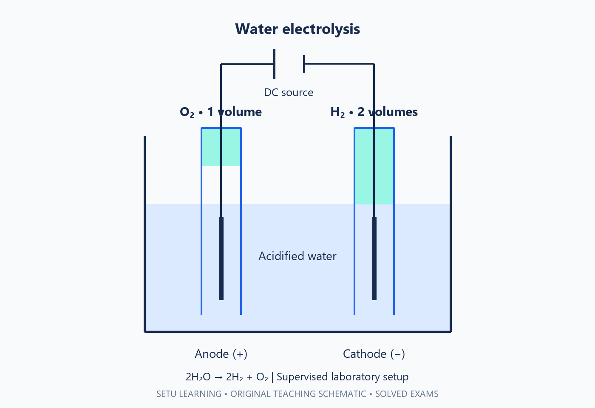

## 2023 — मुख्य परीक्षा

[2023 मुख्य: पूरा आधिकारिक प्रश्न-पत्र](https://rajeduboard.rajasthan.gov.in/books/PAPERS-2023/Sec/S-07.pdf)

## 146. Growth-inhibiting hormone।

**स्रोत:** 2023 मुख्य, प्रश्न 1(i), PDF पृष्ठ 2 · **अंक:** 1 अंक

**अध्याय-संबंध:** नियंत्रण एवं समन्वय

**हल:** Abscisic acid (ABA) growth inhibition और stress responses से संबंधित है। Water stress में stomatal closing में भी भूमिका निभाता है।

[मूल प्रश्न देखें](https://rajeduboard.rajasthan.gov.in/books/PAPERS-2023/Sec/S-07.pdf#page=2)

## 147. Posture/balance का brain भाग।

**स्रोत:** 2023 मुख्य, प्रश्न 1(ii), PDF पृष्ठ 2 · **अंक:** 1 अंक

**अध्याय-संबंध:** नियंत्रण एवं समन्वय

**हल:** Cerebellum posture, balance तथा precise movement में मदद करता है। Walking straight/riding bicycle coordination के ऐसे examples हैं।

[मूल प्रश्न देखें](https://rajeduboard.rajasthan.gov.in/books/PAPERS-2023/Sec/S-07.pdf#page=2)

## 148. RrYy का pea phenotype।

**स्रोत:** 2023 मुख्य, प्रश्न 1(iii), PDF पृष्ठ 3 · **अंक:** 1 अंक

**अध्याय-संबंध:** आनुवंशिकता

**हल:** Complete dominance के pea model में RrYy phenotype round और yellow है। R round, Y yellow dominant; genotype heterozygous होने पर recessive traits hidden हो सकते हैं।

[मूल प्रश्न देखें](https://rajeduboard.rajasthan.gov.in/books/PAPERS-2023/Sec/S-07.pdf#page=3)

## 149. Iris muscles का काम।

**स्रोत:** 2023 मुख्य, प्रश्न 1(vii), PDF पृष्ठ 5 · **अंक:** 1 अंक

**अध्याय-संबंध:** मानव नेत्र तथा रंगबिरंगा संसार

**हल:** Iris की muscles pupil opening का size नियंत्रित करती हैं। Lens की curvature ciliary muscles बदलती हैं; light entry और accommodation के mechanisms अलग हैं।

[मूल प्रश्न देखें](https://rajeduboard.rajasthan.gov.in/books/PAPERS-2023/Sec/S-07.pdf#page=5)

## 150. kWh किस quantity की unit?

**स्रोत:** 2023 मुख्य, प्रश्न 1(viii), PDF पृष्ठ 5 · **अंक:** 1 अंक

**अध्याय-संबंध:** विद्युत

**हल:** 1 kWh=3.6×10⁶ J और यह electric energy की unit है। kW power, kWh energy; 1 hour=3600 seconds।

[मूल प्रश्न देखें](https://rajeduboard.rajasthan.gov.in/books/PAPERS-2023/Sec/S-07.pdf#page=5)

## 151. Silver का black coating process।

**स्रोत:** 2023 मुख्य, प्रश्न 1(x), PDF पृष्ठ 6 · **अंक:** 1 अंक

**अध्याय-संबंध:** धातु एवं अधातु

**हल:** Silver की environmental black coating corrosion/tarnishing है; sulfur compounds के साथ Ag₂S बन सकता है। इसे fat rancidity या metal का केवल melting न कहें।

[मूल प्रश्न देखें](https://rajeduboard.rajasthan.gov.in/books/PAPERS-2023/Sec/S-07.pdf#page=6)

## 152. Al/Fe/Zn ascending activity।

**स्रोत:** 2023 मुख्य, प्रश्न 1(xi), PDF पृष्ठ 6 · **अंक:** 1 अंक

**अध्याय-संबंध:** धातु एवं अधातु

**हल:** Ascending reactivity: Fe < Zn < Al। Activity-series position displaced metal और reaction tendency के school predictions में उपयोगी है।

[मूल प्रश्न देखें](https://rajeduboard.rajasthan.gov.in/books/PAPERS-2023/Sec/S-07.pdf#page=6)

## 153. Acid+ethanol का ester।

**स्रोत:** 2023 मुख्य, प्रश्न 1(xii), PDF पृष्ठ 6 · **अंक:** 1 अंक

**अध्याय-संबंध:** कार्बन एवं उसके यौगिक

**हल:** Ethanoic acid+ethanol से CH₃COOC₂H₅ (ethyl ethanoate) और water बनते हैं, acid catalyst/heat सहित। Ester का group –COO– है; ether option सही नहीं।

[मूल प्रश्न देखें](https://rajeduboard.rajasthan.gov.in/books/PAPERS-2023/Sec/S-07.pdf#page=6)

## 154. Saliva enzyme का नाम।

**स्रोत:** 2023 मुख्य, प्रश्न 2(i), PDF पृष्ठ 7 · **अंक:** 1 अंक

**अध्याय-संबंध:** जैव प्रक्रम

**हल:** Salivary amylase/ptyalin saliva में starch breakdown शुरू करता है। यह fat emulsification नहीं करता; fat पर bile और lipase-related processes अलग हैं।

[मूल प्रश्न देखें](https://rajeduboard.rajasthan.gov.in/books/PAPERS-2023/Sec/S-07.pdf#page=7)

## 155. Vegetative offspring की similarity।

**स्रोत:** 2023 मुख्य, प्रश्न 2(ii), PDF पृष्ठ 7 · **अंक:** 1 अंक

**अध्याय-संबंध:** जीव जनन कैसे करते हैं?

**हल:** Vegetative offspring सामान्यतः parent जैसे genetically similar/clone होते हैं। DNA copying में mutations संभव हैं; ‘हर molecule बिल्कुल समान’ absolute claim से बचें।

[मूल प्रश्न देखें](https://rajeduboard.rajasthan.gov.in/books/PAPERS-2023/Sec/S-07.pdf#page=7)

## 156. Biological breakdown वाला material।

**स्रोत:** 2023 मुख्य, प्रश्न 2(iii), PDF पृष्ठ 7 · **अंक:** 1 अंक

**अध्याय-संबंध:** हमारा पर्यावरण

**हल:** Biological processes द्वारा breakdown होने वाले substances biodegradable हैं। Suitable conditions/समय चाहिए; biodegradable का अर्थ तत्काल harmless नहीं।

[मूल प्रश्न देखें](https://rajeduboard.rajasthan.gov.in/books/PAPERS-2023/Sec/S-07.pdf#page=7)

## 157. Like magnet poles का effect।

**स्रोत:** 2023 मुख्य, प्रश्न 2(iv), PDF पृष्ठ 7 · **अंक:** 1 अंक

**अध्याय-संबंध:** विद्युत धारा के चुंबकीय प्रभाव

**हल:** Like magnetic poles repel, unlike poles attract। Field-direction rules और poles के attraction को current direction का synonym न बनाएं।

[मूल प्रश्न देखें](https://rajeduboard.rajasthan.gov.in/books/PAPERS-2023/Sec/S-07.pdf#page=7)

## 158. Vinegar acid का नाम।

**स्रोत:** 2023 मुख्य, प्रश्न 2(v), PDF पृष्ठ 7 · **अंक:** 1 अंक

**अध्याय-संबंध:** कार्बन एवं उसके यौगिक

**हल:** Vinegar का प्रमुख characteristic acid ethanoic/acetic acid, CH₃COOH है। Dilute vinegar और pure glacial acetic acid की concentration अलग है।

[मूल प्रश्न देखें](https://rajeduboard.rajasthan.gov.in/books/PAPERS-2023/Sec/S-07.pdf#page=7)

## 159. Hormone action regulation।

**स्रोत:** 2023 मुख्य, प्रश्न 3(i), PDF पृष्ठ 8 · **अंक:** 1 अंक

**अध्याय-संबंध:** नियंत्रण एवं समन्वय

**हल:** Feedback mechanism hormone release के time/amount को regulate कर सकता है। उदाहरण blood glucose बढ़ने से insulin stimulus बढ़ता, glucose घटने पर stimulus कम होता है।

[मूल प्रश्न देखें](https://rajeduboard.rajasthan.gov.in/books/PAPERS-2023/Sec/S-07.pdf#page=8)

## 160. Multiple-fission organism।

**स्रोत:** 2023 मुख्य, प्रश्न 3(ii), PDF पृष्ठ 8 · **अंक:** 1 अंक

**अध्याय-संबंध:** जीव जनन कैसे करते हैं?

**हल:** Plasmodium में multiple fission: एक parent cell से अनेक daughter cells बन सकते हैं। Binary fission में केवल दो बनते हैं।

[मूल प्रश्न देखें](https://rajeduboard.rajasthan.gov.in/books/PAPERS-2023/Sec/S-07.pdf#page=8)

## 161. एक abiotic component।

**स्रोत:** 2023 मुख्य, प्रश्न 3(iv), PDF पृष्ठ 8 · **अंक:** 1 अंक

**अध्याय-संबंध:** हमारा पर्यावरण

**हल:** Water, sunlight या temperature ecosystem का abiotic component है। Plants/animals/bacteria biotic components हैं।

[मूल प्रश्न देखें](https://rajeduboard.rajasthan.gov.in/books/PAPERS-2023/Sec/S-07.pdf#page=8)

## 162. 5 Ω wire half length: R,ρ।

**स्रोत:** 2023 मुख्य, प्रश्न 3(v), PDF पृष्ठ 8 · **अंक:** 1 अंक

**अध्याय-संबंध:** विद्युत

**हल:** P resistance=5 Ω और Q resistivity=8×10⁻⁴ Ω·m। Length half, same A/material/temperature में P=2.5 Ω; Q unchanged 8×10⁻⁴ Ω·m।

[मूल प्रश्न देखें](https://rajeduboard.rajasthan.gov.in/books/PAPERS-2023/Sec/S-07.pdf#page=8)

## 163. Field lines क्यों नहीं cross?

**स्रोत:** 2023 मुख्य, प्रश्न 3(vi), PDF पृष्ठ 8 · **अंक:** 1 अंक

**अध्याय-संबंध:** विद्युत धारा के चुंबकीय प्रभाव

**हल:** एक point पर field की unique direction है। Two field lines crossing करें तो दो tangents/directions मिलेंगी; इसलिए magnetic field lines intersect नहीं करतीं।

[मूल प्रश्न देखें](https://rajeduboard.rajasthan.gov.in/books/PAPERS-2023/Sec/S-07.pdf#page=8)

## 164. Coil के भीतर-बाहर field।

**स्रोत:** 2023 मुख्य, प्रश्न 3(vii), PDF पृष्ठ 9 · **अंक:** 1 अंक

**अध्याय-संबंध:** विद्युत धारा के चुंबकीय प्रभाव

**हल:** Solenoid के भीतर, ends से दूर लगभग parallel equally spaced field lines draw करें; बाहर N→S तथा अंदर S→N return direction, closed loops। Current और coil turns field को प्रभावित करते हैं; suitable iron core से electromagnet बनाया जा सकता है।

[मूल प्रश्न देखें](https://rajeduboard.rajasthan.gov.in/books/PAPERS-2023/Sec/S-07.pdf#page=9)

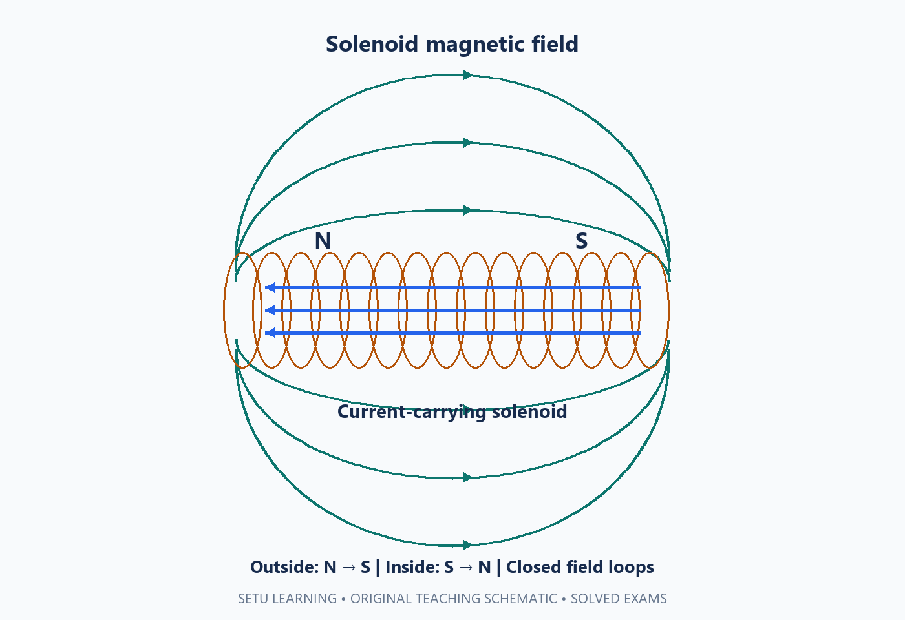

## 165. Neutralisation definition।

**स्रोत:** 2023 मुख्य, प्रश्न 3(viii), PDF पृष्ठ 9 · **अंक:** 1 अंक

**अध्याय-संबंध:** अम्ल, क्षारक एवं लवण

**हल:** Acid और base से salt और सामान्यतः water बनना neutralisation है। HCl+NaOH→NaCl+H₂O balanced example है।

[मूल प्रश्न देखें](https://rajeduboard.rajasthan.gov.in/books/PAPERS-2023/Sec/S-07.pdf#page=9)

## 166. CuO–H₂ में reduced reactant।

**स्रोत:** 2023 मुख्य, प्रश्न 3(x), PDF पृष्ठ 9 · **अंक:** 1 अंक

**अध्याय-संबंध:** रासायनिक अभिक्रियाएँ एवं समीकरण

**हल:** CuO + H₂ → Cu + H₂O में H₂ oxygen पाकर oxidised, CuO oxygen खोकर reduced है। Oxidation तथा reduction एक साथ होना redox है; दूसरा उदाहरण ZnO + C → Zn + CO है।

[मूल प्रश्न देखें](https://rajeduboard.rajasthan.gov.in/books/PAPERS-2023/Sec/S-07.pdf#page=9)

## 2022 — मुख्य परीक्षा

[2022 मुख्य: पूरा आधिकारिक प्रश्न-पत्र](https://rajeduboard.rajasthan.gov.in/books/PAPERS-2022/Sec/S-07.pdf)

## 167. Heart किस organ system में?

**स्रोत:** 2022 मुख्य, प्रश्न 1(i), PDF पृष्ठ 2 · **अंक:** 1 अंक

**अध्याय-संबंध:** जैव प्रक्रम

**हल:** Heart circulatory system का pump है। Chambers blood को lungs और body circuits में भेजते हैं; यह kidney की तरह metabolic-waste filtration organ नहीं।

[मूल प्रश्न देखें](https://rajeduboard.rajasthan.gov.in/books/PAPERS-2022/Sec/S-07.pdf#page=2)

## 168. Thyroxine का आवश्यक element।

**स्रोत:** 2022 मुख्य, प्रश्न 1(iii), PDF पृष्ठ 3 · **अंक:** 1 अंक

**अध्याय-संबंध:** नियंत्रण एवं समन्वय

**हल:** Thyroid को thyroxine बनाने के लिए iodine आवश्यक है। Thyroxine metabolic regulation में भूमिका निभाता है; iodine gland या hormone का नाम नहीं है।

[मूल प्रश्न देखें](https://rajeduboard.rajasthan.gov.in/books/PAPERS-2022/Sec/S-07.pdf#page=3)

## 169. Involuntary functions का brain भाग।

**स्रोत:** 2022 मुख्य, प्रश्न 1(iv), PDF पृष्ठ 3 · **अंक:** 1 अंक

**अध्याय-संबंध:** नियंत्रण एवं समन्वय

**हल:** इस board MCQ का अपेक्षित विकल्प medulla है, जो breathing, blood-pressure-related responses, salivation/vomiting जैसे involuntary functions में काम करता है। ‘सभी involuntary actions केवल medulla’ वैज्ञानिक रूप से अत्यधिक व्यापक कथन है।

[मूल प्रश्न देखें](https://rajeduboard.rajasthan.gov.in/books/PAPERS-2022/Sec/S-07.pdf#page=3)

## 170. किस salt में crystal water नहीं?

**स्रोत:** 2022 मुख्य, प्रश्न 1(v), PDF पृष्ठ 3 · **अंक:** 1 अंक

**अध्याय-संबंध:** अम्ल, क्षारक एवं लवण

**हल:** NaHCO₃ यानी baking soda में formula-bound water of crystallisation नहीं। Washing soda decahydrate, gypsum dihydrate और POP hemihydrate हैं।

[मूल प्रश्न देखें](https://rajeduboard.rajasthan.gov.in/books/PAPERS-2022/Sec/S-07.pdf#page=3)

## 171. Zn–dilute acid की gas।

**स्रोत:** 2022 मुख्य, प्रश्न 1(vi), PDF पृष्ठ 4 · **अंक:** 1 अंक

**अध्याय-संबंध:** अम्ल, क्षारक एवं लवण

**हल:** Zn + H₂SO₄(dil.) → ZnSO₄ + H₂। Gas hydrogen है; prescribed supervised test में burning splint से characteristic pop मिल सकता है। Acid/gas experiment स्वयं न करें।

[मूल प्रश्न देखें](https://rajeduboard.rajasthan.gov.in/books/PAPERS-2022/Sec/S-07.pdf#page=4)

## 172. Soft, cold-water-reactive option।

**स्रोत:** 2022 मुख्य, प्रश्न 1(vii), PDF पृष्ठ 4 · **अंक:** 1 अंक

**अध्याय-संबंध:** धातु एवं अधातु

**हल:** दिए K, Ag, Cu, Pb विकल्पों में K soft और cold water से vigorous reaction करता है। Alkali metals को lab में carefully handle करते हैं; यह self-experiment निर्देश नहीं।

[मूल प्रश्न देखें](https://rajeduboard.rajasthan.gov.in/books/PAPERS-2022/Sec/S-07.pdf#page=4)

## 173. Reflection laws किन mirrors पर?

**स्रोत:** 2022 मुख्य, प्रश्न 1(viii), PDF पृष्ठ 5 · **अंक:** 1 अंक

**अध्याय-संबंध:** प्रकाश: परावर्तन तथा अपवर्तन

**हल:** Reflection laws plane, concave और convex mirrors सभी के हर local surface point पर लागू हैं। Normal curved surface पर local perpendicular के अनुसार खींचें।

[मूल प्रश्न देखें](https://rajeduboard.rajasthan.gov.in/books/PAPERS-2022/Sec/S-07.pdf#page=5)

## 174. n=1.33: water में light speed।

**स्रोत:** 2022 मुख्य, प्रश्न 1(ix), PDF पृष्ठ 5 · **अंक:** 1 अंक

**अध्याय-संबंध:** प्रकाश: परावर्तन तथा अपवर्तन

**हल:** n=1.33,c≈3×10⁸ m/s। v=c/n≈2.26×10⁸ m/s। Medium में speed कम है; n को c से multiply करना गलत।

[मूल प्रश्न देखें](https://rajeduboard.rajasthan.gov.in/books/PAPERS-2022/Sec/S-07.pdf#page=5)

## 175. Charge का SI unit।

**स्रोत:** 2022 मुख्य, प्रश्न 1(x), PDF पृष्ठ 5 · **अंक:** 1 अंक

**अध्याय-संबंध:** विद्युत

**हल:** Electric charge का SI unit coulomb (C) है। Current ampere, potential difference volt और resistance ohm में मापते हैं।

[मूल प्रश्न देखें](https://rajeduboard.rajasthan.gov.in/books/PAPERS-2022/Sec/S-07.pdf#page=5)

## 176. Hormone amount/time regulation।

**स्रोत:** 2022 मुख्य, प्रश्न 2(i), PDF पृष्ठ 7 · **अंक:** 1 अंक

**अध्याय-संबंध:** नियंत्रण एवं समन्वय

**हल:** Feedback mechanism hormone release के time/amount को regulate कर सकता है। उदाहरण blood glucose बढ़ने से insulin stimulus बढ़ता, glucose घटने पर stimulus कम होता है।

[मूल प्रश्न देखें](https://rajeduboard.rajasthan.gov.in/books/PAPERS-2022/Sec/S-07.pdf#page=7)

## 177. Nerve message का प्रकार।

**स्रोत:** 2022 मुख्य, प्रश्न 2(ii), PDF पृष्ठ 7 · **अंक:** 1 अंक

**अध्याय-संबंध:** नियंत्रण एवं समन्वय

**हल:** Nervous tissue में electrical/electrochemical impulses messages transmit करते हैं; chemical synapses पर neurotransmitter crossing होती है। पूरे pathway को केवल chemical diffusion न कहें।

[मूल प्रश्न देखें](https://rajeduboard.rajasthan.gov.in/books/PAPERS-2022/Sec/S-07.pdf#page=7)

## 178. Trophic transfer में energy।

**स्रोत:** 2022 मुख्य, प्रश्न 2(iii), PDF पृष्ठ 7 · **अंक:** 1 अंक

**अध्याय-संबंध:** हमारा पर्यावरण

**हल:** Trophic transfer पर usable energy घटती है; respiration/heat/activities में losses होते हैं। लगभग 10% next level transfer school estimate है, सभी ecosystems में exact constant नहीं।

[मूल प्रश्न देखें](https://rajeduboard.rajasthan.gov.in/books/PAPERS-2022/Sec/S-07.pdf#page=7)

## 179. Lens v/u का अर्थ।

**स्रोत:** 2022 मुख्य, प्रश्न 2(v), PDF पृष्ठ 7 · **अंक:** 1 अंक

**अध्याय-संबंध:** प्रकाश: परावर्तन तथा अपवर्तन

**हल:** Linear magnification image height/object height, m=hᵢ/hₒ। Mirror में −v/u और lens में v/u। Magnitude relative size, sign orientation दर्शाता है।

[मूल प्रश्न देखें](https://rajeduboard.rajasthan.gov.in/books/PAPERS-2022/Sec/S-07.pdf#page=7)

## 180. Bulb filament का material।

**स्रोत:** 2022 मुख्य, प्रश्न 2(vi), PDF पृष्ठ 7 · **अंक:** 1 अंक

**अध्याय-संबंध:** विद्युत

**हल:** Filament incandescent bulbs में tungsten उपयोगी है क्योंकि melting point बहुत ऊँचा और heating पर incandescence मिलती है। यह modern LED का filament होने का दावा नहीं।

[मूल प्रश्न देखें](https://rajeduboard.rajasthan.gov.in/books/PAPERS-2022/Sec/S-07.pdf#page=7)

## 181. Nervous tissue का network।

**स्रोत:** 2022 मुख्य, प्रश्न 3(i), PDF पृष्ठ 7 · **अंक:** 1 अंक

**अध्याय-संबंध:** नियंत्रण एवं समन्वय

**हल:** Dendrites incoming signals ग्रहण, cell body integration और axon terminal तक conduction करता है। Chemical synapse पर neurotransmitter next cell तक signal पहुँचाता है। Diagram arrows dendrite → body → axon → terminal तथा labels दें।

[मूल प्रश्न देखें](https://rajeduboard.rajasthan.gov.in/books/PAPERS-2022/Sec/S-07.pdf#page=7)

## 182. Growth-regulating endocrine gland।

**स्रोत:** 2022 मुख्य, प्रश्न 3(ii), PDF पृष्ठ 7 · **अंक:** 1 अंक

**अध्याय-संबंध:** नियंत्रण एवं समन्वय

**हल:** दिए विकल्पों में pituitary gland growth hormone से growth stimulate करती है। Board stem ‘all organs’ simplified है; actual tissue responses एवं अन्य hormones भी भूमिका रखते हैं।

[मूल प्रश्न देखें](https://rajeduboard.rajasthan.gov.in/books/PAPERS-2022/Sec/S-07.pdf#page=7)

## 183. CFC का expansion।

**स्रोत:** 2022 मुख्य, प्रश्न 3(iii), PDF पृष्ठ 8 · **अंक:** 1 अंक

**अध्याय-संबंध:** हमारा पर्यावरण

**हल:** CFC का full form chlorofluorocarbon है। इनमें carbon, chlorine और fluorine वाले compounds शामिल हैं; कुछ CFCs stratospheric ozone depletion में भूमिका निभाते हैं।

[मूल प्रश्न देखें](https://rajeduboard.rajasthan.gov.in/books/PAPERS-2022/Sec/S-07.pdf#page=8)

## 184. Recycling का अर्थ।

**स्रोत:** 2022 मुख्य, प्रश्न 3(v), PDF पृष्ठ 8 · **अंक:** 1 अंक

**अध्याय-संबंध:** हमारा पर्यावरण

**हल:** Reduce: unnecessary consumption/waste घटाएँ। Reuse: वस्तु फिर उपयोग करें। Recycle: waste material से उपयोगी material बनाएं। उदाहरण bottle reuse, कम packaging और separated paper recycling हैं।

[मूल प्रश्न देखें](https://rajeduboard.rajasthan.gov.in/books/PAPERS-2022/Sec/S-07.pdf#page=8)

## 185. Orange का acid।

**स्रोत:** 2022 मुख्य, प्रश्न 3(vi), PDF पृष्ठ 8 · **अंक:** 1 अंक

**अध्याय-संबंध:** अम्ल, क्षारक एवं लवण

**हल:** Orange का characteristic school-level acid citric acid है। Tamarind tartaric और curd lactic acid examples हैं; fruit sample में कई acids मौजूद हो सकते हैं।

[मूल प्रश्न देखें](https://rajeduboard.rajasthan.gov.in/books/PAPERS-2022/Sec/S-07.pdf#page=8)

## 2020 — मुख्य परीक्षा

[2020 मुख्य: पूरा आधिकारिक प्रश्न-पत्र](https://rajeduboard.rajasthan.gov.in/books/PAPERS-2020/Sec/S-07-Science.pdf)

## 186. Catenation का अर्थ।

**स्रोत:** 2020 मुख्य, प्रश्न 3, PDF पृष्ठ 3 · **अंक:** 1 अंक

**अध्याय-संबंध:** कार्बन एवं उसके यौगिक

**हल:** Tetravalency से चार covalent bonds और catenation से chains/branches/rings बनते हैं। Stable C–C bonding carbon compounds की विविधता में मदद करती है। Organic compounds में electron sharing प्रमुख है।

[मूल प्रश्न देखें](https://rajeduboard.rajasthan.gov.in/books/PAPERS-2020/Sec/S-07-Science.pdf#page=3)

## 187. Bar-magnet field sketch।

**स्रोत:** 2020 मुख्य, प्रश्न 11, PDF पृष्ठ 4 · **अंक:** 1 अंक

**अध्याय-संबंध:** विद्युत धारा के चुंबकीय प्रभाव

**हल:** Bar magnet के भीतर field lines south→north, बाहर north→south हैं; मिलकर closed loops बनती हैं।

[मूल प्रश्न देखें](https://rajeduboard.rajasthan.gov.in/books/PAPERS-2020/Sec/S-07-Science.pdf#page=4)

चित्र सहायता: इसी अध्याय में इस अवधारणा का पहले दिया नामांकित schematic देखें।

## 188. Neutralisation example।

**स्रोत:** 2020 मुख्य, प्रश्न 17(b), PDF पृष्ठ 5 · **अंक:** 1 अंक

**अध्याय-संबंध:** अम्ल, क्षारक एवं लवण

**हल:** Acid और base से salt और सामान्यतः water बनना neutralisation है। HCl+NaOH→NaCl+H₂O balanced example है।

[मूल प्रश्न देखें](https://rajeduboard.rajasthan.gov.in/books/PAPERS-2020/Sec/S-07-Science.pdf#page=5)

## 189. Agricultural waste और disposal।

**स्रोत:** 2020 मुख्य, प्रश्न 21, PDF पृष्ठ 7 · **अंक:** 3 अंक

**अध्याय-संबंध:** हमारा पर्यावरण

**हल:** Discarded unwanted material waste है। Source segregation, reduce/reuse और suitable recycling/composting useful methods हैं। E-waste/batteries organic compost में न मिलाएँ।

[मूल प्रश्न देखें](https://rajeduboard.rajasthan.gov.in/books/PAPERS-2020/Sec/S-07-Science.pdf#page=7)

## 190. Fruit की परिभाषा।

**स्रोत:** 2020 मुख्य, प्रश्न 22(a), PDF पृष्ठ 7 · **अंक:** 1 अंक

**अध्याय-संबंध:** जीव जनन कैसे करते हैं?

**हल:** Flower का ovary fertilisation के बाद सामान्यतः fruit में विकसित होता है; ovules seeds बनते हैं। Seedless/parthenocarpic examples के कारण ‘हर fruit में fertilisation अनिवार्य’ absolute न जोड़ें।

[मूल प्रश्न देखें](https://rajeduboard.rajasthan.gov.in/books/PAPERS-2020/Sec/S-07-Science.pdf#page=7)

## 191. Backcross तथा testcross।

**स्रोत:** 2020 मुख्य, प्रश्न 23, PDF पृष्ठ 7 · **अंक:** 4 अंक

**अध्याय-संबंध:** आनुवंशिकता

**हल:** Backcross F₁ को किसी parent-type से cross करना है। Testcross unknown dominant phenotype को homozygous recessive से cross करता है; Tt×tt से expected 1:1, TT×tt से सभी dominant। Testcross backcross का special case हो सकता है।

[मूल प्रश्न देखें](https://rajeduboard.rajasthan.gov.in/books/PAPERS-2020/Sec/S-07-Science.pdf#page=7)

## 192. Bleaching powder name/formula।

**स्रोत:** 2020 मुख्य, प्रश्न 24(a), PDF पृष्ठ 7 · **अंक:** 1 अंक

**अध्याय-संबंध:** अम्ल, क्षारक एवं लवण

**हल:** Bleaching powder का school formula CaOCl₂; water disinfection/bleaching में उपयोग। POP CaSO₄·½H₂O, plaster/moulds के लिए; water जोड़कर gypsum CaSO₄·2H₂O बनकर जमता है।

[मूल प्रश्न देखें](https://rajeduboard.rajasthan.gov.in/books/PAPERS-2020/Sec/S-07-Science.pdf#page=7)

## 193. Aqueous acids/bases theory।

**स्रोत:** 2020 मुख्य, प्रश्न 24(b), PDF पृष्ठ 7 · **अंक:** 1 अंक

**अध्याय-संबंध:** अम्ल, क्षारक एवं लवण

**हल:** Arrhenius acid aqueous H⁺/H₃O⁺ बढ़ाता है, जैसे HCl; base OH⁻ बढ़ाता है, जैसे NaOH। NaOH+HCl→NaCl+H₂O neutralisation है। सभी hydrogen compounds aqueous acids नहीं।

[मूल प्रश्न देखें](https://rajeduboard.rajasthan.gov.in/books/PAPERS-2020/Sec/S-07-Science.pdf#page=7)

## 194. Respiration का अर्थ।

**स्रोत:** 2020 मुख्य, प्रश्न 28(a), प्रथम विकल्प, PDF पृष्ठ 9 · **अंक:** 1 अंक

**अध्याय-संबंध:** जैव प्रक्रम

**हल:** Cellular respiration food का breakdown करके usable energy release करने की प्रक्रिया है। Cytoplasm में glucose से pyruvate; aerobic mitochondrial route CO₂/water देता है। Yeast anaerobic route ethanol/CO₂ तथा oxygen-deficit muscles lactate दे सकते हैं।

[मूल प्रश्न देखें](https://rajeduboard.rajasthan.gov.in/books/PAPERS-2020/Sec/S-07-Science.pdf#page=9)

## 195. Male प्रमुख sex hormone।

**स्रोत:** 2020 मुख्य, प्रश्न 28(a), दूसरा विकल्प, PDF पृष्ठ 9 · **अंक:** 1 अंक

**अध्याय-संबंध:** नियंत्रण एवं समन्वय

**हल:** विद्यालयी प्रमुख male hormone testosterone है; female reproductive hormones में oestrogen और progesterone शामिल हैं। ये सामान्य sex characteristics तथा reproductive functions में भूमिका निभाते हैं; hormone केवल एक sex में ही पाया जाता है, ऐसा absolute दावा न करें।

[मूल प्रश्न देखें](https://rajeduboard.rajasthan.gov.in/books/PAPERS-2020/Sec/S-07-Science.pdf#page=9)

## 196. Magnification की परिभाषा।

**स्रोत:** 2020 मुख्य, प्रश्न 30(a), प्रथम विकल्प, PDF पृष्ठ 11 · **अंक:** 1 अंक

**अध्याय-संबंध:** प्रकाश: परावर्तन तथा अपवर्तन

**हल:** Linear magnification image height/object height, m=hᵢ/hₒ। Mirror में −v/u और lens में v/u। Magnitude relative size, sign orientation दर्शाता है।

[मूल प्रश्न देखें](https://rajeduboard.rajasthan.gov.in/books/PAPERS-2020/Sec/S-07-Science.pdf#page=11)

## 197. Positive m की image nature।

**स्रोत:** 2020 मुख्य, प्रश्न 30(c), प्रथम विकल्प, PDF पृष्ठ 11 · **अंक:** 1 अंक

**अध्याय-संबंध:** प्रकाश: परावर्तन तथा अपवर्तन

**हल:** Positive magnification का अर्थ erect image है। Standard concave-mirror real-object school case में ऐसी image virtual होती है और object P–F के बीच है। Positive का अर्थ अनिवार्य larger नहीं।

[मूल प्रश्न देखें](https://rajeduboard.rajasthan.gov.in/books/PAPERS-2020/Sec/S-07-Science.pdf#page=11)

## 198. CH₃–CH=CH₂ का नाम।

**स्रोत:** 2020 मुख्य, प्रश्न 20(a)(ii), PDF पृष्ठ 6 · **अंक:** 1 अंक

**अध्याय-संबंध:** कार्बन एवं उसके यौगिक

**हल:** CH₃–CH=CH₂ अथवा CH₂=CH–CH₃ का IUPAC नाम propene है। तीन carbon, one double bond; suffix -ene।

[मूल प्रश्न देखें](https://rajeduboard.rajasthan.gov.in/books/PAPERS-2020/Sec/S-07-Science.pdf#page=6)

## 199. 220 V,0.5 A: R और P।

**स्रोत:** 2020 मुख्य, प्रश्न 25, PDF पृष्ठ 8 · **अंक:** 4 अंक

**अध्याय-संबंध:** विद्युत

**हल:** V=220 V,I=0.5 A। P=VI=110 W। यदि resistance भी चाहिए तो R=V/I=440 Ω।

[मूल प्रश्न देखें](https://rajeduboard.rajasthan.gov.in/books/PAPERS-2020/Sec/S-07-Science.pdf#page=8)

## 200. 40 kg,5→10 m/s: work।

**स्रोत:** 2020 मुख्य, प्रश्न 26(a), PDF पृष्ठ 8 · **अंक:** 2 अंक

**अध्याय-संबंध:** पुराना पाठ्यक्रम / enrichment: वर्तमान core से बाहर

**पुराना पाठ्यक्रम:** **हल:** पुराना mechanics: W=½×40×(10²−5²)=20×75=1500 J। Work–energy theorem उपयोग होता है, current core scope से अलग।

[मूल प्रश्न देखें](https://rajeduboard.rajasthan.gov.in/books/PAPERS-2020/Sec/S-07-Science.pdf#page=8)

## 201. 200 J,10 m: force।

**स्रोत:** 2020 मुख्य, प्रश्न 26(b), PDF पृष्ठ 8 · **अंक:** 2 अंक

**अध्याय-संबंध:** पुराना पाठ्यक्रम / enrichment: वर्तमान core से बाहर

**पुराना पाठ्यक्रम:** **हल:** पुराना mechanics: maximum aligned work W=Fs। F=200/10=20 N। Angle 0° होने की maximum-work condition महत्वपूर्ण है।

[मूल प्रश्न देखें](https://rajeduboard.rajasthan.gov.in/books/PAPERS-2020/Sec/S-07-Science.pdf#page=8)

## 2020 — पूरक परीक्षा

[2020 पूरक: पूरा आधिकारिक प्रश्न-पत्र](https://rajeduboard.rajasthan.gov.in/books/PAPERS-2020/SecSUP/S-07.pdf)

## 202. दो crystalline carbon forms।

**स्रोत:** 2020 पूरक, प्रश्न 3, PDF पृष्ठ 3 · **अंक:** 1 अंक

**अध्याय-संबंध:** कार्बन एवं उसके यौगिक

**हल:** Diamond और graphite carbon के crystalline allotropes हैं। Atomic element same, bonding/structure अलग; graphite conductor जबकि diamond सामान्यतः electrical insulator है।

[मूल प्रश्न देखें](https://rajeduboard.rajasthan.gov.in/books/PAPERS-2020/SecSUP/S-07.pdf#page=3)

## 203. Current-wire field direction rule।

**स्रोत:** 2020 पूरक, प्रश्न 11, PDF पृष्ठ 4 · **अंक:** 1 अंक

**अध्याय-संबंध:** विद्युत धारा के चुंबकीय प्रभाव

**हल:** Right-hand thumb conventional current की दिशा में रखें; curled fingers wire के circular magnetic field की direction देती हैं। Thumb force नहीं बताता; force के लिए Fleming left-hand rule है।

[मूल प्रश्न देखें](https://rajeduboard.rajasthan.gov.in/books/PAPERS-2020/SecSUP/S-07.pdf#page=4)

## 204. Electron transfer से redox।

**स्रोत:** 2020 पूरक, प्रश्न 17(a), PDF पृष्ठ 5 · **अंक:** 2 अंक

**अध्याय-संबंध:** रासायनिक अभिक्रियाएँ एवं समीकरण

**हल:** Electron concept में oxidation electron loss, reduction electron gain है। Zn→Zn²⁺+2e⁻ तथा Cu²⁺+2e⁻→Cu; net Zn+Cu²⁺→Zn²⁺+Cu। दोनों half-reactions में electron संख्या समान रखकर जोड़ें।

[मूल प्रश्न देखें](https://rajeduboard.rajasthan.gov.in/books/PAPERS-2020/SecSUP/S-07.pdf#page=5)

## 205. एक enzyme-driven reaction।

**स्रोत:** 2020 पूरक, प्रश्न 17(b), PDF पृष्ठ 5 · **अंक:** 1 अंक

**अध्याय-संबंध:** जैव प्रक्रम

**हल:** Salivary amylase starch को छोटे carbohydrate products में hydrolyse करना शुरू करता है। Enzyme biological catalyst है; reaction में rate बढ़ाता है और खुद स्थायी रूप से consumed नहीं होता।

[मूल प्रश्न देखें](https://rajeduboard.rajasthan.gov.in/books/PAPERS-2020/SecSUP/S-07.pdf#page=5)

## 206. HC≡C–CH₃ का नाम।

**स्रोत:** 2020 पूरक, प्रश्न 20(a)(2), PDF पृष्ठ 6 · **अंक:** 1 अंक

**अध्याय-संबंध:** कार्बन एवं उसके यौगिक

**हल:** CH₃–C≡CH का नाम propyne/prop-1-yne है। तीन carbon और terminal triple bond; suffix -yne प्रयोग करें।

[मूल प्रश्न देखें](https://rajeduboard.rajasthan.gov.in/books/PAPERS-2020/SecSUP/S-07.pdf#page=6)

## 207. Non-biodegradable waste का अर्थ।

**स्रोत:** 2020 पूरक, प्रश्न 21, परिभाषा भाग, PDF पृष्ठ 6 · **अंक:** 1 अंक

**अध्याय-संबंध:** हमारा पर्यावरण

**हल:** दिए examples में conventional plastic non-biodegradable है; persistent waste अलग collect/recycle करें। सभी types/material formulations की degradation समान नहीं होती।

[मूल प्रश्न देखें](https://rajeduboard.rajasthan.gov.in/books/PAPERS-2020/SecSUP/S-07.pdf#page=6)

## 208. Mendel segregation और example।

**स्रोत:** 2020 पूरक, प्रश्न 23, PDF पृष्ठ 7 · **अंक:** 4 अंक

**अध्याय-संबंध:** आनुवंशिकता

**हल:** Tt organism gamete बनाते समय allele pair अलग करता है, इसलिए gametes T या t हैं। Tt×Tt में TT:Tt:tt=1:2:1 expected। Dominant allele होने पर भी recessive allele gamete तक जा सकता है।

[मूल प्रश्न देखें](https://rajeduboard.rajasthan.gov.in/books/PAPERS-2020/SecSUP/S-07.pdf#page=7)

## 209. Fracture plaster का compound।

**स्रोत:** 2020 पूरक, प्रश्न 24(a), PDF पृष्ठ 7 · **अंक:** 1 अंक

**अध्याय-संबंध:** अम्ल, क्षारक एवं लवण

**हल:** Plaster of Paris calcium sulfate hemihydrate, CaSO₄·½H₂O है। Water मिलाने पर gypsum बनकर hardens, इसलिए casts/moulds में उपयोगी। Gypsum का formula CaSO₄·2H₂O अलग है।

[मूल प्रश्न देखें](https://rajeduboard.rajasthan.gov.in/books/PAPERS-2020/SecSUP/S-07.pdf#page=7)

## 210. Zn–H₂SO₄ reaction का विन्यास।

**स्रोत:** 2020 पूरक, प्रश्न 24(c), PDF पृष्ठ 7 · **अंक:** 2 अंक

**अध्याय-संबंध:** अम्ल, क्षारक एवं लवण

**हल:** Zn + H₂SO₄(dil.) → ZnSO₄ + H₂। Gas hydrogen है; prescribed supervised test में burning splint से characteristic pop मिल सकता है। Acid/gas experiment स्वयं न करें।

[मूल प्रश्न देखें](https://rajeduboard.rajasthan.gov.in/books/PAPERS-2020/SecSUP/S-07.pdf#page=7)

## 211. तीन series resistors का equivalent।

**स्रोत:** 2020 पूरक, प्रश्न 25(a), PDF पृष्ठ 8 · **अंक:** 2 अंक

**अध्याय-संबंध:** विद्युत

**हल:** Series में same I और V=V₁+V₂+V₃। Ohm law से V=I(R₁+R₂+R₃)=IRₛ, इसलिए Rₛ=R₁+R₂+R₃। Circuit में resistors एक successive path में दिखाएँ, branches नहीं।

[मूल प्रश्न देखें](https://rajeduboard.rajasthan.gov.in/books/PAPERS-2020/SecSUP/S-07.pdf#page=8)

## 212. 6 V,30 Ω,1 h: heat।

**स्रोत:** 2020 पूरक, प्रश्न 25(b), PDF पृष्ठ 8 · **अंक:** 2 अंक

**अध्याय-संबंध:** विद्युत

**हल:** V=6 V,R=30 Ω,t=1 h=3600 s। H=V²t/R=36×3600/30=4320 J। Current 0.2 A है; hour को second में बदलें।

[मूल प्रश्न देखें](https://rajeduboard.rajasthan.gov.in/books/PAPERS-2020/SecSUP/S-07.pdf#page=8)

## 213. एक commercial unit की energy।

**स्रोत:** 2020 पूरक, प्रश्न 26(b), PDF पृष्ठ 8 · **अंक:** 2 अंक

**अध्याय-संबंध:** विद्युत

**हल:** 1 kWh=3.6×10⁶ J और यह electric energy की unit है। kW power, kWh energy; 1 hour=3600 seconds।

[मूल प्रश्न देखें](https://rajeduboard.rajasthan.gov.in/books/PAPERS-2020/SecSUP/S-07.pdf#page=8)

## 2019 — मुख्य परीक्षा

[2019 मुख्य: पूरा आधिकारिक प्रश्न-पत्र](https://rajeduboard.rajasthan.gov.in/books/PAPERS-2019/Sec/S-07-Science-E-H.pdf)

## 214. Genetic diversity का अर्थ।

**स्रोत:** 2019 मुख्य, प्रश्न 7, PDF पृष्ठ 3 · **अंक:** 1 अंक

**अध्याय-संबंध:** आनुवंशिकता

**हल:** Same species के individuals/populations में hereditary genetic differences genetic diversity हैं। Alleles तथा genotypes में variation इसके आधार हैं; सभी differences केवल training से acquired नहीं।

[मूल प्रश्न देखें](https://rajeduboard.rajasthan.gov.in/books/PAPERS-2019/Sec/S-07-Science-E-H.pdf#page=3)

## 215. V–I graph का आकार।

**स्रोत:** 2019 मुख्य, प्रश्न 11, PDF पृष्ठ 4 · **अंक:** 1 अंक

**अध्याय-संबंध:** विद्युत

**हल:** स्थिर temperature/physical conditions में V ∝ I, इसलिए V=IR। Low-voltage circuit में ammeter series, voltmeter resistor के parallel; कई V,I readings में V/I लगभग constant और V-vertical/I-horizontal graph straight line होता है।

[मूल प्रश्न देखें](https://rajeduboard.rajasthan.gov.in/books/PAPERS-2019/Sec/S-07-Science-E-H.pdf#page=4)

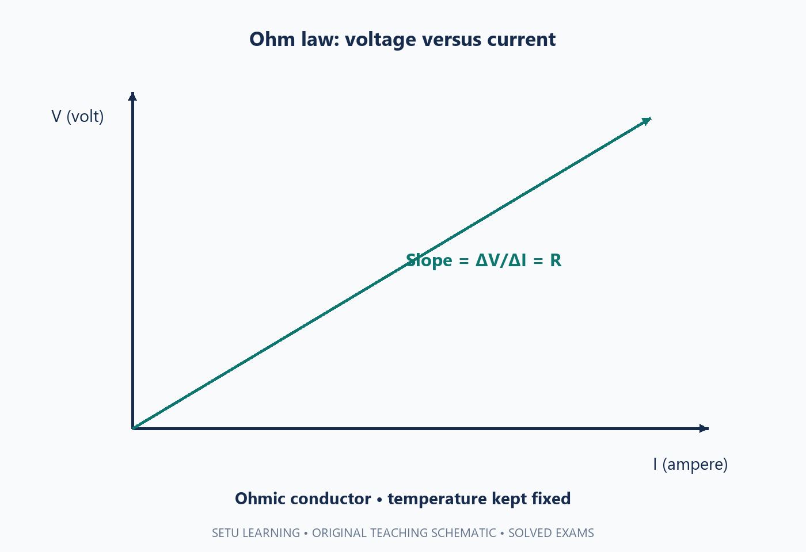

## 216. Headlight/rear-view mirror चयन।

**स्रोत:** 2019 मुख्य, प्रश्न 15(b), PDF पृष्ठ 5 · **अंक:** 2 अंक

**अध्याय-संबंध:** प्रकाश: परावर्तन तथा अपवर्तन

**हल:** School optics में headlight reflector concave, source near focus से roughly parallel beam देता है। Rear-view convex wide field तथा erect diminished virtual image देता है। Modern lamp designs अलग हो सकती हैं; उत्तर prescribed optical model का है।

[मूल प्रश्न देखें](https://rajeduboard.rajasthan.gov.in/books/PAPERS-2019/Sec/S-07-Science-E-H.pdf#page=5)

## 217. Carbon combustion और water splitting।

**स्रोत:** 2019 मुख्य, प्रश्न 17(a), PDF पृष्ठ 6 · **अंक:** 1 अंक

**अध्याय-संबंध:** रासायनिक अभिक्रियाएँ एवं समीकरण

**हल:** Combination: CaO + H₂O → Ca(OH)₂; अनेक reactants से एक मुख्य product। Decomposition: CaCO₃ → CaO + CO₂ (heat); एक compound कई products देता है। दोनों equations balanced रखें।

[मूल प्रश्न देखें](https://rajeduboard.rajasthan.gov.in/books/PAPERS-2019/Sec/S-07-Science-E-H.pdf#page=6)

## 218. दो reactions की तुलना।

**स्रोत:** 2019 मुख्य, प्रश्न 17(b), PDF पृष्ठ 6 · **अंक:** 1 अंक

**अध्याय-संबंध:** रासायनिक अभिक्रियाएँ एवं समीकरण

**हल:** Combination: CaO + H₂O → Ca(OH)₂; अनेक reactants से एक मुख्य product। Decomposition: CaCO₃ → CaO + CO₂ (heat); एक compound कई products देता है। दोनों equations balanced रखें।

[मूल प्रश्न देखें](https://rajeduboard.rajasthan.gov.in/books/PAPERS-2019/Sec/S-07-Science-E-H.pdf#page=6)

## 219. Marsh gas structure।

**स्रोत:** 2019 मुख्य, प्रश्न 20(b), PDF पृष्ठ 7 · **अंक:** 1 अंक

**अध्याय-संबंध:** कार्बन एवं उसके यौगिक

**हल:** Marsh gas methane CH₄ है। Structural diagram में central C से चार H single bonds लगाएँ; electron-dot form में चार shared pairs। इसे CH₃ radical या ethene न लिखें।

[मूल प्रश्न देखें](https://rajeduboard.rajasthan.gov.in/books/PAPERS-2019/Sec/S-07-Science-E-H.pdf#page=7)

## 220. Mendel dominance और उपयोगिता।

**स्रोत:** 2019 मुख्य, प्रश्न 23, PDF पृष्ठ 8 · **अंक:** 4 अंक

**अध्याय-संबंध:** आनुवंशिकता

**हल:** TT×tt से F₁ Tt सभी tall: heterozygote में T expressed, t hidden है। F₁ selfing में phenotype 3:1। Mendel rules trait transmission की predictions और recessive allele के फिर प्रकट होने को समझाते हैं। Dominant का अर्थ श्रेष्ठ नहीं।

[मूल प्रश्न देखें](https://rajeduboard.rajasthan.gov.in/books/PAPERS-2019/Sec/S-07-Science-E-H.pdf#page=8)

## 221. Milk of magnesia antacid क्यों?

**स्रोत:** 2019 मुख्य, प्रश्न 24(a)(i), PDF पृष्ठ 8 · **अंक:** 1 अंक

**अध्याय-संबंध:** अम्ल, क्षारक एवं लवण

**हल:** Milk of magnesia में magnesium hydroxide Mg(OH)₂ होता है। यह अतिरिक्त stomach acid neutralise करता है: Mg(OH)₂+2HCl→MgCl₂+2H₂O। यह chemical principle है, dose/self-treatment निर्देश नहीं।

[मूल प्रश्न देखें](https://rajeduboard.rajasthan.gov.in/books/PAPERS-2019/Sec/S-07-Science-E-H.pdf#page=8)

## 222. Excretion का अर्थ।

**स्रोत:** 2019 मुख्य, प्रश्न 28(a), प्रथम विकल्प, PDF पृष्ठ 9 · **अंक:** 1 अंक

**अध्याय-संबंध:** जैव प्रक्रम

**हल:** Metabolic wastes को body से हटाना excretion है, जैसे nitrogenous wastes urine में। Undigested food का removal egestion है; waste की उत्पत्ति दोनों में अलग है।

[मूल प्रश्न देखें](https://rajeduboard.rajasthan.gov.in/books/PAPERS-2019/Sec/S-07-Science-E-H.pdf#page=9)

## 2018 — मुख्य परीक्षा

[2018 मुख्य: पूरा आधिकारिक प्रश्न-पत्र](https://rajeduboard.rajasthan.gov.in/books/PAPERS-2018/Sec/S-07-Science-E-H.pdf)

## 223. Salivary gland का enzyme।

**स्रोत:** 2018 मुख्य, प्रश्न 1, PDF पृष्ठ 3 · **अंक:** 1 अंक

**अध्याय-संबंध:** जैव प्रक्रम

**हल:** Salivary amylase/ptyalin saliva में starch breakdown शुरू करता है। यह fat emulsification नहीं करता; fat पर bile और lipase-related processes अलग हैं।

[मूल प्रश्न देखें](https://rajeduboard.rajasthan.gov.in/books/PAPERS-2018/Sec/S-07-Science-E-H.pdf#page=3)

## 224. Alkyne general formula।

**स्रोत:** 2018 मुख्य, प्रश्न 3, PDF पृष्ठ 3 · **अंक:** 1 अंक

**अध्याय-संबंध:** कार्बन एवं उसके यौगिक

**हल:** एक triple bond वाले acyclic alkyne की general formula CₙH₂ₙ₋₂ है। Example ethyne C₂H₂; cyclic/multiple-unsaturation compounds पर formula बिना जाँच न लगाएँ।

[मूल प्रश्न देखें](https://rajeduboard.rajasthan.gov.in/books/PAPERS-2018/Sec/S-07-Science-E-H.pdf#page=3)

## 225. Equal-length wires का R–A graph।

**स्रोत:** 2018 मुख्य, प्रश्न 11, PDF पृष्ठ 4 · **अंक:** 1 अंक

**अध्याय-संबंध:** विद्युत

**हल:** Same material, length और temperature पर R=ρl/A, इसलिए R∝1/A। R vertical और A horizontal पर decreasing hyperbola; R बनाम 1/A plot linear है। Axes labels जरूरी हैं।

[मूल प्रश्न देखें](https://rajeduboard.rajasthan.gov.in/books/PAPERS-2018/Sec/S-07-Science-E-H.pdf#page=4)

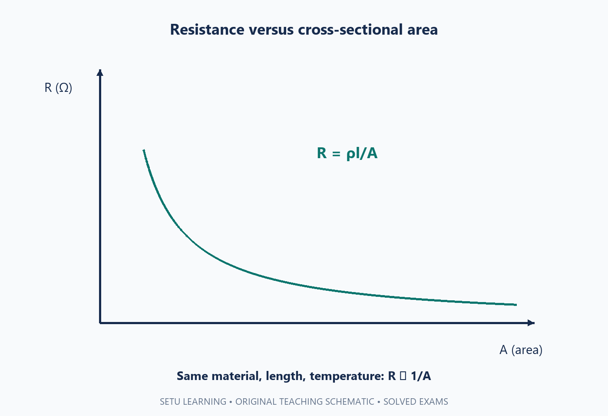

## 226. Thermal/electrical decomposition अंतर।

**स्रोत:** 2018 मुख्य, प्रश्न 17(b), PDF पृष्ठ 5 · **अंक:** 1 अंक

**अध्याय-संबंध:** रासायनिक अभिक्रियाएँ एवं समीकरण

**हल:** Thermolysis heat से decomposition, जैसे CaCO₃→CaO+CO₂। Electrolysis electrical energy से decomposition, जैसे 2H₂O→2H₂+O₂। Energy source तथा उदाहरण तुलना-बिंदु हैं।

[मूल प्रश्न देखें](https://rajeduboard.rajasthan.gov.in/books/PAPERS-2018/Sec/S-07-Science-E-H.pdf#page=5)

## 227. Waste तथा management के उपाय।

**स्रोत:** 2018 मुख्य, प्रश्न 21, PDF पृष्ठ 6 · **अंक:** 3 अंक

**अध्याय-संबंध:** हमारा पर्यावरण

**हल:** Discarded unwanted material waste है। Source segregation, reduce/reuse और suitable recycling/composting useful methods हैं। E-waste/batteries organic compost में न मिलाएँ।

[मूल प्रश्न देखें](https://rajeduboard.rajasthan.gov.in/books/PAPERS-2018/Sec/S-07-Science-E-H.pdf#page=6)

## 228. F₁ × dominant parent के ratios।

**स्रोत:** 2018 मुख्य, प्रश्न 23, cross भाग, PDF पृष्ठ 7 · **अंक:** 3 अंक

**अध्याय-संबंध:** आनुवंशिकता

**हल:** Monohybrid complete-dominance model में F₁ Tt × homozygous dominant TT से TT तथा Tt 1:1 genotype ratio। दोनों tall, इसलिए phenotype सभी dominant (1:0)। Reciprocal cross में sexes की parental roles interchange होती हैं; वह backcross का synonym नहीं।

[मूल प्रश्न देखें](https://rajeduboard.rajasthan.gov.in/books/PAPERS-2018/Sec/S-07-Science-E-H.pdf#page=7)

## 229. Bleaching powder formula।

**स्रोत:** 2018 मुख्य, प्रश्न 24(a), formula भाग, PDF पृष्ठ 7 · **अंक:** अलग अंक सत्यापित नहीं

**अध्याय-संबंध:** अम्ल, क्षारक एवं लवण

**हल:** Bleaching powder का school formula CaOCl₂; water disinfection/bleaching में उपयोग। POP CaSO₄·½H₂O, plaster/moulds के लिए; water जोड़कर gypsum CaSO₄·2H₂O बनकर जमता है।

[मूल प्रश्न देखें](https://rajeduboard.rajasthan.gov.in/books/PAPERS-2018/Sec/S-07-Science-E-H.pdf#page=7)

## 230. Respiration की परिभाषा।

**स्रोत:** 2018 मुख्य, प्रश्न 28(a), प्रथम विकल्प, PDF पृष्ठ 9 · **अंक:** 1 अंक

**अध्याय-संबंध:** जैव प्रक्रम

**हल:** Cellular respiration food का breakdown करके usable energy release करने की प्रक्रिया है। Cytoplasm में glucose से pyruvate; aerobic mitochondrial route CO₂/water देता है। Yeast anaerobic route ethanol/CO₂ तथा oxygen-deficit muscles lactate दे सकते हैं।

[मूल प्रश्न देखें](https://rajeduboard.rajasthan.gov.in/books/PAPERS-2018/Sec/S-07-Science-E-H.pdf#page=9)

## 231. Female primary sex organ।

**स्रोत:** 2018 मुख्य, प्रश्न 28(a), दूसरा विकल्प, PDF पृष्ठ 10 · **अंक:** 1 अंक

**अध्याय-संबंध:** जीव जनन कैसे करते हैं?

**हल:** Female primary reproductive organs ovaries हैं; ova तथा reproductive hormones बनाती हैं। Oviduct transport/fertilisation और uterus implantation/development से जुड़े हैं।

[मूल प्रश्न देखें](https://rajeduboard.rajasthan.gov.in/books/PAPERS-2018/Sec/S-07-Science-E-H.pdf#page=10)

## 232. kWh को joules में।

**स्रोत:** 2018 मुख्य, प्रश्न 4, PDF पृष्ठ 3 · **अंक:** 1 अंक

**अध्याय-संबंध:** विद्युत

**हल:** 1 kWh=3.6×10⁶ J और यह electric energy की unit है। kW power, kWh energy; 1 hour=3600 seconds।

[मूल प्रश्न देखें](https://rajeduboard.rajasthan.gov.in/books/PAPERS-2018/Sec/S-07-Science-E-H.pdf#page=3)

## 233. दो V–I readings से R।

**स्रोत:** 2018 मुख्य, प्रश्न 25(a), PDF पृष्ठ 8 · **अंक:** 2 अंक

**अध्याय-संबंध:** विद्युत

**हल:** दो readings: R=2/0.50=4 Ω और R=3/0.75=4 Ω। Constant V/I ohmic relation का support है, assuming temperature stable।

[मूल प्रश्न देखें](https://rajeduboard.rajasthan.gov.in/books/PAPERS-2018/Sec/S-07-Science-E-H.pdf#page=8)

## 234. 12 V,25 Ω,15 min: heat।

**स्रोत:** 2018 मुख्य, प्रश्न 25(b), PDF पृष्ठ 8 · **अंक:** 2 अंक

**अध्याय-संबंध:** विद्युत

**हल:** V=12 V,R=25 Ω,t=15 min=900 s। H=V²t/R=144×900/25=5184 J। I=0.48 A लेकर I²Rt से भी यही result।

[मूल प्रश्न देखें](https://rajeduboard.rajasthan.gov.in/books/PAPERS-2018/Sec/S-07-Science-E-H.pdf#page=8)

## 235. 40 kg,1→2 m/s: work।

**स्रोत:** 2018 मुख्य, प्रश्न 26(a), PDF पृष्ठ 9 · **अंक:** 2 अंक

**अध्याय-संबंध:** पुराना पाठ्यक्रम / enrichment: वर्तमान core से बाहर

**पुराना पाठ्यक्रम:** **हल:** पुराने mechanics पाठ्यक्रम: W=ΔK=½m(v²−u²)=½×40×(4−1)=60 J। यह current 13-chapter core का topic नहीं; historical practice label रखें।

[मूल प्रश्न देखें](https://rajeduboard.rajasthan.gov.in/books/PAPERS-2018/Sec/S-07-Science-E-H.pdf#page=9)

## 236. k=4000, x=2 cm: energy।

**स्रोत:** 2018 मुख्य, प्रश्न 26(b), PDF पृष्ठ 9 · **अंक:** 2 अंक

**अध्याय-संबंध:** पुराना पाठ्यक्रम / enrichment: वर्तमान core से बाहर

**पुराना पाठ्यक्रम:** **हल:** पुराना mechanics: x=2 cm=0.02 m। E=½kx²=½×4000×0.02²=0.8 J। Centimetre को metre में convert करना जरूरी है।

[मूल प्रश्न देखें](https://rajeduboard.rajasthan.gov.in/books/PAPERS-2018/Sec/S-07-Science-E-H.pdf#page=9)

## 2018 — पूरक परीक्षा

[2018 पूरक: पूरा आधिकारिक प्रश्न-पत्र](https://rajeduboard.rajasthan.gov.in/books/PAPERS-2018/SUPP/Sec/S-07-Science.pdf)

## 237. Bar magnet field की दिशा।

**स्रोत:** 2018 पूरक, प्रश्न 11, PDF पृष्ठ 4 · **अंक:** 1 अंक

**अध्याय-संबंध:** विद्युत धारा के चुंबकीय प्रभाव

**हल:** Bar magnet के भीतर field lines south→north, बाहर north→south हैं; मिलकर closed loops बनती हैं।

[मूल प्रश्न देखें](https://rajeduboard.rajasthan.gov.in/books/PAPERS-2018/SUPP/Sec/S-07-Science.pdf#page=4)

चित्र सहायता: इसी अध्याय में इस अवधारणा का पहले दिया नामांकित schematic देखें।

## 238. Vehicle mirror selection।

**स्रोत:** 2018 पूरक, प्रश्न 15(b), PDF पृष्ठ 5 · **अंक:** 1 अंक

**अध्याय-संबंध:** प्रकाश: परावर्तन तथा अपवर्तन

**हल:** Convex mirror wide field of view तथा erect, diminished virtual image देता है। इसलिए vehicle rear-view में useful है; concave magnified-image case से अलग रखें।

[मूल प्रश्न देखें](https://rajeduboard.rajasthan.gov.in/books/PAPERS-2018/SUPP/Sec/S-07-Science.pdf#page=5)

## 239. Displacement का उदाहरण।

**स्रोत:** 2018 पूरक, प्रश्न 17(a), PDF पृष्ठ 5 · **अंक:** 1 अंक

**अध्याय-संबंध:** रासायनिक अभिक्रियाएँ एवं समीकरण

**हल:** अधिक active element कम active को compound से हटाता है। Zn + CuSO₄ → ZnSO₄ + Cu उदाहरण है; zinc copper से अधिक active है।

[मूल प्रश्न देखें](https://rajeduboard.rajasthan.gov.in/books/PAPERS-2018/SUPP/Sec/S-07-Science.pdf#page=5)

## 240. Neutralisation का example।

**स्रोत:** 2018 पूरक, प्रश्न 17(b), PDF पृष्ठ 5 · **अंक:** 1 अंक

**अध्याय-संबंध:** अम्ल, क्षारक एवं लवण

**हल:** Acid और base से salt और सामान्यतः water बनना neutralisation है। HCl+NaOH→NaCl+H₂O balanced example है।

[मूल प्रश्न देखें](https://rajeduboard.rajasthan.gov.in/books/PAPERS-2018/SUPP/Sec/S-07-Science.pdf#page=5)

## 241. Redox का example।

**स्रोत:** 2018 पूरक, प्रश्न 17(c), PDF पृष्ठ 5 · **अंक:** 1 अंक

**अध्याय-संबंध:** रासायनिक अभिक्रियाएँ एवं समीकरण

**हल:** CuO + H₂ → Cu + H₂O में H₂ oxygen पाकर oxidised, CuO oxygen खोकर reduced है। Oxidation तथा reduction एक साथ होना redox है; दूसरा उदाहरण ZnO + C → Zn + CO है।

[मूल प्रश्न देखें](https://rajeduboard.rajasthan.gov.in/books/PAPERS-2018/SUPP/Sec/S-07-Science.pdf#page=5)

## 242. Biodegradable waste का अर्थ।

**स्रोत:** 2018 पूरक, प्रश्न 21, परिभाषा भाग, PDF पृष्ठ 7 · **अंक:** 1 अंक

**अध्याय-संबंध:** हमारा पर्यावरण

**हल:** Biological processes द्वारा breakdown होने वाले substances biodegradable हैं। Suitable conditions/समय चाहिए; biodegradable का अर्थ तत्काल harmless नहीं।

[मूल प्रश्न देखें](https://rajeduboard.rajasthan.gov.in/books/PAPERS-2018/SUPP/Sec/S-07-Science.pdf#page=7)

## 243. Dominance उदाहरण।

**स्रोत:** 2018 पूरक, प्रश्न 23, dominance भाग, PDF पृष्ठ 7 · **अंक:** 2 अंक

**अध्याय-संबंध:** आनुवंशिकता

**हल:** TT×tt से F₁ Tt सभी tall: heterozygote में T expressed, t hidden है। F₁ selfing में phenotype 3:1। Mendel rules trait transmission की predictions और recessive allele के फिर प्रकट होने को समझाते हैं। Dominant का अर्थ श्रेष्ठ नहीं।

[मूल प्रश्न देखें](https://rajeduboard.rajasthan.gov.in/books/PAPERS-2018/SUPP/Sec/S-07-Science.pdf#page=7)

## 244. Arrhenius acid/base examples।

**स्रोत:** 2018 पूरक, प्रश्न 24(a), PDF पृष्ठ 7 · **अंक:** 2 अंक

**अध्याय-संबंध:** अम्ल, क्षारक एवं लवण

**हल:** Arrhenius acid aqueous H⁺/H₃O⁺ बढ़ाता है, जैसे HCl; base OH⁻ बढ़ाता है, जैसे NaOH। NaOH+HCl→NaCl+H₂O neutralisation है। सभी hydrogen compounds aqueous acids नहीं।

[मूल प्रश्न देखें](https://rajeduboard.rajasthan.gov.in/books/PAPERS-2018/SUPP/Sec/S-07-Science.pdf#page=7)

## 245. CH₂=CH–CH₃ का नाम।

**स्रोत:** 2018 पूरक, प्रश्न 20(b), PDF पृष्ठ 6 · **अंक:** 1 अंक

**अध्याय-संबंध:** कार्बन एवं उसके यौगिक

**हल:** CH₃–CH=CH₂ अथवा CH₂=CH–CH₃ का IUPAC नाम propene है। तीन carbon, one double bond; suffix -ene।

[मूल प्रश्न देखें](https://rajeduboard.rajasthan.gov.in/books/PAPERS-2018/SUPP/Sec/S-07-Science.pdf#page=6)

## 246. 4 mA,0.05 s: charge।

**स्रोत:** 2018 पूरक, प्रश्न 25(b), PDF पृष्ठ 8 · **अंक:** 2 अंक

**अध्याय-संबंध:** विद्युत

**हल:** 4 mA=0.004 A,t=0.05 s। Q=It=0.0002 C=2×10⁻⁴ C। Milli-prefix तथा decimal दोनों सही convert करें।

[मूल प्रश्न देखें](https://rajeduboard.rajasthan.gov.in/books/PAPERS-2018/SUPP/Sec/S-07-Science.pdf#page=8)

## 2017 — मुख्य परीक्षा

[2017 मुख्य: पूरा आधिकारिक प्रश्न-पत्र](https://rajeduboard.rajasthan.gov.in/books/PAPERS-2017/Sec/S-07-Science-E-H.pdf)

## 247. Iron rust के दो बचाव।

**स्रोत:** 2017 मुख्य, प्रश्न 1, PDF पृष्ठ 2 · **अंक:** 1 अंक

**अध्याय-संबंध:** धातु एवं अधातु

**हल:** Painting और galvanising iron को moisture/oxygen से बचाते हैं। Zinc coating sacrificial protection भी दे सकती है; iron का corrosion नमी तथा oxygen से जुड़ा है।

[मूल प्रश्न देखें](https://rajeduboard.rajasthan.gov.in/books/PAPERS-2017/Sec/S-07-Science-E-H.pdf#page=2)

## 248. Mg combustion product।

**स्रोत:** 2017 मुख्य, प्रश्न 2, PDF पृष्ठ 2 · **अंक:** 1 अंक

**अध्याय-संबंध:** रासायनिक अभिक्रियाएँ एवं समीकरण

**हल:** 2Mg + O₂ → 2MgO। Product magnesium oxide है, combination reaction का उदाहरण। Mg और O दोनों sides पर 2 atoms हैं।

[मूल प्रश्न देखें](https://rajeduboard.rajasthan.gov.in/books/PAPERS-2017/Sec/S-07-Science-E-H.pdf#page=2)

## 249. Normal adult near point।

**स्रोत:** 2017 मुख्य, प्रश्न 6, PDF पृष्ठ 3 · **अंक:** 1 अंक

**अध्याय-संबंध:** मानव नेत्र तथा रंगबिरंगा संसार

**हल:** Normal young-adult school model में least distance of distinct vision लगभग 25 cm है। यह typical approximation है, हर individual का fixed measured near point नहीं।

[मूल प्रश्न देखें](https://rajeduboard.rajasthan.gov.in/books/PAPERS-2017/Sec/S-07-Science-E-H.pdf#page=3)

## 250. Roasting–calcination अंतर।

**स्रोत:** 2017 मुख्य, प्रश्न 9, PDF पृष्ठ 4 · **अंक:** 2 अंक

**अध्याय-संबंध:** धातु एवं अधातु

**हल:** Calcination में carbonate ore limited/no air पर oxide+CO₂ देता है। Roasting में sulfide ore excess air से oxide और SO₂ देता है। ZnCO₃ → ZnO+CO₂; 2ZnS+3O₂ → 2ZnO+2SO₂।

[मूल प्रश्न देखें](https://rajeduboard.rajasthan.gov.in/books/PAPERS-2017/Sec/S-07-Science-E-H.pdf#page=4)

## 251. Tall/round cross, F₂ ratio।

**स्रोत:** 2017 मुख्य, प्रश्न 11, PDF पृष्ठ 4 · **अंक:** 2 अंक

**अध्याय-संबंध:** आनुवंशिकता

**हल:** Independent assortment और complete dominance के model में pure dominant × pure recessive से F₁ दोनों dominant traits वाला heterozygote है। F₁ selfing से expected F₂ phenotypes 9:3:3:1। यह universal genetic ratio नहीं।

[मूल प्रश्न देखें](https://rajeduboard.rajasthan.gov.in/books/PAPERS-2017/Sec/S-07-Science-E-H.pdf#page=4)

## 252. Human sex-determination आधार।

**स्रोत:** 2017 मुख्य, प्रश्न 12, PDF पृष्ठ 5 · **अंक:** 2 अंक

**अध्याय-संबंध:** आनुवंशिकता

**हल:** XX–XY school model में egg X और sperm X या Y देता है। X+X → XX, X+Y → XY; expected probability लगभग बराबर। Mother को outcome के लिए दोष देने का scientific आधार नहीं।

[मूल प्रश्न देखें](https://rajeduboard.rajasthan.gov.in/books/PAPERS-2017/Sec/S-07-Science-E-H.pdf#page=5)

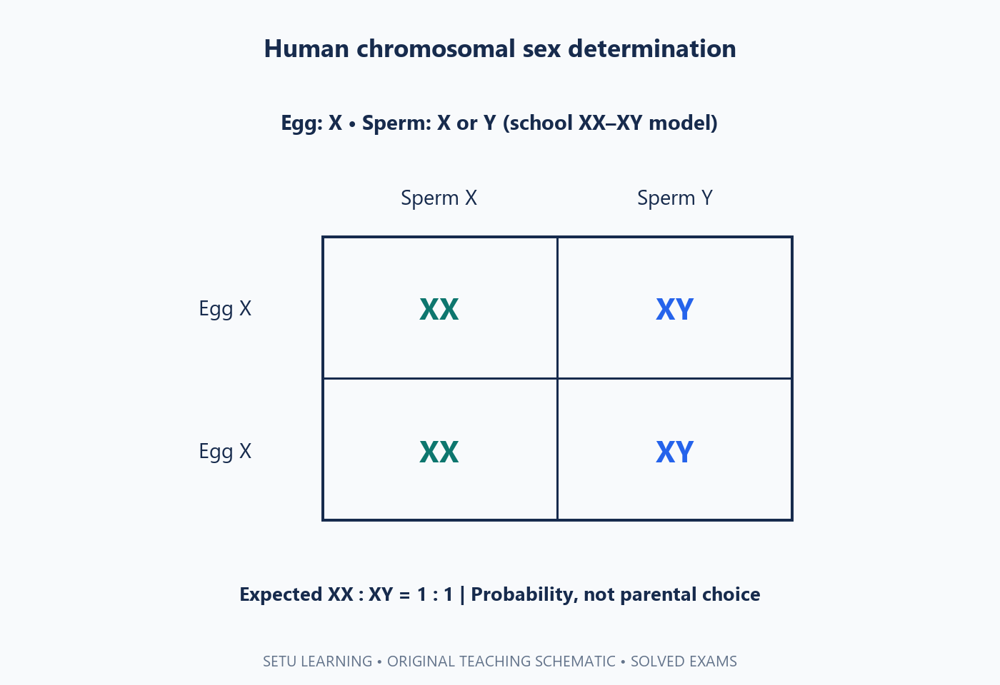

## 253. Vehicle rear-view mirror।

**स्रोत:** 2017 मुख्य, प्रश्न 13(a), PDF पृष्ठ 5 · **अंक:** 1 अंक

**अध्याय-संबंध:** प्रकाश: परावर्तन तथा अपवर्तन

**हल:** Convex mirror wide field of view तथा erect, diminished virtual image देता है। इसलिए vehicle rear-view में useful है; concave magnified-image case से अलग रखें।

[मूल प्रश्न देखें](https://rajeduboard.rajasthan.gov.in/books/PAPERS-2017/Sec/S-07-Science-E-H.pdf#page=5)

## 254. Household parallel का कारण।

**स्रोत:** 2017 मुख्य, प्रश्न 14, PDF पृष्ठ 5 · **अंक:** 2 अंक

**अध्याय-संबंध:** विद्युत

**हल:** Parallel branches पर समान supply voltage और independent switching मिलता है। एक appliance बंद/खराब होने पर अन्य branches चल सकती हैं। Series circuit में voltage sharing और common current होता है।

[मूल प्रश्न देखें](https://rajeduboard.rajasthan.gov.in/books/PAPERS-2017/Sec/S-07-Science-E-H.pdf#page=5)

## 255. Fat food oxidation रोकना।

**स्रोत:** 2017 मुख्य, प्रश्न 15(a), PDF पृष्ठ 5 · **अंक:** 1.5 अंक

**अध्याय-संबंध:** रासायनिक अभिक्रियाएँ एवं समीकरण

**हल:** Fat oxidation rancidity देती है। Airtight packs/nitrogen flushing oxygen exposure घटाते; refrigeration rate घटाती है। Rancid food को गरम करना हर hazard को खत्म करने की गारंटी नहीं।

[मूल प्रश्न देखें](https://rajeduboard.rajasthan.gov.in/books/PAPERS-2017/Sec/S-07-Science-E-H.pdf#page=5)

## 256. CuO–H₂ में oxidation/reduction।

**स्रोत:** 2017 मुख्य, प्रश्न 15(b), PDF पृष्ठ 5 · **अंक:** 1.5 अंक

**अध्याय-संबंध:** रासायनिक अभिक्रियाएँ एवं समीकरण

**हल:** CuO + H₂ → Cu + H₂O में H₂ oxygen पाकर oxidised, CuO oxygen खोकर reduced है। Oxidation तथा reduction एक साथ होना redox है; दूसरा उदाहरण ZnO + C → Zn + CO है।

[मूल प्रश्न देखें](https://rajeduboard.rajasthan.gov.in/books/PAPERS-2017/Sec/S-07-Science-E-H.pdf#page=5)

## 257. दो metal properties।

**स्रोत:** 2017 मुख्य, प्रश्न 17(a), PDF पृष्ठ 6 · **अंक:** 1 अंक

**अध्याय-संबंध:** धातु एवं अधातु

**हल:** Metals सामान्यतः lustrous, malleable, ductile तथा good conductors हैं। Sodium नरम और mercury liquid exceptions हैं। General property को ‘सभी’ के absolute statement में न बदलें।

[मूल प्रश्न देखें](https://rajeduboard.rajasthan.gov.in/books/PAPERS-2017/Sec/S-07-Science-E-H.pdf#page=6)

## 258. Alloy definition और examples।

**स्रोत:** 2017 मुख्य, प्रश्न 17(b), PDF पृष्ठ 6 · **अंक:** 1 अंक

**अध्याय-संबंध:** धातु एवं अधातु

**हल:** Alloy metal का दूसरे metal/nonmetal के साथ mixture है। Brass Cu–Zn, bronze Cu–Sn; composition से hardness, corrosion resistance आदि बदलते हैं।

[मूल प्रश्न देखें](https://rajeduboard.rajasthan.gov.in/books/PAPERS-2017/Sec/S-07-Science-E-H.pdf#page=6)

## 259. Metal/nonmetal oxides की प्रकृति।

**स्रोत:** 2017 मुख्य, प्रश्न 17(c), PDF पृष्ठ 6 · **अंक:** 1 अंक

**अध्याय-संबंध:** धातु एवं अधातु

**हल:** Metal oxides सामान्यतः basic, nonmetal oxides सामान्यतः acidic। Al₂O₃/ZnO amphoteric और CO जैसे neutral oxides exceptions हैं।

[मूल प्रश्न देखें](https://rajeduboard.rajasthan.gov.in/books/PAPERS-2017/Sec/S-07-Science-E-H.pdf#page=6)

## 260. Digestion में enzymes।

**स्रोत:** 2017 मुख्य, प्रश्न 18(a), PDF पृष्ठ 6 · **अंक:** 2 अंक

**अध्याय-संबंध:** जैव प्रक्रम

**हल:** Salivary amylase starch breakdown, stomach pepsin protein digestion और pancreatic/intestinal enzymes आगे digestion करते हैं। Lipase fat breakdown करता है; bile emulsification करता है लेकिन enzyme नहीं। Enzymes reaction-specific biological catalysts हैं।

[मूल प्रश्न देखें](https://rajeduboard.rajasthan.gov.in/books/PAPERS-2017/Sec/S-07-Science-E-H.pdf#page=6)

## 261. Pancreatic hormone और deficiency।

**स्रोत:** 2017 मुख्य, प्रश्न 19, PDF पृष्ठ 7 · **अंक:** 3 अंक

**अध्याय-संबंध:** नियंत्रण एवं समन्वय

**हल:** Pancreas insulin देता है; blood glucose regulation तथा uptake/storage में सहायता करता है। इसकी deficiency diabetes mellitus से जुड़ सकती है। सभी diabetes के cases केवल पूर्ण insulin absence से नहीं होते।

[मूल प्रश्न देखें](https://rajeduboard.rajasthan.gov.in/books/PAPERS-2017/Sec/S-07-Science-E-H.pdf#page=7)

## 262. Placenta damage का प्रभाव।

**स्रोत:** 2017 मुख्य, प्रश्न 21, PDF पृष्ठ 7 · **अंक:** 3 अंक

**अध्याय-संबंध:** जीव जनन कैसे करते हैं?

**हल:** Placenta maternal–fetal exchange interface है: oxygen/nutrients fetus को तथा metabolic wastes maternal side को transfer होते हैं। दोनों blood systems सामान्यतः सीधे common pool में नहीं मिलते। Damage से fetal nutrition/oxygen supply प्रभावित हो सकती है।

[मूल प्रश्न देखें](https://rajeduboard.rajasthan.gov.in/books/PAPERS-2017/Sec/S-07-Science-E-H.pdf#page=7)

## 263. Near-object defect और correction।

**स्रोत:** 2017 मुख्य, प्रश्न 22(a), PDF पृष्ठ 7 · **अंक:** 2 अंक

**अध्याय-संबंध:** मानव नेत्र तथा रंगबिरंगा संसार

**हल:** Myopia: दूर वस्तु की image retina के आगे; correction concave lens। Hypermetropia: near-object focus retina के पीछे की tendency; correction convex lens। Diagrams में retina और corrected focus label करें।

[मूल प्रश्न देखें](https://rajeduboard.rajasthan.gov.in/books/PAPERS-2017/Sec/S-07-Science-E-H.pdf#page=7)

## 264. Tyndall mechanism।

**स्रोत:** 2017 मुख्य, प्रश्न 22(b), PDF पृष्ठ 7 · **अंक:** 1 अंक

**अध्याय-संबंध:** मानव नेत्र तथा रंगबिरंगा संसार

**हल:** Colloidal/suitable small particles light scatter करके beam path visible करते हैं: Tyndall effect। Clear blue sky molecular scattering और star twinkling atmospheric refraction से जुड़े हैं।

[मूल प्रश्न देखें](https://rajeduboard.rajasthan.gov.in/books/PAPERS-2017/Sec/S-07-Science-E-H.pdf#page=7)

## 265. Ohm statement।

**स्रोत:** 2017 मुख्य, प्रश्न 23, नियम भाग, PDF पृष्ठ 8 · **अंक:** 1 अंक

**अध्याय-संबंध:** विद्युत

**हल:** स्थिर temperature/physical conditions में V ∝ I, इसलिए V=IR। Low-voltage circuit में ammeter series, voltmeter resistor के parallel; कई V,I readings में V/I लगभग constant और V-vertical/I-horizontal graph straight line होता है।

[मूल प्रश्न देखें](https://rajeduboard.rajasthan.gov.in/books/PAPERS-2017/Sec/S-07-Science-E-H.pdf#page=8)

चित्र सहायता: इसी अध्याय में इस अवधारणा का पहले दिया नामांकित schematic देखें।

## 266. Dilution का सुरक्षित क्रम क्यों?

**स्रोत:** 2017 मुख्य, प्रश्न 25(ii), PDF पृष्ठ 8 · **अंक:** 2 अंक

**अध्याय-संबंध:** अम्ल, क्षारक एवं लवण

**हल:** Acid dilution heat release कर सकता है। Acid धीरे large water volume में डालने से heat dissipation बेहतर और splashing कम; water को concentrated acid में अचानक न डालें।

[मूल प्रश्न देखें](https://rajeduboard.rajasthan.gov.in/books/PAPERS-2017/Sec/S-07-Science-E-H.pdf#page=8)

## 267. Chlor-alkali process।

**स्रोत:** 2017 मुख्य, प्रश्न 25(iv), PDF पृष्ठ 8 · **अंक:** 1 अंक

**अध्याय-संबंध:** अम्ल, क्षारक एवं लवण

**हल:** Brine electrolysis: 2NaCl+2H₂O → 2NaOH+Cl₂+H₂। Anode पर Cl₂, cathode पर H₂ और solution में NaOH; products को अलग रखें।

[मूल प्रश्न देखें](https://rajeduboard.rajasthan.gov.in/books/PAPERS-2017/Sec/S-07-Science-E-H.pdf#page=8)

## 268. Field-line representation के गुण।

**स्रोत:** 2017 मुख्य, प्रश्न 27(b), PDF पृष्ठ 9 · **अंक:** 2 अंक

**अध्याय-संबंध:** विद्युत धारा के चुंबकीय प्रभाव

**हल:** Field lines closed loops: बाहर N→S, अंदर S→N। Tangent local direction, close spacing stronger field; lines intersect नहीं करतीं। Diagram arrows और poles दोनों label करें।

[मूल प्रश्न देखें](https://rajeduboard.rajasthan.gov.in/books/PAPERS-2017/Sec/S-07-Science-E-H.pdf#page=9)

चित्र सहायता: इसी अध्याय में इस अवधारणा का पहले दिया नामांकित schematic देखें।

## 269. 220 V, 0.5 A: power।

**स्रोत:** 2017 मुख्य, प्रश्न 13(b), PDF पृष्ठ 5 · **अंक:** 1 अंक

**अध्याय-संबंध:** विद्युत

**हल:** V=220 V,I=0.5 A। P=VI=110 W। यदि resistance भी चाहिए तो R=V/I=440 Ω।

[मूल प्रश्न देखें](https://rajeduboard.rajasthan.gov.in/books/PAPERS-2017/Sec/S-07-Science-E-H.pdf#page=5)

## 270. 1 A, 30 s: charge।

**स्रोत:** 2017 मुख्य, प्रश्न 24, PDF पृष्ठ 8 · **अंक:** 3 अंक

**अध्याय-संबंध:** विद्युत

**हल:** I=1 A,t=30 s। Q=It=30 C। Current प्रति second charge flow है; I तथा Q अलग quantities हैं।

[मूल प्रश्न देखें](https://rajeduboard.rajasthan.gov.in/books/PAPERS-2017/Sec/S-07-Science-E-H.pdf#page=8)

## 271. f=0.5 m: lens power।

**स्रोत:** 2017 मुख्य, प्रश्न 30, प्रथम विकल्प अंतिम भाग, PDF पृष्ठ 11 · **अंक:** 1 अंक

**अध्याय-संबंध:** प्रकाश: परावर्तन तथा अपवर्तन

**हल:** f=0.5 m। P=1/f=2 D; given positive focal length school model में +2 D। यदि lens type/sign न दी हो तो power sign के लिए convention स्पष्ट करें।

[मूल प्रश्न देखें](https://rajeduboard.rajasthan.gov.in/books/PAPERS-2017/Sec/S-07-Science-E-H.pdf#page=11)

## 272. n=1.5: light speed।

**स्रोत:** 2017 मुख्य, प्रश्न 30, दूसरे विकल्प अंतिम भाग, PDF पृष्ठ 11 · **अंक:** 1 अंक

**अध्याय-संबंध:** प्रकाश: परावर्तन तथा अपवर्तन

**हल:** n=1.5,c=3×10⁸ m/s। v=c/n=2×10⁸ m/s। Refractive index dimensionless और speed की unit m/s है।

[मूल प्रश्न देखें](https://rajeduboard.rajasthan.gov.in/books/PAPERS-2017/Sec/S-07-Science-E-H.pdf#page=11)

## 2017 — विशेष पूरक परीक्षा

[2017 विशेष पूरक: पूरा आधिकारिक प्रश्न-पत्र](https://rajeduboard.rajasthan.gov.in/books/PAPERS-2017/SUPP/Sec/S-07-Science.pdf)

## 273. Copper–zinc alloy।

**स्रोत:** 2017 विशेष पूरक, प्रश्न 1, PDF पृष्ठ 2 · **अंक:** 1 अंक

**अध्याय-संबंध:** धातु एवं अधातु

**हल:** Brass copper और zinc की alloy है। Bronze copper–tin है; इन दोनों मिश्रधातुओं के घटक अलग हैं।

[मूल प्रश्न देखें](https://rajeduboard.rajasthan.gov.in/books/PAPERS-2017/SUPP/Sec/S-07-Science.pdf#page=2)

## 274. दो metal गुण।

**स्रोत:** 2017 विशेष पूरक, प्रश्न 4, PDF पृष्ठ 3 · **अंक:** 1 अंक

**अध्याय-संबंध:** धातु एवं अधातु

**हल:** Metals सामान्यतः lustrous, malleable, ductile तथा good conductors हैं। Sodium नरम और mercury liquid exceptions हैं। General property को ‘सभी’ के absolute statement में न बदलें।

[मूल प्रश्न देखें](https://rajeduboard.rajasthan.gov.in/books/PAPERS-2017/SUPP/Sec/S-07-Science.pdf#page=3)

## 275. Bisexual flower का अर्थ।

**स्रोत:** 2017 विशेष पूरक, प्रश्न 5, PDF पृष्ठ 3 · **अंक:** 1 अंक

**अध्याय-संबंध:** जीव जनन कैसे करते हैं?

**हल:** जिस flower में stamen और pistil दोनों हों, वह bisexual flower है। Hibiscus और mustard standard examples हैं; bisexual होना self-pollination की guarantee नहीं।

[मूल प्रश्न देखें](https://rajeduboard.rajasthan.gov.in/books/PAPERS-2017/SUPP/Sec/S-07-Science.pdf#page=3)

## 276. White light dispersion।

**स्रोत:** 2017 विशेष पूरक, प्रश्न 6, PDF पृष्ठ 3 · **अंक:** 1 अंक

**अध्याय-संबंध:** मानव नेत्र तथा रंगबिरंगा संसार

**हल:** White light का constituent wavelengths/colours में separation dispersion है। Prism का refractive index wavelength-dependent होने से colours अलग deviate करते हैं; ordinary glass में violet अधिक, red कम deviates है।

[मूल प्रश्न देखें](https://rajeduboard.rajasthan.gov.in/books/PAPERS-2017/SUPP/Sec/S-07-Science.pdf#page=3)

चित्र सहायता: इसी अध्याय में इस अवधारणा का पहले दिया नामांकित schematic देखें।

## 277. P–f संबंध।

**स्रोत:** 2017 विशेष पूरक, प्रश्न 7, PDF पृष्ठ 3 · **अंक:** 1 अंक

**अध्याय-संबंध:** प्रकाश: परावर्तन तथा अपवर्तन

**हल:** Lens power P=1/f है, f metre में; unit dioptre। Convex/converging lens positive, concave/diverging lens negative power रखता है। Centimetre में f का reciprocal सीधे dioptres नहीं देता।

[मूल प्रश्न देखें](https://rajeduboard.rajasthan.gov.in/books/PAPERS-2017/SUPP/Sec/S-07-Science.pdf#page=3)

## 278. Bleaching powder और POP उपयोग।

**स्रोत:** 2017 विशेष पूरक, प्रश्न 9, PDF पृष्ठ 4 · **अंक:** 2 अंक

**अध्याय-संबंध:** अम्ल, क्षारक एवं लवण

**हल:** Bleaching powder का school formula CaOCl₂; water disinfection/bleaching में उपयोग। POP CaSO₄·½H₂O, plaster/moulds के लिए; water जोड़कर gypsum CaSO₄·2H₂O बनकर जमता है।

[मूल प्रश्न देखें](https://rajeduboard.rajasthan.gov.in/books/PAPERS-2017/SUPP/Sec/S-07-Science.pdf#page=4)

## 279. Rear-view mirror।

**स्रोत:** 2017 विशेष पूरक, प्रश्न 13(a), PDF पृष्ठ 5 · **अंक:** 1 अंक

**अध्याय-संबंध:** प्रकाश: परावर्तन तथा अपवर्तन

**हल:** Convex mirror wide field of view तथा erect, diminished virtual image देता है। इसलिए vehicle rear-view में useful है; concave magnified-image case से अलग रखें।

[मूल प्रश्न देखें](https://rajeduboard.rajasthan.gov.in/books/PAPERS-2017/SUPP/Sec/S-07-Science.pdf#page=5)

## 280. Bar-magnet lines के गुण।

**स्रोत:** 2017 विशेष पूरक, प्रश्न 14, PDF पृष्ठ 5 · **अंक:** 2 अंक

**अध्याय-संबंध:** विद्युत धारा के चुंबकीय प्रभाव

**हल:** Field lines closed loops: बाहर N→S, अंदर S→N। Tangent local direction, close spacing stronger field; lines intersect नहीं करतीं। Diagram arrows और poles दोनों label करें।

[मूल प्रश्न देखें](https://rajeduboard.rajasthan.gov.in/books/PAPERS-2017/SUPP/Sec/S-07-Science.pdf#page=5)

चित्र सहायता: इसी अध्याय में इस अवधारणा का पहले दिया नामांकित schematic देखें।

## 281. Strong/weak acid का आधार।

**स्रोत:** 2017 विशेष पूरक, प्रश्न 15(b), PDF पृष्ठ 5 · **अंक:** 1 अंक

**अध्याय-संबंध:** अम्ल, क्षारक एवं लवण

**हल:** Strong acid जल में अधिक/लगभग पूर्ण ionisation, weak acid आंशिक ionisation करता है। HCl strong और ethanoic acid weak उदाहरण हैं। Strength तथा concentration अलग धारणाएँ हैं।

[मूल प्रश्न देखें](https://rajeduboard.rajasthan.gov.in/books/PAPERS-2017/SUPP/Sec/S-07-Science.pdf#page=5)

## 282. Crystal water क्या है?

**स्रोत:** 2017 विशेष पूरक, प्रश्न 15(c), PDF पृष्ठ 5 · **अंक:** 1 अंक

**अध्याय-संबंध:** अम्ल, क्षारक एवं लवण

**हल:** Salt crystal structure में निश्चित संख्या के water molecules crystallisation water हैं। CuSO₄·5H₂O तथा Na₂CO₃·10H₂O examples हैं; यह केवल बाहरी गीलापन नहीं।

[मूल प्रश्न देखें](https://rajeduboard.rajasthan.gov.in/books/PAPERS-2017/SUPP/Sec/S-07-Science.pdf#page=5)

## 283. Saliva और bile के काम।

**स्रोत:** 2017 विशेष पूरक, प्रश्न 18(a), PDF पृष्ठ 6 · **अंक:** 2 अंक

**अध्याय-संबंध:** जैव प्रक्रम

**हल:** Salivary amylase starch digestion शुरू करता है। Bile liver में बनता है; fat emulsification तथा intestinal medium में मदद करता है, digestive enzyme नहीं। Small intestine में fat digestion और absorption प्रमुख हैं।

[मूल प्रश्न देखें](https://rajeduboard.rajasthan.gov.in/books/PAPERS-2017/SUPP/Sec/S-07-Science.pdf#page=6)

## 284. Growth-inhibiting hormone का प्रभाव।

**स्रोत:** 2017 विशेष पूरक, प्रश्न 19(a), PDF पृष्ठ 7 · **अंक:** 2 अंक

**अध्याय-संबंध:** नियंत्रण एवं समन्वय

**हल:** Abscisic acid (ABA) growth inhibition और stress responses से संबंधित है। Water stress में stomatal closing में भी भूमिका निभाता है।

[मूल प्रश्न देखें](https://rajeduboard.rajasthan.gov.in/books/PAPERS-2017/SUPP/Sec/S-07-Science.pdf#page=7)

## 285. Division-promoting hormone।

**स्रोत:** 2017 विशेष पूरक, प्रश्न 19(b), PDF पृष्ठ 7 · **अंक:** 1 अंक

**अध्याय-संबंध:** नियंत्रण एवं समन्वय

**हल:** Cytokinin plant cell division promote कर सकता है। Insulin, thyroxine और oestrogen animal hormones हैं, इसलिए plant-hormone MCQ में cytokinin चुनें।

[मूल प्रश्न देखें](https://rajeduboard.rajasthan.gov.in/books/PAPERS-2017/SUPP/Sec/S-07-Science.pdf#page=7)

## 286. दो defects और corrective lenses।

**स्रोत:** 2017 विशेष पूरक, प्रश्न 22, PDF पृष्ठ 7 · **अंक:** 3 अंक

**अध्याय-संबंध:** मानव नेत्र तथा रंगबिरंगा संसार

**हल:** Myopia: दूर वस्तु की image retina के आगे; correction concave lens। Hypermetropia: near-object focus retina के पीछे की tendency; correction convex lens। Diagrams में retina और corrected focus label करें।

[मूल प्रश्न देखें](https://rajeduboard.rajasthan.gov.in/books/PAPERS-2017/SUPP/Sec/S-07-Science.pdf#page=7)

## 2016 — मुख्य परीक्षा

[2016 मुख्य: पूरा आधिकारिक प्रश्न-पत्र](https://rajeduboard.rajasthan.gov.in/books/PAPERS-2016/Sec/S-07-Science.pdf)

## 287. Baking powder के दो घटक।

**स्रोत:** 2016 मुख्य, प्रश्न 1, PDF पृष्ठ 2 · **अंक:** 1 अंक

**अध्याय-संबंध:** अम्ल, क्षारक एवं लवण

**हल:** Baking powder में NaHCO₃ तथा edible weak acid, जैसे tartaric acid, होते हैं। Heating पर CO₂ food को rise देती है; acid residual carbonate की bitter/basic effect कम करता है।

[मूल प्रश्न देखें](https://rajeduboard.rajasthan.gov.in/books/PAPERS-2016/Sec/S-07-Science.pdf#page=2)

## 288. Seed-loss plants का propagation।

**स्रोत:** 2016 मुख्य, प्रश्न 2, PDF पृष्ठ 2 · **अंक:** 1 अंक

**अध्याय-संबंध:** जीव जनन कैसे करते हैं?

**हल:** Root, stem अथवा leaf के vegetative parts से नए plants बनाना vegetative propagation है। Potato stem buds और Bryophyllum leaf buds उदाहरण हैं। Seed-less plants को बढ़ाने और useful traits बनाए रखने में उपयोगी है।

[मूल प्रश्न देखें](https://rajeduboard.rajasthan.gov.in/books/PAPERS-2016/Sec/S-07-Science.pdf#page=2)

## 289. Uniform magnetic field का चित्र।

**स्रोत:** 2016 मुख्य, प्रश्न 5, PDF पृष्ठ 2 · **अंक:** 1 अंक

**अध्याय-संबंध:** विद्युत धारा के चुंबकीय प्रभाव

**हल:** Uniform magnetic field को parallel, equally spaced straight lines और same direction arrowheads से draw करें। Lines की spacing uniform strength तथा tangent direction दर्शाती है।

[मूल प्रश्न देखें](https://rajeduboard.rajasthan.gov.in/books/PAPERS-2016/Sec/S-07-Science.pdf#page=2)

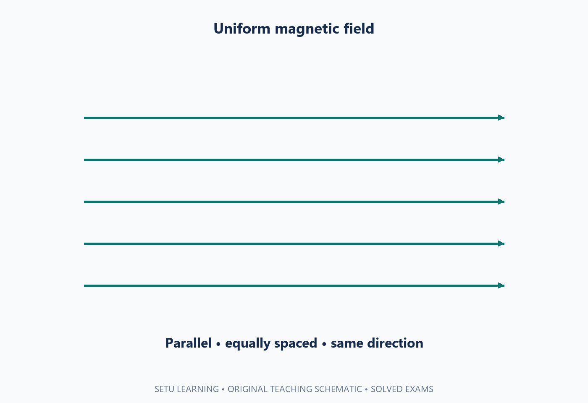

## 290. East→west wire के नीचे field।

**स्रोत:** 2016 मुख्य, प्रश्न 7, PDF पृष्ठ 2 · **अंक:** 1 अंक

**अध्याय-संबंध:** विद्युत धारा के चुंबकीय प्रभाव

**हल:** Current east→west और point सीधे नीचे हो तो right-hand rule से field south की ओर है। Directions को coordinate cross-product से check करें; above-wire point पर direction उलटी होगी।

[मूल प्रश्न देखें](https://rajeduboard.rajasthan.gov.in/books/PAPERS-2016/Sec/S-07-Science.pdf#page=2)

## 291. Quicklime–water combination।

**स्रोत:** 2016 मुख्य, प्रश्न 9, PDF पृष्ठ 3 · **अंक:** 2 अंक

**अध्याय-संबंध:** रासायनिक अभिक्रियाएँ एवं समीकरण

**हल:** Combination: CaO + H₂O → Ca(OH)₂; अनेक reactants से एक मुख्य product। Decomposition: CaCO₃ → CaO + CO₂ (heat); एक compound कई products देता है। दोनों equations balanced रखें।

[मूल प्रश्न देखें](https://rajeduboard.rajasthan.gov.in/books/PAPERS-2016/Sec/S-07-Science.pdf#page=3)

## 292. Photosynthesis equation तथा घटनाएँ।

**स्रोत:** 2016 मुख्य, प्रश्न 15(a), PDF पृष्ठ 4 · **अंक:** 2 अंक

**अध्याय-संबंध:** जैव प्रक्रम

**हल:** Light/chlorophyll energy absorb करते हैं; water से oxygen liberation तथा CO₂ का carbohydrate में reduction होता है। Simplified equation 6CO₂ + 6H₂O → C₆H₁₂O₆ + 6O₂ है; light/chlorophyll condition लिखें।

[मूल प्रश्न देखें](https://rajeduboard.rajasthan.gov.in/books/PAPERS-2016/Sec/S-07-Science.pdf#page=4)

## 293. ZnO–carbon redox analysis।

**स्रोत:** 2016 मुख्य, प्रश्न 17, PDF पृष्ठ 4 · **अंक:** 3 अंक

**अध्याय-संबंध:** रासायनिक अभिक्रियाएँ एवं समीकरण

**हल:** ZnO+C→Zn+CO में ZnO oxygen खोकर reduced और carbon oxygen पाकर oxidised होता है। ZnO oxidising agent, carbon reducing agent। दोनों transformations एक साथ होने से यह redox है।

[मूल प्रश्न देखें](https://rajeduboard.rajasthan.gov.in/books/PAPERS-2016/Sec/S-07-Science.pdf#page=4)

## 294. Mirror magnification formula।

**स्रोत:** 2016 मुख्य, प्रश्न 18(a), PDF पृष्ठ 4 · **अंक:** 1 अंक

**अध्याय-संबंध:** प्रकाश: परावर्तन तथा अपवर्तन

**हल:** Spherical mirror magnification m=hᵢ/hₒ=−v/u। New Cartesian signs लें; m<0 inverted और m>0 erect image दर्शाता है।

[मूल प्रश्न देखें](https://rajeduboard.rajasthan.gov.in/books/PAPERS-2016/Sec/S-07-Science.pdf#page=4)

## 295. Erect enlarged mirror पहचान।

**स्रोत:** 2016 मुख्य, प्रश्न 18(b), PDF पृष्ठ 4 · **अंक:** 1 अंक

**अध्याय-संबंध:** प्रकाश: परावर्तन तथा अपवर्तन

**हल:** Concave mirror object को pole और focus के बीच रखने पर erect, enlarged virtual image देता है। Convex mirror finite real object की erect लेकिन diminished image देता है।

[मूल प्रश्न देखें](https://rajeduboard.rajasthan.gov.in/books/PAPERS-2016/Sec/S-07-Science.pdf#page=4)

## 296. Reflex arc और response।

**स्रोत:** 2016 मुख्य, प्रश्न 19, PDF पृष्ठ 4 · **अंक:** 3 अंक

**अध्याय-संबंध:** नियंत्रण एवं समन्वय

**हल:** Receptor → sensory neuron → spinal relay → motor neuron → effector muscle। तेज automatic withdrawal response reflex है; brain को information भी मिलती है। Arc diagram में nerve direction और effector label करें।

[मूल प्रश्न देखें](https://rajeduboard.rajasthan.gov.in/books/PAPERS-2016/Sec/S-07-Science.pdf#page=4)

## 297. Current का सही formula।

**स्रोत:** 2016 मुख्य, प्रश्न 20(i), PDF पृष्ठ 5 · **अंक:** 0.5 अंक

**अध्याय-संबंध:** विद्युत

**हल:** Current I=Q/t। Q coulomb और t second में लेने पर I ampere मिलता है; 1 A=1 C/s।

[मूल प्रश्न देखें](https://rajeduboard.rajasthan.gov.in/books/PAPERS-2016/Sec/S-07-Science.pdf#page=5)

## 298. Potential difference formula।

**स्रोत:** 2016 मुख्य, प्रश्न 20(ii), PDF पृष्ठ 5 · **अंक:** 0.5 अंक

**अध्याय-संबंध:** विद्युत

**हल:** Potential difference V=W/Q। W joule और Q coulomb में होने पर V volt; 1 V=1 J/C।

[मूल प्रश्न देखें](https://rajeduboard.rajasthan.gov.in/books/PAPERS-2016/Sec/S-07-Science.pdf#page=5)

## 299. Ohm relation मिलान।

**स्रोत:** 2016 मुख्य, प्रश्न 20(iii), PDF पृष्ठ 5 · **अंक:** 0.5 अंक

**अध्याय-संबंध:** विद्युत

**हल:** स्थिर temperature/physical conditions में V ∝ I, इसलिए V=IR। Low-voltage circuit में ammeter series, voltmeter resistor के parallel; कई V,I readings में V/I लगभग constant और V-vertical/I-horizontal graph straight line होता है।

[मूल प्रश्न देखें](https://rajeduboard.rajasthan.gov.in/books/PAPERS-2016/Sec/S-07-Science.pdf#page=5)

चित्र सहायता: इसी अध्याय में इस अवधारणा का पहले दिया नामांकित schematic देखें।

## 300. Resistivity relation मिलान।

**स्रोत:** 2016 मुख्य, प्रश्न 20(iv), PDF पृष्ठ 5 · **अंक:** 0.5 अंक

**अध्याय-संबंध:** विद्युत

**हल:** R=ρl/A: length, cross-section, material तथा temperature matter करते हैं। ρ=RA/l, unit Ω·m। Same material/temperature में geometry बदलने से R बदलता है, intrinsic resistivity नहीं।

[मूल प्रश्न देखें](https://rajeduboard.rajasthan.gov.in/books/PAPERS-2016/Sec/S-07-Science.pdf#page=5)

## 301. Unfertilised egg के बाद प्रक्रिया।

**स्रोत:** 2016 मुख्य, प्रश्न 21, PDF पृष्ठ 5 · **अंक:** 3 अंक

**अध्याय-संबंध:** जीव जनन कैसे करते हैं?

**हल:** Ovum fertilised न हो और pregnancy न बने तो hormonal changes के साथ uterine lining shed हो सकती है। Blood/tissue vagina से बाहर आते हैं: menstruation। Cycle length vary करती है; इसे ‘impure blood’ नहीं कहें।

[मूल प्रश्न देखें](https://rajeduboard.rajasthan.gov.in/books/PAPERS-2016/Sec/S-07-Science.pdf#page=5)

## 302. Mouth pH और tooth decay।

**स्रोत:** 2016 मुख्य, प्रश्न 23, PDF पृष्ठ 5 · **अंक:** 3 अंक

**अध्याय-संबंध:** अम्ल, क्षारक एवं लवण

**हल:** Bacterial sugar metabolism acid बनाता है; mouth pH लगभग 5.5 से नीचे गिरने पर enamel demineralisation बढ़ सकती है। Mildly basic toothpaste acid neutralisation में मदद करता है। pH acid strength और total amount का अकेला प्रमाण नहीं।

[मूल प्रश्न देखें](https://rajeduboard.rajasthan.gov.in/books/PAPERS-2016/Sec/S-07-Science.pdf#page=5)

## 303. Grassland chain तथा energy।

**स्रोत:** 2016 मुख्य, प्रश्न 25, PDF पृष्ठ 5 · **अंक:** 5 अंक

**अध्याय-संबंध:** हमारा पर्यावरण

**हल:** Food chain organisms के बीच feeding/energy transfer दिखाती है: grass → grasshopper → frog → snake। Solar energy producer से consumers तक जाती है और हर step में heat/metabolism से घटती है; लगभग 10% transfer school model है। Nutrients cycle कर सकते हैं, energy flow one-way है।

[मूल प्रश्न देखें](https://rajeduboard.rajasthan.gov.in/books/PAPERS-2016/Sec/S-07-Science.pdf#page=5)

## 304. 600 W fridge, 30 दिन: bill।

**स्रोत:** 2016 मुख्य, प्रश्न 24, PDF पृष्ठ 5 · **अंक:** 3 अंक

**अध्याय-संबंध:** विद्युत

**हल:** P=600 W=0.6 kW; t=8×30=240 h। E=0.6×240=144 kWh। Rate ₹4/kWh पर charge ₹576; fixed fees/taxes शामिल नहीं।

[मूल प्रश्न देखें](https://rajeduboard.rajasthan.gov.in/books/PAPERS-2016/Sec/S-07-Science.pdf#page=5)

## 2015 — मुख्य परीक्षा

[2015 मुख्य: पूरा आधिकारिक प्रश्न-पत्र](https://rajeduboard.rajasthan.gov.in/books/PAPERS-2015/Sec/S-07-Science-15.pdf)

## 305. दो synthetic indicators।

**स्रोत:** 2015 मुख्य, प्रश्न 1, PDF पृष्ठ 2 · **अंक:** 1 अंक

**अध्याय-संबंध:** अम्ल, क्षारक एवं लवण

**हल:** Phenolphthalein और methyl orange दो synthetic indicators हैं। Phenolphthalein acidic medium में colourless और basic में pink है।

[मूल प्रश्न देखें](https://rajeduboard.rajasthan.gov.in/books/PAPERS-2015/Sec/S-07-Science-15.pdf#page=2)

## 306. Embryo nutrition का interface।

**स्रोत:** 2015 मुख्य, प्रश्न 2, PDF पृष्ठ 2 · **अंक:** 1 अंक

**अध्याय-संबंध:** जीव जनन कैसे करते हैं?

**हल:** Placenta maternal–fetal exchange interface है: oxygen/nutrients fetus को तथा metabolic wastes maternal side को transfer होते हैं। दोनों blood systems सामान्यतः सीधे common pool में नहीं मिलते। Damage से fetal nutrition/oxygen supply प्रभावित हो सकती है।

[मूल प्रश्न देखें](https://rajeduboard.rajasthan.gov.in/books/PAPERS-2015/Sec/S-07-Science-15.pdf#page=2)

## 307. दो जोड़ों का pH compare।

**स्रोत:** 2015 मुख्य, प्रश्न 4, PDF पृष्ठ 2 · **अंक:** 1 अंक

**अध्याय-संबंध:** अम्ल, क्षारक एवं लवण

**हल:** Blood का typical pH लगभग 7.4, distilled water लगभग 7; blood अधिक pH वाला है। Gastric juice का pH सामान्यतः lemon juice से कम, इसलिए lemon juice अपेक्षाकृत अधिक pH वाला है। Actual values conditions पर निर्भर हैं।

[मूल प्रश्न देखें](https://rajeduboard.rajasthan.gov.in/books/PAPERS-2015/Sec/S-07-Science-15.pdf#page=2)

## 308. Overload से दो बचाव।

**स्रोत:** 2015 मुख्य, प्रश्न 5, PDF पृष्ठ 2 · **अंक:** 1 अंक

**अध्याय-संबंध:** विद्युत धारा के चुंबकीय प्रभाव

**हल:** एक socket/circuit पर बहुत appliances से total current rating से अधिक हो सकता है: overloading। I²R heating बढ़ सकती है। Load rating मानें और suitable protective devices रखें; एक socket में high-power loads न जोड़ें।

[मूल प्रश्न देखें](https://rajeduboard.rajasthan.gov.in/books/PAPERS-2015/Sec/S-07-Science-15.pdf#page=2)

## 309. Eye focal adjustment का नाम।

**स्रोत:** 2015 मुख्य, प्रश्न 8, PDF पृष्ठ 3 · **अंक:** 1 अंक

**अध्याय-संबंध:** मानव नेत्र तथा रंगबिरंगा संसार

**हल:** Eye lens की focal length adjust करने की क्षमता accommodation है। Ciliary muscles curvature बदलती हैं: near object के लिए lens अधिक convex और focal length कम होती है।

[मूल प्रश्न देखें](https://rajeduboard.rajasthan.gov.in/books/PAPERS-2015/Sec/S-07-Science-15.pdf#page=3)

## 310. Combination/decomposition के examples।

**स्रोत:** 2015 मुख्य, प्रश्न 9, PDF पृष्ठ 3 · **अंक:** 2 अंक

**अध्याय-संबंध:** रासायनिक अभिक्रियाएँ एवं समीकरण

**हल:** Combination: CaO + H₂O → Ca(OH)₂; अनेक reactants से एक मुख्य product। Decomposition: CaCO₃ → CaO + CO₂ (heat); एक compound कई products देता है। दोनों equations balanced रखें।

[मूल प्रश्न देखें](https://rajeduboard.rajasthan.gov.in/books/PAPERS-2015/Sec/S-07-Science-15.pdf#page=3)

## 311. Ozone किस radiation से बचाती है?

**स्रोत:** 2015 मुख्य, प्रश्न 11(a), PDF पृष्ठ 3 · **अंक:** 1 अंक

**अध्याय-संबंध:** हमारा पर्यावरण

**हल:** Stratospheric ozone harmful ultraviolet radiation के कुछ हिस्से को absorb करता है। UV shielding घटने को ozone depletion से जोड़ें, visible colours के dispersion से नहीं।

[मूल प्रश्न देखें](https://rajeduboard.rajasthan.gov.in/books/PAPERS-2015/Sec/S-07-Science-15.pdf#page=3)

## 312. XX–XY determination schematic।

**स्रोत:** 2015 मुख्य, प्रश्न 14, PDF पृष्ठ 3 · **अंक:** 2 अंक

**अध्याय-संबंध:** आनुवंशिकता

**हल:** XX–XY school model में egg X और sperm X या Y देता है। X+X → XX, X+Y → XY; expected probability लगभग बराबर। Mother को outcome के लिए दोष देने का scientific आधार नहीं।

[मूल प्रश्न देखें](https://rajeduboard.rajasthan.gov.in/books/PAPERS-2015/Sec/S-07-Science-15.pdf#page=3)

चित्र सहायता: इसी अध्याय में इस अवधारणा का पहले दिया नामांकित schematic देखें।

## 313. Stomach acid का कार्य।

**स्रोत:** 2015 मुख्य, प्रश्न 15(a), PDF पृष्ठ 4 · **अंक:** 1 अंक

**अध्याय-संबंध:** जैव प्रक्रम

**हल:** HCl stomach में acidic environment बनाता है, pepsin action के अनुकूल है और कई microbes के विरुद्ध मदद करता है। Mucus lining रक्षा करती है; HCl स्वयं protein-digesting enzyme नहीं।

[मूल प्रश्न देखें](https://rajeduboard.rajasthan.gov.in/books/PAPERS-2015/Sec/S-07-Science-15.pdf#page=4)

## 314. दो nutrition modes में अंतर।

**स्रोत:** 2015 मुख्य, प्रश्न 15(b), PDF पृष्ठ 4 · **अंक:** 2 अंक

**अध्याय-संबंध:** जैव प्रक्रम

**हल:** Autotroph inorganic sources से organic food बनाते हैं; green plants photosynthesis से। Heterotroph दूसरे organisms से organic food लेते हैं; humans इसका उदाहरण हैं। दोनों usable energy के लिए cellular processes रखते हैं।

[मूल प्रश्न देखें](https://rajeduboard.rajasthan.gov.in/books/PAPERS-2015/Sec/S-07-Science-15.pdf#page=4)

## 315. Nerve और hormone control।

**स्रोत:** 2015 मुख्य, प्रश्न 16(b), PDF पृष्ठ 4 · **अंक:** 2 अंक

**अध्याय-संबंध:** नियंत्रण एवं समन्वय

**हल:** Nervous messages specific neural paths से सामान्यतः तेज और short-lived responses देते हैं। Hormones blood से receptor-bearing targets तक जाते और अक्सर slower/longer responses देते हैं। Messenger, route और timescale स्पष्ट तुलना-बिंदु हैं।

[मूल प्रश्न देखें](https://rajeduboard.rajasthan.gov.in/books/PAPERS-2015/Sec/S-07-Science-15.pdf#page=4)

## 316. CuO–H₂ redox तथा दूसरा उदाहरण।

**स्रोत:** 2015 मुख्य, प्रश्न 17, PDF पृष्ठ 4 · **अंक:** 3 अंक

**अध्याय-संबंध:** रासायनिक अभिक्रियाएँ एवं समीकरण

**हल:** CuO + H₂ → Cu + H₂O में H₂ oxygen पाकर oxidised, CuO oxygen खोकर reduced है। Oxidation तथा reduction एक साथ होना redox है; दूसरा उदाहरण ZnO + C → Zn + CO है।

[मूल प्रश्न देखें](https://rajeduboard.rajasthan.gov.in/books/PAPERS-2015/Sec/S-07-Science-15.pdf#page=4)

## 317. Mirrors और image types तुलना।

**स्रोत:** 2015 मुख्य, प्रश्न 18, PDF पृष्ठ 4 · **अंक:** 3 अंक

**अध्याय-संबंध:** प्रकाश: परावर्तन तथा अपवर्तन

**हल:** Spherical mirror का reflecting surface sphere के भाग जैसा है। Concave inward surface, convex outward surface। Real image actual rays की intersection से screen पर मिलती है; virtual image backward extensions का apparent intersection है।

[मूल प्रश्न देखें](https://rajeduboard.rajasthan.gov.in/books/PAPERS-2015/Sec/S-07-Science-15.pdf#page=4)

## 318. Insulin/thyroxine के functions।

**स्रोत:** 2015 मुख्य, प्रश्न 19(b), PDF पृष्ठ 4 · **अंक:** 2 अंक

**अध्याय-संबंध:** नियंत्रण एवं समन्वय

**हल:** Insulin pancreas से blood glucose regulation में सहायता करता है। Thyroxine thyroid से metabolic regulation में काम करता है और iodine चाहिए। Insulin deficiency diabetes mellitus से संबंधित हो सकती है; सभी diabetes केवल complete absence नहीं।

[मूल प्रश्न देखें](https://rajeduboard.rajasthan.gov.in/books/PAPERS-2015/Sec/S-07-Science-15.pdf#page=4)

## 319. White-light separation का कारण।

**स्रोत:** 2015 मुख्य, प्रश्न 20, PDF पृष्ठ 4 · **अंक:** 3 अंक

**अध्याय-संबंध:** मानव नेत्र तथा रंगबिरंगा संसार

**हल:** White light का constituent wavelengths/colours में separation dispersion है। Prism का refractive index wavelength-dependent होने से colours अलग deviate करते हैं; ordinary glass में violet अधिक, red कम deviates है।

[मूल प्रश्न देखें](https://rajeduboard.rajasthan.gov.in/books/PAPERS-2015/Sec/S-07-Science-15.pdf#page=4)

चित्र सहायता: इसी अध्याय में इस अवधारणा का पहले दिया नामांकित schematic देखें।

## 320. तीन asexual modes तुलना।

**स्रोत:** 2015 मुख्य, प्रश्न 21, PDF पृष्ठ 4 · **अंक:** 3 अंक

**अध्याय-संबंध:** जीव जनन कैसे करते हैं?

**हल:** Fragmentation: Spirogyra filament pieces नए individuals बन सकते हैं। Regeneration: Planaria suitable fragments से body पुनः बना सकती है। Budding: Hydra/yeast में outgrowth नया organism देता है। हर animal body fragment reproduce नहीं करता।

[मूल प्रश्न देखें](https://rajeduboard.rajasthan.gov.in/books/PAPERS-2015/Sec/S-07-Science-15.pdf#page=4)

## 321. Zn–acid गैस और test।

**स्रोत:** 2015 मुख्य, प्रश्न 23, PDF पृष्ठ 5 · **अंक:** 3 अंक

**अध्याय-संबंध:** अम्ल, क्षारक एवं लवण

**हल:** Zn + H₂SO₄(dil.) → ZnSO₄ + H₂। Gas hydrogen है; prescribed supervised test में burning splint से characteristic pop मिल सकता है। Acid/gas experiment स्वयं न करें।

[मूल प्रश्न देखें](https://rajeduboard.rajasthan.gov.in/books/PAPERS-2015/Sec/S-07-Science-15.pdf#page=5)

## 322. Air–glass–air ray path।

**स्रोत:** 2015 मुख्य, प्रश्न 24, PDF पृष्ठ 5 · **अंक:** 3 अंक

**अध्याय-संबंध:** प्रकाश: परावर्तन तथा अपवर्तन

**हल:** Parallel-sided glass slab में oblique ray entry पर normal की ओर और exit पर normal से दूर bends करती है। Same external medium में emergent ray incident के parallel लेकिन laterally displaced होती है; normal incidence पर displacement शून्य।

[मूल प्रश्न देखें](https://rajeduboard.rajasthan.gov.in/books/PAPERS-2015/Sec/S-07-Science-15.pdf#page=5)

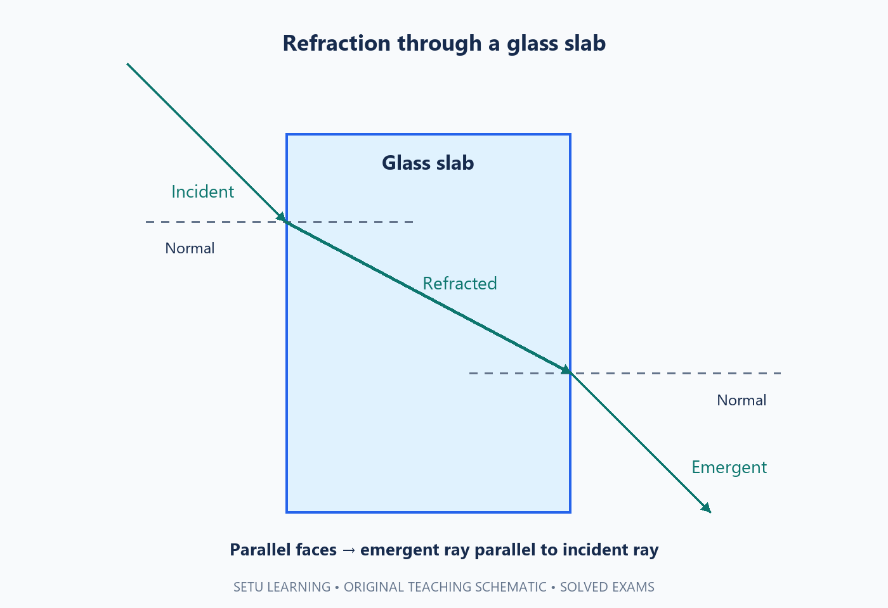

## 323. Ecosystem components।

**स्रोत:** 2015 मुख्य, प्रश्न 25(a), PDF पृष्ठ 5 · **अंक:** 3 अंक

**अध्याय-संबंध:** हमारा पर्यावरण

**हल:** Biotic: plants, animals, microbes। Abiotic: light, water, temperature, soil conditions। इनके interactions ecosystem बनाते हैं। उदाहरण pond में algae producer और organisms consumers हैं; decomposers nutrient recycling करते हैं।

[मूल प्रश्न देखें](https://rajeduboard.rajasthan.gov.in/books/PAPERS-2015/Sec/S-07-Science-15.pdf#page=5)

## 324. Room-temperature liquid metal।

**स्रोत:** 2015 मुख्य, प्रश्न 26(a), PDF पृष्ठ 5 · **अंक:** 1 अंक

**अध्याय-संबंध:** धातु एवं अधातु

**हल:** Mercury सामान्य room temperature पर liquid metal है। इसका अर्थ सभी metals liquid हैं या liquid पदार्थ metal ही है, ऐसा नहीं।

[मूल प्रश्न देखें](https://rajeduboard.rajasthan.gov.in/books/PAPERS-2015/Sec/S-07-Science-15.pdf#page=5)

## 325. MgCl₂ का electron transfer।

**स्रोत:** 2015 मुख्य, प्रश्न 26(b,c), PDF पृष्ठ 5 · **अंक:** 4 अंक

**अध्याय-संबंध:** धातु एवं अधातु

**हल:** Mg configuration 2,8,2 और Cl 2,8,7 है। Mg दो electrons खोकर Mg²⁺, दो Cl एक-एक लेकर Cl⁻ बनाते हैं। +2 तथा 2×−1 charges balance से MgCl₂ ionic lattice बनता है।

[मूल प्रश्न देखें](https://rajeduboard.rajasthan.gov.in/books/PAPERS-2015/Sec/S-07-Science-15.pdf#page=5)

## 326. Conductor force direction rule।

**स्रोत:** 2015 मुख्य, प्रश्न 27(a), PDF पृष्ठ 5 · **अंक:** 2 अंक

**अध्याय-संबंध:** विद्युत धारा के चुंबकीय प्रभाव

**हल:** Left-hand thumb, forefinger और middle finger mutually perpendicular रखें। Forefinger B, middle conventional I तथा thumb force/motion देता है। Current या field अकेला reverse हो तो force reverse होता है।

[मूल प्रश्न देखें](https://rajeduboard.rajasthan.gov.in/books/PAPERS-2015/Sec/S-07-Science-15.pdf#page=5)

## 327. Double circulation की आवश्यकता।

**स्रोत:** 2015 मुख्य, प्रश्न 28(b), प्रथम विकल्प, PDF पृष्ठ 6 · **अंक:** 2 अंक

**अध्याय-संबंध:** जैव प्रक्रम

**हल:** Body → right atrium/ventricle → lungs → left atrium/ventricle → body। Pulmonary तथा systemic circuits में blood heart से twice passes; चार chambers mixing घटाते और oxygen delivery कुशल करते हैं।

[मूल प्रश्न देखें](https://rajeduboard.rajasthan.gov.in/books/PAPERS-2015/Sec/S-07-Science-15.pdf#page=6)

## 328. Fat digestion और saliva।

**स्रोत:** 2015 मुख्य, प्रश्न 28(b,c), दूसरा विकल्प, PDF पृष्ठ 6 · **अंक:** 3 अंक

**अध्याय-संबंध:** जैव प्रक्रम

**हल:** Salivary amylase starch digestion शुरू करता है। Bile liver में बनता है; fat emulsification तथा intestinal medium में मदद करता है, digestive enzyme नहीं। Small intestine में fat digestion और absorption प्रमुख हैं।

[मूल प्रश्न देखें](https://rajeduboard.rajasthan.gov.in/books/PAPERS-2015/Sec/S-07-Science-15.pdf#page=6)

## 329. Wire resistance तथा resistivity।

**स्रोत:** 2015 मुख्य, प्रश्न 29(a), प्रथम विकल्प, PDF पृष्ठ 6 · **अंक:** 2.5 अंक

**अध्याय-संबंध:** विद्युत

**हल:** R=ρl/A: length, cross-section, material तथा temperature matter करते हैं। ρ=RA/l, unit Ω·m। Same material/temperature में geometry बदलने से R बदलता है, intrinsic resistivity नहीं।

[मूल प्रश्न देखें](https://rajeduboard.rajasthan.gov.in/books/PAPERS-2015/Sec/S-07-Science-15.pdf#page=6)

## 330. Homologous series के तीन गुण।

**स्रोत:** 2015 मुख्य, प्रश्न 30(a), प्रथम विकल्प, PDF पृष्ठ 7 · **अंक:** 3 अंक

**अध्याय-संबंध:** कार्बन एवं उसके यौगिक

**हल:** Same functional group/general formula; successive members differ by CH₂ (14 u)। Similar chemical properties और gradual physical-property changes होते हैं। Ethane के अगले homologues propane C₃H₈ तथा butane C₄H₁₀ हैं।

[मूल प्रश्न देखें](https://rajeduboard.rajasthan.gov.in/books/PAPERS-2015/Sec/S-07-Science-15.pdf#page=7)

## 331. 5 A fuse, 100 W bulbs संख्या।

**स्रोत:** 2015 मुख्य, प्रश्न 7, PDF पृष्ठ 3 · **अंक:** 1 अंक

**अध्याय-संबंध:** विद्युत

**हल:** School ideal rating: maximum power VI=220×5=1100 W। Each bulb 100 W, इसलिए 1100/100=11 bulbs। Real circuit design में safety margins/inrush/अन्य loads जाँचे जाते हैं; इसे installation instruction न मानें।

[मूल प्रश्न देखें](https://rajeduboard.rajasthan.gov.in/books/PAPERS-2015/Sec/S-07-Science-15.pdf#page=3)

## 332. 0.25 A, 20 min: charge।

**स्रोत:** 2015 मुख्य, प्रश्न 13, PDF पृष्ठ 3 · **अंक:** 2 अंक

**अध्याय-संबंध:** विद्युत

**हल:** I=0.25 A; t=20 min=1200 s। Q=It=0.25×1200=300 C। Electric charge unit coulomb है, ampere-hour को बिना conversion न लिखें।

[मूल प्रश्न देखें](https://rajeduboard.rajasthan.gov.in/books/PAPERS-2015/Sec/S-07-Science-15.pdf#page=3)

## 333. 840 W, 220 V: I,R।

**स्रोत:** 2015 मुख्य, प्रश्न 29(b), दूसरा विकल्प, PDF पृष्ठ 7 · **अंक:** 2.5 अंक

**अध्याय-संबंध:** विद्युत

**हल:** P=840 W,V=220 V। I=P/V=42/11≈3.82 A। R=V²/P=48400/840=1210/21≈57.62 Ω। P=VI तथा V/I से दो checks करें।

[मूल प्रश्न देखें](https://rajeduboard.rajasthan.gov.in/books/PAPERS-2015/Sec/S-07-Science-15.pdf#page=7)

## 2014 — मुख्य परीक्षा

[2014 मुख्य: पूरा आधिकारिक प्रश्न-पत्र](https://rajeduboard.rajasthan.gov.in/books/PAPERS-2014/Sec/S-07-Science-14.pdf)

## 334. उदासीन विलयन का pH।

**स्रोत:** 2014 मुख्य, प्रश्न 2, PDF पृष्ठ 2 · **अंक:** 1 अंक

**अध्याय-संबंध:** अम्ल, क्षारक एवं लवण

**हल:** लगभग 25°C पर उदासीन जलीय विलयन का pH 7 होता है। इसमें H₃O⁺ और OH⁻ की concentrations समान होती हैं।

[मूल प्रश्न देखें](https://rajeduboard.rajasthan.gov.in/books/PAPERS-2014/Sec/S-07-Science-14.pdf#page=2)

## 335. चींटी के डंक का अम्ल।

**स्रोत:** 2014 मुख्य, प्रश्न 3, PDF पृष्ठ 2 · **अंक:** 1 अंक

**अध्याय-संबंध:** अम्ल, क्षारक एवं लवण

**हल:** विद्यालयी उत्तर methanoic/formic acid, HCOOH है। अम्लीय प्रभाव को उपयुक्त क्षारक द्वारा neutralisation से समझा जाता है।

[मूल प्रश्न देखें](https://rajeduboard.rajasthan.gov.in/books/PAPERS-2014/Sec/S-07-Science-14.pdf#page=2)

## 336. Plasmodium का विखंडन।

**स्रोत:** 2014 मुख्य, प्रश्न 4, PDF पृष्ठ 3 · **अंक:** 1 अंक

**अध्याय-संबंध:** जीव जनन कैसे करते हैं?

**हल:** Plasmodium में multiple fission: एक parent cell से अनेक daughter cells बन सकते हैं। Binary fission में केवल दो बनते हैं।

[मूल प्रश्न देखें](https://rajeduboard.rajasthan.gov.in/books/PAPERS-2014/Sec/S-07-Science-14.pdf#page=3)

## 337. ओजोन गिरावट का प्रमुख कारण।

**स्रोत:** 2014 मुख्य, प्रश्न 5, PDF पृष्ठ 3 · **अंक:** 1 अंक

**अध्याय-संबंध:** हमारा पर्यावरण

**हल:** CFCs जैसे ozone-depleting substances से stratosphere में chlorine-related catalytic reactions ozone घटा सकती हैं। इससे UV shielding कम होती है; यह greenhouse warming का समानार्थी नहीं।

[मूल प्रश्न देखें](https://rajeduboard.rajasthan.gov.in/books/PAPERS-2014/Sec/S-07-Science-14.pdf#page=3)

## 338. एक socket पर बहुत उपकरण।

**स्रोत:** 2014 मुख्य, प्रश्न 7, PDF पृष्ठ 3 · **अंक:** 1 अंक

**अध्याय-संबंध:** विद्युत धारा के चुंबकीय प्रभाव

**हल:** एक socket/circuit पर बहुत appliances से total current rating से अधिक हो सकता है: overloading। I²R heating बढ़ सकती है। Load rating मानें और suitable protective devices रखें; एक socket में high-power loads न जोड़ें।

[मूल प्रश्न देखें](https://rajeduboard.rajasthan.gov.in/books/PAPERS-2014/Sec/S-07-Science-14.pdf#page=3)

## 339. एक redox उदाहरण।

**स्रोत:** 2014 मुख्य, प्रश्न 9(a), PDF पृष्ठ 4 · **अंक:** 1 अंक

**अध्याय-संबंध:** रासायनिक अभिक्रियाएँ एवं समीकरण

**हल:** CuO + H₂ → Cu + H₂O में H₂ oxygen पाकर oxidised, CuO oxygen खोकर reduced है। Oxidation तथा reduction एक साथ होना redox है; दूसरा उदाहरण ZnO + C → Zn + CO है।

[मूल प्रश्न देखें](https://rajeduboard.rajasthan.gov.in/books/PAPERS-2014/Sec/S-07-Science-14.pdf#page=4)

## 340. जल विद्युत-अपघटन का विन्यास।

**स्रोत:** 2014 मुख्य, प्रश्न 9(b), PDF पृष्ठ 4 · **अंक:** 1 अंक

**अध्याय-संबंध:** रासायनिक अभिक्रियाएँ एवं समीकरण

**हल:** 2H₂O → 2H₂ + O₂, electrical energy की उपस्थिति में। Diagram में electrolyte युक्त water, दो electrodes, DC source, cathode पर H₂ और anode पर O₂ दिखाएँ; समान परिस्थितियों में gas volumes 2:1 हैं।

[मूल प्रश्न देखें](https://rajeduboard.rajasthan.gov.in/books/PAPERS-2014/Sec/S-07-Science-14.pdf#page=4)

चित्र सहायता: इसी अध्याय में इस अवधारणा का पहले दिया नामांकित schematic देखें।

## 341. Photosynthesis के दो events।

**स्रोत:** 2014 मुख्य, प्रश्न 11, PDF पृष्ठ 4 · **अंक:** 2 अंक

**अध्याय-संबंध:** जैव प्रक्रम

**हल:** Light/chlorophyll energy absorb करते हैं; water से oxygen liberation तथा CO₂ का carbohydrate में reduction होता है। Simplified equation 6CO₂ + 6H₂O → C₆H₁₂O₆ + 6O₂ है; light/chlorophyll condition लिखें।

[मूल प्रश्न देखें](https://rajeduboard.rajasthan.gov.in/books/PAPERS-2014/Sec/S-07-Science-14.pdf#page=4)

## 342. कायिक जनन और लाभ।

**स्रोत:** 2014 मुख्य, प्रश्न 13, PDF पृष्ठ 4 · **अंक:** 2 अंक

**अध्याय-संबंध:** जीव जनन कैसे करते हैं?

**हल:** Root, stem अथवा leaf के vegetative parts से नए plants बनाना vegetative propagation है। Potato stem buds और Bryophyllum leaf buds उदाहरण हैं। Seed-less plants को बढ़ाने और useful traits बनाए रखने में उपयोगी है।

[मूल प्रश्न देखें](https://rajeduboard.rajasthan.gov.in/books/PAPERS-2014/Sec/S-07-Science-14.pdf#page=4)

## 343. Astronaut को dark sky क्यों?

**स्रोत:** 2014 मुख्य, प्रश्न 14(i), PDF पृष्ठ 4 · **अंक:** 1 अंक

**अध्याय-संबंध:** मानव नेत्र तथा रंगबिरंगा संसार

**हल:** Atmosphere न होने या अत्यल्प होने पर sunlight का scattering पर्याप्त नहीं होता। इसलिए atmosphere से बाहर astronaut को सूर्य चमकने के बावजूद background sky dark दिखाई देता है।

[मूल प्रश्न देखें](https://rajeduboard.rajasthan.gov.in/books/PAPERS-2014/Sec/S-07-Science-14.pdf#page=4)

## 344. Pupil का नियंत्रण।

**स्रोत:** 2014 मुख्य, प्रश्न 14(ii), PDF पृष्ठ 4 · **अंक:** 1 अंक

**अध्याय-संबंध:** मानव नेत्र तथा रंगबिरंगा संसार

**हल:** Iris की muscles pupil opening का size नियंत्रित करती हैं। Lens की curvature ciliary muscles बदलती हैं; light entry और accommodation के mechanisms अलग हैं।

[मूल प्रश्न देखें](https://rajeduboard.rajasthan.gov.in/books/PAPERS-2014/Sec/S-07-Science-14.pdf#page=4)

## 345. Zn–NaOH गैस और समीकरण।

**स्रोत:** 2014 मुख्य, प्रश्न 15(a), PDF पृष्ठ 5 · **अंक:** 1 अंक

**अध्याय-संबंध:** अम्ल, क्षारक एवं लवण

**हल:** Hydrogen निकलती है। विद्यालयी समीकरण: Zn + 2NaOH → Na₂ZnO₂ + H₂। Aqueous complex formulation में zincate को hydroxo-complex से भी लिखा जाता है; prescribed school representation का उपयोग करें।

[मूल प्रश्न देखें](https://rajeduboard.rajasthan.gov.in/books/PAPERS-2014/Sec/S-07-Science-14.pdf#page=5)

## 346. चार दैनिक उपयोग के रसायन।

**स्रोत:** 2014 मुख्य, प्रश्न 15(b), PDF पृष्ठ 5 · **अंक:** 2 अंक

**अध्याय-संबंध:** अम्ल, क्षारक एवं लवण

**हल:** Germ-free water के लिए bleaching powder, baking के लिए NaHCO₃, स्थायी कठोरता घटाने के लिए washing soda और moulds/toys के लिए POP। क्रमशः CaOCl₂, NaHCO₃, Na₂CO₃·10H₂O और CaSO₄·½H₂O लिखें।

[मूल प्रश्न देखें](https://rajeduboard.rajasthan.gov.in/books/PAPERS-2014/Sec/S-07-Science-14.pdf#page=5)

## 347. विस्थापन की परिभाषा।

**स्रोत:** 2014 मुख्य, प्रश्न 16(a), PDF पृष्ठ 5 · **अंक:** 1 अंक

**अध्याय-संबंध:** रासायनिक अभिक्रियाएँ एवं समीकरण

**हल:** अधिक active element कम active को compound से हटाता है। Zn + CuSO₄ → ZnSO₄ + Cu उदाहरण है; zinc copper से अधिक active है।

[मूल प्रश्न देखें](https://rajeduboard.rajasthan.gov.in/books/PAPERS-2014/Sec/S-07-Science-14.pdf#page=5)

## 348. Zn–CuSO₄ में missing product।

**स्रोत:** 2014 मुख्य, प्रश्न 16(b)(i), PDF पृष्ठ 5 · **अंक:** 1 अंक

**अध्याय-संबंध:** रासायनिक अभिक्रियाएँ एवं समीकरण

**हल:** ZnSO₄ बनता है: Zn + CuSO₄ → ZnSO₄ + Cu। यह displacement तथा redox दोनों है; Cu²⁺ reduced और zinc oxidised होता है।

[मूल प्रश्न देखें](https://rajeduboard.rajasthan.gov.in/books/PAPERS-2014/Sec/S-07-Science-14.pdf#page=5)

## 349. Na₂SO₄–BaCl₂ का precipitate।

**स्रोत:** 2014 मुख्य, प्रश्न 16(b)(ii), PDF पृष्ठ 5 · **अंक:** 1 अंक

**अध्याय-संबंध:** रासायनिक अभिक्रियाएँ एवं समीकरण

**हल:** BaSO₄ सफेद insoluble precipitate है: Na₂SO₄ + BaCl₂ → BaSO₄↓ + 2NaCl। यह double displacement तथा precipitation है।

[मूल प्रश्न देखें](https://rajeduboard.rajasthan.gov.in/books/PAPERS-2014/Sec/S-07-Science-14.pdf#page=5)

## 350. कृत्रिम वृक्क का उपयोग।

**स्रोत:** 2014 मुख्य, प्रश्न 18, PDF पृष्ठ 6 · **अंक:** 3 अंक

**अध्याय-संबंध:** जैव प्रक्रम

**हल:** Haemodialysis में blood semipermeable interface के across dialysing fluid से संपर्क करता है और wastes/अतिरिक्त solutes हटाए जा सकते हैं। Kidney failure में clinical use है; यह kidney के सभी functions का पूर्ण replacement नहीं।

[मूल प्रश्न देखें](https://rajeduboard.rajasthan.gov.in/books/PAPERS-2014/Sec/S-07-Science-14.pdf#page=6)

## 351. Hydra budding की अवस्थाएँ।

**स्रोत:** 2014 मुख्य, प्रश्न 19, PDF पृष्ठ 6 · **अंक:** 3 अंक

**अध्याय-संबंध:** जीव जनन कैसे करते हैं?

**हल:** Hydra में repeated cell division से body wall पर bud निकलता है, mouth/tentacles बनते हैं और mature bud अलग individual हो सकता है। Diagram में parent, bud, tentacles और detachment stages label करें।

[मूल प्रश्न देखें](https://rajeduboard.rajasthan.gov.in/books/PAPERS-2014/Sec/S-07-Science-14.pdf#page=6)

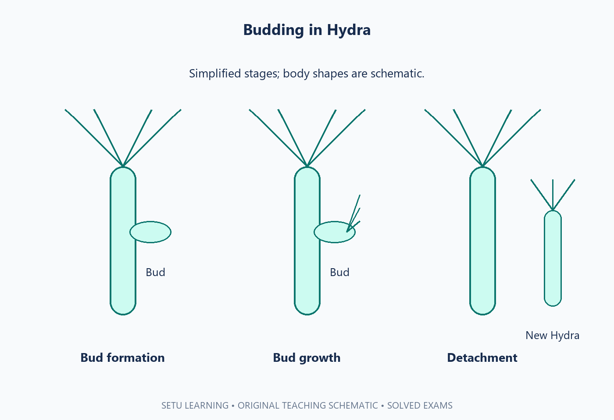

## 352. पर्यावरण के तीन R।

**स्रोत:** 2014 मुख्य, प्रश्न 21, PDF पृष्ठ 7 · **अंक:** 3 अंक

**अध्याय-संबंध:** हमारा पर्यावरण

**हल:** Reduce: unnecessary consumption/waste घटाएँ। Reuse: वस्तु फिर उपयोग करें। Recycle: waste material से उपयोगी material बनाएं। उदाहरण bottle reuse, कम packaging और separated paper recycling हैं।

[मूल प्रश्न देखें](https://rajeduboard.rajasthan.gov.in/books/PAPERS-2014/Sec/S-07-Science-14.pdf#page=7)

## 353. Concave focus, convex उपयोग।

**स्रोत:** 2014 मुख्य, प्रश्न 22, PDF पृष्ठ 7 · **अंक:** 3 अंक

**अध्याय-संबंध:** प्रकाश: परावर्तन तथा अपवर्तन

**हल:** Concave mirror पर principal axis के parallel paraxial rays reflect होकर principal focus पर मिलती हैं। Convex mirrors rear-view तथा wide-angle security viewing में useful हैं; virtual erect diminished image देते हैं।

[मूल प्रश्न देखें](https://rajeduboard.rajasthan.gov.in/books/PAPERS-2014/Sec/S-07-Science-14.pdf#page=7)

## 354. Ohm नियम तथा verification।

**स्रोत:** 2014 मुख्य, प्रश्न 23, PDF पृष्ठ 7 · **अंक:** 3 अंक

**अध्याय-संबंध:** विद्युत

**हल:** स्थिर temperature/physical conditions में V ∝ I, इसलिए V=IR। Low-voltage circuit में ammeter series, voltmeter resistor के parallel; कई V,I readings में V/I लगभग constant और V-vertical/I-horizontal graph straight line होता है।

[मूल प्रश्न देखें](https://rajeduboard.rajasthan.gov.in/books/PAPERS-2014/Sec/S-07-Science-14.pdf#page=7)

चित्र सहायता: इसी अध्याय में इस अवधारणा का पहले दिया नामांकित schematic देखें।

## 355. Amphoteric oxide का उदाहरण।

**स्रोत:** 2014 मुख्य, प्रश्न 25(b), PDF पृष्ठ 8 · **अंक:** 2 अंक

**अध्याय-संबंध:** धातु एवं अधातु

**हल:** Amphoteric oxides acids और bases दोनों से reaction करते हैं। Al₂O₃ तथा ZnO उदाहरण हैं। केवल सभी metal oxides acidic या सभी केवल basic लिखना उचित नहीं।

[मूल प्रश्न देखें](https://rajeduboard.rajasthan.gov.in/books/PAPERS-2014/Sec/S-07-Science-14.pdf#page=8)

## 356. Brass के घटक।

**स्रोत:** 2014 मुख्य, प्रश्न 25(c), PDF पृष्ठ 8 · **अंक:** 1 अंक

**अध्याय-संबंध:** धातु एवं अधातु

**हल:** Brass copper और zinc की alloy है। Bronze copper–tin है; इन दोनों मिश्रधातुओं के घटक अलग हैं।

[मूल प्रश्न देखें](https://rajeduboard.rajasthan.gov.in/books/PAPERS-2014/Sec/S-07-Science-14.pdf#page=8)

## 357. Food chain और energy flow।

**स्रोत:** 2014 मुख्य, प्रश्न 26, PDF पृष्ठ 8 · **अंक:** 5 अंक

**अध्याय-संबंध:** हमारा पर्यावरण

**हल:** Food chain organisms के बीच feeding/energy transfer दिखाती है: grass → grasshopper → frog → snake। Solar energy producer से consumers तक जाती है और हर step में heat/metabolism से घटती है; लगभग 10% transfer school model है। Nutrients cycle कर सकते हैं, energy flow one-way है।

[मूल प्रश्न देखें](https://rajeduboard.rajasthan.gov.in/books/PAPERS-2014/Sec/S-07-Science-14.pdf#page=8)

चित्र सहायता: इसी अध्याय में इस अवधारणा का पहले दिया नामांकित schematic देखें।

## 358. Covalent bond का अर्थ।

**स्रोत:** 2014 मुख्य, प्रश्न 28(a), PDF पृष्ठ 9 · **अंक:** 1 अंक

**अध्याय-संबंध:** कार्बन एवं उसके यौगिक

**हल:** Covalent bond electron pair के sharing से बनता है। CH₄ में चार C–H single bonds और ethene में C=C double bond है। Electron-dot diagram में हर shared pair दिखाएँ; ionic electron transfer की तरह पूर्ण charge formation न दिखाएँ।

[मूल प्रश्न देखें](https://rajeduboard.rajasthan.gov.in/books/PAPERS-2014/Sec/S-07-Science-14.pdf#page=9)

## 359. Normal incidence में दिशा।

**स्रोत:** 2014 मुख्य, प्रश्न 30(c), PDF पृष्ठ 11 · **अंक:** 1 अंक

**अध्याय-संबंध:** प्रकाश: परावर्तन तथा अपवर्तन

**हल:** Normal incidence पर ray की direction सामान्यतः unchanged रहती है, लेकिन medium बदलने से speed और wavelength बदल सकते हैं। Frequency interface पार करते समय unchanged रहती है।

[मूल प्रश्न देखें](https://rajeduboard.rajasthan.gov.in/books/PAPERS-2014/Sec/S-07-Science-14.pdf#page=11)

## 360. 300 C, 5 min: current।

**स्रोत:** 2014 मुख्य, प्रश्न 8, PDF पृष्ठ 3 · **अंक:** 1 अंक

**अध्याय-संबंध:** विद्युत

**हल:** Q=300 C; t=5 min=300 s। I=Q/t=300/300=1 A। Minute को second में बदले बिना 60 A निकालना गलत है।

[मूल प्रश्न देखें](https://rajeduboard.rajasthan.gov.in/books/PAPERS-2014/Sec/S-07-Science-14.pdf#page=3)

## 361. 60 W+40 W, 220 V: total I।

**स्रोत:** 2014 मुख्य, प्रश्न 24, PDF पृष्ठ 7 · **अंक:** 3 अंक

**अध्याय-संबंध:** विद्युत

**हल:** दोनों rated bulbs 220 V पर parallel: total P=60+40=100 W। I=P/V=100/220=5/11 A≈0.455 A। यह total current है, किसी एक bulb का नहीं।

[मूल प्रश्न देखें](https://rajeduboard.rajasthan.gov.in/books/PAPERS-2014/Sec/S-07-Science-14.pdf#page=7)

## PYQ आधारित पुनरावृत्ति क्विज़ — 18 प्रश्न

वर्ष-संदर्भ वास्तविक हैं। नीचे प्रश्न-सार और distractor विकल्प लेखक द्वारा पुनर्गठित हैं; इन्हें मूल पेपर के option letters का पुनर्मुद्रण न मानें।

**क्विज़ 1. [2026 मुख्य, Q 1(i)] Sugar-regulating endocrine gland।**

अ) Pancreas  
ब) Thyroid  
स) Pituitary  
द) Adrenal  

**उत्तर: अ — Pancreas।** Pancreas insulin सहित hormones से blood glucose regulation में भूमिका निभाता है। Thyroid metabolism और adrenal acute-stress responses से अलग हैं। स्रोत: प्रश्न 1(i), PDF पृष्ठ 2।

**क्विज़ 2. [2026 पूरक, Q 1(ii)] Budding से नया organism।**

अ) Amoeba  
ब) Spirogyra  
स) Rhizopus  
द) Hydra  

**उत्तर: द — Hydra।** Hydra budding से asexual reproduction करता है; parent body पर outgrowth mature होकर नया individual बनता है। स्रोत: प्रश्न 1(ii), PDF पृष्ठ 3।

**क्विज़ 3. [2025 मुख्य, Q 1(v)] Monohybrid F₂ genotype ratio।**

अ) 1:1  
ब) 9:3:3:1  
स) 1:2:1  
द) 3:1  

**उत्तर: स — 1:2:1।** Tt×Tt से TT,Tt,Tt,tt; expected genotype ratio 1:2:1। Complete dominance का phenotype ratio 3:1 है। दोनों को swap न करें। स्रोत: प्रश्न 1(v), PDF पृष्ठ 3।

**क्विज़ 4. [2025 पूरक, Q 1(x)] 24 J/2 C: voltage।**

अ) 48 V  
ब) 12 V  
स) 6 V  
द) 24 V  

**उत्तर: ब — 12 V।** Work 24 J तथा charge 2 C। V=W/Q=24/2=12 V। Volt joule प्रति coulomb है। स्रोत: प्रश्न 1(x), PDF पृष्ठ 5।

**क्विज़ 5. [2024 मुख्य, Q 1(x)] 3 m mirror distance: image separation।**

अ) 6 m  
ब) 3 m  
स) 1.5 m  
द) 9 m  

**उत्तर: अ — 6 m।** Object mirror से 3 m, virtual image mirror के पीछे 3 m। Object–image separation=3+3=6 m। Mirror से image distance और object से image distance अलग हैं। स्रोत: प्रश्न 1(x), PDF पृष्ठ 5।

**क्विज़ 6. [2024 पूरक, Q 1(x)] 5 m mirror distance: separation।**

अ) 5 m  
ब) 2.5 m  
स) 20 m  
द) 10 m  

**उत्तर: द — 10 m।** Object plane mirror से 5 m, image पीछे 5 m। Total object–image distance 10 m। Plane mirror magnification +1, size same है। स्रोत: प्रश्न 1(x), PDF पृष्ठ 4।

**क्विज़ 7. [2023 मुख्य, Q 1(ii)] Posture/balance का brain भाग।**

अ) Cerebrum  
ब) Spinal cord  
स) Cerebellum  
द) Medulla  

**उत्तर: स — Cerebellum।** Cerebellum posture, balance तथा precise movement में मदद करता है। Walking straight/riding bicycle coordination के ऐसे examples हैं। स्रोत: प्रश्न 1(ii), PDF पृष्ठ 2।

**क्विज़ 8. [2022 मुख्य, Q 1(ix)] n=1.33: water में light speed।**

अ) 3.99×10⁸ m/s  
ब) लगभग 2.26×10⁸ m/s  
स) 3×10⁸ m/s  
द) 1.33×10⁸ m/s  

**उत्तर: ब — लगभग 2.26×10⁸ m/s।** n=1.33,c≈3×10⁸ m/s। v=c/n≈2.26×10⁸ m/s। Medium में speed कम है; n को c से multiply करना गलत। स्रोत: प्रश्न 1(ix), PDF पृष्ठ 5।

**क्विज़ 9. [2020 मुख्य, Q 25] 220 V,0.5 A: R और P।**

अ) 440 Ω; 110 W  
ब) 110 Ω; 440 W  
स) 220 Ω; 220 W  
द) 440 Ω; 55 W  

**उत्तर: अ — 440 Ω; 110 W।** V=220 V,I=0.5 A। P=VI=110 W। यदि resistance भी चाहिए तो R=V/I=440 Ω। स्रोत: प्रश्न 25, PDF पृष्ठ 8।

**क्विज़ 10. [2020 पूरक, Q 25(b)] 6 V,30 Ω,1 h: heat।**

अ) 120 J  
ब) 72 J  
स) 3600 J  
द) 4320 J  

**उत्तर: द — 4320 J।** V=6 V,R=30 Ω,t=1 h=3600 s। H=V²t/R=36×3600/30=4320 J। Current 0.2 A है; hour को second में बदलें। स्रोत: प्रश्न 25(b), PDF पृष्ठ 8।

**क्विज़ 11. [2019 मुख्य, Q 20(b)] Marsh gas structure।**

अ) C₂H₄  
ब) C₂H₂  
स) CH₄  
द) C₂H₆  

**उत्तर: स — CH₄।** Marsh gas methane CH₄ है। Structural diagram में central C से चार H single bonds लगाएँ; electron-dot form में चार shared pairs। इसे CH₃ radical या ethene न लिखें। स्रोत: प्रश्न 20(b), PDF पृष्ठ 7।

**क्विज़ 12. [2018 मुख्य, Q 25(b)] 12 V,25 Ω,15 min: heat।**

अ) 25 J  
ब) 5184 J  
स) 144 J  
द) 129600 J  

**उत्तर: ब — 5184 J।** V=12 V,R=25 Ω,t=15 min=900 s। H=V²t/R=144×900/25=5184 J। I=0.48 A लेकर I²Rt से भी यही result। स्रोत: प्रश्न 25(b), PDF पृष्ठ 8।

**क्विज़ 13. [2018 पूरक, Q 25(b)] 4 mA,0.05 s: charge।**

अ) 2×10⁻⁴ C  
ब) 2×10⁻³ C  
स) 0.2 C  
द) 200 C  

**उत्तर: अ — 2×10⁻⁴ C।** 4 mA=0.004 A,t=0.05 s। Q=It=0.0002 C=2×10⁻⁴ C। Milli-prefix तथा decimal दोनों सही convert करें। स्रोत: प्रश्न 25(b), PDF पृष्ठ 8।

**क्विज़ 14. [2017 मुख्य, Q 24] 1 A, 30 s: charge।**

अ) 1 C  
ब) 30 A  
स) 0.033 C  
द) 30 C  

**उत्तर: द — 30 C।** I=1 A,t=30 s। Q=It=30 C। Current प्रति second charge flow है; I तथा Q अलग quantities हैं। स्रोत: प्रश्न 24, PDF पृष्ठ 8।

**क्विज़ 15. [2017 पूरक, Q 1] Copper–zinc alloy।**

अ) Steel  
ब) Solder  
स) Brass  
द) Bronze  

**उत्तर: स — Brass।** Brass copper और zinc की alloy है। Bronze copper–tin है; इन दोनों मिश्रधातुओं के घटक अलग हैं। स्रोत: प्रश्न 1, PDF पृष्ठ 2।

**क्विज़ 16. [2016 मुख्य, Q 24] 600 W fridge, 30 दिन: bill।**

अ) ₹57.60  
ब) ₹576  
स) ₹144  
द) ₹240  

**उत्तर: ब — ₹576।** P=600 W=0.6 kW; t=8×30=240 h। E=0.6×240=144 kWh। Rate ₹4/kWh पर charge ₹576; fixed fees/taxes शामिल नहीं। स्रोत: प्रश्न 24, PDF पृष्ठ 5।

**क्विज़ 17. [2015 मुख्य, Q 7] 5 A fuse, 100 W bulbs संख्या।**

अ) 11  
ब) 5  
स) 10  
द) 22  

**उत्तर: अ — 11।** School ideal rating: maximum power VI=220×5=1100 W। Each bulb 100 W, इसलिए 1100/100=11 bulbs। Real circuit design में safety margins/inrush/अन्य loads जाँचे जाते हैं; इसे installation instruction न मानें। स्रोत: प्रश्न 7, PDF पृष्ठ 3।

**क्विज़ 18. [2014 मुख्य, Q 8] 300 C, 5 min: current।**

अ) 60 A  
ब) 0.2 A  
स) 300 A  
द) 1 A  

**उत्तर: द — 1 A।** Q=300 C; t=5 min=300 s। I=Q/t=300/300=1 A। Minute को second में बदले बिना 60 A निकालना गलत है। स्रोत: प्रश्न 8, PDF पृष्ठ 3।

## अंतिम अभ्यास और आगे की कड़ी

किसी एक year का source paper खोलकर timer के साथ पूरा paper attempt करें। Selected solutions से covered parts check करें; unselected questions को इस bank के नाम पर solved न मानें। पुराने/removed topics को current syllabus से मिलाएँ। गलत उत्तरों को chemical equations, biology terms, optics signs और electrical units की चार lists में रखें।

**आगे की कड़ी:** मुख्य अध्याय 1–13 में कमजोर concept पर लौटें। यह अंतिम अभ्यास अध्याय है।
