# अध्याय 22: विगत वर्षों के हल किए बोर्ड प्रश्न-पत्र (2014–2026)

**चयनित हल:** 234 · **आधिकारिक पेपर:** 18

## अध्याय का उपयोग और स्रोत सीमा

> 234 स्रोत-संदर्भित हल किए प्रश्न/उपभाग, 18 आधिकारिक मुख्य/पूरक पेपरों (2014–2026) से। प्रश्नों के संक्षिप्त संस्कृत/हिंदी सार और मौलिक शिक्षण-समाधान हैं; पूरे पेपरों का शब्दशः पुनर्मुद्रण या आधिकारिक उत्तर-कुंजी नहीं।

प्रत्येक प्रश्न का वर्ष, मुख्य/पूरक परीक्षा, मूल प्रश्न/उपभाग क्रमांक और PDF viewer पृष्ठ दिया है। मुद्रित पृष्ठ और PDF पृष्ठ अलग हो सकते हैं। बड़े प्रश्न (अपठित गद्यांश, निबंधात्मक/रचनात्मक कार्य) का चयनित सार और आदर्श समाधान दिया गया है; इसे पूरे प्रश्न-पत्र का शब्दशः पुनर्मुद्रण न मानें।

मुख्य अध्याय 1–21 के 80-अंक भार में यह अभ्यास अध्याय अलग अतिरिक्त भार नहीं जोड़ता। 2021 का अभिलेखीय PDF केवल स्कैन इमेज होने के कारण यहाँ पाठ-सत्यापित स्रोत में सम्मिलित नहीं है। 2018–2020 के स्पन्दना पाठ्यपुस्तक एवं हटाए गए अध्यायों के प्रश्नों पर स्पष्ट 'पुराना पाठ्यक्रम' टैग लगाया गया है।

> **प्रोवेनेंस पुनः परीक्षण, 13 October 2026:** इस register में URL और source hash होना हर प्रश्न-संदर्भ के सही होने का प्रमाण नहीं है। 2026 मुख्य Q1(i), 2025 मुख्य Q1(i), और 2025 मुख्य Q10(ii) के तीन sampled references गलत मिले और सुधारे गए। शेष 231 selections का स्वतंत्र source matching इस continuation में नहीं हुआ है। सभी हल लेखक-लिखित teaching answers हैं; official answer key नहीं।

## वर्षवार स्रोत रजिस्टर (2014–2026)

| वर्ष / परीक्षा | चुने प्रश्न/उपभाग | मूल स्रोत |
|---|---:|---|
| 2026 / मुख्य | 13 | [S-71 मूल पेपर](https://rajeduboard.rajasthan.gov.in/books/PAPERS-2026/Sec/S-71.pdf) |
| 2026 / पूरक | 13 | [S-71 मूल पेपर](https://rajeduboard.rajasthan.gov.in/books/PAPERS-2026/SecSUP/S-71.pdf) |
| 2025 / मुख्य | 13 | [S-71 मूल पेपर](https://rajeduboard.rajasthan.gov.in/books/PAPERS-2025/Sec/S-71.pdf) |
| 2025 / पूरक | 13 | [S-71 मूल पेपर](https://rajeduboard.rajasthan.gov.in/books/PAPERS-2025/SecSUP/S-71.pdf) |
| 2024 / मुख्य | 13 | [S-71 मूल पेपर](https://rajeduboard.rajasthan.gov.in/books/PAPERS-2024/Sec/S-71.pdf) |
| 2024 / पूरक | 13 | [S-71 मूल पेपर](https://rajeduboard.rajasthan.gov.in/books/PAPERS-2024/SecSUP/S-71.pdf) |
| 2023 / मुख्य | 13 | [S-71 मूल पेपर](https://rajeduboard.rajasthan.gov.in/books/PAPERS-2023/Sec/S-71.pdf) |
| 2022 / मुख्य | 13 | [S-71 मूल पेपर](https://rajeduboard.rajasthan.gov.in/books/PAPERS-2022/Sec/S-71.pdf) |
| 2020 / मुख्य | 13 | [S-71 मूल पेपर](https://rajeduboard.rajasthan.gov.in/books/PAPERS-2020/Sec/S-71-Sanskrit-T-L.pdf) |
| 2020 / पूरक | 13 | [S-71 मूल पेपर](https://rajeduboard.rajasthan.gov.in/books/PAPERS-2020/SecSUP/S-71.pdf) |
| 2019 / मुख्य | 13 | [S-71 मूल पेपर](https://rajeduboard.rajasthan.gov.in/books/PAPERS-2019/Sec/S-71-Sanskrit-T-L.pdf) |
| 2018 / मुख्य | 13 | [S-71 मूल पेपर](https://rajeduboard.rajasthan.gov.in/books/PAPERS-2018/Sec/S-71-Sanskrit-T-L.pdf) |
| 2018 / पूरक | 13 | [S-71 मूल पेपर](https://rajeduboard.rajasthan.gov.in/books/PAPERS-2018/SUPP/Sec/S-71-Sanskrit-T-L.pdf) |
| 2017 / मुख्य | 13 | [S-71 मूल पेपर](https://rajeduboard.rajasthan.gov.in/books/PAPERS-2017/Sec/S-71-Sanskrit-T-L.pdf) |
| 2017 / विशेष पूरक | 13 | [S-71 मूल पेपर](https://rajeduboard.rajasthan.gov.in/books/PAPERS-2017/SUPP/Sec/S-71-Sanskrit-T-L.pdf) |
| 2016 / मुख्य | 13 | [S-71 मूल पेपर](https://rajeduboard.rajasthan.gov.in/books/PAPERS-2016/Sec/S-71-Sanskrit%20%28T.L.%29.pdf) |
| 2015 / मुख्य | 13 | [S-71 मूल पेपर](https://rajeduboard.rajasthan.gov.in/books/PAPERS-2015/Sec/S-71-Sankrit-15.pdf) |
| 2014 / मुख्य | 13 | [S-71 मूल पेपर](https://rajeduboard.rajasthan.gov.in/books/PAPERS-2014/Sec/S-71-Sankrit-14.pdf) |

## लिखित उत्तर की प्रस्तुति विधि

पहले मूल प्रश्न-पत्र का पूरा प्रश्न पढ़ें, फिर उत्तर छिपाकर स्वयं हल करें। संधि में संधि-विच्छेद और संधि का नाम दोनों लिखें; समास में विग्रह और समास का नाम दोनों दें; कारक प्रश्न में विभक्ति और कारण दोनों स्पष्ट लिखें; पत्र व संवाद में पूरी पंक्तियाँ लिखकर रिक्त-स्थान के शब्दों को रेखांकित करें; तथा घटनाक्रम में पूरे ६ वाक्य सही क्रम में लिखें।

## 2026 — मुख्य परीक्षा

[2026 मुख्य: पूरा आधिकारिक प्रश्न-पत्र (S-71)](https://rajeduboard.rajasthan.gov.in/books/PAPERS-2026/Sec/S-71.pdf)

## 1. पाषाणीसभ्यतायां प्रस्तरतले के पिष्टाः सन्ति?

**स्रोत:** 2026 मुख्य, प्रश्न 1(i), PDF पृष्ठ 2 · **अंक:** 1 अंक

**अध्याय-संबंध:** प्रथमः पाठः — शुचिपर्यावरणम् (हरिदत्त शर्मा)

**हल:** सही विकल्प **स — लतातरुगुल्माः**। मूल प्रश्न MCQ है; पहले दिया गया वाष्पयानमाला श्लोक-पूर्ति वाला संदर्भ इस प्रश्न का नहीं था।

[मूल प्रश्न देखें](https://rajeduboard.rajasthan.gov.in/books/PAPERS-2026/Sec/S-71.pdf#page=2)

## 2. लोकेऽस्मिन् पदस्य सन्धि-विच्छेदः।

**स्रोत:** 2026 मुख्य, प्रश्न 1(ix), PDF पृष्ठ 3 · **अंक:** 1 अंक

**अध्याय-संबंध:** प्रकरण १ — संधि-प्रकरणम् (व्यंजन, विसर्ग एवं प्रमुख स्वर संधिः)

**हल:** लोकेऽस्मिन् = लोके + अस्मिन् (पूर्वरूप संधिः); खल्वेतत् = खलु + एतत् (यण् संधिः); इत्युक्त्वा = इति + उक्त्वा (यण् संधिः); स्वागतम् = सु + आगतम् (यण् संधिः); प्रत्यागच्छति = प्रति + आगच्छति (यण् संधिः)।

[मूल प्रश्न देखें](https://rajeduboard.rajasthan.gov.in/books/PAPERS-2026/Sec/S-71.pdf#page=3)

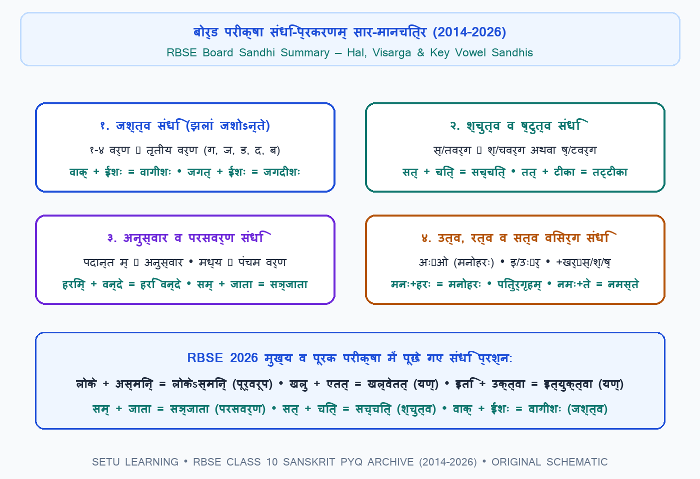

## 3. सम् + जाता इत्यस्य सन्धिपदम्।

**स्रोत:** 2026 मुख्य, प्रश्न 1(x), PDF पृष्ठ 3 · **अंक:** 1 अंक

**अध्याय-संबंध:** प्रकरण १ — संधि-प्रकरणम् (व्यंजन, विसर्ग एवं प्रमुख स्वर संधिः)

**हल:** सच्चित् = सत् + चित् (श्चुत्व व्यंजन संधिः — त् को च्); रामश्च = रामस् + च (श्चुत्व संधिः); सम् + जाता = सञ्जाता (परसवर्ण संधिः — ज के योग में अनुस्वार को ञ्); हरिम् + वन्दे = हरिं वन्दे (अनुस्वार संधिः)।

[मूल प्रश्न देखें](https://rajeduboard.rajasthan.gov.in/books/PAPERS-2026/Sec/S-71.pdf#page=3)

## 4. खल्वेतत् पदस्य सन्धिः।

**स्रोत:** 2026 मुख्य, प्रश्न 1(xi), PDF पृष्ठ 3 · **अंक:** 1 अंक

**अध्याय-संबंध:** प्रकरण १ — संधि-प्रकरणम् (व्यंजन, विसर्ग एवं प्रमुख स्वर संधिः)

**हल:** लोकेऽस्मिन् = लोके + अस्मिन् (पूर्वरूप संधिः); खल्वेतत् = खलु + एतत् (यण् संधिः); इत्युक्त्वा = इति + उक्त्वा (यण् संधिः); स्वागतम् = सु + आगतम् (यण् संधिः); प्रत्यागच्छति = प्रति + आगच्छति (यण् संधिः)।

[मूल प्रश्न देखें](https://rajeduboard.rajasthan.gov.in/books/PAPERS-2026/Sec/S-71.pdf#page=3)

चित्र सहायता: इसी अध्याय में इस अवधारणा का पहले दिया नामांकित schematic देखें।

## 5. दशाननः पदे समासः।

**स्रोत:** 2026 मुख्य, प्रश्न 1(xii), PDF पृष्ठ 3 · **अंक:** 1 अंक

**अध्याय-संबंध:** प्रकरण २ — समास-प्रकरणम् (अव्ययीभावः, तत्पुरुषः, कर्मधारयः, द्विगुः, द्वन्द्वः, बहुव्रीहिः)

**हल:** दशाननः = दश आननानि यस्य सः (रावणः — बहुव्रीहि समासः); पीताम्बरः = पीतम् अम्बरं यस्य सः (विष्णुः — बहुव्रीहिः; पीताम्बरम् = पीतं च तत् अम्बरम् — कर्मधारयः); प्रक्षालितपादम् = प्रक्षालितौ पादौ यस्य तम् (बहुव्रीहिः); विमूढधीः = विमूढा धीः यस्य सः (बहुव्रीहिः)।

[मूल प्रश्न देखें](https://rajeduboard.rajasthan.gov.in/books/PAPERS-2026/Sec/S-71.pdf#page=3)

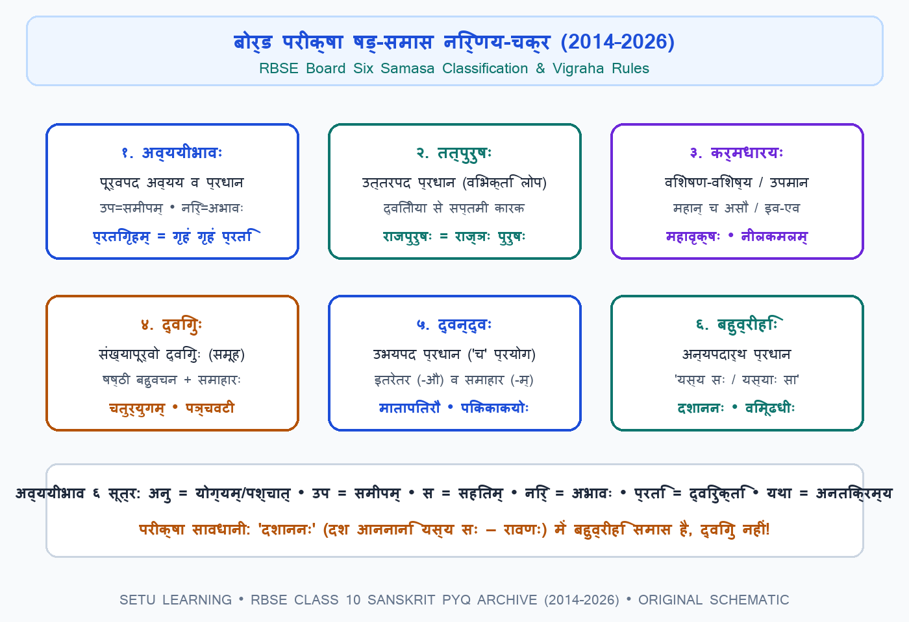

## 6. ग्रामम् अभितः वृक्षाः उपपद-चयनम्।

**स्रोत:** 2026 मुख्य, प्रश्न 1(xiii), PDF पृष्ठ 3 · **अंक:** 1 अंक

**अध्याय-संबंध:** प्रकरण ७ — कारक, उपपद-विभक्तयः एवं अशुद्धि-संशोधनम्

**हल:** ग्रामम् अभितः वृक्षाः सन्ति ('अभितः' योगे द्वितीया); धिक् चौरम् ('धिक्' योगे द्वितीया); मन्दिरम् उपर्युपरि ('उपर्युपरि' योगे द्वितीया); जलं विना ('विना' योगे द्वितीया/तृतीया/पंचमी); सीता रामेण सह गच्छति / मया साकम् ('सह/साकम्' योगे तृतीया); अलम् अतिदाक्षिण्येन ('अलम्' निषेधार्थे तृतीया); शिवाय नमः / गणेशाय नमः / अग्नये स्वाहा ('नमः/स्वाहा' योगे चतुर्थी); सिंहात् बिभेति ('भी' धातु भयहेतु योगे पंचमी)।

[मूल प्रश्न देखें](https://rajeduboard.rajasthan.gov.in/books/PAPERS-2026/Sec/S-71.pdf#page=3)

## 7. त्वया किम् क्रियते कर्तृपद-चयनम्।

**स्रोत:** 2026 मुख्य, प्रश्न 1(xvi), PDF पृष्ठ 3 · **अंक:** 1 अंक

**अध्याय-संबंध:** प्रकरण ६ — वाच्य-परिवर्तनम् (कर्तृवाच्यम्, कर्मवाच्यम्, भाववाच्यम्)

**हल:** मोहनः ग्रामं गच्छति → मोहनेन ग्रामः गम्यते; आचार्यः ग्रन्थं पठति → आचार्येण ग्रन्थः पठ्यते; त्वया किम् क्रियते / छात्रेण ग्रन्थः पठ्यते; सीतया गीतं गीयते → सीता गीतं गायति; अहं ग्रन्थं पठामि → मया ग्रन्थः पठ्यते; त्वया पाठः लिख्यते → त्वं पाठं लिखसि; सः स्वपिति → तेन सुप्यते; सः हसति → तेन हस्यते; अहं साधुं पश्यामि → मया साधुः दृश्यते।

[मूल प्रश्न देखें](https://rajeduboard.rajasthan.gov.in/books/PAPERS-2026/Sec/S-71.pdf#page=3)

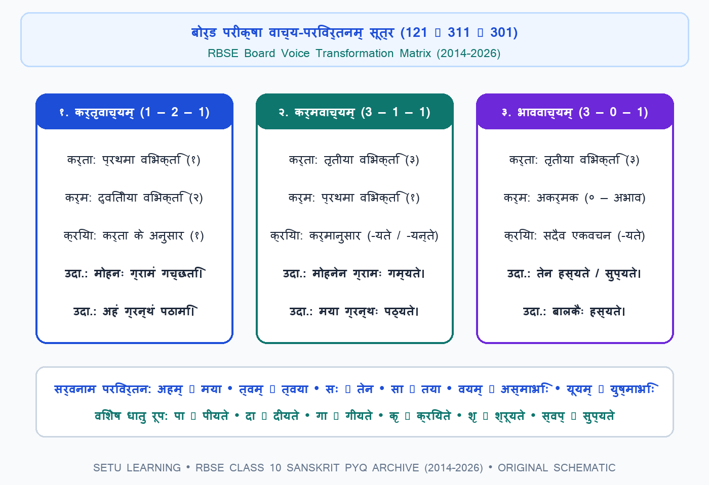

## 8. 8:15 (सपाद-अष्ट) समय-लेखनम्।

**स्रोत:** 2026 मुख्य, प्रश्न 1(xvii), PDF पृष्ठ 3 · **अंक:** 1 अंक

**अध्याय-संबंध:** प्रकरण ५ — समय-लेखनम् एवं संख्यावाची-शब्दाः (घटिका-चित्रम्)

**हल:** 8:15 = सपाद-अष्टवादने (सपादाष्टवादने); 9:30 = सार्धनववादने; 5:45 = पादोनषड्वादने; 8:30 = सार्ध-अष्टवादने; 10:00 = दशवादने। नियम: :15 के लिए 'सपाद', :30 के लिए 'सार्ध', और :45 के लिए 'पादोन + अगली संख्या' लिखते हैं।

[मूल प्रश्न देखें](https://rajeduboard.rajasthan.gov.in/books/PAPERS-2026/Sec/S-71.pdf#page=3)

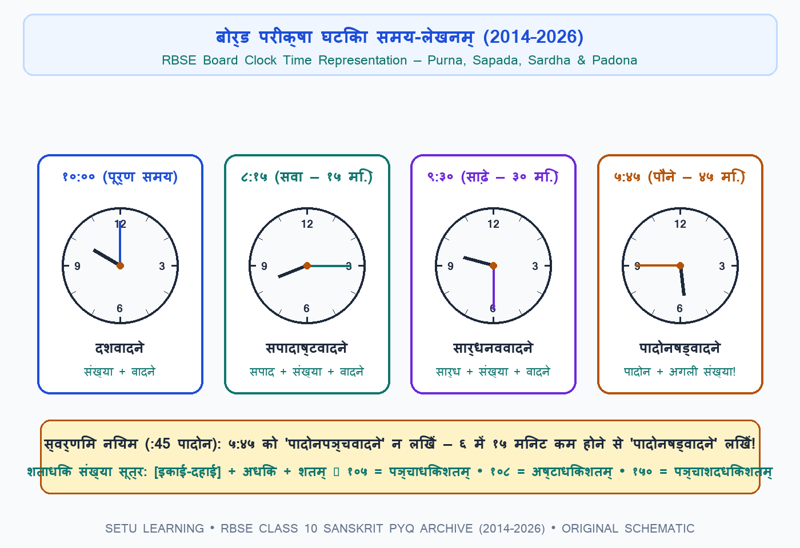

## 9. कृ + अनीयर् (करणीयम्) प्रत्यय-प्रयोगः।

**स्रोत:** 2026 मुख्य, प्रश्न 2(i), PDF पृष्ठ 4 · **अंक:** 1 अंक

**अध्याय-संबंध:** प्रकरण ३ — प्रत्यय-प्रकरणम् (कृत्, तद्धित एवं स्त्री-प्रत्ययाः)

**हल:** कृ + अनीयर् = करणीयम् (नपुंसकलिंग); हन् + तव्यत् = हन्तव्यः (पुल्लिंग); शङ्क् + अनीयर् = शङ्कनीयः; दृश् + अनीयर् = दर्शनीयम्; पाल् + अनीयर् = पालनीयम्; पा + अनीयर् = पानीयम्; पूज् + अनीयर् = पूजनीयः।

[मूल प्रश्न देखें](https://rajeduboard.rajasthan.gov.in/books/PAPERS-2026/Sec/S-71.pdf#page=4)

## 10. रामः सोमः च अपठित-गद्यांशः।

**स्रोत:** 2026 मुख्य, प्रश्न 3, PDF पृष्ठ 4 · **अंक:** 8 अंक

**अध्याय-संबंध:** प्रकरण ८ — अपठित-अवबोधनम् (गद्यांश-अवबोधनम् एवं भाषिक-कार्यम्)

**हल:** अपठित गद्यांश (8 अंक) में: (1) एकपदेन उत्तरत में केवल एक सटीक शब्द लिखें; (2) पूर्णवाक्येन में प्रश्नवाचक पद हटाकर पूर्ण वाक्य लिखें; (3) शीर्षकम् में गद्यांश का केंद्रीय विषय प्रथमा या षष्ठी में 1-3 शब्दों में लिखें (जैसे — 'सत्यस्य विजयः', 'पर्यावरणम्', 'महाराणाप्रतापः', 'अनुशासनम्', 'भारतीयसंस्कृतिः', 'नारीशिक्षा', 'परोपकारः', 'विश्वबन्धुत्वम्'); (4) भाषिककार्यम् में प्रथमा कर्ता, अंतिम क्रिया और समान विभक्ति वाला विशेषण-विशेष्य चुनें।

[मूल प्रश्न देखें](https://rajeduboard.rajasthan.gov.in/books/PAPERS-2026/Sec/S-71.pdf#page=4)

## 11. 5:45 (पादोनषड्वादने) घटिका-समयः।

**स्रोत:** 2026 मुख्य, प्रश्न 4(ii), PDF पृष्ठ 5 · **अंक:** 1 अंक

**अध्याय-संबंध:** प्रकरण ५ — समय-लेखनम् एवं संख्यावाची-शब्दाः (घटिका-चित्रम्)

**हल:** 8:15 = सपाद-अष्टवादने (सपादाष्टवादने); 9:30 = सार्धनववादने; 5:45 = पादोनषड्वादने; 8:30 = सार्ध-अष्टवादने; 10:00 = दशवादने। नियम: :15 के लिए 'सपाद', :30 के लिए 'सार्ध', और :45 के लिए 'पादोन + अगली संख्या' लिखते हैं।

[मूल प्रश्न देखें](https://rajeduboard.rajasthan.gov.in/books/PAPERS-2026/Sec/S-71.pdf#page=5)

चित्र सहायता: इसी अध्याय में इस अवधारणा का पहले दिया नामांकित schematic देखें।

## 12. अहं श्वः विद्यालयं गमिष्यामि संशोधनम्।

**स्रोत:** 2026 मुख्य, प्रश्न 5, PDF पृष्ठ 5 · **अंक:** 2 अंक

**अध्याय-संबंध:** प्रकरण ७ — कारक, उपपद-विभक्तयः एवं अशुद्धि-संशोधनम्

**हल:** अहं श्वः विद्यालयं गच्छामि (अशुद्ध) → अहं श्वः विद्यालयं गमिष्यामि ('श्वः' के साथ लृट् लकार); गणेशं नमः (अशुद्ध) → गणेशाय नमः ('नमः' के योग में चतुर्थी); सः गृहे वसति (लट् लकार प्रथम पुरुष एकवचन); सत्यमेव जयते, असत्यं पराजितं भवति; प्रच्छ् लृट् = प्रक्ष्यति, अस्मद् षष्ठी बहुवचन = अस्माकम्, युष्मद् षष्ठी एकवचन = तव, पितृ चतुर्थी एकवचन = पित्रे।

[मूल प्रश्न देखें](https://rajeduboard.rajasthan.gov.in/books/PAPERS-2026/Sec/S-71.pdf#page=5)

## 13. एकेन राजहंसेन श्लोक-भावार्थः।

**स्रोत:** 2026 मुख्य, प्रश्न 8, PDF पृष्ठ 5 · **अंक:** 2 अंक

**अध्याय-संबंध:** दशमः पाठः — अन्योक्तयः (पण्डितराज जगन्नाथः, भर्तृहरिः आदयः)

**हल:** 'एकेन राजहंसेन या शोभा सरसो भवेत्, न सा बकसहस्रेण परितस्तीरवासिना' — एक ही राजहंस (गुणी विद्वान) से सरोवर (समाज) की जो शोभा होती है, वह किनारे पर रहने वाले हजारों बगुलों (मूर्खों) से नहीं होती।

[मूल प्रश्न देखें](https://rajeduboard.rajasthan.gov.in/books/PAPERS-2026/Sec/S-71.pdf#page=5)

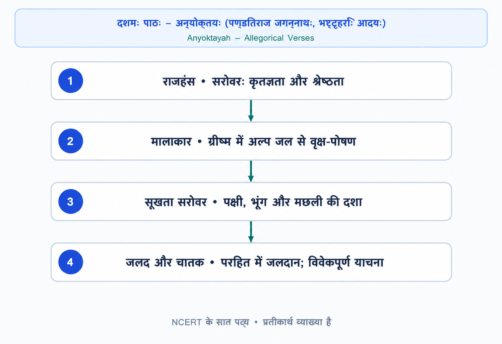

## 2026 — पूरक परीक्षा

[2026 पूरक: पूरा आधिकारिक प्रश्न-पत्र (S-71)](https://rajeduboard.rajasthan.gov.in/books/PAPERS-2026/SecSUP/S-71.pdf)

## 14. इति + उक्त्वा इत्यस्य सन्धिपदम्।

**स्रोत:** 2026 पूरक, प्रश्न 1(x), PDF पृष्ठ 3 · **अंक:** 1 अंक

**अध्याय-संबंध:** प्रकरण १ — संधि-प्रकरणम् (व्यंजन, विसर्ग एवं प्रमुख स्वर संधिः)

**हल:** लोकेऽस्मिन् = लोके + अस्मिन् (पूर्वरूप संधिः); खल्वेतत् = खलु + एतत् (यण् संधिः); इत्युक्त्वा = इति + उक्त्वा (यण् संधिः); स्वागतम् = सु + आगतम् (यण् संधिः); प्रत्यागच्छति = प्रति + आगच्छति (यण् संधिः)।

[मूल प्रश्न देखें](https://rajeduboard.rajasthan.gov.in/books/PAPERS-2026/SecSUP/S-71.pdf#page=3)

चित्र सहायता: इसी अध्याय में इस अवधारणा का पहले दिया नामांकित schematic देखें।

## 15. सच्चित् पदस्य सन्धि-विच्छेदः।

**स्रोत:** 2026 पूरक, प्रश्न 1(xi), PDF पृष्ठ 3 · **अंक:** 1 अंक

**अध्याय-संबंध:** प्रकरण १ — संधि-प्रकरणम् (व्यंजन, विसर्ग एवं प्रमुख स्वर संधिः)

**हल:** सच्चित् = सत् + चित् (श्चुत्व व्यंजन संधिः — त् को च्); रामश्च = रामस् + च (श्चुत्व संधिः); सम् + जाता = सञ्जाता (परसवर्ण संधिः — ज के योग में अनुस्वार को ञ्); हरिम् + वन्दे = हरिं वन्दे (अनुस्वार संधिः)।

[मूल प्रश्न देखें](https://rajeduboard.rajasthan.gov.in/books/PAPERS-2026/SecSUP/S-71.pdf#page=3)

## 16. महावृक्षः पदे समासः।

**स्रोत:** 2026 पूरक, प्रश्न 1(xii), PDF पृष्ठ 3 · **अंक:** 1 अंक

**अध्याय-संबंध:** प्रकरण २ — समास-प्रकरणम् (अव्ययीभावः, तत्पुरुषः, कर्मधारयः, द्विगुः, द्वन्द्वः, बहुव्रीहिः)

**हल:** महावृक्षः = महान् च असौ वृक्षः (कर्मधारय समासः); महापुरुषः = महान् च असौ पुरुषः (कर्मधारयः); नीलकमलम् = नीलं च तत् कमलम् (कर्मधारयः); वीरपुरुषः = वीरः च असौ पुरुषः (कर्मधारयः); कृष्णसर्पः = कृष्णः च असौ सर्पः (कर्मधारयः)।

[मूल प्रश्न देखें](https://rajeduboard.rajasthan.gov.in/books/PAPERS-2026/SecSUP/S-71.pdf#page=3)

## 17. रामेण सह इत्यत्र तृतीया विभक्तिः।

**स्रोत:** 2026 पूरक, प्रश्न 1(xiii), PDF पृष्ठ 3 · **अंक:** 1 अंक

**अध्याय-संबंध:** प्रकरण ७ — कारक, उपपद-विभक्तयः एवं अशुद्धि-संशोधनम्

**हल:** ग्रामम् अभितः वृक्षाः सन्ति ('अभितः' योगे द्वितीया); धिक् चौरम् ('धिक्' योगे द्वितीया); मन्दिरम् उपर्युपरि ('उपर्युपरि' योगे द्वितीया); जलं विना ('विना' योगे द्वितीया/तृतीया/पंचमी); सीता रामेण सह गच्छति / मया साकम् ('सह/साकम्' योगे तृतीया); अलम् अतिदाक्षिण्येन ('अलम्' निषेधार्थे तृतीया); शिवाय नमः / गणेशाय नमः / अग्नये स्वाहा ('नमः/स्वाहा' योगे चतुर्थी); सिंहात् बिभेति ('भी' धातु भयहेतु योगे पंचमी)।

[मूल प्रश्न देखें](https://rajeduboard.rajasthan.gov.in/books/PAPERS-2026/SecSUP/S-71.pdf#page=3)

## 18. धिक् चौरम् इत्यत्र द्वितीया विभक्तिः।

**स्रोत:** 2026 पूरक, प्रश्न 1(xiv), PDF पृष्ठ 3 · **अंक:** 1 अंक

**अध्याय-संबंध:** प्रकरण ७ — कारक, उपपद-विभक्तयः एवं अशुद्धि-संशोधनम्

**हल:** ग्रामम् अभितः वृक्षाः सन्ति ('अभितः' योगे द्वितीया); धिक् चौरम् ('धिक्' योगे द्वितीया); मन्दिरम् उपर्युपरि ('उपर्युपरि' योगे द्वितीया); जलं विना ('विना' योगे द्वितीया/तृतीया/पंचमी); सीता रामेण सह गच्छति / मया साकम् ('सह/साकम्' योगे तृतीया); अलम् अतिदाक्षिण्येन ('अलम्' निषेधार्थे तृतीया); शिवाय नमः / गणेशाय नमः / अग्नये स्वाहा ('नमः/स्वाहा' योगे चतुर्थी); सिंहात् बिभेति ('भी' धातु भयहेतु योगे पंचमी)।

[मूल प्रश्न देखें](https://rajeduboard.rajasthan.gov.in/books/PAPERS-2026/SecSUP/S-71.pdf#page=3)

## 19. छात्रेण ग्रन्थः पठ्यते वाच्य-चयनम्।

**स्रोत:** 2026 पूरक, प्रश्न 1(xvi), PDF पृष्ठ 3 · **अंक:** 1 अंक

**अध्याय-संबंध:** प्रकरण ६ — वाच्य-परिवर्तनम् (कर्तृवाच्यम्, कर्मवाच्यम्, भाववाच्यम्)

**हल:** मोहनः ग्रामं गच्छति → मोहनेन ग्रामः गम्यते; आचार्यः ग्रन्थं पठति → आचार्येण ग्रन्थः पठ्यते; त्वया किम् क्रियते / छात्रेण ग्रन्थः पठ्यते; सीतया गीतं गीयते → सीता गीतं गायति; अहं ग्रन्थं पठामि → मया ग्रन्थः पठ्यते; त्वया पाठः लिख्यते → त्वं पाठं लिखसि; सः स्वपिति → तेन सुप्यते; सः हसति → तेन हस्यते; अहं साधुं पश्यामि → मया साधुः दृश्यते।

[मूल प्रश्न देखें](https://rajeduboard.rajasthan.gov.in/books/PAPERS-2026/SecSUP/S-71.pdf#page=3)

चित्र सहायता: इसी अध्याय में इस अवधारणा का पहले दिया नामांकित schematic देखें।

## 20. 9:30 (सार्ध-नव) समय-चयनम्।

**स्रोत:** 2026 पूरक, प्रश्न 1(xvii), PDF पृष्ठ 3 · **अंक:** 1 अंक

**अध्याय-संबंध:** प्रकरण ५ — समय-लेखनम् एवं संख्यावाची-शब्दाः (घटिका-चित्रम्)

**हल:** 8:15 = सपाद-अष्टवादने (सपादाष्टवादने); 9:30 = सार्धनववादने; 5:45 = पादोनषड्वादने; 8:30 = सार्ध-अष्टवादने; 10:00 = दशवादने। नियम: :15 के लिए 'सपाद', :30 के लिए 'सार्ध', और :45 के लिए 'पादोन + अगली संख्या' लिखते हैं।

[मूल प्रश्न देखें](https://rajeduboard.rajasthan.gov.in/books/PAPERS-2026/SecSUP/S-71.pdf#page=3)

चित्र सहायता: इसी अध्याय में इस अवधारणा का पहले दिया नामांकित schematic देखें।

## 21. हन् + तव्यत् (हन्तव्यः) प्रत्ययः।

**स्रोत:** 2026 पूरक, प्रश्न 2(iv), PDF पृष्ठ 4 · **अंक:** 1 अंक

**अध्याय-संबंध:** प्रकरण ३ — प्रत्यय-प्रकरणम् (कृत्, तद्धित एवं स्त्री-प्रत्ययाः)

**हल:** कृ + अनीयर् = करणीयम् (नपुंसकलिंग); हन् + तव्यत् = हन्तव्यः (पुल्लिंग); शङ्क् + अनीयर् = शङ्कनीयः; दृश् + अनीयर् = दर्शनीयम्; पाल् + अनीयर् = पालनीयम्; पा + अनीयर् = पानीयम्; पूज् + अनीयर् = पूजनीयः।

[मूल प्रश्न देखें](https://rajeduboard.rajasthan.gov.in/books/PAPERS-2026/SecSUP/S-71.pdf#page=4)

## 22. पर्यावरणम् अपठित-गद्यांशः।

**स्रोत:** 2026 पूरक, प्रश्न 3, PDF पृष्ठ 4 · **अंक:** 8 अंक

**अध्याय-संबंध:** प्रकरण ८ — अपठित-अवबोधनम् (गद्यांश-अवबोधनम् एवं भाषिक-कार्यम्)

**हल:** अपठित गद्यांश (8 अंक) में: (1) एकपदेन उत्तरत में केवल एक सटीक शब्द लिखें; (2) पूर्णवाक्येन में प्रश्नवाचक पद हटाकर पूर्ण वाक्य लिखें; (3) शीर्षकम् में गद्यांश का केंद्रीय विषय प्रथमा या षष्ठी में 1-3 शब्दों में लिखें (जैसे — 'सत्यस्य विजयः', 'पर्यावरणम्', 'महाराणाप्रतापः', 'अनुशासनम्', 'भारतीयसंस्कृतिः', 'नारीशिक्षा', 'परोपकारः', 'विश्वबन्धुत्वम्'); (4) भाषिककार्यम् में प्रथमा कर्ता, अंतिम क्रिया और समान विभक्ति वाला विशेषण-विशेष्य चुनें।

[मूल प्रश्न देखें](https://rajeduboard.rajasthan.gov.in/books/PAPERS-2026/SecSUP/S-71.pdf#page=4)

## 23. गणेशाय नमः अशुद्धि-संशोधनम्।

**स्रोत:** 2026 पूरक, प्रश्न 5, PDF पृष्ठ 5 · **अंक:** 2 अंक

**अध्याय-संबंध:** प्रकरण ७ — कारक, उपपद-विभक्तयः एवं अशुद्धि-संशोधनम्

**हल:** अहं श्वः विद्यालयं गच्छामि (अशुद्ध) → अहं श्वः विद्यालयं गमिष्यामि ('श्वः' के साथ लृट् लकार); गणेशं नमः (अशुद्ध) → गणेशाय नमः ('नमः' के योग में चतुर्थी); सः गृहे वसति (लट् लकार प्रथम पुरुष एकवचन); सत्यमेव जयते, असत्यं पराजितं भवति; प्रच्छ् लृट् = प्रक्ष्यति, अस्मद् षष्ठी बहुवचन = अस्माकम्, युष्मद् षष्ठी एकवचन = तव, पितृ चतुर्थी एकवचन = पित्रे।

[मूल प्रश्न देखें](https://rajeduboard.rajasthan.gov.in/books/PAPERS-2026/SecSUP/S-71.pdf#page=5)

## 24. आचार्येण ग्रन्थः पठ्यते वाच्य-परिवर्तनम्।

**स्रोत:** 2026 पूरक, प्रश्न 6, PDF पृष्ठ 5 · **अंक:** 2 अंक

**अध्याय-संबंध:** प्रकरण ६ — वाच्य-परिवर्तनम् (कर्तृवाच्यम्, कर्मवाच्यम्, भाववाच्यम्)

**हल:** मोहनः ग्रामं गच्छति → मोहनेन ग्रामः गम्यते; आचार्यः ग्रन्थं पठति → आचार्येण ग्रन्थः पठ्यते; त्वया किम् क्रियते / छात्रेण ग्रन्थः पठ्यते; सीतया गीतं गीयते → सीता गीतं गायति; अहं ग्रन्थं पठामि → मया ग्रन्थः पठ्यते; त्वया पाठः लिख्यते → त्वं पाठं लिखसि; सः स्वपिति → तेन सुप्यते; सः हसति → तेन हस्यते; अहं साधुं पश्यामि → मया साधुः दृश्यते।

[मूल प्रश्न देखें](https://rajeduboard.rajasthan.gov.in/books/PAPERS-2026/SecSUP/S-71.pdf#page=5)

चित्र सहायता: इसी अध्याय में इस अवधारणा का पहले दिया नामांकित schematic देखें।

## 25. सेवितव्यो महावृक्षः श्लोक-भावार्थः।

**स्रोत:** 2026 पूरक, प्रश्न 8, PDF पृष्ठ 5 · **अंक:** 2 अंक

**अध्याय-संबंध:** पञ्चमः पाठः — सुभाषितानि (नीति-श्लोकाः)

**हल:** 'सेवितव्यो महावृक्षः फलच्छायासमन्वितः' — फल और छाया से युक्त महान वृक्ष (सज्जन) का आश्रय लेना चाहिए; यदि भाग्यवश फल न भी हो, तो उसकी शीतल छाया को कौन रोक सकता है?

[मूल प्रश्न देखें](https://rajeduboard.rajasthan.gov.in/books/PAPERS-2026/SecSUP/S-71.pdf#page=5)

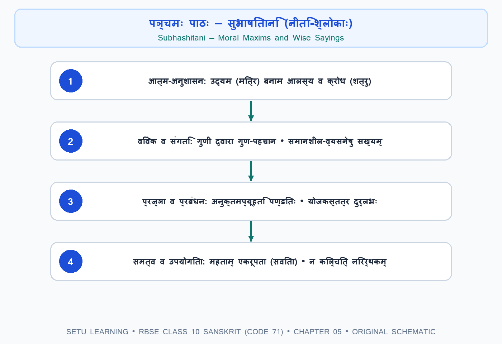

## 26. बुद्धिर्बलवती सदा अथवा विचित्रः साक्षी सारः।

**स्रोत:** 2026 पूरक, प्रश्न 11, PDF पृष्ठ 5 · **अंक:** 2 अंक

**अध्याय-संबंध:** द्वितीयः पाठः — बुद्धिर्बलवती सदा (शुकसप्ततिः)

**हल:** 'शुकसप्ततिः' से संकलित इस कथा में बुद्धिमती घने वन में बाघ को देखकर बेटों को डाँटती है कि एक बाघ को बाँटकर खा लो; सियार के साथ लौटे बाघ को पुनः प्रत्युत्पन्नमति से डराकर भगा देती है। शिक्षा: बुद्धि सदैव बलवती होती है।

[मूल प्रश्न देखें](https://rajeduboard.rajasthan.gov.in/books/PAPERS-2026/SecSUP/S-71.pdf#page=5)

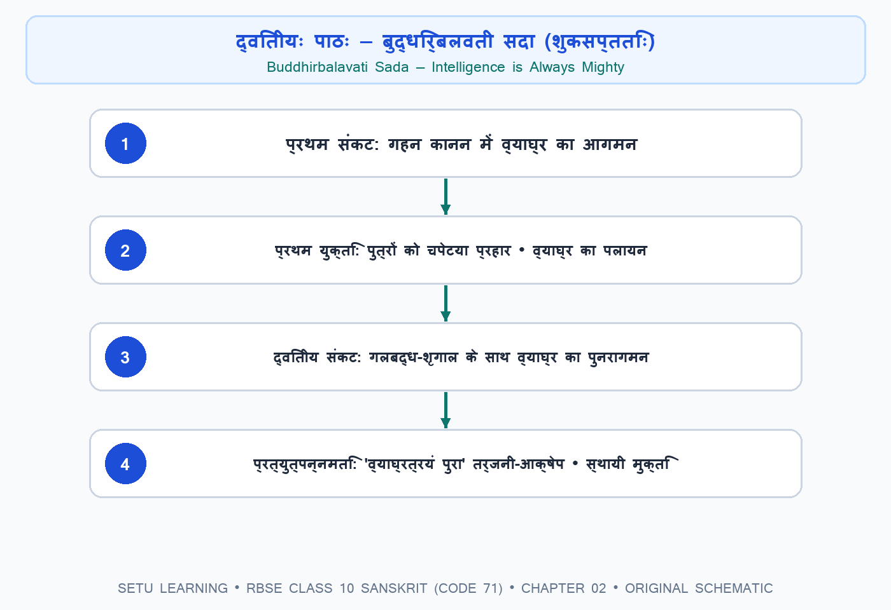

## 2025 — मुख्य परीक्षा

[2025 मुख्य: पूरा आधिकारिक प्रश्न-पत्र (S-71)](https://rajeduboard.rajasthan.gov.in/books/PAPERS-2025/Sec/S-71.pdf)

## 27. का सभ्यता निसर्गे समाविष्टा न स्यात्?

**स्रोत:** 2025 मुख्य, प्रश्न 1(i), PDF पृष्ठ 2 · **अंक:** 1 अंक

**अध्याय-संबंध:** प्रथमः पाठः — शुचिपर्यावरणम्

**हल:** सही विकल्प **ब — पाषाणी**। पहले इस reference पर आलस्यं रिपुः का समाधान रखा गया था; वह इस मूल प्रश्न का विषय नहीं है।

[मूल प्रश्न देखें](https://rajeduboard.rajasthan.gov.in/books/PAPERS-2025/Sec/S-71.pdf#page=2)

## 28. हस् + शतृ (हसन्) प्रत्यय-पूरणम्।

**स्रोत:** 2025 मुख्य, प्रश्न 2(i), PDF पृष्ठ 4 · **अंक:** 1 अंक

**अध्याय-संबंध:** प्रकरण ३ — प्रत्यय-प्रकरणम् (कृत्, तद्धित एवं स्त्री-प्रत्ययाः)

**हल:** हस् + शतृ = हसन् (पुल्लिंग एकवचन); गम् + शतृ = गच्छन्; पठ् + शतृ = पठन्; धाव् + शतृ = धावन्; नृत् + शतृ + ङीप् = नृत्यन्ती (स्त्रीलिंग); सेव् + शानच् = सेवमानः; शङ्क् + शानच् = शङ्कमानः; वि + मुच् + क्त + टाप् = विमुक्ता; युज् + क्त + टाप् = युक्ता।

[मूल प्रश्न देखें](https://rajeduboard.rajasthan.gov.in/books/PAPERS-2025/Sec/S-71.pdf#page=4)

## 29. कृतज्ञ + तल् (कृतज्ञताम्) प्रत्ययः।

**स्रोत:** 2025 मुख्य, प्रश्न 2(ii), PDF पृष्ठ 4 · **अंक:** 1 अंक

**अध्याय-संबंध:** प्रकरण ३ — प्रत्यय-प्रकरणम् (कृत्, तद्धित एवं स्त्री-प्रत्ययाः)

**हल:** महत् + त्व = महत्त्वम्; सम + त्व = समत्वम्; नर + त्व = नरत्वम्; रम्य + त्व = रम्यत्वम्; कृतज्ञ + तल् = कृतज्ञता (द्वितीया: कृतज्ञताम्); जन + तल् = जनता; कुमार + ङीप् = कुमारी; नद + ङीप् = नदी; अज + टाप् = अजा; बालक + टाप् = बालिका; शिक्षक + टाप् = शिक्षिका; चतुर + टाप् = चतुरा; चपल + टाप् = चपला।

[मूल प्रश्न देखें](https://rajeduboard.rajasthan.gov.in/books/PAPERS-2025/Sec/S-71.pdf#page=4)

## 30. चौरस्य पादध्वनिना प्रबुद्धः अतिथिः।

**स्रोत:** 2025 मुख्य, प्रश्न 2(iv), PDF पृष्ठ 4 · **अंक:** 1 अंक

**अध्याय-संबंध:** सप्तमः पाठः — विचित्रः साक्षी (ओमप्रकाश ठाकुरः)

**हल:** रात्रि में घर में घुसे चोर के पैरों की आहट से ('चौरस्य पादध्वनिना') अतिथि जाग गया और चोर के पीछे दौड़ा; दयालु गृहस्थ ('करुणापरो गृही') ने अतिथि को आश्रय दिया था।

[मूल प्रश्न देखें](https://rajeduboard.rajasthan.gov.in/books/PAPERS-2025/Sec/S-71.pdf#page=4)

## 31. महाराणाप्रतापः अपठित-गद्यांशः।

**स्रोत:** 2025 मुख्य, प्रश्न 3, PDF पृष्ठ 4 · **अंक:** 8 अंक

**अध्याय-संबंध:** प्रकरण ८ — अपठित-अवबोधनम् (गद्यांश-अवबोधनम् एवं भाषिक-कार्यम्)

**हल:** अपठित गद्यांश (8 अंक) में: (1) एकपदेन उत्तरत में केवल एक सटीक शब्द लिखें; (2) पूर्णवाक्येन में प्रश्नवाचक पद हटाकर पूर्ण वाक्य लिखें; (3) शीर्षकम् में गद्यांश का केंद्रीय विषय प्रथमा या षष्ठी में 1-3 शब्दों में लिखें (जैसे — 'सत्यस्य विजयः', 'पर्यावरणम्', 'महाराणाप्रतापः', 'अनुशासनम्', 'भारतीयसंस्कृतिः', 'नारीशिक्षा', 'परोपकारः', 'विश्वबन्धुत्वम्'); (4) भाषिककार्यम् में प्रथमा कर्ता, अंतिम क्रिया और समान विभक्ति वाला विशेषण-विशेष्य चुनें।

[मूल प्रश्न देखें](https://rajeduboard.rajasthan.gov.in/books/PAPERS-2025/Sec/S-71.pdf#page=4)

## 32. अलम् अतिदाक्षिण्येन विभक्तिः कारणं च।

**स्रोत:** 2025 मुख्य, प्रश्न 4, PDF पृष्ठ 4 · **अंक:** 2 अंक

**अध्याय-संबंध:** प्रकरण ७ — कारक, उपपद-विभक्तयः एवं अशुद्धि-संशोधनम्

**हल:** ग्रामम् अभितः वृक्षाः सन्ति ('अभितः' योगे द्वितीया); धिक् चौरम् ('धिक्' योगे द्वितीया); मन्दिरम् उपर्युपरि ('उपर्युपरि' योगे द्वितीया); जलं विना ('विना' योगे द्वितीया/तृतीया/पंचमी); सीता रामेण सह गच्छति / मया साकम् ('सह/साकम्' योगे तृतीया); अलम् अतिदाक्षिण्येन ('अलम्' निषेधार्थे तृतीया); शिवाय नमः / गणेशाय नमः / अग्नये स्वाहा ('नमः/स्वाहा' योगे चतुर्थी); सिंहात् बिभेति ('भी' धातु भयहेतु योगे पंचमी)।

[मूल प्रश्न देखें](https://rajeduboard.rajasthan.gov.in/books/PAPERS-2025/Sec/S-71.pdf#page=4)

## 33. 105 (पञ्चाधिकशतम्) एवं 150 संख्या-लेखनम्।

**स्रोत:** 2025 मुख्य, प्रश्न 5, PDF पृष्ठ 4 · **अंक:** 2 अंक

**अध्याय-संबंध:** प्रकरण ५ — समय-लेखनम् एवं संख्यावाची-शब्दाः (घटिका-चित्रम्)

**हल:** 105 = पञ्चाधिकशतम्; 150 = पञ्चाशदधिकशतम्; 108 = अष्टाधिकशतम्; 141 = एकचत्वारिंशदधिकशतम्; 125 = पञ्चविंशत्यधिकशतम्; 328 = अष्टाविंशत्यधिकत्रिशतम्; 130 = त्रिंशदधिकशतम्; 445 = पञ्चचत्वारिंशदधिकचतुःशतम्; 1025 = पञ्चविंशत्यधिकसहस्रम्; 30 = त्रिंशत्; 20 = विंशतिः; 12 = द्वादश; 4 (पु.) = चत्वारः; 2 (पु.) = द्वौ।

[मूल प्रश्न देखें](https://rajeduboard.rajasthan.gov.in/books/PAPERS-2025/Sec/S-71.pdf#page=4)

## 34. रेखांकितपदानाम् आधारेण प्रश्ननिर्माणम्।

**स्रोत:** 2025 मुख्य, प्रश्न 6, PDF पृष्ठ 5 · **अंक:** 3 अंक

**अध्याय-संबंध:** प्रकरण ७ — कारक, उपपद-विभक्तयः एवं अशुद्धि-संशोधनम्

**हल:** प्रश्ननिर्माण में रेखांकित पद के लिंग, विभक्ति और वचन के अनुसार 'किम्' सर्वनाम या प्रश्नवाचक अव्यय लगाते हैं: प्रथमा पु. एकवचन → कः, बहुवचन → के; स्त्रीलिंग प्रथमा → का; षष्ठी बहुवचन → केषाम्/कासाम्; तृतीया → केन/कया/काभ्याम्; चतुर्थी → कस्मै; पंचमी → कस्मात्/कुतः; स्थान → कुत्र; विशेषण → कीदृशः/कीदृशम्।

[मूल प्रश्न देखें](https://rajeduboard.rajasthan.gov.in/books/PAPERS-2025/Sec/S-71.pdf#page=5)

## 35. भूकम्पविभीषिका पाठसारः (शिशुलालनम् का विकल्प)।

**स्रोत:** 2025 मुख्य, प्रश्न 10(ii), PDF पृष्ठ 5 · **अंक:** 2 अंक

**अध्याय-संबंध:** नवमः पाठः — भूकम्पविभीषिका (प्रो. अभिराज राजेन्द्र मिश्रः)

**हल:** २६ जनवरी २००१ को गुजरात के कच्छ (भुज) जनपद में आए भीषण भूकंप से बहुमंजिला भवन धराशायी हो गए। भूगर्भ में पाषाणशिलाओं के संघर्षण और ज्वालामुखी विस्फोट से भूकंप आता है। प्रकृति के समक्ष मानव 'वामनकल्पः' (बौने के समान) है; पंचतत्त्वों का संतुलन ही शांति का आधार है।

[मूल प्रश्न देखें](https://rajeduboard.rajasthan.gov.in/books/PAPERS-2025/Sec/S-71.pdf#page=5)

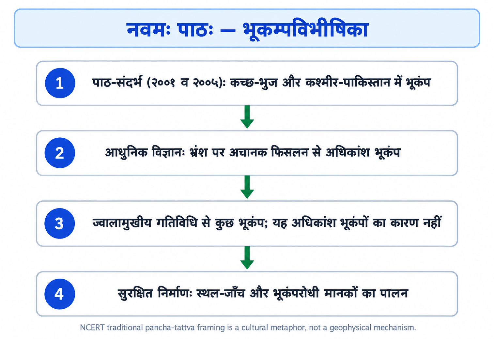

**समीक्षा-सीमा:** इस चयन का प्रश्न/विकल्प/पृष्ठ/अंक पुनः source-matched है। विस्तृत पाठसार का वैज्ञानिक एवं साहित्यिक समीक्षा-कार्य Chapter 9 के साथ शेष है।

## 36. चतुर्युगम् तथा माता च पिता च समासः।

**स्रोत:** 2025 मुख्य, प्रश्न 14, PDF पृष्ठ 8 · **अंक:** 3 अंक

**अध्याय-संबंध:** प्रकरण २ — समास-प्रकरणम् (अव्ययीभावः, तत्पुरुषः, कर्मधारयः, द्विगुः, द्वन्द्वः, बहुव्रीहिः)

**हल:** चतुर्युगम् = चतुर्णां युगानां समाहारः (द्विगु समासः); मातापितरौ / पितरौ = माता च पिता च (इतरेतर द्वन्द्व समासः); पिककाकयोः = पिकः च काकः च तयोः (द्वन्द्वः); शिवकेशवौ = शिवः च केशवः च (द्वन्द्वः); पाणिपादम् = पाणिः च पादौ च तेषां समाहारः (समाहार द्वन्द्वः); पत्रपुष्पम् = पत्रं च पुष्पं च अनयोः समाहारः (समाहार द्वन्द्वः)।

[मूल प्रश्न देखें](https://rajeduboard.rajasthan.gov.in/books/PAPERS-2025/Sec/S-71.pdf#page=8)

## 37. अवकाशार्थं प्रार्थना-पत्रम्।

**स्रोत:** 2025 मुख्य, प्रश्न 15, PDF पृष्ठ 9 · **अंक:** 4 अंक

**अध्याय-संबंध:** प्रकरण ९ — पत्र-लेखनम् (औपचारिकं प्रार्थना-पत्रम् एवं अनौपचारिकं पत्रम्)

**हल:** प्रार्थना-पत्र (4 अंक): सेवायाम्, श्रीमन्तः प्रधानाचार्यमहोदयाः... विषयः — दिनद्वयस्य रुग्णतावकाशार्थं / स्थानान्तरण-प्रमाणपत्रार्थं प्रार्थना-पत्रम्। महोदयाः, सविनयं निवेदनम् अस्ति यत् अहं सहसा ज्वरपीडितः अस्मि (अथवा पितुः स्थानान्तरणम् अभवत्), अतः विद्यालयम् आगन्तुम् असमर्थः अस्मि। कृपया अवकाशं / टी.सी. प्रदाय अनुग्रहीष्यन्ति। भवताम् आज्ञाकारी शिष्यः। अनौपचारिक पत्र में ऊपर दाएँ स्थान ('जयपुरतः'), संबोधन ('प्रिय मित्र'), प्रथम पंक्ति ('अत्र कुशलं तत्रास्तु') और अंत में 'तव सुहृद्' लिखें।

[मूल प्रश्न देखें](https://rajeduboard.rajasthan.gov.in/books/PAPERS-2025/Sec/S-71.pdf#page=9)

## 38. चित्र-वर्णनम् अथवा संवाद-पूर्तिः।

**स्रोत:** 2025 मुख्य, प्रश्न 16, PDF पृष्ठ 9 · **अंक:** 4 अंक

**अध्याय-संबंध:** प्रकरण १० — चित्र-वर्णनम्, अनुच्छेद-लेखनम् एवं संवाद-पूर्तिः

**हल:** चित्र-वर्णन (4 अंक) में 4 सरल वाक्य लिखें: (1) इदं चित्रम् उद्यानस्य / वृक्षारोपणस्य / विद्यालयस्य अस्ति। (2) अस्मिन् चित्रे हरिताः वृक्षाः सन्ति। (3) चित्रे बालकाः क्रीडन्ति / छात्राः पादपान् रोपयन्ति। (4) इदं चित्रम् अतीव रमणीयम् अस्ति। संवाद-पूर्ति में प्रश्न और उत्तर की जोड़ी ('त्वम् + पठसि' ↔ 'अहम् + पठामि') मिलाकर पूरा संवाद लिखें।

[मूल प्रश्न देखें](https://rajeduboard.rajasthan.gov.in/books/PAPERS-2025/Sec/S-71.pdf#page=9)

## 39. हिन्दीवाक्यानां संस्कृत-अनुवादः।

**स्रोत:** 2025 मुख्य, प्रश्न 17, PDF पृष्ठ 10 · **अंक:** 4 अंक

**अध्याय-संबंध:** प्रकरण ११ — अनुवाद-कार्यम् एवं घटनाक्रम-संयोजनम्

**हल:** अनुवाद (4 अंक): (1) ग्रामं परितः वृक्षाः सन्ति, (2) गङ्गा हिमालयात् प्रभवति, (3) बालकाय मोदकं रोचते, (4) सः श्वः जयपुरं गमिष्यति, (5) वयं संस्कृतं पठामः, (6) वृक्षात् पत्राणि पतन्ति, (7) कविषु कालिदासः श्रेष्ठः अस्ति। घटनाक्रम-संयोजन (3 अंक): 6 क्रम-रहित वाक्यों में पहले प्रारंभिक परिचय ('एकदा / अस्ति देउलाख्यो ग्रामः') रखें, बीच में संकट व प्रयास रखें और अंत में परिणाम ('अन्ते / मुक्तवान्') रखकर पूरे 6 वाक्य लिखें।

[मूल प्रश्न देखें](https://rajeduboard.rajasthan.gov.in/books/PAPERS-2025/Sec/S-71.pdf#page=10)

## 2025 — पूरक परीक्षा

[2025 पूरक: पूरा आधिकारिक प्रश्न-पत्र (S-71)](https://rajeduboard.rajasthan.gov.in/books/PAPERS-2025/SecSUP/S-71.pdf)

## 40. शतशकटीयानं कज्जलमलिनं धूमं मुञ्चति।

**स्रोत:** 2025 पूरक, प्रश्न 1(i), PDF पृष्ठ 2 · **अंक:** 1 अंक

**अध्याय-संबंध:** प्रथमः पाठः — शुचिपर्यावरणम् (हरिदत्त शर्मा)

**हल:** सैकड़ों मोटरगाड़ियाँ काजल के समान मलीन/काला ('कज्जलमलिनम्') धुआँ छोड़ती हैं ('कज्जलमलिनं धूमं मुञ्चति शतशकटीयानम्')। कर्मधारय समास: कज्जलम् इव मलिनम्।

[मूल प्रश्न देखें](https://rajeduboard.rajasthan.gov.in/books/PAPERS-2025/SecSUP/S-71.pdf#page=2)

## 41. नद + ङीप् (नदी) स्त्री-प्रत्ययः।

**स्रोत:** 2025 पूरक, प्रश्न 2(iii), PDF पृष्ठ 4 · **अंक:** 1 अंक

**अध्याय-संबंध:** प्रकरण ३ — प्रत्यय-प्रकरणम् (कृत्, तद्धित एवं स्त्री-प्रत्ययाः)

**हल:** महत् + त्व = महत्त्वम्; सम + त्व = समत्वम्; नर + त्व = नरत्वम्; रम्य + त्व = रम्यत्वम्; कृतज्ञ + तल् = कृतज्ञता (द्वितीया: कृतज्ञताम्); जन + तल् = जनता; कुमार + ङीप् = कुमारी; नद + ङीप् = नदी; अज + टाप् = अजा; बालक + टाप् = बालिका; शिक्षक + टाप् = शिक्षिका; चतुर + टाप् = चतुरा; चपल + टाप् = चपला।

[मूल प्रश्न देखें](https://rajeduboard.rajasthan.gov.in/books/PAPERS-2025/SecSUP/S-71.pdf#page=4)

## 42. सेव् + शानच् (सेवमानः) प्रत्ययः।

**स्रोत:** 2025 पूरक, प्रश्न 2(v), PDF पृष्ठ 4 · **अंक:** 1 अंक

**अध्याय-संबंध:** प्रकरण ३ — प्रत्यय-प्रकरणम् (कृत्, तद्धित एवं स्त्री-प्रत्ययाः)

**हल:** हस् + शतृ = हसन् (पुल्लिंग एकवचन); गम् + शतृ = गच्छन्; पठ् + शतृ = पठन्; धाव् + शतृ = धावन्; नृत् + शतृ + ङीप् = नृत्यन्ती (स्त्रीलिंग); सेव् + शानच् = सेवमानः; शङ्क् + शानच् = शङ्कमानः; वि + मुच् + क्त + टाप् = विमुक्ता; युज् + क्त + टाप् = युक्ता।

[मूल प्रश्न देखें](https://rajeduboard.rajasthan.gov.in/books/PAPERS-2025/SecSUP/S-71.pdf#page=4)

## 43. पर्यावरणस्य रक्षणम् अपठित-गद्यांशः।

**स्रोत:** 2025 पूरक, प्रश्न 3, PDF पृष्ठ 4 · **अंक:** 8 अंक

**अध्याय-संबंध:** प्रकरण ८ — अपठित-अवबोधनम् (गद्यांश-अवबोधनम् एवं भाषिक-कार्यम्)

**हल:** अपठित गद्यांश (8 अंक) में: (1) एकपदेन उत्तरत में केवल एक सटीक शब्द लिखें; (2) पूर्णवाक्येन में प्रश्नवाचक पद हटाकर पूर्ण वाक्य लिखें; (3) शीर्षकम् में गद्यांश का केंद्रीय विषय प्रथमा या षष्ठी में 1-3 शब्दों में लिखें (जैसे — 'सत्यस्य विजयः', 'पर्यावरणम्', 'महाराणाप्रतापः', 'अनुशासनम्', 'भारतीयसंस्कृतिः', 'नारीशिक्षा', 'परोपकारः', 'विश्वबन्धुत्वम्'); (4) भाषिककार्यम् में प्रथमा कर्ता, अंतिम क्रिया और समान विभक्ति वाला विशेषण-विशेष्य चुनें।

[मूल प्रश्न देखें](https://rajeduboard.rajasthan.gov.in/books/PAPERS-2025/SecSUP/S-71.pdf#page=4)

## 44. मया साकम् इत्यत्र तृतीया विभक्तिः।

**स्रोत:** 2025 पूरक, प्रश्न 4, PDF पृष्ठ 4 · **अंक:** 2 अंक

**अध्याय-संबंध:** प्रकरण ७ — कारक, उपपद-विभक्तयः एवं अशुद्धि-संशोधनम्

**हल:** ग्रामम् अभितः वृक्षाः सन्ति ('अभितः' योगे द्वितीया); धिक् चौरम् ('धिक्' योगे द्वितीया); मन्दिरम् उपर्युपरि ('उपर्युपरि' योगे द्वितीया); जलं विना ('विना' योगे द्वितीया/तृतीया/पंचमी); सीता रामेण सह गच्छति / मया साकम् ('सह/साकम्' योगे तृतीया); अलम् अतिदाक्षिण्येन ('अलम्' निषेधार्थे तृतीया); शिवाय नमः / गणेशाय नमः / अग्नये स्वाहा ('नमः/स्वाहा' योगे चतुर्थी); सिंहात् बिभेति ('भी' धातु भयहेतु योगे पंचमी)।

[मूल प्रश्न देखें](https://rajeduboard.rajasthan.gov.in/books/PAPERS-2025/SecSUP/S-71.pdf#page=4)

## 45. 108 (अष्टाधिकशतम्) एवं 141 संख्या-लेखनम्।

**स्रोत:** 2025 पूरक, प्रश्न 5, PDF पृष्ठ 4 · **अंक:** 2 अंक

**अध्याय-संबंध:** प्रकरण ५ — समय-लेखनम् एवं संख्यावाची-शब्दाः (घटिका-चित्रम्)

**हल:** 105 = पञ्चाधिकशतम्; 150 = पञ्चाशदधिकशतम्; 108 = अष्टाधिकशतम्; 141 = एकचत्वारिंशदधिकशतम्; 125 = पञ्चविंशत्यधिकशतम्; 328 = अष्टाविंशत्यधिकत्रिशतम्; 130 = त्रिंशदधिकशतम्; 445 = पञ्चचत्वारिंशदधिकचतुःशतम्; 1025 = पञ्चविंशत्यधिकसहस्रम्; 30 = त्रिंशत्; 20 = विंशतिः; 12 = द्वादश; 4 (पु.) = चत्वारः; 2 (पु.) = द्वौ।

[मूल प्रश्न देखें](https://rajeduboard.rajasthan.gov.in/books/PAPERS-2025/SecSUP/S-71.pdf#page=4)

## 46. वाक्येषु प्रश्ननिर्माणम्।

**स्रोत:** 2025 पूरक, प्रश्न 6, PDF पृष्ठ 4 · **अंक:** 3 अंक

**अध्याय-संबंध:** प्रकरण ७ — कारक, उपपद-विभक्तयः एवं अशुद्धि-संशोधनम्

**हल:** प्रश्ननिर्माण में रेखांकित पद के लिंग, विभक्ति और वचन के अनुसार 'किम्' सर्वनाम या प्रश्नवाचक अव्यय लगाते हैं: प्रथमा पु. एकवचन → कः, बहुवचन → के; स्त्रीलिंग प्रथमा → का; षष्ठी बहुवचन → केषाम्/कासाम्; तृतीया → केन/कया/काभ्याम्; चतुर्थी → कस्मै; पंचमी → कस्मात्/कुतः; स्थान → कुत्र; विशेषण → कीदृशः/कीदृशम्।

[मूल प्रश्न देखें](https://rajeduboard.rajasthan.gov.in/books/PAPERS-2025/SecSUP/S-71.pdf#page=4)

## 47. सम्पत्तौ च विपत्तौ च श्लोक-भावार्थः।

**स्रोत:** 2025 पूरक, प्रश्न 8, PDF पृष्ठ 5 · **अंक:** 2 अंक

**अध्याय-संबंध:** पञ्चमः पाठः — सुभाषितानि (नीति-श्लोकाः)

**हल:** संपत्ति और विपत्ति में महापुरुषों में एकरूपता होती है; जैसे सूर्य ('सविता') उदय के समय भी लाल ('रक्तः') होता है और अस्त के समय भी लाल ही रहता है।

[मूल प्रश्न देखें](https://rajeduboard.rajasthan.gov.in/books/PAPERS-2025/SecSUP/S-71.pdf#page=5)

## 48. जननी तुल्यवत्सला पाठसारः।

**स्रोत:** 2025 पूरक, प्रश्न 11, PDF पृष्ठ 6 · **अंक:** 2 अंक

**अध्याय-संबंध:** चतुर्थः पाठः — जननी तुल्यवत्सला (महर्षि वेदव्यासः — महाभारतम्)

**हल:** महाभारत के वनपर्व से संकलित 'जननी तुल्यवत्सला' पाठ में खेत में गिरे दुर्बल बैल को देखकर माता सुरभि रोती है। वह इंद्र से कहती है कि माता सब संतानों पर समान स्नेह रखती है, किंतु दुर्बल पुत्र पर उसकी कृपा स्वाभाविक रूप से अधिक होती है। इंद्र वर्षा करके बैल को कष्ट से मुक्त करते हैं।

[मूल प्रश्न देखें](https://rajeduboard.rajasthan.gov.in/books/PAPERS-2025/SecSUP/S-71.pdf#page=6)

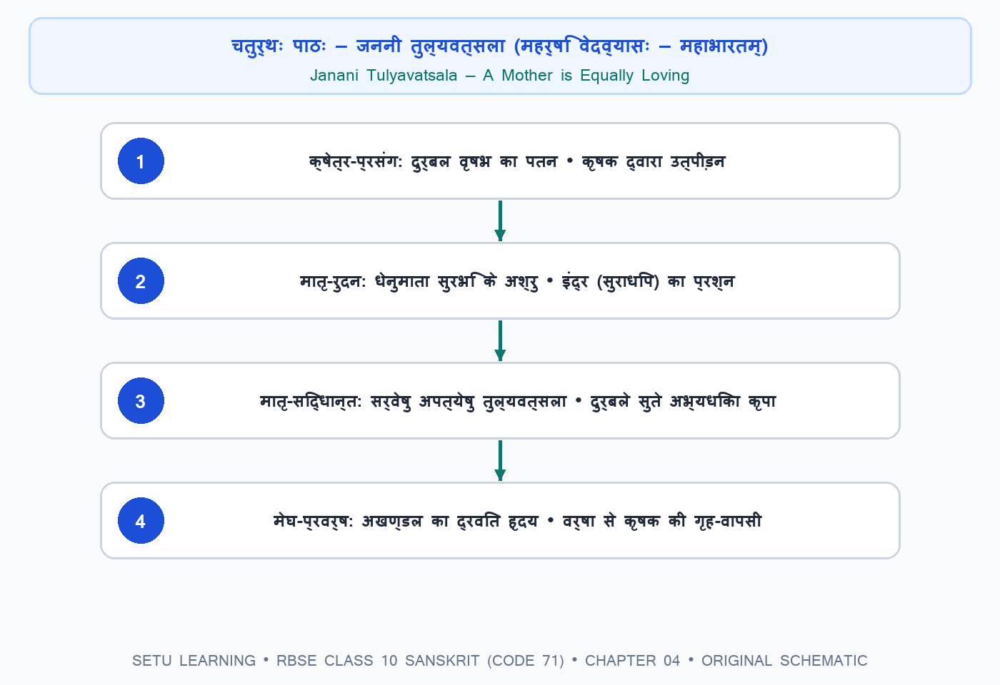

## 49. प्रतिगृहम् तथा प्रक्षालितपादम् समासः।

**स्रोत:** 2025 पूरक, प्रश्न 14, PDF पृष्ठ 8 · **अंक:** 3 अंक

**अध्याय-संबंध:** प्रकरण २ — समास-प्रकरणम् (अव्ययीभावः, तत्पुरुषः, कर्मधारयः, द्विगुः, द्वन्द्वः, बहुव्रीहिः)

**हल:** प्रतिगृहम् = गृहं गृहं प्रति (अव्ययीभाव समासः); प्रतिदिनम् = दिनं दिनं प्रति (अव्ययीभावः); निर्जनम् = जनानाम् अभावः (अव्ययीभावः); उपकृष्णम् = कृष्णस्य समीपम् (अव्ययीभावः); यथाशक्ति = शक्तिम् अनतिक्रम्य (अव्ययीभावः)।

[मूल प्रश्न देखें](https://rajeduboard.rajasthan.gov.in/books/PAPERS-2025/SecSUP/S-71.pdf#page=8)

## 50. प्रधानाचार्यं प्रति प्रार्थना-पत्रम्।

**स्रोत:** 2025 पूरक, प्रश्न 15, PDF पृष्ठ 9 · **अंक:** 4 अंक

**अध्याय-संबंध:** प्रकरण ९ — पत्र-लेखनम् (औपचारिकं प्रार्थना-पत्रम् एवं अनौपचारिकं पत्रम्)

**हल:** प्रार्थना-पत्र (4 अंक): सेवायाम्, श्रीमन्तः प्रधानाचार्यमहोदयाः... विषयः — दिनद्वयस्य रुग्णतावकाशार्थं / स्थानान्तरण-प्रमाणपत्रार्थं प्रार्थना-पत्रम्। महोदयाः, सविनयं निवेदनम् अस्ति यत् अहं सहसा ज्वरपीडितः अस्मि (अथवा पितुः स्थानान्तरणम् अभवत्), अतः विद्यालयम् आगन्तुम् असमर्थः अस्मि। कृपया अवकाशं / टी.सी. प्रदाय अनुग्रहीष्यन्ति। भवताम् आज्ञाकारी शिष्यः। अनौपचारिक पत्र में ऊपर दाएँ स्थान ('जयपुरतः'), संबोधन ('प्रिय मित्र'), प्रथम पंक्ति ('अत्र कुशलं तत्रास्तु') और अंत में 'तव सुहृद्' लिखें।

[मूल प्रश्न देखें](https://rajeduboard.rajasthan.gov.in/books/PAPERS-2025/SecSUP/S-71.pdf#page=9)

## 51. चतुर्णां वाक्यानां संस्कृत-अनुवादः।

**स्रोत:** 2025 पूरक, प्रश्न 17, PDF पृष्ठ 10 · **अंक:** 4 अंक

**अध्याय-संबंध:** प्रकरण ११ — अनुवाद-कार्यम् एवं घटनाक्रम-संयोजनम्

**हल:** अनुवाद (4 अंक): (1) ग्रामं परितः वृक्षाः सन्ति, (2) गङ्गा हिमालयात् प्रभवति, (3) बालकाय मोदकं रोचते, (4) सः श्वः जयपुरं गमिष्यति, (5) वयं संस्कृतं पठामः, (6) वृक्षात् पत्राणि पतन्ति, (7) कविषु कालिदासः श्रेष्ठः अस्ति। घटनाक्रम-संयोजन (3 अंक): 6 क्रम-रहित वाक्यों में पहले प्रारंभिक परिचय ('एकदा / अस्ति देउलाख्यो ग्रामः') रखें, बीच में संकट व प्रयास रखें और अंत में परिणाम ('अन्ते / मुक्तवान्') रखकर पूरे 6 वाक्य लिखें।

[मूल प्रश्न देखें](https://rajeduboard.rajasthan.gov.in/books/PAPERS-2025/SecSUP/S-71.pdf#page=10)

## 52. कथा-वाक्यानां घटनाक्रम-संयोजनम्।

**स्रोत:** 2025 पूरक, प्रश्न 19, PDF पृष्ठ 11 · **अंक:** 3 अंक

**अध्याय-संबंध:** प्रकरण ११ — अनुवाद-कार्यम् एवं घटनाक्रम-संयोजनम्

**हल:** अनुवाद (4 अंक): (1) ग्रामं परितः वृक्षाः सन्ति, (2) गङ्गा हिमालयात् प्रभवति, (3) बालकाय मोदकं रोचते, (4) सः श्वः जयपुरं गमिष्यति, (5) वयं संस्कृतं पठामः, (6) वृक्षात् पत्राणि पतन्ति, (7) कविषु कालिदासः श्रेष्ठः अस्ति। घटनाक्रम-संयोजन (3 अंक): 6 क्रम-रहित वाक्यों में पहले प्रारंभिक परिचय ('एकदा / अस्ति देउलाख्यो ग्रामः') रखें, बीच में संकट व प्रयास रखें और अंत में परिणाम ('अन्ते / मुक्तवान्') रखकर पूरे 6 वाक्य लिखें।

[मूल प्रश्न देखें](https://rajeduboard.rajasthan.gov.in/books/PAPERS-2025/SecSUP/S-71.pdf#page=11)

## 2024 — मुख्य परीक्षा

[2024 मुख्य: पूरा आधिकारिक प्रश्न-पत्र (S-71)](https://rajeduboard.rajasthan.gov.in/books/PAPERS-2024/Sec/S-71.pdf)

## 53. ग्रामान्ते निर्झर-नदी-पयःपूरम् दर्शनम्।

**स्रोत:** 2024 मुख्य, प्रश्न 1(i), PDF पृष्ठ 2 · **अंक:** 1 अंक

**अध्याय-संबंध:** प्रथमः पाठः — शुचिपर्यावरणम् (हरिदत्त शर्मा)

**हल:** कवि नगर से बहुत दूर गाँव की सीमा ('ग्रामान्ते') पर झरने, नदी और जल से भरे जलाशय ('निर्झर-नदी-पयःपूरम्') देखना चाहता है तथा एकांत वन में भ्रमण की कामना करता है।

[मूल प्रश्न देखें](https://rajeduboard.rajasthan.gov.in/books/PAPERS-2024/Sec/S-71.pdf#page=2)

## 54. दुर्बले सुते मातुः अभ्यधिका कृपा।

**स्रोत:** 2024 मुख्य, प्रश्न 1(v), PDF पृष्ठ 2 · **अंक:** 1 अंक

**अध्याय-संबंध:** चतुर्थः पाठः — जननी तुल्यवत्सला (महर्षि वेदव्यासः — महाभारतम्)

**हल:** हजारों पुत्रों के होते हुए भी माता सुरभि की दुर्बल पुत्र पर अधिक कृपा होती है ('तथापि दुर्बले सुते मातुः अभ्यधिका कृपा सहजैव भवति')। कृषक दो बैलों ('बलीवर्दाभ्याम्') से खेत जोत रहा था।

[मूल प्रश्न देखें](https://rajeduboard.rajasthan.gov.in/books/PAPERS-2024/Sec/S-71.pdf#page=2)

## 55. कुमार + ङीप् (कुमारी) प्रत्ययः।

**स्रोत:** 2024 मुख्य, प्रश्न 2(i), PDF पृष्ठ 4 · **अंक:** 1 अंक

**अध्याय-संबंध:** प्रकरण ३ — प्रत्यय-प्रकरणम् (कृत्, तद्धित एवं स्त्री-प्रत्ययाः)

**हल:** महत् + त्व = महत्त्वम्; सम + त्व = समत्वम्; नर + त्व = नरत्वम्; रम्य + त्व = रम्यत्वम्; कृतज्ञ + तल् = कृतज्ञता (द्वितीया: कृतज्ञताम्); जन + तल् = जनता; कुमार + ङीप् = कुमारी; नद + ङीप् = नदी; अज + टाप् = अजा; बालक + टाप् = बालिका; शिक्षक + टाप् = शिक्षिका; चतुर + टाप् = चतुरा; चपल + टाप् = चपला।

[मूल प्रश्न देखें](https://rajeduboard.rajasthan.gov.in/books/PAPERS-2024/Sec/S-71.pdf#page=4)

## 56. गुण + मतुप् (गुणवान्) प्रत्ययः।

**स्रोत:** 2024 मुख्य, प्रश्न 2(ii), PDF पृष्ठ 4 · **अंक:** 1 अंक

**अध्याय-संबंध:** प्रकरण ३ — प्रत्यय-प्रकरणम् (कृत्, तद्धित एवं स्त्री-प्रत्ययाः)

**हल:** बुद्धि + मतुप् = बुद्धिमान् (पुल्लिंग) / बुद्धिमती (स्त्रीलिंग); गुण + मतुप् = गुणवान्; बल + मतुप् + ङीप् = बलवती; श्री + मतुप् + ङीप् = श्रीमती; गुण + इन् (णिनि) = गुणी; धन + इन् = धनी; नौ + ठक् = नाविकः।

[मूल प्रश्न देखें](https://rajeduboard.rajasthan.gov.in/books/PAPERS-2024/Sec/S-71.pdf#page=4)

## 57. कृ + अनीयर् (करणीयम्) प्रत्ययः।

**स्रोत:** 2024 मुख्य, प्रश्न 2(iii), PDF पृष्ठ 4 · **अंक:** 1 अंक

**अध्याय-संबंध:** प्रकरण ३ — प्रत्यय-प्रकरणम् (कृत्, तद्धित एवं स्त्री-प्रत्ययाः)

**हल:** कृ + अनीयर् = करणीयम् (नपुंसकलिंग); हन् + तव्यत् = हन्तव्यः (पुल्लिंग); शङ्क् + अनीयर् = शङ्कनीयः; दृश् + अनीयर् = दर्शनीयम्; पाल् + अनीयर् = पालनीयम्; पा + अनीयर् = पानीयम्; पूज् + अनीयर् = पूजनीयः।

[मूल प्रश्न देखें](https://rajeduboard.rajasthan.gov.in/books/PAPERS-2024/Sec/S-71.pdf#page=4)

## 58. युष्मद् षष्ठी एकवचनम् (तव) रूपम्।

**स्रोत:** 2024 मुख्य, प्रश्न 2(iv), PDF पृष्ठ 4 · **अंक:** 1 अंक

**अध्याय-संबंध:** प्रकरण ७ — कारक, उपपद-विभक्तयः एवं अशुद्धि-संशोधनम्

**हल:** अहं श्वः विद्यालयं गच्छामि (अशुद्ध) → अहं श्वः विद्यालयं गमिष्यामि ('श्वः' के साथ लृट् लकार); गणेशं नमः (अशुद्ध) → गणेशाय नमः ('नमः' के योग में चतुर्थी); सः गृहे वसति (लट् लकार प्रथम पुरुष एकवचन); सत्यमेव जयते, असत्यं पराजितं भवति; प्रच्छ् लृट् = प्रक्ष्यति, अस्मद् षष्ठी बहुवचन = अस्माकम्, युष्मद् षष्ठी एकवचन = तव, पितृ चतुर्थी एकवचन = पित्रे।

[मूल प्रश्न देखें](https://rajeduboard.rajasthan.gov.in/books/PAPERS-2024/Sec/S-71.pdf#page=4)

## 59. अनुशासनम् अपठित-गद्यांशः।

**स्रोत:** 2024 मुख्य, प्रश्न 3, PDF पृष्ठ 4 · **अंक:** 8 अंक

**अध्याय-संबंध:** प्रकरण ८ — अपठित-अवबोधनम् (गद्यांश-अवबोधनम् एवं भाषिक-कार्यम्)

**हल:** अपठित गद्यांश (8 अंक) में: (1) एकपदेन उत्तरत में केवल एक सटीक शब्द लिखें; (2) पूर्णवाक्येन में प्रश्नवाचक पद हटाकर पूर्ण वाक्य लिखें; (3) शीर्षकम् में गद्यांश का केंद्रीय विषय प्रथमा या षष्ठी में 1-3 शब्दों में लिखें (जैसे — 'सत्यस्य विजयः', 'पर्यावरणम्', 'महाराणाप्रतापः', 'अनुशासनम्', 'भारतीयसंस्कृतिः', 'नारीशिक्षा', 'परोपकारः', 'विश्वबन्धुत्वम्'); (4) भाषिककार्यम् में प्रथमा कर्ता, अंतिम क्रिया और समान विभक्ति वाला विशेषण-विशेष्य चुनें।

[मूल प्रश्न देखें](https://rajeduboard.rajasthan.gov.in/books/PAPERS-2024/Sec/S-71.pdf#page=4)

## 60. संख्यावाची-शब्दानां संस्कृत-लेखनम्।

**स्रोत:** 2024 मुख्य, प्रश्न 3(ब), PDF पृष्ठ 5 · **अंक:** 2 अंक

**अध्याय-संबंध:** प्रकरण ५ — समय-लेखनम् एवं संख्यावाची-शब्दाः (घटिका-चित्रम्)

**हल:** 105 = पञ्चाधिकशतम्; 150 = पञ्चाशदधिकशतम्; 108 = अष्टाधिकशतम्; 141 = एकचत्वारिंशदधिकशतम्; 125 = पञ्चविंशत्यधिकशतम्; 328 = अष्टाविंशत्यधिकत्रिशतम्; 130 = त्रिंशदधिकशतम्; 445 = पञ्चचत्वारिंशदधिकचतुःशतम्; 1025 = पञ्चविंशत्यधिकसहस्रम्; 30 = त्रिंशत्; 20 = विंशतिः; 12 = द्वादश; 4 (पु.) = चत्वारः; 2 (पु.) = द्वौ।

[मूल प्रश्न देखें](https://rajeduboard.rajasthan.gov.in/books/PAPERS-2024/Sec/S-71.pdf#page=5)

## 61. कर्तृवाच्य-कर्मवाच्य परिवर्तनम्।

**स्रोत:** 2024 मुख्य, प्रश्न 6, PDF पृष्ठ 5 · **अंक:** 2 अंक

**अध्याय-संबंध:** प्रकरण ६ — वाच्य-परिवर्तनम् (कर्तृवाच्यम्, कर्मवाच्यम्, भाववाच्यम्)

**हल:** मोहनः ग्रामं गच्छति → मोहनेन ग्रामः गम्यते; आचार्यः ग्रन्थं पठति → आचार्येण ग्रन्थः पठ्यते; त्वया किम् क्रियते / छात्रेण ग्रन्थः पठ्यते; सीतया गीतं गीयते → सीता गीतं गायति; अहं ग्रन्थं पठामि → मया ग्रन्थः पठ्यते; त्वया पाठः लिख्यते → त्वं पाठं लिखसि; सः स्वपिति → तेन सुप्यते; सः हसति → तेन हस्यते; अहं साधुं पश्यामि → मया साधुः दृश्यते।

[मूल प्रश्न देखें](https://rajeduboard.rajasthan.gov.in/books/PAPERS-2024/Sec/S-71.pdf#page=5)

चित्र सहायता: इसी अध्याय में इस अवधारणा का पहले दिया नामांकित schematic देखें।

## 62. श्लोकान्वय-पूर्तिः।

**स्रोत:** 2024 मुख्य, प्रश्न 10, PDF पृष्ठ 6 · **अंक:** 2 अंक

**अध्याय-संबंध:** पञ्चमः पाठः — सुभाषितानि (नीति-श्लोकाः)

**हल:** अन्वयः: अमन्त्रम् अक्षरं नास्ति, अनौषधं मूलं नास्ति, अयोग्यः पुरुषः नास्ति, तत्र योजकः दुर्लभः (अस्ति)। भाव: कोई अक्षर मंत्रहीन नहीं और कोई व्यक्ति अयोग्य नहीं; केवल उन्हें जोड़ने वाला पारखी (योजकः) दुर्लभ होता है।

[मूल प्रश्न देखें](https://rajeduboard.rajasthan.gov.in/books/PAPERS-2024/Sec/S-71.pdf#page=6)

## 63. अवकाशार्थं प्रार्थना-पत्रम्।

**स्रोत:** 2024 मुख्य, प्रश्न 15, PDF पृष्ठ 8 · **अंक:** 4 अंक

**अध्याय-संबंध:** प्रकरण ९ — पत्र-लेखनम् (औपचारिकं प्रार्थना-पत्रम् एवं अनौपचारिकं पत्रम्)

**हल:** प्रार्थना-पत्र (4 अंक): सेवायाम्, श्रीमन्तः प्रधानाचार्यमहोदयाः... विषयः — दिनद्वयस्य रुग्णतावकाशार्थं / स्थानान्तरण-प्रमाणपत्रार्थं प्रार्थना-पत्रम्। महोदयाः, सविनयं निवेदनम् अस्ति यत् अहं सहसा ज्वरपीडितः अस्मि (अथवा पितुः स्थानान्तरणम् अभवत्), अतः विद्यालयम् आगन्तुम् असमर्थः अस्मि। कृपया अवकाशं / टी.सी. प्रदाय अनुग्रहीष्यन्ति। भवताम् आज्ञाकारी शिष्यः। अनौपचारिक पत्र में ऊपर दाएँ स्थान ('जयपुरतः'), संबोधन ('प्रिय मित्र'), प्रथम पंक्ति ('अत्र कुशलं तत्रास्तु') और अंत में 'तव सुहृद्' लिखें।

[मूल प्रश्न देखें](https://rajeduboard.rajasthan.gov.in/books/PAPERS-2024/Sec/S-71.pdf#page=8)

## 64. चित्र-वर्णनम् अथवा संवाद-पूर्तिः।

**स्रोत:** 2024 मुख्य, प्रश्न 17, PDF पृष्ठ 10 · **अंक:** 4 अंक

**अध्याय-संबंध:** प्रकरण १० — चित्र-वर्णनम्, अनुच्छेद-लेखनम् एवं संवाद-पूर्तिः

**हल:** चित्र-वर्णन (4 अंक) में 4 सरल वाक्य लिखें: (1) इदं चित्रम् उद्यानस्य / वृक्षारोपणस्य / विद्यालयस्य अस्ति। (2) अस्मिन् चित्रे हरिताः वृक्षाः सन्ति। (3) चित्रे बालकाः क्रीडन्ति / छात्राः पादपान् रोपयन्ति। (4) इदं चित्रम् अतीव रमणीयम् अस्ति। संवाद-पूर्ति में प्रश्न और उत्तर की जोड़ी ('त्वम् + पठसि' ↔ 'अहम् + पठामि') मिलाकर पूरा संवाद लिखें।

[मूल प्रश्न देखें](https://rajeduboard.rajasthan.gov.in/books/PAPERS-2024/Sec/S-71.pdf#page=10)

## 65. हिन्दीवाक्यानां संस्कृत-अनुवादः।

**स्रोत:** 2024 मुख्य, प्रश्न 19, PDF पृष्ठ 11 · **अंक:** 4 अंक

**अध्याय-संबंध:** प्रकरण ११ — अनुवाद-कार्यम् एवं घटनाक्रम-संयोजनम्

**हल:** अनुवाद (4 अंक): (1) ग्रामं परितः वृक्षाः सन्ति, (2) गङ्गा हिमालयात् प्रभवति, (3) बालकाय मोदकं रोचते, (4) सः श्वः जयपुरं गमिष्यति, (5) वयं संस्कृतं पठामः, (6) वृक्षात् पत्राणि पतन्ति, (7) कविषु कालिदासः श्रेष्ठः अस्ति। घटनाक्रम-संयोजन (3 अंक): 6 क्रम-रहित वाक्यों में पहले प्रारंभिक परिचय ('एकदा / अस्ति देउलाख्यो ग्रामः') रखें, बीच में संकट व प्रयास रखें और अंत में परिणाम ('अन्ते / मुक्तवान्') रखकर पूरे 6 वाक्य लिखें।

[मूल प्रश्न देखें](https://rajeduboard.rajasthan.gov.in/books/PAPERS-2024/Sec/S-71.pdf#page=11)

## 2024 — पूरक परीक्षा

[2024 पूरक: पूरा आधिकारिक प्रश्न-पत्र (S-71)](https://rajeduboard.rajasthan.gov.in/books/PAPERS-2024/SecSUP/S-71.pdf)

## 66. बुद्धिमती पुत्रद्वयोपेता पितुर्गृहं चलिता।

**स्रोत:** 2024 पूरक, प्रश्न 1(ii), PDF पृष्ठ 2 · **अंक:** 1 अंक

**अध्याय-संबंध:** द्वितीयः पाठः — बुद्धिर्बलवती सदा (शुकसप्ततिः)

**हल:** राजसिंह की पत्नी बुद्धिमती दोनों पुत्रों के साथ ('पुत्रद्वयोपेता') पिता के घर की ओर चल पड़ी और मार्ग में गहन वन में उसने एक बाघ ('व्याघ्रम्') को देखा।

[मूल प्रश्न देखें](https://rajeduboard.rajasthan.gov.in/books/PAPERS-2024/SecSUP/S-71.pdf#page=2)

## 67. लोके विद्वांसः एव चक्षुष्मन्तः प्रकीर्तिताः।

**स्रोत:** 2024 पूरक, प्रश्न 1(vi), PDF पृष्ठ 2 · **अंक:** 1 अंक

**अध्याय-संबंध:** अष्टमः पाठः — सूक्तयः (तिरुवल्लुवरः — तिरुक्कुरल)

**हल:** 'विद्वांस एव लोकेऽस्मिन् चक्षुष्मन्तः प्रकीर्तिताः' — इस लोक में विद्वान ही वास्तव में नेत्रों वाले कहे गए हैं; दूसरों के मुख पर तो नाममात्र की आँखें हैं। पिता बचपन में पुत्र को महान 'विद्याधनम्' देता है।

[मूल प्रश्न देखें](https://rajeduboard.rajasthan.gov.in/books/PAPERS-2024/SecSUP/S-71.pdf#page=2)

## 68. अज + टाप् (अजा) स्त्री-प्रत्ययः।

**स्रोत:** 2024 पूरक, प्रश्न 2(i), PDF पृष्ठ 3 · **अंक:** 1 अंक

**अध्याय-संबंध:** प्रकरण ३ — प्रत्यय-प्रकरणम् (कृत्, तद्धित एवं स्त्री-प्रत्ययाः)

**हल:** महत् + त्व = महत्त्वम्; सम + त्व = समत्वम्; नर + त्व = नरत्वम्; रम्य + त्व = रम्यत्वम्; कृतज्ञ + तल् = कृतज्ञता (द्वितीया: कृतज्ञताम्); जन + तल् = जनता; कुमार + ङीप् = कुमारी; नद + ङीप् = नदी; अज + टाप् = अजा; बालक + टाप् = बालिका; शिक्षक + टाप् = शिक्षिका; चतुर + टाप् = चतुरा; चपल + टाप् = चपला।

[मूल प्रश्न देखें](https://rajeduboard.rajasthan.gov.in/books/PAPERS-2024/SecSUP/S-71.pdf#page=3)

## 69. नर + त्व (नरत्वम्) तद्धित-प्रत्ययः।

**स्रोत:** 2024 पूरक, प्रश्न 2(ii), PDF पृष्ठ 3 · **अंक:** 1 अंक

**अध्याय-संबंध:** प्रकरण ३ — प्रत्यय-प्रकरणम् (कृत्, तद्धित एवं स्त्री-प्रत्ययाः)

**हल:** महत् + त्व = महत्त्वम्; सम + त्व = समत्वम्; नर + त्व = नरत्वम्; रम्य + त्व = रम्यत्वम्; कृतज्ञ + तल् = कृतज्ञता (द्वितीया: कृतज्ञताम्); जन + तल् = जनता; कुमार + ङीप् = कुमारी; नद + ङीप् = नदी; अज + टाप् = अजा; बालक + टाप् = बालिका; शिक्षक + टाप् = शिक्षिका; चतुर + टाप् = चतुरा; चपल + टाप् = चपला।

[मूल प्रश्न देखें](https://rajeduboard.rajasthan.gov.in/books/PAPERS-2024/SecSUP/S-71.pdf#page=3)

## 70. बल + मतुप् + ङीप् (बलवती) रूपम्।

**स्रोत:** 2024 पूरक, प्रश्न 2(iii), PDF पृष्ठ 3 · **अंक:** 1 अंक

**अध्याय-संबंध:** प्रकरण ३ — प्रत्यय-प्रकरणम् (कृत्, तद्धित एवं स्त्री-प्रत्ययाः)

**हल:** बुद्धि + मतुप् = बुद्धिमान् (पुल्लिंग) / बुद्धिमती (स्त्रीलिंग); गुण + मतुप् = गुणवान्; बल + मतुप् + ङीप् = बलवती; श्री + मतुप् + ङीप् = श्रीमती; गुण + इन् (णिनि) = गुणी; धन + इन् = धनी; नौ + ठक् = नाविकः।

[मूल प्रश्न देखें](https://rajeduboard.rajasthan.gov.in/books/PAPERS-2024/SecSUP/S-71.pdf#page=3)

## 71. प्रच्छ् लृट् लकार (प्रक्ष्यति) तथा पित्रे रूपम्।

**स्रोत:** 2024 पूरक, प्रश्न 2(iv), PDF पृष्ठ 3 · **अंक:** 1 अंक

**अध्याय-संबंध:** प्रकरण ७ — कारक, उपपद-विभक्तयः एवं अशुद्धि-संशोधनम्

**हल:** अहं श्वः विद्यालयं गच्छामि (अशुद्ध) → अहं श्वः विद्यालयं गमिष्यामि ('श्वः' के साथ लृट् लकार); गणेशं नमः (अशुद्ध) → गणेशाय नमः ('नमः' के योग में चतुर्थी); सः गृहे वसति (लट् लकार प्रथम पुरुष एकवचन); सत्यमेव जयते, असत्यं पराजितं भवति; प्रच्छ् लृट् = प्रक्ष्यति, अस्मद् षष्ठी बहुवचन = अस्माकम्, युष्मद् षष्ठी एकवचन = तव, पितृ चतुर्थी एकवचन = पित्रे।

[मूल प्रश्न देखें](https://rajeduboard.rajasthan.gov.in/books/PAPERS-2024/SecSUP/S-71.pdf#page=3)

## 72. भारतवर्षः अपठित-गद्यांशः।

**स्रोत:** 2024 पूरक, प्रश्न 3, PDF पृष्ठ 4 · **अंक:** 8 अंक

**अध्याय-संबंध:** प्रकरण ८ — अपठित-अवबोधनम् (गद्यांश-अवबोधनम् एवं भाषिक-कार्यम्)

**हल:** अपठित गद्यांश (8 अंक) में: (1) एकपदेन उत्तरत में केवल एक सटीक शब्द लिखें; (2) पूर्णवाक्येन में प्रश्नवाचक पद हटाकर पूर्ण वाक्य लिखें; (3) शीर्षकम् में गद्यांश का केंद्रीय विषय प्रथमा या षष्ठी में 1-3 शब्दों में लिखें (जैसे — 'सत्यस्य विजयः', 'पर्यावरणम्', 'महाराणाप्रतापः', 'अनुशासनम्', 'भारतीयसंस्कृतिः', 'नारीशिक्षा', 'परोपकारः', 'विश्वबन्धुत्वम्'); (4) भाषिककार्यम् में प्रथमा कर्ता, अंतिम क्रिया और समान विभक्ति वाला विशेषण-विशेष्य चुनें।

[मूल प्रश्न देखें](https://rajeduboard.rajasthan.gov.in/books/PAPERS-2024/SecSUP/S-71.pdf#page=4)

## 73. 125 (पञ्चविंशत्यधिकशतम्) एवं 328 संख्या।

**स्रोत:** 2024 पूरक, प्रश्न 3(ब), PDF पृष्ठ 4 · **अंक:** 2 अंक

**अध्याय-संबंध:** प्रकरण ५ — समय-लेखनम् एवं संख्यावाची-शब्दाः (घटिका-चित्रम्)

**हल:** 105 = पञ्चाधिकशतम्; 150 = पञ्चाशदधिकशतम्; 108 = अष्टाधिकशतम्; 141 = एकचत्वारिंशदधिकशतम्; 125 = पञ्चविंशत्यधिकशतम्; 328 = अष्टाविंशत्यधिकत्रिशतम्; 130 = त्रिंशदधिकशतम्; 445 = पञ्चचत्वारिंशदधिकचतुःशतम्; 1025 = पञ्चविंशत्यधिकसहस्रम्; 30 = त्रिंशत्; 20 = विंशतिः; 12 = द्वादश; 4 (पु.) = चत्वारः; 2 (पु.) = द्वौ।

[मूल प्रश्न देखें](https://rajeduboard.rajasthan.gov.in/books/PAPERS-2024/SecSUP/S-71.pdf#page=4)

## 74. घटिका-चित्रस्य समय-लेखनम्।

**स्रोत:** 2024 पूरक, प्रश्न 7, PDF पृष्ठ 5 · **अंक:** 2 अंक

**अध्याय-संबंध:** प्रकरण ५ — समय-लेखनम् एवं संख्यावाची-शब्दाः (घटिका-चित्रम्)

**हल:** 8:15 = सपाद-अष्टवादने (सपादाष्टवादने); 9:30 = सार्धनववादने; 5:45 = पादोनषड्वादने; 8:30 = सार्ध-अष्टवादने; 10:00 = दशवादने। नियम: :15 के लिए 'सपाद', :30 के लिए 'सार्ध', और :45 के लिए 'पादोन + अगली संख्या' लिखते हैं।

[मूल प्रश्न देखें](https://rajeduboard.rajasthan.gov.in/books/PAPERS-2024/SecSUP/S-71.pdf#page=5)

चित्र सहायता: इसी अध्याय में इस अवधारणा का पहले दिया नामांकित schematic देखें।

## 75. विचित्रः साक्षी पाठसारः।

**स्रोत:** 2024 पूरक, प्रश्न 12, PDF पृष्ठ 6 · **अंक:** 2 अंक

**अध्याय-संबंध:** सप्तमः पाठः — विचित्रः साक्षी (ओमप्रकाश ठाकुरः)

**हल:** ओमप्रकाश ठाकुर रचित कथा में निर्धन पिता बीमार पुत्र को देखने धन के अभाव ('अर्थकार्श्येन') में पैदल चलता है। रात्रि में गृहस्थ के घर चोरी होने पर चोर (गाँव का सिपाही 'आरक्षी') उल्टे अतिथि को जेल में डाल देता है। न्यायाधीश बंकिमचंद्र चटर्जी राजमार्ग से शव मँगवाकर युक्ति से सिपाही का अपराध सिद्ध करते हैं।

[मूल प्रश्न देखें](https://rajeduboard.rajasthan.gov.in/books/PAPERS-2024/SecSUP/S-71.pdf#page=6)

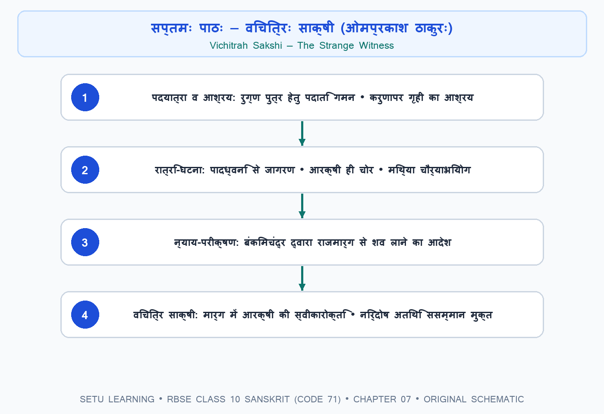

## 76. स्थानान्तरण-प्रमाणपत्रार्थं प्रार्थना-पत्रम्।

**स्रोत:** 2024 पूरक, प्रश्न 16, PDF पृष्ठ 8 · **अंक:** 4 अंक

**अध्याय-संबंध:** प्रकरण ९ — पत्र-लेखनम् (औपचारिकं प्रार्थना-पत्रम् एवं अनौपचारिकं पत्रम्)

**हल:** प्रार्थना-पत्र (4 अंक): सेवायाम्, श्रीमन्तः प्रधानाचार्यमहोदयाः... विषयः — दिनद्वयस्य रुग्णतावकाशार्थं / स्थानान्तरण-प्रमाणपत्रार्थं प्रार्थना-पत्रम्। महोदयाः, सविनयं निवेदनम् अस्ति यत् अहं सहसा ज्वरपीडितः अस्मि (अथवा पितुः स्थानान्तरणम् अभवत्), अतः विद्यालयम् आगन्तुम् असमर्थः अस्मि। कृपया अवकाशं / टी.सी. प्रदाय अनुग्रहीष्यन्ति। भवताम् आज्ञाकारी शिष्यः। अनौपचारिक पत्र में ऊपर दाएँ स्थान ('जयपुरतः'), संबोधन ('प्रिय मित्र'), प्रथम पंक्ति ('अत्र कुशलं तत्रास्तु') और अंत में 'तव सुहृद्' लिखें।

[मूल प्रश्न देखें](https://rajeduboard.rajasthan.gov.in/books/PAPERS-2024/SecSUP/S-71.pdf#page=8)

## 77. संस्कृतभाषया अनुवाद-कार्यम्।

**स्रोत:** 2024 पूरक, प्रश्न 18, PDF पृष्ठ 10 · **अंक:** 4 अंक

**अध्याय-संबंध:** प्रकरण ११ — अनुवाद-कार्यम् एवं घटनाक्रम-संयोजनम्

**हल:** अनुवाद (4 अंक): (1) ग्रामं परितः वृक्षाः सन्ति, (2) गङ्गा हिमालयात् प्रभवति, (3) बालकाय मोदकं रोचते, (4) सः श्वः जयपुरं गमिष्यति, (5) वयं संस्कृतं पठामः, (6) वृक्षात् पत्राणि पतन्ति, (7) कविषु कालिदासः श्रेष्ठः अस्ति। घटनाक्रम-संयोजन (3 अंक): 6 क्रम-रहित वाक्यों में पहले प्रारंभिक परिचय ('एकदा / अस्ति देउलाख्यो ग्रामः') रखें, बीच में संकट व प्रयास रखें और अंत में परिणाम ('अन्ते / मुक्तवान्') रखकर पूरे 6 वाक्य लिखें।

[मूल प्रश्न देखें](https://rajeduboard.rajasthan.gov.in/books/PAPERS-2024/SecSUP/S-71.pdf#page=10)

## 78. षड्-वाक्यानां घटनाक्रम-संयोजनम्।

**स्रोत:** 2024 पूरक, प्रश्न 20, PDF पृष्ठ 11 · **अंक:** 3 अंक

**अध्याय-संबंध:** प्रकरण ११ — अनुवाद-कार्यम् एवं घटनाक्रम-संयोजनम्

**हल:** अनुवाद (4 अंक): (1) ग्रामं परितः वृक्षाः सन्ति, (2) गङ्गा हिमालयात् प्रभवति, (3) बालकाय मोदकं रोचते, (4) सः श्वः जयपुरं गमिष्यति, (5) वयं संस्कृतं पठामः, (6) वृक्षात् पत्राणि पतन्ति, (7) कविषु कालिदासः श्रेष्ठः अस्ति। घटनाक्रम-संयोजन (3 अंक): 6 क्रम-रहित वाक्यों में पहले प्रारंभिक परिचय ('एकदा / अस्ति देउलाख्यो ग्रामः') रखें, बीच में संकट व प्रयास रखें और अंत में परिणाम ('अन्ते / मुक्तवान्') रखकर पूरे 6 वाक्य लिखें।

[मूल प्रश्न देखें](https://rajeduboard.rajasthan.gov.in/books/PAPERS-2024/SecSUP/S-71.pdf#page=11)

## 2023 — मुख्य परीक्षा

[2023 मुख्य: पूरा आधिकारिक प्रश्न-पत्र (S-71)](https://rajeduboard.rajasthan.gov.in/books/PAPERS-2023/Sec/S-71.pdf)

## 79. शुचिपर्यावरणम् पद्यांश-प्रश्नः।

**स्रोत:** 2023 मुख्य, प्रश्न 1(i), PDF पृष्ठ 2 · **अंक:** 1 अंक

**अध्याय-संबंध:** प्रथमः पाठः — शुचिपर्यावरणम् (हरिदत्त शर्मा)

**हल:** 'वाष्पयानमाला संधावति वितरन्ती ध्वानम्' — रेलगाड़ियों की पंक्ति कोलाहल (शोर) बिखेरती हुई दौड़ रही है। यह प्रथम पाठ 'शुचिपर्यावरणम्' के द्वितीय श्लोक से है।

[मूल प्रश्न देखें](https://rajeduboard.rajasthan.gov.in/books/PAPERS-2023/Sec/S-71.pdf#page=2)

चित्र सहायता: इसी अध्याय में इस अवधारणा का पहले दिया नामांकित schematic देखें।

## 80. व्यायामः सर्वदा पथ्यः पुराना पाठ्यक्रम-प्रश्नः।

**स्रोत:** 2023 मुख्य, प्रश्न 1(iv), PDF पृष्ठ 2 · **अंक:** 1 अंक

**अध्याय-संबंध:** पुराना पाठ्यक्रम (स्पन्दना / हटाए गए अध्याय): वर्तमान शेमुषी core से बाहर

**पुराना पाठ्यक्रम:** **हल:** यह प्रश्न तत्कालीन पुराने पाठ्यक्रम (स्पन्दना २०१८–२०२० अथवा शेमुषी के हटाए गए पाठ 'व्यायामः सर्वदा पथ्यः' / 'प्राणेभ्योऽपि प्रियः सुहृद्') से संबंधित है। व्यायाम से शरीर स्वस्थ व सुगठित होता है तथा चंदनदास ने मित्रधर्म निभाया।

[मूल प्रश्न देखें](https://rajeduboard.rajasthan.gov.in/books/PAPERS-2023/Sec/S-71.pdf#page=2)

## 81. भारतीयसंस्कृतिः त्यागभावना अपठित-गद्यांशः।

**स्रोत:** 2023 मुख्य, प्रश्न 3, PDF पृष्ठ 3 · **अंक:** 8 अंक

**अध्याय-संबंध:** प्रकरण ८ — अपठित-अवबोधनम् (गद्यांश-अवबोधनम् एवं भाषिक-कार्यम्)

**हल:** अपठित गद्यांश (8 अंक) में: (1) एकपदेन उत्तरत में केवल एक सटीक शब्द लिखें; (2) पूर्णवाक्येन में प्रश्नवाचक पद हटाकर पूर्ण वाक्य लिखें; (3) शीर्षकम् में गद्यांश का केंद्रीय विषय प्रथमा या षष्ठी में 1-3 शब्दों में लिखें (जैसे — 'सत्यस्य विजयः', 'पर्यावरणम्', 'महाराणाप्रतापः', 'अनुशासनम्', 'भारतीयसंस्कृतिः', 'नारीशिक्षा', 'परोपकारः', 'विश्वबन्धुत्वम्'); (4) भाषिककार्यम् में प्रथमा कर्ता, अंतिम क्रिया और समान विभक्ति वाला विशेषण-विशेष्य चुनें।

[मूल प्रश्न देखें](https://rajeduboard.rajasthan.gov.in/books/PAPERS-2023/Sec/S-71.pdf#page=3)

## 82. महावृक्षः पदस्य समास-विग्रहः।

**स्रोत:** 2023 मुख्य, प्रश्न 5(i), PDF पृष्ठ 4 · **अंक:** 1 अंक

**अध्याय-संबंध:** प्रकरण २ — समास-प्रकरणम् (अव्ययीभावः, तत्पुरुषः, कर्मधारयः, द्विगुः, द्वन्द्वः, बहुव्रीहिः)

**हल:** महावृक्षः = महान् च असौ वृक्षः (कर्मधारय समासः); महापुरुषः = महान् च असौ पुरुषः (कर्मधारयः); नीलकमलम् = नीलं च तत् कमलम् (कर्मधारयः); वीरपुरुषः = वीरः च असौ पुरुषः (कर्मधारयः); कृष्णसर्पः = कृष्णः च असौ सर्पः (कर्मधारयः)।

[मूल प्रश्न देखें](https://rajeduboard.rajasthan.gov.in/books/PAPERS-2023/Sec/S-71.pdf#page=4)

## 83. पिककाकयोः पदस्य द्वन्द्व-समासः।

**स्रोत:** 2023 मुख्य, प्रश्न 5(ii), PDF पृष्ठ 4 · **अंक:** 1 अंक

**अध्याय-संबंध:** प्रकरण २ — समास-प्रकरणम् (अव्ययीभावः, तत्पुरुषः, कर्मधारयः, द्विगुः, द्वन्द्वः, बहुव्रीहिः)

**हल:** चतुर्युगम् = चतुर्णां युगानां समाहारः (द्विगु समासः); मातापितरौ / पितरौ = माता च पिता च (इतरेतर द्वन्द्व समासः); पिककाकयोः = पिकः च काकः च तयोः (द्वन्द्वः); शिवकेशवौ = शिवः च केशवः च (द्वन्द्वः); पाणिपादम् = पाणिः च पादौ च तेषां समाहारः (समाहार द्वन्द्वः); पत्रपुष्पम् = पत्रं च पुष्पं च अनयोः समाहारः (समाहार द्वन्द्वः)।

[मूल प्रश्न देखें](https://rajeduboard.rajasthan.gov.in/books/PAPERS-2023/Sec/S-71.pdf#page=4)

## 84. विमूढधीः पदस्य बहुव्रीहि-समासः।

**स्रोत:** 2023 मुख्य, प्रश्न 5(iii), PDF पृष्ठ 4 · **अंक:** 1 अंक

**अध्याय-संबंध:** प्रकरण २ — समास-प्रकरणम् (अव्ययीभावः, तत्पुरुषः, कर्मधारयः, द्विगुः, द्वन्द्वः, बहुव्रीहिः)

**हल:** दशाननः = दश आननानि यस्य सः (रावणः — बहुव्रीहि समासः); पीताम्बरः = पीतम् अम्बरं यस्य सः (विष्णुः — बहुव्रीहिः; पीताम्बरम् = पीतं च तत् अम्बरम् — कर्मधारयः); प्रक्षालितपादम् = प्रक्षालितौ पादौ यस्य तम् (बहुव्रीहिः); विमूढधीः = विमूढा धीः यस्य सः (बहुव्रीहिः)।

[मूल प्रश्न देखें](https://rajeduboard.rajasthan.gov.in/books/PAPERS-2023/Sec/S-71.pdf#page=4)

चित्र सहायता: इसी अध्याय में इस अवधारणा का पहले दिया नामांकित schematic देखें।

## 85. रेखांकितपदेषु विभक्तिः तत्कारणं च।

**स्रोत:** 2023 मुख्य, प्रश्न 6, PDF पृष्ठ 4 · **अंक:** 2 अंक

**अध्याय-संबंध:** प्रकरण ७ — कारक, उपपद-विभक्तयः एवं अशुद्धि-संशोधनम्

**हल:** ग्रामम् अभितः वृक्षाः सन्ति ('अभितः' योगे द्वितीया); धिक् चौरम् ('धिक्' योगे द्वितीया); मन्दिरम् उपर्युपरि ('उपर्युपरि' योगे द्वितीया); जलं विना ('विना' योगे द्वितीया/तृतीया/पंचमी); सीता रामेण सह गच्छति / मया साकम् ('सह/साकम्' योगे तृतीया); अलम् अतिदाक्षिण्येन ('अलम्' निषेधार्थे तृतीया); शिवाय नमः / गणेशाय नमः / अग्नये स्वाहा ('नमः/स्वाहा' योगे चतुर्थी); सिंहात् बिभेति ('भी' धातु भयहेतु योगे पंचमी)।

[मूल प्रश्न देखें](https://rajeduboard.rajasthan.gov.in/books/PAPERS-2023/Sec/S-71.pdf#page=4)

## 86. शङ्क् + अनीयर् (शङ्कनीयः) प्रत्ययः।

**स्रोत:** 2023 मुख्य, प्रश्न 7(i), PDF पृष्ठ 5 · **अंक:** 1 अंक

**अध्याय-संबंध:** प्रकरण ३ — प्रत्यय-प्रकरणम् (कृत्, तद्धित एवं स्त्री-प्रत्ययाः)

**हल:** कृ + अनीयर् = करणीयम् (नपुंसकलिंग); हन् + तव्यत् = हन्तव्यः (पुल्लिंग); शङ्क् + अनीयर् = शङ्कनीयः; दृश् + अनीयर् = दर्शनीयम्; पाल् + अनीयर् = पालनीयम्; पा + अनीयर् = पानीयम्; पूज् + अनीयर् = पूजनीयः।

[मूल प्रश्न देखें](https://rajeduboard.rajasthan.gov.in/books/PAPERS-2023/Sec/S-71.pdf#page=5)

## 87. महत् + त्व (महत्त्वम्) तथा समत्वम् प्रत्ययः।

**स्रोत:** 2023 मुख्य, प्रश्न 7(ii), PDF पृष्ठ 5 · **अंक:** 1 अंक

**अध्याय-संबंध:** प्रकरण ३ — प्रत्यय-प्रकरणम् (कृत्, तद्धित एवं स्त्री-प्रत्ययाः)

**हल:** महत् + त्व = महत्त्वम्; सम + त्व = समत्वम्; नर + त्व = नरत्वम्; रम्य + त्व = रम्यत्वम्; कृतज्ञ + तल् = कृतज्ञता (द्वितीया: कृतज्ञताम्); जन + तल् = जनता; कुमार + ङीप् = कुमारी; नद + ङीप् = नदी; अज + टाप् = अजा; बालक + टाप् = बालिका; शिक्षक + टाप् = शिक्षिका; चतुर + टाप् = चतुरा; चपल + टाप् = चपला।

[मूल प्रश्न देखें](https://rajeduboard.rajasthan.gov.in/books/PAPERS-2023/Sec/S-71.pdf#page=5)

## 88. मञ्जूषातः अव्ययपदैः रिक्तस्थान-पूर्तिः।

**स्रोत:** 2023 मुख्य, प्रश्न 8, PDF पृष्ठ 5 · **अंक:** 3 अंक

**अध्याय-संबंध:** प्रकरण ४ — अव्यय-पदानि (अर्थ एवं वाक्य-प्रयोगः)

**हल:** प्रकृतिः एव शरणम् (एव = ही); अहम् अपि पठामि (अपि = भी); वने पशवः इतस्ततः भ्रमन्ति (इतस्ततः = इधर-उधर); यत्र धूमः तत्र वह्निः (यत्र-तत्र = जहाँ-वहाँ); अहं श्वः गमिष्यामि (श्वः = आने वाला कल); सः ह्यः अगच्छत् (ह्यः = बीता हुआ कल); सहसा विदधीत न क्रियाम् (सहसा = अचानक); मेघाः वृथा गर्जन्ति (वृथा = व्यर्थ)।

[मूल प्रश्न देखें](https://rajeduboard.rajasthan.gov.in/books/PAPERS-2023/Sec/S-71.pdf#page=5)

## 89. 130 (त्रिंशदधिकशतम्) एवं 445 संख्या-लेखनम्।

**स्रोत:** 2023 मुख्य, प्रश्न 10, PDF पृष्ठ 5 · **अंक:** 2 अंक

**अध्याय-संबंध:** प्रकरण ५ — समय-लेखनम् एवं संख्यावाची-शब्दाः (घटिका-चित्रम्)

**हल:** 105 = पञ्चाधिकशतम्; 150 = पञ्चाशदधिकशतम्; 108 = अष्टाधिकशतम्; 141 = एकचत्वारिंशदधिकशतम्; 125 = पञ्चविंशत्यधिकशतम्; 328 = अष्टाविंशत्यधिकत्रिशतम्; 130 = त्रिंशदधिकशतम्; 445 = पञ्चचत्वारिंशदधिकचतुःशतम्; 1025 = पञ्चविंशत्यधिकसहस्रम्; 30 = त्रिंशत्; 20 = विंशतिः; 12 = द्वादश; 4 (पु.) = चत्वारः; 2 (पु.) = द्वौ।

[मूल प्रश्न देखें](https://rajeduboard.rajasthan.gov.in/books/PAPERS-2023/Sec/S-71.pdf#page=5)

## 90. घटिका-समयानां संस्कृत-लेखनम्।

**स्रोत:** 2023 मुख्य, प्रश्न 11, PDF पृष्ठ 6 · **अंक:** 2 अंक

**अध्याय-संबंध:** प्रकरण ५ — समय-लेखनम् एवं संख्यावाची-शब्दाः (घटिका-चित्रम्)

**हल:** 8:15 = सपाद-अष्टवादने (सपादाष्टवादने); 9:30 = सार्धनववादने; 5:45 = पादोनषड्वादने; 8:30 = सार्ध-अष्टवादने; 10:00 = दशवादने। नियम: :15 के लिए 'सपाद', :30 के लिए 'सार्ध', और :45 के लिए 'पादोन + अगली संख्या' लिखते हैं।

[मूल प्रश्न देखें](https://rajeduboard.rajasthan.gov.in/books/PAPERS-2023/Sec/S-71.pdf#page=6)

चित्र सहायता: इसी अध्याय में इस अवधारणा का पहले दिया नामांकित schematic देखें।

## 91. प्रार्थना-पत्रम् अथवा मित्र-पत्रम्।

**स्रोत:** 2023 मुख्य, प्रश्न 21, PDF पृष्ठ 10 · **अंक:** 4 अंक

**अध्याय-संबंध:** प्रकरण ९ — पत्र-लेखनम् (औपचारिकं प्रार्थना-पत्रम् एवं अनौपचारिकं पत्रम्)

**हल:** प्रार्थना-पत्र (4 अंक): सेवायाम्, श्रीमन्तः प्रधानाचार्यमहोदयाः... विषयः — दिनद्वयस्य रुग्णतावकाशार्थं / स्थानान्तरण-प्रमाणपत्रार्थं प्रार्थना-पत्रम्। महोदयाः, सविनयं निवेदनम् अस्ति यत् अहं सहसा ज्वरपीडितः अस्मि (अथवा पितुः स्थानान्तरणम् अभवत्), अतः विद्यालयम् आगन्तुम् असमर्थः अस्मि। कृपया अवकाशं / टी.सी. प्रदाय अनुग्रहीष्यन्ति। भवताम् आज्ञाकारी शिष्यः। अनौपचारिक पत्र में ऊपर दाएँ स्थान ('जयपुरतः'), संबोधन ('प्रिय मित्र'), प्रथम पंक्ति ('अत्र कुशलं तत्रास्तु') और अंत में 'तव सुहृद्' लिखें।

[मूल प्रश्न देखें](https://rajeduboard.rajasthan.gov.in/books/PAPERS-2023/Sec/S-71.pdf#page=10)

## 2022 — मुख्य परीक्षा

[2022 मुख्य: पूरा आधिकारिक प्रश्न-पत्र (S-71)](https://rajeduboard.rajasthan.gov.in/books/PAPERS-2022/Sec/S-71.pdf)

## 92. महानगरमध्ये कालायसचक्रं भ्रमति।

**स्रोत:** 2022 मुख्य, प्रश्न 1(i), PDF पृष्ठ 2 · **अंक:** 1 अंक

**अध्याय-संबंध:** प्रथमः पाठः — शुचिपर्यावरणम् (हरिदत्त शर्मा)

**हल:** सैकड़ों मोटरगाड़ियाँ काजल के समान मलीन/काला ('कज्जलमलिनम्') धुआँ छोड़ती हैं ('कज्जलमलिनं धूमं मुञ्चति शतशकटीयानम्')। कर्मधारय समास: कज्जलम् इव मलिनम्।

[मूल प्रश्न देखें](https://rajeduboard.rajasthan.gov.in/books/PAPERS-2022/Sec/S-71.pdf#page=2)

## 93. कुशलवयोः वंशस्य कर्ता सहस्रदीधितिः।

**स्रोत:** 2022 मुख्य, प्रश्न 1(v), PDF पृष्ठ 2 · **अंक:** 1 अंक

**अध्याय-संबंध:** तृतीयः पाठः — शिशुलालनम् (दिङ्नागः — कुन्दमाला)

**हल:** सिंहासनस्थ श्रीराम लव और कुश के शिष्टाचार से मुग्ध होकर उन्हें अपनी गोद ('अङ्कम्') में बिठाते हैं। उनका वंशकर्ता भगवान सूर्य ('सहस्रदीधितिः') और गुरु महर्षि वाल्मीकि ('उपनयनोपदेशेन') हैं।

[मूल प्रश्न देखें](https://rajeduboard.rajasthan.gov.in/books/PAPERS-2022/Sec/S-71.pdf#page=2)

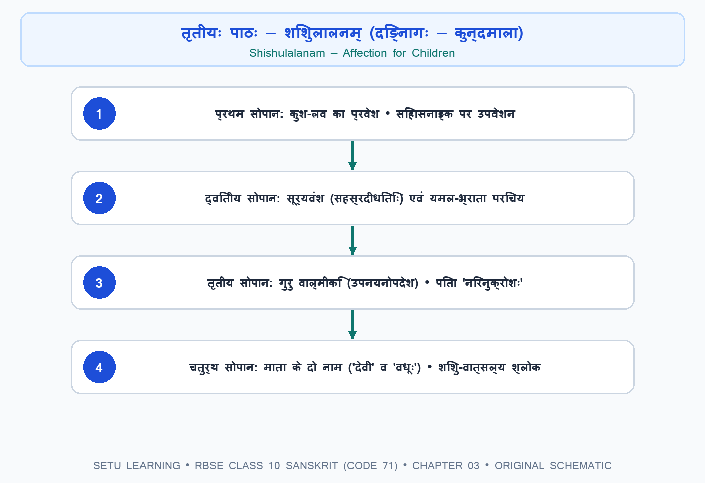

## 94. नारीशिक्षा अपठित-गद्यांशः।

**स्रोत:** 2022 मुख्य, प्रश्न 3, PDF पृष्ठ 4 · **अंक:** 8 अंक

**अध्याय-संबंध:** प्रकरण ८ — अपठित-अवबोधनम् (गद्यांश-अवबोधनम् एवं भाषिक-कार्यम्)

**हल:** अपठित गद्यांश (8 अंक) में: (1) एकपदेन उत्तरत में केवल एक सटीक शब्द लिखें; (2) पूर्णवाक्येन में प्रश्नवाचक पद हटाकर पूर्ण वाक्य लिखें; (3) शीर्षकम् में गद्यांश का केंद्रीय विषय प्रथमा या षष्ठी में 1-3 शब्दों में लिखें (जैसे — 'सत्यस्य विजयः', 'पर्यावरणम्', 'महाराणाप्रतापः', 'अनुशासनम्', 'भारतीयसंस्कृतिः', 'नारीशिक्षा', 'परोपकारः', 'विश्वबन्धुत्वम्'); (4) भाषिककार्यम् में प्रथमा कर्ता, अंतिम क्रिया और समान विभक्ति वाला विशेषण-विशेष्य चुनें।

[मूल प्रश्न देखें](https://rajeduboard.rajasthan.gov.in/books/PAPERS-2022/Sec/S-71.pdf#page=4)

## 95. मनोहरः (मनः + हरः) उत्व-सन्धिः।

**स्रोत:** 2022 मुख्य, प्रश्न 4(i), PDF पृष्ठ 5 · **अंक:** 1 अंक

**अध्याय-संबंध:** प्रकरण १ — संधि-प्रकरणम् (व्यंजन, विसर्ग एवं प्रमुख स्वर संधिः)

**हल:** मनोहरः = मनः + हरः (उत्व विसर्ग संधिः); मनोरथः = मनः + रथः (उत्व विसर्ग संधिः); यशोगानम् = यशः + गानम् (उत्व विसर्ग संधिः); रामो हसति = रामः + हसति (उत्व विसर्ग संधिः)।

[मूल प्रश्न देखें](https://rajeduboard.rajasthan.gov.in/books/PAPERS-2022/Sec/S-71.pdf#page=5)

## 96. वागीशः (वाक् + ईशः) जश्त्व-सन्धिः।

**स्रोत:** 2022 मुख्य, प्रश्न 4(ii), PDF पृष्ठ 5 · **अंक:** 1 अंक

**अध्याय-संबंध:** प्रकरण १ — संधि-प्रकरणम् (व्यंजन, विसर्ग एवं प्रमुख स्वर संधिः)

**हल:** वागीशः = वाक् + ईशः (जश्त्व व्यंजन संधिः — क् को तृतीय वर्ण ग्); दिग्गजः = दिक् + गजः (जश्त्व संधिः); दिगम्बरः = दिक् + अम्बरः (जश्त्व संधिः); जगदीशः = जगत् + ईशः (जश्त्व संधिः — त् को द्)।

[मूल प्रश्न देखें](https://rajeduboard.rajasthan.gov.in/books/PAPERS-2022/Sec/S-71.pdf#page=5)

## 97. नमस्ते (नमः + ते) सत्व-सन्धिः।

**स्रोत:** 2022 मुख्य, प्रश्न 4(iii), PDF पृष्ठ 5 · **अंक:** 1 अंक

**अध्याय-संबंध:** प्रकरण १ — संधि-प्रकरणम् (व्यंजन, विसर्ग एवं प्रमुख स्वर संधिः)

**हल:** नमस्ते = नमः + ते (सत्व विसर्ग संधिः — विसर्ग को स्); विष्णुस्त्राता = विष्णुः + त्राता (सत्व विसर्ग संधिः); निश्छलः = निः + छलः (सत्व/शत्व संधिः); पितुर्गृहम् = पितुः + गृहम् (रत्व विसर्ग संधिः)।

[मूल प्रश्न देखें](https://rajeduboard.rajasthan.gov.in/books/PAPERS-2022/Sec/S-71.pdf#page=5)

## 98. हरिम् + वन्दे (हरिं वन्दे) अनुस्वार-सन्धिः।

**स्रोत:** 2022 मुख्य, प्रश्न 4(iv), PDF पृष्ठ 5 · **अंक:** 1 अंक

**अध्याय-संबंध:** प्रकरण १ — संधि-प्रकरणम् (व्यंजन, विसर्ग एवं प्रमुख स्वर संधिः)

**हल:** सच्चित् = सत् + चित् (श्चुत्व व्यंजन संधिः — त् को च्); रामश्च = रामस् + च (श्चुत्व संधिः); सम् + जाता = सञ्जाता (परसवर्ण संधिः — ज के योग में अनुस्वार को ञ्); हरिम् + वन्दे = हरिं वन्दे (अनुस्वार संधिः)।

[मूल प्रश्न देखें](https://rajeduboard.rajasthan.gov.in/books/PAPERS-2022/Sec/S-71.pdf#page=5)

## 99. प्रतिदिनम् (दिनं दिनं प्रति) अव्ययीभावः।

**स्रोत:** 2022 मुख्य, प्रश्न 5(i), PDF पृष्ठ 5 · **अंक:** 1 अंक

**अध्याय-संबंध:** प्रकरण २ — समास-प्रकरणम् (अव्ययीभावः, तत्पुरुषः, कर्मधारयः, द्विगुः, द्वन्द्वः, बहुव्रीहिः)

**हल:** प्रतिगृहम् = गृहं गृहं प्रति (अव्ययीभाव समासः); प्रतिदिनम् = दिनं दिनं प्रति (अव्ययीभावः); निर्जनम् = जनानाम् अभावः (अव्ययीभावः); उपकृष्णम् = कृष्णस्य समीपम् (अव्ययीभावः); यथाशक्ति = शक्तिम् अनतिक्रम्य (अव्ययीभावः)।

[मूल प्रश्न देखें](https://rajeduboard.rajasthan.gov.in/books/PAPERS-2022/Sec/S-71.pdf#page=5)

## 100. दशाननः तथा महापुरुषः समासः।

**स्रोत:** 2022 मुख्य, प्रश्न 5(ii), PDF पृष्ठ 5 · **अंक:** 1 अंक

**अध्याय-संबंध:** प्रकरण २ — समास-प्रकरणम् (अव्ययीभावः, तत्पुरुषः, कर्मधारयः, द्विगुः, द्वन्द्वः, बहुव्रीहिः)

**हल:** दशाननः = दश आननानि यस्य सः (रावणः — बहुव्रीहि समासः); पीताम्बरः = पीतम् अम्बरं यस्य सः (विष्णुः — बहुव्रीहिः; पीताम्बरम् = पीतं च तत् अम्बरम् — कर्मधारयः); प्रक्षालितपादम् = प्रक्षालितौ पादौ यस्य तम् (बहुव्रीहिः); विमूढधीः = विमूढा धीः यस्य सः (बहुव्रीहिः)।

[मूल प्रश्न देखें](https://rajeduboard.rajasthan.gov.in/books/PAPERS-2022/Sec/S-71.pdf#page=5)

चित्र सहायता: इसी अध्याय में इस अवधारणा का पहले दिया नामांकित schematic देखें।

## 101. मातापितरौ (माता च पिता च) द्वन्द्वः।

**स्रोत:** 2022 मुख्य, प्रश्न 5(iv), PDF पृष्ठ 5 · **अंक:** 1 अंक

**अध्याय-संबंध:** प्रकरण २ — समास-प्रकरणम् (अव्ययीभावः, तत्पुरुषः, कर्मधारयः, द्विगुः, द्वन्द्वः, बहुव्रीहिः)

**हल:** चतुर्युगम् = चतुर्णां युगानां समाहारः (द्विगु समासः); मातापितरौ / पितरौ = माता च पिता च (इतरेतर द्वन्द्व समासः); पिककाकयोः = पिकः च काकः च तयोः (द्वन्द्वः); शिवकेशवौ = शिवः च केशवः च (द्वन्द्वः); पाणिपादम् = पाणिः च पादौ च तेषां समाहारः (समाहार द्वन्द्वः); पत्रपुष्पम् = पत्रं च पुष्पं च अनयोः समाहारः (समाहार द्वन्द्वः)।

[मूल प्रश्न देखें](https://rajeduboard.rajasthan.gov.in/books/PAPERS-2022/Sec/S-71.pdf#page=5)

## 102. 150 (पञ्चाशदधिकशतम्) एवं 1025 संख्या।

**स्रोत:** 2022 मुख्य, प्रश्न 10, PDF पृष्ठ 6 · **अंक:** 2 अंक

**अध्याय-संबंध:** प्रकरण ५ — समय-लेखनम् एवं संख्यावाची-शब्दाः (घटिका-चित्रम्)

**हल:** 105 = पञ्चाधिकशतम्; 150 = पञ्चाशदधिकशतम्; 108 = अष्टाधिकशतम्; 141 = एकचत्वारिंशदधिकशतम्; 125 = पञ्चविंशत्यधिकशतम्; 328 = अष्टाविंशत्यधिकत्रिशतम्; 130 = त्रिंशदधिकशतम्; 445 = पञ्चचत्वारिंशदधिकचतुःशतम्; 1025 = पञ्चविंशत्यधिकसहस्रम्; 30 = त्रिंशत्; 20 = विंशतिः; 12 = द्वादश; 4 (पु.) = चत्वारः; 2 (पु.) = द्वौ।

[मूल प्रश्न देखें](https://rajeduboard.rajasthan.gov.in/books/PAPERS-2022/Sec/S-71.pdf#page=6)

## 103. प्रधानाचार्यं प्रति अवकाश-पत्रम्।

**स्रोत:** 2022 मुख्य, प्रश्न 20, PDF पृष्ठ 9 · **अंक:** 4 अंक

**अध्याय-संबंध:** प्रकरण ९ — पत्र-लेखनम् (औपचारिकं प्रार्थना-पत्रम् एवं अनौपचारिकं पत्रम्)

**हल:** प्रार्थना-पत्र (4 अंक): सेवायाम्, श्रीमन्तः प्रधानाचार्यमहोदयाः... विषयः — दिनद्वयस्य रुग्णतावकाशार्थं / स्थानान्तरण-प्रमाणपत्रार्थं प्रार्थना-पत्रम्। महोदयाः, सविनयं निवेदनम् अस्ति यत् अहं सहसा ज्वरपीडितः अस्मि (अथवा पितुः स्थानान्तरणम् अभवत्), अतः विद्यालयम् आगन्तुम् असमर्थः अस्मि। कृपया अवकाशं / टी.सी. प्रदाय अनुग्रहीष्यन्ति। भवताम् आज्ञाकारी शिष्यः। अनौपचारिक पत्र में ऊपर दाएँ स्थान ('जयपुरतः'), संबोधन ('प्रिय मित्र'), प्रथम पंक्ति ('अत्र कुशलं तत्रास्तु') और अंत में 'तव सुहृद्' लिखें।

[मूल प्रश्न देखें](https://rajeduboard.rajasthan.gov.in/books/PAPERS-2022/Sec/S-71.pdf#page=9)

## 104. हिन्दीवाक्यानां संस्कृत-अनुवादः।

**स्रोत:** 2022 मुख्य, प्रश्न 22, PDF पृष्ठ 10 · **अंक:** 4 अंक

**अध्याय-संबंध:** प्रकरण ११ — अनुवाद-कार्यम् एवं घटनाक्रम-संयोजनम्

**हल:** अनुवाद (4 अंक): (1) ग्रामं परितः वृक्षाः सन्ति, (2) गङ्गा हिमालयात् प्रभवति, (3) बालकाय मोदकं रोचते, (4) सः श्वः जयपुरं गमिष्यति, (5) वयं संस्कृतं पठामः, (6) वृक्षात् पत्राणि पतन्ति, (7) कविषु कालिदासः श्रेष्ठः अस्ति। घटनाक्रम-संयोजन (3 अंक): 6 क्रम-रहित वाक्यों में पहले प्रारंभिक परिचय ('एकदा / अस्ति देउलाख्यो ग्रामः') रखें, बीच में संकट व प्रयास रखें और अंत में परिणाम ('अन्ते / मुक्तवान्') रखकर पूरे 6 वाक्य लिखें।

[मूल प्रश्न देखें](https://rajeduboard.rajasthan.gov.in/books/PAPERS-2022/Sec/S-71.pdf#page=10)

## 2020 — मुख्य परीक्षा

[2020 मुख्य: पूरा आधिकारिक प्रश्न-पत्र (S-71)](https://rajeduboard.rajasthan.gov.in/books/PAPERS-2020/Sec/S-71-Sanskrit-T-L.pdf)

## 105. स्पन्दना-पाठ्यपुस्तकस्य गद्यांश-हिन्दी-अनुवादः।

**स्रोत:** 2020 मुख्य, प्रश्न 1, PDF पृष्ठ 2 · **अंक:** 4 अंक

**अध्याय-संबंध:** पुराना पाठ्यक्रम (स्पन्दना / हटाए गए अध्याय): वर्तमान शेमुषी core से बाहर

**पुराना पाठ्यक्रम:** **हल:** यह प्रश्न तत्कालीन पुराने पाठ्यक्रम (स्पन्दना २०१८–२०२० अथवा शेमुषी के हटाए गए पाठ 'व्यायामः सर्वदा पथ्यः' / 'प्राणेभ्योऽपि प्रियः सुहृद्') से संबंधित है। व्यायाम से शरीर स्वस्थ व सुगठित होता है तथा चंदनदास ने मित्रधर्म निभाया।

[मूल प्रश्न देखें](https://rajeduboard.rajasthan.gov.in/books/PAPERS-2020/Sec/S-71-Sanskrit-T-L.pdf#page=2)

## 106. वर्षाकालः अपठित-गद्यांशः।

**स्रोत:** 2020 मुख्य, प्रश्न 11, PDF पृष्ठ 4 · **अंक:** 8 अंक

**अध्याय-संबंध:** प्रकरण ८ — अपठित-अवबोधनम् (गद्यांश-अवबोधनम् एवं भाषिक-कार्यम्)

**हल:** अपठित गद्यांश (8 अंक) में: (1) एकपदेन उत्तरत में केवल एक सटीक शब्द लिखें; (2) पूर्णवाक्येन में प्रश्नवाचक पद हटाकर पूर्ण वाक्य लिखें; (3) शीर्षकम् में गद्यांश का केंद्रीय विषय प्रथमा या षष्ठी में 1-3 शब्दों में लिखें (जैसे — 'सत्यस्य विजयः', 'पर्यावरणम्', 'महाराणाप्रतापः', 'अनुशासनम्', 'भारतीयसंस्कृतिः', 'नारीशिक्षा', 'परोपकारः', 'विश्वबन्धुत्वम्'); (4) भाषिककार्यम् में प्रथमा कर्ता, अंतिम क्रिया और समान विभक्ति वाला विशेषण-विशेष्य चुनें।

[मूल प्रश्न देखें](https://rajeduboard.rajasthan.gov.in/books/PAPERS-2020/Sec/S-71-Sanskrit-T-L.pdf#page=4)

## 107. यथा + इच्छम् (यथेच्छम्) गुण-सन्धिः।

**स्रोत:** 2020 मुख्य, प्रश्न 12(i), PDF पृष्ठ 4 · **अंक:** 1 अंक

**अध्याय-संबंध:** प्रकरण १ — संधि-प्रकरणम् (व्यंजन, विसर्ग एवं प्रमुख स्वर संधिः)

**हल:** नायकः = नै + अकः (अयादि संधिः); पवनः = पो + अनः (अयादि संधिः); चयनम् = चे + अनम् (अयादि संधिः); यथेच्छम् = यथा + इच्छम् (गुण संधिः); एकैकः = एक + एकः (वृद्धि संधिः); नैकः = न + एकः (वृद्धि संधिः)।

[मूल प्रश्न देखें](https://rajeduboard.rajasthan.gov.in/books/PAPERS-2020/Sec/S-71-Sanskrit-T-L.pdf#page=4)

## 108. दिक् + अम्बरः (दिगम्बरः) जश्त्व-सन्धिः।

**स्रोत:** 2020 मुख्य, प्रश्न 12(ii), PDF पृष्ठ 4 · **अंक:** 1 अंक

**अध्याय-संबंध:** प्रकरण १ — संधि-प्रकरणम् (व्यंजन, विसर्ग एवं प्रमुख स्वर संधिः)

**हल:** वागीशः = वाक् + ईशः (जश्त्व व्यंजन संधिः — क् को तृतीय वर्ण ग्); दिग्गजः = दिक् + गजः (जश्त्व संधिः); दिगम्बरः = दिक् + अम्बरः (जश्त्व संधिः); जगदीशः = जगत् + ईशः (जश्त्व संधिः — त् को द्)।

[मूल प्रश्न देखें](https://rajeduboard.rajasthan.gov.in/books/PAPERS-2020/Sec/S-71-Sanskrit-T-L.pdf#page=4)

## 109. रामो हसति (रामः + हसति) विसर्ग-सन्धिः।

**स्रोत:** 2020 मुख्य, प्रश्न 13, PDF पृष्ठ 4 · **अंक:** 1 अंक

**अध्याय-संबंध:** प्रकरण १ — संधि-प्रकरणम् (व्यंजन, विसर्ग एवं प्रमुख स्वर संधिः)

**हल:** मनोहरः = मनः + हरः (उत्व विसर्ग संधिः); मनोरथः = मनः + रथः (उत्व विसर्ग संधिः); यशोगानम् = यशः + गानम् (उत्व विसर्ग संधिः); रामो हसति = रामः + हसति (उत्व विसर्ग संधिः)।

[मूल प्रश्न देखें](https://rajeduboard.rajasthan.gov.in/books/PAPERS-2020/Sec/S-71-Sanskrit-T-L.pdf#page=4)

## 110. निर्जनम् (जनानाम् अभावः) अव्ययीभावः।

**स्रोत:** 2020 मुख्य, प्रश्न 14, PDF पृष्ठ 4 · **अंक:** 1 अंक

**अध्याय-संबंध:** प्रकरण २ — समास-प्रकरणम् (अव्ययीभावः, तत्पुरुषः, कर्मधारयः, द्विगुः, द्वन्द्वः, बहुव्रीहिः)

**हल:** प्रतिगृहम् = गृहं गृहं प्रति (अव्ययीभाव समासः); प्रतिदिनम् = दिनं दिनं प्रति (अव्ययीभावः); निर्जनम् = जनानाम् अभावः (अव्ययीभावः); उपकृष्णम् = कृष्णस्य समीपम् (अव्ययीभावः); यथाशक्ति = शक्तिम् अनतिक्रम्य (अव्ययीभावः)।

[मूल प्रश्न देखें](https://rajeduboard.rajasthan.gov.in/books/PAPERS-2020/Sec/S-71-Sanskrit-T-L.pdf#page=4)

## 111. नौ + ठक् (नाविकः) प्रत्ययः।

**स्रोत:** 2020 मुख्य, प्रश्न 16, PDF पृष्ठ 5 · **अंक:** 1 अंक

**अध्याय-संबंध:** प्रकरण ३ — प्रत्यय-प्रकरणम् (कृत्, तद्धित एवं स्त्री-प्रत्ययाः)

**हल:** बुद्धि + मतुप् = बुद्धिमान् (पुल्लिंग) / बुद्धिमती (स्त्रीलिंग); गुण + मतुप् = गुणवान्; बल + मतुप् + ङीप् = बलवती; श्री + मतुप् + ङीप् = श्रीमती; गुण + इन् (णिनि) = गुणी; धन + इन् = धनी; नौ + ठक् = नाविकः।

[मूल प्रश्न देखें](https://rajeduboard.rajasthan.gov.in/books/PAPERS-2020/Sec/S-71-Sanskrit-T-L.pdf#page=5)

## 112. सेव् + शानच् (सेवमानः) प्रत्ययः।

**स्रोत:** 2020 मुख्य, प्रश्न 17, PDF पृष्ठ 5 · **अंक:** 1 अंक

**अध्याय-संबंध:** प्रकरण ३ — प्रत्यय-प्रकरणम् (कृत्, तद्धित एवं स्त्री-प्रत्ययाः)

**हल:** हस् + शतृ = हसन् (पुल्लिंग एकवचन); गम् + शतृ = गच्छन्; पठ् + शतृ = पठन्; धाव् + शतृ = धावन्; नृत् + शतृ + ङीप् = नृत्यन्ती (स्त्रीलिंग); सेव् + शानच् = सेवमानः; शङ्क् + शानच् = शङ्कमानः; वि + मुच् + क्त + टाप् = विमुक्ता; युज् + क्त + टाप् = युक्ता।

[मूल प्रश्न देखें](https://rajeduboard.rajasthan.gov.in/books/PAPERS-2020/Sec/S-71-Sanskrit-T-L.pdf#page=5)

## 113. सीतया गीतं गीयते वाच्य-परिवर्तनम्।

**स्रोत:** 2020 मुख्य, प्रश्न 19, PDF पृष्ठ 5 · **अंक:** 1 अंक

**अध्याय-संबंध:** प्रकरण ६ — वाच्य-परिवर्तनम् (कर्तृवाच्यम्, कर्मवाच्यम्, भाववाच्यम्)

**हल:** मोहनः ग्रामं गच्छति → मोहनेन ग्रामः गम्यते; आचार्यः ग्रन्थं पठति → आचार्येण ग्रन्थः पठ्यते; त्वया किम् क्रियते / छात्रेण ग्रन्थः पठ्यते; सीतया गीतं गीयते → सीता गीतं गायति; अहं ग्रन्थं पठामि → मया ग्रन्थः पठ्यते; त्वया पाठः लिख्यते → त्वं पाठं लिखसि; सः स्वपिति → तेन सुप्यते; सः हसति → तेन हस्यते; अहं साधुं पश्यामि → मया साधुः दृश्यते।

[मूल प्रश्न देखें](https://rajeduboard.rajasthan.gov.in/books/PAPERS-2020/Sec/S-71-Sanskrit-T-L.pdf#page=5)

चित्र सहायता: इसी अध्याय में इस अवधारणा का पहले दिया नामांकित schematic देखें।

## 114. अहं ग्रन्थं पठामि कर्मवाच्य-रूपम्।

**स्रोत:** 2020 मुख्य, प्रश्न 20, PDF पृष्ठ 5 · **अंक:** 1 अंक

**अध्याय-संबंध:** प्रकरण ६ — वाच्य-परिवर्तनम् (कर्तृवाच्यम्, कर्मवाच्यम्, भाववाच्यम्)

**हल:** मोहनः ग्रामं गच्छति → मोहनेन ग्रामः गम्यते; आचार्यः ग्रन्थं पठति → आचार्येण ग्रन्थः पठ्यते; त्वया किम् क्रियते / छात्रेण ग्रन्थः पठ्यते; सीतया गीतं गीयते → सीता गीतं गायति; अहं ग्रन्थं पठामि → मया ग्रन्थः पठ्यते; त्वया पाठः लिख्यते → त्वं पाठं लिखसि; सः स्वपिति → तेन सुप्यते; सः हसति → तेन हस्यते; अहं साधुं पश्यामि → मया साधुः दृश्यते।

[मूल प्रश्न देखें](https://rajeduboard.rajasthan.gov.in/books/PAPERS-2020/Sec/S-71-Sanskrit-T-L.pdf#page=5)

चित्र सहायता: इसी अध्याय में इस अवधारणा का पहले दिया नामांकित schematic देखें।

## 115. सः स्वपिति (तेन सुप्यते) भाववाच्यम्।

**स्रोत:** 2020 मुख्य, प्रश्न 21, PDF पृष्ठ 5 · **अंक:** 1 अंक

**अध्याय-संबंध:** प्रकरण ६ — वाच्य-परिवर्तनम् (कर्तृवाच्यम्, कर्मवाच्यम्, भाववाच्यम्)

**हल:** मोहनः ग्रामं गच्छति → मोहनेन ग्रामः गम्यते; आचार्यः ग्रन्थं पठति → आचार्येण ग्रन्थः पठ्यते; त्वया किम् क्रियते / छात्रेण ग्रन्थः पठ्यते; सीतया गीतं गीयते → सीता गीतं गायति; अहं ग्रन्थं पठामि → मया ग्रन्थः पठ्यते; त्वया पाठः लिख्यते → त्वं पाठं लिखसि; सः स्वपिति → तेन सुप्यते; सः हसति → तेन हस्यते; अहं साधुं पश्यामि → मया साधुः दृश्यते।

[मूल प्रश्न देखें](https://rajeduboard.rajasthan.gov.in/books/PAPERS-2020/Sec/S-71-Sanskrit-T-L.pdf#page=5)

चित्र सहायता: इसी अध्याय में इस अवधारणा का पहले दिया नामांकित schematic देखें।

## 116. घटिका-चित्रस्य सहायतया समय-लेखनम्।

**स्रोत:** 2020 मुख्य, प्रश्न 22, PDF पृष्ठ 5 · **अंक:** 2 अंक

**अध्याय-संबंध:** प्रकरण ५ — समय-लेखनम् एवं संख्यावाची-शब्दाः (घटिका-चित्रम्)

**हल:** 8:15 = सपाद-अष्टवादने (सपादाष्टवादने); 9:30 = सार्धनववादने; 5:45 = पादोनषड्वादने; 8:30 = सार्ध-अष्टवादने; 10:00 = दशवादने। नियम: :15 के लिए 'सपाद', :30 के लिए 'सार्ध', और :45 के लिए 'पादोन + अगली संख्या' लिखते हैं।

[मूल प्रश्न देखें](https://rajeduboard.rajasthan.gov.in/books/PAPERS-2020/Sec/S-71-Sanskrit-T-L.pdf#page=5)

चित्र सहायता: इसी अध्याय में इस अवधारणा का पहले दिया नामांकित schematic देखें।

## 117. त्रयाणां वाक्यानां संशोधनम्।

**स्रोत:** 2020 मुख्य, प्रश्न 23, PDF पृष्ठ 5 · **अंक:** 3 अंक

**अध्याय-संबंध:** प्रकरण ७ — कारक, उपपद-विभक्तयः एवं अशुद्धि-संशोधनम्

**हल:** अहं श्वः विद्यालयं गच्छामि (अशुद्ध) → अहं श्वः विद्यालयं गमिष्यामि ('श्वः' के साथ लृट् लकार); गणेशं नमः (अशुद्ध) → गणेशाय नमः ('नमः' के योग में चतुर्थी); सः गृहे वसति (लट् लकार प्रथम पुरुष एकवचन); सत्यमेव जयते, असत्यं पराजितं भवति; प्रच्छ् लृट् = प्रक्ष्यति, अस्मद् षष्ठी बहुवचन = अस्माकम्, युष्मद् षष्ठी एकवचन = तव, पितृ चतुर्थी एकवचन = पित्रे।

[मूल प्रश्न देखें](https://rajeduboard.rajasthan.gov.in/books/PAPERS-2020/Sec/S-71-Sanskrit-T-L.pdf#page=5)

## 2020 — पूरक परीक्षा

[2020 पूरक: पूरा आधिकारिक प्रश्न-पत्र (S-71)](https://rajeduboard.rajasthan.gov.in/books/PAPERS-2020/SecSUP/S-71.pdf)

## 118. स्पन्दना-पाठ्यपुस्तकस्य पद्यांश-व्याख्या।

**स्रोत:** 2020 पूरक, प्रश्न 1, PDF पृष्ठ 2 · **अंक:** 4 अंक

**अध्याय-संबंध:** पुराना पाठ्यक्रम (स्पन्दना / हटाए गए अध्याय): वर्तमान शेमुषी core से बाहर

**पुराना पाठ्यक्रम:** **हल:** यह प्रश्न तत्कालीन पुराने पाठ्यक्रम (स्पन्दना २०१८–२०२० अथवा शेमुषी के हटाए गए पाठ 'व्यायामः सर्वदा पथ्यः' / 'प्राणेभ्योऽपि प्रियः सुहृद्') से संबंधित है। व्यायाम से शरीर स्वस्थ व सुगठित होता है तथा चंदनदास ने मित्रधर्म निभाया।

[मूल प्रश्न देखें](https://rajeduboard.rajasthan.gov.in/books/PAPERS-2020/SecSUP/S-71.pdf#page=2)

## 119. एकतायाः आवश्यकता अपठित-गद्यांशः।

**स्रोत:** 2020 पूरक, प्रश्न 11, PDF पृष्ठ 5 · **अंक:** 8 अंक

**अध्याय-संबंध:** प्रकरण ८ — अपठित-अवबोधनम् (गद्यांश-अवबोधनम् एवं भाषिक-कार्यम्)

**हल:** अपठित गद्यांश (8 अंक) में: (1) एकपदेन उत्तरत में केवल एक सटीक शब्द लिखें; (2) पूर्णवाक्येन में प्रश्नवाचक पद हटाकर पूर्ण वाक्य लिखें; (3) शीर्षकम् में गद्यांश का केंद्रीय विषय प्रथमा या षष्ठी में 1-3 शब्दों में लिखें (जैसे — 'सत्यस्य विजयः', 'पर्यावरणम्', 'महाराणाप्रतापः', 'अनुशासनम्', 'भारतीयसंस्कृतिः', 'नारीशिक्षा', 'परोपकारः', 'विश्वबन्धुत्वम्'); (4) भाषिककार्यम् में प्रथमा कर्ता, अंतिम क्रिया और समान विभक्ति वाला विशेषण-विशेष्य चुनें।

[मूल प्रश्न देखें](https://rajeduboard.rajasthan.gov.in/books/PAPERS-2020/SecSUP/S-71.pdf#page=5)

## 120. खलु + अयम् (खल्वयम्) यण्-सन्धिः।

**स्रोत:** 2020 पूरक, प्रश्न 12, PDF पृष्ठ 6 · **अंक:** 1 अंक

**अध्याय-संबंध:** प्रकरण १ — संधि-प्रकरणम् (व्यंजन, विसर्ग एवं प्रमुख स्वर संधिः)

**हल:** लोकेऽस्मिन् = लोके + अस्मिन् (पूर्वरूप संधिः); खल्वेतत् = खलु + एतत् (यण् संधिः); इत्युक्त्वा = इति + उक्त्वा (यण् संधिः); स्वागतम् = सु + आगतम् (यण् संधिः); प्रत्यागच्छति = प्रति + आगच्छति (यण् संधिः)।

[मूल प्रश्न देखें](https://rajeduboard.rajasthan.gov.in/books/PAPERS-2020/SecSUP/S-71.pdf#page=6)

चित्र सहायता: इसी अध्याय में इस अवधारणा का पहले दिया नामांकित schematic देखें।

## 121. विष्णुः + त्राता (विष्णुस्त्राता) विसर्ग-सन्धिः।

**स्रोत:** 2020 पूरक, प्रश्न 13, PDF पृष्ठ 6 · **अंक:** 1 अंक

**अध्याय-संबंध:** प्रकरण १ — संधि-प्रकरणम् (व्यंजन, विसर्ग एवं प्रमुख स्वर संधिः)

**हल:** नमस्ते = नमः + ते (सत्व विसर्ग संधिः — विसर्ग को स्); विष्णुस्त्राता = विष्णुः + त्राता (सत्व विसर्ग संधिः); निश्छलः = निः + छलः (सत्व/शत्व संधिः); पितुर्गृहम् = पितुः + गृहम् (रत्व विसर्ग संधिः)।

[मूल प्रश्न देखें](https://rajeduboard.rajasthan.gov.in/books/PAPERS-2020/SecSUP/S-71.pdf#page=6)

## 122. मातापितरौ (माता च पिता च) समासः।

**स्रोत:** 2020 पूरक, प्रश्न 14(i), PDF पृष्ठ 6 · **अंक:** 1 अंक

**अध्याय-संबंध:** प्रकरण २ — समास-प्रकरणम् (अव्ययीभावः, तत्पुरुषः, कर्मधारयः, द्विगुः, द्वन्द्वः, बहुव्रीहिः)

**हल:** चतुर्युगम् = चतुर्णां युगानां समाहारः (द्विगु समासः); मातापितरौ / पितरौ = माता च पिता च (इतरेतर द्वन्द्व समासः); पिककाकयोः = पिकः च काकः च तयोः (द्वन्द्वः); शिवकेशवौ = शिवः च केशवः च (द्वन्द्वः); पाणिपादम् = पाणिः च पादौ च तेषां समाहारः (समाहार द्वन्द्वः); पत्रपुष्पम् = पत्रं च पुष्पं च अनयोः समाहारः (समाहार द्वन्द्वः)।

[मूल प्रश्न देखें](https://rajeduboard.rajasthan.gov.in/books/PAPERS-2020/SecSUP/S-71.pdf#page=6)

## 123. वीरपुरुषः कर्मधारय-समासः।

**स्रोत:** 2020 पूरक, प्रश्न 14(ii), PDF पृष्ठ 6 · **अंक:** 1 अंक

**अध्याय-संबंध:** प्रकरण २ — समास-प्रकरणम् (अव्ययीभावः, तत्पुरुषः, कर्मधारयः, द्विगुः, द्वन्द्वः, बहुव्रीहिः)

**हल:** महावृक्षः = महान् च असौ वृक्षः (कर्मधारय समासः); महापुरुषः = महान् च असौ पुरुषः (कर्मधारयः); नीलकमलम् = नीलं च तत् कमलम् (कर्मधारयः); वीरपुरुषः = वीरः च असौ पुरुषः (कर्मधारयः); कृष्णसर्पः = कृष्णः च असौ सर्पः (कर्मधारयः)।

[मूल प्रश्न देखें](https://rajeduboard.rajasthan.gov.in/books/PAPERS-2020/SecSUP/S-71.pdf#page=6)

## 124. उपकृष्णम् (कृष्णस्य समीपम्) अव्ययीभावः।

**स्रोत:** 2020 पूरक, प्रश्न 14(iii), PDF पृष्ठ 6 · **अंक:** 1 अंक

**अध्याय-संबंध:** प्रकरण २ — समास-प्रकरणम् (अव्ययीभावः, तत्पुरुषः, कर्मधारयः, द्विगुः, द्वन्द्वः, बहुव्रीहिः)

**हल:** प्रतिगृहम् = गृहं गृहं प्रति (अव्ययीभाव समासः); प्रतिदिनम् = दिनं दिनं प्रति (अव्ययीभावः); निर्जनम् = जनानाम् अभावः (अव्ययीभावः); उपकृष्णम् = कृष्णस्य समीपम् (अव्ययीभावः); यथाशक्ति = शक्तिम् अनतिक्रम्य (अव्ययीभावः)।

[मूल प्रश्न देखें](https://rajeduboard.rajasthan.gov.in/books/PAPERS-2020/SecSUP/S-71.pdf#page=6)

## 125. रम्य + त्व (रम्यत्वम्) प्रत्ययः।

**स्रोत:** 2020 पूरक, प्रश्न 16, PDF पृष्ठ 7 · **अंक:** 1 अंक

**अध्याय-संबंध:** प्रकरण ३ — प्रत्यय-प्रकरणम् (कृत्, तद्धित एवं स्त्री-प्रत्ययाः)

**हल:** महत् + त्व = महत्त्वम्; सम + त्व = समत्वम्; नर + त्व = नरत्वम्; रम्य + त्व = रम्यत्वम्; कृतज्ञ + तल् = कृतज्ञता (द्वितीया: कृतज्ञताम्); जन + तल् = जनता; कुमार + ङीप् = कुमारी; नद + ङीप् = नदी; अज + टाप् = अजा; बालक + टाप् = बालिका; शिक्षक + टाप् = शिक्षिका; चतुर + टाप् = चतुरा; चपल + टाप् = चपला।

[मूल प्रश्न देखें](https://rajeduboard.rajasthan.gov.in/books/PAPERS-2020/SecSUP/S-71.pdf#page=7)

## 126. कुमार + ङीप् (कुमारी) स्त्री-प्रत्ययः।

**स्रोत:** 2020 पूरक, प्रश्न 17, PDF पृष्ठ 7 · **अंक:** 1 अंक

**अध्याय-संबंध:** प्रकरण ३ — प्रत्यय-प्रकरणम् (कृत्, तद्धित एवं स्त्री-प्रत्ययाः)

**हल:** महत् + त्व = महत्त्वम्; सम + त्व = समत्वम्; नर + त्व = नरत्वम्; रम्य + त्व = रम्यत्वम्; कृतज्ञ + तल् = कृतज्ञता (द्वितीया: कृतज्ञताम्); जन + तल् = जनता; कुमार + ङीप् = कुमारी; नद + ङीप् = नदी; अज + टाप् = अजा; बालक + टाप् = बालिका; शिक्षक + टाप् = शिक्षिका; चतुर + टाप् = चतुरा; चपल + टाप् = चपला।

[मूल प्रश्न देखें](https://rajeduboard.rajasthan.gov.in/books/PAPERS-2020/SecSUP/S-71.pdf#page=7)

## 127. मया पठ्यते (अहं पठामि) वाच्य-परिवर्तनम्।

**स्रोत:** 2020 पूरक, प्रश्न 19, PDF पृष्ठ 8 · **अंक:** 1 अंक

**अध्याय-संबंध:** प्रकरण ६ — वाच्य-परिवर्तनम् (कर्तृवाच्यम्, कर्मवाच्यम्, भाववाच्यम्)

**हल:** मोहनः ग्रामं गच्छति → मोहनेन ग्रामः गम्यते; आचार्यः ग्रन्थं पठति → आचार्येण ग्रन्थः पठ्यते; त्वया किम् क्रियते / छात्रेण ग्रन्थः पठ्यते; सीतया गीतं गीयते → सीता गीतं गायति; अहं ग्रन्थं पठामि → मया ग्रन्थः पठ्यते; त्वया पाठः लिख्यते → त्वं पाठं लिखसि; सः स्वपिति → तेन सुप्यते; सः हसति → तेन हस्यते; अहं साधुं पश्यामि → मया साधुः दृश्यते।

[मूल प्रश्न देखें](https://rajeduboard.rajasthan.gov.in/books/PAPERS-2020/SecSUP/S-71.pdf#page=8)

चित्र सहायता: इसी अध्याय में इस अवधारणा का पहले दिया नामांकित schematic देखें।

## 128. छात्रेण विद्यालयः गम्यते वाच्य-परिवर्तनम्।

**स्रोत:** 2020 पूरक, प्रश्न 20, PDF पृष्ठ 8 · **अंक:** 1 अंक

**अध्याय-संबंध:** प्रकरण ६ — वाच्य-परिवर्तनम् (कर्तृवाच्यम्, कर्मवाच्यम्, भाववाच्यम्)

**हल:** मोहनः ग्रामं गच्छति → मोहनेन ग्रामः गम्यते; आचार्यः ग्रन्थं पठति → आचार्येण ग्रन्थः पठ्यते; त्वया किम् क्रियते / छात्रेण ग्रन्थः पठ्यते; सीतया गीतं गीयते → सीता गीतं गायति; अहं ग्रन्थं पठामि → मया ग्रन्थः पठ्यते; त्वया पाठः लिख्यते → त्वं पाठं लिखसि; सः स्वपिति → तेन सुप्यते; सः हसति → तेन हस्यते; अहं साधुं पश्यामि → मया साधुः दृश्यते।

[मूल प्रश्न देखें](https://rajeduboard.rajasthan.gov.in/books/PAPERS-2020/SecSUP/S-71.pdf#page=8)

चित्र सहायता: इसी अध्याय में इस अवधारणा का पहले दिया नामांकित schematic देखें।

## 129. सः हसति (तेन हस्यते) भाववाच्यम्।

**स्रोत:** 2020 पूरक, प्रश्न 21, PDF पृष्ठ 8 · **अंक:** 1 अंक

**अध्याय-संबंध:** प्रकरण ६ — वाच्य-परिवर्तनम् (कर्तृवाच्यम्, कर्मवाच्यम्, भाववाच्यम्)

**हल:** मोहनः ग्रामं गच्छति → मोहनेन ग्रामः गम्यते; आचार्यः ग्रन्थं पठति → आचार्येण ग्रन्थः पठ्यते; त्वया किम् क्रियते / छात्रेण ग्रन्थः पठ्यते; सीतया गीतं गीयते → सीता गीतं गायति; अहं ग्रन्थं पठामि → मया ग्रन्थः पठ्यते; त्वया पाठः लिख्यते → त्वं पाठं लिखसि; सः स्वपिति → तेन सुप्यते; सः हसति → तेन हस्यते; अहं साधुं पश्यामि → मया साधुः दृश्यते।

[मूल प्रश्न देखें](https://rajeduboard.rajasthan.gov.in/books/PAPERS-2020/SecSUP/S-71.pdf#page=8)

चित्र सहायता: इसी अध्याय में इस अवधारणा का पहले दिया नामांकित schematic देखें।

## 130. घटिका-समय-लेखनम्।

**स्रोत:** 2020 पूरक, प्रश्न 22, PDF पृष्ठ 8 · **अंक:** 2 अंक

**अध्याय-संबंध:** प्रकरण ५ — समय-लेखनम् एवं संख्यावाची-शब्दाः (घटिका-चित्रम्)

**हल:** 8:15 = सपाद-अष्टवादने (सपादाष्टवादने); 9:30 = सार्धनववादने; 5:45 = पादोनषड्वादने; 8:30 = सार्ध-अष्टवादने; 10:00 = दशवादने। नियम: :15 के लिए 'सपाद', :30 के लिए 'सार्ध', और :45 के लिए 'पादोन + अगली संख्या' लिखते हैं।

[मूल प्रश्न देखें](https://rajeduboard.rajasthan.gov.in/books/PAPERS-2020/SecSUP/S-71.pdf#page=8)

चित्र सहायता: इसी अध्याय में इस अवधारणा का पहले दिया नामांकित schematic देखें।

## 2019 — मुख्य परीक्षा

[2019 मुख्य: पूरा आधिकारिक प्रश्न-पत्र (S-71)](https://rajeduboard.rajasthan.gov.in/books/PAPERS-2019/Sec/S-71-Sanskrit-T-L.pdf)

## 131. स्पन्दना-पाठ्यपुस्तकस्य सप्रसंग-अनुवादः।

**स्रोत:** 2019 मुख्य, प्रश्न 1, PDF पृष्ठ 2 · **अंक:** 4 अंक

**अध्याय-संबंध:** पुराना पाठ्यक्रम (स्पन्दना / हटाए गए अध्याय): वर्तमान शेमुषी core से बाहर

**पुराना पाठ्यक्रम:** **हल:** यह प्रश्न तत्कालीन पुराने पाठ्यक्रम (स्पन्दना २०१८–२०२० अथवा शेमुषी के हटाए गए पाठ 'व्यायामः सर्वदा पथ्यः' / 'प्राणेभ्योऽपि प्रियः सुहृद्') से संबंधित है। व्यायाम से शरीर स्वस्थ व सुगठित होता है तथा चंदनदास ने मित्रधर्म निभाया।

[मूल प्रश्न देखें](https://rajeduboard.rajasthan.gov.in/books/PAPERS-2019/Sec/S-71-Sanskrit-T-L.pdf#page=2)

## 132. परोपकारः अपठित-गद्यांशः।

**स्रोत:** 2019 मुख्य, प्रश्न 10, PDF पृष्ठ 4 · **अंक:** 8 अंक

**अध्याय-संबंध:** प्रकरण ८ — अपठित-अवबोधनम् (गद्यांश-अवबोधनम् एवं भाषिक-कार्यम्)

**हल:** अपठित गद्यांश (8 अंक) में: (1) एकपदेन उत्तरत में केवल एक सटीक शब्द लिखें; (2) पूर्णवाक्येन में प्रश्नवाचक पद हटाकर पूर्ण वाक्य लिखें; (3) शीर्षकम् में गद्यांश का केंद्रीय विषय प्रथमा या षष्ठी में 1-3 शब्दों में लिखें (जैसे — 'सत्यस्य विजयः', 'पर्यावरणम्', 'महाराणाप्रतापः', 'अनुशासनम्', 'भारतीयसंस्कृतिः', 'नारीशिक्षा', 'परोपकारः', 'विश्वबन्धुत्वम्'); (4) भाषिककार्यम् में प्रथमा कर्ता, अंतिम क्रिया और समान विभक्ति वाला विशेषण-विशेष्य चुनें।

[मूल प्रश्न देखें](https://rajeduboard.rajasthan.gov.in/books/PAPERS-2019/Sec/S-71-Sanskrit-T-L.pdf#page=4)

## 133. व्यंजन-सन्धेः विच्छेदः सन्धिपदं च।

**स्रोत:** 2019 मुख्य, प्रश्न 11, PDF पृष्ठ 4 · **अंक:** 2 अंक

**अध्याय-संबंध:** प्रकरण १ — संधि-प्रकरणम् (व्यंजन, विसर्ग एवं प्रमुख स्वर संधिः)

**हल:** वागीशः = वाक् + ईशः (जश्त्व व्यंजन संधिः — क् को तृतीय वर्ण ग्); दिग्गजः = दिक् + गजः (जश्त्व संधिः); दिगम्बरः = दिक् + अम्बरः (जश्त्व संधिः); जगदीशः = जगत् + ईशः (जश्त्व संधिः — त् को द्)।

[मूल प्रश्न देखें](https://rajeduboard.rajasthan.gov.in/books/PAPERS-2019/Sec/S-71-Sanskrit-T-L.pdf#page=4)

## 134. समस्तपदानां विग्रहः समासनाम च।

**स्रोत:** 2019 मुख्य, प्रश्न 13, PDF पृष्ठ 4 · **अंक:** 3 अंक

**अध्याय-संबंध:** प्रकरण २ — समास-प्रकरणम् (अव्ययीभावः, तत्पुरुषः, कर्मधारयः, द्विगुः, द्वन्द्वः, बहुव्रीहिः)

**हल:** महावृक्षः = महान् च असौ वृक्षः (कर्मधारय समासः); महापुरुषः = महान् च असौ पुरुषः (कर्मधारयः); नीलकमलम् = नीलं च तत् कमलम् (कर्मधारयः); वीरपुरुषः = वीरः च असौ पुरुषः (कर्मधारयः); कृष्णसर्पः = कृष्णः च असौ सर्पः (कर्मधारयः)।

[मूल प्रश्न देखें](https://rajeduboard.rajasthan.gov.in/books/PAPERS-2019/Sec/S-71-Sanskrit-T-L.pdf#page=4)

## 135. जलं विना जीवनं नास्ति विभक्तिः।

**स्रोत:** 2019 मुख्य, प्रश्न 15(i), PDF पृष्ठ 5 · **अंक:** 1 अंक

**अध्याय-संबंध:** प्रकरण ७ — कारक, उपपद-विभक्तयः एवं अशुद्धि-संशोधनम्

**हल:** ग्रामम् अभितः वृक्षाः सन्ति ('अभितः' योगे द्वितीया); धिक् चौरम् ('धिक्' योगे द्वितीया); मन्दिरम् उपर्युपरि ('उपर्युपरि' योगे द्वितीया); जलं विना ('विना' योगे द्वितीया/तृतीया/पंचमी); सीता रामेण सह गच्छति / मया साकम् ('सह/साकम्' योगे तृतीया); अलम् अतिदाक्षिण्येन ('अलम्' निषेधार्थे तृतीया); शिवाय नमः / गणेशाय नमः / अग्नये स्वाहा ('नमः/स्वाहा' योगे चतुर्थी); सिंहात् बिभेति ('भी' धातु भयहेतु योगे पंचमी)।

[मूल प्रश्न देखें](https://rajeduboard.rajasthan.gov.in/books/PAPERS-2019/Sec/S-71-Sanskrit-T-L.pdf#page=5)

## 136. नमः शिवाय इत्यत्र चतुर्थी विभक्तिः।

**स्रोत:** 2019 मुख्य, प्रश्न 15(ii), PDF पृष्ठ 5 · **अंक:** 1 अंक

**अध्याय-संबंध:** प्रकरण ७ — कारक, उपपद-विभक्तयः एवं अशुद्धि-संशोधनम्

**हल:** ग्रामम् अभितः वृक्षाः सन्ति ('अभितः' योगे द्वितीया); धिक् चौरम् ('धिक्' योगे द्वितीया); मन्दिरम् उपर्युपरि ('उपर्युपरि' योगे द्वितीया); जलं विना ('विना' योगे द्वितीया/तृतीया/पंचमी); सीता रामेण सह गच्छति / मया साकम् ('सह/साकम्' योगे तृतीया); अलम् अतिदाक्षिण्येन ('अलम्' निषेधार्थे तृतीया); शिवाय नमः / गणेशाय नमः / अग्नये स्वाहा ('नमः/स्वाहा' योगे चतुर्थी); सिंहात् बिभेति ('भी' धातु भयहेतु योगे पंचमी)।

[मूल प्रश्न देखें](https://rajeduboard.rajasthan.gov.in/books/PAPERS-2019/Sec/S-71-Sanskrit-T-L.pdf#page=5)

## 137. मन्दिरम् उपर्युपरि द्वितीया विभक्तिः।

**स्रोत:** 2019 मुख्य, प्रश्न 15(iii), PDF पृष्ठ 5 · **अंक:** 1 अंक

**अध्याय-संबंध:** प्रकरण ७ — कारक, उपपद-विभक्तयः एवं अशुद्धि-संशोधनम्

**हल:** ग्रामम् अभितः वृक्षाः सन्ति ('अभितः' योगे द्वितीया); धिक् चौरम् ('धिक्' योगे द्वितीया); मन्दिरम् उपर्युपरि ('उपर्युपरि' योगे द्वितीया); जलं विना ('विना' योगे द्वितीया/तृतीया/पंचमी); सीता रामेण सह गच्छति / मया साकम् ('सह/साकम्' योगे तृतीया); अलम् अतिदाक्षिण्येन ('अलम्' निषेधार्थे तृतीया); शिवाय नमः / गणेशाय नमः / अग्नये स्वाहा ('नमः/स्वाहा' योगे चतुर्थी); सिंहात् बिभेति ('भी' धातु भयहेतु योगे पंचमी)।

[मूल प्रश्न देखें](https://rajeduboard.rajasthan.gov.in/books/PAPERS-2019/Sec/S-71-Sanskrit-T-L.pdf#page=5)

## 138. धन + इन् (धनी) तद्धित-प्रत्ययः।

**स्रोत:** 2019 मुख्य, प्रश्न 16, PDF पृष्ठ 5 · **अंक:** 1 अंक

**अध्याय-संबंध:** प्रकरण ३ — प्रत्यय-प्रकरणम् (कृत्, तद्धित एवं स्त्री-प्रत्ययाः)

**हल:** बुद्धि + मतुप् = बुद्धिमान् (पुल्लिंग) / बुद्धिमती (स्त्रीलिंग); गुण + मतुप् = गुणवान्; बल + मतुप् + ङीप् = बलवती; श्री + मतुप् + ङीप् = श्रीमती; गुण + इन् (णिनि) = गुणी; धन + इन् = धनी; नौ + ठक् = नाविकः।

[मूल प्रश्न देखें](https://rajeduboard.rajasthan.gov.in/books/PAPERS-2019/Sec/S-71-Sanskrit-T-L.pdf#page=5)

## 139. शिक्षक + टाप् (शिक्षिका) स्त्री-प्रत्ययः।

**स्रोत:** 2019 मुख्य, प्रश्न 17, PDF पृष्ठ 5 · **अंक:** 1 अंक

**अध्याय-संबंध:** प्रकरण ३ — प्रत्यय-प्रकरणम् (कृत्, तद्धित एवं स्त्री-प्रत्ययाः)

**हल:** महत् + त्व = महत्त्वम्; सम + त्व = समत्वम्; नर + त्व = नरत्वम्; रम्य + त्व = रम्यत्वम्; कृतज्ञ + तल् = कृतज्ञता (द्वितीया: कृतज्ञताम्); जन + तल् = जनता; कुमार + ङीप् = कुमारी; नद + ङीप् = नदी; अज + टाप् = अजा; बालक + टाप् = बालिका; शिक्षक + टाप् = शिक्षिका; चतुर + टाप् = चतुरा; चपल + टाप् = चपला।

[मूल प्रश्न देखें](https://rajeduboard.rajasthan.gov.in/books/PAPERS-2019/Sec/S-71-Sanskrit-T-L.pdf#page=5)

## 140. बुद्धि + मतुप् + ङीप् (बुद्धिमती) रूपम्।

**स्रोत:** 2019 मुख्य, प्रश्न 18, PDF पृष्ठ 5 · **अंक:** 1 अंक

**अध्याय-संबंध:** प्रकरण ३ — प्रत्यय-प्रकरणम् (कृत्, तद्धित एवं स्त्री-प्रत्ययाः)

**हल:** बुद्धि + मतुप् = बुद्धिमान् (पुल्लिंग) / बुद्धिमती (स्त्रीलिंग); गुण + मतुप् = गुणवान्; बल + मतुप् + ङीप् = बलवती; श्री + मतुप् + ङीप् = श्रीमती; गुण + इन् (णिनि) = गुणी; धन + इन् = धनी; नौ + ठक् = नाविकः।

[मूल प्रश्न देखें](https://rajeduboard.rajasthan.gov.in/books/PAPERS-2019/Sec/S-71-Sanskrit-T-L.pdf#page=5)

## 141. अव्ययपदैः रिक्तस्थान-पूर्तिः।

**स्रोत:** 2019 मुख्य, प्रश्न 19, PDF पृष्ठ 5 · **अंक:** 3 अंक

**अध्याय-संबंध:** प्रकरण ४ — अव्यय-पदानि (अर्थ एवं वाक्य-प्रयोगः)

**हल:** प्रकृतिः एव शरणम् (एव = ही); अहम् अपि पठामि (अपि = भी); वने पशवः इतस्ततः भ्रमन्ति (इतस्ततः = इधर-उधर); यत्र धूमः तत्र वह्निः (यत्र-तत्र = जहाँ-वहाँ); अहं श्वः गमिष्यामि (श्वः = आने वाला कल); सः ह्यः अगच्छत् (ह्यः = बीता हुआ कल); सहसा विदधीत न क्रियाम् (सहसा = अचानक); मेघाः वृथा गर्जन्ति (वृथा = व्यर्थ)।

[मूल प्रश्न देखें](https://rajeduboard.rajasthan.gov.in/books/PAPERS-2019/Sec/S-71-Sanskrit-T-L.pdf#page=5)

## 142. वाच्य-परिवर्तनस्य त्रयः प्रश्नाः।

**स्रोत:** 2019 मुख्य, प्रश्न 20, PDF पृष्ठ 5 · **अंक:** 3 अंक

**अध्याय-संबंध:** प्रकरण ६ — वाच्य-परिवर्तनम् (कर्तृवाच्यम्, कर्मवाच्यम्, भाववाच्यम्)

**हल:** मोहनः ग्रामं गच्छति → मोहनेन ग्रामः गम्यते; आचार्यः ग्रन्थं पठति → आचार्येण ग्रन्थः पठ्यते; त्वया किम् क्रियते / छात्रेण ग्रन्थः पठ्यते; सीतया गीतं गीयते → सीता गीतं गायति; अहं ग्रन्थं पठामि → मया ग्रन्थः पठ्यते; त्वया पाठः लिख्यते → त्वं पाठं लिखसि; सः स्वपिति → तेन सुप्यते; सः हसति → तेन हस्यते; अहं साधुं पश्यामि → मया साधुः दृश्यते।

[मूल प्रश्न देखें](https://rajeduboard.rajasthan.gov.in/books/PAPERS-2019/Sec/S-71-Sanskrit-T-L.pdf#page=5)

चित्र सहायता: इसी अध्याय में इस अवधारणा का पहले दिया नामांकित schematic देखें।

## 143. घटिका-समय-लेखनम्।

**स्रोत:** 2019 मुख्य, प्रश्न 21, PDF पृष्ठ 5 · **अंक:** 2 अंक

**अध्याय-संबंध:** प्रकरण ५ — समय-लेखनम् एवं संख्यावाची-शब्दाः (घटिका-चित्रम्)

**हल:** 8:15 = सपाद-अष्टवादने (सपादाष्टवादने); 9:30 = सार्धनववादने; 5:45 = पादोनषड्वादने; 8:30 = सार्ध-अष्टवादने; 10:00 = दशवादने। नियम: :15 के लिए 'सपाद', :30 के लिए 'सार्ध', और :45 के लिए 'पादोन + अगली संख्या' लिखते हैं।

[मूल प्रश्न देखें](https://rajeduboard.rajasthan.gov.in/books/PAPERS-2019/Sec/S-71-Sanskrit-T-L.pdf#page=5)

चित्र सहायता: इसी अध्याय में इस अवधारणा का पहले दिया नामांकित schematic देखें।

## 2018 — मुख्य परीक्षा

[2018 मुख्य: पूरा आधिकारिक प्रश्न-पत्र (S-71)](https://rajeduboard.rajasthan.gov.in/books/PAPERS-2018/Sec/S-71-Sanskrit-T-L.pdf)

## 144. स्पन्दना-गद्यांशस्य हिन्दी-अनुवादः।

**स्रोत:** 2018 मुख्य, प्रश्न 1, PDF पृष्ठ 2 · **अंक:** 4 अंक

**अध्याय-संबंध:** पुराना पाठ्यक्रम (स्पन्दना / हटाए गए अध्याय): वर्तमान शेमुषी core से बाहर

**पुराना पाठ्यक्रम:** **हल:** यह प्रश्न तत्कालीन पुराने पाठ्यक्रम (स्पन्दना २०१८–२०२० अथवा शेमुषी के हटाए गए पाठ 'व्यायामः सर्वदा पथ्यः' / 'प्राणेभ्योऽपि प्रियः सुहृद्') से संबंधित है। व्यायाम से शरीर स्वस्थ व सुगठित होता है तथा चंदनदास ने मित्रधर्म निभाया।

[मूल प्रश्न देखें](https://rajeduboard.rajasthan.gov.in/books/PAPERS-2018/Sec/S-71-Sanskrit-T-L.pdf#page=2)

## 145. विश्वबन्धुत्वम् अपठित-गद्यांशः।

**स्रोत:** 2018 मुख्य, प्रश्न 11, PDF पृष्ठ 5 · **अंक:** 8 अंक

**अध्याय-संबंध:** प्रकरण ८ — अपठित-अवबोधनम् (गद्यांश-अवबोधनम् एवं भाषिक-कार्यम्)

**हल:** अपठित गद्यांश (8 अंक) में: (1) एकपदेन उत्तरत में केवल एक सटीक शब्द लिखें; (2) पूर्णवाक्येन में प्रश्नवाचक पद हटाकर पूर्ण वाक्य लिखें; (3) शीर्षकम् में गद्यांश का केंद्रीय विषय प्रथमा या षष्ठी में 1-3 शब्दों में लिखें (जैसे — 'सत्यस्य विजयः', 'पर्यावरणम्', 'महाराणाप्रतापः', 'अनुशासनम्', 'भारतीयसंस्कृतिः', 'नारीशिक्षा', 'परोपकारः', 'विश्वबन्धुत्वम्'); (4) भाषिककार्यम् में प्रथमा कर्ता, अंतिम क्रिया और समान विभक्ति वाला विशेषण-विशेष्य चुनें।

[मूल प्रश्न देखें](https://rajeduboard.rajasthan.gov.in/books/PAPERS-2018/Sec/S-71-Sanskrit-T-L.pdf#page=5)

## 146. सु + आगतम् (स्वागतम्) यण्-सन्धिः।

**स्रोत:** 2018 मुख्य, प्रश्न 12(i), PDF पृष्ठ 6 · **अंक:** 1 अंक

**अध्याय-संबंध:** प्रकरण १ — संधि-प्रकरणम् (व्यंजन, विसर्ग एवं प्रमुख स्वर संधिः)

**हल:** लोकेऽस्मिन् = लोके + अस्मिन् (पूर्वरूप संधिः); खल्वेतत् = खलु + एतत् (यण् संधिः); इत्युक्त्वा = इति + उक्त्वा (यण् संधिः); स्वागतम् = सु + आगतम् (यण् संधिः); प्रत्यागच्छति = प्रति + आगच्छति (यण् संधिः)।

[मूल प्रश्न देखें](https://rajeduboard.rajasthan.gov.in/books/PAPERS-2018/Sec/S-71-Sanskrit-T-L.pdf#page=6)

चित्र सहायता: इसी अध्याय में इस अवधारणा का पहले दिया नामांकित schematic देखें।

## 147. दिक् + गजः (दिग्गजः) जश्त्व-सन्धिः।

**स्रोत:** 2018 मुख्य, प्रश्न 12(ii), PDF पृष्ठ 6 · **अंक:** 1 अंक

**अध्याय-संबंध:** प्रकरण १ — संधि-प्रकरणम् (व्यंजन, विसर्ग एवं प्रमुख स्वर संधिः)

**हल:** वागीशः = वाक् + ईशः (जश्त्व व्यंजन संधिः — क् को तृतीय वर्ण ग्); दिग्गजः = दिक् + गजः (जश्त्व संधिः); दिगम्बरः = दिक् + अम्बरः (जश्त्व संधिः); जगदीशः = जगत् + ईशः (जश्त्व संधिः — त् को द्)।

[मूल प्रश्न देखें](https://rajeduboard.rajasthan.gov.in/books/PAPERS-2018/Sec/S-71-Sanskrit-T-L.pdf#page=6)

## 148. पवनः (पो + अनः) अयादि-सन्धिः।

**स्रोत:** 2018 मुख्य, प्रश्न 13(i), PDF पृष्ठ 6 · **अंक:** 1 अंक

**अध्याय-संबंध:** प्रकरण १ — संधि-प्रकरणम् (व्यंजन, विसर्ग एवं प्रमुख स्वर संधिः)

**हल:** नायकः = नै + अकः (अयादि संधिः); पवनः = पो + अनः (अयादि संधिः); चयनम् = चे + अनम् (अयादि संधिः); यथेच्छम् = यथा + इच्छम् (गुण संधिः); एकैकः = एक + एकः (वृद्धि संधिः); नैकः = न + एकः (वृद्धि संधिः)।

[मूल प्रश्न देखें](https://rajeduboard.rajasthan.gov.in/books/PAPERS-2018/Sec/S-71-Sanskrit-T-L.pdf#page=6)

## 149. रामश्च (रामस् + च) श्चुत्व-सन्धिः।

**स्रोत:** 2018 मुख्य, प्रश्न 13(ii), PDF पृष्ठ 6 · **अंक:** 1 अंक

**अध्याय-संबंध:** प्रकरण १ — संधि-प्रकरणम् (व्यंजन, विसर्ग एवं प्रमुख स्वर संधिः)

**हल:** सच्चित् = सत् + चित् (श्चुत्व व्यंजन संधिः — त् को च्); रामश्च = रामस् + च (श्चुत्व संधिः); सम् + जाता = सञ्जाता (परसवर्ण संधिः — ज के योग में अनुस्वार को ञ्); हरिम् + वन्दे = हरिं वन्दे (अनुस्वार संधिः)।

[मूल प्रश्न देखें](https://rajeduboard.rajasthan.gov.in/books/PAPERS-2018/Sec/S-71-Sanskrit-T-L.pdf#page=6)

## 150. प्रतिवारम् तथा महाराजः समासः।

**स्रोत:** 2018 मुख्य, प्रश्न 14(i), PDF पृष्ठ 7 · **अंक:** 1 अंक

**अध्याय-संबंध:** प्रकरण २ — समास-प्रकरणम् (अव्ययीभावः, तत्पुरुषः, कर्मधारयः, द्विगुः, द्वन्द्वः, बहुव्रीहिः)

**हल:** प्रतिगृहम् = गृहं गृहं प्रति (अव्ययीभाव समासः); प्रतिदिनम् = दिनं दिनं प्रति (अव्ययीभावः); निर्जनम् = जनानाम् अभावः (अव्ययीभावः); उपकृष्णम् = कृष्णस्य समीपम् (अव्ययीभावः); यथाशक्ति = शक्तिम् अनतिक्रम्य (अव्ययीभावः)।

[मूल प्रश्न देखें](https://rajeduboard.rajasthan.gov.in/books/PAPERS-2018/Sec/S-71-Sanskrit-T-L.pdf#page=7)

## 151. मातापितरौ द्वन्द्व-समासः।

**स्रोत:** 2018 मुख्य, प्रश्न 14(iii), PDF पृष्ठ 7 · **अंक:** 1 अंक

**अध्याय-संबंध:** प्रकरण २ — समास-प्रकरणम् (अव्ययीभावः, तत्पुरुषः, कर्मधारयः, द्विगुः, द्वन्द्वः, बहुव्रीहिः)

**हल:** चतुर्युगम् = चतुर्णां युगानां समाहारः (द्विगु समासः); मातापितरौ / पितरौ = माता च पिता च (इतरेतर द्वन्द्व समासः); पिककाकयोः = पिकः च काकः च तयोः (द्वन्द्वः); शिवकेशवौ = शिवः च केशवः च (द्वन्द्वः); पाणिपादम् = पाणिः च पादौ च तेषां समाहारः (समाहार द्वन्द्वः); पत्रपुष्पम् = पत्रं च पुष्पं च अनयोः समाहारः (समाहार द्वन्द्वः)।

[मूल प्रश्न देखें](https://rajeduboard.rajasthan.gov.in/books/PAPERS-2018/Sec/S-71-Sanskrit-T-L.pdf#page=7)

## 152. शङ्क् + शानच् (शङ्कमानः) तथा पठन् प्रत्ययः।

**स्रोत:** 2018 मुख्य, प्रश्न 16, PDF पृष्ठ 7 · **अंक:** 1 अंक

**अध्याय-संबंध:** प्रकरण ३ — प्रत्यय-प्रकरणम् (कृत्, तद्धित एवं स्त्री-प्रत्ययाः)

**हल:** हस् + शतृ = हसन् (पुल्लिंग एकवचन); गम् + शतृ = गच्छन्; पठ् + शतृ = पठन्; धाव् + शतृ = धावन्; नृत् + शतृ + ङीप् = नृत्यन्ती (स्त्रीलिंग); सेव् + शानच् = सेवमानः; शङ्क् + शानच् = शङ्कमानः; वि + मुच् + क्त + टाप् = विमुक्ता; युज् + क्त + टाप् = युक्ता।

[मूल प्रश्न देखें](https://rajeduboard.rajasthan.gov.in/books/PAPERS-2018/Sec/S-71-Sanskrit-T-L.pdf#page=7)

## 153. त्वया पाठः लिख्यते (त्वं पाठं लिखसि)।

**स्रोत:** 2018 मुख्य, प्रश्न 18, PDF पृष्ठ 8 · **अंक:** 1 अंक

**अध्याय-संबंध:** प्रकरण ६ — वाच्य-परिवर्तनम् (कर्तृवाच्यम्, कर्मवाच्यम्, भाववाच्यम्)

**हल:** मोहनः ग्रामं गच्छति → मोहनेन ग्रामः गम्यते; आचार्यः ग्रन्थं पठति → आचार्येण ग्रन्थः पठ्यते; त्वया किम् क्रियते / छात्रेण ग्रन्थः पठ्यते; सीतया गीतं गीयते → सीता गीतं गायति; अहं ग्रन्थं पठामि → मया ग्रन्थः पठ्यते; त्वया पाठः लिख्यते → त्वं पाठं लिखसि; सः स्वपिति → तेन सुप्यते; सः हसति → तेन हस्यते; अहं साधुं पश्यामि → मया साधुः दृश्यते।

[मूल प्रश्न देखें](https://rajeduboard.rajasthan.gov.in/books/PAPERS-2018/Sec/S-71-Sanskrit-T-L.pdf#page=8)

चित्र सहायता: इसी अध्याय में इस अवधारणा का पहले दिया नामांकित schematic देखें।

## 154. रामः पुस्तकं पठति (रामेण पुस्तकं पठ्यते)।

**स्रोत:** 2018 मुख्य, प्रश्न 19, PDF पृष्ठ 8 · **अंक:** 1 अंक

**अध्याय-संबंध:** प्रकरण ६ — वाच्य-परिवर्तनम् (कर्तृवाच्यम्, कर्मवाच्यम्, भाववाच्यम्)

**हल:** मोहनः ग्रामं गच्छति → मोहनेन ग्रामः गम्यते; आचार्यः ग्रन्थं पठति → आचार्येण ग्रन्थः पठ्यते; त्वया किम् क्रियते / छात्रेण ग्रन्थः पठ्यते; सीतया गीतं गीयते → सीता गीतं गायति; अहं ग्रन्थं पठामि → मया ग्रन्थः पठ्यते; त्वया पाठः लिख्यते → त्वं पाठं लिखसि; सः स्वपिति → तेन सुप्यते; सः हसति → तेन हस्यते; अहं साधुं पश्यामि → मया साधुः दृश्यते।

[मूल प्रश्न देखें](https://rajeduboard.rajasthan.gov.in/books/PAPERS-2018/Sec/S-71-Sanskrit-T-L.pdf#page=8)

चित्र सहायता: इसी अध्याय में इस अवधारणा का पहले दिया नामांकित schematic देखें।

## 155. अहं साधुं पश्यामि (मया साधुः दृश्यते)।

**स्रोत:** 2018 मुख्य, प्रश्न 20, PDF पृष्ठ 8 · **अंक:** 1 अंक

**अध्याय-संबंध:** प्रकरण ६ — वाच्य-परिवर्तनम् (कर्तृवाच्यम्, कर्मवाच्यम्, भाववाच्यम्)

**हल:** मोहनः ग्रामं गच्छति → मोहनेन ग्रामः गम्यते; आचार्यः ग्रन्थं पठति → आचार्येण ग्रन्थः पठ्यते; त्वया किम् क्रियते / छात्रेण ग्रन्थः पठ्यते; सीतया गीतं गीयते → सीता गीतं गायति; अहं ग्रन्थं पठामि → मया ग्रन्थः पठ्यते; त्वया पाठः लिख्यते → त्वं पाठं लिखसि; सः स्वपिति → तेन सुप्यते; सः हसति → तेन हस्यते; अहं साधुं पश्यामि → मया साधुः दृश्यते।

[मूल प्रश्न देखें](https://rajeduboard.rajasthan.gov.in/books/PAPERS-2018/Sec/S-71-Sanskrit-T-L.pdf#page=8)

चित्र सहायता: इसी अध्याय में इस अवधारणा का पहले दिया नामांकित schematic देखें।

## 156. घटिका-चित्रस्य समय-लेखनम्।

**स्रोत:** 2018 मुख्य, प्रश्न 21, PDF पृष्ठ 8 · **अंक:** 2 अंक

**अध्याय-संबंध:** प्रकरण ५ — समय-लेखनम् एवं संख्यावाची-शब्दाः (घटिका-चित्रम्)

**हल:** 8:15 = सपाद-अष्टवादने (सपादाष्टवादने); 9:30 = सार्धनववादने; 5:45 = पादोनषड्वादने; 8:30 = सार्ध-अष्टवादने; 10:00 = दशवादने। नियम: :15 के लिए 'सपाद', :30 के लिए 'सार्ध', और :45 के लिए 'पादोन + अगली संख्या' लिखते हैं।

[मूल प्रश्न देखें](https://rajeduboard.rajasthan.gov.in/books/PAPERS-2018/Sec/S-71-Sanskrit-T-L.pdf#page=8)

चित्र सहायता: इसी अध्याय में इस अवधारणा का पहले दिया नामांकित schematic देखें।

## 2018 — पूरक परीक्षा

[2018 पूरक: पूरा आधिकारिक प्रश्न-पत्र (S-71)](https://rajeduboard.rajasthan.gov.in/books/PAPERS-2018/SUPP/Sec/S-71-Sanskrit-T-L.pdf)

## 157. स्पन्दना-पद्यांशस्य सप्रसंग-व्याख्या।

**स्रोत:** 2018 पूरक, प्रश्न 1, PDF पृष्ठ 2 · **अंक:** 4 अंक

**अध्याय-संबंध:** पुराना पाठ्यक्रम (स्पन्दना / हटाए गए अध्याय): वर्तमान शेमुषी core से बाहर

**पुराना पाठ्यक्रम:** **हल:** यह प्रश्न तत्कालीन पुराने पाठ्यक्रम (स्पन्दना २०१८–२०२० अथवा शेमुषी के हटाए गए पाठ 'व्यायामः सर्वदा पथ्यः' / 'प्राणेभ्योऽपि प्रियः सुहृद्') से संबंधित है। व्यायाम से शरीर स्वस्थ व सुगठित होता है तथा चंदनदास ने मित्रधर्म निभाया।

[मूल प्रश्न देखें](https://rajeduboard.rajasthan.gov.in/books/PAPERS-2018/SUPP/Sec/S-71-Sanskrit-T-L.pdf#page=2)

## 158. महाकविः भारविः अपठित-गद्यांशः।

**स्रोत:** 2018 पूरक, प्रश्न 11, PDF पृष्ठ 5 · **अंक:** 8 अंक

**अध्याय-संबंध:** प्रकरण ८ — अपठित-अवबोधनम् (गद्यांश-अवबोधनम् एवं भाषिक-कार्यम्)

**हल:** अपठित गद्यांश (8 अंक) में: (1) एकपदेन उत्तरत में केवल एक सटीक शब्द लिखें; (2) पूर्णवाक्येन में प्रश्नवाचक पद हटाकर पूर्ण वाक्य लिखें; (3) शीर्षकम् में गद्यांश का केंद्रीय विषय प्रथमा या षष्ठी में 1-3 शब्दों में लिखें (जैसे — 'सत्यस्य विजयः', 'पर्यावरणम्', 'महाराणाप्रतापः', 'अनुशासनम्', 'भारतीयसंस्कृतिः', 'नारीशिक्षा', 'परोपकारः', 'विश्वबन्धुत्वम्'); (4) भाषिककार्यम् में प्रथमा कर्ता, अंतिम क्रिया और समान विभक्ति वाला विशेषण-विशेष्य चुनें।

[मूल प्रश्न देखें](https://rajeduboard.rajasthan.gov.in/books/PAPERS-2018/SUPP/Sec/S-71-Sanskrit-T-L.pdf#page=5)

## 159. वाक् + ईशः (वागीशः) जश्त्व-सन्धिः।

**स्रोत:** 2018 पूरक, प्रश्न 12(i), PDF पृष्ठ 6 · **अंक:** 1 अंक

**अध्याय-संबंध:** प्रकरण १ — संधि-प्रकरणम् (व्यंजन, विसर्ग एवं प्रमुख स्वर संधिः)

**हल:** वागीशः = वाक् + ईशः (जश्त्व व्यंजन संधिः — क् को तृतीय वर्ण ग्); दिग्गजः = दिक् + गजः (जश्त्व संधिः); दिगम्बरः = दिक् + अम्बरः (जश्त्व संधिः); जगदीशः = जगत् + ईशः (जश्त्व संधिः — त् को द्)।

[मूल प्रश्न देखें](https://rajeduboard.rajasthan.gov.in/books/PAPERS-2018/SUPP/Sec/S-71-Sanskrit-T-L.pdf#page=6)

## 160. चयनम् (चे + अनम्) अयादि-सन्धिः।

**स्रोत:** 2018 पूरक, प्रश्न 13(i), PDF पृष्ठ 6 · **अंक:** 1 अंक

**अध्याय-संबंध:** प्रकरण १ — संधि-प्रकरणम् (व्यंजन, विसर्ग एवं प्रमुख स्वर संधिः)

**हल:** नायकः = नै + अकः (अयादि संधिः); पवनः = पो + अनः (अयादि संधिः); चयनम् = चे + अनम् (अयादि संधिः); यथेच्छम् = यथा + इच्छम् (गुण संधिः); एकैकः = एक + एकः (वृद्धि संधिः); नैकः = न + एकः (वृद्धि संधिः)।

[मूल प्रश्न देखें](https://rajeduboard.rajasthan.gov.in/books/PAPERS-2018/SUPP/Sec/S-71-Sanskrit-T-L.pdf#page=6)

## 161. निश्छलः (निः + छलः) विसर्ग-सन्धिः।

**स्रोत:** 2018 पूरक, प्रश्न 13(ii), PDF पृष्ठ 6 · **अंक:** 1 अंक

**अध्याय-संबंध:** प्रकरण १ — संधि-प्रकरणम् (व्यंजन, विसर्ग एवं प्रमुख स्वर संधिः)

**हल:** नमस्ते = नमः + ते (सत्व विसर्ग संधिः — विसर्ग को स्); विष्णुस्त्राता = विष्णुः + त्राता (सत्व विसर्ग संधिः); निश्छलः = निः + छलः (सत्व/शत्व संधिः); पितुर्गृहम् = पितुः + गृहम् (रत्व विसर्ग संधिः)।

[मूल प्रश्न देखें](https://rajeduboard.rajasthan.gov.in/books/PAPERS-2018/SUPP/Sec/S-71-Sanskrit-T-L.pdf#page=6)

## 162. उपनेत्रम्, एकपुरुषः, छत्रोपानहम् समासः।

**स्रोत:** 2018 पूरक, प्रश्न 14, PDF पृष्ठ 6 · **अंक:** 3 अंक

**अध्याय-संबंध:** प्रकरण २ — समास-प्रकरणम् (अव्ययीभावः, तत्पुरुषः, कर्मधारयः, द्विगुः, द्वन्द्वः, बहुव्रीहिः)

**हल:** चतुर्युगम् = चतुर्णां युगानां समाहारः (द्विगु समासः); मातापितरौ / पितरौ = माता च पिता च (इतरेतर द्वन्द्व समासः); पिककाकयोः = पिकः च काकः च तयोः (द्वन्द्वः); शिवकेशवौ = शिवः च केशवः च (द्वन्द्वः); पाणिपादम् = पाणिः च पादौ च तेषां समाहारः (समाहार द्वन्द्वः); पत्रपुष्पम् = पत्रं च पुष्पं च अनयोः समाहारः (समाहार द्वन्द्वः)।

[मूल प्रश्न देखें](https://rajeduboard.rajasthan.gov.in/books/PAPERS-2018/SUPP/Sec/S-71-Sanskrit-T-L.pdf#page=6)

## 163. नृत् + शतृ + ङीप् (नृत्यन्ती) रूपम्।

**स्रोत:** 2018 पूरक, प्रश्न 15, PDF पृष्ठ 7 · **अंक:** 1 अंक

**अध्याय-संबंध:** प्रकरण ३ — प्रत्यय-प्रकरणम् (कृत्, तद्धित एवं स्त्री-प्रत्ययाः)

**हल:** हस् + शतृ = हसन् (पुल्लिंग एकवचन); गम् + शतृ = गच्छन्; पठ् + शतृ = पठन्; धाव् + शतृ = धावन्; नृत् + शतृ + ङीप् = नृत्यन्ती (स्त्रीलिंग); सेव् + शानच् = सेवमानः; शङ्क् + शानच् = शङ्कमानः; वि + मुच् + क्त + टाप् = विमुक्ता; युज् + क्त + टाप् = युक्ता।

[मूल प्रश्न देखें](https://rajeduboard.rajasthan.gov.in/books/PAPERS-2018/SUPP/Sec/S-71-Sanskrit-T-L.pdf#page=7)

## 164. बालक + टाप् (बालिका) स्त्री-प्रत्ययः।

**स्रोत:** 2018 पूरक, प्रश्न 16, PDF पृष्ठ 7 · **अंक:** 1 अंक

**अध्याय-संबंध:** प्रकरण ३ — प्रत्यय-प्रकरणम् (कृत्, तद्धित एवं स्त्री-प्रत्ययाः)

**हल:** महत् + त्व = महत्त्वम्; सम + त्व = समत्वम्; नर + त्व = नरत्वम्; रम्य + त्व = रम्यत्वम्; कृतज्ञ + तल् = कृतज्ञता (द्वितीया: कृतज्ञताम्); जन + तल् = जनता; कुमार + ङीप् = कुमारी; नद + ङीप् = नदी; अज + टाप् = अजा; बालक + टाप् = बालिका; शिक्षक + टाप् = शिक्षिका; चतुर + टाप् = चतुरा; चपल + टाप् = चपला।

[मूल प्रश्न देखें](https://rajeduboard.rajasthan.gov.in/books/PAPERS-2018/SUPP/Sec/S-71-Sanskrit-T-L.pdf#page=7)

## 165. पूज् + अनीयर् (पूजनीयः) प्रत्ययः।

**स्रोत:** 2018 पूरक, प्रश्न 17, PDF पृष्ठ 7 · **अंक:** 1 अंक

**अध्याय-संबंध:** प्रकरण ३ — प्रत्यय-प्रकरणम् (कृत्, तद्धित एवं स्त्री-प्रत्ययाः)

**हल:** कृ + अनीयर् = करणीयम् (नपुंसकलिंग); हन् + तव्यत् = हन्तव्यः (पुल्लिंग); शङ्क् + अनीयर् = शङ्कनीयः; दृश् + अनीयर् = दर्शनीयम्; पाल् + अनीयर् = पालनीयम्; पा + अनीयर् = पानीयम्; पूज् + अनीयर् = पूजनीयः।

[मूल प्रश्न देखें](https://rajeduboard.rajasthan.gov.in/books/PAPERS-2018/SUPP/Sec/S-71-Sanskrit-T-L.pdf#page=7)

## 166. श्री + मतुप् + ङीप् (श्रीमती) प्रत्ययः।

**स्रोत:** 2018 पूरक, प्रश्न 18, PDF पृष्ठ 7 · **अंक:** 1 अंक

**अध्याय-संबंध:** प्रकरण ३ — प्रत्यय-प्रकरणम् (कृत्, तद्धित एवं स्त्री-प्रत्ययाः)

**हल:** बुद्धि + मतुप् = बुद्धिमान् (पुल्लिंग) / बुद्धिमती (स्त्रीलिंग); गुण + मतुप् = गुणवान्; बल + मतुप् + ङीप् = बलवती; श्री + मतुप् + ङीप् = श्रीमती; गुण + इन् (णिनि) = गुणी; धन + इन् = धनी; नौ + ठक् = नाविकः।

[मूल प्रश्न देखें](https://rajeduboard.rajasthan.gov.in/books/PAPERS-2018/SUPP/Sec/S-71-Sanskrit-T-L.pdf#page=7)

## 167. बालिकया गृहकार्यं लिख्यते वाच्य-परिवर्तनम्।

**स्रोत:** 2018 पूरक, प्रश्न 19, PDF पृष्ठ 8 · **अंक:** 1 अंक

**अध्याय-संबंध:** प्रकरण ६ — वाच्य-परिवर्तनम् (कर्तृवाच्यम्, कर्मवाच्यम्, भाववाच्यम्)

**हल:** मोहनः ग्रामं गच्छति → मोहनेन ग्रामः गम्यते; आचार्यः ग्रन्थं पठति → आचार्येण ग्रन्थः पठ्यते; त्वया किम् क्रियते / छात्रेण ग्रन्थः पठ्यते; सीतया गीतं गीयते → सीता गीतं गायति; अहं ग्रन्थं पठामि → मया ग्रन्थः पठ्यते; त्वया पाठः लिख्यते → त्वं पाठं लिखसि; सः स्वपिति → तेन सुप्यते; सः हसति → तेन हस्यते; अहं साधुं पश्यामि → मया साधुः दृश्यते।

[मूल प्रश्न देखें](https://rajeduboard.rajasthan.gov.in/books/PAPERS-2018/SUPP/Sec/S-71-Sanskrit-T-L.pdf#page=8)

चित्र सहायता: इसी अध्याय में इस अवधारणा का पहले दिया नामांकित schematic देखें।

## 168. बालकः पशुं पश्यति (बालकेन पशुः दृश्यते)।

**स्रोत:** 2018 पूरक, प्रश्न 20, PDF पृष्ठ 8 · **अंक:** 1 अंक

**अध्याय-संबंध:** प्रकरण ६ — वाच्य-परिवर्तनम् (कर्तृवाच्यम्, कर्मवाच्यम्, भाववाच्यम्)

**हल:** मोहनः ग्रामं गच्छति → मोहनेन ग्रामः गम्यते; आचार्यः ग्रन्थं पठति → आचार्येण ग्रन्थः पठ्यते; त्वया किम् क्रियते / छात्रेण ग्रन्थः पठ्यते; सीतया गीतं गीयते → सीता गीतं गायति; अहं ग्रन्थं पठामि → मया ग्रन्थः पठ्यते; त्वया पाठः लिख्यते → त्वं पाठं लिखसि; सः स्वपिति → तेन सुप्यते; सः हसति → तेन हस्यते; अहं साधुं पश्यामि → मया साधुः दृश्यते।

[मूल प्रश्न देखें](https://rajeduboard.rajasthan.gov.in/books/PAPERS-2018/SUPP/Sec/S-71-Sanskrit-T-L.pdf#page=8)

चित्र सहायता: इसी अध्याय में इस अवधारणा का पहले दिया नामांकित schematic देखें।

## 169. घटिका-समय-लेखनम्।

**स्रोत:** 2018 पूरक, प्रश्न 22, PDF पृष्ठ 8 · **अंक:** 2 अंक

**अध्याय-संबंध:** प्रकरण ५ — समय-लेखनम् एवं संख्यावाची-शब्दाः (घटिका-चित्रम्)

**हल:** 8:15 = सपाद-अष्टवादने (सपादाष्टवादने); 9:30 = सार्धनववादने; 5:45 = पादोनषड्वादने; 8:30 = सार्ध-अष्टवादने; 10:00 = दशवादने। नियम: :15 के लिए 'सपाद', :30 के लिए 'सार्ध', और :45 के लिए 'पादोन + अगली संख्या' लिखते हैं।

[मूल प्रश्न देखें](https://rajeduboard.rajasthan.gov.in/books/PAPERS-2018/SUPP/Sec/S-71-Sanskrit-T-L.pdf#page=8)

चित्र सहायता: इसी अध्याय में इस अवधारणा का पहले दिया नामांकित schematic देखें।

## 2017 — मुख्य परीक्षा

[2017 मुख्य: पूरा आधिकारिक प्रश्न-पत्र (S-71)](https://rajeduboard.rajasthan.gov.in/books/PAPERS-2017/Sec/S-71-Sanskrit-T-L.pdf)

## 170. अपठित-गद्यांशस्य प्रश्नोत्तराणि।

**स्रोत:** 2017 मुख्य, प्रश्न 1, PDF पृष्ठ 2 · **अंक:** 6 अंक

**अध्याय-संबंध:** प्रकरण ८ — अपठित-अवबोधनम् (गद्यांश-अवबोधनम् एवं भाषिक-कार्यम्)

**हल:** अपठित गद्यांश (8 अंक) में: (1) एकपदेन उत्तरत में केवल एक सटीक शब्द लिखें; (2) पूर्णवाक्येन में प्रश्नवाचक पद हटाकर पूर्ण वाक्य लिखें; (3) शीर्षकम् में गद्यांश का केंद्रीय विषय प्रथमा या षष्ठी में 1-3 शब्दों में लिखें (जैसे — 'सत्यस्य विजयः', 'पर्यावरणम्', 'महाराणाप्रतापः', 'अनुशासनम्', 'भारतीयसंस्कृतिः', 'नारीशिक्षा', 'परोपकारः', 'विश्वबन्धुत्वम्'); (4) भाषिककार्यम् में प्रथमा कर्ता, अंतिम क्रिया और समान विभक्ति वाला विशेषण-विशेष्य चुनें।

[मूल प्रश्न देखें](https://rajeduboard.rajasthan.gov.in/books/PAPERS-2017/Sec/S-71-Sanskrit-T-L.pdf#page=2)

## 171. यथेच्छम् (यथा + इच्छम्) गुण-सन्धिः।

**स्रोत:** 2017 मुख्य, प्रश्न 5, PDF पृष्ठ 5 · **अंक:** 1 अंक

**अध्याय-संबंध:** प्रकरण १ — संधि-प्रकरणम् (व्यंजन, विसर्ग एवं प्रमुख स्वर संधिः)

**हल:** नायकः = नै + अकः (अयादि संधिः); पवनः = पो + अनः (अयादि संधिः); चयनम् = चे + अनम् (अयादि संधिः); यथेच्छम् = यथा + इच्छम् (गुण संधिः); एकैकः = एक + एकः (वृद्धि संधिः); नैकः = न + एकः (वृद्धि संधिः)।

[मूल प्रश्न देखें](https://rajeduboard.rajasthan.gov.in/books/PAPERS-2017/Sec/S-71-Sanskrit-T-L.pdf#page=5)

## 172. प्रियं वद (प्रियम् + वद) अनुस्वार-सन्धिः।

**स्रोत:** 2017 मुख्य, प्रश्न 6, PDF पृष्ठ 5 · **अंक:** 1 अंक

**अध्याय-संबंध:** प्रकरण १ — संधि-प्रकरणम् (व्यंजन, विसर्ग एवं प्रमुख स्वर संधिः)

**हल:** सच्चित् = सत् + चित् (श्चुत्व व्यंजन संधिः — त् को च्); रामश्च = रामस् + च (श्चुत्व संधिः); सम् + जाता = सञ्जाता (परसवर्ण संधिः — ज के योग में अनुस्वार को ञ्); हरिम् + वन्दे = हरिं वन्दे (अनुस्वार संधिः)।

[मूल प्रश्न देखें](https://rajeduboard.rajasthan.gov.in/books/PAPERS-2017/Sec/S-71-Sanskrit-T-L.pdf#page=5)

## 173. यशोगानम् (यशः + गानम्) उत्व-सन्धिः।

**स्रोत:** 2017 मुख्य, प्रश्न 7, PDF पृष्ठ 5 · **अंक:** 1 अंक

**अध्याय-संबंध:** प्रकरण १ — संधि-प्रकरणम् (व्यंजन, विसर्ग एवं प्रमुख स्वर संधिः)

**हल:** मनोहरः = मनः + हरः (उत्व विसर्ग संधिः); मनोरथः = मनः + रथः (उत्व विसर्ग संधिः); यशोगानम् = यशः + गानम् (उत्व विसर्ग संधिः); रामो हसति = रामः + हसति (उत्व विसर्ग संधिः)।

[मूल प्रश्न देखें](https://rajeduboard.rajasthan.gov.in/books/PAPERS-2017/Sec/S-71-Sanskrit-T-L.pdf#page=5)

## 174. निर्जनम् (जनानाम् अभावः) अव्ययीभावः।

**स्रोत:** 2017 मुख्य, प्रश्न 8(i), PDF पृष्ठ 6 · **अंक:** 1 अंक

**अध्याय-संबंध:** प्रकरण २ — समास-प्रकरणम् (अव्ययीभावः, तत्पुरुषः, कर्मधारयः, द्विगुः, द्वन्द्वः, बहुव्रीहिः)

**हल:** प्रतिगृहम् = गृहं गृहं प्रति (अव्ययीभाव समासः); प्रतिदिनम् = दिनं दिनं प्रति (अव्ययीभावः); निर्जनम् = जनानाम् अभावः (अव्ययीभावः); उपकृष्णम् = कृष्णस्य समीपम् (अव्ययीभावः); यथाशक्ति = शक्तिम् अनतिक्रम्य (अव्ययीभावः)।

[मूल प्रश्न देखें](https://rajeduboard.rajasthan.gov.in/books/PAPERS-2017/Sec/S-71-Sanskrit-T-L.pdf#page=6)

## 175. पाणिपादम् समाहार-द्वन्द्वः।

**स्रोत:** 2017 मुख्य, प्रश्न 8(ii), PDF पृष्ठ 6 · **अंक:** 1 अंक

**अध्याय-संबंध:** प्रकरण २ — समास-प्रकरणम् (अव्ययीभावः, तत्पुरुषः, कर्मधारयः, द्विगुः, द्वन्द्वः, बहुव्रीहिः)

**हल:** चतुर्युगम् = चतुर्णां युगानां समाहारः (द्विगु समासः); मातापितरौ / पितरौ = माता च पिता च (इतरेतर द्वन्द्व समासः); पिककाकयोः = पिकः च काकः च तयोः (द्वन्द्वः); शिवकेशवौ = शिवः च केशवः च (द्वन्द्वः); पाणिपादम् = पाणिः च पादौ च तेषां समाहारः (समाहार द्वन्द्वः); पत्रपुष्पम् = पत्रं च पुष्पं च अनयोः समाहारः (समाहार द्वन्द्वः)।

[मूल प्रश्न देखें](https://rajeduboard.rajasthan.gov.in/books/PAPERS-2017/Sec/S-71-Sanskrit-T-L.pdf#page=6)

## 176. कज्जलमलिनम् कर्मधारय-समासः।

**स्रोत:** 2017 मुख्य, प्रश्न 8(iii), PDF पृष्ठ 6 · **अंक:** 1 अंक

**अध्याय-संबंध:** प्रथमः पाठः — शुचिपर्यावरणम् (हरिदत्त शर्मा)

**हल:** सैकड़ों मोटरगाड़ियाँ काजल के समान मलीन/काला ('कज्जलमलिनम्') धुआँ छोड़ती हैं ('कज्जलमलिनं धूमं मुञ्चति शतशकटीयानम्')। कर्मधारय समास: कज्जलम् इव मलिनम्।

[मूल प्रश्न देखें](https://rajeduboard.rajasthan.gov.in/books/PAPERS-2017/Sec/S-71-Sanskrit-T-L.pdf#page=6)

## 177. हस् + शतृ (हसन्) प्रत्ययः।

**स्रोत:** 2017 मुख्य, प्रश्न 9(i), PDF पृष्ठ 6 · **अंक:** 1 अंक

**अध्याय-संबंध:** प्रकरण ३ — प्रत्यय-प्रकरणम् (कृत्, तद्धित एवं स्त्री-प्रत्ययाः)

**हल:** हस् + शतृ = हसन् (पुल्लिंग एकवचन); गम् + शतृ = गच्छन्; पठ् + शतृ = पठन्; धाव् + शतृ = धावन्; नृत् + शतृ + ङीप् = नृत्यन्ती (स्त्रीलिंग); सेव् + शानच् = सेवमानः; शङ्क् + शानच् = शङ्कमानः; वि + मुच् + क्त + टाप् = विमुक्ता; युज् + क्त + टाप् = युक्ता।

[मूल प्रश्न देखें](https://rajeduboard.rajasthan.gov.in/books/PAPERS-2017/Sec/S-71-Sanskrit-T-L.pdf#page=6)

## 178. बुद्धि + मतुप् (बुद्धिमान्) प्रत्ययः।

**स्रोत:** 2017 मुख्य, प्रश्न 9(ii), PDF पृष्ठ 6 · **अंक:** 1 अंक

**अध्याय-संबंध:** प्रकरण ३ — प्रत्यय-प्रकरणम् (कृत्, तद्धित एवं स्त्री-प्रत्ययाः)

**हल:** बुद्धि + मतुप् = बुद्धिमान् (पुल्लिंग) / बुद्धिमती (स्त्रीलिंग); गुण + मतुप् = गुणवान्; बल + मतुप् + ङीप् = बलवती; श्री + मतुप् + ङीप् = श्रीमती; गुण + इन् (णिनि) = गुणी; धन + इन् = धनी; नौ + ठक् = नाविकः।

[मूल प्रश्न देखें](https://rajeduboard.rajasthan.gov.in/books/PAPERS-2017/Sec/S-71-Sanskrit-T-L.pdf#page=6)

## 179. दृश् + अनीयर् (दर्शनीयम्) प्रत्ययः।

**स्रोत:** 2017 मुख्य, प्रश्न 9(iv), PDF पृष्ठ 6 · **अंक:** 1 अंक

**अध्याय-संबंध:** प्रकरण ३ — प्रत्यय-प्रकरणम् (कृत्, तद्धित एवं स्त्री-प्रत्ययाः)

**हल:** कृ + अनीयर् = करणीयम् (नपुंसकलिंग); हन् + तव्यत् = हन्तव्यः (पुल्लिंग); शङ्क् + अनीयर् = शङ्कनीयः; दृश् + अनीयर् = दर्शनीयम्; पाल् + अनीयर् = पालनीयम्; पा + अनीयर् = पानीयम्; पूज् + अनीयर् = पूजनीयः।

[मूल प्रश्न देखें](https://rajeduboard.rajasthan.gov.in/books/PAPERS-2017/Sec/S-71-Sanskrit-T-L.pdf#page=6)

## 180. घटिका-समय-लेखनम्।

**स्रोत:** 2017 मुख्य, प्रश्न 12, PDF पृष्ठ 7 · **अंक:** 2 अंक

**अध्याय-संबंध:** प्रकरण ५ — समय-लेखनम् एवं संख्यावाची-शब्दाः (घटिका-चित्रम्)

**हल:** 8:15 = सपाद-अष्टवादने (सपादाष्टवादने); 9:30 = सार्धनववादने; 5:45 = पादोनषड्वादने; 8:30 = सार्ध-अष्टवादने; 10:00 = दशवादने। नियम: :15 के लिए 'सपाद', :30 के लिए 'सार्ध', और :45 के लिए 'पादोन + अगली संख्या' लिखते हैं।

[मूल प्रश्न देखें](https://rajeduboard.rajasthan.gov.in/books/PAPERS-2017/Sec/S-71-Sanskrit-T-L.pdf#page=7)

चित्र सहायता: इसी अध्याय में इस अवधारणा का पहले दिया नामांकित schematic देखें।

## 181. भुक्ता मृणालपटली राजहंस-श्लोकः।

**स्रोत:** 2017 मुख्य, प्रश्न 16, PDF पृष्ठ 8 · **अंक:** 4 अंक

**अध्याय-संबंध:** दशमः पाठः — अन्योक्तयः (पण्डितराज जगन्नाथः, भर्तृहरिः आदयः)

**हल:** राजहंस ने सरोवर के कमलनाल-समूह ('मृणालपटली') का भक्षण किया। अन्योक्ति में कवि स्वाभिमानी चातक पक्षी को हर बादल ('अम्भोदः/वारिदः') के सामने दीन वचन न बोलने का उपदेश देता है, और सुवर्ण को रत्ती ('गुञ्जाफलैः') से तौले जाने का दुःख है।

[मूल प्रश्न देखें](https://rajeduboard.rajasthan.gov.in/books/PAPERS-2017/Sec/S-71-Sanskrit-T-L.pdf#page=8)

## 182. शिशुलालनम् नाट्यांश-प्रश्नोत्तराणि।

**स्रोत:** 2017 मुख्य, प्रश्न 17, PDF पृष्ठ 9 · **अंक:** 4 अंक

**अध्याय-संबंध:** तृतीयः पाठः — शिशुलालनम् (दिङ्नागः — कुन्दमाला)

**हल:** सिंहासनस्थ श्रीराम लव और कुश के शिष्टाचार से मुग्ध होकर उन्हें अपनी गोद ('अङ्कम्') में बिठाते हैं। उनका वंशकर्ता भगवान सूर्य ('सहस्रदीधितिः') और गुरु महर्षि वाल्मीकि ('उपनयनोपदेशेन') हैं।

[मूल प्रश्न देखें](https://rajeduboard.rajasthan.gov.in/books/PAPERS-2017/Sec/S-71-Sanskrit-T-L.pdf#page=9)

चित्र सहायता: इसी अध्याय में इस अवधारणा का पहले दिया नामांकित schematic देखें।

## 2017 — विशेष पूरक परीक्षा

[2017 विशेष पूरक: पूरा आधिकारिक प्रश्न-पत्र (S-71)](https://rajeduboard.rajasthan.gov.in/books/PAPERS-2017/SUPP/Sec/S-71-Sanskrit-T-L.pdf)

## 183. अपठित-गद्यांश-अवबोधनम्।

**स्रोत:** 2017 विशेष पूरक, प्रश्न 1, PDF पृष्ठ 2 · **अंक:** 6 अंक

**अध्याय-संबंध:** प्रकरण ८ — अपठित-अवबोधनम् (गद्यांश-अवबोधनम् एवं भाषिक-कार्यम्)

**हल:** अपठित गद्यांश (8 अंक) में: (1) एकपदेन उत्तरत में केवल एक सटीक शब्द लिखें; (2) पूर्णवाक्येन में प्रश्नवाचक पद हटाकर पूर्ण वाक्य लिखें; (3) शीर्षकम् में गद्यांश का केंद्रीय विषय प्रथमा या षष्ठी में 1-3 शब्दों में लिखें (जैसे — 'सत्यस्य विजयः', 'पर्यावरणम्', 'महाराणाप्रतापः', 'अनुशासनम्', 'भारतीयसंस्कृतिः', 'नारीशिक्षा', 'परोपकारः', 'विश्वबन्धुत्वम्'); (4) भाषिककार्यम् में प्रथमा कर्ता, अंतिम क्रिया और समान विभक्ति वाला विशेषण-विशेष्य चुनें।

[मूल प्रश्न देखें](https://rajeduboard.rajasthan.gov.in/books/PAPERS-2017/SUPP/Sec/S-71-Sanskrit-T-L.pdf#page=2)

## 184. नैकः (न + एकः) वृद्धि-सन्धिः।

**स्रोत:** 2017 विशेष पूरक, प्रश्न 6, PDF पृष्ठ 6 · **अंक:** 1 अंक

**अध्याय-संबंध:** प्रकरण १ — संधि-प्रकरणम् (व्यंजन, विसर्ग एवं प्रमुख स्वर संधिः)

**हल:** नायकः = नै + अकः (अयादि संधिः); पवनः = पो + अनः (अयादि संधिः); चयनम् = चे + अनम् (अयादि संधिः); यथेच्छम् = यथा + इच्छम् (गुण संधिः); एकैकः = एक + एकः (वृद्धि संधिः); नैकः = न + एकः (वृद्धि संधिः)।

[मूल प्रश्न देखें](https://rajeduboard.rajasthan.gov.in/books/PAPERS-2017/SUPP/Sec/S-71-Sanskrit-T-L.pdf#page=6)

## 185. दिग्गजः (दिक् + गजः) जश्त्व-सन्धिः।

**स्रोत:** 2017 विशेष पूरक, प्रश्न 7, PDF पृष्ठ 6 · **अंक:** 1 अंक

**अध्याय-संबंध:** प्रकरण १ — संधि-प्रकरणम् (व्यंजन, विसर्ग एवं प्रमुख स्वर संधिः)

**हल:** वागीशः = वाक् + ईशः (जश्त्व व्यंजन संधिः — क् को तृतीय वर्ण ग्); दिग्गजः = दिक् + गजः (जश्त्व संधिः); दिगम्बरः = दिक् + अम्बरः (जश्त्व संधिः); जगदीशः = जगत् + ईशः (जश्त्व संधिः — त् को द्)।

[मूल प्रश्न देखें](https://rajeduboard.rajasthan.gov.in/books/PAPERS-2017/SUPP/Sec/S-71-Sanskrit-T-L.pdf#page=6)

## 186. नमोनमः (नमः + नमः) उत्व-सन्धिः।

**स्रोत:** 2017 विशेष पूरक, प्रश्न 8, PDF पृष्ठ 6 · **अंक:** 1 अंक

**अध्याय-संबंध:** प्रकरण १ — संधि-प्रकरणम् (व्यंजन, विसर्ग एवं प्रमुख स्वर संधिः)

**हल:** मनोहरः = मनः + हरः (उत्व विसर्ग संधिः); मनोरथः = मनः + रथः (उत्व विसर्ग संधिः); यशोगानम् = यशः + गानम् (उत्व विसर्ग संधिः); रामो हसति = रामः + हसति (उत्व विसर्ग संधिः)।

[मूल प्रश्न देखें](https://rajeduboard.rajasthan.gov.in/books/PAPERS-2017/SUPP/Sec/S-71-Sanskrit-T-L.pdf#page=6)

## 187. समास-विग्रहः समस्तपद-निर्माणं च।

**स्रोत:** 2017 विशेष पूरक, प्रश्न 9, PDF पृष्ठ 7 · **अंक:** 3 अंक

**अध्याय-संबंध:** प्रकरण २ — समास-प्रकरणम् (अव्ययीभावः, तत्पुरुषः, कर्मधारयः, द्विगुः, द्वन्द्वः, बहुव्रीहिः)

**हल:** महावृक्षः = महान् च असौ वृक्षः (कर्मधारय समासः); महापुरुषः = महान् च असौ पुरुषः (कर्मधारयः); नीलकमलम् = नीलं च तत् कमलम् (कर्मधारयः); वीरपुरुषः = वीरः च असौ पुरुषः (कर्मधारयः); कृष्णसर्पः = कृष्णः च असौ सर्पः (कर्मधारयः)।

[मूल प्रश्न देखें](https://rajeduboard.rajasthan.gov.in/books/PAPERS-2017/SUPP/Sec/S-71-Sanskrit-T-L.pdf#page=7)

## 188. प्रकृति-प्रत्यय-संयोजनम्।

**स्रोत:** 2017 विशेष पूरक, प्रश्न 10, PDF पृष्ठ 7 · **अंक:** 2 अंक

**अध्याय-संबंध:** प्रकरण ३ — प्रत्यय-प्रकरणम् (कृत्, तद्धित एवं स्त्री-प्रत्ययाः)

**हल:** कृ + अनीयर् = करणीयम् (नपुंसकलिंग); हन् + तव्यत् = हन्तव्यः (पुल्लिंग); शङ्क् + अनीयर् = शङ्कनीयः; दृश् + अनीयर् = दर्शनीयम्; पाल् + अनीयर् = पालनीयम्; पा + अनीयर् = पानीयम्; पूज् + अनीयर् = पूजनीयः।

[मूल प्रश्न देखें](https://rajeduboard.rajasthan.gov.in/books/PAPERS-2017/SUPP/Sec/S-71-Sanskrit-T-L.pdf#page=7)

## 189. अव्ययपदैः वाक्य-चयनम्।

**स्रोत:** 2017 विशेष पूरक, प्रश्न 11, PDF पृष्ठ 7 · **अंक:** 2 अंक

**अध्याय-संबंध:** प्रकरण ४ — अव्यय-पदानि (अर्थ एवं वाक्य-प्रयोगः)

**हल:** प्रकृतिः एव शरणम् (एव = ही); अहम् अपि पठामि (अपि = भी); वने पशवः इतस्ततः भ्रमन्ति (इतस्ततः = इधर-उधर); यत्र धूमः तत्र वह्निः (यत्र-तत्र = जहाँ-वहाँ); अहं श्वः गमिष्यामि (श्वः = आने वाला कल); सः ह्यः अगच्छत् (ह्यः = बीता हुआ कल); सहसा विदधीत न क्रियाम् (सहसा = अचानक); मेघाः वृथा गर्जन्ति (वृथा = व्यर्थ)।

[मूल प्रश्न देखें](https://rajeduboard.rajasthan.gov.in/books/PAPERS-2017/SUPP/Sec/S-71-Sanskrit-T-L.pdf#page=7)

## 190. घटिका-चित्र-समय-लेखनम्।

**स्रोत:** 2017 विशेष पूरक, प्रश्न 12, PDF पृष्ठ 8 · **अंक:** 2 अंक

**अध्याय-संबंध:** प्रकरण ५ — समय-लेखनम् एवं संख्यावाची-शब्दाः (घटिका-चित्रम्)

**हल:** 8:15 = सपाद-अष्टवादने (सपादाष्टवादने); 9:30 = सार्धनववादने; 5:45 = पादोनषड्वादने; 8:30 = सार्ध-अष्टवादने; 10:00 = दशवादने। नियम: :15 के लिए 'सपाद', :30 के लिए 'सार्ध', और :45 के लिए 'पादोन + अगली संख्या' लिखते हैं।

[मूल प्रश्न देखें](https://rajeduboard.rajasthan.gov.in/books/PAPERS-2017/SUPP/Sec/S-71-Sanskrit-T-L.pdf#page=8)

चित्र सहायता: इसी अध्याय में इस अवधारणा का पहले दिया नामांकित schematic देखें।

## 191. चत्वारः तथा 30 (त्रिंशत्) संख्या-प्रयोगः।

**स्रोत:** 2017 विशेष पूरक, प्रश्न 14, PDF पृष्ठ 8 · **अंक:** 2 अंक

**अध्याय-संबंध:** प्रकरण ५ — समय-लेखनम् एवं संख्यावाची-शब्दाः (घटिका-चित्रम्)

**हल:** 105 = पञ्चाधिकशतम्; 150 = पञ्चाशदधिकशतम्; 108 = अष्टाधिकशतम्; 141 = एकचत्वारिंशदधिकशतम्; 125 = पञ्चविंशत्यधिकशतम्; 328 = अष्टाविंशत्यधिकत्रिशतम्; 130 = त्रिंशदधिकशतम्; 445 = पञ्चचत्वारिंशदधिकचतुःशतम्; 1025 = पञ्चविंशत्यधिकसहस्रम्; 30 = त्रिंशत्; 20 = विंशतिः; 12 = द्वादश; 4 (पु.) = चत्वारः; 2 (पु.) = द्वौ।

[मूल प्रश्न देखें](https://rajeduboard.rajasthan.gov.in/books/PAPERS-2017/SUPP/Sec/S-71-Sanskrit-T-L.pdf#page=8)

## 192. वाक्येषु अशुद्धि-संशोधनम्।

**स्रोत:** 2017 विशेष पूरक, प्रश्न 15, PDF पृष्ठ 8 · **अंक:** 3 अंक

**अध्याय-संबंध:** प्रकरण ७ — कारक, उपपद-विभक्तयः एवं अशुद्धि-संशोधनम्

**हल:** अहं श्वः विद्यालयं गच्छामि (अशुद्ध) → अहं श्वः विद्यालयं गमिष्यामि ('श्वः' के साथ लृट् लकार); गणेशं नमः (अशुद्ध) → गणेशाय नमः ('नमः' के योग में चतुर्थी); सः गृहे वसति (लट् लकार प्रथम पुरुष एकवचन); सत्यमेव जयते, असत्यं पराजितं भवति; प्रच्छ् लृट् = प्रक्ष्यति, अस्मद् षष्ठी बहुवचन = अस्माकम्, युष्मद् षष्ठी एकवचन = तव, पितृ चतुर्थी एकवचन = पित्रे।

[मूल प्रश्न देखें](https://rajeduboard.rajasthan.gov.in/books/PAPERS-2017/SUPP/Sec/S-71-Sanskrit-T-L.pdf#page=8)

## 193. कज्जलमलिनं धूमं मुञ्चति पद्यांश-व्याख्या।

**स्रोत:** 2017 विशेष पूरक, प्रश्न 16, PDF पृष्ठ 9 · **अंक:** 4 अंक

**अध्याय-संबंध:** प्रथमः पाठः — शुचिपर्यावरणम् (हरिदत्त शर्मा)

**हल:** सैकड़ों मोटरगाड़ियाँ काजल के समान मलीन/काला ('कज्जलमलिनम्') धुआँ छोड़ती हैं ('कज्जलमलिनं धूमं मुञ्चति शतशकटीयानम्')। कर्मधारय समास: कज्जलम् इव मलिनम्।

[मूल प्रश्न देखें](https://rajeduboard.rajasthan.gov.in/books/PAPERS-2017/SUPP/Sec/S-71-Sanskrit-T-L.pdf#page=9)

## 194. प्रार्थना-पत्रम् अथवा मित्र-पत्रम्।

**स्रोत:** 2017 विशेष पूरक, प्रश्न 19, PDF पृष्ठ 10 · **अंक:** 4 अंक

**अध्याय-संबंध:** प्रकरण ९ — पत्र-लेखनम् (औपचारिकं प्रार्थना-पत्रम् एवं अनौपचारिकं पत्रम्)

**हल:** प्रार्थना-पत्र (4 अंक): सेवायाम्, श्रीमन्तः प्रधानाचार्यमहोदयाः... विषयः — दिनद्वयस्य रुग्णतावकाशार्थं / स्थानान्तरण-प्रमाणपत्रार्थं प्रार्थना-पत्रम्। महोदयाः, सविनयं निवेदनम् अस्ति यत् अहं सहसा ज्वरपीडितः अस्मि (अथवा पितुः स्थानान्तरणम् अभवत्), अतः विद्यालयम् आगन्तुम् असमर्थः अस्मि। कृपया अवकाशं / टी.सी. प्रदाय अनुग्रहीष्यन्ति। भवताम् आज्ञाकारी शिष्यः। अनौपचारिक पत्र में ऊपर दाएँ स्थान ('जयपुरतः'), संबोधन ('प्रिय मित्र'), प्रथम पंक्ति ('अत्र कुशलं तत्रास्तु') और अंत में 'तव सुहृद्' लिखें।

[मूल प्रश्न देखें](https://rajeduboard.rajasthan.gov.in/books/PAPERS-2017/SUPP/Sec/S-71-Sanskrit-T-L.pdf#page=10)

## 195. हिन्दीवाक्यानां संस्कृत-अनुवादः।

**स्रोत:** 2017 विशेष पूरक, प्रश्न 21, PDF पृष्ठ 11 · **अंक:** 4 अंक

**अध्याय-संबंध:** प्रकरण ११ — अनुवाद-कार्यम् एवं घटनाक्रम-संयोजनम्

**हल:** अनुवाद (4 अंक): (1) ग्रामं परितः वृक्षाः सन्ति, (2) गङ्गा हिमालयात् प्रभवति, (3) बालकाय मोदकं रोचते, (4) सः श्वः जयपुरं गमिष्यति, (5) वयं संस्कृतं पठामः, (6) वृक्षात् पत्राणि पतन्ति, (7) कविषु कालिदासः श्रेष्ठः अस्ति। घटनाक्रम-संयोजन (3 अंक): 6 क्रम-रहित वाक्यों में पहले प्रारंभिक परिचय ('एकदा / अस्ति देउलाख्यो ग्रामः') रखें, बीच में संकट व प्रयास रखें और अंत में परिणाम ('अन्ते / मुक्तवान्') रखकर पूरे 6 वाक्य लिखें।

[मूल प्रश्न देखें](https://rajeduboard.rajasthan.gov.in/books/PAPERS-2017/SUPP/Sec/S-71-Sanskrit-T-L.pdf#page=11)

## 2016 — मुख्य परीक्षा

[2016 मुख्य: पूरा आधिकारिक प्रश्न-पत्र (S-71)](https://rajeduboard.rajasthan.gov.in/books/PAPERS-2016/Sec/S-71-Sanskrit%20%28T.L.%29.pdf)

## 196. गङ्गानदी प्रयागनगरम् अपठित-गद्यांशः।

**स्रोत:** 2016 मुख्य, प्रश्न 1, PDF पृष्ठ 2 · **अंक:** 6 अंक

**अध्याय-संबंध:** प्रकरण ८ — अपठित-अवबोधनम् (गद्यांश-अवबोधनम् एवं भाषिक-कार्यम्)

**हल:** अपठित गद्यांश (8 अंक) में: (1) एकपदेन उत्तरत में केवल एक सटीक शब्द लिखें; (2) पूर्णवाक्येन में प्रश्नवाचक पद हटाकर पूर्ण वाक्य लिखें; (3) शीर्षकम् में गद्यांश का केंद्रीय विषय प्रथमा या षष्ठी में 1-3 शब्दों में लिखें (जैसे — 'सत्यस्य विजयः', 'पर्यावरणम्', 'महाराणाप्रतापः', 'अनुशासनम्', 'भारतीयसंस्कृतिः', 'नारीशिक्षा', 'परोपकारः', 'विश्वबन्धुत्वम्'); (4) भाषिककार्यम् में प्रथमा कर्ता, अंतिम क्रिया और समान विभक्ति वाला विशेषण-विशेष्य चुनें।

[मूल प्रश्न देखें](https://rajeduboard.rajasthan.gov.in/books/PAPERS-2016/Sec/S-71-Sanskrit%20%28T.L.%29.pdf#page=2)

## 197. प्रत्यागच्छति (प्रति + आगच्छति) यण्-सन्धिः।

**स्रोत:** 2016 मुख्य, प्रश्न 6, PDF पृष्ठ 5 · **अंक:** 1 अंक

**अध्याय-संबंध:** प्रकरण १ — संधि-प्रकरणम् (व्यंजन, विसर्ग एवं प्रमुख स्वर संधिः)

**हल:** लोकेऽस्मिन् = लोके + अस्मिन् (पूर्वरूप संधिः); खल्वेतत् = खलु + एतत् (यण् संधिः); इत्युक्त्वा = इति + उक्त्वा (यण् संधिः); स्वागतम् = सु + आगतम् (यण् संधिः); प्रत्यागच्छति = प्रति + आगच्छति (यण् संधिः)।

[मूल प्रश्न देखें](https://rajeduboard.rajasthan.gov.in/books/PAPERS-2016/Sec/S-71-Sanskrit%20%28T.L.%29.pdf#page=5)

चित्र सहायता: इसी अध्याय में इस अवधारणा का पहले दिया नामांकित schematic देखें।

## 198. मनोरथः (मनः + रथः) उत्व-सन्धिः।

**स्रोत:** 2016 मुख्य, प्रश्न 7, PDF पृष्ठ 5 · **अंक:** 1 अंक

**अध्याय-संबंध:** प्रकरण १ — संधि-प्रकरणम् (व्यंजन, विसर्ग एवं प्रमुख स्वर संधिः)

**हल:** मनोहरः = मनः + हरः (उत्व विसर्ग संधिः); मनोरथः = मनः + रथः (उत्व विसर्ग संधिः); यशोगानम् = यशः + गानम् (उत्व विसर्ग संधिः); रामो हसति = रामः + हसति (उत्व विसर्ग संधिः)।

[मूल प्रश्न देखें](https://rajeduboard.rajasthan.gov.in/books/PAPERS-2016/Sec/S-71-Sanskrit%20%28T.L.%29.pdf#page=5)

## 199. वागीशः (वाक् + ईशः) जश्त्व-सन्धिः।

**स्रोत:** 2016 मुख्य, प्रश्न 8, PDF पृष्ठ 5 · **अंक:** 1 अंक

**अध्याय-संबंध:** प्रकरण १ — संधि-प्रकरणम् (व्यंजन, विसर्ग एवं प्रमुख स्वर संधिः)

**हल:** वागीशः = वाक् + ईशः (जश्त्व व्यंजन संधिः — क् को तृतीय वर्ण ग्); दिग्गजः = दिक् + गजः (जश्त्व संधिः); दिगम्बरः = दिक् + अम्बरः (जश्त्व संधिः); जगदीशः = जगत् + ईशः (जश्त्व संधिः — त् को द्)।

[मूल प्रश्न देखें](https://rajeduboard.rajasthan.gov.in/books/PAPERS-2016/Sec/S-71-Sanskrit%20%28T.L.%29.pdf#page=5)

## 200. समास-विग्रहः समास-नाम च।

**स्रोत:** 2016 मुख्य, प्रश्न 9, PDF पृष्ठ 5 · **अंक:** 3 अंक

**अध्याय-संबंध:** प्रकरण २ — समास-प्रकरणम् (अव्ययीभावः, तत्पुरुषः, कर्मधारयः, द्विगुः, द्वन्द्वः, बहुव्रीहिः)

**हल:** प्रतिगृहम् = गृहं गृहं प्रति (अव्ययीभाव समासः); प्रतिदिनम् = दिनं दिनं प्रति (अव्ययीभावः); निर्जनम् = जनानाम् अभावः (अव्ययीभावः); उपकृष्णम् = कृष्णस्य समीपम् (अव्ययीभावः); यथाशक्ति = शक्तिम् अनतिक्रम्य (अव्ययीभावः)।

[मूल प्रश्न देखें](https://rajeduboard.rajasthan.gov.in/books/PAPERS-2016/Sec/S-71-Sanskrit%20%28T.L.%29.pdf#page=5)

## 201. कृत्-तद्धित-प्रत्यय-प्रयोगः।

**स्रोत:** 2016 मुख्य, प्रश्न 10, PDF पृष्ठ 5 · **अंक:** 2 अंक

**अध्याय-संबंध:** प्रकरण ३ — प्रत्यय-प्रकरणम् (कृत्, तद्धित एवं स्त्री-प्रत्ययाः)

**हल:** बुद्धि + मतुप् = बुद्धिमान् (पुल्लिंग) / बुद्धिमती (स्त्रीलिंग); गुण + मतुप् = गुणवान्; बल + मतुप् + ङीप् = बलवती; श्री + मतुप् + ङीप् = श्रीमती; गुण + इन् (णिनि) = गुणी; धन + इन् = धनी; नौ + ठक् = नाविकः।

[मूल प्रश्न देखें](https://rajeduboard.rajasthan.gov.in/books/PAPERS-2016/Sec/S-71-Sanskrit%20%28T.L.%29.pdf#page=5)

## 202. अव्ययपदानां वाक्ये प्रयोगः।

**स्रोत:** 2016 मुख्य, प्रश्न 11, PDF पृष्ठ 5 · **अंक:** 2 अंक

**अध्याय-संबंध:** प्रकरण ४ — अव्यय-पदानि (अर्थ एवं वाक्य-प्रयोगः)

**हल:** प्रकृतिः एव शरणम् (एव = ही); अहम् अपि पठामि (अपि = भी); वने पशवः इतस्ततः भ्रमन्ति (इतस्ततः = इधर-उधर); यत्र धूमः तत्र वह्निः (यत्र-तत्र = जहाँ-वहाँ); अहं श्वः गमिष्यामि (श्वः = आने वाला कल); सः ह्यः अगच्छत् (ह्यः = बीता हुआ कल); सहसा विदधीत न क्रियाम् (सहसा = अचानक); मेघाः वृथा गर्जन्ति (वृथा = व्यर्थ)।

[मूल प्रश्न देखें](https://rajeduboard.rajasthan.gov.in/books/PAPERS-2016/Sec/S-71-Sanskrit%20%28T.L.%29.pdf#page=5)

## 203. घटिका-समय-लेखनम्।

**स्रोत:** 2016 मुख्य, प्रश्न 12, PDF पृष्ठ 5 · **अंक:** 2 अंक

**अध्याय-संबंध:** प्रकरण ५ — समय-लेखनम् एवं संख्यावाची-शब्दाः (घटिका-चित्रम्)

**हल:** 8:15 = सपाद-अष्टवादने (सपादाष्टवादने); 9:30 = सार्धनववादने; 5:45 = पादोनषड्वादने; 8:30 = सार्ध-अष्टवादने; 10:00 = दशवादने। नियम: :15 के लिए 'सपाद', :30 के लिए 'सार्ध', और :45 के लिए 'पादोन + अगली संख्या' लिखते हैं।

[मूल प्रश्न देखें](https://rajeduboard.rajasthan.gov.in/books/PAPERS-2016/Sec/S-71-Sanskrit%20%28T.L.%29.pdf#page=5)

चित्र सहायता: इसी अध्याय में इस अवधारणा का पहले दिया नामांकित schematic देखें।

## 204. वाच्य-परिवर्तनस्य प्रश्नौ।

**स्रोत:** 2016 मुख्य, प्रश्न 13, PDF पृष्ठ 6 · **अंक:** 2 अंक

**अध्याय-संबंध:** प्रकरण ६ — वाच्य-परिवर्तनम् (कर्तृवाच्यम्, कर्मवाच्यम्, भाववाच्यम्)

**हल:** मोहनः ग्रामं गच्छति → मोहनेन ग्रामः गम्यते; आचार्यः ग्रन्थं पठति → आचार्येण ग्रन्थः पठ्यते; त्वया किम् क्रियते / छात्रेण ग्रन्थः पठ्यते; सीतया गीतं गीयते → सीता गीतं गायति; अहं ग्रन्थं पठामि → मया ग्रन्थः पठ्यते; त्वया पाठः लिख्यते → त्वं पाठं लिखसि; सः स्वपिति → तेन सुप्यते; सः हसति → तेन हस्यते; अहं साधुं पश्यामि → मया साधुः दृश्यते।

[मूल प्रश्न देखें](https://rajeduboard.rajasthan.gov.in/books/PAPERS-2016/Sec/S-71-Sanskrit%20%28T.L.%29.pdf#page=6)

चित्र सहायता: इसी अध्याय में इस अवधारणा का पहले दिया नामांकित schematic देखें।

## 205. द्वौ तथा 20 (विंशतिः) संख्या-लेखनम्।

**स्रोत:** 2016 मुख्य, प्रश्न 14, PDF पृष्ठ 6 · **अंक:** 2 अंक

**अध्याय-संबंध:** प्रकरण ५ — समय-लेखनम् एवं संख्यावाची-शब्दाः (घटिका-चित्रम्)

**हल:** 105 = पञ्चाधिकशतम्; 150 = पञ्चाशदधिकशतम्; 108 = अष्टाधिकशतम्; 141 = एकचत्वारिंशदधिकशतम्; 125 = पञ्चविंशत्यधिकशतम्; 328 = अष्टाविंशत्यधिकत्रिशतम्; 130 = त्रिंशदधिकशतम्; 445 = पञ्चचत्वारिंशदधिकचतुःशतम्; 1025 = पञ्चविंशत्यधिकसहस्रम्; 30 = त्रिंशत्; 20 = विंशतिः; 12 = द्वादश; 4 (पु.) = चत्वारः; 2 (पु.) = द्वौ।

[मूल प्रश्न देखें](https://rajeduboard.rajasthan.gov.in/books/PAPERS-2016/Sec/S-71-Sanskrit%20%28T.L.%29.pdf#page=6)

## 206. रेखांकितपदानां संशोधनम्।

**स्रोत:** 2016 मुख्य, प्रश्न 15, PDF पृष्ठ 6 · **अंक:** 3 अंक

**अध्याय-संबंध:** प्रकरण ७ — कारक, उपपद-विभक्तयः एवं अशुद्धि-संशोधनम्

**हल:** अहं श्वः विद्यालयं गच्छामि (अशुद्ध) → अहं श्वः विद्यालयं गमिष्यामि ('श्वः' के साथ लृट् लकार); गणेशं नमः (अशुद्ध) → गणेशाय नमः ('नमः' के योग में चतुर्थी); सः गृहे वसति (लट् लकार प्रथम पुरुष एकवचन); सत्यमेव जयते, असत्यं पराजितं भवति; प्रच्छ् लृट् = प्रक्ष्यति, अस्मद् षष्ठी बहुवचन = अस्माकम्, युष्मद् षष्ठी एकवचन = तव, पितृ चतुर्थी एकवचन = पित्रे।

[मूल प्रश्न देखें](https://rajeduboard.rajasthan.gov.in/books/PAPERS-2016/Sec/S-71-Sanskrit%20%28T.L.%29.pdf#page=6)

## 207. प्रधानाचार्यं प्रति प्रार्थना-पत्रम्।

**स्रोत:** 2016 मुख्य, प्रश्न 19, PDF पृष्ठ 7 · **अंक:** 4 अंक

**अध्याय-संबंध:** प्रकरण ९ — पत्र-लेखनम् (औपचारिकं प्रार्थना-पत्रम् एवं अनौपचारिकं पत्रम्)

**हल:** प्रार्थना-पत्र (4 अंक): सेवायाम्, श्रीमन्तः प्रधानाचार्यमहोदयाः... विषयः — दिनद्वयस्य रुग्णतावकाशार्थं / स्थानान्तरण-प्रमाणपत्रार्थं प्रार्थना-पत्रम्। महोदयाः, सविनयं निवेदनम् अस्ति यत् अहं सहसा ज्वरपीडितः अस्मि (अथवा पितुः स्थानान्तरणम् अभवत्), अतः विद्यालयम् आगन्तुम् असमर्थः अस्मि। कृपया अवकाशं / टी.सी. प्रदाय अनुग्रहीष्यन्ति। भवताम् आज्ञाकारी शिष्यः। अनौपचारिक पत्र में ऊपर दाएँ स्थान ('जयपुरतः'), संबोधन ('प्रिय मित्र'), प्रथम पंक्ति ('अत्र कुशलं तत्रास्तु') और अंत में 'तव सुहृद्' लिखें।

[मूल प्रश्न देखें](https://rajeduboard.rajasthan.gov.in/books/PAPERS-2016/Sec/S-71-Sanskrit%20%28T.L.%29.pdf#page=7)

## 208. संस्कृतभाषया अनुवाद-कार्यम्।

**स्रोत:** 2016 मुख्य, प्रश्न 21, PDF पृष्ठ 8 · **अंक:** 4 अंक

**अध्याय-संबंध:** प्रकरण ११ — अनुवाद-कार्यम् एवं घटनाक्रम-संयोजनम्

**हल:** अनुवाद (4 अंक): (1) ग्रामं परितः वृक्षाः सन्ति, (2) गङ्गा हिमालयात् प्रभवति, (3) बालकाय मोदकं रोचते, (4) सः श्वः जयपुरं गमिष्यति, (5) वयं संस्कृतं पठामः, (6) वृक्षात् पत्राणि पतन्ति, (7) कविषु कालिदासः श्रेष्ठः अस्ति। घटनाक्रम-संयोजन (3 अंक): 6 क्रम-रहित वाक्यों में पहले प्रारंभिक परिचय ('एकदा / अस्ति देउलाख्यो ग्रामः') रखें, बीच में संकट व प्रयास रखें और अंत में परिणाम ('अन्ते / मुक्तवान्') रखकर पूरे 6 वाक्य लिखें।

[मूल प्रश्न देखें](https://rajeduboard.rajasthan.gov.in/books/PAPERS-2016/Sec/S-71-Sanskrit%20%28T.L.%29.pdf#page=8)

## 2015 — मुख्य परीक्षा

[2015 मुख्य: पूरा आधिकारिक प्रश्न-पत्र (S-71)](https://rajeduboard.rajasthan.gov.in/books/PAPERS-2015/Sec/S-71-Sankrit-15.pdf)

## 209. अपठित-गद्यांशस्य अवबोधनम्।

**स्रोत:** 2015 मुख्य, प्रश्न 1, PDF पृष्ठ 2 · **अंक:** 6 अंक

**अध्याय-संबंध:** प्रकरण ८ — अपठित-अवबोधनम् (गद्यांश-अवबोधनम् एवं भाषिक-कार्यम्)

**हल:** अपठित गद्यांश (8 अंक) में: (1) एकपदेन उत्तरत में केवल एक सटीक शब्द लिखें; (2) पूर्णवाक्येन में प्रश्नवाचक पद हटाकर पूर्ण वाक्य लिखें; (3) शीर्षकम् में गद्यांश का केंद्रीय विषय प्रथमा या षष्ठी में 1-3 शब्दों में लिखें (जैसे — 'सत्यस्य विजयः', 'पर्यावरणम्', 'महाराणाप्रतापः', 'अनुशासनम्', 'भारतीयसंस्कृतिः', 'नारीशिक्षा', 'परोपकारः', 'विश्वबन्धुत्वम्'); (4) भाषिककार्यम् में प्रथमा कर्ता, अंतिम क्रिया और समान विभक्ति वाला विशेषण-विशेष्य चुनें।

[मूल प्रश्न देखें](https://rajeduboard.rajasthan.gov.in/books/PAPERS-2015/Sec/S-71-Sankrit-15.pdf#page=2)

## 210. जगदीशः (जगत् + ईशः) जश्त्व-सन्धिः।

**स्रोत:** 2015 मुख्य, प्रश्न 5, PDF पृष्ठ 4 · **अंक:** 1 अंक

**अध्याय-संबंध:** प्रकरण १ — संधि-प्रकरणम् (व्यंजन, विसर्ग एवं प्रमुख स्वर संधिः)

**हल:** वागीशः = वाक् + ईशः (जश्त्व व्यंजन संधिः — क् को तृतीय वर्ण ग्); दिग्गजः = दिक् + गजः (जश्त्व संधिः); दिगम्बरः = दिक् + अम्बरः (जश्त्व संधिः); जगदीशः = जगत् + ईशः (जश्त्व संधिः — त् को द्)।

[मूल प्रश्न देखें](https://rajeduboard.rajasthan.gov.in/books/PAPERS-2015/Sec/S-71-Sankrit-15.pdf#page=4)

## 211. मनोहरः (मनः + हरः) उत्व-सन्धिः।

**स्रोत:** 2015 मुख्य, प्रश्न 6, PDF पृष्ठ 4 · **अंक:** 1 अंक

**अध्याय-संबंध:** प्रकरण १ — संधि-प्रकरणम् (व्यंजन, विसर्ग एवं प्रमुख स्वर संधिः)

**हल:** मनोहरः = मनः + हरः (उत्व विसर्ग संधिः); मनोरथः = मनः + रथः (उत्व विसर्ग संधिः); यशोगानम् = यशः + गानम् (उत्व विसर्ग संधिः); रामो हसति = रामः + हसति (उत्व विसर्ग संधिः)।

[मूल प्रश्न देखें](https://rajeduboard.rajasthan.gov.in/books/PAPERS-2015/Sec/S-71-Sankrit-15.pdf#page=4)

## 212. एकैकः (एक + एकः) वृद्धि-सन्धिः।

**स्रोत:** 2015 मुख्य, प्रश्न 7, PDF पृष्ठ 4 · **अंक:** 1 अंक

**अध्याय-संबंध:** प्रकरण १ — संधि-प्रकरणम् (व्यंजन, विसर्ग एवं प्रमुख स्वर संधिः)

**हल:** नायकः = नै + अकः (अयादि संधिः); पवनः = पो + अनः (अयादि संधिः); चयनम् = चे + अनम् (अयादि संधिः); यथेच्छम् = यथा + इच्छम् (गुण संधिः); एकैकः = एक + एकः (वृद्धि संधिः); नैकः = न + एकः (वृद्धि संधिः)।

[मूल प्रश्न देखें](https://rajeduboard.rajasthan.gov.in/books/PAPERS-2015/Sec/S-71-Sankrit-15.pdf#page=4)

## 213. नीलकमलम् कर्मधारय-समासः।

**स्रोत:** 2015 मुख्य, प्रश्न 8(i), PDF पृष्ठ 5 · **अंक:** 1 अंक

**अध्याय-संबंध:** प्रकरण २ — समास-प्रकरणम् (अव्ययीभावः, तत्पुरुषः, कर्मधारयः, द्विगुः, द्वन्द्वः, बहुव्रीहिः)

**हल:** महावृक्षः = महान् च असौ वृक्षः (कर्मधारय समासः); महापुरुषः = महान् च असौ पुरुषः (कर्मधारयः); नीलकमलम् = नीलं च तत् कमलम् (कर्मधारयः); वीरपुरुषः = वीरः च असौ पुरुषः (कर्मधारयः); कृष्णसर्पः = कृष्णः च असौ सर्पः (कर्मधारयः)।

[मूल प्रश्न देखें](https://rajeduboard.rajasthan.gov.in/books/PAPERS-2015/Sec/S-71-Sankrit-15.pdf#page=5)

## 214. प्रतिदिनम् अव्ययीभाव-समासः।

**स्रोत:** 2015 मुख्य, प्रश्न 8(ii), PDF पृष्ठ 5 · **अंक:** 1 अंक

**अध्याय-संबंध:** प्रकरण २ — समास-प्रकरणम् (अव्ययीभावः, तत्पुरुषः, कर्मधारयः, द्विगुः, द्वन्द्वः, बहुव्रीहिः)

**हल:** प्रतिगृहम् = गृहं गृहं प्रति (अव्ययीभाव समासः); प्रतिदिनम् = दिनं दिनं प्रति (अव्ययीभावः); निर्जनम् = जनानाम् अभावः (अव्ययीभावः); उपकृष्णम् = कृष्णस्य समीपम् (अव्ययीभावः); यथाशक्ति = शक्तिम् अनतिक्रम्य (अव्ययीभावः)।

[मूल प्रश्न देखें](https://rajeduboard.rajasthan.gov.in/books/PAPERS-2015/Sec/S-71-Sankrit-15.pdf#page=5)

## 215. पत्रपुष्पम् समाहार-द्वन्द्वः।

**स्रोत:** 2015 मुख्य, प्रश्न 8(iii), PDF पृष्ठ 5 · **अंक:** 1 अंक

**अध्याय-संबंध:** प्रकरण २ — समास-प्रकरणम् (अव्ययीभावः, तत्पुरुषः, कर्मधारयः, द्विगुः, द्वन्द्वः, बहुव्रीहिः)

**हल:** चतुर्युगम् = चतुर्णां युगानां समाहारः (द्विगु समासः); मातापितरौ / पितरौ = माता च पिता च (इतरेतर द्वन्द्व समासः); पिककाकयोः = पिकः च काकः च तयोः (द्वन्द्वः); शिवकेशवौ = शिवः च केशवः च (द्वन्द्वः); पाणिपादम् = पाणिः च पादौ च तेषां समाहारः (समाहार द्वन्द्वः); पत्रपुष्पम् = पत्रं च पुष्पं च अनयोः समाहारः (समाहार द्वन्द्वः)।

[मूल प्रश्न देखें](https://rajeduboard.rajasthan.gov.in/books/PAPERS-2015/Sec/S-71-Sankrit-15.pdf#page=5)

## 216. पाल् + अनीयर् (पालनीयम्) प्रत्ययः।

**स्रोत:** 2015 मुख्य, प्रश्न 9(i), PDF पृष्ठ 5 · **अंक:** 1 अंक

**अध्याय-संबंध:** प्रकरण ३ — प्रत्यय-प्रकरणम् (कृत्, तद्धित एवं स्त्री-प्रत्ययाः)

**हल:** कृ + अनीयर् = करणीयम् (नपुंसकलिंग); हन् + तव्यत् = हन्तव्यः (पुल्लिंग); शङ्क् + अनीयर् = शङ्कनीयः; दृश् + अनीयर् = दर्शनीयम्; पाल् + अनीयर् = पालनीयम्; पा + अनीयर् = पानीयम्; पूज् + अनीयर् = पूजनीयः।

[मूल प्रश्न देखें](https://rajeduboard.rajasthan.gov.in/books/PAPERS-2015/Sec/S-71-Sankrit-15.pdf#page=5)

## 217. महत् + त्व (महत्त्वम्) एवं चतुरा प्रत्ययः।

**स्रोत:** 2015 मुख्य, प्रश्न 9(ii), PDF पृष्ठ 5 · **अंक:** 1 अंक

**अध्याय-संबंध:** प्रकरण ३ — प्रत्यय-प्रकरणम् (कृत्, तद्धित एवं स्त्री-प्रत्ययाः)

**हल:** महत् + त्व = महत्त्वम्; सम + त्व = समत्वम्; नर + त्व = नरत्वम्; रम्य + त्व = रम्यत्वम्; कृतज्ञ + तल् = कृतज्ञता (द्वितीया: कृतज्ञताम्); जन + तल् = जनता; कुमार + ङीप् = कुमारी; नद + ङीप् = नदी; अज + टाप् = अजा; बालक + टाप् = बालिका; शिक्षक + टाप् = शिक्षिका; चतुर + टाप् = चतुरा; चपल + टाप् = चपला।

[मूल प्रश्न देखें](https://rajeduboard.rajasthan.gov.in/books/PAPERS-2015/Sec/S-71-Sankrit-15.pdf#page=5)

## 218. गम् + शतृ (गच्छन्) प्रत्ययः।

**स्रोत:** 2015 मुख्य, प्रश्न 9(iv), PDF पृष्ठ 5 · **अंक:** 1 अंक

**अध्याय-संबंध:** प्रकरण ३ — प्रत्यय-प्रकरणम् (कृत्, तद्धित एवं स्त्री-प्रत्ययाः)

**हल:** हस् + शतृ = हसन् (पुल्लिंग एकवचन); गम् + शतृ = गच्छन्; पठ् + शतृ = पठन्; धाव् + शतृ = धावन्; नृत् + शतृ + ङीप् = नृत्यन्ती (स्त्रीलिंग); सेव् + शानच् = सेवमानः; शङ्क् + शानच् = शङ्कमानः; वि + मुच् + क्त + टाप् = विमुक्ता; युज् + क्त + टाप् = युक्ता।

[मूल प्रश्न देखें](https://rajeduboard.rajasthan.gov.in/books/PAPERS-2015/Sec/S-71-Sankrit-15.pdf#page=5)

## 219. 12 (द्वादश) संख्यावाची-पद-प्रयोगः।

**स्रोत:** 2015 मुख्य, प्रश्न 13, PDF पृष्ठ 5 · **अंक:** 2 अंक

**अध्याय-संबंध:** प्रकरण ५ — समय-लेखनम् एवं संख्यावाची-शब्दाः (घटिका-चित्रम्)

**हल:** 105 = पञ्चाधिकशतम्; 150 = पञ्चाशदधिकशतम्; 108 = अष्टाधिकशतम्; 141 = एकचत्वारिंशदधिकशतम्; 125 = पञ्चविंशत्यधिकशतम्; 328 = अष्टाविंशत्यधिकत्रिशतम्; 130 = त्रिंशदधिकशतम्; 445 = पञ्चचत्वारिंशदधिकचतुःशतम्; 1025 = पञ्चविंशत्यधिकसहस्रम्; 30 = त्रिंशत्; 20 = विंशतिः; 12 = द्वादश; 4 (पु.) = चत्वारः; 2 (पु.) = द्वौ।

[मूल प्रश्न देखें](https://rajeduboard.rajasthan.gov.in/books/PAPERS-2015/Sec/S-71-Sankrit-15.pdf#page=5)

## 220. कश्चन निर्धनो जनः (विचित्रः साक्षी) गद्यांशः।

**स्रोत:** 2015 मुख्य, प्रश्न 15, PDF पृष्ठ 6 · **अंक:** 4 अंक

**अध्याय-संबंध:** सप्तमः पाठः — विचित्रः साक्षी (ओमप्रकाश ठाकुरः)

**हल:** ओमप्रकाश ठाकुर रचित कथा में निर्धन पिता बीमार पुत्र को देखने धन के अभाव ('अर्थकार्श्येन') में पैदल चलता है। रात्रि में गृहस्थ के घर चोरी होने पर चोर (गाँव का सिपाही 'आरक्षी') उल्टे अतिथि को जेल में डाल देता है। न्यायाधीश बंकिमचंद्र चटर्जी राजमार्ग से शव मँगवाकर युक्ति से सिपाही का अपराध सिद्ध करते हैं।

[मूल प्रश्न देखें](https://rajeduboard.rajasthan.gov.in/books/PAPERS-2015/Sec/S-71-Sankrit-15.pdf#page=6)

चित्र सहायता: इसी अध्याय में इस अवधारणा का पहले दिया नामांकित schematic देखें।

## 221. औपचारिकं प्रार्थना-पत्रम्।

**स्रोत:** 2015 मुख्य, प्रश्न 19, PDF पृष्ठ 7 · **अंक:** 4 अंक

**अध्याय-संबंध:** प्रकरण ९ — पत्र-लेखनम् (औपचारिकं प्रार्थना-पत्रम् एवं अनौपचारिकं पत्रम्)

**हल:** प्रार्थना-पत्र (4 अंक): सेवायाम्, श्रीमन्तः प्रधानाचार्यमहोदयाः... विषयः — दिनद्वयस्य रुग्णतावकाशार्थं / स्थानान्तरण-प्रमाणपत्रार्थं प्रार्थना-पत्रम्। महोदयाः, सविनयं निवेदनम् अस्ति यत् अहं सहसा ज्वरपीडितः अस्मि (अथवा पितुः स्थानान्तरणम् अभवत्), अतः विद्यालयम् आगन्तुम् असमर्थः अस्मि। कृपया अवकाशं / टी.सी. प्रदाय अनुग्रहीष्यन्ति। भवताम् आज्ञाकारी शिष्यः। अनौपचारिक पत्र में ऊपर दाएँ स्थान ('जयपुरतः'), संबोधन ('प्रिय मित्र'), प्रथम पंक्ति ('अत्र कुशलं तत्रास्तु') और अंत में 'तव सुहृद्' लिखें।

[मूल प्रश्न देखें](https://rajeduboard.rajasthan.gov.in/books/PAPERS-2015/Sec/S-71-Sankrit-15.pdf#page=7)

## 2014 — मुख्य परीक्षा

[2014 मुख्य: पूरा आधिकारिक प्रश्न-पत्र (S-71)](https://rajeduboard.rajasthan.gov.in/books/PAPERS-2014/Sec/S-71-Sankrit-14.pdf)

## 222. अपठित-गद्यांश-प्रश्नोत्तराणि।

**स्रोत:** 2014 मुख्य, प्रश्न 1, PDF पृष्ठ 2 · **अंक:** 6 अंक

**अध्याय-संबंध:** प्रकरण ८ — अपठित-अवबोधनम् (गद्यांश-अवबोधनम् एवं भाषिक-कार्यम्)

**हल:** अपठित गद्यांश (8 अंक) में: (1) एकपदेन उत्तरत में केवल एक सटीक शब्द लिखें; (2) पूर्णवाक्येन में प्रश्नवाचक पद हटाकर पूर्ण वाक्य लिखें; (3) शीर्षकम् में गद्यांश का केंद्रीय विषय प्रथमा या षष्ठी में 1-3 शब्दों में लिखें (जैसे — 'सत्यस्य विजयः', 'पर्यावरणम्', 'महाराणाप्रतापः', 'अनुशासनम्', 'भारतीयसंस्कृतिः', 'नारीशिक्षा', 'परोपकारः', 'विश्वबन्धुत्वम्'); (4) भाषिककार्यम् में प्रथमा कर्ता, अंतिम क्रिया और समान विभक्ति वाला विशेषण-विशेष्य चुनें।

[मूल प्रश्न देखें](https://rajeduboard.rajasthan.gov.in/books/PAPERS-2014/Sec/S-71-Sankrit-14.pdf#page=2)

## 223. नायकः (नै + अकः) अयादि-सन्धिः।

**स्रोत:** 2014 मुख्य, प्रश्न 6(i), PDF पृष्ठ 6 · **अंक:** 1 अंक

**अध्याय-संबंध:** प्रकरण १ — संधि-प्रकरणम् (व्यंजन, विसर्ग एवं प्रमुख स्वर संधिः)

**हल:** नायकः = नै + अकः (अयादि संधिः); पवनः = पो + अनः (अयादि संधिः); चयनम् = चे + अनम् (अयादि संधिः); यथेच्छम् = यथा + इच्छम् (गुण संधिः); एकैकः = एक + एकः (वृद्धि संधिः); नैकः = न + एकः (वृद्धि संधिः)।

[मूल प्रश्न देखें](https://rajeduboard.rajasthan.gov.in/books/PAPERS-2014/Sec/S-71-Sankrit-14.pdf#page=6)

## 224. वागीशः (वाक् + ईशः) जश्त्व-सन्धिः।

**स्रोत:** 2014 मुख्य, प्रश्न 6(ii), PDF पृष्ठ 6 · **अंक:** 1 अंक

**अध्याय-संबंध:** प्रकरण १ — संधि-प्रकरणम् (व्यंजन, विसर्ग एवं प्रमुख स्वर संधिः)

**हल:** वागीशः = वाक् + ईशः (जश्त्व व्यंजन संधिः — क् को तृतीय वर्ण ग्); दिग्गजः = दिक् + गजः (जश्त्व संधिः); दिगम्बरः = दिक् + अम्बरः (जश्त्व संधिः); जगदीशः = जगत् + ईशः (जश्त्व संधिः — त् को द्)।

[मूल प्रश्न देखें](https://rajeduboard.rajasthan.gov.in/books/PAPERS-2014/Sec/S-71-Sankrit-14.pdf#page=6)

## 225. नमस्ते (नमः + ते) सत्व-सन्धिः।

**स्रोत:** 2014 मुख्य, प्रश्न 6(iii), PDF पृष्ठ 6 · **अंक:** 1 अंक

**अध्याय-संबंध:** प्रकरण १ — संधि-प्रकरणम् (व्यंजन, विसर्ग एवं प्रमुख स्वर संधिः)

**हल:** नमस्ते = नमः + ते (सत्व विसर्ग संधिः — विसर्ग को स्); विष्णुस्त्राता = विष्णुः + त्राता (सत्व विसर्ग संधिः); निश्छलः = निः + छलः (सत्व/शत्व संधिः); पितुर्गृहम् = पितुः + गृहम् (रत्व विसर्ग संधिः)।

[मूल प्रश्न देखें](https://rajeduboard.rajasthan.gov.in/books/PAPERS-2014/Sec/S-71-Sankrit-14.pdf#page=6)

## 226. यथाशक्ति (शक्तिम् अनतिक्रम्य) अव्ययीभावः।

**स्रोत:** 2014 मुख्य, प्रश्न 7(i), PDF पृष्ठ 6 · **अंक:** 1 अंक

**अध्याय-संबंध:** प्रकरण २ — समास-प्रकरणम् (अव्ययीभावः, तत्पुरुषः, कर्मधारयः, द्विगुः, द्वन्द्वः, बहुव्रीहिः)

**हल:** प्रतिगृहम् = गृहं गृहं प्रति (अव्ययीभाव समासः); प्रतिदिनम् = दिनं दिनं प्रति (अव्ययीभावः); निर्जनम् = जनानाम् अभावः (अव्ययीभावः); उपकृष्णम् = कृष्णस्य समीपम् (अव्ययीभावः); यथाशक्ति = शक्तिम् अनतिक्रम्य (अव्ययीभावः)।

[मूल प्रश्न देखें](https://rajeduboard.rajasthan.gov.in/books/PAPERS-2014/Sec/S-71-Sankrit-14.pdf#page=6)

## 227. कृष्णसर्पः कर्मधारय-समासः।

**स्रोत:** 2014 मुख्य, प्रश्न 7(ii), PDF पृष्ठ 6 · **अंक:** 1 अंक

**अध्याय-संबंध:** प्रकरण २ — समास-प्रकरणम् (अव्ययीभावः, तत्पुरुषः, कर्मधारयः, द्विगुः, द्वन्द्वः, बहुव्रीहिः)

**हल:** महावृक्षः = महान् च असौ वृक्षः (कर्मधारय समासः); महापुरुषः = महान् च असौ पुरुषः (कर्मधारयः); नीलकमलम् = नीलं च तत् कमलम् (कर्मधारयः); वीरपुरुषः = वीरः च असौ पुरुषः (कर्मधारयः); कृष्णसर्पः = कृष्णः च असौ सर्पः (कर्मधारयः)।

[मूल प्रश्न देखें](https://rajeduboard.rajasthan.gov.in/books/PAPERS-2014/Sec/S-71-Sankrit-14.pdf#page=6)

## 228. शिवकेशवौ द्वन्द्व-समासः।

**स्रोत:** 2014 मुख्य, प्रश्न 7(iii), PDF पृष्ठ 6 · **अंक:** 1 अंक

**अध्याय-संबंध:** प्रकरण २ — समास-प्रकरणम् (अव्ययीभावः, तत्पुरुषः, कर्मधारयः, द्विगुः, द्वन्द्वः, बहुव्रीहिः)

**हल:** चतुर्युगम् = चतुर्णां युगानां समाहारः (द्विगु समासः); मातापितरौ / पितरौ = माता च पिता च (इतरेतर द्वन्द्व समासः); पिककाकयोः = पिकः च काकः च तयोः (द्वन्द्वः); शिवकेशवौ = शिवः च केशवः च (द्वन्द्वः); पाणिपादम् = पाणिः च पादौ च तेषां समाहारः (समाहार द्वन्द्वः); पत्रपुष्पम् = पत्रं च पुष्पं च अनयोः समाहारः (समाहार द्वन्द्वः)।

[मूल प्रश्न देखें](https://rajeduboard.rajasthan.gov.in/books/PAPERS-2014/Sec/S-71-Sankrit-14.pdf#page=6)

## 229. धाव् + शतृ (धावन्) प्रत्ययः।

**स्रोत:** 2014 मुख्य, प्रश्न 8(i), PDF पृष्ठ 6 · **अंक:** 1 अंक

**अध्याय-संबंध:** प्रकरण ३ — प्रत्यय-प्रकरणम् (कृत्, तद्धित एवं स्त्री-प्रत्ययाः)

**हल:** हस् + शतृ = हसन् (पुल्लिंग एकवचन); गम् + शतृ = गच्छन्; पठ् + शतृ = पठन्; धाव् + शतृ = धावन्; नृत् + शतृ + ङीप् = नृत्यन्ती (स्त्रीलिंग); सेव् + शानच् = सेवमानः; शङ्क् + शानच् = शङ्कमानः; वि + मुच् + क्त + टाप् = विमुक्ता; युज् + क्त + टाप् = युक्ता।

[मूल प्रश्न देखें](https://rajeduboard.rajasthan.gov.in/books/PAPERS-2014/Sec/S-71-Sankrit-14.pdf#page=6)

## 230. पा + अनीयर् (पानीयम्) प्रत्ययः।

**स्रोत:** 2014 मुख्य, प्रश्न 8(ii), PDF पृष्ठ 6 · **अंक:** 1 अंक

**अध्याय-संबंध:** प्रकरण ३ — प्रत्यय-प्रकरणम् (कृत्, तद्धित एवं स्त्री-प्रत्ययाः)

**हल:** कृ + अनीयर् = करणीयम् (नपुंसकलिंग); हन् + तव्यत् = हन्तव्यः (पुल्लिंग); शङ्क् + अनीयर् = शङ्कनीयः; दृश् + अनीयर् = दर्शनीयम्; पाल् + अनीयर् = पालनीयम्; पा + अनीयर् = पानीयम्; पूज् + अनीयर् = पूजनीयः।

[मूल प्रश्न देखें](https://rajeduboard.rajasthan.gov.in/books/PAPERS-2014/Sec/S-71-Sankrit-14.pdf#page=6)

## 231. जन + तल् (जनता) एवं चपला प्रत्ययः।

**स्रोत:** 2014 मुख्य, प्रश्न 8(iii), PDF पृष्ठ 6 · **अंक:** 1 अंक

**अध्याय-संबंध:** प्रकरण ३ — प्रत्यय-प्रकरणम् (कृत्, तद्धित एवं स्त्री-प्रत्ययाः)

**हल:** महत् + त्व = महत्त्वम्; सम + त्व = समत्वम्; नर + त्व = नरत्वम्; रम्य + त्व = रम्यत्वम्; कृतज्ञ + तल् = कृतज्ञता (द्वितीया: कृतज्ञताम्); जन + तल् = जनता; कुमार + ङीप् = कुमारी; नद + ङीप् = नदी; अज + टाप् = अजा; बालक + टाप् = बालिका; शिक्षक + टाप् = शिक्षिका; चतुर + टाप् = चतुरा; चपल + टाप् = चपला।

[मूल प्रश्न देखें](https://rajeduboard.rajasthan.gov.in/books/PAPERS-2014/Sec/S-71-Sankrit-14.pdf#page=6)

## 232. घटिका-समय-लेखनम्।

**स्रोत:** 2014 मुख्य, प्रश्न 10, PDF पृष्ठ 7 · **अंक:** 2 अंक

**अध्याय-संबंध:** प्रकरण ५ — समय-लेखनम् एवं संख्यावाची-शब्दाः (घटिका-चित्रम्)

**हल:** 8:15 = सपाद-अष्टवादने (सपादाष्टवादने); 9:30 = सार्धनववादने; 5:45 = पादोनषड्वादने; 8:30 = सार्ध-अष्टवादने; 10:00 = दशवादने। नियम: :15 के लिए 'सपाद', :30 के लिए 'सार्ध', और :45 के लिए 'पादोन + अगली संख्या' लिखते हैं।

[मूल प्रश्न देखें](https://rajeduboard.rajasthan.gov.in/books/PAPERS-2014/Sec/S-71-Sankrit-14.pdf#page=7)

चित्र सहायता: इसी अध्याय में इस अवधारणा का पहले दिया नामांकित schematic देखें।

## 233. शेमुषी-गद्यांश-प्रश्नोत्तराणि।

**स्रोत:** 2014 मुख्य, प्रश्न 14, PDF पृष्ठ 8 · **अंक:** 4 अंक

**अध्याय-संबंध:** द्वितीयः पाठः — बुद्धिर्बलवती सदा (शुकसप्ततिः)

**हल:** बाघ ने सोचा कि यह स्त्री शास्त्रों में सुनी जाने वाली 'व्याघ्रमारी' है, इसलिए वह भय से व्याकुल होकर भाग गया। अपनी बुद्धि से भामिनी बाघ के भय से मुक्त हो गई।

[मूल प्रश्न देखें](https://rajeduboard.rajasthan.gov.in/books/PAPERS-2014/Sec/S-71-Sankrit-14.pdf#page=8)

## 234. प्रधानाचार्यं प्रति प्रार्थना-पत्रम्।

**स्रोत:** 2014 मुख्य, प्रश्न 19, PDF पृष्ठ 10 · **अंक:** 4 अंक

**अध्याय-संबंध:** प्रकरण ९ — पत्र-लेखनम् (औपचारिकं प्रार्थना-पत्रम् एवं अनौपचारिकं पत्रम्)

**हल:** प्रार्थना-पत्र (4 अंक): सेवायाम्, श्रीमन्तः प्रधानाचार्यमहोदयाः... विषयः — दिनद्वयस्य रुग्णतावकाशार्थं / स्थानान्तरण-प्रमाणपत्रार्थं प्रार्थना-पत्रम्। महोदयाः, सविनयं निवेदनम् अस्ति यत् अहं सहसा ज्वरपीडितः अस्मि (अथवा पितुः स्थानान्तरणम् अभवत्), अतः विद्यालयम् आगन्तुम् असमर्थः अस्मि। कृपया अवकाशं / टी.सी. प्रदाय अनुग्रहीष्यन्ति। भवताम् आज्ञाकारी शिष्यः। अनौपचारिक पत्र में ऊपर दाएँ स्थान ('जयपुरतः'), संबोधन ('प्रिय मित्र'), प्रथम पंक्ति ('अत्र कुशलं तत्रास्तु') और अंत में 'तव सुहृद्' लिखें।

[मूल प्रश्न देखें](https://rajeduboard.rajasthan.gov.in/books/PAPERS-2014/Sec/S-71-Sankrit-14.pdf#page=10)

## PYQ आधारित पुनरावृत्ति क्विज़ — 18 प्रश्न

वर्ष-संदर्भ वास्तविक हैं। नीचे प्रश्न-सार और distractor विकल्प लेखक द्वारा पुनर्गठित हैं; इन्हें मूल पेपर के विकल्प अक्षरों का पुनर्मुद्रण न मानें।

**क्विज़ 1. [2026 मुख्य, Q 1(x)] सम् + जाता इत्यस्य सन्धिपदम्।**

अ) सञ्जाता  
ब) सन्जाता  
स) समजाता  
द) सङ्जाता  

**उत्तर: अ — सञ्जाता।** सच्चित् = सत् + चित् (श्चुत्व व्यंजन संधिः — त् को च्); रामश्च = रामस् + च (श्चुत्व संधिः); सम् + जाता = सञ्जाता (परसवर्ण संधिः — ज के योग में अनुस्वार को ञ्); हरिम् + वन्दे = हरिं वन्दे (अनुस्वार संधिः)। स्रोत: प्रश्न 1(x), PDF पृष्ठ 3।

**क्विज़ 2. [2026 पूरक, Q 1(xi)] सच्चित् पदस्य सन्धि-विच्छेदः।**

अ) सच् + चित्  
ब) सद् + चित्  
स) सः + चित्  
द) सत् + चित्  

**उत्तर: द — सत् + चित्।** सच्चित् = सत् + चित् (श्चुत्व व्यंजन संधिः — त् को च्); रामश्च = रामस् + च (श्चुत्व संधिः); सम् + जाता = सञ्जाता (परसवर्ण संधिः — ज के योग में अनुस्वार को ञ्); हरिम् + वन्दे = हरिं वन्दे (अनुस्वार संधिः)। स्रोत: प्रश्न 1(xi), PDF पृष्ठ 3।

**क्विज़ 3. [2025 मुख्य, Q 5] 105 (पञ्चाधिकशतम्) एवं 150 संख्या-लेखनम्।**

अ) पञ्चाशत् तथा शतम्  
ब) अष्टाधिकशतम् तथा द्विशतम्  
स) पञ्चाधिकशतम् तथा पञ्चाशदधिकशतम्  
द) पञ्चशतम् तथा पञ्चदशशतम्  

**उत्तर: स — पञ्चाधिकशतम् तथा पञ्चाशदधिकशतम्।** 105 = पञ्चाधिकशतम्; 150 = पञ्चाशदधिकशतम्; 108 = अष्टाधिकशतम्; 141 = एकचत्वारिंशदधिकशतम्; 125 = पञ्चविंशत्यधिकशतम्; 328 = अष्टाविंशत्यधिकत्रिशतम्; 130 = त्रिंशदधिकशतम्; 445 = पञ्चचत्वारिंशदधिकचतुःशतम्; 1025 = पञ्चविंशत्यधिकसहस्रम्; 30 = त्रिंशत्; 20 = विंशतिः; 12 = द्वादश; 4 (पु.) = चत्वारः; 2 (पु.) = द्वौ। स्रोत: प्रश्न 5, PDF पृष्ठ 4।

**क्विज़ 4. [2025 पूरक, Q 2(v)] सेव् + शानच् (सेवमानः) प्रत्ययः।**

अ) सेवनीयः  
ब) सेवमानः  
स) सेवन्  
द) सेवितव्यः  

**उत्तर: ब — सेवमानः।** हस् + शतृ = हसन् (पुल्लिंग एकवचन); गम् + शतृ = गच्छन्; पठ् + शतृ = पठन्; धाव् + शतृ = धावन्; नृत् + शतृ + ङीप् = नृत्यन्ती (स्त्रीलिंग); सेव् + शानच् = सेवमानः; शङ्क् + शानच् = शङ्कमानः; वि + मुच् + क्त + टाप् = विमुक्ता; युज् + क्त + टाप् = युक्ता। स्रोत: प्रश्न 2(v), PDF पृष्ठ 4।

**क्विज़ 5. [2024 मुख्य, Q 2(i)] कुमार + ङीप् (कुमारी) प्रत्ययः।**

अ) कुमारी  
ब) कुमारा  
स) कुमारिका  
द) कौमारी  

**उत्तर: अ — कुमारी।** महत् + त्व = महत्त्वम्; सम + त्व = समत्वम्; नर + त्व = नरत्वम्; रम्य + त्व = रम्यत्वम्; कृतज्ञ + तल् = कृतज्ञता (द्वितीया: कृतज्ञताम्); जन + तल् = जनता; कुमार + ङीप् = कुमारी; नद + ङीप् = नदी; अज + टाप् = अजा; बालक + टाप् = बालिका; शिक्षक + टाप् = शिक्षिका; चतुर + टाप् = चतुरा; चपल + टाप् = चपला। स्रोत: प्रश्न 2(i), PDF पृष्ठ 4।

**क्विज़ 6. [2024 पूरक, Q 3(ब)] 125 (पञ्चविंशत्यधिकशतम्) एवं 328 संख्या।**

अ) पञ्चाधिकद्विशतम्  
ब) विंशत्यधिकशतम्  
स) पञ्चत्रिंशदधिकशतम्  
द) पञ्चविंशत्यधिकशतम्  

**उत्तर: द — पञ्चविंशत्यधिकशतम्।** 105 = पञ्चाधिकशतम्; 150 = पञ्चाशदधिकशतम्; 108 = अष्टाधिकशतम्; 141 = एकचत्वारिंशदधिकशतम्; 125 = पञ्चविंशत्यधिकशतम्; 328 = अष्टाविंशत्यधिकत्रिशतम्; 130 = त्रिंशदधिकशतम्; 445 = पञ्चचत्वारिंशदधिकचतुःशतम्; 1025 = पञ्चविंशत्यधिकसहस्रम्; 30 = त्रिंशत्; 20 = विंशतिः; 12 = द्वादश; 4 (पु.) = चत्वारः; 2 (पु.) = द्वौ। स्रोत: प्रश्न 3(ब), PDF पृष्ठ 4।

**क्विज़ 7. [2023 मुख्य, Q 5(ii)] पिककाकयोः पदस्य द्वन्द्व-समासः।**

अ) पिकम् इव काकः (कर्मधारयः)  
ब) पीतः काकः यस्य (बहुव्रीहिः)  
स) पिकः च काकः च तयोः (द्वन्द्वः)  
द) पिकस्य काकः (तत्पुरुषः)  

**उत्तर: स — पिकः च काकः च तयोः (द्वन्द्वः)।** चतुर्युगम् = चतुर्णां युगानां समाहारः (द्विगु समासः); मातापितरौ / पितरौ = माता च पिता च (इतरेतर द्वन्द्व समासः); पिककाकयोः = पिकः च काकः च तयोः (द्वन्द्वः); शिवकेशवौ = शिवः च केशवः च (द्वन्द्वः); पाणिपादम् = पाणिः च पादौ च तेषां समाहारः (समाहार द्वन्द्वः); पत्रपुष्पम् = पत्रं च पुष्पं च अनयोः समाहारः (समाहार द्वन्द्वः)। स्रोत: प्रश्न 5(ii), PDF पृष्ठ 4।

**क्विज़ 8. [2022 मुख्य, Q 4(ii)] वागीशः (वाक् + ईशः) जश्त्व-सन्धिः।**

अ) वाः + ईशः (विसर्गसन्धिः)  
ब) वाक् + ईशः (जश्त्वसन्धिः)  
स) वाग + ईशः (दीर्घसन्धिः)  
द) वाच् + ईशः (श्चुत्वसन्धिः)  

**उत्तर: ब — वाक् + ईशः (जश्त्वसन्धिः)।** वागीशः = वाक् + ईशः (जश्त्व व्यंजन संधिः — क् को तृतीय वर्ण ग्); दिग्गजः = दिक् + गजः (जश्त्व संधिः); दिगम्बरः = दिक् + अम्बरः (जश्त्व संधिः); जगदीशः = जगत् + ईशः (जश्त्व संधिः — त् को द्)। स्रोत: प्रश्न 4(ii), PDF पृष्ठ 5।

**क्विज़ 9. [2020 मुख्य, Q 16] नौ + ठक् (नाविकः) प्रत्ययः।**

अ) नाविकः  
ब) नाववान्  
स) नावता  
द) नावी  

**उत्तर: अ — नाविकः।** बुद्धि + मतुप् = बुद्धिमान् (पुल्लिंग) / बुद्धिमती (स्त्रीलिंग); गुण + मतुप् = गुणवान्; बल + मतुप् + ङीप् = बलवती; श्री + मतुप् + ङीप् = श्रीमती; गुण + इन् (णिनि) = गुणी; धन + इन् = धनी; नौ + ठक् = नाविकः। स्रोत: प्रश्न 16, PDF पृष्ठ 5।

**क्विज़ 10. [2020 पूरक, Q 14(iii)] उपकृष्णम् (कृष्णस्य समीपम्) अव्ययीभावः।**

अ) कृष्णेन सहितम्  
ब) कृष्णं प्रति  
स) कृष्णानाम् अभावः  
द) कृष्णस्य समीपम्  

**उत्तर: द — कृष्णस्य समीपम्।** प्रतिगृहम् = गृहं गृहं प्रति (अव्ययीभाव समासः); प्रतिदिनम् = दिनं दिनं प्रति (अव्ययीभावः); निर्जनम् = जनानाम् अभावः (अव्ययीभावः); उपकृष्णम् = कृष्णस्य समीपम् (अव्ययीभावः); यथाशक्ति = शक्तिम् अनतिक्रम्य (अव्ययीभावः)। स्रोत: प्रश्न 14(iii), PDF पृष्ठ 6।

**क्विज़ 11. [2019 मुख्य, Q 17] शिक्षक + टाप् (शिक्षिका) स्त्री-प्रत्ययः।**

अ) शैक्षिकी  
ब) शिक्षका  
स) शिक्षिका  
द) शिक्षकी  

**उत्तर: स — शिक्षिका।** महत् + त्व = महत्त्वम्; सम + त्व = समत्वम्; नर + त्व = नरत्वम्; रम्य + त्व = रम्यत्वम्; कृतज्ञ + तल् = कृतज्ञता (द्वितीया: कृतज्ञताम्); जन + तल् = जनता; कुमार + ङीप् = कुमारी; नद + ङीप् = नदी; अज + टाप् = अजा; बालक + टाप् = बालिका; शिक्षक + टाप् = शिक्षिका; चतुर + टाप् = चतुरा; चपल + टाप् = चपला। स्रोत: प्रश्न 17, PDF पृष्ठ 5।

**क्विज़ 12. [2018 मुख्य, Q 18] त्वया पाठः लिख्यते (त्वं पाठं लिखसि)।**

अ) अहं पाठं लिखामि  
ब) त्वं पाठं लिखसि  
स) त्वं पाठं लिखति  
द) त्वया पाठं लिखसि  

**उत्तर: ब — त्वं पाठं लिखसि।** मोहनः ग्रामं गच्छति → मोहनेन ग्रामः गम्यते; आचार्यः ग्रन्थं पठति → आचार्येण ग्रन्थः पठ्यते; त्वया किम् क्रियते / छात्रेण ग्रन्थः पठ्यते; सीतया गीतं गीयते → सीता गीतं गायति; अहं ग्रन्थं पठामि → मया ग्रन्थः पठ्यते; त्वया पाठः लिख्यते → त्वं पाठं लिखसि; सः स्वपिति → तेन सुप्यते; सः हसति → तेन हस्यते; अहं साधुं पश्यामि → मया साधुः दृश्यते। स्रोत: प्रश्न 18, PDF पृष्ठ 8।

**क्विज़ 13. [2018 पूरक, Q 15] नृत् + शतृ + ङीप् (नृत्यन्ती) रूपम्।**

अ) नृत्यन्ती  
ब) नृत्यमाना  
स) नर्तितव्या  
द) नृत्यता  

**उत्तर: अ — नृत्यन्ती।** हस् + शतृ = हसन् (पुल्लिंग एकवचन); गम् + शतृ = गच्छन्; पठ् + शतृ = पठन्; धाव् + शतृ = धावन्; नृत् + शतृ + ङीप् = नृत्यन्ती (स्त्रीलिंग); सेव् + शानच् = सेवमानः; शङ्क् + शानच् = शङ्कमानः; वि + मुच् + क्त + टाप् = विमुक्ता; युज् + क्त + टाप् = युक्ता। स्रोत: प्रश्न 15, PDF पृष्ठ 7।

**क्विज़ 14. [2017 मुख्य, Q 8(i)] निर्जनम् (जनानाम् अभावः) अव्ययीभावः।**

अ) जनस्य समीपम्  
ब) जनेन सहितम्  
स) जनं जनं प्रति  
द) जनानाम् अभावः  

**उत्तर: द — जनानाम् अभावः।** प्रतिगृहम् = गृहं गृहं प्रति (अव्ययीभाव समासः); प्रतिदिनम् = दिनं दिनं प्रति (अव्ययीभावः); निर्जनम् = जनानाम् अभावः (अव्ययीभावः); उपकृष्णम् = कृष्णस्य समीपम् (अव्ययीभावः); यथाशक्ति = शक्तिम् अनतिक्रम्य (अव्ययीभावः)। स्रोत: प्रश्न 8(i), PDF पृष्ठ 6।

**क्विज़ 15. [2017 पूरक, Q 7] दिग्गजः (दिक् + गजः) जश्त्व-सन्धिः।**

अ) दिग् + गजः  
ब) दिः + गजः  
स) दिक् + गजः  
द) दिग + गजः  

**उत्तर: स — दिक् + गजः।** वागीशः = वाक् + ईशः (जश्त्व व्यंजन संधिः — क् को तृतीय वर्ण ग्); दिग्गजः = दिक् + गजः (जश्त्व संधिः); दिगम्बरः = दिक् + अम्बरः (जश्त्व संधिः); जगदीशः = जगत् + ईशः (जश्त्व संधिः — त् को द्)। स्रोत: प्रश्न 7, PDF पृष्ठ 6।

**क्विज़ 16. [2016 मुख्य, Q 7] मनोरथः (मनः + रथः) उत्व-सन्धिः।**

अ) मनस् + अरथः  
ब) मनः + रथः  
स) मनो + रथः  
द) मना + रथः  

**उत्तर: ब — मनः + रथः।** मनोहरः = मनः + हरः (उत्व विसर्ग संधिः); मनोरथः = मनः + रथः (उत्व विसर्ग संधिः); यशोगानम् = यशः + गानम् (उत्व विसर्ग संधिः); रामो हसति = रामः + हसति (उत्व विसर्ग संधिः)। स्रोत: प्रश्न 7, PDF पृष्ठ 5।

**क्विज़ 17. [2015 मुख्य, Q 5] जगदीशः (जगत् + ईशः) जश्त्व-सन्धिः।**

अ) जगत् + ईशः  
ब) जगद् + ईशः  
स) जग + दीशः  
द) जगः + ईशः  

**उत्तर: अ — जगत् + ईशः।** वागीशः = वाक् + ईशः (जश्त्व व्यंजन संधिः — क् को तृतीय वर्ण ग्); दिग्गजः = दिक् + गजः (जश्त्व संधिः); दिगम्बरः = दिक् + अम्बरः (जश्त्व संधिः); जगदीशः = जगत् + ईशः (जश्त्व संधिः — त् को द्)। स्रोत: प्रश्न 5, PDF पृष्ठ 4।

**क्विज़ 18. [2014 मुख्य, Q 7(i)] यथाशक्ति (शक्तिम् अनतिक्रम्य) अव्ययीभावः।**

अ) शक्तेः अभावः (तत्पुरुषः)  
ब) शक्त्या सहितम् (बहुव्रीहिः)  
स) शक्तिः च भक्तिः च (द्वन्द्वः)  
द) शक्तिम् अनतिक्रम्य (अव्ययीभावः)  

**उत्तर: द — शक्तिम् अनतिक्रम्य (अव्ययीभावः)।** प्रतिगृहम् = गृहं गृहं प्रति (अव्ययीभाव समासः); प्रतिदिनम् = दिनं दिनं प्रति (अव्ययीभावः); निर्जनम् = जनानाम् अभावः (अव्ययीभावः); उपकृष्णम् = कृष्णस्य समीपम् (अव्ययीभावः); यथाशक्ति = शक्तिम् अनतिक्रम्य (अव्ययीभावः)। स्रोत: प्रश्न 7(i), PDF पृष्ठ 6।

## अंतिम अभ्यास और आगे की कड़ी

किसी एक वर्ष का मूल प्रश्न-पत्र खोलकर ३ घंटे १५ मिनट के टाइमर के साथ पूरा पेपर हल करें। चयनित समाधानों से अपने उत्तर मिलाएँ; अचयनित प्रश्नों को इस बैंक के नाम पर हल किया हुआ न मानें। गलत हुए प्रश्नों को चार सूचियों में बाँटें — (१) शेमुषी अन्वय व भावार्थ, (२) संधि-समास-प्रत्यय, (३) घटिका, वाच्य व कारक-संशोधन, (४) पत्र, चित्र/संवाद, अनुवाद व घटनाक्रम।

**आगे की कड़ी:** मुख्य अध्याय 1–21 में जिस प्रकरण में त्रुटि हुई हो, उस अध्याय के भाग 2–4 का पुनः अभ्यास करें। यह अंतिम अभ्यास अध्याय है।
