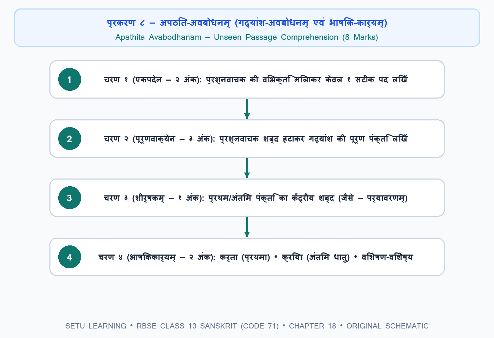

# अध्याय 18: प्रकरण ८ — अपठित-अवबोधनम् (गद्यांश-अवबोधनम् एवं भाषिक-कार्यम्) (Apathita Avabodhanam — Unseen Passage Comprehension (8 Marks))

## भाग 1: अध्याय प्रवेश एवं पाठ्यक्रम मैपिंग

> NCERT 'शेमुषी भाग-2' के सभी प्रश्नों के हल तथा पूरा ऐतिहासिक PYQ संग्रह स्रोत-परीक्षण सहित संकलित हैं। सामान्य माध्यमिक 2026–27 पाठ्यक्रम की पुनः पुष्टि शेष है।

**विषय कोड:** 71 (तृतीया भाषा — संस्कृतम्) · **श्रृंखला पुस्तक:** 6

**सत्यापित आधार:** RBSE 2025–26 · **अध्याय भार:** 8 अंक। यह भार उसी संस्करण का है; वास्तविक प्रश्न-विभाजन की भविष्यवाणी नहीं।

**सीखने के लक्ष्य:** ८०–१०० शब्दों के अपठित संस्कृत गद्यांश से एकपदेन उत्तर, पूर्णवाक्येन उत्तर, समुचित शीर्षक-लेखन तथा भाषिक-कार्य (कर्तृ-क्रिया, विशेषण-विशेष्य, सर्वनाम-स्थाने संज्ञा, पर्याय/विलोम) में ८ में से ८ अंक प्राप्त करना।

## भाग 2: शब्दावली एवं अवधारणा कैप्सूल

| शब्द / सूत्र | अर्थ / उपयोग |
|---|---|
| एकपदेन उत्तरत | केवल एक शब्द में उत्तर देना (४ प्रश्न × ½ = २ अंक अथवा २ × १ = २ अंक)। |
| पूर्णवाक्येन उत्तरत | पूरे संस्कृत वाक्य में उत्तर देना (२ या ३ प्रश्न = ३ अंक)। |
| अस्य गद्यांशस्य समुचितं शीर्षकम् | गद्यांश का केंद्रीय विषय — प्रथमा या षष्ठी विभक्ति में १–३ शब्दों में (१ अंक)। |
| कर्तृपदम् | क्रिया करने वाला पद (प्रायः प्रथमा विभक्ति में; 'कः/का/के' से प्रश्न करने पर मिलता है)। |
| क्रियापदम् | वाक्य को पूर्ण करने वाली धातु-क्रिया (प्रायः वाक्य के अंत में — अस्ति, भवति, करोति, आसीत् आदि)। |
| विशेषण-विशेष्यम् | संज्ञा की विशेषता बताने वाला 'विशेषण' और जिसकी विशेषता बताई जाए वह संज्ञा 'विशेष्य' (समान लिंग-विभक्ति-वचन)। |
| सर्वनामस्थाने संज्ञापदम् | रेखांकित सर्वनाम (सः, तस्य, तस्मै, सा, ते) किस संज्ञा के लिए आया है, उसे उसी विभक्ति में लिखना। |
| पर्यायपदम् | समानार्थक शब्द (गद्यांश में से चुनकर लिखना)। |
| विलोमपदम् | विपरीतार्थक शब्द (गद्यांश में से चुनकर लिखना)। |
| भाषिककार्यम् | गद्यांश की अंतिम ३–४ व्याकरणिक उपप्रश्न शृंखला (२ अंक)। |

## भाग 3: विस्तृत शिक्षण पाठ

### १. अपठित-अवबोधनम् का अंक-विभाजन (RBSE प्रश्न संख्या 3 — कुल ८ अंक)
RBSE कक्षा 10 संस्कृत प्रश्न-पत्र के खंड 'अ' में प्रश्न संख्या 3 पर ८० से १०० शब्दों का एक अपठित गद्यांश आता है, जिसका अंक-विभाजन इस प्रकार है:
1. **(अ) एकपदेन उत्तरत (४ प्रश्न × ½ अंक = २ अंक):** उत्तर केवल **एक शब्द** में लिखें।
2. **(ब) पूर्णवाक्येन उत्तरत (३ प्रश्न × १ अंक = ३ अंक):** प्रश्नवाचक शब्द (कः, किम्, कुत्र, केन, कदा) हटाकर गद्यांश की पंक्ति से **पूरा वाक्य** लिखें।
3. **(स) अस्य गद्यांशस्य समुचितं शीर्षकं लिखत (१ अंक):** गद्यांश की प्रथम या अंतिम पंक्ति में बार-बार आया मुख्य शब्द (जैसे — **'पर्यावरणम्'**, **'सत्सङ्गतिः'**, **'अनुशासनम्'**, **'महाराणाप्रतापः'**, **'भारतवर्षः'**, **'परोपकारः'**) ही शीर्षक होता है!
4. **(द) भाषिककार्यम् (४ प्रश्न × ½ अंक = २ अंक):** कर्तृ-क्रिया चयन, विशेषण-विशेष्य चयन, सर्वनाम के स्थान पर संज्ञा तथा पर्याय/विलोम पद।

### २. भाषिक-कार्यम् और शीर्षक के ५ अचूक टॉपर सूत्र
1. **समुचित शीर्षक लिखने का सूत्र:** गद्यांश में जो शब्द सबसे अधिक बार आए या जिसके गुण/महत्त्व का वर्णन पहली पंक्ति में हो, उसे प्रथमा विभक्ति में लिखें (जैसे — **'पर्यावरणस्य रक्षणम्'** या **'पर्यावरणम्'**; **'अनुशासनस्य महत्त्वम्'** या **'अनुशासनम्'**)। कभी भी पूरा लंबा वाक्य शीर्षक में न लिखें।
2. **कर्तृपद-क्रियापद पहचान सूत्र:**
   - यदि प्रश्न पूछे: `‘आसीत् / अभवत् / करोति’ इति क्रियापदस्य कर्तृपदं किम्?` → उस वाक्य में **प्रथमा विभक्ति** वाला शब्द ढूँढ़ें (जैसे — 'रामः सोमः च... सोमः अतीव चतुरः आसीत्' में 'आसीत्' का कर्ता **'सोमः'** है — RBSE 2026 मुख्य परीक्षा)।
   - यदि प्रश्न पूछे: `‘पर्यावरणम् / प्रतापः’ इति कर्तृपदस्य क्रियापदं किम्?` → उस वाक्य के **अंत में स्थित क्रिया** (रक्षति, अकरोत्, भवति, वर्तते) चुनें।
3. **विशेषण-विशेष्य पहचान सूत्र:** विशेषण और विशेष्य में **समान लिंग, समान विभक्ति और समान वचन** होता है! सामान्यतः **पहला शब्द विशेषण** और **दूसरा संज्ञा शब्द विशेष्य** होता है:
   - उदाहरण: **'चतुरः सोमः'** में विशेषण = **चतुरः**, विशेष्य = **सोमः** (RBSE 2026 मुख्य परीक्षा)।
   - उदाहरण: **'स्वच्छं पर्यावरणम्'** में विशेषण = **स्वच्छम्**, विशेष्य = **पर्यावरणम्** (RBSE 2026 पूरक व 2025 पूरक)।
   - उदाहरण: **'महान् देशभक्तः'** में विशेषण = **महान्**, विशेष्य = **देशभक्तः** (RBSE 2025 मुख्य)।
4. **सर्वनाम के स्थान पर संज्ञा सूत्र:** जब पूछे कि वाक्य में 'सः / तस्य / तस्मै / तेन' किसके लिए प्रयुक्त हुआ है, तो पिछली पंक्ति का मुख्य पात्र देखें और **जिस विभक्ति में सर्वनाम हो, उसीया चतुर्थी/षष्ठी/प्रथमा में संज्ञा** लिखें (जैसे — 'तस्मै' के लिए 'रामाय/प्रतापाय', 'तस्य' के लिए 'सोमस्य', 'सः' के लिए 'रामः')।

### ३. RBSE २०२६ एवं २०२५ के वास्तविक अपठित गद्यांश (हल सहित)
**आदर्श गद्यांश १ (RBSE 2026 मुख्य परीक्षा, प्रश्न 3, पृष्ठ 4):**
> *"कस्मिंश्चित् ग्रामे रामः सोमः च द्वौ मित्रौ निवसतः स्म। रामः सरलः सत्यवादी च आसीत्, परं सोमः अतीव चतुरः स्वार्थी च आसीत्। एकदा तौ धनोपार्जनाय नगरं प्रति प्रस्थितौ। मार्गे तौ एकं सुवर्णकलशं प्राप्तवन्तौ। रामः अवदत् — 'आवाम् इमं कलशं समभागेन विभजावः।' परं सोमः छलेन सर्वं सुवर्णं हर्तुम् ऐच्छत्। अन्ते न्यायाधीशस्य समक्षे सोमस्य चौर्यं प्रकटितम् अभवत्, सत्यवादिनः रामस्य च विजयः अभवत्।"*
- **एकपदेन:** (i) ग्रामे कौ निवसतः स्म? → **रामः सोमः च (द्वौ मित्रौ)**। (ii) सरलः सत्यवादी च कः आसीत्? → **रामः**। (iii) तौ मार्गे किं प्राप्तवन्तौ? → **सुवर्णकलशम्**। (iv) अन्ते कस्य विजयः अभवत्? → **रामस्य (सत्यवादिनः)**।
- **शीर्षकम्:** **'सत्यस्य विजयः'** अथवा **'रामः सोमः च (द्वौ मित्रौ)'**।
- **भाषिककार्यम्:** (i) 'आसीत्' क्रियायाः कर्तृपदम् → **रामः / सोमः**; (ii) 'चतुरः सोमः' अत्र विशेषणपदम् → **चतुरः**; (iii) 'तौ' सर्वनामपदं काभ्यां प्रयुक्तम् → **रामसोमाभ्याम् (रामः सोमः च)**; (iv) 'पराजयः' इत्यस्य विलोमपदम् → **विजयः**।

**आदर्श गद्यांश २ (RBSE 2026 पूरक व 2025 पूरक परीक्षा — 'पर्यावरणम्'):**
> *"अस्मान् परितः यत् आवरणं वर्तते तत् पर्यावरणं कथ्यते। स्वच्छं पर्यावरणम् अस्माकं जीवनाय अत्यन्तम् आवश्यकम् अस्ति। वृक्षाः वायुमण्डलं शुद्धं कुर्वन्ति, मेघान् आकर्षयन्ति वृष्टिं च कारयन्ति। मानवः स्वार्थाय वनानि छिनत्ति, येन प्रदूषणं वर्धते। अतः अस्माभिः अधिकाधिकाः वृक्षाः रोपणीयाः। रक्षणीयाः च। उच्यते अपि — 'वृक्षो रक्षति रक्षितः'।"*
- **एकपदेन:** (i) अस्मान् परितः आवरणं किं कथ्यते? → **पर्यावरणम्**। (ii) के वायुमण्डलं शुद्धं कुर्वन्ति? → **वृक्षाः**।
- **शीर्षकम्:** **'पर्यावरणस्य महत्त्वम्'** अथवा **'वृक्षारोपणम्'**।

अपठित-अवबोधनम्: ८ अंकों के अपठित गद्यांश को हल करने की ४-चरणीय रणनीति।

## भाग 4: पाठ्यपुस्तक-अवधारणाओं पर मौलिक हल किए उदाहरण

नीचे के प्रश्न लेखक के मौलिक मॉडल हैं। ये किसी NCERT edition के प्रश्न क्रमांक या संपूर्ण in-text/exercise solution bank होने का दावा नहीं करते।

**हल किया उदाहरण 1: RBSE 2025 मुख्य परीक्षा प्रश्न 3 ('महाराणाप्रतापः' गद्यांश) के प्रश्न हल करें।**

गद्यांश-सार: मेवाड़ केसरी महाराणा प्रताप का जन्म १५४० ई. में कुम्भलगढ़ दुर्ग में हुआ। उनके पिता उदयसिंह और माता जयवन्तीबाई थीं। हल्दीघाटी युद्ध में उनके अश्व 'चेतक' ने अद्भुत शौर्य दिखाया। उत्तर: १. प्रतापस्य जन्म कुत्र अभवत्? → **कुम्भलगढदुर्गे**। २. प्रतापस्य अश्वस्य नाम किम् आसीत्? → **चेतकः**। ३. शीर्षकम् → **'महाराणाप्रतापः'**। ४. 'वीरः प्रतापः' में विशेषणपदम् → **वीरः**।

**हल किया उदाहरण 2: RBSE 2024 मुख्य परीक्षा प्रश्न 3 ('अनुशासनम्' गद्यांश) के प्रश्न हल करें।**

गद्यांश-सार: अनुशासनं नाम नियमानां पालनम्। छात्रजीवने अनुशासनस्य सर्वाधिकं महत्त्वम् अस्ति। प्रकृतिरपि नियमानुसारं चलति। उत्तर: १. नियमानां पालनं किं कथ्यते? → **अनुशासनम्**। २. कस्मिन् जीवने अनुशासनस्य सर्वाधिकं महत्त्वम् अस्ति? → **छात्रजीवने**। ३. शीर्षकम् → **'अनुशासनस्य महत्त्वम्'**। ४. 'अस्ति' क्रियायाः कर्तृपदम् → **महत्त्वम्**।

**हल किया उदाहरण 3: गद्यांश के वाक्य 'वृक्षाः वायुमण्डलं शुद्धं कुर्वन्ति' में कर्तृपद, कर्मपद, विशेषण और क्रियापद अलग करें।**

१. **कर्तृपदम्:** वृक्षाः (प्रथमा बहुवचन)। २. **विशेष्य/कर्मपदम्:** वायुमण्डलम् (द्वितीया एकवचन)। ३. **विधेय-विशेषणम्:** शुद्धम्। ४. **क्रियापदम्:** कुर्वन्ति (कृ धातु, लट् लकार प्रथम पुरुष बहुवचन)।

## भाग 5: सत्यापित बोर्ड प्रश्न एवं स्रोत-स्थिति

2026 मुख्य परीक्षा, प्रश्न 3, PDF पृष्ठ 4 ('रामः सोमः च' गद्यांश — 8 अंक) तथा 2026 पूरक परीक्षा ('पर्यावरणम्' गद्यांश — 8 अंक)।

[RBSE 2026 मूल पेपर (S-71)](https://rajeduboard.rajasthan.gov.in/books/PAPERS-2026/Sec/S-71-Sankrit-TL-26.pdf)। प्रश्न का संक्षिप्त विषय-संदर्भ है; शब्दशः पुनर्मुद्रण नहीं।

## भाग 6: खंडवार मौलिक अभ्यास बैंक

**अभ्यास-अंक:** लेखक के स्व-अभ्यास के लिए हैं; RBSE की आधिकारिक marking scheme नहीं। उत्तर पहले स्वयं लिखें, फिर भाग 9 देखें।

## अ: बहुविकल्पीय प्रश्न — 15 × 1 अंक

**MCQ 1. अपठित-गद्यांशस्य शीर्षकं कीदृशं भवितव्यम्?**

अ) गद्यांशात् असम्बद्धम्  
ब) प्रश्नवाचकम्  
स) संक्षिप्तं केन्द्रीयविषयाधारितं च  
द) अतिदीर्घं पूर्णवाक्यम्

**MCQ 2. 'सोमः अतीव चतुरः आसीत्' — अत्र 'आसीत्' क्रियापदस्य कर्तृपदं किम्?**

अ) आसीत्  
ब) सोमः  
स) अतीव  
द) चतुरः

**MCQ 3. 'चतुरः सोमः' — अनयोः पदयोः विशेषणपदं किम् अस्ति?**

अ) चतुरः  
ब) सोमः  
स) उभौ  
द) न कोऽपि

**MCQ 4. 'स्वच्छं पर्यावरणम् आवश्यकम् अस्ति' — अत्र विशेष्यपदं किम्?**

अ) स्वच्छम्  
ब) आवश्यकम्  
स) अस्ति  
द) पर्यावरणम्

**MCQ 5. 'वृक्षाः वायुमण्डलं शुद्धं कुर्वन्ति' — अत्र क्रियापदं किम् अस्ति?**

अ) वायुमण्डलम्  
ब) शुद्धम्  
स) कुर्वन्ति  
द) वृक्षाः

**MCQ 6. 'एकदा तौ नगरं प्रस्थितौ' (रामः सोमः च) — अत्र 'तौ' सर्वनामपदं काभ्यां प्रयुक्तम्?**

अ) वृक्षाभ्याम्  
ब) रामसोमाभ्याम्  
स) ग्रामजनाभ्याम्  
द) न्यायाधीशाभ्याम्

**MCQ 7. 'पराजयः' इत्यस्य पदस्य गद्यांशे प्रयुक्तं विलोमपदं किम्?**

अ) विजयः  
ब) जयः-पराजयः  
स) हानिः  
द) लाभः

**MCQ 8. 'शिक्षिता नारी परिवारं शिक्षितं करोति' — अत्र 'करोति' क्रियायाः कर्तृपदं किम्?**

अ) परिवारम्  
ब) शिक्षितम्  
स) करोति  
द) नारी

**MCQ 9. 'एकपदेन उत्तरत' प्रश्ने कीदृशम् उत्तरं लेखनीयम्?**

अ) श्लोकरूपेण  
ब) हिन्दीभाषया  
स) केवलम् एकपदेन  
द) पूर्णवाक्येन

**MCQ 10. 'किमर्थम्' इति प्रश्नवाचकपदस्य उत्तरे प्रायः का विभक्तिः कः प्रत्ययो वा आगच्छति?**

अ) सम्बोधनम्  
ब) चतुर्थी विभक्तिः अथवा तुमुन्-प्रत्ययः  
स) प्रथमा विभक्तिः  
द) सप्तमी विभक्तिः

**MCQ 11. 'कुत्र' इति प्रश्नवाचकपदस्य उत्तरे का विभक्तिः प्रायः भवति?**

अ) सप्तमी विभक्तिः  
ब) प्रथमा विभक्तिः  
स) तृतीया विभक्तिः  
द) चतुर्थी विभक्तिः

**MCQ 12. 'महान् देशभक्तः प्रतापः' — अत्र 'महान्' इति पदं किम् अस्ति?**

अ) क्रियापदम्  
ब) अव्ययपदम्  
स) सर्वनामपदम्  
द) विशेषणपदम्

**MCQ 13. 'मानवः स्वार्थाय वनानि छिनत्ति' — अत्र 'छिनत्ति' क्रियायाः कर्तृपदं किम्?**

अ) वनानि  
ब) छिनत्ति  
स) मानवः  
द) स्वार्थाय

**MCQ 14. 'सम्पत्तिः' इत्यस्य विलोमपदं किम्?**

अ) धनम्  
ब) विपत्तिः  
स) समृद्धिः  
द) लक्ष्मीः

**MCQ 15. गद्यांशे यदि पुनः-पुनः 'अनुशासनम्' पदम् आगच्छति, तर्हि समुचितं शीर्षकं किम्?**

अ) अनुशासनम् / अनुशासनस्य महत्त्वम्  
ब) क्रीडायाः महत्त्वम्  
स) भ्रमणम्  
द) भोजनम्

## अ: रिक्त स्थान — 6 × 1 अंक

1. केवल एक शब्द में उत्तर देना (४ प्रश्न × ½ = २ अंक अथवा २ × १ = २ अंक)। — इस शब्द/सूत्र का नाम है: ____।  
2. पूरे संस्कृत वाक्य में उत्तर देना (२ या ३ प्रश्न = ३ अंक)। — इस शब्द/सूत्र का नाम है: ____।  
3. गद्यांश का केंद्रीय विषय — प्रथमा या षष्ठी विभक्ति में १–३ शब्दों में (१ अंक)। — इस शब्द/सूत्र का नाम है: ____।  
4. क्रिया करने वाला पद (प्रायः प्रथमा विभक्ति में; 'कः/का/के' से प्रश्न करने पर मिलता है)। — इस शब्द/सूत्र का नाम है: ____।  
5. वाक्य को पूर्ण करने वाली धातु-क्रिया (प्रायः वाक्य के अंत में — अस्ति, भवति, करोति, आसीत् आदि)। — इस शब्द/सूत्र का नाम है: ____।  
6. संज्ञा की विशेषता बताने वाला 'विशेषण' और जिसकी विशेषता बताई जाए वह संज्ञा 'विशेष्य' (समान लिंग-विभक्ति-वचन)। — इस शब्द/सूत्र का नाम है: ____।

## अ: अतिलघु उत्तर — 8 × 1 अंक

1. अपठित-गद्यांशस्य शीर्षकं कीदृशं भवितव्यम्?  
2. 'सोमः अतीव चतुरः आसीत्' — अत्र 'आसीत्' क्रियापदस्य कर्तृपदं किम्?  
3. 'चतुरः सोमः' — अनयोः पदयोः विशेषणपदं किम् अस्ति?  
4. 'स्वच्छं पर्यावरणम् आवश्यकम् अस्ति' — अत्र विशेष्यपदं किम्?  
5. 'वृक्षाः वायुमण्डलं शुद्धं कुर्वन्ति' — अत्र क्रियापदं किम् अस्ति?  
6. 'एकदा तौ नगरं प्रस्थितौ' (रामः सोमः च) — अत्र 'तौ' सर्वनामपदं काभ्यां प्रयुक्तम्?  
7. 'पराजयः' इत्यस्य पदस्य गद्यांशे प्रयुक्तं विलोमपदं किम्?  
8. 'शिक्षिता नारी परिवारं शिक्षितं करोति' — अत्र 'करोति' क्रियायाः कर्तृपदं किम्?

## ब: लघु उत्तर — 6 × 2 अंक

**B1.** अपठित-गद्यांशस्य शीर्षकं कथं चयनीयम्?

**B2.** 'एकपदेन उत्तरत' प्रश्ने कति पदानि लेखनीयानि?

**B3.** वाक्ये कर्तृपदं कथं ज्ञायते?

**B4.** विशेषण-विशेष्ययोः मध्ये कः सम्बन्धः भवति?

**B5.** 'अस्मान् परितः यत् आवरणं वर्तते तत् पर्यावरणं कथ्यते' — अत्र 'कथ्यते' क्रियायाः कर्तृपदं किम्?

**B6.** 'स्वच्छं पर्यावरणम्' इत्यत्र विशेषणपदं विशेष्यपदं च पृथक् कुरुत।

## स: दीर्घ उत्तर — 4 × 3 अंक

आंतरिक विकल्प अभ्यास: C1 अथवा C2, तथा C3 अथवा C4 चुनें। पुनरावृत्ति में बचा विकल्प भी हल करें। यह लेखक की अभ्यास व्यवस्था है।

**C1.** अपठित-गद्यांशं हल कर्तुं चत्वारि सोपानानि लिखत।

**C2.** भाषिक-कार्ये 'सर्वनामस्थाने संज्ञाप्रयोगः' कथं क्रियते? सोदाहरणं स्पष्टीकुरुत।

**C3.** RBSE परीक्षा में सर्वाधिक पूछे जाने वाले ६ अपठित गद्यांश विषयों के आदर्श शीर्षक लिखें।

**C4.** विशेषण-विशेष्य चयन के ४ बोर्ड उदाहरण हल सहित स्पष्ट करें।

## द: विस्तृत उत्तर — 2 × 4 अंक

आंतरिक विकल्प अभ्यास: D1 अथवा D2 चुनें; बाद में दूसरा भी हल करें।

**D1.** RBSE 2023 व 2022 के दो पूर्ण अपठित गद्यांश ('भारतीयसंस्कृतिः' एवं 'नारीशिक्षा') सभी प्रश्नों के आदर्श उत्तर सहित लिखें।

**D2.** अपठित गद्यांश में प्रश्नवाचक शब्दों (कः, कम्, केन, कस्मै, कस्मात्, कस्य, कस्मिन्, कुत्र, कदा, कथम्, किमर्थम्) से उत्तर खोजने की तालिका बनाएँ।

## भाग 7: सावधानियाँ एवं परीक्षा-त्रुटियाँ

- 'एकपदेन' में पूरा वाक्य न लिखें और 'पूर्णवाक्येन' में कभी अधूरा एक शब्द न छोड़ें।
- पूर्णवाक्येन में प्रश्नवाचक शब्द (कः, कुत्र, किमर्थम्) को उत्तर में से हटाना न भूलें।
- 'विशेषणपदम्' और 'विशेष्यपदम्' को ध्यान से पढ़ें: गुण बताने वाला **विशेषण** ('स्वच्छम्') और मुख्य संज्ञा **विशेष्य** ('पर्यावरणम्') है।
- शीर्षक हमेशा प्रथमा विभक्ति ('अनुशासनम्') या षष्ठी तत्पुरुष ('अनुशासनस्य महत्त्वम्') में संक्षिप्त लिखें।
- भाषिक-कार्य में पर्याय या विलोम शब्द अपनी मर्जी से न लिखकर **गद्यांश में आए शब्दों में से ही** चुनकर लिखें।

## भाग 8: फटाफट पुनरावृत्ति — 25 बिंदु

1. एकपदेन उत्तरत: केवल एक शब्द में उत्तर देना (४ प्रश्न × ½ = २ अंक अथवा २ × १ = २ अंक)।  
2. पूर्णवाक्येन उत्तरत: पूरे संस्कृत वाक्य में उत्तर देना (२ या ३ प्रश्न = ३ अंक)।  
3. अस्य गद्यांशस्य समुचितं शीर्षकम्: गद्यांश का केंद्रीय विषय — प्रथमा या षष्ठी विभक्ति में १–३ शब्दों में (१ अंक)।  
4. कर्तृपदम्: क्रिया करने वाला पद (प्रायः प्रथमा विभक्ति में; 'कः/का/के' से प्रश्न करने पर मिलता है)।  
5. क्रियापदम्: वाक्य को पूर्ण करने वाली धातु-क्रिया (प्रायः वाक्य के अंत में — अस्ति, भवति, करोति, आसीत् आदि)।  
6. विशेषण-विशेष्यम्: संज्ञा की विशेषता बताने वाला 'विशेषण' और जिसकी विशेषता बताई जाए वह संज्ञा 'विशेष्य' (समान लिंग-विभक्ति-वचन)।  
7. सर्वनामस्थाने संज्ञापदम्: रेखांकित सर्वनाम (सः, तस्य, तस्मै, सा, ते) किस संज्ञा के लिए आया है, उसे उसी विभक्ति में लिखना।  
8. पर्यायपदम्: समानार्थक शब्द (गद्यांश में से चुनकर लिखना)।  
9. विलोमपदम्: विपरीतार्थक शब्द (गद्यांश में से चुनकर लिखना)।  
10. भाषिककार्यम्: गद्यांश की अंतिम ३–४ व्याकरणिक उपप्रश्न शृंखला (२ अंक)।  
11. शीर्षक सदैव संक्षिप्त (१–३ शब्द) और गद्यांश के केंद्रीय विषय पर आधारित होना चाहिए।  
12. वाक्य में प्रथमा विभक्ति का कर्ता 'सोमः' है (RBSE 2026 मुख्य परीक्षा)।  
13. 'चतुरः' गुण बता रहा है अतः विशेषण है, और 'सोमः' संज्ञा होने से विशेष्य है (RBSE 2026 मुख्य परीक्षा)।  
14. जिस संज्ञा की विशेषता बताई जाती है वह विशेष्य होता है, अतः 'पर्यावरणम्' विशेष्य है (RBSE 2026 पूरक)।  
15. 'कुर्वन्ति' (कृ धातु, लट् लकार प्रथम पुरुष बहुवचन) वाक्य का क्रियापद है।  
16. 'तौ' द्विवचन सर्वनाम दो मित्रों (राम और सोम) के लिए आया है (RBSE 2026 मुख्य परीक्षा)।  
17. 'पराजयः' का सटीक विलोम 'विजयः' है (RBSE 2026 मुख्य परीक्षा)।  
18. प्रथमा एकवचन में स्थित 'नारी' कर्तृपद है (RBSE 2022 मुख्य परीक्षा)।  
19. 'एकपदेन' प्रश्न का उत्तर केवल एक संस्कृत पद में लिखना चाहिए।  
20. 'किसलिए' (किमर्थम्) के उत्तर में चतुर्थी विभक्ति ('धनोपार्जनाय') या तुमुन् प्रत्यय ('पठितुम्') आता है।  
21. 'कुत्र' (कहाँ) स्थान पूछता है, अतः उत्तर प्रायः सप्तमी विभक्ति ('ग्रामे, दुर्गे, वने') में होता है।  
22. 'महान्' देशभक्त प्रताप की विशेषता बता रहा है, अतः विशेषणपद है (RBSE 2025 मुख्य)।  
23. 'छिनत्ति' (काटता है) क्रिया का प्रथमा एकवचन कर्ता 'मानवः' है।  
24. सम्पत्तिः का विलोम 'विपत्तिः' होता है।  
25. बार-बार आने वाला केंद्रीय विषय ही गद्यांश का शीर्षक होता है (RBSE 2024 मुख्य)।

## भाग 9: संपूर्ण अभ्यास उत्तर-कुंजी

## MCQ: सही विकल्प और कारण

**1. स — संक्षिप्तं केन्द्रीयविषयाधारितं च।** शीर्षक सदैव संक्षिप्त (१–३ शब्द) और गद्यांश के केंद्रीय विषय पर आधारित होना चाहिए।

**2. ब — सोमः।** वाक्य में प्रथमा विभक्ति का कर्ता 'सोमः' है (RBSE 2026 मुख्य परीक्षा)।

**3. अ — चतुरः।** 'चतुरः' गुण बता रहा है अतः विशेषण है, और 'सोमः' संज्ञा होने से विशेष्य है (RBSE 2026 मुख्य परीक्षा)।

**4. द — पर्यावरणम्।** जिस संज्ञा की विशेषता बताई जाती है वह विशेष्य होता है, अतः 'पर्यावरणम्' विशेष्य है (RBSE 2026 पूरक)।

**5. स — कुर्वन्ति।** 'कुर्वन्ति' (कृ धातु, लट् लकार प्रथम पुरुष बहुवचन) वाक्य का क्रियापद है।

**6. ब — रामसोमाभ्याम्।** 'तौ' द्विवचन सर्वनाम दो मित्रों (राम और सोम) के लिए आया है (RBSE 2026 मुख्य परीक्षा)।

**7. अ — विजयः।** 'पराजयः' का सटीक विलोम 'विजयः' है (RBSE 2026 मुख्य परीक्षा)।

**8. द — नारी।** प्रथमा एकवचन में स्थित 'नारी' कर्तृपद है (RBSE 2022 मुख्य परीक्षा)।

**9. स — केवलम् एकपदेन।** 'एकपदेन' प्रश्न का उत्तर केवल एक संस्कृत पद में लिखना चाहिए।

**10. ब — चतुर्थी विभक्तिः अथवा तुमुन्-प्रत्ययः।** 'किसलिए' (किमर्थम्) के उत्तर में चतुर्थी विभक्ति ('धनोपार्जनाय') या तुमुन् प्रत्यय ('पठितुम्') आता है।

**11. अ — सप्तमी विभक्तिः।** 'कुत्र' (कहाँ) स्थान पूछता है, अतः उत्तर प्रायः सप्तमी विभक्ति ('ग्रामे, दुर्गे, वने') में होता है।

**12. द — विशेषणपदम्।** 'महान्' देशभक्त प्रताप की विशेषता बता रहा है, अतः विशेषणपद है (RBSE 2025 मुख्य)।

**13. स — मानवः।** 'छिनत्ति' (काटता है) क्रिया का प्रथमा एकवचन कर्ता 'मानवः' है।

**14. ब — विपत्तिः।** सम्पत्तिः का विलोम 'विपत्तिः' होता है।

**15. अ — अनुशासनम् / अनुशासनस्य महत्त्वम्।** बार-बार आने वाला केंद्रीय विषय ही गद्यांश का शीर्षक होता है (RBSE 2024 मुख्य)।

**रिक्त स्थान:** 1. एकपदेन उत्तरत; 2. पूर्णवाक्येन उत्तरत; 3. अस्य गद्यांशस्य समुचितं शीर्षकम्; 4. कर्तृपदम्; 5. क्रियापदम्; 6. विशेषण-विशेष्यम्

**अतिलघु उत्तर:**

1. संक्षिप्तं केन्द्रीयविषयाधारितं च। शीर्षक सदैव संक्षिप्त (१–३ शब्द) और गद्यांश के केंद्रीय विषय पर आधारित होना चाहिए।

2. सोमः। वाक्य में प्रथमा विभक्ति का कर्ता 'सोमः' है (RBSE 2026 मुख्य परीक्षा)।

3. चतुरः। 'चतुरः' गुण बता रहा है अतः विशेषण है, और 'सोमः' संज्ञा होने से विशेष्य है (RBSE 2026 मुख्य परीक्षा)।

4. पर्यावरणम्। जिस संज्ञा की विशेषता बताई जाती है वह विशेष्य होता है, अतः 'पर्यावरणम्' विशेष्य है (RBSE 2026 पूरक)।

5. कुर्वन्ति। 'कुर्वन्ति' (कृ धातु, लट् लकार प्रथम पुरुष बहुवचन) वाक्य का क्रियापद है।

6. रामसोमाभ्याम्। 'तौ' द्विवचन सर्वनाम दो मित्रों (राम और सोम) के लिए आया है (RBSE 2026 मुख्य परीक्षा)।

7. विजयः। 'पराजयः' का सटीक विलोम 'विजयः' है (RBSE 2026 मुख्य परीक्षा)।

8. नारी। प्रथमा एकवचन में स्थित 'नारी' कर्तृपद है (RBSE 2022 मुख्य परीक्षा)।

**B1. अपठित-गद्यांशस्य शीर्षकं कथं चयनीयम्?**

गद्यांशस्य प्रथमपङ्क्तौ अन्तिमपङ्क्तौ वा पुनः-पुनः प्रयुक्तं केन्द्रीय-विषयपदं प्रथमा-विभक्तौ षष्ठी-विभक्तौ वा शीर्षकरूपेण लेखनीयम्।

**B2. 'एकपदेन उत्तरत' प्रश्ने कति पदानि लेखनीयानि?**

'एकपदेन उत्तरत' प्रश्ने केवलम् एकम् एव सटीकं पदं लेखनीयम्, न तु पूर्णवाक्यम्।

**B3. वाक्ये कर्तृपदं कथं ज्ञायते?**

क्रियायाः पूर्वं 'कः / का / के' इति प्रश्नं कृत्वा प्रथमा-विभक्तियुक्तं पदं कर्तृपदरूपेण ज्ञायते।

**B4. विशेषण-विशेष्ययोः मध्ये कः सम्बन्धः भवति?**

विशेषण-विशेष्ययोः लिङ्गं, विभक्तिः वचनं च समानं भवति; पूर्वपदं प्रायः विशेषणं उत्तरपदं च विशेष्यं भवति।

**B5. 'अस्मान् परितः यत् आवरणं वर्तते तत् पर्यावरणं कथ्यते' — अत्र 'कथ्यते' क्रियायाः कर्तृपदं किम्?**

अत्र 'कथ्यते' इति कर्मवाच्य-क्रियायाः उक्तकर्म/कर्तृस्थानीयपदं 'तत् / पर्यावरणम्' अस्ति।

**B6. 'स्वच्छं पर्यावरणम्' इत्यत्र विशेषणपदं विशेष्यपदं च पृथक् कुरुत।**

अत्र 'स्वच्छम्' इति विशेषणपदम् अस्ति, 'पर्यावरणम्' च विशेष्यपदम् अस्ति।

**C1. अपठित-गद्यांशं हल कर्तुं चत्वारि सोपानानि लिखत।**

1. **प्रथम सोपान (दो बार वाचन):** पहले गद्यांश को शांत मन से दो बार पढ़ें और उसके केंद्रीय विषय (शीर्षक) को रेखांकित करें। 2. **द्वितीय सोपान (एकपदेन व पूर्णवाक्येन):** प्रश्नवाचक शब्द (कः, कुत्र, किमर्थम्) की विभक्ति देखकर गद्यांश में वही पंक्ति खोजें और एकपदेन में एक शब्द तथा पूर्णवाक्येन में पूरा वाक्य लिखें। 3. **तृतीय सोपान (शीर्षक लेखन):** केंद्रीय विषय को १ से ३ शब्दों में ('पर्यावरणम्' / 'अनुशासनस्य महत्त्वम्') लिखें। 4. **चतुर्थ सोपान (भाषिक-कार्य):** वाक्य की संरचना देखकर कर्तृपद, क्रियापद, विशेषण-विशेष्य और विलोम/पर्याय चुनें।

**C2. भाषिक-कार्ये 'सर्वनामस्थाने संज्ञाप्रयोगः' कथं क्रियते? सोदाहरणं स्पष्टीकुरुत।**

1. गद्यांश में पहली पंक्ति में संज्ञा (जैसे — 'रामः', 'प्रतापः', 'भारतवर्षः') आती है और अगली पंक्तियों में उसके लिए सर्वनाम ('सः, तम्, तेन, तस्मै, तस्य, तस्मिन्') आता है। 2. जब परीक्षा में पूछा जाए कि सर्वनाम किसके लिए प्रयुक्त हुआ है, तो संज्ञा शब्द को **चतुर्थी ('कस्मै')** या **उसी विभक्ति** में लिखें। 3. उदाहरण: 'रामः सरलः आसीत्। **सः** सत्यं वदति स्म।' यहाँ 'सः' के स्थान पर संज्ञा = **रामः** (अथवा रामाय)। 4. यदि स्त्रीलिंग नाम ('सीता / नारी') हो और सर्वनाम 'सा / तस्याः' हो, तो 'सीता / सीतायाः' लिखें।

**C3. RBSE परीक्षा में सर्वाधिक पूछे जाने वाले ६ अपठित गद्यांश विषयों के आदर्श शीर्षक लिखें।**

1. पर्यावरण और वृक्षारोपण विषय पर → **'पर्यावरणस्य रक्षणम्'** अथवा **'वृक्षाणां महत्त्वम्'**। 2. अनुशासन और छात्रजीवन विषय पर → **'अनुशासनस्य महत्त्वम्'** अथवा **'छात्रजीवनम्'**। 3. महापुरुष (महाराणा प्रताप / स्वामी विवेकानंद / कालिदास) पर → **'महाराणाप्रतापः'** / **'स्वामीविवेकानन्दः'** / **'महाकविः कालिदासः'**। 4. भारतवर्ष और भारतीय संस्कृति पर → **'अस्माकं भारतवर्षः'** अथवा **'भारतीयसंस्कृतिः'**। 5. परोपकार और सत्संगति पर → **'परोपकारः'** अथवा **'सत्सङ्गतेः महिमा'**। 6. नारीशिक्षा और विश्वबंधुत्व पर → **'नारीशिक्षा'** अथवा **'विश्वबन्धुत्वम्'**।

**C4. विशेषण-विशेष्य चयन के ४ बोर्ड उदाहरण हल सहित स्पष्ट करें।**

1. **'चतुरः सोमः'** (2026 मुख्य) → विशेषण: चतुरः, विशेष्य: सोमः। 2. **'स्वच्छं पर्यावरणम्'** (2026 पूरक) → विशेषण: स्वच्छम्, विशेष्य: पर्यावरणम्। 3. **'महान् देशभक्तः'** (2025 मुख्य) → विशेषण: महान्, विशेष्य: देशभक्तः। 4. **'प्राचीना संस्कृतिः'** (2023 मुख्य) → विशेषण: प्राचीना, विशेष्य: संस्कृतिः।

**D1. RBSE 2023 व 2022 के दो पूर्ण अपठित गद्यांश ('भारतीयसंस्कृतिः' एवं 'नारीशिक्षा') सभी प्रश्नों के आदर्श उत्तर सहित लिखें।**

1. **गद्यांश १ (RBSE 2023 मुख्य — भारतीयसंस्कृतिः):** *"विश्वस्य सर्वासु संस्कृतिषु भारतीयसंस्कृतिः प्राचीनतमा श्रेष्ठा च वर्तते। अस्याः मूलमन्त्रः 'वसुधैव कुटुम्बकम्' तथा 'सर्वे भवन्तु सुखिनः' इति अस्ति। त्यागेन संयमेन च मानवाः सुखं प्राप्नुवन्ति।"* — **उत्तर:** (क) एकपदेन: का प्राचीनतमा वर्तते? → **भारतीयसंस्कृतिः**; मानवाः केन सुखं प्राप्नुवन्ति? → **त्यागेन संयमेन च**। (ख) पूर्णवाक्येन: भारतीयसंस्कृतेः मूलमन्त्रः कः अस्ति? → **भारतीयसंस्कृतेः मूलमन्त्रः 'वसुधैव कुटुम्बकम्' तथा 'सर्वे भवन्तु सुखिनः' इति अस्ति।** (ग) शीर्षकम्: **'भारतीयसंस्कृतिः'**। (घ) भाषिककार्यम्: 'प्राचीनतमा संस्कृतिः' में विशेषण = **प्राचीनतमा**; 'प्राप्नुवन्ति' का कर्ता = **मानवाः**। 2. **गद्यांश २ (RBSE 2022 मुख्य — नारीशिक्षा):** *"यत्र नार्यस्तु पूज्यन्ते रमन्ते तत्र देवताः। शिक्षिता नारी सम्पूर्णं परिवारं शिक्षितं करोति। अद्यत्वे बालिकाः प्रत्येकस्मिन् क्षेत्रे अग्रेसराः सन्ति।"* — **उत्तर:** (क) एकपदेन: कुत्र देवताः रमन्ते? → **यत्र नार्यः पूज्यन्ते**; का परिवारं शिक्षितं करोति? → **शिक्षिता नारी**। (ख) शीर्षकम्: **'नारीशिक्षायाः महत्त्वम्'**। (ग) भाषिककार्यम्: 'शिक्षिता नारी' में विशेष्यपद = **नारी**; 'सन्ति' क्रिया का कर्तृपद = **बालिकाः**।

**D2. अपठित गद्यांश में प्रश्नवाचक शब्दों (कः, कम्, केन, कस्मै, कस्मात्, कस्य, कस्मिन्, कुत्र, कदा, कथम्, किमर्थम्) से उत्तर खोजने की तालिका बनाएँ।**

1. **कः / का / के:** प्रथमा विभक्ति का कर्ता खोजें (रामः, सा, जनाः)। 2. **कम् / काम् / किम्:** द्वितीया विभक्ति का कर्म खोजें (ग्रन्थम्, विद्यालयम्)। 3. **केन / कया / कैः:** तृतीया विभक्ति का साधन खोजें (परिश्रमेण, त्यागेन)। 4. **कस्मै / किमर्थम्:** चतुर्थी विभक्ति या 'तुमुन्' प्रत्यय वाला उद्देश्य खोजें (धनोपार्जनाय, पठितुम्)। 5. **कस्मात् / कुतः:** पंचमी विभक्ति का स्रोत खोजें (हिमालयात्, ग्रामात्)। 6. **कस्य / कस्याः / केषाम्:** षष्ठी विभक्ति का संबंध खोजें (रामस्य, संस्कृतेः)। 7. **कस्मिन् / कुत्र / कदा:** सप्तमी विभक्ति का स्थान या समय खोजें (ग्रामे, कुम्भलगढदुर्गे, प्रातःकाले)।

## भाग 10: 10 मिनट / 10 अंक आत्म-मूल्यांकन एवं संदर्भ

समय: 10 मिनट। पहले पुस्तक बंद करें।

1. MCQ 3 और 11 हल करें। (1 + 1)
2. B2 और B5 के उत्तर लिखें। (2 + 2)
3. D1 हल करें। (4)

**कुंजी:** भाग 9 में संबंधित क्रमांक देखें। **स्व-मूल्यांकन:** 8–10: आगे बढ़ें; 5–7: छूटे कौशल का दोहराव; 0–4: भाग 2–4 फिर पढ़ें। यह अभ्यास-सुझाव है, बोर्ड grade नहीं।

[सत्यापित RBSE 2025–26 पाठ्यक्रम](https://rajeduboard.rajasthan.gov.in/anudeshika-etc/10_2026.pdf) · [NCERT शेमुषी भाग-2 संदर्भ](https://ncert.nic.in/textbook.php?jhsk1=0-12)

**आगे की कड़ी:** प्रकरण १९ 'पत्र-लेखनम्' में औपचारिक प्रार्थना-पत्र और अनौपचारिक मित्र/पितृ-पत्र (मंजूषा आधारित व स्वतंत्र, ४ अंक) का अभ्यास करेंगे।
