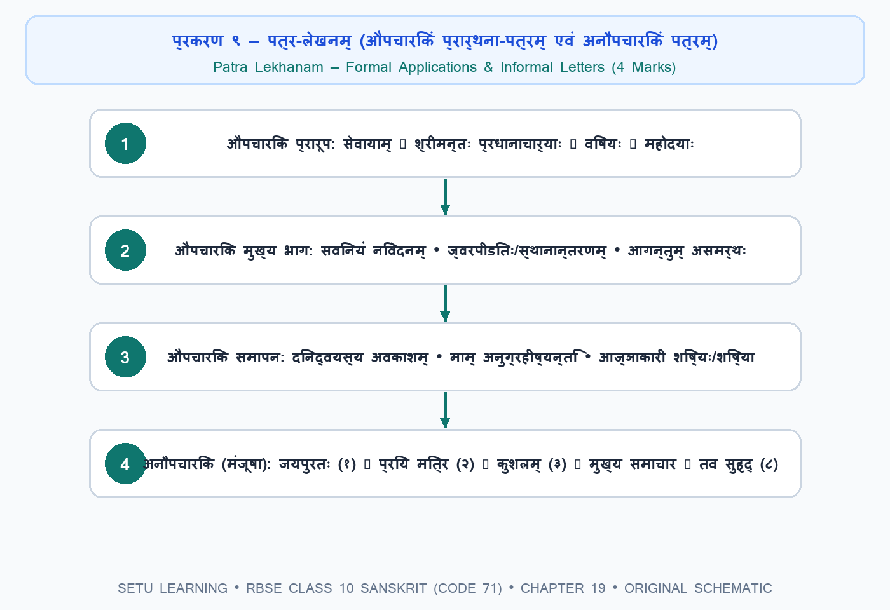

# अध्याय 19: प्रकरण ९ — पत्र-लेखनम् (औपचारिकं प्रार्थना-पत्रम् एवं अनौपचारिकं पत्रम्) (Patra Lekhanam — Formal Applications & Informal Letters (4 Marks))

## भाग 1: अध्याय प्रवेश एवं पाठ्यक्रम मैपिंग

> प्रथम संपादकीय प्रारूप। NCERT 'शेमुषी भाग-2' के सभी प्रश्नों के हल तथा पूरा ऐतिहासिक PYQ संग्रह स्रोत-परीक्षण सहित संकलित हैं। सामान्य माध्यमिक 2026–27 पाठ्यक्रम की पुनः पुष्टि शेष है।

**विषय कोड:** 71 (तृतीया भाषा — संस्कृतम्) · **श्रृंखला पुस्तक:** 6

**सत्यापित आधार:** RBSE 2025–26 · **अध्याय भार:** 4 अंक। यह भार उसी संस्करण का है; वास्तविक प्रश्न-विभाजन की भविष्यवाणी नहीं।

**सीखने के लक्ष्य:** RBSE कक्षा 10 परीक्षा के प्रश्न संख्या 15 (४ अंक) हेतु औपचारिक प्रार्थना-पत्र (रुग्णतावकाश, दिनद्वयस्य अवकाश, स्थानान्तरण-प्रमाणपत्र/TC, शुल्कमुक्ति) तथा अनौपचारिक पत्र (मित्र/पिता को पत्र — मंजूषा की सहायता से ८ रिक्त स्थानों की पूर्ति) में ४ में से ४ अंक प्राप्त करना।

## भाग 2: शब्दावली एवं अवधारणा कैप्सूल

| शब्द / सूत्र | अर्थ / उपयोग |
|---|---|
| सेवायाम् | सेवा में (औपचारिक प्रार्थना-पत्र का प्रारंभिक शब्द — सप्तमी एकवचन)। |
| श्रीमन्तः प्रधानाचार्याः | श्रीमान् प्रधानाचार्य महोदय (आदरार्थ बहुवचन प्रयोग)। |
| विषयः | प्रार्थना-पत्र का मुख्य उद्देश्य (जैसे — दिनद्वयस्य अवकाशार्थं प्रार्थना-पत्रम्)। |
| सविनयं निवेदनम् अस्ति | विनम्र निवेदन है ('महोदयाः! सविनयं निवेदनम् अस्ति यत्...')। |
| ज्वरपीडितः | बुखार से पीड़ित (अहं गतरात्रेः सहसा ज्वरपीडितः अस्मि)। |
| स्थानान्तरण-प्रमाणपत्रम् | टी.सी. / Transfer Certificate (पितुः स्थानान्तरणं जयपुरनगरे अभवत्)। |
| भवताम् आज्ञाकारी शिष्यः | आपका आज्ञाकारी शिष्य (स्त्रीलिंग में — 'भवताम् आज्ञाकारिणी शिष्या')। |
| प्रिय मित्र! / पूज्य पितृमहोदयाः! | अनौपचारिक पत्र का संबोधन (मित्र के लिए 'सप्रेम नमोनमः', बड़ों के लिए 'सादरं प्रणामः')। |
| अत्र कुशलं तत्रास्तु | यहाँ सब कुशल है, वहाँ भी कुशल हो (अनौपचारिक पत्र की प्रथम पंक्ति)। |
| भवदीयः सुहृद् / अभिन्नहृदयः | आपका मित्र (मित्र-पत्र का समापन)। |

## भाग 3: विस्तृत शिक्षण पाठ

### १. पत्र-लेखनम् का बोर्ड पैटर्न (RBSE प्रश्न संख्या 15 — ४ अंक)
RBSE कक्षा 10 संस्कृत परीक्षा में प्रश्न संख्या 15 पर आंतरिक विकल्प (अथवा) के साथ दो पत्र आते हैं:
1. **प्रथम विकल्प (औपचारिक प्रार्थना-पत्रम्):** प्रधानाचार्य को २/३ दिन के अवकाश (रुग्णतावकाश / आवश्यक कार्य) अथवा स्थानान्तरण-प्रमाणपत्र (T.C.) या शुल्क-मुक्ति के लिए प्रार्थना-पत्र लिखना।
2. **द्वितीय विकल्प (मञ्जूषा-आधारित पत्र-पूर्तिः):** ८ शब्दों की मंजूषा (Word Box) दी जाती है और पत्र में ८ रिक्त स्थान (**8 × ½ = 4 अंक**) भरने होते हैं!

### २. आदर्श औपचारिक प्रार्थना-पत्र १: रुग्णतावकाशार्थं / दिनद्वयस्य अवकाशार्थम् (RBSE 2026, 2025, 2024)
> **सेवायाम्,**  
> श्रीमन्तः प्रधानाचार्यमहोदयाः,  
> राजकीय-उच्चमाध्यमिक-विद्यालयः,  
> अजमेरम् (राजस्थानम्)।  
>   
> **विषयः — दिनद्वयस्य अवकाशार्थं प्रार्थना-पत्रम्।**  
>   
> महोदयाः,  
> सविनयं **निवेदनम्** अस्ति यत् अहं गतरात्रेः सहसा **ज्वरपीडितः** अस्मि। चिकित्सकेन मह्यं दिनद्वयस्य विश्रामाय परामर्शः दत्तः। अस्मात् **कारणात्** अहं विद्यालयम् **आगन्तुम्** असमर्थः अस्मि।  
> अतः **प्रार्थये** यत् मह्यं दिनांक 15.03.2026 तः 16.03.2026 पर्यन्तं **दिनद्वयस्य** अवकाशं स्वीकृत्य माम् **अनुग्रहीष्यन्ति** भवन्तः।  
>   
> सधन्यवादः।  
> दिनांकः — 15.03.2026  
> **भवताम् आज्ञाकारी शिष्यः** (बालिका हो तो: *भवताम् आज्ञाकारिणी शिष्या*)  
> नाम — रमेशः / रमा  
> कक्षा — दशमी (अ)

### ३. आदर्श औपचारिक प्रार्थना-पत्र २: स्थानान्तरण-प्रमाणपत्रार्थम् (T.C. हेतु — RBSE 2026 पूरक, 2023)
> **सेवायाम्,**  
> श्रीमन्तः प्रधानाचार्यमहोदयाः,  
> राजकीय-उच्चमाध्यमिक-विद्यालयः, जयपुरम्।  
>   
> **विषयः — स्थानान्तरण-प्रमाणपत्रं (T.C.) प्राप्तुं प्रार्थना-पत्रम्।**  
>   
> महोदयाः,  
> सविनयं निवेदनम् अस्ति यत् मम **पितुः** राजकीय-सेवायाः **स्थानान्तरणम्** जोधपुरनगरे सञ्जातम् अस्ति। मम सम्पूर्णः **परिवारः** पित्रा सह जोधपुरनगरं गच्छति। अहम् अपि तत्रैव राजकीय-विद्यालये दशमकक्षायां **प्रवेशं** ग्रहीष्यामि।  
> अतः श्रीमन्तः मह्यं **स्थानान्तरण-प्रमाणपत्रं** प्रदाय अनुग्रहीष्यन्ति इति प्रार्थये।  
>   
> दिनांकः — 20.03.2026  
> **भवताम् आज्ञाकारी शिष्यः**  
> नाम — सुरेशः, कक्षा — दशमी

### ४. आदर्श अनौपचारिक पत्र ३: मित्रं प्रति वर्धापन-पत्रम् / भ्रमण-पत्रम् (मञ्जूषा सहित)
**मञ्जूषा:** `[कुशलम्, जयपुरतः, मित्रवर, परीक्षायाम्, प्रथमस्थानम्, वर्धापनानि, पित्रोः, सुहृद्]`
> परीक्षाभवनात्,  
> **(१) जयपुरतः**  
> दिनांकः — 15.03.2026  
>   
> प्रिय **(२) मित्रवर!**  
> सप्रेम नमोनमः।  
> अत्र **(३) कुशलं** तत्रास्तु। अद्यैव मया तव पत्रं प्राप्तम्। इदं ज्ञात्वा अहं भृशं प्रसन्नः अभवम् यत् त्वं दशमकक्षायाः **(४) परीक्षायाम्** सर्वोत्तमैः अङ्कैः **(५) प्रथमस्थानं** प्राप्तवान् असि। एतदर्थं मम पक्षतः कोटिशः **(६) वर्धापनानि** स्वीकुरु।  
> गृहे पूज्ययोः **(७) पित्रोः** चरणयोः मम सादरं प्रणामं निवेदय।  
>   
> तव अभिन्नः **(८) सुहृद्**,  
> देवेन्द्रः।

पत्र-लेखनम्: औपचारिक प्रार्थना-पत्र एवं अनौपचारिक मित्र/पितृ-पत्र का ८-बिंदु संरचना-मानचित्र।

## भाग 4: पाठ्यपुस्तक-अवधारणाओं पर मौलिक हल किए उदाहरण

नीचे के प्रश्न लेखक के मौलिक मॉडल हैं। ये किसी NCERT edition के प्रश्न क्रमांक या संपूर्ण in-text/exercise solution bank होने का दावा नहीं करते।

**हल किया उदाहरण 1: मंजूषा आधारित रिक्त स्थान भरने के ६ अचूक सूत्र (Topper Hack) लिखें।**

१. **स्थान (Top-Right):** जिस शब्द के अंत में **'-तः' या पंचमी विभक्ति** हो (जयपुरतः, अजमेरतः, परीक्षाभवनात्, छात्रावासात्), उसे सबसे ऊपर दाईं ओर (१) में भरें। २. **संबोधन:** 'प्रिय ____' या 'पूज्य ____' के पास संबोधन पद (मित्र, रमेश, पितृपादाः) या 'नमोनमः/प्रणामः' भरें। ३. **प्रथम पंक्ति:** 'अत्र ____ तत्रास्तु' में हमेशा **'कुशलम्'** भरें! ४. **उद्देश्य ('तुमुन्' प्रत्यय):** 'असमर्थः अस्मि' से ठीक पहले **'-तुम्'** अंत वाला शब्द (**आगन्तुम्**) भरें। ५. **समापन क्रिया:** प्रार्थना-पत्र के अंत में 'भवन्तः' के पास **'अनुग्रहीष्यन्ति'** भरें। ६. **हस्ताक्षर से पूर्व:** मित्र-पत्र में **'सुहृद् / मित्रम्'** और प्रार्थना-पत्र में **'शिष्यः / शिष्या'** भरें।

**हल किया उदाहरण 2: RBSE 2025 मुख्य परीक्षा प्रश्न 15 (आवश्यककार्यात् दिनत्रयस्य अवकाशार्थं प्रार्थना-पत्रम्) लिखें।**

सेवायाम्, श्रीमन्तः प्रधानाचार्यमहोदयाः, राजकीय-उच्चमाध्यमिक-विद्यालयः, बीकानेरम्। विषयः — दिनत्रयस्य अवकाशार्थं प्रार्थना-पत्रम्। महोदयाः, सविनयं निवेदनम् अस्ति यत् मम ज्येष्ठभ्रातुः विवाहः श्वः भविष्यति। गृहे आवश्यकं कार्यं वर्तते, अतः अहं विद्यालयम् आगन्तुं न शक्नोमि। कृपया मह्यं दिनत्रयस्य अवकाशं प्रदाय माम् अनुग्रहीष्यन्ति। भवताम् आज्ञाकारी शिष्यः — मोहनः, कक्षा दशमी।

**हल किया उदाहरण 3: पिता से पुस्तकें खरीदने हेतु धन मँगवाने के लिए (धनप्रेषणार्थम्) पत्र के ८ मंजूषा-पदों का मिलान करें।**

१. छात्रावासात् (स्थान), २. पूज्यपितृमहोदयाः (संबोधन), ३. सादरं चरणवन्दनम् (अभिवादन), ४. कुशलम् ('अत्र कुशलं तत्रास्तु'), ५. अध्ययनम् ('मम अध्ययनं सुचारुरूपेण चलति'), ६. पुस्तकानि ('मया कानिचित् पुस्तकानि क्रेतव्यानि'), ७. पञ्चशतरूप्यकाणि ('कृपया ५०० रूप्यकाणि प्रेषयन्तु'), ८. आज्ञाकारी पुत्रः (समापन)।

## भाग 5: सत्यापित बोर्ड प्रश्न एवं स्रोत-स्थिति

2026 मुख्य परीक्षा, प्रश्न 15, PDF पृष्ठ 8-9: दिनद्वयस्य रुग्णतावकाशार्थं प्रार्थना-पत्रम् अथवा मित्रं प्रति वर्धापन-पत्रम् (4 अंक)।

[RBSE 2026 मूल पेपर (S-71)](https://rajeduboard.rajasthan.gov.in/books/PAPERS-2026/Sec/S-71-Sankrit-TL-26.pdf)। प्रश्न का संक्षिप्त विषय-संदर्भ है; शब्दशः पुनर्मुद्रण नहीं।

## भाग 6: खंडवार मौलिक अभ्यास बैंक

**अभ्यास-अंक:** लेखक के स्व-अभ्यास के लिए हैं; RBSE की आधिकारिक marking scheme नहीं। उत्तर पहले स्वयं लिखें, फिर भाग 9 देखें।

## अ: बहुविकल्पीय प्रश्न — 15 × 1 अंक

**MCQ 1. प्रधानाचार्यं प्रति प्रार्थना-पत्रस्य आरम्भे किं पदं लिख्यते?**

अ) भवदीयः  
ब) सेवायाम्  
स) प्रिय मित्र  
द) अत्र कुशलम्

**MCQ 2. 'अत्र ____ तत्रास्तु' — अनौपचारिकपत्रस्य प्रथमपङ्क्तौ रिक्तस्थाने किं पदम् आगच्छति?**

अ) कुशलम्  
ब) निवेदनम्  
स) शिष्यः  
द) आगन्तुम्

**MCQ 3. 'अहं गतरात्रेः सहसा ____ अस्मि' — रुग्णतावकाश-पत्रे रिक्तस्थाने किम् उचितम्?**

अ) प्रसन्नः  
ब) उत्तीर्णः  
स) क्रीडितः  
द) ज्वरपीडितः

**MCQ 4. 'अस्मात् कारणात् अहं विद्यालयम् ____ असमर्थः अस्मि' — रिक्तस्थानं पूरयत।**

अ) आगच्छति  
ब) आगमनः  
स) आगन्तुम्  
द) आगत्य

**MCQ 5. प्रार्थना-पत्रस्य समापने 'माम् ____ भवन्तः' इत्यत्र का क्रिया प्रयुज्यते?**

अ) क्रीडिष्यन्ति  
ब) अनुग्रहीष्यन्ति  
स) पठिष्यन्ति  
द) हसिष्यन्ति

**MCQ 6. मित्रं प्रति पत्रे ऊपरि दक्षिणकोणे (Top-Right) कीदृशं पदं लिख्यते?**

अ) स्थानवाची पञ्चमी/तह्-प्रत्ययान्तम् (जयपुरतः)  
ब) क्रियापदम्  
स) आज्ञाकारी शिष्यः  
द) सविनयं निवेदनम्

**MCQ 7. पितरं प्रति पत्रे उचितम् अभिवादनपदं किम्?**

अ) सप्रेम नमोनमः  
ब) शुभाशीर्वादः  
स) आज्ञाकारी  
द) सादरं प्रणामः / चरणवन्दनम्

**MCQ 8. मित्रं प्रति पत्रस्य अन्ते हस्ताक्षरात् पूर्वं किं लिख्यते?**

अ) भवदीयः पुत्रः  
ब) प्रधानाचार्यः  
स) भवदीयः सुहृद् / तव अभिन्नं मित्रम्  
द) भवताम् आज्ञाकारी शिष्यः

**MCQ 9. यदि प्रार्थना-पत्रस्य लेखिका बालिका 'रमा' अस्ति, तर्हि अन्ते किं लेखनीयम्?**

अ) तव सखा  
ब) भवताम् आज्ञाकारिणी शिष्या  
स) भवताम् आज्ञाकारी शिष्यः  
द) भवदीयः भ्राता

**MCQ 10. 'मम पितुः ____ जोधपुरनगरे अभवत्' — T.C. प्रार्थना-पत्रे रिक्तस्थाने किम् उचितम्?**

अ) स्थानान्तरणम्  
ब) ज्वरपीडितम्  
स) भ्रमणम्  
द) क्रीडनम्

**MCQ 11. 'चिकित्सकेन मह्यं दिनद्वयस्य ____ परामर्शः दत्तः' — रिक्तस्थानं पूरयत।**

अ) भ्रमणाय  
ब) क्रीडनाय  
स) पठनाय  
द) विश्रामाय

**MCQ 12. 'सविनयं ____ अस्ति यत्...' — प्रार्थना-पत्रे रिक्तस्थाने किं पदं भवति?**

अ) वर्धापनम्  
ब) प्रणामम्  
स) निवेदनम्  
द) कुशलम्

**MCQ 13. मित्रं प्रति परीक्षायां प्रथमस्थान-प्राप्तौ किं प्रेष्यते?**

अ) दण्डः  
ब) वर्धापनानि (बधाई)  
स) अवकाशम्  
द) शुल्कमुक्तिः

**MCQ 14. 'गृहे पूज्ययोः ____ चरणयोः मम प्रणामः' — द्विवचने रिक्तस्थाने किम् आगमिष्यति?**

अ) पित्रोः (मातापितृभ्याम्)  
ब) मित्राणाम्  
स) शिष्यस्य  
द) विद्यालयस्य

**MCQ 15. प्रार्थना-पत्रे 'विषयः' कुत्र लिख्यते?**

अ) पत्रस्य अन्ते  
ब) दिनांकात् पश्चात्  
स) सेवायाम् इति पदात् पूर्वम्  
द) महोदयाः इति सम्बोधनात् पूर्वम्

## अ: रिक्त स्थान — 6 × 1 अंक

1. सेवा में (औपचारिक प्रार्थना-पत्र का प्रारंभिक शब्द — सप्तमी एकवचन)। — इस शब्द/सूत्र का नाम है: ____।  
2. श्रीमान् प्रधानाचार्य महोदय (आदरार्थ बहुवचन प्रयोग)। — इस शब्द/सूत्र का नाम है: ____।  
3. प्रार्थना-पत्र का मुख्य उद्देश्य (जैसे — दिनद्वयस्य अवकाशार्थं प्रार्थना-पत्रम्)। — इस शब्द/सूत्र का नाम है: ____।  
4. विनम्र निवेदन है ('महोदयाः! सविनयं निवेदनम् अस्ति यत्...')। — इस शब्द/सूत्र का नाम है: ____।  
5. बुखार से पीड़ित (अहं गतरात्रेः सहसा ज्वरपीडितः अस्मि)। — इस शब्द/सूत्र का नाम है: ____।  
6. टी.सी. / Transfer Certificate (पितुः स्थानान्तरणं जयपुरनगरे अभवत्)। — इस शब्द/सूत्र का नाम है: ____।

## अ: अतिलघु उत्तर — 8 × 1 अंक

1. प्रधानाचार्यं प्रति प्रार्थना-पत्रस्य आरम्भे किं पदं लिख्यते?  
2. 'अत्र ____ तत्रास्तु' — अनौपचारिकपत्रस्य प्रथमपङ्क्तौ रिक्तस्थाने किं पदम् आगच्छति?  
3. 'अहं गतरात्रेः सहसा ____ अस्मि' — रुग्णतावकाश-पत्रे रिक्तस्थाने किम् उचितम्?  
4. 'अस्मात् कारणात् अहं विद्यालयम् ____ असमर्थः अस्मि' — रिक्तस्थानं पूरयत।  
5. प्रार्थना-पत्रस्य समापने 'माम् ____ भवन्तः' इत्यत्र का क्रिया प्रयुज्यते?  
6. मित्रं प्रति पत्रे ऊपरि दक्षिणकोणे (Top-Right) कीदृशं पदं लिख्यते?  
7. पितरं प्रति पत्रे उचितम् अभिवादनपदं किम्?  
8. मित्रं प्रति पत्रस्य अन्ते हस्ताक्षरात् पूर्वं किं लिख्यते?

## ब: लघु उत्तर — 6 × 2 अंक

**B1.** औपचारिक-प्रार्थनापत्रस्य प्रारम्भे किं पदं लिख्यते?

**B2.** अनौपचारिकपत्रस्य प्रथमपङ्क्तिः का भवति?

**B3.** प्रधानाचार्यं प्रति प्रार्थनापत्रस्य अन्ते छात्रः स्वपरिचयात् पूर्वं किं लिखति?

**B4.** मित्रं प्रति पत्रे अभिवादनरूपेण किं लिख्यते?

**B5.** पितरं गुरुं वा प्रति पत्रे अभिवादनरूपेण किं लिख्यते?

**B6.** 'अहं विद्यालयम् ____ असमर्थः अस्मि' — अत्र कः तुमुन्-प्रत्ययान्तः शब्दः आगच्छति?

## स: दीर्घ उत्तर — 4 × 3 अंक

आंतरिक विकल्प अभ्यास: C1 अथवा C2, तथा C3 अथवा C4 चुनें। पुनरावृत्ति में बचा विकल्प भी हल करें। यह लेखक की अभ्यास व्यवस्था है।

**C1.** शुल्कमुक्त्यर्थं (Fee Concession) प्रधानाचार्यं प्रति संस्कृतभाषया प्रार्थना-पत्रं लिखत।

**C2.** स्वमित्रं स्वभगिन्याः विवाहे आमन्त्रयितुं संस्कृतभाषया पत्रं लिखत।

**C3.** प्रार्थना-पत्रे बालकस्य बालिकायाः च लिंगानुसारं के के भेदाः भवन्ति? स्पष्टीकुरुत।

**C4.** मञ्जूषायाः सहायतया पत्र-पूर्तेः नियमान् सोदाहरणं लिखत।

## द: विस्तृत उत्तर — 2 × 4 अंक

आंतरिक विकल्प अभ्यास: D1 अथवा D2 चुनें; बाद में दूसरा भी हल करें।

**D1.** बोर्ड परीक्षा हेतु ४ सबसे महत्त्वपूर्ण पत्रों (१. ज्वरपीडित अवकाश, २. आवश्यक कार्य अवकाश, ३. टी.सी. प्रार्थना-पत्र, ४. मित्र को परीक्षा/भ्रमण पत्र) का तुलनात्मक प्रारूप व शब्दावली लिखें।

**D2.** मंजूषा आधारित एक पूर्ण मॉडल प्रश्न (८ रिक्त स्थान) और उसका चरणबद्ध हल लिखें।

## भाग 7: सावधानियाँ एवं परीक्षा-त्रुटियाँ

- मञ्जूषा आधारित पत्र में केवल १ से ८ तक के शब्द न लिखें — उत्तर-पुस्तिका में **पूरा पत्र उतारकर रिक्त स्थानों के नीचे अंडरलाइन** करें!
- ऊपर दाएँ कोने के रिक्त स्थान में हमेशा स्थानवाची शब्द ('जयपुरतः / छात्रावासात् / परीक्षाभवनात्') ही भरें।
- 'अत्र ____ तत्रास्तु' दिखे तो बिना सोचे **'कुशलम्'** भरें।
- प्रार्थना-पत्र में छात्र/छात्रा का नाम प्रश्न में जो दिया हो वही लिखें; अपना वास्तविक नाम या रोल नंबर न लिखें।
- 'सेवायाम्' में हलन्त 'म्' और 'महोदयाः' में विसर्ग ':' का ध्यान रखें।

## भाग 8: फटाफट पुनरावृत्ति — 25 बिंदु

1. सेवायाम्: सेवा में (औपचारिक प्रार्थना-पत्र का प्रारंभिक शब्द — सप्तमी एकवचन)।  
2. श्रीमन्तः प्रधानाचार्याः: श्रीमान् प्रधानाचार्य महोदय (आदरार्थ बहुवचन प्रयोग)।  
3. विषयः: प्रार्थना-पत्र का मुख्य उद्देश्य (जैसे — दिनद्वयस्य अवकाशार्थं प्रार्थना-पत्रम्)।  
4. सविनयं निवेदनम् अस्ति: विनम्र निवेदन है ('महोदयाः! सविनयं निवेदनम् अस्ति यत्...')।  
5. ज्वरपीडितः: बुखार से पीड़ित (अहं गतरात्रेः सहसा ज्वरपीडितः अस्मि)।  
6. स्थानान्तरण-प्रमाणपत्रम्: टी.सी. / Transfer Certificate (पितुः स्थानान्तरणं जयपुरनगरे अभवत्)।  
7. भवताम् आज्ञाकारी शिष्यः: आपका आज्ञाकारी शिष्य (स्त्रीलिंग में — 'भवताम् आज्ञाकारिणी शिष्या')।  
8. प्रिय मित्र! / पूज्य पितृमहोदयाः!: अनौपचारिक पत्र का संबोधन (मित्र के लिए 'सप्रेम नमोनमः', बड़ों के लिए 'सादरं प्रणामः')।  
9. अत्र कुशलं तत्रास्तु: यहाँ सब कुशल है, वहाँ भी कुशल हो (अनौपचारिक पत्र की प्रथम पंक्ति)।  
10. भवदीयः सुहृद् / अभिन्नहृदयः: आपका मित्र (मित्र-पत्र का समापन)।  
11. औपचारिक प्रार्थना-पत्र का प्रारंभ सदैव 'सेवायाम्' (सेवा में) से होता है।  
12. अनौपचारिक पत्र की प्रथम पंक्ति 'अत्र कुशलं तत्रास्तु' (यहाँ कुशल है, वहाँ भी हो) होती है।  
13. बुखार के प्रार्थना-पत्र में 'अहं गतरात्रेः सहसा ज्वरपीडितः अस्मि' आता है।  
14. 'असमर्थः अस्मि' के पूर्व तुमुन् प्रत्ययान्त पद 'आगन्तुम्' (आने में) आता है।  
15. 'अवकाशं स्वीकृत्य माम् अनुग्रहीष्यन्ति भवन्तः' (मुझ पर अनुग्रह करेंगे)।  
16. पत्र के ऊपर दाईं ओर प्रेषक का स्थान ('जयपुरतः / परीक्षाभवनात्') लिखा जाता है।  
17. पिता या बड़ों को पत्र लिखते समय 'सादरं प्रणामः' या 'चरणवन्दनम्' लिखा जाता है।  
18. मित्र-पत्र के समापन में 'भवदीयः सुहृद्' या 'तव मित्रम्' लिखा जाता है।  
19. स्त्रीलिंग नाम होने पर 'भवताम् आज्ञाकारिणी शिष्या' लिखा जाता है।  
20. टी.सी. प्रार्थना-पत्र में पिता का तबादला ('स्थानान्तरणम्') मुख्य कारण होता है।  
21. चिकित्सक ने दो दिन के विश्राम के लिए ('विश्रामाय') परामर्श दिया।  
22. 'सविनयं निवेदनम् अस्ति यत्' (विनम्र निवेदन है कि...)।  
23. मित्र के प्रथम स्थान प्राप्त करने पर बधाई ('वर्धापनानि') भेजी जाती है।  
24. 'पूज्ययोः' और 'चरणयोः' षष्ठी/सप्तमी द्विवचन हैं, अतः माता-पिता के लिए 'पित्रोः' आएगा।  
25. 'विषयः' सदैव प्रधानाचार्य के पते के बाद और 'महोदयाः' संबोधन से ठीक पहले लिखा जाता है।

## भाग 9: संपूर्ण अभ्यास उत्तर-कुंजी

## MCQ: सही विकल्प और कारण

**1. ब — सेवायाम्।** औपचारिक प्रार्थना-पत्र का प्रारंभ सदैव 'सेवायाम्' (सेवा में) से होता है।

**2. अ — कुशलम्।** अनौपचारिक पत्र की प्रथम पंक्ति 'अत्र कुशलं तत्रास्तु' (यहाँ कुशल है, वहाँ भी हो) होती है।

**3. द — ज्वरपीडितः।** बुखार के प्रार्थना-पत्र में 'अहं गतरात्रेः सहसा ज्वरपीडितः अस्मि' आता है।

**4. स — आगन्तुम्।** 'असमर्थः अस्मि' के पूर्व तुमुन् प्रत्ययान्त पद 'आगन्तुम्' (आने में) आता है।

**5. ब — अनुग्रहीष्यन्ति।** 'अवकाशं स्वीकृत्य माम् अनुग्रहीष्यन्ति भवन्तः' (मुझ पर अनुग्रह करेंगे)।

**6. अ — स्थानवाची पञ्चमी/तह्-प्रत्ययान्तम् (जयपुरतः)।** पत्र के ऊपर दाईं ओर प्रेषक का स्थान ('जयपुरतः / परीक्षाभवनात्') लिखा जाता है।

**7. द — सादरं प्रणामः / चरणवन्दनम्।** पिता या बड़ों को पत्र लिखते समय 'सादरं प्रणामः' या 'चरणवन्दनम्' लिखा जाता है।

**8. स — भवदीयः सुहृद् / तव अभिन्नं मित्रम्।** मित्र-पत्र के समापन में 'भवदीयः सुहृद्' या 'तव मित्रम्' लिखा जाता है।

**9. ब — भवताम् आज्ञाकारिणी शिष्या।** स्त्रीलिंग नाम होने पर 'भवताम् आज्ञाकारिणी शिष्या' लिखा जाता है।

**10. अ — स्थानान्तरणम्।** टी.सी. प्रार्थना-पत्र में पिता का तबादला ('स्थानान्तरणम्') मुख्य कारण होता है।

**11. द — विश्रामाय।** चिकित्सक ने दो दिन के विश्राम के लिए ('विश्रामाय') परामर्श दिया।

**12. स — निवेदनम्।** 'सविनयं निवेदनम् अस्ति यत्' (विनम्र निवेदन है कि...)।

**13. ब — वर्धापनानि (बधाई)।** मित्र के प्रथम स्थान प्राप्त करने पर बधाई ('वर्धापनानि') भेजी जाती है।

**14. अ — पित्रोः (मातापितृभ्याम्)।** 'पूज्ययोः' और 'चरणयोः' षष्ठी/सप्तमी द्विवचन हैं, अतः माता-पिता के लिए 'पित्रोः' आएगा।

**15. द — महोदयाः इति सम्बोधनात् पूर्वम्।** 'विषयः' सदैव प्रधानाचार्य के पते के बाद और 'महोदयाः' संबोधन से ठीक पहले लिखा जाता है।

**रिक्त स्थान:** 1. सेवायाम्; 2. श्रीमन्तः प्रधानाचार्याः; 3. विषयः; 4. सविनयं निवेदनम् अस्ति; 5. ज्वरपीडितः; 6. स्थानान्तरण-प्रमाणपत्रम्

**अतिलघु उत्तर:**

1. सेवायाम्। औपचारिक प्रार्थना-पत्र का प्रारंभ सदैव 'सेवायाम्' (सेवा में) से होता है।

2. कुशलम्। अनौपचारिक पत्र की प्रथम पंक्ति 'अत्र कुशलं तत्रास्तु' (यहाँ कुशल है, वहाँ भी हो) होती है।

3. ज्वरपीडितः। बुखार के प्रार्थना-पत्र में 'अहं गतरात्रेः सहसा ज्वरपीडितः अस्मि' आता है।

4. आगन्तुम्। 'असमर्थः अस्मि' के पूर्व तुमुन् प्रत्ययान्त पद 'आगन्तुम्' (आने में) आता है।

5. अनुग्रहीष्यन्ति। 'अवकाशं स्वीकृत्य माम् अनुग्रहीष्यन्ति भवन्तः' (मुझ पर अनुग्रह करेंगे)।

6. स्थानवाची पञ्चमी/तह्-प्रत्ययान्तम् (जयपुरतः)। पत्र के ऊपर दाईं ओर प्रेषक का स्थान ('जयपुरतः / परीक्षाभवनात्') लिखा जाता है।

7. सादरं प्रणामः / चरणवन्दनम्। पिता या बड़ों को पत्र लिखते समय 'सादरं प्रणामः' या 'चरणवन्दनम्' लिखा जाता है।

8. भवदीयः सुहृद् / तव अभिन्नं मित्रम्। मित्र-पत्र के समापन में 'भवदीयः सुहृद्' या 'तव मित्रम्' लिखा जाता है।

**B1. औपचारिक-प्रार्थनापत्रस्य प्रारम्भे किं पदं लिख्यते?**

औपचारिक-प्रार्थनापत्रस्य प्रारम्भे 'सेवायाम्' इति पदं लिख्यते।

**B2. अनौपचारिकपत्रस्य प्रथमपङ्क्तिः का भवति?**

अनौपचारिकपत्रस्य प्रथमपङ्क्तिः 'अत्र कुशलं तत्रास्तु' इति भवति।

**B3. प्रधानाचार्यं प्रति प्रार्थनापत्रस्य अन्ते छात्रः स्वपरिचयात् पूर्वं किं लिखति?**

छात्रः 'भवताम् आज्ञाकारी शिष्यः' (छात्रा च 'भवताम् आज्ञाकारिणी शिष्या') इति लिखति।

**B4. मित्रं प्रति पत्रे अभिवादनरूपेण किं लिख्यते?**

मित्रं प्रति पत्रे अभिवादनरूपेण 'सप्रेम नमोनमः' अथवा 'सस्नेहं नमस्कारः' इति लिख्यते।

**B5. पितरं गुरुं वा प्रति पत्रे अभिवादनरूपेण किं लिख्यते?**

पितरं गुरुं वा प्रति पत्रे 'सादरं प्रणामः' अथवा 'सादरं चरणवन्दनम्' इति लिख्यते।

**B6. 'अहं विद्यालयम् ____ असमर्थः अस्मि' — अत्र कः तुमुन्-प्रत्ययान्तः शब्दः आगच्छति?**

अत्र 'आगन्तुम्' (आ + गम् + तुमुन्) इति शब्दः आगच्छति।

**C1. शुल्कमुक्त्यर्थं (Fee Concession) प्रधानाचार्यं प्रति संस्कृतभाषया प्रार्थना-पत्रं लिखत।**

1. **प्रारंभ व विषय:** सेवायाम्, श्रीमन्तः प्रधानाचार्यमहोदयाः, राजकीय-उच्चमाध्यमिक-विद्यालयः, कोटा। विषयः — शिक्षण-शुल्कमुक्त्यर्थं प्रार्थना-पत्रम्। 2. **मुख्य भाग:** महोदयाः, सविनयं निवेदनम् अस्ति यत् अहं भवतां विद्यालयस्य दशमकक्षायाः छात्रः अस्मि। मम पिता एकः निर्धनः कृषकः अस्ति। तस्य मासिक-आयः अत्यल्पः वर्तते, येन परिवारस्य भरण-पोषणमपि काठिन्येन भवति। 3. **प्रार्थना:** अहं गतवर्षस्य परीक्षायां प्रथमश्रेण्याम् उत्तीर्णः अभवम्। अतः प्रार्थये यत् मम आर्थिकस्थितिं विचार्य शिक्षणशुल्कात् पूर्णमुक्तिं प्रदाय माम् अनुग्रहीष्यन्ति। 4. **समापन:** सधन्यवादः। भवताम् आज्ञाकारी शिष्यः — लोकेशः, कक्षा दशमी।

**C2. स्वमित्रं स्वभगिन्याः विवाहे आमन्त्रयितुं संस्कृतभाषया पत्रं लिखत।**

1. **स्थान व संबोधन:** उदयपुरतः, दिनांकः — 10.03.2026। प्रिय मित्र राकेश! सप्रेम नमोनमः। 2. **कुशलक्षेम व समाचार:** अत्र कुशलं तत्रास्तु। भवान् इदं ज्ञात्वा अतीव प्रसन्नः भविष्यति यत् मम ज्येष्ठभगिन्याः रमायाः शुभविवाहः आगामि-मासस्य पञ्चम-दिनांके निश्चितः जातः। 3. **आमंत्रण:** अस्मिन् शुभ-अवसरे त्वं स्वपरिवारेण सह विवाहात् द्वे दिने पूर्वमेव अवश्यम् आगच्छ। 4. **समापन:** गृहे मातापितृभ्यां मम प्रणामं कथय। तव अभिन्नं मित्रम् — दिनेशः।

**C3. प्रार्थना-पत्रे बालकस्य बालिकायाः च लिंगानुसारं के के भेदाः भवन्ति? स्पष्टीकुरुत।**

1. यदि प्रश्न-पत्र में प्रेषक का नाम पुल्लिंग (रमेशः, मोहनः, सुशीलः) दिया हो तो: **'ज्वरपीडितः अस्मि'**, **'असमर्थः अस्मि'**, **'छात्रः अस्मि'** और अंत में **'भवताम् आज्ञाकारी शिष्यः'** लिखें। 2. यदि प्रश्न-पत्र में नाम स्त्रीलिंग (रमा, सुशीला, लता, कल्पना) दिया हो तो: **'ज्वरपीडिता अस्मि'**, **'असमर्था अस्मि'**, **'छात्रा अस्मि'** और अंत में **'भवताम् आज्ञाकारिणी शिष्या'** लिखें! 3. मंजूषा आधारित पत्र में भी विशेषण का लिंग देखकर ही रिक्त स्थान भरें।

**C4. मञ्जूषायाः सहायतया पत्र-पूर्तेः नियमान् सोदाहरणं लिखत।**

1. सबसे पहले प्रश्न में देखें कि पत्र कौन, किसे और किस विषय पर लिख रहा है। 2. ऊपर दाएँ कोने में स्थानवाची शब्द (जैसे — जयपुरतः / परीक्षाभवनात्) भरें। 3. संबोधन के बाद अभिवादन ('सप्रेम नमोनमः' / 'सादरं प्रणामः') और पहली पंक्ति में 'अत्र कुशलं तत्रास्तु' भरें। 4. शेष शब्दों का विभक्ति और क्रिया-सहमति से मिलान करें तथा उत्तर-पुस्तिका में **पूरा पत्र लिखकर भरे गए शब्दों को रेखांकित** करें।

**D1. बोर्ड परीक्षा हेतु ४ सबसे महत्त्वपूर्ण पत्रों (१. ज्वरपीडित अवकाश, २. आवश्यक कार्य अवकाश, ३. टी.सी. प्रार्थना-पत्र, ४. मित्र को परीक्षा/भ्रमण पत्र) का तुलनात्मक प्रारूप व शब्दावली लिखें।**

1. **रुग्णतावकाश (बुखार हेतु):** मुख्य शब्दावली — गतरात्रेः, सहसा, ज्वरपीडितः, चिकित्सकेन, विश्रामाय, आगन्तुम् असमर्थः, दिनद्वयस्य अवकाशं स्वीकृत्य अनुग्रहीष्यन्ति। 2. **आवश्यक कार्य / भ्रातृ-विवाह अवकाश:** मुख्य शब्दावली — गृहे आवश्यकं कार्यम् अस्ति / भ्रातुः शुभविवाहः अस्ति, अतः विद्यालयम् आगन्तुं न शक्नोमि, दिनत्रयस्य अवकाशं प्रदाय। 3. **स्थानान्तरण-प्रमाणपत्रम् (T.C.):** मुख्य शब्दावली — मम पितुः स्थानान्तरणं जयपुरनगरे अभवत्, सम्पूर्णः परिवारः तत्र गच्छति, अग्रिमाध्ययनाय स्थानान्तरण-प्रमाणपत्रं प्रदाय। 4. **मित्र/पितृ अनौपचारिक पत्र:** मुख्य शब्दावली — जयपुरतः, प्रिय मित्र, सप्रेम नमोनमः, अत्र कुशलं तत्रास्तु, परीक्षायाम् उत्तीर्णः / शैक्षिकभ्रमणम्, मातापितृभ्यां प्रणामः, तव सुहृद्।

**D2. मंजूषा आधारित एक पूर्ण मॉडल प्रश्न (८ रिक्त स्थान) और उसका चरणबद्ध हल लिखें।**

**प्रश्न:** भवान् सुरेशः। स्वपितरं प्रति धनप्रेषणार्थं लिखितं पत्रं मञ्जूषापदसहायतया पूरयत — मञ्जूषा: `[छात्रावासात्, पूज्यपितृमहोदयाः, कुशलम्, परीक्षा, पुस्तकानि, रूप्यकाणि, मातृचरणयोः, पुत्रः]`। **हल:** (१) स्थान: **छात्रावासात्**, (२) संबोधन: **पूज्यपितृमहोदयाः**, (३) 'अत्र ____ तत्रास्तु': **कुशलम्**, (४) 'मम अर्धवार्षिकी ____ समीपे अस्ति': **परीक्षा**, (५) 'मया संस्कृतस्य ____ क्रेतव्यानि': **पुस्तकानि**, (६) 'कृपया पञ्चशतं ____ प्रेषयन्तु': **रूप्यकाणि**, (७) 'पूज्ययोः ____ प्रणामः': **मातृचरणयोः**, (८) 'भवताम् आज्ञाकारी ____': **पुत्रः**।

## भाग 10: 10 मिनट / 10 अंक आत्म-मूल्यांकन एवं संदर्भ

समय: 10 मिनट। पहले पुस्तक बंद करें।

1. MCQ 3 और 11 हल करें। (1 + 1)
2. B2 और B5 के उत्तर लिखें। (2 + 2)
3. D1 हल करें। (4)

**कुंजी:** भाग 9 में संबंधित क्रमांक देखें। **स्व-मूल्यांकन:** 8–10: आगे बढ़ें; 5–7: छूटे कौशल का दोहराव; 0–4: भाग 2–4 फिर पढ़ें। यह अभ्यास-सुझाव है, बोर्ड grade नहीं।

[सत्यापित RBSE 2025–26 पाठ्यक्रम](https://rajeduboard.rajasthan.gov.in/anudeshika-etc/10_2026.pdf) · [NCERT शेमुषी भाग-2 संदर्भ](https://ncert.nic.in/textbook.php?jhsk1=0-12)

**आगे की कड़ी:** प्रकरण २० 'चित्र-वर्णनम् एवं संवाद-लेखनम्' में मंजूषा की सहायता से चित्र पर ४ वाक्य बनाना अथवा संवाद पूरा करना (४ अंक) सीखेंगे।
