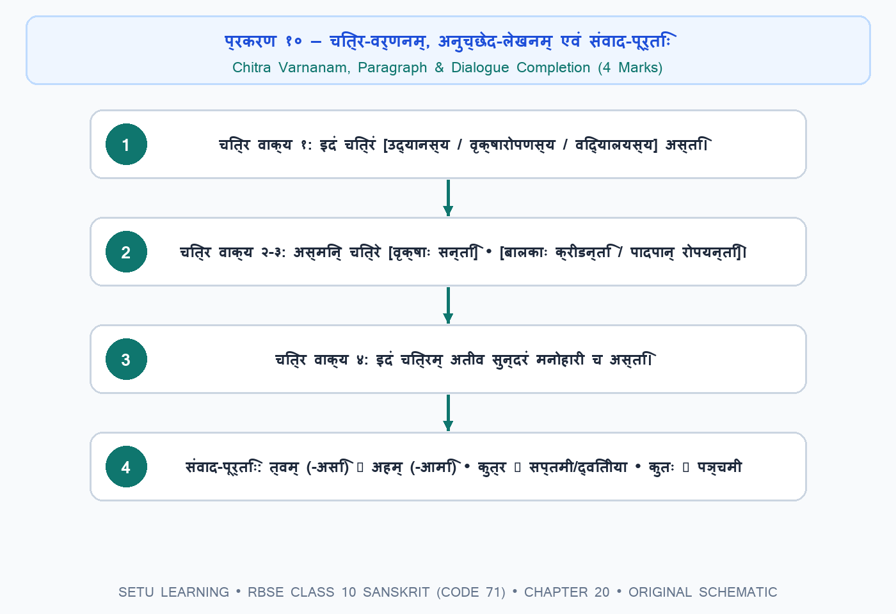

# अध्याय 20: प्रकरण १० — चित्र-वर्णनम्, अनुच्छेद-लेखनम् एवं संवाद-पूर्तिः (Chitra Varnanam, Paragraph & Dialogue Completion (4 Marks))

## भाग 1: अध्याय प्रवेश एवं पाठ्यक्रम मैपिंग

> NCERT 'शेमुषी भाग-2' के सभी प्रश्नों के हल तथा पूरा ऐतिहासिक PYQ संग्रह स्रोत-परीक्षण सहित संकलित हैं। सामान्य माध्यमिक 2026–27 पाठ्यक्रम की पुनः पुष्टि शेष है।

**विषय कोड:** 71 (तृतीया भाषा — संस्कृतम्) · **श्रृंखला पुस्तक:** 6

**सत्यापित आधार:** RBSE 2025–26 · **अध्याय भार:** 4 अंक। यह भार उसी संस्करण का है; वास्तविक प्रश्न-विभाजन की भविष्यवाणी नहीं।

**सीखने के लक्ष्य:** RBSE कक्षा 10 परीक्षा के प्रश्न संख्या 16 (४ अंक) हेतु प्रदत्त चित्र व मंजूषा की सहायता से ४ शुद्ध संस्कृत वाक्यों का निर्माण अथवा संवाद/वार्तालाप में ८ रिक्त स्थानों की पूर्ति में पूर्ण दक्षता प्राप्त करना।

## भाग 2: शब्दावली एवं अवधारणा कैप्सूल

| शब्द / सूत्र | अर्थ / उपयोग |
|---|---|
| इदं चित्रं ____ अस्ति | यह चित्र [विषय का षष्ठी विभक्ति रूप] का है (प्रथम सार्वभौमिक वाक्य)। |
| अस्मिन् चित्रे | इस चित्र में (सप्तमी विभक्ति — वाक्यों के प्रारंभ के लिए सर्वश्रेष्ठ पद)। |
| दृश्यते / दृश्यन्ते | दिखाई देता है / दिखाई देते हैं (एकवचन के साथ 'दृश्यते', बहुवचन के साथ 'दृश्यन्ते')। |
| वृक्षाः / पादपाः | पेड़ / पौधे (चित्रे हरिताः वृक्षाः सन्ति)। |
| क्रीडन्ति / धावन्ति | खेल रहे हैं / दौड़ रहे हैं (बालाः क्रीडाङ्गणे कन्दुकेन क्रीडन्ति)। |
| रोपयन्ति / सिञ्चन्ति | लगा रहे हैं / सींच रहे हैं (छात्राः पादपान् रोपयन्ति जलेन च सिञ्चन्ति)। |
| स्वच्छता / अवकरपात्रम् | सफाई / कूड़ेदान (जनाः अवकरं अवकरपात्रे क्षिपन्ति)। |
| वार्तालापः / संवादः | दो पात्रों (गुरु-शिष्य, पिता-पुत्र, मित्रद्वय, चिकित्सक-रोगी) के बीच बातचीत। |
| किं नाम / कस्यां कक्षायाम् | संवाद में परिचय के प्रश्न और उनके उत्तर। |
| अतीव रमणीयम् | अत्यंत सुंदर (इदं चित्रम् अतीव रमणीयं मनोहारी च अस्ति — चतुर्थ सार्वभौमिक वाक्य)। |

## भाग 3: विस्तृत शिक्षण पाठ

### १. प्रश्न संख्या 16 का स्वरूप (चित्र-वर्णनम् अथवा संवाद-पूर्तिः — ४ अंक)
RBSE कक्षा 10 संस्कृत प्रश्न-पत्र में प्रश्न संख्या 16 पर दो विकल्प आते हैं:
1. **प्रथम विकल्प (चित्र-वर्णनम्):** एक चित्र और मंजूषा में ६–८ सहायक शब्द दिए जाते हैं; चित्र को देखकर संस्कृत में **४ छोटे व शुद्ध वाक्य (4 × 1 = 4 अंक)** बनाने होते हैं।
2. **द्वितीय विकल्प (संवाद-लेखनम् / वार्तालाप-पूर्तिः):** दो व्यक्तियों के संवाद में मंजूषा की सहायता से **८ रिक्त स्थानों (8 × ½ = 4 अंक)** अथवा ४ वाक्य-रिक्त स्थानों की पूर्ति करनी होती है।

### २. चित्र-वर्णनम् का 'ब्रह्मास्त्र' ४-वाक्य टेम्पलेट (Universal 4-Sentence Formula)
किसी भी चित्र में पूरे ४ अंक पाने के लिए लंबे व जटिल वाक्य कभी न बनाएँ! छोटे ३–४ शब्दों के लट् लकार वाक्य बनाएँ:
- **वाक्य १ (चित्र की पहचान):** `इदं चित्रं [विषयस्य षष्ठी विभक्तिः — उद्यानस्य / विद्यालयस्य / वृक्षारोपणस्य / चिकित्सालयस्य / ग्रामस्य] अस्ति।`
- **वाक्य २ (एकवचन वस्तु/व्यक्ति):** `अस्मिन् चित्रे एकः [सूर्यः / वृक्षः / बालकः / देवालयः / चिकित्सकः] अस्ति (वा दृश्यते)।`
- **वाक्य ३ (बहुवचन क्रिया):** `अस्मिन् चित्रे [बालाः क्रीडन्ति / छात्राः पादपान् रोपयन्ति / जनाः भ्रमन्ति / खगाः उत्पतन्ति]।`
- **वाक्य ४ (सदाबहार समापन वाक्य):** `अस्मिन् चित्रे [वृक्षाः पुष्पाणि च सन्ति]।` अथवा `इदं चित्रम् अतीव सुन्दरं (रमणीयम्) अस्ति।`

### ३. बोर्ड परीक्षा के ५ सर्वाधिक महत्त्वपूर्ण चित्र-वर्णन मॉडल
1. **उद्यानस्य / उपवनस्य चित्रम् (मंजूषा: उद्यानम्, वृक्षाः, बालकाः, कन्दुकेन, पुष्पाणि, खगाः):**
   - (i) इदम् एकस्य **उद्यानस्य** चित्रम् अस्ति।
   - (ii) अस्मिन् चित्रे हरिताः **वृक्षाः** सन्ति।
   - (iii) चित्रे **बालकाः कन्दुकेन** क्रीडन्ति।
   - (iv) उद्याने सुन्दराणि **पुष्पाणि** विकसन्ति **खगाः** च कूजन्ति।
2. **वृक्षारोपणस्य / पर्यावरणस्य चित्रम् (मंजूषा: वृक्षारोपणम्, छात्राः, पादपान्, जलेन, सिञ्चन्ति, मेघाः):**
   - (i) इदं **वृक्षारोपणस्य** चित्रम् अस्ति।
   - (ii) चित्रे **छात्राः** उत्साहेन **पादपान्** रोपयन्ति।
   - (iii) एका बालिका पादपान् **जलेन** सिञ्चति।
   - (iv) आकाशे कृष्णवर्णाः **मेघाः** दृश्यन्ते।
3. **स्वच्छभारत-अभियानस्य चित्रम् (मंजूषा: स्वच्छता, जनाः, सम्मार्जन्या, अवकरपात्रम्, राजमार्गम्):**
   - (i) इदं **स्वच्छता-अभियानस्य** चित्रम् अस्ति।
   - (ii) चित्रे **जनाः सम्मार्जन्या** (झाड़ू से) मार्गं स्वच्छं कुर्वन्ति।
   - (iii) एकः बालकः अवकरम् **अवकरपात्रे** क्षिपति।
   - (iv) स्वच्छतया पर्यावरणं शुद्धं भवति।
4. **विद्यालयस्य / क्रीडाङ्गणस्य चित्रम्:**
   - (i) इदं मम **विद्यालयस्य** क्रीडाङ्गणस्य चित्रम् अस्ति। (ii) चित्रे एकं विशालं भवनम् अस्ति। (iii) अत्र छात्राः धावन्ति क्रीडन्ति च। (iv) विद्यालये एकः ध्वजः अपि शोभते।

### ४. संवाद-पूर्तिः (मञ्जूषा आधारित वार्तालाप के नियम व आदर्श मॉडल)
संवाद भरते समय **प्रश्न (Question) और उत्तर (Answer)** की जोड़ी मिलाएँ:
- यदि अगली पंक्ति में उत्तर है, तो पिछली पंक्ति में प्रश्नवाचक शब्द होगा; और यदि पिछली पंक्ति में प्रश्न है, तो अगली पंक्ति में उसका सीधा उत्तर होगा!
**आदर्श संवाद मॉडल (अध्यापक-छात्र संवादः — RBSE 2026, 2025, 2024 पैटर्न):**
**मञ्जूषा:** `[संस्कृतम्, रमेशः, दशमकक्षायाम्, ज्वरपीडितः, श्वः, प्रणामः, आगच्छसि, शोभनम्]`
- **रमेशः** — गुरुवर! सादरं **(१) प्रणामः**।
- **अध्यापकः** — आयुष्मान् भव! तव नाम किम् अस्ति?
- **रमेशः** — श्रीमन्! मम नाम **(२) रमेशः** अस्ति।
- **अध्यापकः** — त्वं कस्यां कक्षायां पठसि?
- **रमेशः** — अहं **(३) दशमकक्षायां** पठामि।
- **अध्यापकः** — त्वं ह्यः विद्यालयं किमर्थं न आगतवान्?
- **रमेशः** — गुरुवर! ह्यः अहं **(४) ज्वरपीडितः** आसम्।
- **अध्यापकः** — अधुना त्वं कुतः **(५) आगच्छसि**?
- **रमेशः** — अधुना अहं पुस्तकालयात् आगच्छामि। अहं **(६) संस्कृतं** पठितुम् इच्छामि।
- **अध्यापकः** — **(७) शोभनम्!** संस्कृतं तु अस्माकं देवभाषा अस्ति। **(८) श्वः** समयतः विद्यालयम् आगच्छ।

चित्र-वर्णनम् एवं संवाद-पूर्तिः: ४-वाक्य चित्र-सूत्र एवं प्रश्नोत्तर संवाद-मैट्रिक्स।

## भाग 4: पाठ्यपुस्तक-अवधारणाओं पर मौलिक हल किए उदाहरण

नीचे के प्रश्न लेखक के मौलिक मॉडल हैं। ये किसी NCERT edition के प्रश्न क्रमांक या संपूर्ण in-text/exercise solution bank होने का दावा नहीं करते।

**हल किया उदाहरण 1: RBSE 2026 मुख्य परीक्षा प्रश्न 16: 'उद्यानस्य चित्रम्' अथवा 'पिता-पुत्र संवादः' हल करें।**

**चित्र-वर्णनम् (उद्यानम्):** १. इदम् उद्यानस्य चित्रम् अस्ति। २. अस्मिन् चित्रे हरिताः वृक्षाः सुन्दराणि पुष्पाणि च सन्ति। ३. चित्रे बालकाः बालिकाः च प्रसन्नतया क्रीडन्ति। ४. प्रातःकाले जनाः उद्याने भ्रमन्ति। **अथवा पिता-पुत्र संवादः:** पिता — रमेश! त्वं किं करोषि? पुत्रः — पितः! अहं **संस्कृतं** पठामि। पिता — तव **परीक्षा** कदा भविष्यति? पुत्रः — मम परीक्षा **मार्चमासे** भविष्यति। पिता — तव सज्जा कीदृशी अस्ति? पुत्रः — मम सज्जा **उत्तमा** अस्ति।

**हल किया उदाहरण 2: 'चिकित्सालयस्य चित्रम्' पर मंजूषा (चिकित्सालयः, चिकित्सकः, रोगिणः, परिचारिका, औषधम्) से ४ वाक्य बनाएँ।**

१. इदम् एकस्य **चिकित्सालयस्य** चित्रम् अस्ति। २. अस्मिन् चित्रे **चिकित्सकः** रोगिणं परीक्षते। ३. चित्रे **परिचारिका** (नर्स) रोगिणे **औषधं** ददाति। ४. अत्र बहवः **रोगिणः** उपविष्टाः सन्ति।

**हल किया उदाहरण 3: मंजूषा आधारित संवाद में 'त्वं कुत्र गच्छसि?' और 'कति वादने?' प्रश्नों के उत्तर कैसे पहचानें?**

१. जब संवाद में प्रश्न हो — **'त्वं कुत्र गच्छसि?'**, तो अगली पंक्ति में कर्ता 'अहम्' और क्रिया 'गच्छामि' के बीच द्वितीया विभक्ति का स्थान (**विद्यालयम् / आपणम् / जयपुरम्**) आएगा। २. जब प्रश्न हो — **'कति वादने?'**, तो उत्तर में समयवाची पद (**सप्तवादने / अष्टवादने / प्रातःकाले**) आएगा।

## भाग 5: सत्यापित बोर्ड प्रश्न एवं स्रोत-स्थिति

2026 मुख्य परीक्षा, प्रश्न 16, PDF पृष्ठ 10: चित्र-वर्णनम् (4 वाक्य = 4 अंक) अथवा संवाद-लेखनम् (4 अंक)।

[RBSE 2026 मूल पेपर (S-71)](https://rajeduboard.rajasthan.gov.in/books/PAPERS-2026/Sec/S-71-Sankrit-TL-26.pdf)। प्रश्न का संक्षिप्त विषय-संदर्भ है; शब्दशः पुनर्मुद्रण नहीं।

## भाग 6: खंडवार मौलिक अभ्यास बैंक

**अभ्यास-अंक:** लेखक के स्व-अभ्यास के लिए हैं; RBSE की आधिकारिक marking scheme नहीं। उत्तर पहले स्वयं लिखें, फिर भाग 9 देखें।

## अ: बहुविकल्पीय प्रश्न — 15 × 1 अंक

**MCQ 1. चित्रवर्णने 'अस्मिन् चित्रे हरिताः वृक्षाः ____' — रिक्तस्थाने उचितं क्रियापदं किम्?**

अ) सन्ति  
ब) अस्ति  
स) अस्मि  
द) स्थः

**MCQ 2. 'अस्मिन् चित्रे एकः सूर्यः ____' — एकवचन-कर्त्रा सह उचितं क्रियापदं किम्?**

अ) उद्यन्ति  
ब) दृश्यन्ते  
स) सन्ति  
द) उदेति / दृश्यते

**MCQ 3. 'चित्रे बालकाः कन्दुकेन ____' — रिक्तस्थाने बहुवचन-क्रियापदं किम्?**

अ) क्रीडसि  
ब) क्रीडामि  
स) क्रीडन्ति  
द) क्रीडति

**MCQ 4. 'छात्राः उद्याने पादपान् ____' — वृक्षारोपण-चित्रे उचितं क्रियापदं किम्?**

अ) स्वपन्ति  
ब) रोपयन्ति  
स) खादन्ति  
द) पठन्ति

**MCQ 5. 'बालिका पादपान् जलेन ____' — एकवचने उचितं क्रियापदं किम्?**

अ) सिञ्चति  
ब) सिञ्चन्ति  
स) रोपयन्ति  
द) पतन्ति

**MCQ 6. 'आकाशे खगाः ____' — पक्षिणां कृते उचितं क्रियापदं किम्?**

अ) पठन्ति  
ब) लिखन्ति  
स) पचन्ति  
द) उत्पतन्ति / डयन्ते

**MCQ 7. संवादे 'त्वं कस्यां कक्षायां पठसि?' इत्यस्य उत्तरे 'अहं दशमकक्षायां ____' — रिक्तस्थाने किम्?**

अ) पठति  
ब) पठन्ति  
स) पठामि  
द) पठसि

**MCQ 8. संवादे 'तव नाम किम् अस्ति?' इत्यस्य उत्तरे '____ नाम रमेशः अस्ति' — रिक्तस्थानं पूरयत।**

अ) अस्माकम्  
ब) मम  
स) तव  
द) तस्य

**MCQ 9. 'इदम् एकस्य ____ चित्रम् अस्ति' — 'उद्यान' शब्दस्य षष्ठी-एकवचने रूपं किम्?**

अ) उद्यानस्य  
ब) उद्यानम्  
स) उद्यानेन  
द) उद्यानात्

**MCQ 10. 'जनाः अवकरं ____ क्षिपन्ति' — स्वच्छता-चित्रे सप्तमी-विभक्तौ पदं किम्?**

अ) अवकरपात्रम्  
ब) अवकरपात्रात्  
स) अवकरपात्रस्य  
द) अवकरपात्रे

**MCQ 11. 'पर्वतात् एका नदी ____' — एकवचने उचितं क्रियापदं किम्?**

अ) धावन्ति  
ब) क्रीडन्ति  
स) वहति  
द) वहन्ति

**MCQ 12. संवादे 'अधुना त्वं कुतः आगच्छसि?' — अत्र 'कुतः' इत्यस्य उत्तरे का विभक्तिः आगमिष्यति?**

अ) सप्तमी  
ब) पञ्चमी (पुस्तकालयात् / विद्यालयात्)  
स) द्वितीया  
द) तृतीया

**MCQ 13. 'कृषकः बलीवर्दाभ्यां क्षेत्रं ____' — कृषक-चित्रे उचितं क्रियापदं किम्?**

अ) कर्षति  
ब) पठति  
स) गायति  
द) हसति

**MCQ 14. 'तडागे सुन्दराणि कमलानि ____' — बहुवचने उचितं क्रियापदं किम्?**

अ) विकसति  
ब) अस्ति  
स) धावति  
द) विकसन्ति / सन्ति

**MCQ 15. चित्रवर्णने संवाद-पूर्तौ च यदि भवान् संवादं चिनोति, तर्हि उत्तरपुस्तिकायां कथं लेखनीयम्?**

अ) केवलं प्रश्नवाक्यानि लेखनीयानि  
ब) हिन्दीभाषया लेखनीयम्  
स) सम्पूर्णं संवादं लिखित्वा पूरितानि पदानि रेखांकितानि करणीयानि  
द) केवलम् अङ्काः लेखनीयाः

## अ: रिक्त स्थान — 6 × 1 अंक

1. यह चित्र [विषय का षष्ठी विभक्ति रूप] का है (प्रथम सार्वभौमिक वाक्य)। — इस शब्द/सूत्र का नाम है: ____।  
2. इस चित्र में (सप्तमी विभक्ति — वाक्यों के प्रारंभ के लिए सर्वश्रेष्ठ पद)। — इस शब्द/सूत्र का नाम है: ____।  
3. दिखाई देता है / दिखाई देते हैं (एकवचन के साथ 'दृश्यते', बहुवचन के साथ 'दृश्यन्ते')। — इस शब्द/सूत्र का नाम है: ____।  
4. पेड़ / पौधे (चित्रे हरिताः वृक्षाः सन्ति)। — इस शब्द/सूत्र का नाम है: ____।  
5. खेल रहे हैं / दौड़ रहे हैं (बालाः क्रीडाङ्गणे कन्दुकेन क्रीडन्ति)। — इस शब्द/सूत्र का नाम है: ____।  
6. लगा रहे हैं / सींच रहे हैं (छात्राः पादपान् रोपयन्ति जलेन च सिञ्चन्ति)। — इस शब्द/सूत्र का नाम है: ____।

## अ: अतिलघु उत्तर — 8 × 1 अंक

1. चित्रवर्णने 'अस्मिन् चित्रे हरिताः वृक्षाः ____' — रिक्तस्थाने उचितं क्रियापदं किम्?  
2. 'अस्मिन् चित्रे एकः सूर्यः ____' — एकवचन-कर्त्रा सह उचितं क्रियापदं किम्?  
3. 'चित्रे बालकाः कन्दुकेन ____' — रिक्तस्थाने बहुवचन-क्रियापदं किम्?  
4. 'छात्राः उद्याने पादपान् ____' — वृक्षारोपण-चित्रे उचितं क्रियापदं किम्?  
5. 'बालिका पादपान् जलेन ____' — एकवचने उचितं क्रियापदं किम्?  
6. 'आकाशे खगाः ____' — पक्षिणां कृते उचितं क्रियापदं किम्?  
7. संवादे 'त्वं कस्यां कक्षायां पठसि?' इत्यस्य उत्तरे 'अहं दशमकक्षायां ____' — रिक्तस्थाने किम्?  
8. संवादे 'तव नाम किम् अस्ति?' इत्यस्य उत्तरे '____ नाम रमेशः अस्ति' — रिक्तस्थानं पूरयत।

## ब: लघु उत्तर — 6 × 2 अंक

**B1.** चित्रवर्णने प्रथमं वाक्यं कथं निर्मातव्यम्?

**B2.** चित्रवर्णने एकवचनस्य बहुवचनस्य च क्रियापदे के स्तः?

**B3.** संवाद-पूर्तौ प्रश्नवाचकचिह्नस्य (?) कः उपयोगः अस्ति?

**B4.** संवादे यदि प्रश्नः 'त्वं किं करोषि?' इति अस्ति, तर्हि उत्तरे कर्तृपदं क्रियापदं च किम् भविष्यति?

**B5.** 'वृक्षारोपणम्' विषये द्वे सरलवाक्ये लिखत।

**B6.** 'मम विद्यालयः' विषये द्वे सरलवाक्ये लिखत।

## स: दीर्घ उत्तर — 4 × 3 अंक

आंतरिक विकल्प अभ्यास: C1 अथवा C2, तथा C3 अथवा C4 चुनें। पुनरावृत्ति में बचा विकल्प भी हल करें। यह लेखक की अभ्यास व्यवस्था है।

**C1.** 'ग्रामजीवनस्य / कृषकस्य चित्रम्' दृष्ट्वा संस्कृतभाषया चत्वारि वाक्यानि लिखत।

**C2.** 'रेलस्थानकस्य / बसस्थानकस्य चित्रम्' दृष्ट्वा संस्कृतभाषया चत्वारि वाक्यानि लिखत।

**C3.** संस्कृतभाषया 'पर्यावरणरक्षणम्' अथवा 'वृक्षाणां महत्त्वम्' विषये लघ्वनुच्छेदं (५ वाक्यानि) लिखत।

**C4.** माता-पुत्रयोः अथवा मित्रयोः मध्ये 'भ्रमण-योजना' विषये संवादं पूरयत।

## द: विस्तृत उत्तर — 2 × 4 अंक

आंतरिक विकल्प अभ्यास: D1 अथवा D2 चुनें; बाद में दूसरा भी हल करें।

**D1.** चित्र-वर्णन में शुद्धता बनाए रखने के लिए १० उपयोगी क्रियापदों और विभक्ति-नियमों की तालिका प्रस्तुत करें।

**D2.** संवाद-पूर्तिः के ३ मॉडल अभ्यास (१. गुरु-शिष्य, २. चिकित्सक-रोगी, ३. ग्राहक-आपणिक) हल सहित लिखें।

## भाग 7: सावधानियाँ एवं परीक्षा-त्रुटियाँ

- यदि प्रश्न में चित्र-वर्णन और संवाद-पूर्ति विकल्प के रूप में दिए जाएँ, तो निर्देश पढ़कर उपयुक्त कार्य चुनें। दोनों विधियों में शुद्धता और अपेक्षित उत्तर-लंबाई का अभ्यास करें; किसी विकल्प या अंक की गारंटी नहीं है।
- चित्र-वर्णन में 'एकः बालकः सन्ति' जैसी वचन-अशुद्धि न करें (एकवचन = अस्ति, बहुवचन = सन्ति)।
- संवाद में 'त्वम् + -असि' (त्वं पठसि) और 'अहम् + -आमि' (अहं पठामि) की जोड़ी का विशेष ध्यान रखें।
- मंजूषा के सभी शब्दों को वाक्य में जबरदस्ती ठूँसने का प्रयास न करें; ४ शुद्ध वाक्यों के लिए ४-५ शब्दों का सही प्रयोग पर्याप्त है।
- हर वाक्य के अंत में पूर्णविराम (।) अवश्य लगाएँ।

## भाग 8: फटाफट पुनरावृत्ति — 25 बिंदु

1. इदं चित्रं ____ अस्ति: यह चित्र [विषय का षष्ठी विभक्ति रूप] का है (प्रथम सार्वभौमिक वाक्य)।  
2. अस्मिन् चित्रे: इस चित्र में (सप्तमी विभक्ति — वाक्यों के प्रारंभ के लिए सर्वश्रेष्ठ पद)।  
3. दृश्यते / दृश्यन्ते: दिखाई देता है / दिखाई देते हैं (एकवचन के साथ 'दृश्यते', बहुवचन के साथ 'दृश्यन्ते')।  
4. वृक्षाः / पादपाः: पेड़ / पौधे (चित्रे हरिताः वृक्षाः सन्ति)।  
5. क्रीडन्ति / धावन्ति: खेल रहे हैं / दौड़ रहे हैं (बालाः क्रीडाङ्गणे कन्दुकेन क्रीडन्ति)।  
6. रोपयन्ति / सिञ्चन्ति: लगा रहे हैं / सींच रहे हैं (छात्राः पादपान् रोपयन्ति जलेन च सिञ्चन्ति)।  
7. स्वच्छता / अवकरपात्रम्: सफाई / कूड़ेदान (जनाः अवकरं अवकरपात्रे क्षिपन्ति)।  
8. वार्तालापः / संवादः: दो पात्रों (गुरु-शिष्य, पिता-पुत्र, मित्रद्वय, चिकित्सक-रोगी) के बीच बातचीत।  
9. किं नाम / कस्यां कक्षायाम्: संवाद में परिचय के प्रश्न और उनके उत्तर।  
10. अतीव रमणीयम्: अत्यंत सुंदर (इदं चित्रम् अतीव रमणीयं मनोहारी च अस्ति — चतुर्थ सार्वभौमिक वाक्य)।  
11. 'वृक्षाः' प्रथम पुरुष बहुवचन है, अतः इसके साथ बहुवचन क्रिया 'सन्ति' आएगी।  
12. 'एकः सूर्यः' एकवचन है, अतः 'उदेति' या 'दृश्यते' क्रिया प्रयुक्त होगी।  
13. 'बालकाः' बहुवचन कर्ता के साथ 'क्रीडन्ति' क्रिया आती है।  
14. वृक्षारोपण के चित्र में छात्र पौधे लगाते हैं ('रोपयन्ति')।  
15. 'बालिका' एकवचन कर्ता है, अतः पौधों को सींचती है = 'सिञ्चति'।  
16. आकाश में पक्षी उड़ते हैं ('उत्पतन्ति' या 'डयन्ते')।  
17. कर्ता 'अहम्' (उत्तम पुरुष एकवचन) होने से क्रिया 'पठामि' होगी।  
18. 'तव नाम किम्?' (तुम्हारा नाम क्या है?) के उत्तर में 'मम नाम...' (मेरा नाम...) आता है।  
19. 'यह एक बगीचे का चित्र है' — संबंध बताने हेतु षष्ठी एकवचन 'उद्यानस्य' आता है।  
20. 'लोग कचरा कूड़ेदान में डालते हैं' — अधिकरण सप्तमी 'अवकरपात्रे'।  
21. 'एका नदी' एकवचन है, अतः 'वहति' (बहती है) क्रिया आएगी।  
22. 'कुतः' (कहाँ से) के उत्तर में पंचमी विभक्ति ('पुस्तकालयात्') आती है।  
23. किसान दो बैलों से खेत जोतता है ('कर्षति')।  
24. 'कमलानि' नपुंसकलिंग बहुवचन है, अतः 'विकसन्ति' या 'सन्ति' आएगा।  
25. पूरी संवाद-पंक्तियाँ लिखकर भरे गए शब्दों को रेखांकित करना चाहिए।

## भाग 9: संपूर्ण अभ्यास उत्तर-कुंजी

## MCQ: सही विकल्प और कारण

**1. अ — सन्ति।** 'वृक्षाः' प्रथम पुरुष बहुवचन है, अतः इसके साथ बहुवचन क्रिया 'सन्ति' आएगी।

**2. द — उदेति / दृश्यते।** 'एकः सूर्यः' एकवचन है, अतः 'उदेति' या 'दृश्यते' क्रिया प्रयुक्त होगी।

**3. स — क्रीडन्ति।** 'बालकाः' बहुवचन कर्ता के साथ 'क्रीडन्ति' क्रिया आती है।

**4. ब — रोपयन्ति।** वृक्षारोपण के चित्र में छात्र पौधे लगाते हैं ('रोपयन्ति')।

**5. अ — सिञ्चति।** 'बालिका' एकवचन कर्ता है, अतः पौधों को सींचती है = 'सिञ्चति'।

**6. द — उत्पतन्ति / डयन्ते।** आकाश में पक्षी उड़ते हैं ('उत्पतन्ति' या 'डयन्ते')।

**7. स — पठामि।** कर्ता 'अहम्' (उत्तम पुरुष एकवचन) होने से क्रिया 'पठामि' होगी।

**8. ब — मम।** 'तव नाम किम्?' (तुम्हारा नाम क्या है?) के उत्तर में 'मम नाम...' (मेरा नाम...) आता है।

**9. अ — उद्यानस्य।** 'यह एक बगीचे का चित्र है' — संबंध बताने हेतु षष्ठी एकवचन 'उद्यानस्य' आता है।

**10. द — अवकरपात्रे।** 'लोग कचरा कूड़ेदान में डालते हैं' — अधिकरण सप्तमी 'अवकरपात्रे'।

**11. स — वहति।** 'एका नदी' एकवचन है, अतः 'वहति' (बहती है) क्रिया आएगी।

**12. ब — पञ्चमी (पुस्तकालयात् / विद्यालयात्)।** 'कुतः' (कहाँ से) के उत्तर में पंचमी विभक्ति ('पुस्तकालयात्') आती है।

**13. अ — कर्षति।** किसान दो बैलों से खेत जोतता है ('कर्षति')।

**14. द — विकसन्ति / सन्ति।** 'कमलानि' नपुंसकलिंग बहुवचन है, अतः 'विकसन्ति' या 'सन्ति' आएगा।

**15. स — सम्पूर्णं संवादं लिखित्वा पूरितानि पदानि रेखांकितानि करणीयानि।** पूरी संवाद-पंक्तियाँ लिखकर भरे गए शब्दों को रेखांकित करना चाहिए।

**रिक्त स्थान:** 1. इदं चित्रं ____ अस्ति; 2. अस्मिन् चित्रे; 3. दृश्यते / दृश्यन्ते; 4. वृक्षाः / पादपाः; 5. क्रीडन्ति / धावन्ति; 6. रोपयन्ति / सिञ्चन्ति

**अतिलघु उत्तर:**

1. सन्ति। 'वृक्षाः' प्रथम पुरुष बहुवचन है, अतः इसके साथ बहुवचन क्रिया 'सन्ति' आएगी।

2. उदेति / दृश्यते। 'एकः सूर्यः' एकवचन है, अतः 'उदेति' या 'दृश्यते' क्रिया प्रयुक्त होगी।

3. क्रीडन्ति। 'बालकाः' बहुवचन कर्ता के साथ 'क्रीडन्ति' क्रिया आती है।

4. रोपयन्ति। वृक्षारोपण के चित्र में छात्र पौधे लगाते हैं ('रोपयन्ति')।

5. सिञ्चति। 'बालिका' एकवचन कर्ता है, अतः पौधों को सींचती है = 'सिञ्चति'।

6. उत्पतन्ति / डयन्ते। आकाश में पक्षी उड़ते हैं ('उत्पतन्ति' या 'डयन्ते')।

7. पठामि। कर्ता 'अहम्' (उत्तम पुरुष एकवचन) होने से क्रिया 'पठामि' होगी।

8. मम। 'तव नाम किम्?' (तुम्हारा नाम क्या है?) के उत्तर में 'मम नाम...' (मेरा नाम...) आता है।

**B1. चित्रवर्णने प्रथमं वाक्यं कथं निर्मातव्यम्?**

चित्रवर्णने प्रथमं वाक्यं "इदं चित्रं [विषयस्य नाम] अस्ति" इति सरलतमेन रूपेण निर्मातव्यम्।

**B2. चित्रवर्णने एकवचनस्य बहुवचनस्य च क्रियापदे के स्तः?**

एकवचन-कर्त्रा सह 'अस्ति / दृश्यते / क्रीडति' तथा बहुवचन-कर्त्रा सह 'सन्ति / दृश्यन्ते / क्रीडन्ति' इति क्रियापदे प्रयुज्येते।

**B3. संवाद-पूर्तौ प्रश्नवाचकचिह्नस्य (?) कः उपयोगः अस्ति?**

यस्मिन् वाक्ये प्रश्नवाचकचिह्नं (?) भवति, तस्मिन् मञ्जूषातः प्रश्नवाचकपदं (कदा, कुत्र, किम्, कथम्) अथवा मध्यमपुरुषस्य क्रिया चयनीया।

**B4. संवादे यदि प्रश्नः 'त्वं किं करोषि?' इति अस्ति, तर्हि उत्तरे कर्तृपदं क्रियापदं च किम् भविष्यति?**

उत्तरे कर्तृपदम् 'अहम्' भविष्यति तथा क्रियापदम् उत्तमपुरुष-एकवचने ('पठामि / लिखामि / गच्छामि') भविष्यति।

**B5. 'वृक्षारोपणम्' विषये द्वे सरलवाक्ये लिखत।**

१. छात्राः विद्यालयस्य प्राङ्गणे पादपान् रोपयन्ति। २. वृक्षाः अस्माकं पर्यावरणं शुद्धं कुर्वन्ति।

**B6. 'मम विद्यालयः' विषये द्वे सरलवाक्ये लिखत।**

१. मम विद्यालयः अतीव विशालः स्वच्छः च अस्ति। २. अत्र विंशतिः अध्यापकाः पञ्चशतं छात्राः च सन्ति।

**C1. 'ग्रामजीवनस्य / कृषकस्य चित्रम्' दृष्ट्वा संस्कृतभाषया चत्वारि वाक्यानि लिखत।**

1. इदं भारतीय-ग्रामजीवनस्य (कृषिक्षेत्रस्य) चित्रम् अस्ति। 2. अस्मिन् चित्रे कृषकः बलीवर्दाभ्यां क्षेत्रं कर्षति। 3. चित्रे हरितानि सस्यानि वृक्षाः च दृश्यन्ते। 4. ग्रामस्य वातावरणं शान्तं प्रदूषणरहितं च अस्ति।

**C2. 'रेलस्थानकस्य / बसस्थानकस्य चित्रम्' दृष्ट्वा संस्कृतभाषया चत्वारि वाक्यानि लिखत।**

1. इदं रेलस्थानकस्य (अथवा बसस्थानकस्य) चित्रम् अस्ति। 2. अस्मिन् चित्रे एकं रेलयानं (बसयानं) तिष्ठति। 3. चित्रे बहवः यात्रिणः इतस्ततः गच्छन्ति। 4. भारवाहकः शिरसि भारं नयति तथा आपणिकः वस्तूनि विक्रीणाति।

**C3. संस्कृतभाषया 'पर्यावरणरक्षणम्' अथवा 'वृक्षाणां महत्त्वम्' विषये लघ्वनुच्छेदं (५ वाक्यानि) लिखत।**

1. अस्मान् परितः वायु-जल-मृदा-वृक्षाणाम् आवरणं पर्यावरणं कथ्यते। 2. अद्यत्वे यानानां धूमेन वायुमण्डलं भृशं दूषितं जातम् अस्ति। 3. वृक्षाः कार्बन-डाइ-ऑक्साइड-वायुं गृह्णन्ति प्राणवायुं (ऑक्सीजन) च यच्छन्ति। 4. वृक्षाः मेघान् आकर्षयन्ति, वृष्टिं कारयन्ति भूमि-अपरदनं च रोधयन्ति। 5. अतः पर्यावरणरक्षणाय अस्माभिः अधिकाधिकाः वृक्षाः रोपणीयाः रक्षणीयाः च।

**C4. माता-पुत्रयोः अथवा मित्रयोः मध्ये 'भ्रमण-योजना' विषये संवादं पूरयत।**

1. **राजीवः** — मित्र देवेन्द्र! श्वः अवकाशः अस्ति, त्वं कुत्र **गमिष्यसि**? 2. **देवेन्द्रः** — अहं श्वः परिवारेण सह **जयपुरनगरं** गमिष्यामि। 3. **राजीवः** — जयपुरनगरे त्वं किं किं **द्रक्ष्यसि**? 4. **देवेन्द्रः** — अहं तत्र हवामहलं, आमेरदुर्गं **जन्तुशालां** च द्रक्ष्यामि। 5. **राजीवः** — शोभनम्! तव यात्रा **मङ्गलमयी** भवतु।

**D1. चित्र-वर्णन में शुद्धता बनाए रखने के लिए १० उपयोगी क्रियापदों और विभक्ति-नियमों की तालिका प्रस्तुत करें।**

1. **अस्ति / सन्ति:** एकः सूर्यः अस्ति / बहवः वृक्षाः सन्ति। 2. **दृश्यते / दृश्यन्ते:** एकं भवनं दृश्यते / पर्वताः दृश्यन्ते। 3. **क्रीडति / क्रीडन्ति:** बालकः क्रीडति / बालकाः कन्दुकेन क्रीडन्ति। 4. **भ्रमति / भ्रमन्ति:** जनः उद्याने भ्रमति / जनाः भ्रमन्ति। 5. **उत्पतति / उत्पतन्ति:** खगः आकाशे उत्पतति / खगाः उत्पतन्ति। 6. **रोपयति / रोपयन्ति:** छात्रः पादपं रोपयति / छात्राः पादपान् रोपयन्ति। 7. **सिञ्चति / सिञ्चन्ति:** बालिका पादपं जलेन सिञ्चति। 8. **पठति / पठन्ति:** छात्राः पुस्तकालये पुस्तकानि पठन्ति। 9. **वहति:** पर्वतात् नदी वहति। 10. **उदेति / शोभते:** आकाशे सूर्यः उदेति / कमलानि शोभन्ते।

**D2. संवाद-पूर्तिः के ३ मॉडल अभ्यास (१. गुरु-शिष्य, २. चिकित्सक-रोगी, ३. ग्राहक-आपणिक) हल सहित लिखें।**

1. **चिकित्सक-रोगी संवादः:** रोगी — श्रीमन्! मह्यं ह्यः आरभ्य **ज्वरः** अस्ति। चिकित्सकः — किं तव **शिरोवेदना** अपि अस्ति? रोगी — आम्, मम शिरसि अपि तीव्रं **पीडा** अस्ति। चिकित्सकः — एतत् **औषधं** दिनत्रयं यावत् उष्णजलेन सह स्वीकुरु, पथ्यं च **भोजनं** कुरु। 2. **ग्राहक-आपणिक संवादः:** ग्राहकः — भो आपणिक! कदलीफलस्य **मूल्यं** किम् अस्ति? आपणिकः — एकदर्जन-कदलीफलानां मूल्यं **त्रिंशत्** रूप्यकाणि सन्ति। ग्राहकः — मह्यं द्वौ दर्जनौ **कदलीफलानि** ददातु। आपणिकः — स्वीकरोतु भवान्, **षष्टिः** रूप्यकाणि यच्छतु।

## भाग 10: 10 मिनट / 10 अंक आत्म-मूल्यांकन एवं संदर्भ

समय: 10 मिनट। पहले पुस्तक बंद करें।

1. MCQ 3 और 11 हल करें। (1 + 1)
2. B2 और B5 के उत्तर लिखें। (2 + 2)
3. D1 हल करें। (4)

**कुंजी:** भाग 9 में संबंधित क्रमांक देखें। **स्व-मूल्यांकन:** 8–10: आगे बढ़ें; 5–7: छूटे कौशल का दोहराव; 0–4: भाग 2–4 फिर पढ़ें। यह अभ्यास-सुझाव है, बोर्ड grade नहीं।

[सत्यापित RBSE 2025–26 पाठ्यक्रम](https://rajeduboard.rajasthan.gov.in/anudeshika-etc/10_2026.pdf) · [NCERT शेमुषी भाग-2 संदर्भ](https://ncert.nic.in/textbook.php?jhsk1=0-12)

**आगे की कड़ी:** प्रकरण २१ 'अनुवाद-कार्यम् एवं घटनाक्रम-संयोजनम्' में हिंदी वाक्यों का संस्कृत अनुवाद (४ अंक) और कथा-क्रम संयोजन (३ अंक) सीखेंगे।
