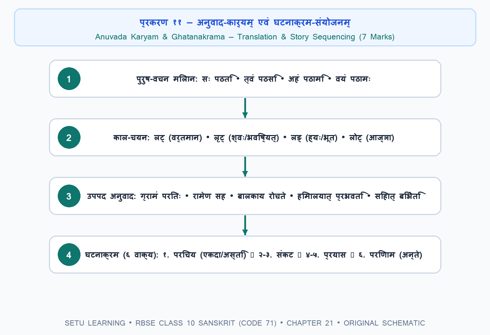

# अध्याय 21: प्रकरण ११ — अनुवाद-कार्यम् एवं घटनाक्रम-संयोजनम् (Anuvada Karyam & Ghatanakrama — Translation & Story Sequencing (7 Marks))

## भाग 1: अध्याय प्रवेश एवं पाठ्यक्रम मैपिंग

> प्रथम संपादकीय प्रारूप। NCERT 'शेमुषी भाग-2' के सभी प्रश्नों के हल तथा पूरा ऐतिहासिक PYQ संग्रह स्रोत-परीक्षण सहित संकलित हैं। सामान्य माध्यमिक 2026–27 पाठ्यक्रम की पुनः पुष्टि शेष है।

**विषय कोड:** 71 (तृतीया भाषा — संस्कृतम्) · **श्रृंखला पुस्तक:** 6

**सत्यापित आधार:** RBSE 2025–26 · **अध्याय भार:** 7 अंक। यह भार उसी संस्करण का है; वास्तविक प्रश्न-विभाजन की भविष्यवाणी नहीं।

**सीखने के लक्ष्य:** RBSE कक्षा 10 परीक्षा के प्रश्न संख्या 17 (६ में से ४ हिंदी वाक्यों का संस्कृत अनुवाद = ४ अंक) तथा प्रश्न संख्या 18 (६ कथा-वाक्यों का घटनाक्रमानुसार संयोजन = ३ अंक) में पूर्ण ७ अंक प्राप्त करना।

## भाग 2: शब्दावली एवं अवधारणा कैप्सूल

| शब्द / सूत्र | अर्थ / उपयोग |
|---|---|
| पुरुष-त्रयम् | प्रथम पुरुष (सः/तौ/ते), मध्यम पुरुष (त्वम्/युवाम्/यूयम्), उत्तम पुरुष (अहम्/आवाम्/वयम्)। |
| लट् लकारः | वर्तमान काल (पठति, पठतः, पठन्ति / पठसि, पठथः, पठथ / पठामि, पठावः, पठामः)। |
| लृट् लकारः | भविष्यत् काल (पठिष्यति, गमिष्यति, करिष्यति, भविष्यति, दास्यति, पास्यति)। |
| लङ् लकारः | भूतकाल (अपठत्, अगच्छत्, अकरोत्, अभवत्, अपश्यत्, आसीत्)। |
| लोट् लकारः | आज्ञार्थक काल (पठतु, पठताम्, पठन्तु / पठ, पठतम्, पठत / पठानि, पठाव, पठाम)। |
| विधिलिङ् लकारः | चाहिए अर्थ में (पठेत्, पठेताम्, पठेयुः / भवेत्, कुर्यात्, गच्छेत्)। |
| घटनाक्रम-संयोजनम् | पठित कथा के ६ क्रम-रहित वाक्यों को कहानी के सही घटनाक्रम में लिखना (३ अंक)। |
| एकदा / कस्मिंश्चित् | कथा का प्रथम वाक्य पहचानने का संकेत ('एकदा...', 'अस्ति देउलाख्यो ग्रामः...', 'कश्चन निर्धनो जनः...')। |
| अन्ते / अत एव | कथा का अंतिम (६वाँ) वाक्य पहचानने का संकेत ('अन्ते...', 'अत एव उच्यते...', 'ससम्मानं मुक्तवान्')। |
| गोल्डन २५ अनुवाद | बोर्ड परीक्षा में बार-बार रिपीट होने वाले २५ प्रामाणिक हिंदी-संस्कृत वाक्य। |

## भाग 3: विस्तृत शिक्षण पाठ

### १. हिंदी से संस्कृत अनुवाद के ९ कर्ता-क्रिया समन्वय सूत्र (प्रश्न 17 — ४ अंक)
RBSE प्रश्न संख्या 17 में ६ या ७ हिंदी वाक्य दिए जाते हैं, जिनमें से **किन्हीं ४ वाक्यों का संस्कृत में अनुवाद (4 × 1 = 4 अंक)** करना होता है। अनुवाद का सबसे पहला नियम है — **जिस पुरुष और वचन का कर्ता होगा, ठीक उसी पुरुष और वचन की क्रिया लगेगी:**

| पुरुष | एकवचन (कर्ता + लट् / लृट् / लङ् / लोट्) | द्विवचन (कर्ता + क्रिया) | बहुवचन (कर्ता + लट् / लृट् / लङ् / लोट्) |
|---|---|---|---|
| **प्रथम पुरुषः** | **सः/सा/रामः/भवान्** → पठति / गमिष्यति / अपठत् / पठतु | **तौ/ते/बालकौ** → पठतः / अपठताम् | **ते/ताः/जनाः/भवन्तः** → पठन्ति / गमिष्यन्ति / अपठन् / पठन्तु |
| **मध्यम पुरुषः** | **त्वम्** (तुम) → पठसि / गमिष्यसि / अपठः / पठ | **युवाम्** (तुम दोनों) → पठथः | **यूयम्** (तुम सब) → पठथ / गमिष्यथ / अपठत / पठत |
| **उत्तम पुरुषः** | **अहम्** (मैं) → पठामि / गमिष्यामि / अपठम् / पठानि | **आवाम्** (हम दोनों) → पठावः | **वयम्** (हम सब) → पठामः / गमिष्यामः / अपठाम / पठाम |

### २. बोर्ड परीक्षा के 'गोल्डन २५' सर्वाधिक पुनरावृत्त अनुवाद वाक्य (2014–2026)
RBSE के पिछले १२ वर्षों के प्रश्न-पत्रों में से हर वर्ष कम से कम ३-४ वाक्य इसी सूची से आते हैं:
1. **गाँव के चारों ओर वृक्ष हैं।** → ग्रामं परितः वृक्षाः सन्ति। (अथवा: विद्यालयं परितः वृक्षाः सन्ति।)
2. **राजमार्ग के दोनों ओर वृक्ष हैं।** → राजमार्गम् अभितः (उभयतः) वृक्षाः सन्ति।
3. **गंगा हिमालय से निकलती है।** → गङ्गा हिमालयात् प्रभवति (निर्गच्छति)।
4. **वृक्ष से पत्ते गिरते हैं।** → वृक्षात् पत्राणि पतन्ति। (एक पत्ता हो तो: वृक्षात् पत्रं पतति।)
5. **बालक शेर से डरता है।** → बालकः सिंहात् बिभेति।
6. **बालक को लड्डू अच्छा लगता है।** → बालकाय मोदकं रोचते। (मुझे संस्कृत अच्छी लगती है → मह्यं संस्कृतं रोचते।)
7. **राजा निर्धन को धन देता है।** → नृपः (राजा) निर्धनाय धनं ददाति (यच्छति)।
8. **पिता पुत्र पर क्रोध करता है।** → पिता पुत्राय क्रुध्यति।
9. **सीता राम के साथ वन जाती है।** → सीता रामेण सह वनं गच्छति। (पुत्र पिता के साथ जाता है → पुत्रः पित्रा सह गच्छति।)
10. **श्री गणेश को नमस्कार है / गुरु को नमस्कार है।** → श्रीगणेशाय नमः / गुरवे नमः।
11. **कवियों में कालिदास श्रेष्ठ हैं।** → कविषु (कवीनां) कालिदासः श्रेष्ठः अस्ति।
12. **माता पुत्र से स्नेह करती है।** → माता पुत्रे स्निह्यति।
13. **वह आँख से काणा है / पैर से लँगड़ा है।** → सः नेत्रेण काणः अस्ति / सः पादेन खञ्जः अस्ति।
14. **विवाद मत करो / कोलाहल मत करो।** → अलं विवादेन / कोलाहलं मा कुरु।
15. **विद्या के बिना जीवन व्यर्थ है।** → विद्यां (विद्यया) विना जीवनं वृथा अस्ति।
16. **गाँव के बाहर तालाब/उद्यान है।** → ग्रामात् बहिः तडागः (उद्यानम्) अस्ति।
17. **वह कल जयपुर जाएगा।** → सः श्वः जयपुरं गमिष्यति। (मैं कल विद्यालय जाऊँगा → अहं श्वः विद्यालयं गमिष्यामि।)
18. **मोहन ने कल पुस्तक पढ़ी।** → मोहनः ह्यः पुस्तकम् अपठत्।
19. **तुम सब क्या कर रहे हो?** → यूयं किं कुरुथ? (तुम कहाँ जा रहे हो? → त्वं कुत्र गच्छसि?)
20. **हम सब भारत के नागरिक हैं / संस्कृत पढ़ते हैं।** → वयं भारतस्य नागरिकाः स्मः / वयं संस्कृतं पठामः।
21. **सदा सत्य बोलो और धर्म का आचरण करो।** → सदा सत्यं वद, धर्मं च चर।
22. **हमें पुस्तक पढ़नी चाहिए।** → वयं पुस्तकं पठेम (अथवा अस्माभिः पुस्तकं पठितव्यम्)।
23. **तालाब में कमल खिलते हैं।** → तडागे (सरोवरे) कमलानि विकसन्ति।
24. **आकाश में पक्षी उड़ते हैं।** → आकाशे खगाः उत्पतन्ति (डयन्ते)।
25. **परिश्रम के बिना सफलता नहीं मिलती।** → परिश्रमं विना सफलता न लभ्यते।

### ३. घटनाक्रम-संयोजनम् (प्रश्न संख्या 18 — ६ वाक्य = ३ अंक)
प्रश्न संख्या 18 में पाठ्यपुस्तक की किसी पठित या नीति कथा के **६ क्रम-रहित वाक्य** दिए जाते हैं, जिन्हें घटना के सही क्रम (१ से ६) में पुनः लिखना होता है।
**४ प्रमुख बोर्ड कथाओं का प्रामाणिक ६-वाक्य क्रम:**
1. **कथा १: बुद्धिर्बलवती सदा (पाठ २):**
   - (१) बुद्धिमती पुत्रद्वयेन उपेता पितुर्गृहं प्रति चलिता।
   - (२) मार्गे गहनकानने सा एकं व्याघ्रम् अपश्यत्।
   - (३) व्याघ्रं दृष्ट्वा सा पुत्रौ ताडयन्ती उवाच — अधुना एकमेव व्याघ्रं विभज्य भुज्यताम्।
   - (४) व्याघ्रः व्याघ्रमारीयम् इति मत्वा पलायितः।
   - (५) जम्बुककृतोत्साहः व्याघ्रः पुनः काननम् आगच्छत्।
   - (६) प्रत्युत्पन्नमतिः सा शृगालम् आक्षिपन्ती उवाच, व्याघ्रः च सहसा नष्टः।
2. **कथा २: जननी तुल्यवत्सला (पाठ ४):**
   - (१) कश्चित् कृषकः बलीवर्दाभ्यां क्षेत्रकर्षणं करोति स्म।
   - (२) तयोः बलीवर्दयोः एकः शरीरेण दुर्बलः भूमौ पपात।
   - (३) भूमौ पतिते स्वपुत्रं दृष्ट्वा सर्वधेनुनां मातुः सुरभेः नेत्राभ्याम् अश्रूणि आविरासन्।
   - (४) सुराधिपः इन्द्रः ताम् अपृच्छत् — अये शुभे! किमेवं रोदिषि?
   - (५) सुरभिः अवदत् — दुर्बले सुते मातुः अभ्यधिका कृपा सहजैव भवति।
   - (६) अचिरादेव चण्डवातेन मेघरवैः च सह प्रवर्षः समजायत, कृषकः च वृषभौ नीत्वा गृहमगात्।
3. **कथा ३: विचित्रः साक्षी (पाठ ७):**
   - (१) कश्चन निर्धनो जनः भूरि परिश्रम्य स्वपुत्रं महाविद्यालये प्रवेशं दापयितुं सफलो जातः।
   - (२) सः रुग्णं पुत्रं द्रष्टुं बसयानं विहाय पदातिरेव प्राचलत्।
   - (३) रात्रौ करुणापरो गृही तस्मै आश्रयं प्रायच्छत्।
   - (४) चौरस्य पादध्वनिना प्रबुद्धः अतिथिः चौरम् अन्वधावत्, परं ग्रामस्यारक्षी एव चौरः आसीत्।
   - (५) न्यायाधीशः बंकिमचन्द्रः उभौ राजमार्गे निहतं शवम् आनेतुम् आदिशत्।
   - (६) न्यायाधीशः आरक्षिणे कारादण्डम् आदिश्य तं जनं ससम्मानं मुक्तवान्।
4. **कथा ४: पिपासितः काकः / बुभुक्षितः शृगालः (RBSE 2026, 2025 आदर्श पंचतंत्र कथाएँ):**
   - (१) एकदा एकः काकः (वा शृगालः) अतीव पिपासितः (बुभुक्षितः) आसीत्।
   - (२) सः जलम् (भोजनम्) अन्वेष्टुं वने इतस्ततः अभ्रमत्।
   - (३) अन्ते सः एकं घटं (द्राक्षाफलानि) अपश्यत्, यस्मिन् स्वल्पं जलम् आसीत्।
   - (४) सः घटस्य समीपे पाषाणखण्डानि अपश्यत्।
   - (५) सः एकैकं पाषाणखण्डं घटे अक्षिपत्, येन जलम् उपरि आगच्छत्।
   - (६) काकः यथेच्छं जलं पीत्वा सन्तुष्टः अभवत् (शृगालः 'द्राक्षाफलानि अम्लानि सन्ति' इति उक्त्वा पलायितः — 2026 मुख्य)।

अनुवाद एवं घटनाक्रम-संयोजनम्: कर्ता-क्रिया ९-कोष्ठक सूत्र एवं कथा-क्रम की ४-चरणीय विधि।

## भाग 4: पाठ्यपुस्तक-अवधारणाओं पर मौलिक हल किए उदाहरण

नीचे के प्रश्न लेखक के मौलिक मॉडल हैं। ये किसी NCERT edition के प्रश्न क्रमांक या संपूर्ण in-text/exercise solution bank होने का दावा नहीं करते।

**हल किया उदाहरण 1: RBSE 2026 मुख्य परीक्षा प्रश्न 17 के ४ हिंदी वाक्यों का संस्कृत अनुवाद करें: (i) गाँव के चारों ओर वृक्ष हैं, (ii) गंगा हिमालय से निकलती है, (iii) बालक को लड्डू अच्छा लगता है, (iv) वह कल जयपुर जाएगा।**

(i) **ग्रामं परितः वृक्षाः सन्ति।** ('परितः' के योग में द्वितीया)। (ii) **गङ्गा हिमालयात् प्रभवति (निर्गच्छति)।** ('प्रभवति' के योग में पंचमी)। (iii) **बालकाय मोदकं रोचते।** ('रुच्' के योग में चतुर्थी)। (iv) **सः श्वः जयपुरं गमिष्यति।** ('श्वः' के योग में लृट् लकार)।

**हल किया उदाहरण 2: RBSE 2026 मुख्य परीक्षा प्रश्न 18 ('बुभुक्षितः जम्बुकः और खट्टे अंगूर') के ६ वाक्यों को सही घटनाक्रम में व्यवस्थित करें।**

सही क्रम: १. एकस्मिन् वने एकः जम्बुकः (शृगालः) वसति स्म। २. एकदा सः बुभुक्षया पीडितः भोजनार्थम् इतस्ततः अभ्रमत्। ३. सः एकस्मिन् उद्याने लतायां लम्बमानानि पक्वानि द्राक्षाफलानि अपश्यत्। ४. तानि खादितुं सः बहुवारम् उत्पतितवान्। ५. परं द्राक्षाफलानि उच्चैः आसन्, अतः सः तानि न प्राप्तवान्। ६. अन्ते सः "द्राक्षाफलानि अम्लानि सन्ति" इति कथयन् ततः अगच्छत्।

**हल किया उदाहरण 3: RBSE 2026 पूरक परीक्षा प्रश्न 17 के ४ वाक्यों का संस्कृत अनुवाद करें: (i) हम सब संस्कृत पढ़ते हैं, (ii) वृक्ष से पत्ते गिरते हैं, (iii) कवियों में कालिदास श्रेष्ठ हैं, (iv) सदा सत्य बोलो।**

(i) **वयं संस्कृतं पठामः।** (उत्तम पुरुष बहुवचन)। (ii) **वृक्षात् पत्राणि पतन्ति।** (अपादान पंचमी + बहुवचन)। (iii) **कविषु (वा कवीनां) कालिदासः श्रेष्ठः अस्ति।** (निर्धारण सप्तमी/षष्ठी)। (iv) **सदा सत्यं वद।** (लोट् लकार मध्यम पुरुष एकवचन)।

## भाग 5: सत्यापित बोर्ड प्रश्न एवं स्रोत-स्थिति

2026 मुख्य परीक्षा, प्रश्न 17 (4 अनुवाद = 4 अंक) व प्रश्न 18 ('बुभुक्षितः जम्बुकः' घटनाक्रम = 3 अंक); 2026 पूरक परीक्षा प्रश्न 17 व 18।

[RBSE 2026 मूल पेपर (S-71)](https://rajeduboard.rajasthan.gov.in/books/PAPERS-2026/Sec/S-71-Sankrit-TL-26.pdf)। प्रश्न का संक्षिप्त विषय-संदर्भ है; शब्दशः पुनर्मुद्रण नहीं।

## भाग 6: खंडवार मौलिक अभ्यास बैंक

**अभ्यास-अंक:** लेखक के स्व-अभ्यास के लिए हैं; RBSE की आधिकारिक marking scheme नहीं। उत्तर पहले स्वयं लिखें, फिर भाग 9 देखें।

## अ: बहुविकल्पीय प्रश्न — 15 × 1 अंक

**MCQ 1. 'गाँव के चारों ओर वृक्ष हैं' — अस्य वाक्यस्य शुद्धः संस्कृत-अनुवादः कः?**

अ) ग्रामस्य परितः वृक्षाः सन्ति  
ब) ग्रामे परितः वृक्षाः अस्ति  
स) ग्रामात् परितः वृक्षाः सन्ति  
द) ग्रामं परितः वृक्षाः सन्ति

**MCQ 2. 'गंगा हिमालय से निकलती है' — अस्य शुद्धः संस्कृत-अनुवादः कः?**

अ) गङ्गा हिमालयस्य प्रभवति  
ब) गङ्गा हिमालये प्रभवति  
स) गङ्गा हिमालयात् प्रभवति  
द) गङ्गा हिमालयेन प्रभवति

**MCQ 3. 'बालक को लड्डू अच्छा लगता है' — अस्य शुद्धः संस्कृत-अनुवादः कः?**

अ) बालकस्य मोदकं रोचते  
ब) बालकाय मोदकं रोचते  
स) बालकं मोदकं रोचते  
द) बालकेन मोदकं रोचते

**MCQ 4. 'वह कल जयपुर जाएगा' — अस्य शुद्धः संस्कृत-अनुवादः कः?**

अ) सः श्वः जयपुरं गमिष्यति  
ब) सः ह्यः जयपुरं गच्छति  
स) सः श्वः जयपुरं अगच्छत्  
द) सः अद्य जयपुरं गमिष्यामि

**MCQ 5. 'हम सब संस्कृत पढ़ते हैं' — अस्य शुद्धः संस्कृत-अनुवादः कः?**

अ) अहं संस्कृतं पठामि  
ब) वयं संस्कृतं पठन्ति  
स) यूयं संस्कृतं पठथ  
द) वयं संस्कृतं पठामः

**MCQ 6. 'वृक्ष से पत्ते गिरते हैं' — अस्य शुद्धः संस्कृत-अनुवादः कः?**

अ) वृक्षात् पत्रं पतति  
ब) वृक्षस्य पत्राणि पतन्ति  
स) वृक्षात् पत्राणि पतन्ति  
द) वृक्षेण पत्राणि पतन्ति

**MCQ 7. 'कवियों में कालिदास श्रेष्ठ हैं' — अस्य शुद्धः संस्कृत-अनुवादः कः?**

अ) कवये कालिदासः श्रेष्ठः अस्ति  
ब) कविषु कालिदासः श्रेष्ठः अस्ति  
स) कविभ्यः कालिदासः श्रेष्ठः अस्ति  
द) कविभिः कालिदासः श्रेष्ठः अस्ति

**MCQ 8. 'राजा निर्धन को धन देता है' — अस्य शुद्धः संस्कृत-अनुवादः कः?**

अ) नृपः निर्धनाय धनं यच्छति (ददाति)  
ब) नृपः निर्धनं धनं ददाति  
स) नृपः निर्धनेन धनं ददाति  
द) नृपः निर्धनात् धनं ददाति

**MCQ 9. 'सीता राम के साथ वन जाती है' — अस्य शुद्धः संस्कृत-अनुवादः कः?**

अ) सीता रामस्य सह वनं गच्छति  
ब) सीता रामाय सह वनं गच्छति  
स) सीता रामे सह वनं गच्छति  
द) सीता रामेण सह वनं गच्छति

**MCQ 10. 'माता पुत्र पर स्नेह करती है' — अस्य शुद्धः संस्कृत-अनुवादः कः?**

अ) माता पुत्रेण स्निह्यति  
ब) माता पुत्राय स्निह्यति  
स) माता पुत्रे स्निह्यति  
द) माता पुत्रं स्निह्यति

**MCQ 11. 'सदा सत्य बोलो' — लोट्-लकारे शुद्धः अनुवादः कः?**

अ) सदा सत्यं वदामि  
ब) सदा सत्यं वद  
स) सदा सत्यं वदति  
द) सदा सत्यं वदिष्यति

**MCQ 12. 'तुम कहाँ जा रहे हो?' — अस्य शुद्धः संस्कृत-अनुवादः कः?**

अ) त्वं कुत्र गच्छसि?  
ब) त्वं कुत्र गच्छति?  
स) यूयं कुत्र गच्छसि?  
द) अहं कुत्र गच्छसि?

**MCQ 13. 'बालक सिंह से डरता है' — अस्य शुद्धः संस्कृत-अनुवादः कः?**

अ) बालकः सिंहेन बिभेति  
ब) बालकः सिंहस्य बिभेति  
स) बालकः सिंहाय बिभेति  
द) बालकः सिंहात् बिभेति

**MCQ 14. घटनाक्रम-संयोजने 'बुद्धिर्बलवती सदा' कथायाः प्रथमं वाक्यं किम्?**

अ) जम्बुकः व्याघ्रस्य उपहासं करोति  
ब) प्रत्युत्पन्नमतिः सा शृगालम् आक्षिपन्ती उवाच  
स) बुद्धिमती पुत्रद्वयोपेता पितुर्गृहं प्रति चलिता  
द) व्याघ्रः सहसा नष्टः

**MCQ 15. घटनाक्रम-संयोजने 'अन्ते सः द्राक्षाफलानि अम्लानि सन्ति इति कथयन् अगच्छत्' — इदं वाक्यं कस्मिन् क्रमे आगच्छति?**

अ) तृतीये क्रमे  
ब) षष्ठे (अन्तिमे) क्रमे  
स) प्रथमे क्रमे  
द) द्वितीये क्रमे

## अ: रिक्त स्थान — 6 × 1 अंक

1. प्रथम पुरुष (सः/तौ/ते), मध्यम पुरुष (त्वम्/युवाम्/यूयम्), उत्तम पुरुष (अहम्/आवाम्/वयम्)। — इस शब्द/सूत्र का नाम है: ____।  
2. वर्तमान काल (पठति, पठतः, पठन्ति / पठसि, पठथः, पठथ / पठामि, पठावः, पठामः)। — इस शब्द/सूत्र का नाम है: ____।  
3. भविष्यत् काल (पठिष्यति, गमिष्यति, करिष्यति, भविष्यति, दास्यति, पास्यति)। — इस शब्द/सूत्र का नाम है: ____।  
4. भूतकाल (अपठत्, अगच्छत्, अकरोत्, अभवत्, अपश्यत्, आसीत्)। — इस शब्द/सूत्र का नाम है: ____।  
5. आज्ञार्थक काल (पठतु, पठताम्, पठन्तु / पठ, पठतम्, पठत / पठानि, पठाव, पठाम)। — इस शब्द/सूत्र का नाम है: ____।  
6. चाहिए अर्थ में (पठेत्, पठेताम्, पठेयुः / भवेत्, कुर्यात्, गच्छेत्)। — इस शब्द/सूत्र का नाम है: ____।

## अ: अतिलघु उत्तर — 8 × 1 अंक

1. 'गाँव के चारों ओर वृक्ष हैं' — अस्य वाक्यस्य शुद्धः संस्कृत-अनुवादः कः?  
2. 'गंगा हिमालय से निकलती है' — अस्य शुद्धः संस्कृत-अनुवादः कः?  
3. 'बालक को लड्डू अच्छा लगता है' — अस्य शुद्धः संस्कृत-अनुवादः कः?  
4. 'वह कल जयपुर जाएगा' — अस्य शुद्धः संस्कृत-अनुवादः कः?  
5. 'हम सब संस्कृत पढ़ते हैं' — अस्य शुद्धः संस्कृत-अनुवादः कः?  
6. 'वृक्ष से पत्ते गिरते हैं' — अस्य शुद्धः संस्कृत-अनुवादः कः?  
7. 'कवियों में कालिदास श्रेष्ठ हैं' — अस्य शुद्धः संस्कृत-अनुवादः कः?  
8. 'राजा निर्धन को धन देता है' — अस्य शुद्धः संस्कृत-अनुवादः कः?

## ब: लघु उत्तर — 6 × 2 अंक

**B1.** 'गाँव के दोनों ओर जल है' — संस्कृतभाषया अनुवादं कुरुत।

**B2.** 'सीता राम के साथ वन जाती है' — संस्कृतभाषया अनुवादं कुरुत।

**B3.** 'राजा निर्धन को धन देता है' — संस्कृतभाषया अनुवादं कुरुत।

**B4.** 'बालक सिंह से डरता है' — संस्कृतभाषया अनुवादं कुरुत।

**B5.** घटनाक्रम-संयोजने प्रथमं वाक्यं कथं ज्ञायते?

**B6.** घटनाक्रम-संयोजने अन्तिमं (षष्ठं) वाक्यं कथं ज्ञायते?

## स: दीर्घ उत्तर — 4 × 3 अंक

आंतरिक विकल्प अभ्यास: C1 अथवा C2, तथा C3 अथवा C4 चुनें। पुनरावृत्ति में बचा विकल्प भी हल करें। यह लेखक की अभ्यास व्यवस्था है।

**C1.** हिन्दीतः संस्कृते अनुवादस्य चत्वारि आधारभूतानि नियमानि लिखत।

**C2.** घटनाक्रम-संयोजनस्य (प्रश्न १८) त्रीणि अचूक-सूत्राणि सोदाहरणं स्पष्टीकुरुत।

**C3.** 'सिंह-मूषक कथा' के ६ वाक्यों को सही घटनाक्रम में व्यवस्थित करें।

**C4.** पाँचों लकारों (लट्, लृट्, लङ्, लोट्, विधिलिङ्) का एक-एक आदर्श अनुवाद-वाक्य लिखत।

## द: विस्तृत उत्तर — 2 × 4 अंक

आंतरिक विकल्प अभ्यास: D1 अथवा D2 चुनें; बाद में दूसरा भी हल करें।

**D1.** अनुवाद-प्रकरण के लिए २० अति-महत्त्वपूर्ण हिंदी-संस्कृत वाक्यों की श्रेणीबद्ध अभ्यास-तालिका लिखें।

**D2.** घटनाक्रम-संयोजनम् में उत्तर-पुस्तिका में लिखने की सही विधि क्या है? एक पूर्ण उदाहरण से स्पष्ट करें।

## भाग 7: सावधानियाँ एवं परीक्षा-त्रुटियाँ

- अनुवाद में 'का/के/की' देखकर अंधाधुंध षष्ठी विभक्ति ('ग्रामस्य परितः' या 'रामस्य सह') न लगाएँ — 'परितः' के साथ द्वितीया (**ग्रामं परितः**) और 'सह' के साथ तृतीया (**रामेण सह**) ही लगाएँ!
- 'वृक्ष से पत्ता गिरता है' (एकवचन = **वृक्षात् पत्रं पतति**) और 'वृक्ष से पत्ते गिरते हैं' (बहुवचन = **वृक्षात् पत्राणि पतन्ति**) में वचन का अंतर ध्यान से देखें।
- 'देता है' के लिए 'ददाति' या 'यच्छति' लिखें ('ददति' बहुवचन रूप है, एकवचन नहीं!)।
- घटनाक्रम-संयोजन में केवल रोमन अंक (i, ii, iii) न लिखकर पूरे ६ वाक्य सही क्रम में लिखें।
- घटनाक्रम में पहले संज्ञा ('एकः जम्बुकः') वाला वाक्य रखें, उसके बाद सर्वनाम ('सः') वाले वाक्य रखें।

## भाग 8: फटाफट पुनरावृत्ति — 25 बिंदु

1. पुरुष-त्रयम्: प्रथम पुरुष (सः/तौ/ते), मध्यम पुरुष (त्वम्/युवाम्/यूयम्), उत्तम पुरुष (अहम्/आवाम्/वयम्)।  
2. लट् लकारः: वर्तमान काल (पठति, पठतः, पठन्ति / पठसि, पठथः, पठथ / पठामि, पठावः, पठामः)।  
3. लृट् लकारः: भविष्यत् काल (पठिष्यति, गमिष्यति, करिष्यति, भविष्यति, दास्यति, पास्यति)।  
4. लङ् लकारः: भूतकाल (अपठत्, अगच्छत्, अकरोत्, अभवत्, अपश्यत्, आसीत्)।  
5. लोट् लकारः: आज्ञार्थक काल (पठतु, पठताम्, पठन्तु / पठ, पठतम्, पठत / पठानि, पठाव, पठाम)।  
6. विधिलिङ् लकारः: चाहिए अर्थ में (पठेत्, पठेताम्, पठेयुः / भवेत्, कुर्यात्, गच्छेत्)।  
7. घटनाक्रम-संयोजनम्: पठित कथा के ६ क्रम-रहित वाक्यों को कहानी के सही घटनाक्रम में लिखना (३ अंक)।  
8. एकदा / कस्मिंश्चित्: कथा का प्रथम वाक्य पहचानने का संकेत ('एकदा...', 'अस्ति देउलाख्यो ग्रामः...', 'कश्चन निर्धनो जनः...')।  
9. अन्ते / अत एव: कथा का अंतिम (६वाँ) वाक्य पहचानने का संकेत ('अन्ते...', 'अत एव उच्यते...', 'ससम्मानं मुक्तवान्')।  
10. गोल्डन २५ अनुवाद: बोर्ड परीक्षा में बार-बार रिपीट होने वाले २५ प्रामाणिक हिंदी-संस्कृत वाक्य।  
11. 'परितः' के योग में द्वितीया विभक्ति ('ग्रामम्') और 'वृक्षाः' बहुवचन के साथ 'सन्ति' आता है (RBSE 2026 मुख्य परीक्षा)।  
12. 'भूवः प्रभवः' से उद्गम स्थान 'हिमालयात्' में पंचमी विभक्ति लगती है (RBSE 2026 मुख्य परीक्षा)।  
13. 'रुच्' (रोचते) धातु के योग में प्रीयमाण ('बालकाय') में चतुर्थी विभक्ति होती है (RBSE 2026 मुख्य परीक्षा)।  
14. आने वाले कल ('श्वः') के साथ प्रथम पुरुष एकवचन लृट् लकार ('गमिष्यति') आता है (RBSE 2026 मुख्य परीक्षा)।  
15. 'हम सब' (वयम् — उत्तम पुरुष बहुवचन) के साथ क्रिया 'पठामः' आती है (RBSE 2026 पूरक परीक्षा)।  
16. अपादान कारक ('वृक्षात्') पंचमी एकवचन और 'पत्ते' ('पत्राणि') बहुवचन के साथ 'पतन्ति' आता है।  
17. 'यतः च निर्धारणम्' से समूह में श्रेष्ठ बताने पर सप्तमी बहुवचन ('कविषु') या षष्ठी बहुवचन ('कवीनाम्') होता है।  
18. दान के पात्र ('निर्धनाय') में संप्रदान चतुर्थी विभक्ति होती है।  
19. 'सह' के योग में तृतीया विभक्ति ('रामेण') होती है।  
20. 'स्निह्' धातु के योग में सप्तमी विभक्ति ('पुत्रे') होती है।  
21. आज्ञार्थक (लोट् लकार मध्यम पुरुष एकवचन) में 'वद' रूप बनता है।  
22. मध्यम पुरुष एकवचन कर्ता 'त्वम्' के साथ क्रिया 'गच्छसि' आती है।  
23. 'भी' (बिभेति) के योग में भय के कारण में पंचमी विभक्ति ('सिंहात्') होती है।  
24. कथा का आरंभ बुद्धिमती के दोनों पुत्रों के साथ पिता के घर की ओर चलने से होता है।  
25. 'अन्ते' (अंत में) शब्द स्पष्ट संकेत देता है कि यह कथा का अंतिम (छठा) वाक्य है (RBSE 2026 मुख्य परीक्षा)।

## भाग 9: संपूर्ण अभ्यास उत्तर-कुंजी

## MCQ: सही विकल्प और कारण

**1. द — ग्रामं परितः वृक्षाः सन्ति।** 'परितः' के योग में द्वितीया विभक्ति ('ग्रामम्') और 'वृक्षाः' बहुवचन के साथ 'सन्ति' आता है (RBSE 2026 मुख्य परीक्षा)।

**2. स — गङ्गा हिमालयात् प्रभवति।** 'भूवः प्रभवः' से उद्गम स्थान 'हिमालयात्' में पंचमी विभक्ति लगती है (RBSE 2026 मुख्य परीक्षा)।

**3. ब — बालकाय मोदकं रोचते।** 'रुच्' (रोचते) धातु के योग में प्रीयमाण ('बालकाय') में चतुर्थी विभक्ति होती है (RBSE 2026 मुख्य परीक्षा)।

**4. अ — सः श्वः जयपुरं गमिष्यति।** आने वाले कल ('श्वः') के साथ प्रथम पुरुष एकवचन लृट् लकार ('गमिष्यति') आता है (RBSE 2026 मुख्य परीक्षा)।

**5. द — वयं संस्कृतं पठामः।** 'हम सब' (वयम् — उत्तम पुरुष बहुवचन) के साथ क्रिया 'पठामः' आती है (RBSE 2026 पूरक परीक्षा)।

**6. स — वृक्षात् पत्राणि पतन्ति।** अपादान कारक ('वृक्षात्') पंचमी एकवचन और 'पत्ते' ('पत्राणि') बहुवचन के साथ 'पतन्ति' आता है।

**7. ब — कविषु कालिदासः श्रेष्ठः अस्ति।** 'यतः च निर्धारणम्' से समूह में श्रेष्ठ बताने पर सप्तमी बहुवचन ('कविषु') या षष्ठी बहुवचन ('कवीनाम्') होता है।

**8. अ — नृपः निर्धनाय धनं यच्छति (ददाति)।** दान के पात्र ('निर्धनाय') में संप्रदान चतुर्थी विभक्ति होती है।

**9. द — सीता रामेण सह वनं गच्छति।** 'सह' के योग में तृतीया विभक्ति ('रामेण') होती है।

**10. स — माता पुत्रे स्निह्यति।** 'स्निह्' धातु के योग में सप्तमी विभक्ति ('पुत्रे') होती है।

**11. ब — सदा सत्यं वद।** आज्ञार्थक (लोट् लकार मध्यम पुरुष एकवचन) में 'वद' रूप बनता है।

**12. अ — त्वं कुत्र गच्छसि?।** मध्यम पुरुष एकवचन कर्ता 'त्वम्' के साथ क्रिया 'गच्छसि' आती है।

**13. द — बालकः सिंहात् बिभेति।** 'भी' (बिभेति) के योग में भय के कारण में पंचमी विभक्ति ('सिंहात्') होती है।

**14. स — बुद्धिमती पुत्रद्वयोपेता पितुर्गृहं प्रति चलिता।** कथा का आरंभ बुद्धिमती के दोनों पुत्रों के साथ पिता के घर की ओर चलने से होता है।

**15. ब — षष्ठे (अन्तिमे) क्रमे।** 'अन्ते' (अंत में) शब्द स्पष्ट संकेत देता है कि यह कथा का अंतिम (छठा) वाक्य है (RBSE 2026 मुख्य परीक्षा)।

**रिक्त स्थान:** 1. पुरुष-त्रयम्; 2. लट् लकारः; 3. लृट् लकारः; 4. लङ् लकारः; 5. लोट् लकारः; 6. विधिलिङ् लकारः

**अतिलघु उत्तर:**

1. ग्रामं परितः वृक्षाः सन्ति। 'परितः' के योग में द्वितीया विभक्ति ('ग्रामम्') और 'वृक्षाः' बहुवचन के साथ 'सन्ति' आता है (RBSE 2026 मुख्य परीक्षा)।

2. गङ्गा हिमालयात् प्रभवति। 'भूवः प्रभवः' से उद्गम स्थान 'हिमालयात्' में पंचमी विभक्ति लगती है (RBSE 2026 मुख्य परीक्षा)।

3. बालकाय मोदकं रोचते। 'रुच्' (रोचते) धातु के योग में प्रीयमाण ('बालकाय') में चतुर्थी विभक्ति होती है (RBSE 2026 मुख्य परीक्षा)।

4. सः श्वः जयपुरं गमिष्यति। आने वाले कल ('श्वः') के साथ प्रथम पुरुष एकवचन लृट् लकार ('गमिष्यति') आता है (RBSE 2026 मुख्य परीक्षा)।

5. वयं संस्कृतं पठामः। 'हम सब' (वयम् — उत्तम पुरुष बहुवचन) के साथ क्रिया 'पठामः' आती है (RBSE 2026 पूरक परीक्षा)।

6. वृक्षात् पत्राणि पतन्ति। अपादान कारक ('वृक्षात्') पंचमी एकवचन और 'पत्ते' ('पत्राणि') बहुवचन के साथ 'पतन्ति' आता है।

7. कविषु कालिदासः श्रेष्ठः अस्ति। 'यतः च निर्धारणम्' से समूह में श्रेष्ठ बताने पर सप्तमी बहुवचन ('कविषु') या षष्ठी बहुवचन ('कवीनाम्') होता है।

8. नृपः निर्धनाय धनं यच्छति (ददाति)। दान के पात्र ('निर्धनाय') में संप्रदान चतुर्थी विभक्ति होती है।

**B1. 'गाँव के दोनों ओर जल है' — संस्कृतभाषया अनुवादं कुरुत।**

ग्रामम् उभयतः (अथवा अभितः) जलम् अस्ति।

**B2. 'सीता राम के साथ वन जाती है' — संस्कृतभाषया अनुवादं कुरुत।**

सीता रामेण सह वनं गच्छति।

**B3. 'राजा निर्धन को धन देता है' — संस्कृतभाषया अनुवादं कुरुत।**

राजा (नृपः) निर्धनाय धनं ददाति (यच्छति)।

**B4. 'बालक सिंह से डरता है' — संस्कृतभाषया अनुवादं कुरुत।**

बालकः सिंहात् बिभेति।

**B5. घटनाक्रम-संयोजने प्रथमं वाक्यं कथं ज्ञायते?**

यस्मिन् वाक्ये 'एकदा / कस्मिंश्चित् वने / अस्ति देउलाख्यो ग्रामः / पुरा' इति प्रारम्भिक-परिचयः भवति, तत् प्रथमं वाक्यं भवति।

**B6. घटनाक्रम-संयोजने अन्तिमं (षष्ठं) वाक्यं कथं ज्ञायते?**

यस्मिन् वाक्ये 'अन्ते / ततः सः सन्तुष्टः अभवत् / अत एव उच्यते / मुक्तवान्' इति परिणामः भवति, तत् अन्तिमं वाक्यं भवति।

**C1. हिन्दीतः संस्कृते अनुवादस्य चत्वारि आधारभूतानि नियमानि लिखत।**

1. **कर्ता-क्रिया पुरुष व वचन एकता:** कर्ता जिस पुरुष व वचन का हो (प्रथम, मध्यम, उत्तम; एकवचन, द्विवचन, बहुवचन), क्रिया भी उसी पुरुष व वचन की लगाएँ (जैसे — अहं पठामि, वयं पठामः, त्वं पठसि)। 2. **काल/लकार पहचान:** 'पढ़ता है' = लट् लकार (पठति); 'पढ़ेगा' = लृट् लकार (पठिष्यति); 'पढ़ा / था' = लङ् लकार (अपठत् / आसीत्); 'पढ़ो' = लोट् लकार (पठ); 'पढ़ना चाहिए' = विधिलिङ् (पठेत्)। 3. **कारक व उपपद विभक्ति:** परितः/अभितः के साथ द्वितीया, सह/अलम् के साथ तृतीया, नमः/रोचते/क्रुध्यति/दा के साथ चतुर्थी, बिभेति/प्रभवति/बहिः के साथ पंचमी और श्रेष्ठः/स्निह्यति के साथ सप्तमी लगाएँ। 4. **सरल वाक्य चयन:** परीक्षा में दिए गए ६-७ वाक्यों में से जो ४ वाक्य सबसे सरल और छोटे हों, उन्हीं का चयन करें।

**C2. घटनाक्रम-संयोजनस्य (प्रश्न १८) त्रीणि अचूक-सूत्राणि सोदाहरणं स्पष्टीकुरुत।**

1. **आदि-अंत सूत्र (Anchor Method):** सबसे पहले ६ वाक्यों को पढ़कर **पहला वाक्य** ('एकदा / कस्मिंश्चित् ग्रामे / अस्ति...') और **छठा (अंतिम) वाक्य** ('अन्ते / एवं प्रकारेण / अत एव...') पक्का कर लें। 2. **कारण-कार्य श्रृंखला (Cause-Effect Chain):** पहले संकट या इच्छा उत्पन्न होती है (प्यास लगना / बाघ दिखना / चोरी होना), फिर पात्र प्रयास करता है (इधर-उधर घूमना / युक्ति सोचना / न्यायालय जाना) और अंत में समाधान मिलता है। 3. **सर्वनाम-संज्ञा क्रम:** जिस वाक्य में पात्र का नाम ('एकः काकः / राजसिंहस्य भार्या बुद्धिमती') हो वह पहले आता है, और जिसमें उसके लिए सर्वनाम ('सः / सा') हो वह बाद में आता है।

**C3. 'सिंह-मूषक कथा' के ६ वाक्यों को सही घटनाक्रम में व्यवस्थित करें।**

1. एकस्मिन् वने एकः सिंहः निद्रायां सुप्तः आसीत्। 2. तदा एकः मूषकः सिंहस्य शरीरस्य उपरि अकूर्दत्। 3. क्रुद्धः सिंहः मूषकं हन्तुम् ऐच्छत्, परं मूषकस्य प्रार्थनया तं मुक्तवान्। 4. एकदा सः सिंहः व्याधस्य जाले बद्धः अभवत् उच्चैः च अगर्जत्। 5. सिंहस्य गर्जनं श्रुत्वा मूषकः तत्र आगच्छत् स्वतीक्ष्णदन्तैः च जालम् अकृन्तत्। 6. जालात् मुक्तः सिंहः मूषकाय धन्यवादम् अयच्छत्।

**C4. पाँचों लकारों (लट्, लृट्, लङ्, लोट्, विधिलिङ्) का एक-एक आदर्श अनुवाद-वाक्य लिखत।**

1. **लट् लकार (वर्तमान):** बालक विद्यालय जाता है → बालकः विद्यालयं गच्छति। 2. **लृट् लकार (भविष्यत्):** मैं कल जयपुर जाऊँगा → अहं श्वः जयपुरं गमिष्यामि। 3. **लङ् लकार (भूतकाल):** राम ने रावण को मारा / उसने पुस्तक पढ़ी → रामः रावणम् अमारयत् / सः पुस्तकम् अपठत्। 4. **लोट् लकार (आज्ञार्थक):** तुम सब पाठ पढ़ो → यूयं पाठं पठत (सदा सत्य बोलो → सदा सत्यं वद)। 5. **विधिलिङ् लकार (चाहिए):** हमें सदा सत्य बोलना चाहिए → वयं सदा सत्यं वदेम।

**D1. अनुवाद-प्रकरण के लिए २० अति-महत्त्वपूर्ण हिंदी-संस्कृत वाक्यों की श्रेणीबद्ध अभ्यास-तालिका लिखें।**

1. **द्वितीया आधारित:** (i) विद्यालय के चारों ओर वृक्ष हैं → विद्यालयं परितः वृक्षाः सन्ति। (ii) गाँव के दोनों ओर खेत हैं → ग्रामम् उभयतः क्षेत्राणि सन्ति। (iii) वह विद्यालय की ओर जाता है → सः विद्यालयं प्रति गच्छति। (iv) विद्या के बिना जीवन व्यर्थ है → विद्यां विना जीवनं वृथा अस्ति। 2. **तृतीया आधारित:** (v) राम के साथ सीता वन जाती है → रामेण सह सीता वनं गच्छति। (vi) वह कान से बहरा है → सः कर्णेन बधिरः अस्ति। (vii) विवाद मत करो → अलं विवादेन। (viii) मोहन कलम से पत्र लिखता है → मोहनः कलमेन पत्रं लिखति। 3. **चतुर्थी आधारित:** (ix) बालक को मोदक अच्छा लगता है → बालकाय मोदकं रोचते। (x) पिता पुत्र पर क्रोध करता है → पिता पुत्राय क्रुध्यति। (xi) धनिक भिक्षुक को धन देता है → धनिकः भिक्षुकाय धनं यच्छति। (xii) गुरु को नमस्कार है → गुरवे नमः। 4. **पञ्चमी आधारित:** (xiii) गंगा हिमालय से निकलती है → गङ्गा हिमालयात् प्रभवति। (xiv) पेड़ से पत्ते गिरते हैं → वृक्षात् पत्राणि पतन्ति। (xv) बालक साँप से डरता है → बालकः सर्पात् बिभेति। (xvi) गाँव के बाहर उद्यान है → ग्रामात् बहिः उद्यानम् अस्ति। 5. **सप्तमी व लकार आधारित:** (xvii) कवियों में कालिदास श्रेष्ठ हैं → कविषु कालिदासः श्रेष्ठः अस्ति। (xviii) माता पुत्र पर स्नेह करती है → माता पुत्रे स्निह्यति। (xix) हम सब संस्कृत पढ़ते हैं → वयं संस्कृतं पठामः। (xx) वह कल ग्राम जाएगा → सः श्वः ग्रामं गमिष्यति।

**D2. घटनाक्रम-संयोजनम् में उत्तर-पुस्तिका में लिखने की सही विधि क्या है? एक पूर्ण उदाहरण से स्पष्ट करें।**

1. **महत्त्वपूर्ण नियम:** घटनाक्रम-संयोजन के प्रश्न में उत्तर-पुस्तिका में केवल `(iii), (i), (vi)...` जैसे क्रमांक मत लिखें! पूरे ६ संस्कृत वाक्यों को सही क्रम में १ से ६ तक क्रमशः साफ-साफ लिखें। 2. **उदाहरण (परोपकार/नदी-वृक्ष कथा):** (१) परोपकारः मानवानां श्रेष्ठः गुणः अस्ति। (२) वृक्षाः परोपकाराय एव फलानि यच्छन्ति। (३) नद्यः परोपकाराय एव वहन्ति। (४) मेघाः अपि परोपकाराय जलं वर्षन्ति। (५) सज्जनानां विभूतयः परोपकाराय एव भवन्ति। (६) अतः अस्माभिः अपि सदैव परोपकारः करणीयः।

## भाग 10: 10 मिनट / 10 अंक आत्म-मूल्यांकन एवं संदर्भ

समय: 10 मिनट। पहले पुस्तक बंद करें।

1. MCQ 3 और 11 हल करें। (1 + 1)
2. B2 और B5 के उत्तर लिखें। (2 + 2)
3. D1 हल करें। (4)

**कुंजी:** भाग 9 में संबंधित क्रमांक देखें। **स्व-मूल्यांकन:** 8–10: आगे बढ़ें; 5–7: छूटे कौशल का दोहराव; 0–4: भाग 2–4 फिर पढ़ें। यह अभ्यास-सुझाव है, बोर्ड grade नहीं।

[सत्यापित RBSE 2025–26 पाठ्यक्रम](https://rajeduboard.rajasthan.gov.in/anudeshika-etc/10_2026.pdf) · [NCERT शेमुषी भाग-2 संदर्भ](https://ncert.nic.in/textbook.php?jhsk1=0-12)

**आगे की कड़ी:** मुख्य २१ अध्यायों (८० अंक) के पूर्ण होने के बाद अब अध्याय २२ में २०१४ से २०२६ तक के १८ आधिकारिक RBSE संस्कृत प्रश्न-पत्रों के २३४ हल किए गए प्रश्न पढ़ेंगे।
