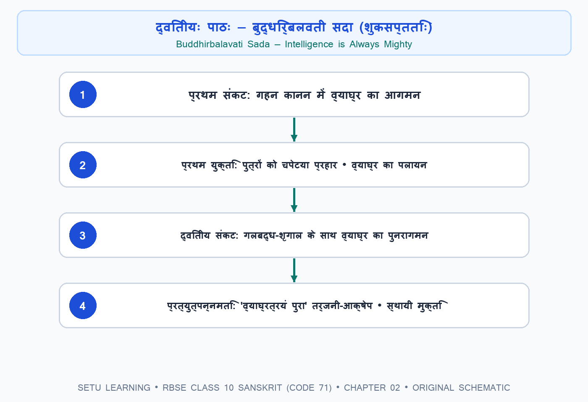

# अध्याय 2: द्वितीयः पाठः — बुद्धिर्बलवती सदा (शुकसप्ततिः) (Buddhirbalavati Sada — Intelligence is Always Mighty)

## भाग 1: अध्याय प्रवेश एवं पाठ्यक्रम मैपिंग

> स्रोत-स्थिति: कथा और NCERT अभ्यास का चयनित पाठ-समीक्षण जारी है। इस फ़ाइल के मौलिक प्रश्न अभ्यास हैं; केवल नीचे अलग से सूचीबद्ध, मिलाए गए RBSE प्रश्नों को प्रमाणित माना जाए। यह अध्याय-सार NCERT के निर्धारित पाठ पर आधारित है।

**विषय कोड:** 71 (तृतीया भाषा — संस्कृतम्) · **श्रृंखला पुस्तक:** 6

**पाठ्यक्रम स्थिति:** RBSE 2026–27 में शेमुषी भाग-2 के निर्धारित पाठों के अंतर्गत। वर्तमान पाठ्यक्रम इस पाठ के लिए अलग अध्याय-भार नहीं बताता; नीचे दिए अभ्यास-अंक केवल स्व-अभ्यास के हैं।

**सीखने के लक्ष्य:** शुकसप्तति कथा-ग्रंथ से संकलित कथा का गद्यांश-अवबोधन, श्लोकों का अन्वय-भावार्थ, पात्र-संवाद और घटनाक्रम-संयोजन में दक्षता प्राप्त करना।

## भाग 2: शब्दावली एवं अवधारणा कैप्सूल

| शब्द / सूत्र | अर्थ / उपयोग |
|---|---|
| भार्या | पत्नी (तस्य भार्या बुद्धिमती पुत्रद्वयोपेता पितुर्गृहं प्रति चलिता)। |
| उपेता | युक्त / साथ (पुत्रद्वयोपेता = दो पुत्रों के साथ)। |
| कानने | वन में / जंगल में (मार्गे गहनकानने सा एकं व्याघ्रं ददर्श)। |
| धार्ष्ट्यात् | ढिठाई से (चपेटया प्रहृत्य जगाद — कथमेकैकशो व्याघ्रभक्षणाय कलहं कुरुथः)। |
| व्याघ्रमारी | बाघ को मारने वाली (इयं काचिद् व्याघ्रमारी इति मत्वा व्याघ्रो भयाकुलचित्तो नष्टः)। |
| जम्बुकः | सियार / शृगाल (कश्चित् धूर्तः शृगालः हसन्नाह — भवान् कुतः भयात् पलायितः)। |
| गूढप्रदेशम् | गुप्त स्थान (गच्छ जम्बुक! त्वमपि किञ्चिद् गूढप्रदेशम्)। |
| प्रत्युत्पन्नमतिः | तत्काल सोचने वाली बुद्धि (प्रत्युत्पन्नमतिः सा शृगालम् आक्षिपन्ती उवाच)। |
| बद्ध्वा | बाँधकर (निजगले बद्ध्वा चल सत्वरम्)। |
| तूर्णम् | शीघ्र / जल्दी (व्याघ्रः गलबद्धशृगालकः तूर्णं पलायितः)। |

## भाग 3: विस्तृत शिक्षण पाठ

### कथा-संदर्भ एवं शुकसप्तति परिचय
NCERT इस पाठ को 'शुकसप्ततिः' से संकलित बताता है और शुक-सारिका (तोता-मैना) संवाद-परंपरा का संदर्भ देता है। कथा बुद्धिमती की तत्काल सूझ-बूझ को दिखाती है; उसका नीति-वाक्य कथा का संदेश है, हर संकट के परिणाम का सार्वभौमिक तथ्य नहीं।

### प्रथम दृश्य: गहन वन में व्याघ्र और बुद्धिमती की युक्ति
देउलाख्य नाम का एक गाँव था। वहाँ राजसिंह नाम का राजपुत्र रहता था। एक बार किसी आवश्यक कार्य से उसकी पत्नी **बुद्धिमती** अपने दोनों पुत्रों को साथ लेकर पिता के घर की ओर चल पड़ी ("अस्ति देउलाख्यो ग्रामः। तत्र राजसिंहः नाम राजपुत्रः वसति स्म। एकदा केनापि आवश्यककार्येण तस्य भार्या बुद्धिमती पुत्रद्वयोपेता पितुर्गृहं प्रति चलिता")। रास्ते में घने जंगल में उसने एक बाघ को आते देखा। बाघ को आता देख उसने ढिठाई से दोनों पुत्रों को थप्पड़ मारकर (चपेटया प्रहृत्य) कहा — "क्यों एक-एक करके बाघ खाने के लिए झगड़ा कर रहे हो? यह एक ही दिख रहा है, तो बाँटकर खा लो; बाद में कोई दूसरा ढूँढ़ा जाएगा।" ("कथमेकैकशो व्याघ्रभक्षणाय कलहं कुरुथः? अयमेकस्तावद्विभज्य भुज्यताम्। पश्चाद् अन्यो द्वितीयः कश्चिल्लक्ष्यते।") यह सुनकर बाघ ने सोचा कि यह कोई 'व्याघ्रमारी' (बाघ मारने वाली) है और भय से व्याकुल होकर भाग गया।
**श्लोक १:** "निजबुद्ध्या विमुक्ता सा भयाद् व्याघ्रस्य भामिनी। अन्योऽपि बुद्धिमान् लोके मुच्यते महतो भयात्॥" — **अन्वयः:** सा भामिनी निजबुद्ध्या व्याघ्रस्य भयात् विमुक्ता। लोके अन्यः अपि बुद्धिमान् महतः भयात् मुच्यते।

### द्वितीय दृश्य: धूर्त शृगाल की चाल और गलबद्ध-व्याघ्र
भय से काँपते बाघ को देखकर एक धूर्त सियार (शृगालः/जम्बुकः) हँसते हुए बोला — "भवान् कुतः भयात् पलायितः?" बाघ ने व्याघ्रमारी की बात बताई और कहा कि उसने अपने दोनों बेटों को मुझे खाने के लिए झगड़ते हुए थप्पड़ मारा। शृगाल ने बाघ का उपहास किया कि तुम मनुष्य से भी डरते हो; फिर उसने स्वयं को बाघ की गर्दन से बाँधकर लौटने को कहा ("यत्र आस्ते सा धूर्ता तत्र गम्यताम्... यदि त्वं मां मुक्त्वा यासि तदा वेलाप्यवेला स्यात्")। बाघ सियार को गले में बाँधकर पुनः जंगल में आया।

### तृतीय दृश्य: प्रत्युत्पन्नमति से पुनः विजय
सियार के साथ बाघ को फिर से आता देखकर बुद्धिमती ने तत्काल बुद्धि लगाई और सियार को डाँटती हुई तर्जनी अँगुली उठाकर बोली:
**श्लोक २:** "रे रे धूर्त त्वया दत्तं मह्यं व्याघ्रत्रयं पुरा। विश्वास्याद्यैकमानीय कथं यासि वदाधुना॥" — **अन्वयः:** रे रे धूर्त! पुरा त्वया मह्यं व्याघ्रत्रयं दत्तम्। विश्वास्य (अपि) अद्य एकम् आनीय कथं यासि, इति अधुना वद। **भावार्थ:** अरे धूर्त सियार! पहले तुमने मुझे तीन बाघ देने की बात कही थी; अब विश्वास दिलाकर आज एक ही बाघ लाकर क्यों जा रहे हो, बताओ?
**श्लोक ३:** "इत्युक्त्वा धाविता तूर्णं व्याघ्रमारी भयङ्करा। व्याघ्रोऽपि सहसा नष्टः गलबद्धशृगालकः॥" — ऐसा कहकर भयंकर व्याघ्रमारी तेजी से दौड़ी और गले में बँधे सियार वाला बाघ भी अचानक भाग खड़ा हुआ। इस प्रकार बुद्धिमती व्याघ्रजात् भयात् पुनरपि मुक्ता अभवत्। **सिद्धान्तः:** "अत एव उच्यते — बुद्धिर्बलवती तन्वि सर्वकार्येषु सर्वदा।" (हे तन्वि! सभी कार्यों में हमेशा बुद्धि ही बलवती होती है।)

बुद्धिर्बलवती सदा: कथा के तीन नाटकीय मोड़ और प्रत्युत्पन्नमति का विजय-चक्र।

## भाग 4: पाठ्यपुस्तक-अवधारणाओं पर मौलिक हल किए उदाहरण

नीचे के प्रश्न लेखक के मौलिक मॉडल हैं। ये किसी NCERT edition के प्रश्न क्रमांक या संपूर्ण in-text/exercise solution bank होने का दावा नहीं करते।

**हल किया उदाहरण 1: 'अस्ति देउलाख्यो ग्रामः...' गद्यांश से कर्तृपद-क्रियापद व विशेषण-विशेष्य प्रश्न हल करें।**

१. 'चलिता' इति क्रियापदस्य कर्तृपदं किम्? उत्तर: बुद्धिमती (तस्य भार्या)। २. 'गहनकानने' इत्यत्र विशेषणपदं किम्? उत्तर: गहन। ३. 'ददर्श' (देखा) क्रिया का कर्ता 'सा' (बुद्धिमती) है और कर्म 'व्याघ्रम्' है।

**हल किया उदाहरण 2: 'रे रे धूर्त त्वया दत्तं मह्यं व्याघ्रत्रयं पुरा' श्लोक का अन्वय पूरा करें।**

अन्वयः — रे रे धूर्त! पुरा (१) त्वया मह्यं (२) व्याघ्रत्रयं दत्तम्। विश्वास्य (अपि) अद्य (३) एकम् आनीय कथं (४) यासि, इति अधुना वद।

**हल किया उदाहरण 3: कथा के ६ वाक्यों को सही घटनाक्रम में संयोजित करें।**

सही क्रम: १. बुद्धिमती पुत्रद्वयेन उपेता पितुर्गृहं प्रति चलिता। २. मार्गे सा एकं व्याघ्रम् अपश्यत्। ३. व्याघ्रं दृष्ट्वा सा पुत्रौ ताडयन्ती उवाच — अधुना एकमेव व्याघ्रं विभज्य भुज्यताम्। ४. व्याघ्रः व्याघ्रमारीयम् इति मत्वा पलायितः। ५. जम्बुककृतोत्साहः व्याघ्रः पुनः काननम् आगच्छत्। ६. प्रत्युत्पन्नमतिः सा शृगालम् आक्षिपन्ती उवाच।

## भाग 5: सत्यापित बोर्ड प्रश्न एवं स्रोत-स्थिति

2026 की माध्यमिक पूरक परीक्षा में प्रश्न 11 (मुद्रित पृष्ठ 5; PDF पृष्ठ 5) में इस पाठ का हिन्दी सार 3 अंकों का विकल्प है। 2024 मुख्य परीक्षा में इस पाठ का प्रश्न नहीं मिला; उस वर्ष का उल्लेख यहाँ प्रमाणित PYQ के रूप में नहीं किया गया है।

[RBSE 2026 माध्यमिक पूरक पेपर (S-71), प्रश्न 11](https://rajeduboard.rajasthan.gov.in/books/PAPERS-2026/SecSUP/S-71.pdf) · [RBSE 2024 माध्यमिक मुख्य पेपर (S-71)](https://rajeduboard.rajasthan.gov.in/books/PAPERS-2024/Sec/S-71.pdf)। आधिकारिक पेपर में प्रश्न संख्या/विषय जाँचे गए; नीचे के स्व-रचित प्रश्न इन पेपरों से नहीं लिए गए हैं।

## भाग 6: खंडवार मौलिक अभ्यास बैंक

**अभ्यास-अंक:** लेखक के स्व-अभ्यास के लिए हैं; RBSE की आधिकारिक marking scheme नहीं। उत्तर पहले स्वयं लिखें, फिर भाग 9 देखें।

## अ: बहुविकल्पीय प्रश्न — 15 × 1 अंक

**MCQ 1. 'बुद्धिर्बलवती सदा' पाठः कस्मात् ग्रन्थात् संकलितः?**

अ) हितोपदेशात्  
ब) कथासरित्सागरात्  
स) शुकसप्ततेः  
द) पञ्चतन्त्रात्

**MCQ 2. राजसिंहः कस्मिन् ग्रामे वसति स्म?**

अ) उज्जयिन्याम्  
ब) देउलाख्ये  
स) काशीग्रामे  
द) पाटलिपुत्रे

**MCQ 3. बुद्धिमती केन उपेता पितुर्गृहं प्रति चलिता?**

अ) पुत्रद्वयोपेता  
ब) सखीजनोपेता  
स) भृत्योपेता  
द) अश्वोपेता

**MCQ 4. मार्गे गहनकानने सा कं ददर्श?**

अ) एकं सिंहम्  
ब) एकं गजम्  
स) एकं भल्लूकम्  
द) एकं व्याघ्रम्

**MCQ 5. बुद्धिमती पुत्रौ केन प्रहृत्य जगाद?**

अ) पादेन  
ब) रज्ज्वा  
स) चपेटया  
द) दण्डेन

**MCQ 6. व्याघ्रं भयाकुलं दृष्ट्वा कः हसन्नाह?**

अ) मयूरः  
ब) धूर्तः शृगालः  
स) सिंहः  
द) वानरः

**MCQ 7. 'भामिनी' इति पदस्य कः अर्थः अस्ति?**

अ) कोपवती स्त्री  
ब) वृद्धा  
स) बालिका  
द) दासी

**MCQ 8. बुद्धिमत्याः मते शृगालेन पुरा कति व्याघ्राः दत्ताः?**

अ) व्याघ्रद्वयम्  
ब) पञ्च व्याघ्राः  
स) चत्वारः व्याघ्राः  
द) व्याघ्रत्रयम् (त्रयः)

**MCQ 9. 'पितुर्गृहम्' इत्यस्य सन्धि-विच्छेदः कः?**

अ) पित्रा + गृहम्  
ब) पितरौ + गृहम्  
स) पितुः + गृहम्  
द) पितुर् + गृहम्

**MCQ 10. 'बुद्धिमती' पदे कः तद्धित-प्रत्ययः प्रयुक्तः?**

अ) ठक्  
ब) मतुप्  
स) तल्  
द) त्व

**MCQ 11. 'जम्बुकः' इत्यस्य पर्यायपदं किम्?**

अ) शृगालः  
ब) व्याघ्रः  
स) वृकः  
द) गर्दभः

**MCQ 12. 'वेलाप्यवेला स्यात्' इत्यत्र सन्धियुक्तपदस्य विच्छेदः कः?**

अ) वेलापि + वेला  
ब) वेल + अपि + अवेला  
स) वेला + अप्य + वेला  
द) वेला + अपि + अवेला

**MCQ 13. 'तूर्णम्' इत्यस्य अव्ययपदस्य समानार्थकपदं किम्?**

अ) शनैः  
ब) वृथा  
स) सत्वरम् / शीघ्रम्  
द) मन्दम्

**MCQ 14. सर्वकार्येषु सर्वदा का बलवती भवति?**

अ) सेना  
ब) बुद्धिः  
स) शरीरशक्तिः  
द) धनसम्पत्तिः

**MCQ 15. 'हसन्नाह' इत्यस्य सन्धि-विच्छेदः कः?**

अ) हसन् + आह  
ब) हस + नाह  
स) हसत् + आह  
द) हसन + आह

## अ: रिक्त स्थान — 6 × 1 अंक

1. पत्नी (तस्य भार्या बुद्धिमती पुत्रद्वयोपेता पितुर्गृहं प्रति चलिता)। — इस शब्द/सूत्र का नाम है: ____।  
2. युक्त / साथ (पुत्रद्वयोपेता = दो पुत्रों के साथ)। — इस शब्द/सूत्र का नाम है: ____।  
3. वन में / जंगल में (मार्गे गहनकानने सा एकं व्याघ्रं ददर्श)। — इस शब्द/सूत्र का नाम है: ____।  
4. ढिठाई से (चपेटया प्रहृत्य जगाद — कथमेकैकशो व्याघ्रभक्षणाय कलहं कुरुथः)। — इस शब्द/सूत्र का नाम है: ____।  
5. बाघ को मारने वाली (इयं काचिद् व्याघ्रमारी इति मत्वा व्याघ्रो भयाकुलचित्तो नष्टः)। — इस शब्द/सूत्र का नाम है: ____।  
6. सियार / शृगाल (कश्चित् धूर्तः शृगालः हसन्नाह — भवान् कुतः भयात् पलायितः)। — इस शब्द/सूत्र का नाम है: ____।

## अ: अतिलघु उत्तर — 8 × 1 अंक

1. 'बुद्धिर्बलवती सदा' पाठः कस्मात् ग्रन्थात् संकलितः?  
2. राजसिंहः कस्मिन् ग्रामे वसति स्म?  
3. बुद्धिमती केन उपेता पितुर्गृहं प्रति चलिता?  
4. मार्गे गहनकानने सा कं ददर्श?  
5. बुद्धिमती पुत्रौ केन प्रहृत्य जगाद?  
6. व्याघ्रं भयाकुलं दृष्ट्वा कः हसन्नाह?  
7. 'भामिनी' इति पदस्य कः अर्थः अस्ति?  
8. बुद्धिमत्याः मते शृगालेन पुरा कति व्याघ्राः दत्ताः?

## ब: लघु उत्तर — 6 × 2 अंक

**B1.** बुद्धिमती केन उपेता पितुर्गृहं प्रति चलिता?

**B2.** व्याघ्रः किं विचार्य पलायितः?

**B3.** लोके महतो भयात् कः मुच्यते?

**B4.** जम्बुकः किं वदन् व्याघ्रस्य उपहासं करोति?

**B5.** बुद्धिमती शृगालं किम् उक्तवती?

**B6.** सर्वकार्येषु सर्वदा का बलवती भवति?

## स: दीर्घ उत्तर — 4 × 3 अंक

आंतरिक विकल्प अभ्यास: C1 अथवा C2, तथा C3 अथवा C4 चुनें। पुनरावृत्ति में बचा विकल्प भी हल करें। यह लेखक की अभ्यास व्यवस्था है।

**C1.** 'बुद्धिर्बलवती सदा' कथायाः हिन्दीभाषायां सारं लिखत।

**C2.** प्रत्युत्पन्नमतिः बुद्धिमती कथं पुनरपि व्याघ्रभयात् मुक्ता अभवत्?

**C3.** व्याघ्रः शृगालाय व्याघ्रमार्याः विषये किम् अकथयत्?

**C4.** पाठ के प्रमुख संधि और प्रत्यय पदों का विश्लेषण करें।

## द: विस्तृत उत्तर — 2 × 4 अंक

आंतरिक विकल्प अभ्यास: D1 अथवा D2 चुनें; बाद में दूसरा भी हल करें।

**D1.** 'अस्ति देउलाख्यो ग्रामः...' गद्यांश का सप्रसंग हिन्दी-अनुवाद तथा व्याकरणिक टिप्पणी लिखें।

**D2.** 'निजबुद्ध्या विमुक्ता सा...' एवं 'रे रे धूर्त त्वया दत्तं...' दोनों श्लोकों का अन्वय और सप्रसंग भावार्थ लिखें।

## भाग 7: सावधानियाँ एवं परीक्षा-त्रुटियाँ

- देउलाख्य ग्राम का निवासी राजसिंह था, बुद्धिमती के पिता का नाम राजसिंह न लिखें (राजसिंह उसका पति था)।
- घटनाक्रम में पहले बाघ अकेला भागता है, बाद में सियार को गले में बाँधकर लौटता है।
- 'चपेटया' तृतीया एकवचन (थप्पड़ से) है, इसे चतुर्थी न समझें।
- 'पुत्रद्वयोपेता' में गुण संधि (पुत्रद्वय + उपेता) है।
- 'विमुक्ता' में वि + मुच् + क्त + टाप् है।

## भाग 8: फटाफट पुनरावृत्ति — 25 बिंदु

1. भार्या: पत्नी (तस्य भार्या बुद्धिमती पुत्रद्वयोपेता पितुर्गृहं प्रति चलिता)।  
2. उपेता: युक्त / साथ (पुत्रद्वयोपेता = दो पुत्रों के साथ)।  
3. कानने: वन में / जंगल में (मार्गे गहनकानने सा एकं व्याघ्रं ददर्श)।  
4. धार्ष्ट्यात्: ढिठाई से (चपेटया प्रहृत्य जगाद — कथमेकैकशो व्याघ्रभक्षणाय कलहं कुरुथः)।  
5. व्याघ्रमारी: बाघ को मारने वाली (इयं काचिद् व्याघ्रमारी इति मत्वा व्याघ्रो भयाकुलचित्तो नष्टः)।  
6. जम्बुकः: सियार / शृगाल (कश्चित् धूर्तः शृगालः हसन्नाह — भवान् कुतः भयात् पलायितः)।  
7. गूढप्रदेशम्: गुप्त स्थान (गच्छ जम्बुक! त्वमपि किञ्चिद् गूढप्रदेशम्)।  
8. प्रत्युत्पन्नमतिः: तत्काल सोचने वाली बुद्धि (प्रत्युत्पन्नमतिः सा शृगालम् आक्षिपन्ती उवाच)।  
9. बद्ध्वा: बाँधकर (निजगले बद्ध्वा चल सत्वरम्)।  
10. तूर्णम्: शीघ्र / जल्दी (व्याघ्रः गलबद्धशृगालकः तूर्णं पलायितः)।  
11. यह पाठ प्रसिद्ध कथा-ग्रंथ 'शुकसप्ततिः' से संकलित है।  
12. पाठ की प्रथम पंक्ति है — 'अस्ति देउलाख्यो ग्रामः। तत्र राजसिंहः नाम राजपुत्रः वसति स्म।'  
13. वह अपने दोनों पुत्रों के साथ (पुत्रद्वयोपेता) पिता के घर की ओर चली थी।  
14. मार्ग में घने जंगल में उसने एक बाघ (व्याघ्रम्) को देखा।  
15. उसने दोनों पुत्रों को थप्पड़ से मारकर (चपेटया प्रहृत्य) डाँटा।  
16. एक धूर्त सियार (जम्बुकः/शृगालः) हँसता हुआ बोला — भवान् कुतः भयात् पलायितः?  
17. 'निजबुद्ध्या विमुक्ता सा भयाद् व्याघ्रस्य भामिनी' में भामिनी का अर्थ इस पाठ के शब्दार्थ के अनुसार कोपवती स्त्री है।  
18. श्लोक के अनुसार — 'त्वया दत्तं मह्यं व्याघ्रत्रयं पुरा' (तीन बाघ)।  
19. विसर्ग के पूर्व 'उ' और बाद में घोष व्यंजन 'ग' होने से विसर्ग को 'र्' होकर 'पितुर्गृहम्' बनता है।  
20. बुद्धि + मतुप् + ङीप् से 'बुद्धिमती' पद निष्पन्न होता है।  
21. संस्कृत में जम्बुकः और शृगालः दोनों सियार के पर्याय हैं।  
22. वेला + अपि (दीर्घ संधि) + अवेला (यण् संधि) = वेलाप्यवेला।  
23. तूर्णम् और सत्वरम् दोनों का अर्थ 'शीघ्र/तेजी से' है।  
24. पाठ का मुख्य संदेश है — 'बुद्धिर्बलवती तन्वि सर्वकार्येषु सर्वदा'।  
25. NCERT में 'हसन्नाह' का पदच्छेद 'हसन् + आह' दिया गया है; विस्तृत पाणिनीय व्युत्पत्ति यहाँ स्वतंत्र रूप से सत्यापित नहीं है।

## भाग 9: संपूर्ण अभ्यास उत्तर-कुंजी

## MCQ: सही विकल्प और कारण

**1. स — शुकसप्ततेः।** यह पाठ प्रसिद्ध कथा-ग्रंथ 'शुकसप्ततिः' से संकलित है।

**2. ब — देउलाख्ये।** पाठ की प्रथम पंक्ति है — 'अस्ति देउलाख्यो ग्रामः। तत्र राजसिंहः नाम राजपुत्रः वसति स्म।'

**3. अ — पुत्रद्वयोपेता।** वह अपने दोनों पुत्रों के साथ (पुत्रद्वयोपेता) पिता के घर की ओर चली थी।

**4. द — एकं व्याघ्रम्।** मार्ग में घने जंगल में उसने एक बाघ (व्याघ्रम्) को देखा।

**5. स — चपेटया।** उसने दोनों पुत्रों को थप्पड़ से मारकर (चपेटया प्रहृत्य) डाँटा।

**6. ब — धूर्तः शृगालः।** एक धूर्त सियार (जम्बुकः/शृगालः) हँसता हुआ बोला — भवान् कुतः भयात् पलायितः?

**7. अ — कोपवती स्त्री।** NCERT के इसी पाठ का शब्दार्थ 'भामिनी' के लिए 'कोपवती स्त्री' देता है।

**8. द — व्याघ्रत्रयम् (त्रयः)।** श्लोक के अनुसार — 'त्वया दत्तं मह्यं व्याघ्रत्रयं पुरा' (तीन बाघ)।

**9. स — पितुः + गृहम्।** विसर्ग के पूर्व 'उ' और बाद में घोष व्यंजन 'ग' होने से विसर्ग को 'र्' होकर 'पितुर्गृहम्' बनता है।

**10. ब — मतुप्।** बुद्धि + मतुप् + ङीप् से 'बुद्धिमती' पद निष्पन्न होता है।

**11. अ — शृगालः।** संस्कृत में जम्बुकः और शृगालः दोनों सियार के पर्याय हैं।

**12. द — वेला + अपि + अवेला।** वेला + अपि (दीर्घ संधि) + अवेला (यण् संधि) = वेलाप्यवेला।

**13. स — सत्वरम् / शीघ्रम्।** तूर्णम् और सत्वरम् दोनों का अर्थ 'शीघ्र/तेजी से' है।

**14. ब — बुद्धिः।** पाठ का मुख्य संदेश है — 'बुद्धिर्बलवती तन्वि सर्वकार्येषु सर्वदा'।

**15. अ — हसन् + आह।** NCERT में 'हसन्नाह' का पदच्छेद 'हसन् + आह' दिया गया है; विस्तृत पाणिनीय व्युत्पत्ति यहाँ स्वतंत्र रूप से सत्यापित नहीं है।

**रिक्त स्थान:** 1. भार्या; 2. उपेता; 3. कानने; 4. धार्ष्ट्यात्; 5. व्याघ्रमारी; 6. जम्बुकः

**अतिलघु उत्तर:**

1. शुकसप्ततेः। यह पाठ प्रसिद्ध कथा-ग्रंथ 'शुकसप्ततिः' से संकलित है।

2. देउलाख्ये। पाठ की प्रथम पंक्ति है — 'अस्ति देउलाख्यो ग्रामः। तत्र राजसिंहः नाम राजपुत्रः वसति स्म।'

3. पुत्रद्वयोपेता। वह अपने दोनों पुत्रों के साथ (पुत्रद्वयोपेता) पिता के घर की ओर चली थी।

4. एकं व्याघ्रम्। मार्ग में घने जंगल में उसने एक बाघ (व्याघ्रम्) को देखा।

5. चपेटया। उसने दोनों पुत्रों को थप्पड़ से मारकर (चपेटया प्रहृत्य) डाँटा।

6. धूर्तः शृगालः। एक धूर्त सियार (जम्बुकः/शृगालः) हँसता हुआ बोला — भवान् कुतः भयात् पलायितः?

7. कोपवती स्त्री। इस पाठ के NCERT शब्दार्थ में भामिनी का अर्थ कोपवती स्त्री दिया है।

8. व्याघ्रत्रयम् (त्रयः)। श्लोक के अनुसार — 'त्वया दत्तं मह्यं व्याघ्रत्रयं पुरा' (तीन बाघ)।

**B1. बुद्धिमती केन उपेता पितुर्गृहं प्रति चलिता?**

बुद्धिमती पुत्रद्वयोपेता (पुत्रद्वयेन उपेता) पितुर्गृहं प्रति चलिता।

**B2. व्याघ्रः किं विचार्य पलायितः?**

'इयं काचिद् व्याघ्रमारी अस्ति' इति विचार्य व्याघ्रः भयाकुलचित्तः पलायितः।

**B3. लोके महतो भयात् कः मुच्यते?**

लोके महतो भयात् बुद्धिमान् जनः मुच्यते।

**B4. जम्बुकः किं वदन् व्याघ्रस्य उपहासं करोति?**

जम्बुकः "भवान् कुतः भयात् पलायितः?" तथा "यत् मानुषादपि बिभेषि!" इति वदन् व्याघ्रस्य उपहासं करोति।

**B5. बुद्धिमती शृगालं किम् उक्तवती?**

बुद्धिमती शृगालम् उक्तवती यत् "रे रे धूर्त! त्वया पुरा मह्यं व्याघ्रत्रयं दत्तम्। विश्वास्य (अपि) अद्य एकम् आनीय कथं यासि, इति अधुना वद।"

**B6. सर्वकार्येषु सर्वदा का बलवती भवति?**

सर्वकार्येषु सर्वदा बुद्धिः बलवती भवति।

**C1. 'बुद्धिर्बलवती सदा' कथायाः हिन्दीभाषायां सारं लिखत।**

1. देउलाख्य ग्राम में राजसिंह नामक राजपुत्र की पत्नी बुद्धिमती दो पुत्रों के साथ पिता के घर जाते समय घने वन में एक बाघ को देखती है। 2. वह ढिठाई से बेटों को थप्पड़ मारकर कहती है कि एक ही बाघ को बाँटकर खा लो, दूसरा बाद में ढूँढ़ा जाएगा; यह सुनकर बाघ डरकर भाग जाता है। 3. रास्ते में धूर्त सियार बाघ को उकसाकर अपने गले में बाँधकर वापस लाता है। 4. बुद्धिमती तत्काल सियार को डाँटती है कि तीन बाघों का वादा करके एक ही क्यों लाए, जिससे बाघ पुनः भाग जाता है; अतः बुद्धि सदैव बलवती होती है।

**C2. प्रत्युत्पन्नमतिः बुद्धिमती कथं पुनरपि व्याघ्रभयात् मुक्ता अभवत्?**

1. गले में सियार बाँधकर लौटते बाघ को देखकर बुद्धिमती ने अपनी प्रत्युत्पन्नमति (तत्काल बुद्धि) का प्रयोग किया। 2. उसने तर्जनी से सियार को धमकाते हुए कहा कि तुमने पहले मुझे तीन बाघ देने का वचन दिया था, आज एक ही लेकर क्यों आए हो? 3. यह कहकर वह भयंकर व्याघ्रमारी की तरह तेजी से दौड़ी, जिससे बाघ सियार सहित भाग गया और बुद्धिमती पुनः मुक्त हो गई।

**C3. व्याघ्रः शृगालाय व्याघ्रमार्याः विषये किम् अकथयत्?**

1. व्याघ्र ने सियार से कहा कि हे जम्बुक, तुम भी किसी गुप्त स्थान में चले जाओ। 2. जिस व्याघ्रमारी के बारे में हम शास्त्रों में सुनते हैं, उसने मुझे मारने का प्रयास किया था, किंतु मैं हथेली पर प्राण रखकर (करजीवितः) उसके आगे से भाग आया। 3. सियार ने पूछा तो बाघ ने बताया कि उसने मेरे सामने ही अपने दोनों बेटों को मुझे खाने के लिए झगड़ते हुए थप्पड़ से मारा।

**C4. पाठ के प्रमुख संधि और प्रत्यय पदों का विश्लेषण करें।**

1. पितुर्गृहम् = पितुः + गृहम् (विसर्ग-रत्व संधिः)। 2. एकैकशः = एक + एकशः (वृद्धि स्वर संधिः)। 3. इत्युक्त्वा = इति + उक्त्वा (यण् स्वर संधिः)। 4. बुद्धिमती = बुद्धि + मतुप् + ङीप् प्रत्ययः। 5. चलिता / मुक्ता / धाविता = क्त + टाप् स्त्री प्रत्ययः।

**D1. 'अस्ति देउलाख्यो ग्रामः...' गद्यांश का सप्रसंग हिन्दी-अनुवाद तथा व्याकरणिक टिप्पणी लिखें।**

1. प्रसंग: प्रस्तुत गद्यांश 'शेमुषी भाग-2' के द्वितीय पाठ 'बुद्धिर्बलवती सदा' से उद्धृत है, जो 'शुकसप्ततिः' कथा-संग्रह से संकलित है। 2. अनुवाद: देउलाख्य नाम का गाँव है। वहाँ राजसिंह नाम का राजपुत्र रहता था। एक बार किसी आवश्यक कार्य से उसकी पत्नी बुद्धिमती दोनों पुत्रों के साथ पिता के घर की ओर चल पड़ी। मार्ग में घने वन में उसने एक बाघ देखा। बाघ को आता देखकर उसने ढिठाई से दोनों पुत्रों को थप्पड़ मारकर कहा — क्यों एक-एक करके बाघ खाने के लिए झगड़ा कर रहे हो? अभी यह एक ही दिख रहा है, इसे बाँटकर खा लो, बाद में कोई दूसरा देखा जाएगा। 3. व्याकरणिक टिप्पणी: पितुर्गृहम् = पितुः + गृहम्; दृष्ट्वा = दृश् + क्त्वा; प्रहृत्य = प्र + हृ + ल्यप्; विभज्य = वि + भज् + ल्यप्।

**D2. 'निजबुद्ध्या विमुक्ता सा...' एवं 'रे रे धूर्त त्वया दत्तं...' दोनों श्लोकों का अन्वय और सप्रसंग भावार्थ लिखें।**

1. प्रथम श्लोक अन्वयः: सा भामिनी निजबुद्ध्या व्याघ्रस्य भयात् विमुक्ता। लोके अन्यः अपि बुद्धिमान् महतः भयात् मुच्यते। भावार्थ: वह कोपवती स्त्री अपनी बुद्धि के बल से बाघ के भय से मुक्त हुई; संसार में अन्य बुद्धिमान व्यक्ति भी बड़े भय से छूट सकता है। 2. द्वितीय श्लोक अन्वयः: रे रे धूर्त! पुरा त्वया मह्यं व्याघ्रत्रयं दत्तम्। विश्वास्य (अपि) अद्य एकम् आनीय कथं यासि, इति अधुना वद। भावार्थ: अरे धूर्त सियार! पहले तुमने मुझे तीन बाघ देने की बात कही थी; विश्वास दिलाकर आज एक ही बाघ लाकर क्यों जा रहे हो, बताओ?

## भाग 10: 10 मिनट / 10 अंक आत्म-मूल्यांकन एवं संदर्भ

समय: 10 मिनट। पहले पुस्तक बंद करें।

1. MCQ 3 और 11 हल करें। (1 + 1)
2. B2 और B5 के उत्तर लिखें। (2 + 2)
3. D1 हल करें। (4)

**कुंजी:** भाग 9 में संबंधित क्रमांक देखें। **स्व-मूल्यांकन:** 8–10: आगे बढ़ें; 5–7: छूटे कौशल का दोहराव; 0–4: भाग 2–4 फिर पढ़ें। यह अभ्यास-सुझाव है, बोर्ड grade नहीं।

[RBSE 2026–27 पाठ्यक्रम](https://rajeduboard.rajasthan.gov.in/anudeshika-etc/10_2027.pdf) · [NCERT शेमुषी भाग-2, 2026–27 reprint, Lesson 2, pp. 13–21](https://ncert.nic.in/textbook/pdf/jhsk102.pdf)

**समीक्षा-सीमा, 14 अक्टूबर 2026:** NCERT पाठ, glossary, मुद्रित अभ्यास 1–7, इस फ़ाइल के तीन solved examples, 41 मौलिक प्रश्न/कुंजियाँ (15 MCQ, 6 रिक्त, 8 अतिलघु, 6 लघु, 4 दीर्घ, 2 विस्तृत), 25 पुनरावृत्ति बिंदु, self-test और diagram जाँचे गए। यह पाठ-आधारित समीक्षा है; सभी पाणिनीय व्युत्पत्तियों की स्वतंत्र पुष्टि शेष है।

**आगे की कड़ी:** तृतीय पाठ 'शिशुलालनम्' में दिङ्नाग विरचित 'कुन्दमाला' नाटक के माध्यम से श्रीराम के वात्सल्य भाव और नाट्यांश-अवबोधन का अध्ययन करेंगे।
