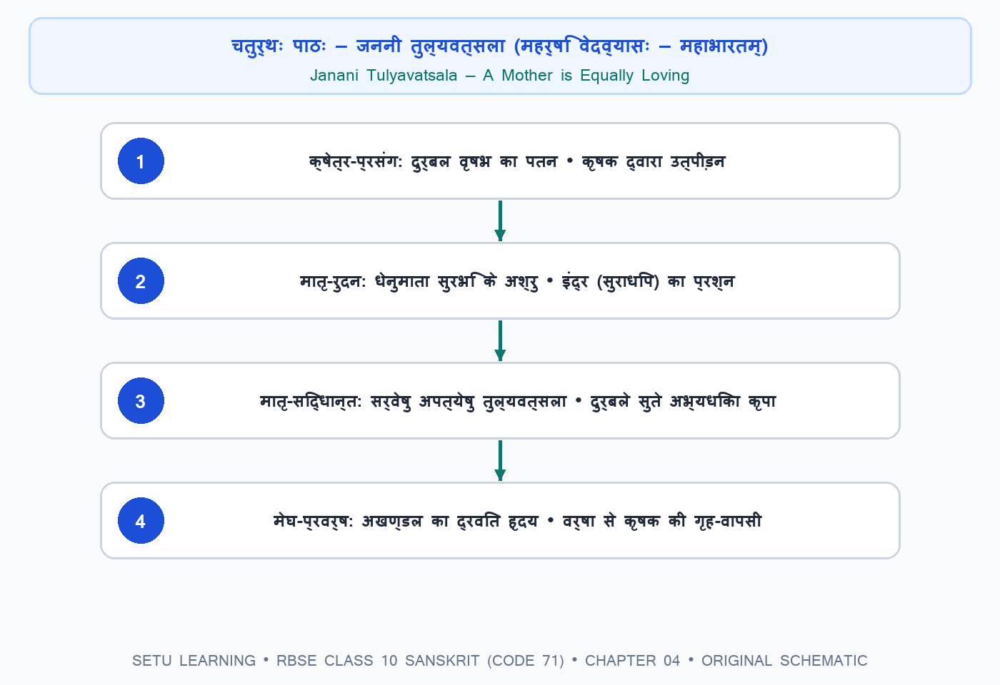

# अध्याय 4: चतुर्थः पाठः — जननी तुल्यवत्सला (महर्षि वेदव्यासः — महाभारतम्) (Janani Tulyavatsala — A Mother is Equally Loving)

## भाग 1: अध्याय प्रवेश एवं पाठ्यक्रम मैपिंग

> इस फ़ाइल के मौलिक अभ्यास लेखक-निर्मित हैं। कुछ दावों और चुने हुए उत्तरों की समीक्षा नीचे दर्ज है; यह संपूर्ण NCERT exercise solution या ऐतिहासिक PYQ-संग्रह का प्रमाणित register नहीं है।

**विषय कोड:** 71 (तृतीया भाषा — संस्कृतम्) · **श्रृंखला पुस्तक:** 6

**पाठ्यक्रम स्थिति:** RBSE 2026–27 में यह शेमुषी भाग-2 का निर्धारित पाठ है। RBSE इस पाठ को अलग अध्याय-अंक नहीं देता; नीचे दिए अभ्यास-अंक स्व-अभ्यास के लिए हैं।

**सीखने के लक्ष्य:** महाभारत के वनपर्व से संकलित सुरभि-इंद्र संवाद का गद्यांश/नाट्यांश अनुवाद, श्लोक-अन्वय और दुर्बल संतान के प्रति मातृ-करुणा का संदेश समझना।

## भाग 2: शब्दावली एवं अवधारणा कैप्सूल

| शब्द / सूत्र | अर्थ / उपयोग |
|---|---|
| बलीवर्दभ्याम् | दो बैलों से (कश्चित् कृषकः बलीवर्दाभ्यां क्षेत्रकर्षणं कुर्वन्नासीत्)। |
| जवेन | तीव्र गति से / वेग से (तयोः बलीवर्दयोः एकः शरीरेण दुर्बलः जवेन गन्तुमशक्तश्चासीत्)। |
| नुदमानः | हाँकता/धकेलता हुआ; पाठ इसे तोदनेन (चुभन/कष्ट देकर) कहता है। |
| सुरभिः | पाठ में सर्वधेनूनां माता; इस प्रसंग में वह दुर्बल वृषभ की माता है। |
| सुराधिपः | देवताओं के राजा इंद्र (सुराधिपः ताम् अपृच्छत् — अये शुभे! किमेवं रोदिषि?)। |
| वासवः | इंद्र (भो वासव! पुत्रस्य दैन्यं दृष्ट्वा अहं रोदिमि)। |
| कृच्छ्रेण | कठिनाई से (सः कृच्छ्रेण भारम् उद्वहति)। |
| धुरम् | जुए को / भार को (इतरमिव धुरं वोढुं सः न शक्नोति)। |
| सहस्राधिकेषु | हजारों से अधिक में (भद्रे! नूनं सहस्राधिकेषु पुत्रेषु सत्स्वपि तव अस्मिन्नेव एतादृशं वात्सल्यं कथम्?)। |
| अखण्डलः | इंद्र का नाम/पर्याय; पाठ में उनके हृदय के द्रवित होने का वर्णन है। |

## भाग 3: विस्तृत शिक्षण पाठ

### पाठ-प्रवेश एवं महाभारत संदर्भ
प्रस्तुत पाठ महर्षि वेदव्यास विरचित ऐतिहासिक ग्रंथ **'महाभारतम्'** के **'वनपर्व'** से लिया गया है। NCERT के 'योग्यताविस्तार' में व्यापक प्रसंग को धृतराष्ट्र के प्रति व्यास के उपदेश से जोड़ा गया है; इसे मुख्य कथा के संवाद का हिस्सा न समझें। इसके माध्यम से यह स्पष्ट किया गया है कि माता के लिए सभी संतानें समान रूप से प्यारी ('तुल्यवत्सला') होती हैं, किंतु जो संतान दुर्बल या संकटग्रस्त होती है, उस पर माता की कृपा और करुणा स्वाभाविक रूप से अधिक होती है।

### प्रथम खंड: कृषक, दुर्बल वृषभ और सुरभि का रुदन
कोई किसान दो बैलों से खेत जोत रहा था ("कश्चित् कृषकः बलीवर्दाभ्यां क्षेत्रकर्षणं कुर्वन्नासीत्")। उन दोनों बैलों में एक शरीर से दुर्बल था और तीव्र गति से चलने में असमर्थ था। अतः किसान उस दुर्बल बैल को तोदनेन (चुभन/कष्ट देकर) हाँक रहा था। वह बैल हल उठाकर चलने में असमर्थ होकर खेत में गिर पड़ा। क्रोधित किसान (कृषीवलः) ने उसे उठाने के लिए बार-बार प्रयत्न किया, फिर भी बैल नहीं उठा।
भूमि पर गिरे अपने पुत्र को देखकर सभी गायों की माता **सुरभि** के नेत्रों से आँसू बहने लगे। सुरभि की इस अवस्था को देखकर देवराज **इंद्र (सुराधिपः/वासवः/अखण्डलः)** ने पूछा — "अये शुभे! किमेवं रोदिषि? उच्यताम्" (हे कल्याणी! इस प्रकार क्यों रो रही हो?)।
**श्लोक १:** "विनिपातो न वः कश्चिद् दृश्यते त्रिदशाधिपः। अहं तु पुत्रं शोचामि, तेन रोदिमि कौशिक!॥" — **भावार्थ:** हे इंद्र (कौशिक)! आपका कोई अनिष्ट नहीं दिखता, किंतु मैं तो अपने पुत्र के दुःख से शोक कर रही हूँ, इसीलिए रो रही हूँ।

### द्वितीय खंड: सुरभि और इंद्र का संवाद
सुरभि ने कहा — "भो वासव! पुत्रस्य दैन्यं दृष्ट्वा अहं रोदिमि। सः दीन इति जानन्नपि कृषकः तं बहुधा पीडयति। सः कृच्छ्रेण भारमुद्वहति। इतरमिव धुरं वोढुं सः न शक्नोति।" (हे इंद्र! पुत्र की दीनता देखकर मैं रो रही हूँ। किसान उसके कमजोर होने को जानते हुए भी उसे बहुत पीड़ित करता है; वह कठिनाई से भार ढोता है और दूसरे बैल की तरह जुआ नहीं खींच सकता।)
इंद्र ने पूछा — "भद्रे! नूनं सहस्राधिकेषु पुत्रेषु सत्स्वपि तव अस्मिन्नेव एतादृशं वात्सल्यं कथम्?" (हे भद्रे! निश्चय ही हजारों से अधिक पुत्रों के होते हुए भी तुम्हारा इसी एक पुत्र पर ऐसा विशेष स्नेह क्यों है?)
**श्लोक २:** "यदि पुत्रसहस्रं मे सर्वत्र सममेव मे। दीनस्य तु सतः शक्र! पुत्रस्याभ्यधिका कृपा॥" — सुरभि कहती है कि उसकी संतानें बहुत हैं और सभी पर समान स्नेह है, फिर भी दीन पुत्र पर अधिक कृपा होती है।

इसके बाद सुरभि गद्य में कहती है: "बहून्यपत्यानि मे सन्तीति सत्यम्। तथाप्यहमेतस्मिन् पुत्रे विशिष्य आत्मवेदनामनुभवामि। यतो हि अयमन्येभ्यो दुर्बलः। सर्वेष्वपत्येषु जननी तुल्यवत्सला एव। तथापि दुर्बले सुते मातुः अभ्यधिका कृपा सहजैव।" इसे श्लोक न कहें।

**श्लोक ३ (अंतिम नीति-पद्य):** "अपत्येषु च सर्वेषु जननी तुल्यवत्सला। पुत्रे दीने तु सा माता कृपार्द्रहृदया भवेत्॥"

### तृतीय खंड: इंद्र का हृदय-परिवर्तन एवं मेघवर्षा
सुरभि के वचन सुनकर अत्यंत विस्मित इंद्र (अखण्डलः) का हृदय भी द्रवित हो गया और उन्होंने सुरभि को सांत्वना दी — "गच्छ वत्से! सर्वं भद्रं जायेत।" (जाओ पुत्री! सब कल्याण हो।)
शीघ्र ही प्रचंड हवा और बादलों की गर्जना के साथ मूसलाधार वर्षा (प्रवर्षः) शुरू हो गई। सब ओर जलोपप्लव होने पर किसान हर्षतिरेकेण जुताई से विमुख हुआ और दोनों बैलों को लेकर घर गया। कथा क्रम बताती है; वह यह नहीं कहती कि इंद्र ने वर्षा कराई।
**अंतिम नीति-पद्य का अन्वयः:** सर्वेषु च अपत्येषु जननी तुल्यवत्सला (भवति), दीने पुत्रे तु सा माता कृपार्द्रहृदया भवेत्।

जननी तुल्यवत्सला: दुर्बल संतान के प्रति मातृ-करुणा और इंद्र के हृदय-परिवर्तन का प्रवाह।

## भाग 4: पाठ्यपुस्तक-अवधारणाओं पर मौलिक हल किए उदाहरण

नीचे के प्रश्न लेखक के मौलिक मॉडल हैं। ये किसी NCERT edition के प्रश्न क्रमांक या संपूर्ण in-text/exercise solution bank होने का दावा नहीं करते।

**हल किया उदाहरण 1: 'कश्चित् कृषकः बलीवर्दाभ्यां क्षेत्रकर्षणं कुर्वन्नासीत्...' गद्यांश से प्रश्नोत्तर लिखें।**

१. एकपदेन: कृषकः काभ्यां क्षेत्रकर्षणं करोति स्म? उत्तर: बलीवर्दाभ्याम्। २. पूर्णवाक्येन: भूमौ पतिते स्वपुत्रं दृष्ट्वा सुरभेः का अवस्था जाता? उत्तर: भूमौ पतितं स्वपुत्रं दृष्ट्वा सर्वधेनुनां मातुः सुरभेः नेत्राभ्याम् अश्रूणि आविरासन्। ३. भाषिककार्यम्: 'शरीरेण दुर्बलः' में विशेष्यपद 'वृषभः' और विशेषणपद 'दुर्बलः' है।

**हल किया उदाहरण 2: अंतिम नीति-पद्य 'अपत्येषु च सर्वेषु जननी तुल्यवत्सला' का अन्वय और भावार्थ लिखें।**

अन्वयः: सर्वेषु च अपत्येषु जननी तुल्यवत्सला (भवति), दीने पुत्रे तु सा माता कृपार्द्रहृदया भवेत्। भावार्थ: सभी संतानों पर माता का स्नेह समान होता है, किंतु दीन और कमजोर पुत्र के प्रति माता का हृदय करुणा से आर्द्र हो जाता है।

**हल किया उदाहरण 3: इंद्र के चारों पर्यायवाची पदों को पाठ के संदर्भ सहित लिखें।**

पाठ में इंद्र के लिए ये संबोधन/नाम आते हैं: सुराधिपः, त्रिदशाधिपः, वासवः, कौशिक और अखण्डलः। इन्हें पाठगत नाम के रूप में पहचानें; यहाँ उनकी व्युत्पत्ति नहीं दी जा रही।

## भाग 5: सत्यापित बोर्ड प्रश्न एवं स्रोत-स्थिति

RBSE 2026 मुख्य परीक्षा, प्रश्न 11 (PDF पृष्ठ 6; मुद्रित पृष्ठ 5): 'भूकम्पविभीषिका' का सार अथवा 'जननी तुल्यवत्सला' का सार लिखने का विकल्प, 3 अंक। यह प्रमाणित बोर्ड प्रश्न है।

[RBSE 2026 मुख्य पेपर (S-71)](https://rajeduboard.rajasthan.gov.in/books/PAPERS-2026/Sec/S-71.pdf)।

## भाग 6: खंडवार मौलिक अभ्यास बैंक

**अभ्यास-अंक:** लेखक के स्व-अभ्यास के लिए हैं; RBSE की आधिकारिक marking scheme नहीं। उत्तर पहले स्वयं लिखें, फिर भाग 9 देखें।

## अ: बहुविकल्पीय प्रश्न — 15 × 1 अंक

**MCQ 1. 'जननी तुल्यवत्सला' पाठः महाभारतस्य कस्मात् पर्वणः गृहीतः?**

अ) वनपर्वणः  
ब) सभापर्वणः  
स) भीष्मपर्वणः  
द) शान्तिपर्वणः

**MCQ 2. कश्चित् कृषकः काभ्यां क्षेत्रकर्षणं कुर्वन्नासीत्?**

अ) अश्वाभ्याम्  
ब) उष्ट्राभ्याम्  
स) गजाभ्याम्  
द) बलीवर्दाभ्याम्

**MCQ 3. 'सर्वधेनूनां माता' इति पाठे का कथ्यते?**

अ) कपिला  
ब) गौरी  
स) सुरभिः  
द) नन्दिनी

**MCQ 4. सुरभेः अवस्थां दृष्ट्वा कः ताम् अपृच्छत्?**

अ) वायुः  
ब) सुराधिपः (इन्द्रः)  
स) वरुणः  
द) अग्निः

**MCQ 5. 'जवेन' इत्यस्य पदस्य कः अर्थः अस्ति?**

अ) तीव्रगत्या  
ब) मन्दगत्या  
स) दुःखेन  
द) हर्षेण

**MCQ 6. कति पुत्रेषु सत्स्वपि सुरभेः दुर्बले पुत्रे वात्सल्यम् आसीत्?**

अ) दशसु  
ब) शतेषु  
स) पञ्चसु  
द) सहस्राधिकेषु

**MCQ 7. 'कृच्छ्रेण' इत्यस्य अर्थः कः?**

अ) कठिनाई से  
ब) वेग से  
स) सरलता/सुख से  
द) समान रूप से

**MCQ 8. कस्मिन् सुते मातुः अभ्यधिका कृपा भवति?**

अ) चतुरे  
ब) दुर्बले  
स) सबले  
द) धनिके

**MCQ 9. 'अखण्डलः' इति कस्य पर्यायपदम् अस्ति?**

अ) इन्द्रस्य  
ब) कृषकस्य  
स) वृषभस्य  
द) सूर्यस्य

**MCQ 10. अचिरादेव चण्डवातेन सह कः समजायत?**

अ) भूकम्पः  
ब) दावानलः  
स) सूर्यातपः  
द) प्रवर्षः

**MCQ 11. 'वोढुम्' इत्यत्र कः प्रत्ययः अस्ति?**

अ) ल्यप्  
ब) क्त  
स) तुमुन्  
द) क्त्वा

**MCQ 12. 'क्रुद्धः कृषीवलः' इत्यत्र विशेष्यपदं किम्?**

अ) क्षेत्रम्  
ब) कृषीवलः  
स) क्रुद्धः  
द) वृषभः

**MCQ 13. 'बलीवर्दः' इत्यस्य पर्यायपदं किम्?**

अ) वृषभः  
ब) अश्वः  
स) सिंहः  
द) गजः

**MCQ 14. 'जानन्नपि' इत्यस्य सन्धि-विच्छेदः कः?**

अ) जान + अपि  
ब) जानाति + अपि  
स) जानत् + अपि  
द) जानन् + अपि

**MCQ 15. पुत्रे दीने तु सा माता कीदृशी भवेत्?**

अ) क्रोधयुक्ता  
ब) उदासीना  
स) कृपार्द्रहृदया  
द) कठोरहृदया

## अ: रिक्त स्थान — 6 × 1 अंक

1. दो बैलों से (कश्चित् कृषकः बलीवर्दाभ्यां क्षेत्रकर्षणं कुर्वन्नासीत्)। — इस शब्द/सूत्र का नाम है: ____।  
2. तीव्र गति से / वेग से (सः वृषभः हलमूढ्वा गन्तुमशक्तः क्षेत्रे पपात)। — इस शब्द/सूत्र का नाम है: ____।  
3. हांकता हुआ / कष्ट देता हुआ (क्रुद्धः कृषीवलः तमुत्थापयितुं बहुवारं यत्नमकरोत्)। — इस शब्द/सूत्र का नाम है: ____।  
4. पाठ में सभी गायों की माता (सर्वधेनूनां माता सुरभिः) — इस नाम का उत्तर है: ____।  
5. देवताओं के राजा इंद्र (सुराधिपः ताम् अपृच्छत् — अये शुभे! किमेवं रोदिषि?)। — इस शब्द/सूत्र का नाम है: ____।  
6. इंद्र (भो वासव! पुत्रस्य दैन्यं दृष्ट्वा अहं रोदिमि)। — इस शब्द/सूत्र का नाम है: ____।

## अ: अतिलघु उत्तर — 8 × 1 अंक

1. 'जननी तुल्यवत्सला' पाठः महाभारतस्य कस्मात् पर्वणः गृहीतः?  
2. कश्चित् कृषकः काभ्यां क्षेत्रकर्षणं कुर्वन्नासीत्?  
3. सर्वधेनुनां माता का अस्ति?  
4. सुरभेः अवस्थां दृष्ट्वा कः ताम् अपृच्छत्?  
5. 'जवेन' इत्यस्य पदस्य कः अर्थः अस्ति?  
6. कति पुत्रेषु सत्स्वपि सुरभेः दुर्बले पुत्रे वात्सल्यम् आसीत्?  
7. 'कृच्छ्रेण' इत्यस्य अर्थः कः?  
8. कस्मिन् सुते मातुः अभ्यधिका कृपा भवति?

## ब: लघु उत्तर — 6 × 2 अंक

**B1.** कृषकः किं करोति स्म?

**B2.** माता सुरभिः किमर्थम् अश्रूणि मुञ्चति स्म?

**B3.** सुरभिः इन्द्रस्य प्रश्नस्य किम् उत्तरं ददाति?

**B4.** मातुः अधिका कृपा कस्मिन् भवति?

**B5.** इन्द्रस्य आश्वासनानन्तरं किं अभवत्?

**B6.** जननी कीदृशी भवति?

## स: दीर्घ उत्तर — 4 × 3 अंक

आंतरिक विकल्प अभ्यास: C1 अथवा C2, तथा C3 अथवा C4 चुनें। पुनरावृत्ति में बचा विकल्प भी हल करें। यह लेखक की अभ्यास व्यवस्था है।

**C1.** 'जननी तुल्यवत्सला' पाठस्य हिन्दीभाषायां सारं लिखत।

**C2.** इन्द्र-सुरभि-संवादं संक्षेपेण लिखत।

**C3.** वृषभस्य कष्टनिवारणं कथम् अभवत्?

**C4.** पाठ के प्रमुख संधि, समास एवं प्रत्यय पदों का विश्लेषण करें।

## द: विस्तृत उत्तर — 2 × 4 अंक

आंतरिक विकल्प अभ्यास: D1 अथवा D2 चुनें; बाद में दूसरा भी हल करें।

**D1.** 'भो वासव! पुत्रस्य दैन्यं दृष्ट्वा अहं रोदिमि...' नाट्यांश का सप्रसंग हिन्दी-अनुवाद लिखें।

**D2.** पाठ में प्रयुक्त विशेषण-विशेष्य एवं पर्याय-विलोम युग्मों की तालिका बनाकर समझाएँ।

## भाग 7: सावधानियाँ एवं परीक्षा-त्रुटियाँ

- पाठ सुरभि को 'सर्वधेनूनां माता' कहता है; यहाँ उसे अलग से कामधेनु की पहचान नहीं दी गई। 'सुराधिपः / वासवः / अखण्डलः' इंद्र के नाम हैं।
- 'बलीवर्दाभ्याम्' में तृतीया द्विवचन है (दो बैलों से)।
- 'जवेन' का अर्थ वेग/तीव्र गति से है, तथा 'कृच्छ्रेण' का अर्थ कठिनाई से है।
- 'तुल्यवत्सला' का अर्थ है 'समान स्नेह रखने वाली'।
- प्रश्ननिर्माण में 'बलीवर्दाभ्याम्' के स्थान पर 'काभ्याम्' तथा 'कृच्छ्रेण' के स्थान पर 'कथम् / केन' लिखें।

## भाग 8: फटाफट पुनरावृत्ति — 25 बिंदु

1. बलीवर्दभ्याम्: दो बैलों से (कश्चित् कृषकः बलीवर्दाभ्यां क्षेत्रकर्षणं कुर्वन्नासीत्)।  
2. जवेन: तीव्र गति से / वेग से (सः वृषभः हलमूढ्वा गन्तुमशक्तः क्षेत्रे पपात)।  
3. नुदमानः: हांकता हुआ / कष्ट देता हुआ (क्रुद्धः कृषीवलः तमुत्थापयितुं बहुवारं यत्नमकरोत्)।  
4. सुरभिः: पाठ में 'सर्वधेनूनां माता'; वह दुर्बल वृषभ की माता है।  
5. सुराधिपः: देवताओं के राजा इंद्र (सुराधिपः ताम् अपृच्छत् — अये शुभे! किमेवं रोदिषि?)।  
6. वासवः: इंद्र (भो वासव! पुत्रस्य दैन्यं दृष्ट्वा अहं रोदिमि)।  
7. कृच्छ्रेण: कठिनाई से (सः कृच्छ्रेण भारम् उद्वहति)।  
8. धुरम्: जुए को / भार को (इतरमिव धुरं वोढुं सः न शक्नोति)।  
9. सहस्राधिकेषु: हजारों से अधिक में (भद्रे! नूनं सहस्राधिकेषु पुत्रेषु सत्स्वपि तव अस्मिन्नेव एतादृशं वात्सल्यं कथम्?)।  
10. अखण्डलः: इंद्र (भृशं विस्मितस्याखण्डलस्यापि हृदयं द्रवतम्)।  
11. यह प्रसंग महर्षि वेदव्यास रचित महाभारत के 'वनपर्व' से लिया गया है।  
12. किसान दो बैलों से (बलीवर्दाभ्याम्) खेत जोत रहा था।  
13. पाठ सुरभि को सभी गायों की माता कहता है।  
14. देवराज इंद्र (सुराधिपः) ने सुरभि से उसके रोने का कारण पूछा।  
15. 'जवेन गन्तुमशक्तः' में जवेन का अर्थ तीव्र गति से (वेगेन) है।  
16. इंद्र कहते हैं — 'सहस्राधिकेषु पुत्रेषु सत्स्वपि तव अस्मिन्नेव एतादृशं वात्सल्यं कथम्?'  
17. 'कृच्छ्रेण' का अर्थ कठिनाई से है; इसे याद रखें, पर कोई निश्चित विलोम पाठ में नहीं दिया।  
18. 'तथापि दुर्बले सुते मातुः अभ्यधिका कृपा सहजैव भवति'।  
19. अखण्डलः, वासवः और सुराधिपः देवराज इंद्र के पर्याय हैं।  
20. तेज हवा और मेघगर्जना के साथ भारी वर्षा (प्रवर्षः) हुई।  
21. वह् धातु में 'के लिए' अर्थ में तुमुन् प्रत्यय जुड़कर 'वोढुम्' (ढोने के लिए) बनता है।  
22. 'क्रुद्धः' विशेषण है और 'कृषीवलः' (किसान) विशेष्य है।  
23. बलीवर्दः और वृषभः दोनों का अर्थ बैल है।  
24. 'जानन्नपि' का पदच्छेद 'जानन् + अपि' है; इस फ़ाइल में संधि-प्रक्रिया का अधिक विशिष्ट नाम सत्यापित नहीं किया गया।  
25. अंतिम श्लोक के अनुसार — 'पुत्रे दीने तु सा माता कृपार्द्रहृदया भवेत्'।

## भाग 9: इस फ़ाइल के मौलिक अभ्यासों की उत्तर-कुंजी

## MCQ: सही विकल्प और कारण

**1. अ — वनपर्वणः।** यह प्रसंग महर्षि वेदव्यास रचित महाभारत के 'वनपर्व' से लिया गया है।

**2. द — बलीवर्दाभ्याम्।** किसान दो बैलों से (बलीवर्दाभ्याम्) खेत जोत रहा था।

**3. स — सुरभिः।** पाठ में 'सर्वधेनूनां माता' का नाम सुरभि है।

**4. ब — सुराधिपः (इन्द्रः)।** देवराज इंद्र (सुराधिपः) ने सुरभि से उसके रोने का कारण पूछा।

**5. अ — तीव्रगत्या।** 'जवेन गन्तुमशक्तः' में जवेन का अर्थ तीव्र गति से (वेगेन) है।

**6. द — सहस्राधिकेषु।** इंद्र कहते हैं — 'सहस्राधिकेषु पुत्रेषु सत्स्वपि तव अस्मिन्नेव एतादृशं वात्सल्यं कथम्?'

**7. अ — कठिनाई से।** NCERT शब्दार्थ में 'कृच्छ्रेण' = काठिन्येन, कठिनाई से।

**8. ब — दुर्बले।** 'तथापि दुर्बले सुते मातुः अभ्यधिका कृपा सहजैव भवति'।

**9. अ — इन्द्रस्य।** अखण्डलः, वासवः और सुराधिपः देवराज इंद्र के पर्याय हैं।

**10. द — प्रवर्षः।** तेज हवा और मेघगर्जना के साथ भारी वर्षा (प्रवर्षः) हुई।

**11. स — तुमुन्।** वह् धातु में 'के लिए' अर्थ में तुमुन् प्रत्यय जुड़कर 'वोढुम्' (ढोने के लिए) बनता है।

**12. ब — कृषीवलः।** 'क्रुद्धः' विशेषण है और 'कृषीवलः' (किसान) विशेष्य है।

**13. अ — वृषभः।** बलीवर्दः और वृषभः दोनों का अर्थ बैल है।

**14. द — जानन् + अपि।** यहाँ केवल पदच्छेद दिया गया है; विशिष्ट संधि-सूत्र का दावा नहीं किया गया।

**15. स — कृपार्द्रहृदया।** अंतिम श्लोक के अनुसार — 'पुत्रे दीने तु सा माता कृपार्द्रहृदया भवेत्'।

**रिक्त स्थान:** 1. बलीवर्दभ्याम्; 2. जवेन; 3. नुदमानः; 4. सुरभिः; 5. सुराधिपः; 6. वासवः

**अतिलघु उत्तर:**

1. वनपर्वणः। यह प्रसंग महर्षि वेदव्यास रचित महाभारत के 'वनपर्व' से लिया गया है।

2. बलीवर्दाभ्याम्। किसान दो बैलों से (बलीवर्दाभ्याम्) खेत जोत रहा था।

3. सुरभिः। पाठ उसे 'सर्वधेनूनां माता' कहता है।

4. सुराधिपः (इन्द्रः)। देवराज इंद्र (सुराधिपः) ने सुरभि से उसके रोने का कारण पूछा।

5. तीव्रगत्या। 'जवेन गन्तुमशक्तः' में जवेन का अर्थ तीव्र गति से (वेगेन) है।

6. सहस्राधिकेषु। इंद्र कहते हैं — 'सहस्राधिकेषु पुत्रेषु सत्स्वपि तव अस्मिन्नेव एतादृशं वात्सल्यं कथम्?'

7. कठिनाई से। NCERT शब्दार्थ में 'कृच्छ्रेण' = काठिन्येन।

8. दुर्बले। 'तथापि दुर्बले सुते मातुः अभ्यधिका कृपा सहजैव भवति'।

**B1. कृषकः किं करोति स्म?**

कृषकः बलीवर्दाभ्यां क्षेत्रकर्षणं करोति स्म।

**B2. माता सुरभिः किमर्थम् अश्रूणि मुञ्चति स्म?**

भूमौ पतितं पीडितं च स्वपुत्रं (दुर्बलं वृषभं) दृष्ट्वा माता सुरभिः अश्रूणि मुञ्चति स्म।

**B3. सुरभिः इन्द्रस्य प्रश्नस्य किम् उत्तरं ददाति?**

सुरभिः उत्तरं ददाति यत् "भो वासव! पुत्रस्य दैन्यं दृष्ट्वा अहं रोदिमि; कृषकः तं दीनं बहुधा पीडयति।"

**B4. मातुः अधिका कृपा कस्मिन् भवति?**

दुर्बले दीने च सुते मातुः अधिका कृपा सहजैव भवति।

**B5. इन्द्रस्य आश्वासनानन्तरं किं अभवत्?**

इन्द्रस्य आश्वासनानन्तरं चण्डवातेन मेघरवैश्च सह प्रवर्षः समजायत। ततः सर्वत्र जलोपप्लवः सञ्जातः; कृषकः कर्षणाविमुखः सन् वृषभौ नीत्वा गृहम् अगात्।

**B6. जननी कीदृशी भवति?**

जननी सर्वेषु अपत्येषु तुल्यवत्सला भवति।

**C1. 'जननी तुल्यवत्सला' पाठस्य हिन्दीभाषायां सारं लिखत।**

1. महाभारत के वनपर्व से संकलित इस पाठ में एक किसान दो बैलों से खेत जोतता है; उनमें एक शरीर से दुर्बल और वेग से चलने में असमर्थ था, फिर हल लेकर आगे न जा सका और खेत में गिर पड़ा। 2. किसान के उसे तोदनेन पीड़ित करने पर सुरभि रोने लगती है। 3. देवराज इंद्र के पूछने पर सुरभि पहले श्लोक में कहती है कि वह पुत्र के पतन/दशा से शोक करती है। फिर वह कहती है कि यद्यपि उसके हजारों पुत्र हैं और वह सभी संतानों पर समान स्नेह रखती है, तथापि दुर्बल पुत्र पर माँ की कृपा स्वाभाविक रूप से अधिक होती है। 4. सुरभि के वचन से इंद्र का हृदय द्रवित होता है; उसके तुरंत बाद कथा में भारी वर्षा होती है, जिससे किसान जुताई रोककर बैलों को घर ले जाता है।

**C2. इन्द्र-सुरभि-संवादं संक्षेपेण लिखत।**

1. सुरभि को रोते देखकर इंद्र पूछते हैं कि हे शुभे! तुम क्यों रो रही हो? 2. सुरभि कहती है कि हे वासव! किसान मेरे दुर्बल पुत्र को पीड़ित कर रहा है और वह जुआ ढोने में असमर्थ है। 3. इंद्र पूछते हैं कि हजारों पुत्रों के होते हुए भी इसी एक पर इतना स्नेह क्यों है? 4. सुरभि उत्तर देती है कि माता सब संतानों पर समान स्नेह रखती है, परंतु दीन व दुर्बल पुत्र पर उसका हृदय अधिक द्रवित होता है।

**C3. वृषभस्य कष्टनिवारणं कथम् अभवत्?**

1. सुरभि के वचन सुनकर इंद्र का हृदय द्रवित हुआ और उन्होंने सुरभि को 'गच्छ वत्से! सर्वं भद्रं जायेत' कहकर आश्वस्त किया। इसके तुरंत बाद पाठ में तेज हवा और बादलों की गर्जना के साथ वर्षा तथा जलोपप्लव का वर्णन है। किसान जुताई से विमुख होकर दोनों बैलों को घर ले गया। कथानक घटनाओं का क्रम बताता है, वर्षा का प्रत्यक्ष कारण इंद्र को नहीं ठहराता।

**C4. पाठ के प्रमुख संधि, समास एवं प्रत्यय पदों का विश्लेषण करें।**

1. कुर्वन्नासीत् का पदच्छेद 'कुर्वन् + आसीत्' है। 2. तमुत्थापयितुम् का पदच्छेद 'तम् + उत्थापयितुम्' है; 'उत्थापयितुम्' का अर्थ उठाने के लिए है। 3. 'तुल्यवत्सला' का पाठगत अर्थ समान स्नेह रखने वाली है; यहाँ समास-विग्रह का दावा नहीं। 4. सुराधिपः = सुराणाम् अधिपः (षष्ठी तत्पुरुष)।

**D1. 'भो वासव! पुत्रस्य दैन्यं दृष्ट्वा अहं रोदिमि...' नाट्यांश का सप्रसंग हिन्दी-अनुवाद लिखें।**

1. प्रसंग: प्रस्तुत संवाद 'शेमुषी भाग-2' के चतुर्थ पाठ 'जननी तुल्यवत्सला' (महर्षि वेदव्यास रचित महाभारत के वनपर्व) से संकलित है। 2. अनुवाद: सुरभि ने कहा — हे इंद्र! पुत्र की दीनता देखकर मैं रो रही हूँ। वह दीन है, यह जानते हुए भी किसान उसे बहुत पीड़ित करता है। वह कठिनाई से भार उठाता है। दूसरे बैल की तरह जुए को ढोने में वह समर्थ नहीं है। यह तो आप देख ही रहे हैं? इंद्र ने कहा — हे भद्रे! निश्चय ही हजारों से अधिक पुत्रों के होते हुए भी तुम्हारा इसी में ऐसा वात्सल्य क्यों है? सुरभि ने कहा — मेरी बहुत संतानें हैं, यह सत्य है; तथापि मैं इस पुत्र में विशेष रूप से आत्मवेदना का अनुभव करती हूँ, क्योंकि यह दूसरों से दुर्बल है। 3. विशेष: मातृहृदय की मनोवैज्ञानिक एवं करुणामयी अभिव्यक्ति।

**D2. पाठ में प्रयुक्त विशेषण-विशेष्य एवं पर्याय-विलोम युग्मों की तालिका बनाकर समझाएँ।**

1. पाठ में दिखने वाले विशेषण-विशेष्य युग्मों में दुर्बलः वृषभः, क्रुद्धः कृषीवलः, सहस्राधिकेषु पुत्रेषु, तुल्यवत्सला जननी और कृपार्द्रहृदया माता आते हैं। 2. पाठगत समानार्थी: कृषकः/कृषीवलः; वृषभः/बलीवर्दः; इन्द्रः/वासवः/सुराधिपः/अखण्डलः; सुतः/पुत्रः; जननी/माता। अतिरिक्त कोशीय पर्याय इस सूची में नहीं जोड़े गए। 3. 'दुर्बलः–सबलः' अर्थ-विपरीत हैं; बाकी दिए गए जोड़े पाठ के स्पष्ट शब्दार्थ या स्थापित विलोम-युग्म के रूप में सत्यापित नहीं, इसलिए हटाए।

## भाग 10: 10 मिनट / 10 अंक आत्म-मूल्यांकन एवं संदर्भ

समय: 10 मिनट। पहले पुस्तक बंद करें।

1. MCQ 3 और 11 हल करें। (1 + 1)
2. B2 और B5 के उत्तर लिखें। (2 + 2)
3. D1 हल करें। (4)

**कुंजी:** भाग 9 में संबंधित क्रमांक देखें। **स्व-मूल्यांकन:** 8–10: आगे बढ़ें; 5–7: छूटे कौशल का दोहराव; 0–4: भाग 2–4 फिर पढ़ें। यह अभ्यास-सुझाव है, बोर्ड grade नहीं।

[RBSE Class 10 syllabus 2026–27](https://rajeduboard.rajasthan.gov.in/anudeshika-etc/10_2027.pdf) · [NCERT शेमुषी भाग-2, पाठ 4](https://ncert.nic.in/textbook/pdf/jhsk104.pdf) · [Haryana Board-hosted NCERT शेमुषी copy](https://bseh.org.in/uploads/ebooks/20_Class_10th_Shemushi_Sansktit_120pp.pdf)

**समीक्षा सीमा:** NCERT chapter text, all three actual verse locations, key vocabulary and discourse sequence were checked; the 15 MCQs, six fill-ins, eight very-short prompts, six short prompts, four long prompts and their keys were reviewed for central claims. NCERT exercise pages and every grammar derivation were not exhaustively audited. The direct NCERT PDF timed out during retrieval; the text comparison used the Haryana Board-hosted NCERT book copy (Lesson 4, printed pp. 32–36) and the official NCERT chapter endpoint is retained above. Diagram flow was visually checked; it does not claim Indra caused the rain.

**आगे की कड़ी:** पंचम पाठ 'सुभाषितानि' में दस नीतिपरक श्लोकों के अन्वय, संस्कृत भावार्थ और कंठस्थ श्लोक लेखन का अभ्यास करेंगे।
