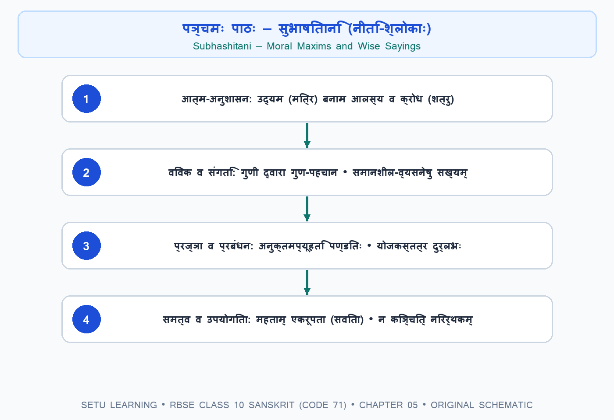

# अध्याय 5: पञ्चमः पाठः — सुभाषितानि (नीति-श्लोकाः) (Subhashitani — Moral Maxims and Wise Sayings)

## भाग 1: अध्याय प्रवेश एवं पाठ्यक्रम मैपिंग

> इस फ़ाइल के अभ्यास लेखक-निर्मित हैं। दो चुने हुए बोर्ड प्रश्न नीचे आधिकारिक पेपर से मिलाए गए हैं; यह NCERT के सभी प्रश्नों या ऐतिहासिक PYQ संग्रह का प्रमाणित register नहीं है।

**विषय कोड:** 71 (तृतीया भाषा — संस्कृतम्) · **श्रृंखला पुस्तक:** 6

**पाठ्यक्रम स्थिति:** RBSE 2026–27 में यह शेमुषी भाग-2 का निर्धारित पाठ है। बोर्ड पाठ को अलग अध्याय-अंक नहीं देता; नीचे के अभ्यास-अंक स्व-अभ्यास के हैं।

**सीखने के लक्ष्य:** दस नीति श्लोकों (परिश्रम, गुणग्राहकता, क्रोध-त्याग, सज्जन-समानता, योजकत्व) का अन्वय, संस्कृत भावार्थ, हिंदी अनुवाद तथा श्लोक-लेखन तैयार करना।

## भाग 2: शब्दावली एवं अवधारणा कैप्सूल

| शब्द / सूत्र | अर्थ / उपयोग |
|---|---|
| आलस्यम् | आलस (आलस्यं हि मनुष्याणां शरीरस्थो महान् रिपुः)। |
| उद्यमसमः | परिश्रम के समान (नास्त्युद्यमसमो बन्धुः कृत्वा यं नावसीदति)। |
| वेत्ति | जानता है (गुणी गुणं वेत्ति न वेत्ति निर्गुणः)। |
| वायसः | कौआ (पिको वसन्तस्य गुणं न वायसः)। |
| निमित्तमुद्दिश्य | कारण को लक्ष्य करके (निमित्तमुद्दिश्य हि यः प्रकुप्यति)। |
| अकारणद्वेषि | बिना कारण द्वेष करने वाला (यस्य मनः अकारणद्वेषि अस्ति तं जनः कथं परितोषयिष्यति)। |
| उदीरितः | कहा गया / संकेतित (उदीरितोऽर्थः पशुनापि गृह्यते)। |
| अनुक्तमप्यूहति | बिना कहे भी अंदाजा लगा लेता है (अनुक्तमप्यूहति पण्डितो जनः)। |
| सविता | सूर्य (उदये सविता रक्तो रक्तश्चास्तमये तथा)। |
| योजकः | जोड़ने वाला / प्रबंधक (अमन्त्रमक्षरं नास्ति... योजकस्तत्र दुर्लभः)। |

## भाग 3: विस्तृत शिक्षण पाठ

### पाठ-प्रवेश एवं सुभाषित-महत्त्व
'सुभाषित' सुंदर/उत्तम वचन के अर्थ में है। NCERT इस पाठ को विविध ग्रंथों से संकलित दस सुभाषितों का संग्रह बताता है; वह यहाँ प्रत्येक श्लोक का मूल ग्रंथ नहीं बताता। RBSE 2026–27 में पाठित-अवबोधन का कुल भार 32 अंक है, इस पाठ या किसी एक प्रश्न-प्रकार का अलग भार नहीं।

### श्लोक १ से ५: उद्यम, गुणग्राहकता, क्रोध और बुद्धिमत्ता
**श्लोक १ (उद्यम व आलस्य):** "आलस्यं हि मनुष्याणां शरीरस्थो महान् रिपुः। नास्त्युद्यमसमो बन्धुः कृत्वा यं नावसीदति॥" — **अन्वयः:** मनुष्याणां शरीरस्थः महान् रिपुः हि आलस्यम् (अस्ति)। उद्यमसमः बन्धुः न अस्ति, यं कृत्वा (नरः) न अवसीदति। **भावार्थ:** मनुष्यों के शरीर में स्थित सबसे बड़ा शत्रु आलस्य है; परिश्रम के समान कोई मित्र नहीं है, जिसे करके मनुष्य कभी दुःखी नहीं होता।
**श्लोक २ (गुणी ही गुण जानता है):** "गुणी गुणं वेत्ति न वेत्ति निर्गुणो, बली बलं वेत्ति न वेत्ति निर्बलः। पिको वसन्तस्य गुणं न वायसः, करी च सिंहस्य बलं न मूषकः॥" — गुणी व्यक्ति ही गुण को जानता है, निर्गुण नहीं; बलवान ही बल को जानता है, निर्बल नहीं; वसंत का महत्त्व कोयल (पिकः) जानती है, कौआ (वायसः) नहीं; और सिंह का बल हाथी (करी) जानता है, चूहा नहीं।
**श्लोक ३ (सकारण व अकारण क्रोध):** "निमित्तमुद्दिश्य हि यः प्रकुप्यति, ध्रुवं स तस्यापगमे प्रसीदति। अकारणद्वेषि मनस्तु यस्य वै, कथं जनस्तं परितोषयिष्यति॥" — जो व्यक्ति किसी कारण को लक्ष्य करके क्रोधित होता है, वह उस कारण के समाप्त होने पर निश्चय ही प्रसन्न हो जाता है; किंतु जिसका मन बिना कारण ही द्वेष करने वाला है, उसे कोई मनुष्य कैसे संतुष्ट कर सकता है?
**श्लोक ४ (पंडितजन की पहचान):** "उदीरितोऽर्थः पशुनापि गृह्यते, हयाश्च नागाश्च वहन्ति बोधिताः। अनुक्तमप्यूहति पण्डितो जनः, परेङ्गितज्ञानफला हि बुद्धयः॥" — कहा गया अर्थ तो पशु द्वारा भी ग्रहण कर लिया जाता है; घोड़े (हयाः) और हाथी (नागाः) भी बताए जाने पर भार ढोते हैं। विद्वान व्यक्ति तो बिना कहे भी अनुमान लगा लेता है, क्योंकि बुद्धियाँ दूसरों के संकेत (इङ्गित) से ज्ञान रूपी फल देने वाली होती हैं।
**श्लोक ५ (क्रोधः प्रथमः शत्रुः):** "क्रोधो हि शत्रुः प्रथमो नराणां, देहस्थितो देहविनाशनाय। यथास्थितः काष्ठगतो हि वह्निः, स एव वह्निर्दहते शरीरम्॥" — मनुष्यों के शरीर के विनाश के लिए शरीर में स्थित प्रथम शत्रु क्रोध ही है; जैसे लकड़ी में स्थित आग लकड़ी को ही जला देती है, वैसे ही क्रोध शरीर को जलाता है।

### श्लोक ६ से १०: मैत्री, महावृक्ष, सज्जन-समानता, योजक और प्रकृति-सामर्थ्य
**श्लोक ६ (समानशीलव्यसनेषु सख्यम्):** "मृगा मृगैः सङ्गमनुव्रजन्ति, गावश्च गोभिः तुरगास्तुरङ्गैः। मूर्खाश्च मूर्खैः सुधियः सुधीभिः, समान-शील-व्यसनेषु सख्यम्॥" — हिरण हिरणों के साथ, गायें गायों के साथ, घोड़े घोड़ों के साथ, मूर्ख मूर्खों के साथ और विद्वान (सुधियः) विद्वानों के साथ चलते हैं; मित्रता समान स्वभाव और आदतों वालों में होती है।
**श्लोक ७ (महावृक्ष का आश्रय — RBSE 2026 पूरक परीक्षा):** "सेवितव्यो महावृक्षः फलच्छायासमन्वितः। यदि दैवात् फलं नास्ति छाया केन निवार्यते॥" — **अन्वयः:** फलच्छायासमन्वितः महावृक्षः सेवितव्यः। यदि दैवात् फलं न अस्ति, (तर्हि) केन छाया निवार्यते? **भावार्थ:** फल और छाया से युक्त महावृक्ष का आश्रय लेना चाहिए; यदि भाग्यवश फल न हो, तो उसकी छाया को कौन रोक सकता है? सज्जनों के संग का अर्थ-विस्तार एक व्याख्या है, श्लोक का प्रत्यक्ष उल्लेख नहीं।
**श्लोक ८ (योजकस्तत्र दुर्लभः — RBSE 2026 मुख्य परीक्षा अन्वय):** "अमन्त्रमक्षरं नास्ति नास्ति मूलमनौषधम्। अयोग्यः पुरुषो नास्ति योजकस्तत्र दुर्लभः॥" — **अन्वयः:** अमन्त्रम् अक्षरं न अस्ति, अनौषधं मूलं न अस्ति, अयोग्यः पुरुषः न अस्ति, तत्र योजकः दुर्लभः (भवति)। **भावार्थ:** ऐसा कोई अक्षर नहीं जो मंत्र न हो, ऐसी कोई जड़ नहीं जो औषधि न हो, और ऐसा कोई व्यक्ति नहीं जो अयोग्य हो; उन्हें सही काम में जोड़ने वाला पारखी (योजकः) ही दुर्लभ होता है।
**श्लोक ९ (संपत्ति और विपत्ति में एकरूपता):** "सम्पत्तौ च विपत्तौ च महतामेकरूपता। उदये सविता रक्तो रक्तश्चास्तमये तथा॥" — संपत्ति और विपत्ति दोनों में महापुरुषों में एकरूपता रहती है; जैसे सूर्य (सविता) उदय होते समय भी लाल होता है और अस्त होते समय भी लाल ही रहता है।
**श्लोक १० (विचित्रे खलु संसारे):** "विचित्रे खलु संसारे नास्ति किञ्चिन्निरर्थकम्। अश्वश्चेद् धावने वीरः भारस्य वहने खरः॥" — इस विचित्र संसार में निश्चय ही कुछ भी निरर्थक नहीं है; यदि घोड़ा दौड़ने में वीर है, तो गधा (खरः) भार ढोने में वीर है।

सुभाषितानि: दश नीति-श्लोकों के जीवन-मूल्य एवं परीक्षा-उपादेयता का समन्वित मानचित्र।

## भाग 4: पाठ्यपुस्तक-अवधारणाओं पर मौलिक हल किए उदाहरण

नीचे के प्रश्न लेखक के मौलिक मॉडल हैं। ये किसी NCERT edition के प्रश्न क्रमांक या संपूर्ण in-text/exercise solution bank होने का दावा नहीं करते।

**हल किया उदाहरण 1: RBSE 2026 मुख्य परीक्षा प्रश्न 9, 'अमन्त्रमक्षरं नास्ति...' का अन्वय भरें। यह प्रश्न आधिकारिक पेपर में इसी आशय से है।**

अन्वयः — अमन्त्रम् (१) अक्षरं नास्ति, अनौषधं (२) मूलं नास्ति, (३) अयोग्यः पुरुषः नास्ति, तत्र (४) योजकः दुर्लभः (अस्ति)।

**हल किया उदाहरण 2: RBSE 2026 पूरक परीक्षा प्रश्न 8, 'सेवितव्यो महावृक्षः...' का हिन्दी भावार्थ लिखें। यह प्रश्न आधिकारिक पेपर में इसी आशय से है।**

भावार्थ: कवि कहता है कि हमें फल और छाया से युक्त विशाल वृक्ष का आश्रय लेना चाहिए। यदि भाग्यवश उस वृक्ष पर फल न भी हों, तो भी उसकी शीतल छाया को कौन रोक सकता है? तात्पर्य यह है कि गुणी और उदार महापुरुषों की संगति सदैव कल्याणकारी होती है।

**हल किया उदाहरण 3: 'मृगा मृगैः सङ्गमनुव्रजन्ति...' पद्यांश से एकपदेन व पूर्णवाक्येन प्रश्न हल करें।**

१. एकपदेन: सुधियः कैः सह संगमनुव्रजन्ति? उत्तर: सुधीभिः। २. पूर्णवाक्येन: सख्यं केषु भवति? उत्तर: समान-शील-व्यसनेषु सख्यं भवति। ३. भाषिककार्यम्: 'तुरगाः' इति पदस्य पर्यायपदं 'अश्वाः / हयाः / तुरङ्गाः' अस्ति।

## भाग 5: सत्यापित बोर्ड प्रश्न एवं स्रोत-स्थिति

RBSE 2026 मुख्य परीक्षा, प्रश्न 9 (PDF पृष्ठ 5; मुद्रित पृष्ठ 4) में 'अमन्त्रमक्षरं नास्ति' के अन्वय की पूर्ति; RBSE 2026 पूरक परीक्षा, प्रश्न 8 (PDF पृष्ठ 5; मुद्रित पृष्ठ 4) में 'सेवितव्यो महावृक्षः...' का हिन्दी भावार्थ, 2 अंक। दोनों स्रोतों से प्रश्न और अंक मिलाए गए।

[RBSE 2026 मुख्य पेपर (S-71)](https://rajeduboard.rajasthan.gov.in/books/PAPERS-2026/Sec/S-71.pdf) · [RBSE 2026 पूरक पेपर (S-71)](https://rajeduboard.rajasthan.gov.in/books/PAPERS-2026/SecSUP/S-71.pdf)。

## भाग 6: खंडवार मौलिक अभ्यास बैंक

**अभ्यास-अंक:** लेखक के स्व-अभ्यास के लिए हैं; RBSE की आधिकारिक marking scheme नहीं। उत्तर पहले स्वयं लिखें, फिर भाग 9 देखें।

## अ: बहुविकल्पीय प्रश्न — 15 × 1 अंक

**MCQ 1. मनुष्याणां शरीरस्थः महान् रिपुः कः अस्ति?**

अ) उद्यमः  
ब) सत्यम्  
स) ज्ञानम्  
द) आलस्यम्

**MCQ 2. कृत्वा यं मानवः नावसीदति सः बन्धुः कः?**

अ) क्रोधः  
ब) लोभः  
स) उद्यमः  
द) आलस्यः

**MCQ 3. वसन्तस्य गुणं कः वेत्ति?**

अ) खरः  
ब) पिकः  
स) वायसः  
द) मूषकः

**MCQ 4. सिंहस्य बलं कः वेत्ति न तु मूषकः?**

अ) करी (गजः)  
ब) शशकः  
स) वानरः  
द) बिडालः

**MCQ 5. कः अनुक्तमपि अर्थम् ऊहति?**

अ) मूर्खो जनः  
ब) पशुः  
स) अलसः  
द) पण्डितो जनः

**MCQ 6. देहविनाशनाय देहस्थितः प्रथमः शत्रुः कः?**

अ) सन्तोषः  
ब) विनयः  
स) क्रोधः  
द) स्नेहः

**MCQ 7. काष्ठगतः कः काष्ठमेव दहते?**

अ) मेघः  
ब) वह्निः  
स) वायुः  
द) जलम्

**MCQ 8. 'सुधियः' कैः सह संगमनुव्रजन्ति?**

अ) सुधीभिः  
ब) मूर्खैः  
स) मृगैः  
द) तुरङ्गैः

**MCQ 9. कीदृशः महावृक्षः सेवितव्यः?**

अ) शुष्कः  
ब) कण्टकयुक्तः  
स) पुष्पहीनः  
द) फलच्छायासमन्वितः

**MCQ 10. 'अमन्त्रमक्षरं नास्ति...' श्लोके कः दुर्लभः कथितः?**

अ) पुरुषः  
ब) औषधः  
स) योजकः  
द) मन्त्रः

**MCQ 11. 'सविता' कदा रक्तः भवति?**

अ) रात्रौ  
ब) उदये अस्तमये च  
स) केवलम् उदये  
द) केवलं मध्याह्ने

**MCQ 12. भारस्य वहने कः वीरः भवति?**

अ) खरः  
ब) अश्वः  
स) सिंहः  
द) पिकः

**MCQ 13. 'तुरगाः' इति पदस्य पर्यायपदं किम्?**

अ) गजाः  
ब) गाः  
स) मृगाः  
द) अश्वाः / हयाः

**MCQ 14. 'सेवितव्यः' पदे कः प्रत्ययः अस्ति?**

अ) क्त  
ब) शतृ  
स) तव्यत्  
द) अनीयर्

**MCQ 15. 'निमित्तम्' इति पदस्य कः अर्थः अस्ति?**

अ) शरीरम्  
ब) कारणम्  
स) फलम्  
द) मित्रम्

## अ: रिक्त स्थान — 6 × 1 अंक

1. आलस (आलस्यं हि मनुष्याणां शरीरस्थो महान् रिपुः)। — इस शब्द/सूत्र का नाम है: ____।  
2. परिश्रम के समान (नास्त्युद्यमसमो बन्धुः कृत्वा यं नावसीदति)। — इस शब्द/सूत्र का नाम है: ____।  
3. जानता है (गुणी गुणं वेत्ति न वेत्ति निर्गुणः)। — इस शब्द/सूत्र का नाम है: ____।  
4. कौआ (पिको वसन्तस्य गुणं न वायसः)। — इस शब्द/सूत्र का नाम है: ____।  
5. कारण को लक्ष्य करके (निमित्तमुद्दिश्य हि यः प्रकुप्यति)। — इस शब्द/सूत्र का नाम है: ____।  
6. बिना कारण द्वेष करने वाला (यस्य मनः अकारणद्वेषि अस्ति तं जनः कथं परितोषयिष्यति)। — इस शब्द/सूत्र का नाम है: ____।

## अ: अतिलघु उत्तर — 8 × 1 अंक

1. मनुष्याणां शरीरस्थः महान् रिपुः कः अस्ति?  
2. कृत्वा यं मानवः नावसीदति सः बन्धुः कः?  
3. वसन्तस्य गुणं कः वेत्ति?  
4. सिंहस्य बलं कः वेत्ति न तु मूषकः?  
5. कः अनुक्तमपि अर्थम् ऊहति?  
6. देहविनाशनाय देहस्थितः प्रथमः शत्रुः कः?  
7. काष्ठगतः कः काष्ठमेव दहते?  
8. 'सुधियः' कैः सह संगमनुव्रजन्ति?

## ब: लघु उत्तर — 6 × 2 अंक

**B1.** मनुष्याणां शरीरस्थः महान् रिपुः कः?

**B2.** केन समः बन्धुः नास्ति?

**B3.** वसन्तस्य गुणं कः जानाति?

**B4.** बुद्धयः कीदृश्यः भवन्ति?

**B5.** नराणां प्रथमः शत्रुः कः?

**B6.** सख्यं केन सह भवति?

## स: दीर्घ उत्तर — 4 × 3 अंक

आंतरिक विकल्प अभ्यास: C1 अथवा C2, तथा C3 अथवा C4 चुनें। पुनरावृत्ति में बचा विकल्प भी हल करें। यह लेखक की अभ्यास व्यवस्था है।

**C1.** 'क्रोधो हि शत्रुः प्रथमो नराणाम्' श्लोकस्य आशयः स्पष्टीकुरुत।

**C2.** 'उदीरितोऽर्थः पशुनापि गृह्यते' श्लोकस्य भावार्थं लिखत।

**C3.** महापुरुषों की एकरूपता को सूर्य के दृष्टांत से स्पष्ट कीजिए।

**C4.** पाठ में प्रयुक्त समानार्थक शब्द-युग्मों (तुरग, नाग, सविता, सुधी) को स्पष्ट करें।

## द: विस्तृत उत्तर — 2 × 4 अंक

आंतरिक विकल्प अभ्यास: D1 अथवा D2 चुनें; बाद में दूसरा भी हल करें।

**D1.** 'आलस्यं हि मनुष्याणां...', 'गुणी गुणं वेत्ति...' एवं 'निमित्तमुद्दिश्य हि...' श्लोकत्रयस्य अन्वयं सप्रसंगं च भावार्थं लिखत।

**D2.** परीक्षा हेतु दो कंठस्थ सुभाषित श्लोक एवं उनके व्याकरणिक बिंदु लिखें।

## भाग 7: सावधानियाँ एवं परीक्षा-त्रुटियाँ

- 'रिपुः' (शत्रु) आलस्य है और 'प्रथमः शत्रुः' (देहविनाशनाय) क्रोध है — प्रश्न के विशेषण देखकर उत्तर दें।
- 'वायसः' का अर्थ कौआ, 'पिकः' का अर्थ कोयल, 'करी/नागः' का अर्थ हाथी और 'हयः/तुरगः' का अर्थ घोड़ा है।
- श्लोक-लेखन प्रश्न में वही श्लोक लिखें जो प्रश्न-पत्र में न आया हो ('अस्मिन प्रश्नपत्रे न आगतौ')।
- 'सविता' का अर्थ सूर्य है और 'रक्तः' का अर्थ लाल वर्ण है।
- 'उदीरितः' का अर्थ 'कहा गया' है और इसका विलोम 'अनुक्तम्' (न कहा गया) है।

## भाग 8: फटाफट पुनरावृत्ति — 25 बिंदु

1. आलस्यम्: आलस (आलस्यं हि मनुष्याणां शरीरस्थो महान् रिपुः)।  
2. उद्यमसमः: परिश्रम के समान (नास्त्युद्यमसमो बन्धुः कृत्वा यं नावसीदति)।  
3. वेत्ति: जानता है (गुणी गुणं वेत्ति न वेत्ति निर्गुणः)।  
4. वायसः: कौआ (पिको वसन्तस्य गुणं न वायसः)।  
5. निमित्तमुद्दिश्य: कारण को लक्ष्य करके (निमित्तमुद्दिश्य हि यः प्रकुप्यति)।  
6. अकारणद्वेषि: बिना कारण द्वेष करने वाला (यस्य मनः अकारणद्वेषि अस्ति तं जनः कथं परितोषयिष्यति)।  
7. उदीरितः: कहा गया / संकेतित (उदीरितोऽर्थः पशुनापि गृह्यते)।  
8. अनुक्तमप्यूहति: बिना कहे भी अंदाजा लगा लेता है (अनुक्तमप्यूहति पण्डितो जनः)।  
9. सविता: सूर्य (उदये सविता रक्तो रक्तश्चास्तमये तथा)।  
10. योजकः: जोड़ने वाला / प्रबंधक (अमन्त्रमक्षरं नास्ति... योजकस्तत्र दुर्लभः)।  
11. 'आलस्यं हि मनुष्याणां शरीरस्थो महान् रिपुः' — आलस्य ही शरीर में स्थित महान शत्रु है।  
12. उद्यम (परिश्रम) के समान कोई मित्र नहीं है जिसे करके मनुष्य दुःखी नहीं होता।  
13. वसंत ऋतु के गुण को कोयल (पिकः) जानती है, कौआ (वायसः) नहीं।  
14. 'करी च सिंहस्य बलं न मूषकः' — सिंह का बल हाथी (करी) जानता है।  
15. 'अनुक्तमप्यूहति पण्डितो जनः' — विद्वान व्यक्ति बिना कहे भी अनुमान लगा लेता है।  
16. शरीर के विनाश के लिए देह में स्थित प्रथम शत्रु क्रोध है।  
17. लकड़ी में स्थित अग्नि (वह्निः) लकड़ी को ही जलाती है।  
18. 'मूर्खाश्च मूर्खैः सुधियः सुधीभिः' — विद्वान विद्वानों के साथ संगति करते हैं।  
19. 'सेवितव्यो महावृक्षः फलच्छायासमन्वितः' — फल और छाया से युक्त महावृक्ष सेवनीय है।  
20. संसार में अयोग्य कोई नहीं है, केवल जोड़ने वाला पारखी (योजकः) दुर्लभ है।  
21. सूर्य (सविता) उदय और अस्त दोनों समय लाल रहता है।  
22. 'अश्वश्चेद् धावने वीरः भारस्य वहने खरः' — भार ढोने में गधा (खरः) वीर है।  
23. तुरगाः, हयाः और अश्वाः घोड़े के पर्याय हैं।  
24. 'सेवितव्यः' का पाठगत अर्थ है आश्रय/सेवन करने योग्य; यहाँ धातु-प्रत्यय की विस्तृत प्रक्रिया का दावा नहीं।  
25. 'निमित्तमुद्दिश्य हि यः प्रकुप्यति' में निमित्तम् का अर्थ कारण (कारणम्) है।

## भाग 9: इस फ़ाइल के मौलिक अभ्यासों की उत्तर-कुंजी

## MCQ: सही विकल्प और कारण

**1. द — आलस्यम्।** 'आलस्यं हि मनुष्याणां शरीरस्थो महान् रिपुः' — आलस्य ही शरीर में स्थित महान शत्रु है।

**2. स — उद्यमः।** उद्यम (परिश्रम) के समान कोई मित्र नहीं है जिसे करके मनुष्य दुःखी नहीं होता।

**3. ब — पिकः।** वसंत ऋतु के गुण को कोयल (पिकः) जानती है, कौआ (वायसः) नहीं।

**4. अ — करी (गजः)।** 'करी च सिंहस्य बलं न मूषकः' — सिंह का बल हाथी (करी) जानता है।

**5. द — पण्डितो जनः।** 'अनुक्तमप्यूहति पण्डितो जनः' — विद्वान व्यक्ति बिना कहे भी अनुमान लगा लेता है।

**6. स — क्रोधः।** शरीर के विनाश के लिए देह में स्थित प्रथम शत्रु क्रोध है।

**7. ब — वह्निः।** लकड़ी में स्थित अग्नि (वह्निः) लकड़ी को ही जलाती है।

**8. अ — सुधीभिः।** 'मूर्खाश्च मूर्खैः सुधियः सुधीभिः' — विद्वान विद्वानों के साथ संगति करते हैं।

**9. द — फलच्छायासमन्वितः।** 'सेवितव्यो महावृक्षः फलच्छायासमन्वितः' — फल और छाया से युक्त महावृक्ष सेवनीय है।

**10. स — योजकः।** संसार में अयोग्य कोई नहीं है, केवल जोड़ने वाला पारखी (योजकः) दुर्लभ है।

**11. ब — उदये अस्तमये च।** सूर्य (सविता) उदय और अस्त दोनों समय लाल रहता है।

**12. अ — खरः।** 'अश्वश्चेद् धावने वीरः भारस्य वहने खरः' — भार ढोने में गधा (खरः) वीर है।

**13. द — अश्वाः / हयाः।** तुरगाः, हयाः और अश्वाः घोड़े के पर्याय हैं।

**14. स — तव्यत्।** सेव् धातु में तव्यत् प्रत्यय जुड़ने से पुल्लिंग में 'सेवितव्यः' बनता है।

**15. ब — कारणम्।** 'निमित्तमुद्दिश्य हि यः प्रकुप्यति' में निमित्तम् का अर्थ कारण (कारणम्) है।

**रिक्त स्थान:** 1. आलस्यम्; 2. उद्यमसमः; 3. वेत्ति; 4. वायसः; 5. निमित्तमुद्दिश्य; 6. अकारणद्वेषि

**अतिलघु उत्तर:**

1. आलस्यम्। 'आलस्यं हि मनुष्याणां शरीरस्थो महान् रिपुः' — आलस्य ही शरीर में स्थित महान शत्रु है।

2. उद्यमः। उद्यम (परिश्रम) के समान कोई मित्र नहीं है जिसे करके मनुष्य दुःखी नहीं होता।

3. पिकः। वसंत ऋतु के गुण को कोयल (पिकः) जानती है, कौआ (वायसः) नहीं।

4. करी (गजः)। 'करी च सिंहस्य बलं न मूषकः' — सिंह का बल हाथी (करी) जानता है।

5. पण्डितो जनः। 'अनुक्तमप्यूहति पण्डितो जनः' — विद्वान व्यक्ति बिना कहे भी अनुमान लगा लेता है।

6. क्रोधः। शरीर के विनाश के लिए देह में स्थित प्रथम शत्रु क्रोध है।

7. वह्निः। लकड़ी में स्थित अग्नि (वह्निः) लकड़ी को ही जलाती है।

8. सुधीभिः। 'मूर्खाश्च मूर्खैः सुधियः सुधीभिः' — विद्वान विद्वानों के साथ संगति करते हैं।

**B1. मनुष्याणां शरीरस्थः महान् रिपुः कः?**

मनुष्याणां शरीरस्थः महान् रिपुः आलस्यम् अस्ति।

**B2. केन समः बन्धुः नास्ति?**

उद्यमेन (परिश्रमेण) समः बन्धुः नास्ति।

**B3. वसन्तस्य गुणं कः जानाति?**

वसन्तस्य गुणं पिकः (कोकिलः) जानाति, न तु वायसः।

**B4. बुद्धयः कीदृश्यः भवन्ति?**

बुद्धयः परङ्गितज्ञानफलाः भवन्ति, अतः पण्डितः जनः अनुक्तमपि ऊहति।

**B5. नराणां प्रथमः शत्रुः कः?**

देहविनाशनाय देहस्थितः क्रोधः नराणां प्रथमः शत्रुः अस्ति।

**B6. सख्यं केन सह भवति?**

समान-शील-व्यसनेषु (समानस्वभाव-आचरणेषु) जनेषु सख्यं भवति।

**C1. 'क्रोधो हि शत्रुः प्रथमो नराणाम्' श्लोकस्य आशयः स्पष्टीकुरुत।**

1. प्रस्तुत श्लोक में क्रोध को मनुष्य के शरीर में स्थित पहला शत्रु बताया गया है। 2. जिस प्रकार लकड़ी के भीतर छिपी हुई अग्नि उसी लकड़ी को जलाकर भस्म कर देती है। 3. उसी प्रकार मनुष्य के शरीर में उत्पन्न क्रोध रूपी अग्नि मनुष्य के अपने ही शरीर और विवेक को नष्ट कर देती है। 4. अतः मनुष्य को क्रोध का त्याग करना चाहिए।

**C2. 'उदीरितोऽर्थः पशुनापि गृह्यते' श्लोकस्य भावार्थं लिखत।**

1. कहा गया या बताया गया अर्थ तो पशु भी समझ लेता है। 2. घोड़े और हाथी भी संकेत देने पर भार वहन करते हैं। 3. किंतु विद्वान (पण्डित) व्यक्ति वह है जो बिना कहे ही बात का अनुमान लगा लेता है। 4. क्योंकि श्रेष्ठ बुद्धि दूसरों के सूक्ष्म संकेतों (इङ्गित) को समझकर ज्ञान रूपी फल देने वाली होती है।

**C3. महापुरुषों की एकरूपता को सूर्य के दृष्टांत से स्पष्ट कीजिए।**

1. 'सम्पत्तौ च विपत्तौ च महतामेकरूपता' श्लोक के अनुसार महापुरुष सुख (संपत्ति) और दुःख (विपत्ति) में समान रहते हैं। 2. वे सुख में अहंकारी नहीं होते और दुःख में विचलित नहीं होते। 3. जिस प्रकार सूर्य (सविता) उदय के समय भी लाल रंग का होता है और अस्त के समय भी लाल ही रहता है। 4. यह समत्व भाव ही महानता का लक्षण है।

**C4. पाठ में प्रयुक्त समानार्थक शब्द-युग्मों (तुरग, नाग, सविता, सुधी) को स्पष्ट करें।**

1. अश्व के पर्याय: श्लोकों में घोड़े के लिए 'हयाः', 'तुरगाः', 'तुरङ्गैः' और 'अश्वः' चार पद आए हैं। 2. गज के पर्याय: हाथी के लिए 'करी' और 'नागाः' पद आए हैं। 3. विद्वान के पर्याय: 'पण्डितः' और 'सुधियः' पद प्रयुक्त हुए हैं। 4. सूर्य के लिए 'सविता', कोयल के लिए 'पिकः' तथा कौए के लिए 'वायसः' प्रयुक्त हुआ है।

**D1. 'आलस्यं हि मनुष्याणां...', 'गुणी गुणं वेत्ति...' एवं 'निमित्तमुद्दिश्य हि...' श्लोकत्रयस्य अन्वयं सप्रसंगं च भावार्थं लिखत।**

1. प्रसंग: प्रस्तुत श्लोक 'शेमुषी भाग-2' के पंचम पाठ 'सुभाषितानि' से उद्धृत हैं। 2. श्लोक १ अन्वय व भाव: मनुष्याणां शरीरस्थः महान् रिपुः हि आलस्यम् अस्ति; उद्यमसमः बन्धुः नास्ति यं कृत्वा नरः न अवसीदति। भाव: आलस्य सबसे बड़ा शत्रु और परिश्रम सबसे बड़ा मित्र है। 3. श्लोक २ अन्वय व भाव: गुणी गुणं वेत्ति निर्गुणः न वेत्ति, बली बलं वेत्ति निर्बलः न वेत्ति; वसन्तस्य गुणं पिकः वेत्ति वायसः न, सिंहस्य बलं च करी वेत्ति मूषकः न। भाव: योग्य व्यक्ति ही योग्यता का मूल्य समझता है। 4. श्लोक ३ अन्वय व भाव: यः हि निमित्तम् उद्दिश्य प्रकुप्यति सः तस्य अपगमे ध्रुवं प्रसीदति; यस्य तु मनः अकारणद्वेषि अस्ति तं जनः कथं परितोषयिष्यति। भाव: अकारण द्वेष रखने वाले व्यक्ति को संतुष्ट करना असंभव है।

**D2. परीक्षा हेतु दो कंठस्थ सुभाषित श्लोक एवं उनके व्याकरणिक बिंदु लिखें।**

1. कंठस्थ अभ्यास के लिए श्लोक 9 या 10 चुनें; यह लेखक का अभ्यास-सुझाव है, RBSE की निश्चित मांग नहीं। 2. व्याकरणिक उदाहरण: नास्त्युद्यमसमः में न + अस्ति + उद्यमसमः; अनुक्तमप्यूहति में अनुक्तम् + अपि + ऊहति; सेवितव्यः का अर्थ आश्रय/सेवन करने योग्य। 3. फलच्छायासमन्वितः का सरल विग्रह 'फल और छाया से युक्त' है; यहाँ किसी निश्चित समास-प्रकार का दावा नहीं।

## भाग 10: 10 मिनट / 10 अंक आत्म-मूल्यांकन एवं संदर्भ

समय: 10 मिनट। पहले पुस्तक बंद करें।

1. MCQ 3 और 11 हल करें। (1 + 1)
2. B2 और B5 के उत्तर लिखें। (2 + 2)
3. D1 हल करें। (4)

**कुंजी:** भाग 9 में संबंधित क्रमांक देखें। **स्व-मूल्यांकन:** 8–10: आगे बढ़ें; 5–7: छूटे कौशल का दोहराव; 0–4: भाग 2–4 फिर पढ़ें। यह अभ्यास-सुझाव है, बोर्ड grade नहीं।

[RBSE Class 10 syllabus 2026–27](https://rajeduboard.rajasthan.gov.in/anudeshika-etc/10_2027.pdf) · [NCERT शेमुषी भाग-2, पाठ 5](https://ncert.nic.in/textbook/pdf/jhsk105.pdf) · [Haryana Board-hosted NCERT Shemushi copy](https://bseh.org.in/uploads/ebooks/20_Class_10th_Shemushi_Sansktit_120pp.pdf)

**समीक्षा सीमा:** दसों श्लोकों की मूल पाठ-रचना और इस फ़ाइल के authored MCQ, short-answer claims, summaries, grammar highlights and keys को NCERT chapter text से मिलाया; diagram visually checked. NCERT exercise bank का हर उपप्रश्न तथा सभी पद-व्युत्पत्तियाँ exhaustively audited नहीं हैं. दो board references ही भाग 5 में authenticated हैं; बाकी लेखक-अभ्यास हैं. Compared against the official NCERT 2026–27 reprint, 8 PDF pages / printed pp. 40–45. Its text layer uses a legacy font encoding; official page OCR and the Haryana Board-hosted textbook copy were used as corroboration for exact verse spelling.

**आगे की कड़ी:** षष्ठ पाठ 'सौहार्दं प्रकृतेः शोभा' में वन के पशु-पक्षियों के रोचक संवाद से पारस्परिक सहयोग और पर्यावरण-संतुलन का अध्ययन करेंगे।
