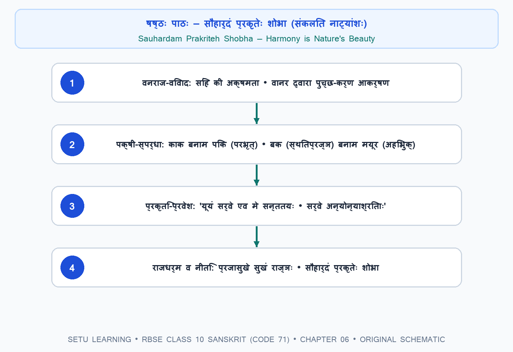

# अध्याय 6: षष्ठः पाठः — सौहार्दं प्रकृतेः शोभा (संकलित नाट्यांशः) (Sauhardam Prakriteh Shobha — Harmony is Nature's Beauty)

## भाग 1: अध्याय प्रवेश एवं पाठ्यक्रम मैपिंग

> **समीक्षा स्थिति:** यह अध्याय-केंद्रित अध्ययन-पत्र है। नीचे दिए अभ्यास प्रश्न और उत्तर इस फ़ाइल के लेखक द्वारा बनाए गए हैं; उन्हें NCERT की संपूर्ण प्रश्नोत्तर-कुंजी या प्रमाणित पिछले-वर्ष प्रश्न न मानें।

**विषय कोड:** 71 (तृतीया भाषा — संस्कृतम्) · **श्रृंखला पुस्तक:** 6

**पाठ्यक्रम संदर्भ:** RBSE 2026–27 में पठित-अवबोधनम् के लिए कुल 32 अंक निर्धारित हैं; इस पाठ को अलग अंक-भार नहीं दिया गया है। अभ्यास-अंक केवल स्व-अभ्यास के लिए हैं।

**सीखने के लक्ष्य:** वनराज पद के लिए पशु-पक्षियों (सिंह, वानर, काक, पिक, गज, बक, मयूर) के संवाद, श्लोक-अन्वय और प्रकृति माता के सौहार्द-संदेश को समझना।

## भाग 2: शब्दावली एवं अवधारणा कैप्सूल

| शब्द / सूत्र | अर्थ / उपयोग |
|---|---|
| सौहार्दम् | मैत्रीभाव / सद्भाव (सौहार्दं प्रकृतेः शोभा)। |
| पुच्छम् | पूँछ (एकः वानरः आगत्य सिंहस्य पुच्छं धुनोति)। |
| तुदन्ति | पीड़ित करते हैं / छेड़ते हैं (वृक्षोपरि स्थितः द्वितीयो वानरः सिंहस्य कर्णमाकृष्य पुनः वृक्षोपरि आरोहति)। |
| कृतान्तः | यमराज; पंचतन्त्र-उक्ति में उस राजा की उपमा जिसे पीड़ित प्राणियों की रक्षा करनी चाहिए पर वह नहीं करता। |
| परभृत् | कोयल / दूसरों द्वारा पाली जाने वाली (काकः पिकस्य सन्ततिं पालयति, अतः पिकः परभृत् कथ्यते)। |
| अहिभुक् | साँप को खाने वाला / मयूर (मयूरः अहिभुक् अपि कथ्यते)। |
| स्थितप्रज्ञः | स्थिर बुद्धि वाला / ध्यानमग्न (बकः शीतले जले बहुकालपर्यन्तं अविचलः ध्यानमग्नः स्थितप्रज्ञ इव तिष्ठति)। |
| अभिषेकः | राज्याभिषेक (वानर अन्य वन्यजीवों से अपने राज्याभिषेक की तैयारी करने को कहता है)। |
| मिथः | आपस में (प्रकृतिमाता पूछती हैं: कथं मिथः कलहं कुरुथ?)। |
| अन्योन्यसहयोगेन | एक-दूसरे के सहयोग से (समापन-श्लोक: प्राणिनां जायते हानिः परस्परविवादतः। अन्योन्यसहयोगेन लाभस्तेषां प्रजायते॥)। |

## भाग 3: विस्तृत शिक्षण पाठ

### पाठ-प्रवेश एवं नाट्यांश की पृष्ठभूमि
प्रस्तुत नाट्यांश में नदी-तट पर विश्राम कर रहे वनराज सिंह को बंदरों द्वारा परेशान किए जाने से कथा आरंभ होती है। जब सिंह अपनी ही रक्षा और बंदरों को दंड देने में असमर्थ दिखता है, तब वन के सभी पशु-पक्षी ('काकः, पिकः, गजः, वानरः, बकः, मयूरः, व्याघ्रः, चित्रकः') स्वयं को वनराज पद के योग्य बताते हुए आपस में विवाद करते हैं। अंत में **प्रकृति माता** प्रवेश कर समझाती हैं कि प्रकृति की शोभा पारस्परिक सौहार्द और सहयोग में ही है।

### प्रथम खंड: सिंह की दुरवस्था और काक-पिक संवाद
वन के दृश्य में एक सिंह सुख से विश्राम कर रहा है, तभी एक बंदर आकर उसकी पूँछ खींचता है ('पुच्छं धुनोति') और दूसरा बंदर कान खींचकर पेड़ पर चढ़ जाता है। क्रोधित सिंह दहाड़ता है, तो बंदर हँसते हुए कहता है कि तुम कैसे वनराज हो जो अपनी भी रक्षा नहीं कर सकते? पंचतंत्र की उक्ति है — जो राजा विपत्ति में प्रजा की रक्षा नहीं करता, वह पार्थिव रूप में कृतान्त (यमराज) ही है।
कौआ (काकः) कहता है कि मेरी सत्यप्रियता प्रसिद्ध है (‘अनृतं वदसि चेत् काकः दशेत्’) और हमारी एकता आदर्श है। कोयल (पिकः) कौए का उपहास करते हुए कहती है कि तुम 'का-का' की कर्कश ध्वनि से वातावरण आकुल करते हो! कौआ उत्तर देता है कि मैं ही तुम्हारी संतान को पालता हूँ, इसलिए तुम्हें **'परभृत्'** कहते हैं! कोयल प्रसिद्ध श्लोक बोलती है:
**श्लोक १ (पाठ्यपुस्तक):** "काकः कृष्णः पिकः कृष्णः को भेदः पिककाकयोः। वसन्तसमये प्राप्ते काकः काकः पिकः पिकः॥" — कौआ भी काला है और कोयल भी काली है, फिर दोनों में क्या भेद है? वसंत ऋतु आने पर कौआ कौआ और कोयल कोयल सिद्ध हो जाती है।

### द्वितीय खंड: गज, बक और मयूर के दावे
हाथी (गजः) कहता है कि मैं विशालकाय और पराक्रमी हूँ, मैं सिंह या अन्य किसी को सूँड से पटककर मार सकता हूँ; किंतु बंदर तुरंत हाथी की पूँछ खींचकर पेड़ पर चढ़ जाता है!
बगुला (बकः) कहता है कि मैं शीतल जल में लंबे समय तक अविचल ध्यानमग्न **'स्थितप्रज्ञ'** की भाँति खड़ा रहकर सबकी रक्षा का उपाय सोचूँगा! तब **मयूरः (मोर)** नृत्य करते हुए अट्टहास करता है कि तुम तपस्वी के वेश में बेचारी मछलियों को छल से खा जाते हो, तुम्हारे कारण तो सारा पक्षी-कुल ही अपमानित हो गया है! मयूर स्वयं को **'पक्षिराज'** बताते हुए कहता है कि विधाता ने ही मेरे सिर पर शिखा (चोटी) रखकर मुझे पक्षिराज बनाया है। कौआ व्यंग्य से मोर को **'अहिभुक्'** (साँप खाने वाला) कहता है और पूछता है कि नृत्य के अतिरिक्त उसकी विशेषता क्या है।

### तृतीय खंड: प्रकृति माता का आगमन और सौहार्द संदेश
जब व्याघ्र और चित्रक नदी का जल पीने आते हैं, तब वे वनराज पद के विवाद पर अपनी पात्रता जताते हैं। पक्षियों द्वारा उल्लू को चुनने पर कौआ उसकी आलोचना करता है। इसके बाद प्रकृति माता प्रवेश कर कहती हैं: ‘यूयं सर्वे एव मे सन्ततिः। कथं मिथः कलहं कुर्वन्ति? वस्तुतः सर्वे वन्यजीविनः अन्योन्याश्रिताः।’ आगे वे अपना परिचय प्रकृति और सबकी जननी के रूप में देती हैं, सभी का महत्त्व बताती हैं और सहयोग का संदेश देती हैं।
**श्लोक २:** "प्रजासुखे सुखं राज्ञः प्रजानां च हिते हितम्। नात्मप्रियं हितं राज्ञः प्रजानां तु प्रियं हितम्॥" — प्रजा के सुख में ही राजा का सुख है और प्रजा के हित में ही राजा का हित है; राजा का अपना प्रिय उसका हित नहीं, अपितु प्रजा का प्रिय ही उसका हित है।
**श्लोक ३:** "अगाधजलसञ्चारी न गर्वं याति रोहितः। अङ्गुष्ठोदकमात्रेण शफरी फुर्फुरायते॥" — अथाह जल में विचरण करने वाली रोहू मछली (रोहितः) गर्व नहीं करती, जबकि अँगूठे भर पानी में ही छोटी मछली (शफरी) फड़फड़ाने लगती है। अंत में सभी प्राणी मिलकर गाते हैं — **"सौहार्दं प्रकृतेः शोभा"**।

सौहार्दं प्रकृतेः शोभा: वन्य प्राणियों के अहंकार-विवाद से प्रकृति माता के समन्वय-संदेश तक का प्रवाह।

> चित्र में ‘सन्ततयः’ लिखा है; NCERT पाठ का रूप ‘सन्ततिः’ है। चित्र-लेबल का स्रोत-कलाकृति संशोधन अभी शेष है।

## भाग 4: पाठ्यपुस्तक-अवधारणाओं पर मौलिक हल किए उदाहरण

नीचे के प्रश्न लेखक के मौलिक मॉडल हैं। ये किसी NCERT edition के प्रश्न क्रमांक या संपूर्ण in-text/exercise solution bank होने का दावा नहीं करते।

**हल किया उदाहरण 1: 'काकः कृष्णः पिकः कृष्णः...' श्लोकस्य अन्वयं भावार्थं च लिखत।**

अन्वयः: काकः कृष्णः (भवति), पिकः कृष्णः (भवति), पिककाकयोः कः भेदः (अस्ति)? वसन्तसमये प्राप्ते काकः काकः (भवति), पिकः पिकः (भवति)। भावार्थ: बाह्य रूप-रंग से कौआ और कोयल दोनों काले होते हैं, किंतु वसंत ऋतु आने पर मधुर वाणी से कोयल और कर्कश वाणी से कौए की वास्तविक पहचान हो जाती है।

**हल किया उदाहरण 2: 'प्रजासुखे सुखं राज्ञः...' श्लोक का अन्वय-पूर्ति करें।**

अन्वयः — प्रजासुखे (१) राज्ञः सुखं, प्रजानां च (२) हिते (राज्ञः) हितम् (अस्ति)। आत्मप्रियं राज्ञः (३) हितं न, प्रजानां तु (४) प्रियं (राज्ञः) हितम् (अस्ति)।

**हल किया उदाहरण 3: नाट्यांश के अनुसार कोयल को 'परभृत्' और मोर को 'अहिभुक्' क्यों कहा जाता है?**

१. परभृत्: कोयल (पिकः) अपनी संतान का पालन स्वयं न करके कौए के घोंसले में रख देती है और कौआ ही उसका पालन करता है ('अहं तव सन्ततिं पालयामि'), इसलिए कोयल को 'परभृत्' कहते हैं। २. अहिभुक्: मोर (मयूरः) साँपों (अहि) का भक्षण करता है, इसलिए उसे 'अहिभुक्' कहा जाता है।

## भाग 5: सत्यापित बोर्ड प्रश्न एवं स्रोत-स्थिति

स्रोत-मिलान: RBSE 2023 मुख्य परीक्षा, प्रश्न 5(ii), PDF पृष्ठ 4 में ‘पिकस्य च काकस्य च’ का समास पूछा गया है; यह श्लोक 1 का प्रश्न नहीं है। उसी प्रश्नपत्र के प्रश्न 11(vii), PDF पृष्ठ 6 में ‘अगाधजलसञ्चारी’ श्लोक पर प्रश्न है। इन दो संदर्भों को ही यहाँ प्रमाणित पिछले-वर्ष प्रश्न के रूप में रखा गया है।

[RBSE 2023 मुख्य प्रश्नपत्र (S-71)](https://rajeduboard.rajasthan.gov.in/books/PAPERS-2023/Sec/S-71.pdf)। अन्य अभ्यास प्रश्न लेखक-रचित हैं; वे बोर्ड के प्रश्न या भविष्यवाणी नहीं हैं।

## भाग 6: खंडवार मौलिक अभ्यास बैंक

**अभ्यास-अंक:** लेखक के स्व-अभ्यास के लिए हैं; RBSE की आधिकारिक marking scheme नहीं। उत्तर पहले स्वयं लिखें, फिर भाग 9 देखें।

## अ: बहुविकल्पीय प्रश्न — 15 × 1 अंक

**MCQ 1. 'सौहार्दं प्रकृतेः शोभा' पाठे सिंहस्य पुच्छं कः धुनोति?**

अ) गजः  
ब) शृगालः  
स) वानरः  
द) काकः

**MCQ 2. पिककाकयोः भेदः कदा ज्ञायते?**

अ) ग्रीष्मकाले  
ब) वसन्तसमये  
स) वर्षाकाले  
द) शीतकाले

**MCQ 3. काकः कस्य सन्ततिं पालयति?**

अ) पिकस्य  
ब) मयूरस्य  
स) बकस्य  
द) हंसस्य

**MCQ 4. 'परभृत्' इति कस्य पक्षिणः नाम अस्ति?**

अ) काकस्य  
ब) मयूरस्य  
स) बकस्य  
द) पिकस्य (कोकिलस्य)

**MCQ 5. कः शीतले जले 'स्थितप्रज्ञ' इव तिष्ठति?**

अ) हंसः  
ब) चातकः  
स) बकः  
द) मयूरः

**MCQ 6. 'अहिभुक्' इति कः कथ्यते?**

अ) वानरः  
ब) मयूरः  
स) बकः  
द) गजः

**MCQ 7. कः पक्षी स्वयं पक्षिराज इति कथयति?**

अ) मयूरः  
ब) पिकः  
स) काकः  
द) राजहंसः

**MCQ 8. अन्ते प्राणिनां कलहं शमयितुं का प्रविशति?**

अ) वनदेवी  
ब) सिंहपत्नी  
स) बुद्धिमती  
द) प्रकृतिमाता

**MCQ 9. प्रजासुखे कस्य सुखं भवति?**

अ) सेनापतेः  
ब) शत्रोः  
स) राज्ञः  
द) मन्त्रिणः

**MCQ 10. अगाधजलसञ्चारी कः गर्वं न याति?**

अ) कच्छपः  
ब) रोहितः  
स) शफरी  
द) मकरः

**MCQ 11. अङ्गुष्ठोदकमात्रेण का फुर्फुरायते?**

अ) शफरी  
ब) रोहितः  
स) नदी  
द) नौका

**MCQ 12. प्रीतिलक्षणं कतिविधं भवति?**

अ) त्रिविधम्  
ब) चतुर्विधम्  
स) दशविधम्  
द) षड्विधम्

**MCQ 13. 'पिककाकयोः' इत्यत्र कः समासः अस्ति?**

अ) कर्मधारयः  
ब) बहुव्रीहिः  
स) द्वन्द्वः  
द) तत्पुरुषः

**MCQ 14. 'मिथः' इत्यस्य अव्ययपदस्य कः अर्थः अस्ति?**

अ) नीचैः  
ब) परस्परम् (आपस में)  
स) बहिः  
द) उपरि

**MCQ 15. सर्वे वन्यजीविनः कीदृशाः सन्ति?**

अ) अन्योन्याश्रिताः  
ब) स्वतन्त्राः  
स) शत्रवः  
द) निरर्थकाः

## अ: रिक्त स्थान — 6 × 1 अंक

1. मैत्रीभाव / सद्भाव (सौहार्दं प्रकृतेः शोभा)। — इस शब्द/सूत्र का नाम है: ____।  
2. पूँछ (एकः वानरः आगत्य सिंहस्य पुच्छं धुनोति)। — इस शब्द/सूत्र का नाम है: ____।  
3. पीड़ित करते हैं / छेड़ते हैं (वृक्षोपरि स्थितः द्वितीयो वानरः सिंहस्य कर्णमाकृष्य पुनः वृक्षोपरि आरोहति)। — इस शब्द/सूत्र का नाम है: ____।  
4. यमराज (द्वितीयवानरः पंचतन्त्र-उक्तिं वदति)। — इस शब्द/सूत्र का नाम है: ____।  
5. कोयल / दूसरों द्वारा पाली जाने वाली (काकः पिकस्य सन्ततिं पालयति, अतः पिकः परभृत् कथ्यते)। — इस शब्द/सूत्र का नाम है: ____।  
6. साँप को खाने वाला / मयूर (मयूरः अहिभुक् अपि कथ्यते)। — इस शब्द/सूत्र का नाम है: ____।

## अ: अतिलघु उत्तर — 8 × 1 अंक

1. 'सौहार्दं प्रकृतेः शोभा' पाठे सिंहस्य पुच्छं कः धुनोति?  
2. पिककाकयोः भेदः कदा ज्ञायते?  
3. काकः कस्य सन्ततिं पालयति?  
4. 'परभृत्' इति कस्य पक्षिणः नाम अस्ति?  
5. कः शीतले जले 'स्थितप्रज्ञ' इव तिष्ठति?  
6. 'अहिभुक्' इति कः कथ्यते?  
7. कः पक्षी स्वयं पक्षिराज इति कथयति?  
8. अन्ते प्राणिनां कलहं शमयितुं का प्रविशति?

## ब: लघु उत्तर — 6 × 2 अंक

**B1.** सिंहं तुदन् वानरः किं करोति?

**B2.** कः वसन्तसमये एव कूजति?

**B3.** बकः जले कथं तिष्ठति?

**B4.** विधात्रा कस्य शिरसि शिखा स्थापिता?

**B5.** सर्वे वन्यजीविनः कीदृशाः सन्ति?

**B6.** राज्ञः सुखं कस्मिन् अस्ति?

## स: दीर्घ उत्तर — 4 × 3 अंक

आंतरिक विकल्प अभ्यास: C1 अथवा C2, तथा C3 अथवा C4 चुनें। पुनरावृत्ति में बचा विकल्प भी हल करें। यह लेखक की अभ्यास व्यवस्था है।

**C1.** 'सौहार्दं प्रकृतेः शोभा' नाट्यांशस्य हिन्दीभाषायां सारं लिखत।

**C2.** प्रकृतिमाता प्राणिभ्यः किम् उपदिशति?

**C3.** बकस्य मयूरस्य च संवादं संक्षेपेण लिखत।

**C4.** पाठ में प्रयुक्त समास एवं प्रत्यय पदों का विश्लेषण करें।

## द: विस्तृत उत्तर — 2 × 4 अंक

आंतरिक विकल्प अभ्यास: D1 अथवा D2 चुनें; बाद में दूसरा भी हल करें।

**D1.** प्रकृतिमाता के ‘वस्तुतः सर्वे वन्यजीविनः अन्योन्याश्रिताः’ कथन और ‘ददाति प्रतिगृह्णाति...’ श्लोक का सप्रसंग हिन्दी-अनुवाद एवं शिक्षा लिखें।

**D2.** 'अगाधजलसञ्चारी न गर्वं याति रोहितः' एवं 'ददाति प्रतिगृह्णाति...' श्लोकद्वयस्य अन्वयं भावार्थं च लिखत।

## भाग 7: सावधानियाँ एवं परीक्षा-त्रुटियाँ

- 'परभृत्' = कोयल (पिकः) और 'परभृत्-पालक' = कौआ (काकः) — इन दोनों में भ्रम न करें।
- 'रोहितः' बड़ी मछली है जो गहरे जल में शांत रहती है; 'शफरी' छोटी मछली है जो कम जल में उछलती है।
- 'अहिभुक्' का अर्थ साँप खाने वाला (मयूरः) है।
- 'स्थितप्रज्ञः' विशेषण बगुले (बकः) ने अपने लिए प्रयुक्त किया है।
- 'पिककाकयोः' रूपतः षष्ठी/सप्तमी द्विवचन है; इस पद्य में षष्ठी-विभक्ति और इतरेतर द्वन्द्व समास है।

## भाग 8: फटाफट पुनरावृत्ति — 25 बिंदु

1. सौहार्दम्: मैत्रीभाव / सद्भाव (सौहार्दं प्रकृतेः शोभा)।  
2. पुच्छम्: पूँछ (एकः वानरः आगत्य सिंहस्य पुच्छं धुनोति)।  
3. तुदन्ति: पीड़ित करते हैं / छेड़ते हैं (वृक्षोपरि स्थितः द्वितीयो वानरः सिंहस्य कर्णमाकृष्य पुनः वृक्षोपरि आरोहति)।  
4. कृतान्तः: यमराज (द्वितीयवानरः पंचतन्त्र-उक्तिं वदति)।  
5. परभृत्: कोयल / दूसरों द्वारा पाली जाने वाली (काकः पिकस्य सन्ततिं पालयति, अतः पिकः परभृत् कथ्यते)।  
6. अहिभुक्: साँप को खाने वाला / मयूर (मयूरः अहिभुक् अपि कथ्यते)।  
7. स्थितप्रज्ञः: स्थिर बुद्धि वाला / ध्यानमग्न (बकः शीतले जले बहुकालपर्यन्तं अविचलः ध्यानमग्नः स्थितप्रज्ञ इव तिष्ठति)।  
8. अभिषेकः: राज्याभिषेक (मयूरः कथयति — विधात्रा एव अहं पक्षिराजः कृतः)।  
9. मिथः: आपस में (सर्वे प्राणिनः मिथः कलहं कुर्वन्ति)।  
10. अन्योन्यसहयोगेन: एक-दूसरे के सहयोग से (प्रजासुखे सुखं राज्ञः, सर्वे अन्योन्यसहयोगेन लाभं प्राप्नुवन्ति)।  
11. नाट्यांश के प्रारंभ में एक बंदर (वानरः) आकर सोते हुए सिंह की पूँछ खींचता है।  
12. 'वसन्तसमये प्राप्ते काकः काकः पिकः पिकः' — वसंत ऋतु आने पर भेद प्रकट होता है।  
13. कौआ कोयल (पिकः) की संतान को पालता है, इसलिए कोयल को 'परभृत्' कहते हैं।  
14. दूसरों (कौए) द्वारा पाले जाने के कारण कोयल को 'परभृत्' कहा जाता है।  
15. बगुला (बकः) शीतल जल में मछलियों के लिए स्थितप्रज्ञ की तरह ध्यानमग्न खड़ा रहता है।  
16. साँप (अहि) को खाने वाला होने के कारण मयूर (मोर) को 'अहिभुक्' कहा जाता है।  
17. मोर स्वयं को विधाता द्वारा बनाया गया शिखाधारी पक्षिराज बताता है।  
18. अंत में प्रकृति माता प्रवेश कर सभी प्राणियों को अपनी संतान बताती हैं।  
19. 'प्रजासुखे सुखं राज्ञः प्रजानां च हिते हितम्' — प्रजा के सुख में ही राजा का सुख है।  
20. अथाह जल में विचरण करने वाली रोहू मछली (रोहितः) गर्व नहीं करती।  
21. अँगूठे भर पानी में छोटी मछली (शफरी) फड़फड़ाती है।  
22. 'भुङ्क्ते भोजयते चैव षड्विधं प्रीतिलक्षणम्' — प्रीति के छह लक्षण बताए गए हैं।  
23. पिकः च काकः च, तयोः — इतरेतर द्वन्द्व समास (RBSE 2023 मुख्य परीक्षा, प्रश्न 5(ii))।  
24. 'कथं मिथः कलहं कुरुथ?' में मिथः का अर्थ आपस में (परस्परम्) है।  
25. प्रकृति माता के अनुसार सभी वन्य जीव एक-दूसरे पर आश्रित (अन्योन्याश्रिताः) हैं।

## भाग 9: लेखक-अभ्यास उत्तर-कुंजी

## MCQ: सही विकल्प और कारण

**1. स — वानरः।** नाट्यांश के प्रारंभ में एक बंदर (वानरः) आकर सोते हुए सिंह की पूँछ खींचता है।

**2. ब — वसन्तसमये।** 'वसन्तसमये प्राप्ते काकः काकः पिकः पिकः' — वसंत ऋतु आने पर भेद प्रकट होता है।

**3. अ — पिकस्य।** कौआ कोयल (पिकः) की संतान को पालता है, इसलिए कोयल को 'परभृत्' कहते हैं।

**4. द — पिकस्य (कोकिलस्य)।** दूसरों (कौए) द्वारा पाले जाने के कारण कोयल को 'परभृत्' कहा जाता है।

**5. स — बकः।** बगुला (बकः) शीतल जल में मछलियों के लिए स्थितप्रज्ञ की तरह ध्यानमग्न खड़ा रहता है।

**6. ब — मयूरः।** साँप (अहि) को खाने वाला होने के कारण मयूर (मोर) को 'अहिभुक्' कहा जाता है।

**7. अ — मयूरः।** मोर स्वयं को विधाता द्वारा बनाया गया शिखाधारी पक्षिराज बताता है।

**8. द — प्रकृतिमाता।** अंत में प्रकृति माता प्रवेश कर सभी प्राणियों को अपनी संतान बताती हैं।

**9. स — राज्ञः।** 'प्रजासुखे सुखं राज्ञः प्रजानां च हिते हितम्' — प्रजा के सुख में ही राजा का सुख है।

**10. ब — रोहितः।** अथाह जल में विचरण करने वाली रोहू मछली (रोहितः) गर्व नहीं करती।

**11. अ — शफरी।** अँगूठे भर पानी में छोटी मछली (शफरी) फड़फड़ाती है।

**12. द — षड्विधम्।** 'भुङ्क्ते भोजयते चैव षड्विधं प्रीतिलक्षणम्' — प्रीति के छह लक्षण बताए गए हैं।

**13. स — द्वन्द्वः।** पिकः च काकः च, तयोः — इतरेतर द्वन्द्व समास (RBSE 2023 मुख्य परीक्षा, प्रश्न 5(ii))।

**14. ब — परस्परम् (आपस में)।** 'कथं मिथः कलहं कुरुथ?' में मिथः का अर्थ आपस में (परस्परम्) है।

**15. अ — अन्योन्याश्रिताः।** प्रकृति माता के अनुसार सभी वन्य जीव एक-दूसरे पर आश्रित (अन्योन्याश्रिताः) हैं।

**रिक्त स्थान:** 1. सौहार्दम्; 2. पुच्छम्; 3. तुदन्ति; 4. कृतान्तः; 5. परभृत्; 6. अहिभुक्

**अतिलघु उत्तर:**

1. वानरः। नाट्यांश के प्रारंभ में एक बंदर (वानरः) आकर सोते हुए सिंह की पूँछ खींचता है।

2. वसन्तसमये। 'वसन्तसमये प्राप्ते काकः काकः पिकः पिकः' — वसंत ऋतु आने पर भेद प्रकट होता है।

3. पिकस्य। कौआ कोयल (पिकः) की संतान को पालता है, इसलिए कोयल को 'परभृत्' कहते हैं।

4. पिकस्य (कोकिलस्य)। दूसरों (कौए) द्वारा पाले जाने के कारण कोयल को 'परभृत्' कहा जाता है।

5. बकः। बगुला (बकः) शीतल जल में मछलियों के लिए स्थितप्रज्ञ की तरह ध्यानमग्न खड़ा रहता है।

6. मयूरः। साँप (अहि) को खाने वाला होने के कारण मयूर (मोर) को 'अहिभुक्' कहा जाता है।

7. मयूरः। मोर स्वयं को विधाता द्वारा बनाया गया शिखाधारी पक्षिराज बताता है।

8. प्रकृतिमाता। अंत में प्रकृति माता प्रवेश कर सभी प्राणियों को अपनी संतान बताती हैं।

**B1. सिंहं तुदन् वानरः किं करोति?**

वानरः सिंहस्य पुच्छं धुनोति तथा कर्णमाकृष्य पुनः वृक्षोपरि आरोहति।

**B2. कः वसन्तसमये एव कूजति?**

पाठ के श्लोक के अनुसार वसन्तसमये प्राप्त होने पर काक और पिक की पहचान उनके स्वरों से होती है।

**B3. बकः जले कथं तिष्ठति?**

बकः शीतले जले बहुकालपर्यन्तम् अविचलः ध्यानमग्नः 'स्थितप्रज्ञ' इव तिष्ठति।

**B4. विधात्रा कस्य शिरसि शिखा स्थापिता?**

विधात्रा मयूरस्य शिरसि शिखा (मुकुटम् इव) स्थापिता।

**B5. सर्वे वन्यजीविनः कीदृशाः सन्ति?**

प्रकृतिमाता कहती हैं कि सभी वन्यजीव एक-दूसरे पर आश्रित हैं; आगे वे अपना परिचय सभी की जननी के रूप में देती हैं।

**B6. राज्ञः सुखं कस्मिन् अस्ति?**

राज्ञः सुखं प्रजासुखे तथा प्रजानां हिते अस्ति।

**C1. 'सौहार्दं प्रकृतेः शोभा' नाट्यांशस्य हिन्दीभाषायां सारं लिखत।**

1. बंदर सिंह को परेशान करते हैं; वह उन्हें पकड़ नहीं पाता। 2. इसके बाद कौआ, कोयल, हाथी, बगुला, मोर, व्याघ्र और चित्रक वनराज पद के लिए अपनी पात्रता बताते हुए विवाद करते हैं। 3. कौआ अपनी सत्यप्रियता, बगुला अपनी ध्यानमग्नता और मोर अपने पक्षिराज होने तथा सौंदर्य पर गर्व करते हैं। 4. अंत में प्रकृति माता प्रकट होकर समझाती हैं कि सभी प्राणी मेरी संतान हैं और एक-दूसरे पर आश्रित हैं; आपसी सौहार्द ही प्रकृति की शोभा है।

**C2. प्रकृतिमाता प्राणिभ्यः किम् उपदिशति?**

1. प्रकृति माता सभी प्राणियों को स्नेहपूर्वक कहती हैं कि तुम सब मेरी ही संतान हो, अतः आपस में कलह मत करो। 2. संसार में प्रत्येक प्राणी का अपना महत्त्व है और सभी वन्यजीव एक-दूसरे पर आश्रित (अन्योन्याश्रिताः) हैं। 3. अँगूठे भर जल में छोटी मछली (शफरी) की तरह मिथ्या अहंकार नहीं करना चाहिए। 4. पारस्परिक सहयोग और सौहार्द से ही प्रकृति की रक्षा और शोभा संभव है।

**C3. बकस्य मयूरस्य च संवादं संक्षेपेण लिखत।**

1. बगुला (बकः) दावा करता है कि वह शीतल जल में स्थितप्रज्ञ की तरह ध्यानमग्न रहकर सबकी रक्षा के उपाय सोचेगा। 2. मोर (मयूरः) अट्टहास करते हुए कहता है कि बगुला ध्यान के बहाने बेचारी मछलियों को छल से पकड़कर खा जाता है। 3. मोर स्वयं को पक्षिराज और विधाता द्वारा शिखा-मुकुट से अलंकृत पक्षिराज बताता है। 4. कौआ मोर को ‘अहिभुक्’ (साँप खाने वाला) कहकर व्यंग्य करता है।

**C4. पाठ में प्रयुक्त समास एवं प्रत्यय पदों का विश्लेषण करें।**

1. पिककाकयोः = पिकः च काकः च तयोः (इतरेतर द्वन्द्व समासः — RBSE 2023 मुख्य परीक्षा, प्रश्न 5(ii))। 2. स्थितप्रज्ञः = स्थिता प्रज्ञा यस्य सः (बहुव्रीहि समासः)। 3. वनराजः = वनस्य राजा (षष्ठी तत्पुरुषः)। 4. आकृष्य = आ + कृष् + ल्यप् प्रत्ययः; धुनोति = धु + लट् लकार प्रथम पुरुष एकवचनम्।

**D1. प्रकृतिमाता के ‘सर्वे वन्यजीविनः अन्योन्याश्रिताः’ कथन और ‘ददाति प्रतिगृह्णाति...’ श्लोक का सप्रसंग हिन्दी-अनुवाद एवं शिक्षा लिखें।**

1. प्रसंग: प्रस्तुत नाट्यांश 'शेमुषी भाग-2' के षष्ठ पाठ 'सौहार्दं प्रकृतेः शोभा' से उद्धृत है। 2. अनुवाद: प्रकृतिमाता पहले प्राणियों से पूछती हैं कि वे क्या कर रहे हैं और कहती हैं कि सभी वन्यजीव एक-दूसरे पर आश्रित हैं। फिर वे प्रीति के छह लक्षणों वाला श्लोक सुनाती हैं। बाद में अपना परिचय प्रकृति, सबकी जननी के रूप में देती हैं, और प्रजाहित व विनम्रता से जुड़े दो श्लोक कहती हैं। 3. शिक्षा: पारिस्थितिकी तंत्र में कोई भी प्राणी छोटा या निरर्थक नहीं है; अहंकार छोड़कर सौहार्दपूर्वक रहना ही प्रकृति की सच्ची शोभा है।

**D2. 'अगाधजलसञ्चारी न गर्वं याति रोहितः' एवं 'ददाति प्रतिगृह्णाति...' श्लोकद्वयस्य अन्वयं भावार्थं च लिखत।**

1. श्लोक १ अन्वयः: अगाधजलसञ्चारी रोहितः गर्वं न याति, शफरी तु अङ्गुष्ठोदकमात्रेण फुर्फुरायते। भावार्थ: गहरे जल में तैरने वाली बड़ी रोहू मछली कभी घमंड नहीं करती, किंतु ओछे जल वाली छोटी शफरी मछली अँगूठे भर पानी में ही उछलने लगती है (अर्थात् अल्पज्ञानी अधिक अहंकार दिखाता है)। 2. श्लोक २ अन्वयः: ददाति, प्रतिगृह्णाति, गुह्यम् आख्याति, पृच्छति, भुङ्क्ते, भोजयते च एव षड्विधं प्रीतिलक्षणम् (भवति)। भावार्थ: लेना-देना, विश्वासपूर्वक मन की बात कहना-सुनना और साथ भोजन करना-कराना — ये सच्ची मित्रता के छह लक्षण हैं।

## भाग 10: 10 मिनट / 10 अंक आत्म-मूल्यांकन एवं संदर्भ

समय: 10 मिनट। पहले पुस्तक बंद करें।

1. MCQ 3 और 11 हल करें। (1 + 1)
2. B2 और B5 के उत्तर लिखें। (2 + 2)
3. D1 हल करें। (4)

**कुंजी:** भाग 9 में संबंधित क्रमांक देखें। **स्व-मूल्यांकन:** 8–10: आगे बढ़ें; 5–7: छूटे कौशल का दोहराव; 0–4: भाग 2–4 फिर पढ़ें। यह अभ्यास-सुझाव है, बोर्ड grade नहीं।

[RBSE 2026–27 पाठ्यक्रम](https://rajeduboard.rajasthan.gov.in/anudeshika-etc/10_2027.pdf) · [NCERT शेमुषी भाग-2 पाठ 6 (2026–27 पुनर्मुद्रण)](https://ncert.nic.in/textbook/pdf/jhsk106.pdf) · [पाठ का पठनीय वेब-पाठ (NCERT पाठ की तुलना हेतु)](https://philoid.com/index.php/ncert/chapter/jhsk106) · [RBSE 2023 मुख्य प्रश्नपत्र (S-71)](https://rajeduboard.rajasthan.gov.in/books/PAPERS-2023/Sec/S-71.pdf)

**आगे की कड़ी:** सप्तम पाठ 'विचित्रः साक्षी' में ओमप्रकाश ठाकुर विरचित कथा के माध्यम से न्यायाधीश बंकिमचंद्र चटर्जी की न्याय-प्रज्ञा का अध्ययन करेंगे।
