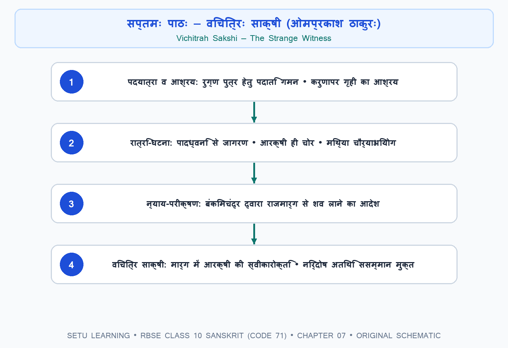

# अध्याय 7: सप्तमः पाठः — विचित्रः साक्षी (ओमप्रकाश ठाकुरः) (Vichitrah Sakshi — The Strange Witness)

## भाग 1: अध्याय प्रवेश एवं पाठ्यक्रम मैपिंग

> **समीक्षा स्थिति:** यह अध्याय-केंद्रित अध्ययन-पत्र है। नीचे के अभ्यास और उत्तर इस फ़ाइल के लेखक द्वारा बनाए गए हैं; उन्हें NCERT की संपूर्ण प्रश्नोत्तर-कुंजी या प्रमाणित पिछले-वर्ष प्रश्न न मानें।

**विषय कोड:** 71 (तृतीया भाषा — संस्कृतम्) · **श्रृंखला पुस्तक:** 6

**पाठ्यक्रम संदर्भ:** RBSE 2026–27 में पठित-अवबोधनम् के लिए कुल 32 अंक निर्धारित हैं; इस पाठ को अलग अंक-भार नहीं दिया गया है। अभ्यास-अंक केवल स्व-अभ्यास के लिए हैं।

**सीखने के लक्ष्य:** ओमप्रकाश ठाकुर रचित कथा का गद्यांश-अवबोधन, घटनाक्रम-संयोजन, न्यायाधीश बंकिमचंद्र चटर्जी का न्याय-कौशल तथा व्याकरणिक प्रयोग समझना।

## भाग 2: शब्दावली एवं अवधारणा कैप्सूल

| शब्द / सूत्र | अर्थ / उपयोग |
|---|---|
| अर्थकार्श्येन | धन की कमी से / निर्धनता से (सः पिता अर्थकार्श्येन पीडितः पदातिरेव प्राचलत्)। |
| पदातिरेव | पैदल ही (बसयानं विहाय पदातिरेव प्राचलत्)। |
| निशान्धकारे | रात्रि के अंधकार में (निशान्धकारे प्रसृते विजने प्रदेशे पदयात्रा न शुभावाहा)। |
| करुणापरो गृही | दयालु गृहस्थ (करुणापरो गृही तस्मै आश्रयं प्रायच्छत्)। |
| मञ्जूषाम् | पेटी / संदूक (चौरः एकं मञ्जूषाम् आदाय पलायितः)। |
| पादध्वनिना | पैरों की आहट से (चौरस्य पादध्वनिना प्रबुद्धोऽतिथिः तमन्वधावत्)। |
| आरक्षी | सिपाही / पुलिसकर्मी (ग्रामस्यारक्षी एव चौरः आसीत्)। |
| कारादण्डम् | जेल की सजा (अतिथिं चौर्याभियोगे कारादण्डं लप्स्यते)। |
| शवम् | मृत शरीर / लाश (राजमार्गे निहतं कमपि शवं आनयतम्)। |
| दुष्करम् | कठिन कार्य (दुष्कराण्यपि कर्माणि मतिवैभवशालिनः नीतिं युक्तिं समालम्ब्य लीलयैव प्रकुर्वते)। |

## भाग 3: विस्तृत शिक्षण पाठ

### पाठ-प्रवेश एवं कथाकार परिचय
NCERT के पाठ-प्रवेश के अनुसार यह आधुनिक संस्कृत कथाकार **ओमप्रकाश ठाकुर** द्वारा रचित कथा का संपादित अंश है और बंगाली साहित्यकार **बंकिमचन्द्र चटर्जी** द्वारा न्यायाधीश के रूप में दिए गए एक निर्णय पर आधारित है। यह इस पुस्तक का परिचय है; इस समीक्षा में उस ऐतिहासिक घटना की स्वतंत्र जीवनी-स्रोतों से पुष्टि नहीं की गई। कथा में प्रत्यक्ष साक्ष्य न मिलने पर न्यायाधीश एक ढके हुए शव को न्यायालय लाने का आदेश देते हैं; कथा का यह रहस्यपूर्ण पात्र ‘विचित्र साक्षी’ बनता है।

### प्रथम खंड: निर्धन पिता की पैदल यात्रा और रात्रि-विश्राम
कोई निर्धन व्यक्ति (निर्धनो जनः) अत्यधिक परिश्रम करके कुछ धन कमाता था और उसने अपने पुत्र को एक महाविद्यालय में प्रवेश दिलाया ("कश्चन निर्धनो जनः भूरि परिश्रम्य किञ्चिद् वित्तमुपार्जितवान्। तेन वित्तेन स्वपुत्रम् एकस्मिन् महाविद्यालये प्रवेशं दापयितुं सफलो जातः")। पुत्र छात्रावास में रहकर पढ़ने लगा। एक बार पिता ने सुना कि उसका पुत्र बीमार है ('तनयः रुग्णः'), तो वह व्याकुल होकर पुत्र को देखने चल पड़ा। धन की कमी से पीड़ित ('अर्थकार्श्येन पीडितः') वह बस छोड़कर पैदल ही चल पड़ा ('पदातिरेव प्राचलत्')।
शाम तक भी गंतव्य दूर था और रात्रि का अंधकार फैल जाने पर निर्जन प्रदेश में पैदल चलना शुभ नहीं था, अतः वह पास के गाँव में रात्रि-निवास के लिए किसी गृहस्थ के पास गया। दयालु गृहस्थ ('करुणापरो गृही') ने उसे आश्रय दिया।

### द्वितीय खंड: चोरी की घटना और आरक्षी का मिथ्या आरोप
उसी रात घर में एक चोर घुसा और एक पेटी (मञ्जूषाम्) लेकर भागने लगा। चोर के पैरों की आहट से ('चौरस्य पादध्वनिना') जागा हुआ अतिथि चोर के पीछे दौड़ा और उसे पकड़ लिया, किंतु आश्चर्य! गाँव का सिपाही (आरक्षी) ही चोर था! ("तदा विचित्रमघटत। ग्रामस्यारक्षी एव चौर आसीत्।") उसी क्षण सिपाही ने उल्टे उस अतिथि पर ही चिल्लाकर कहा — "चौरोऽयम्, चौरोऽयम्" (यह चोर है!) और उसे पकड़कर कारागार में डाल दिया।

### तृतीय खंड: बंकिमचंद्र चटर्जी का न्याय और 'विचित्रः साक्षी'
अगले दिन सिपाही ने चौर्याभियोग में उसे न्यायालय में पेश किया। न्यायाधीश **बंकिमचन्द्रः** ने दोनों के अलग-अलग बयान सुने और समझ गए कि अतिथि निर्दोष है और आरक्षी दोषी है, किंतु प्रमाण के अभाव में ('प्रमाणाभावात्') वे निर्णय नहीं कर सके। उन्होंने दोनों को अगले दिन फिर उपस्थित होने का आदेश दिया। अगले दिन एक स्थानीय कर्मचारी ने न्यायालय में सूचना दी कि वहाँ से दो क्रोश दूर किसी व्यक्ति की हत्या हुई है और उसका शव राजमार्ग के पास पड़ा है। न्यायाधीश ने आरक्षी और अभियुक्त को शव न्यायालय लाने का आदेश दिया।
आदेश पाकर दोनों एक लकड़ी के तख्ते पर रखे, कपड़े से ढके शव को कंधे पर उठाकर न्यायालय की ओर चले। कथा में कृशकाय अतिथि भार से पीड़ा के कारण रोता है; सिपाही प्रसन्न होकर उसे धमकाता और पिछली रात संदूक चुराने की कोशिश का उल्लेख करता है — "रे दुष्ट! तस्मिन् दिने त्वया अहं चोरीतायाः मञ्जूषायाः ग्रहणात् वारितः। इदानीं निजकृत्यस्य फलं भुङ्क्ष्व। अस्मिन् चौर्याभियोगे त्वं वर्षत्रयस्य कारादण्डं लप्स्यसे" (उस दिन तुमने मुझे चुराई हुई पेटी ले जाने से रोका था, अब तीन साल की जेल भुगतो!)।
न्यायालय में फिर बयान देने को कहे जाने पर ढका हुआ शव आवरण हटाकर न्यायाधीश को प्रणाम करता है और मार्ग में सिपाही द्वारा कही गई बात दोहराता है। कथा इसी रहस्यमय साक्ष्य को निर्णय का आधार बताती है: न्यायाधीश आरक्षी को कारादण्ड देते हैं और अतिथि को सम्मानपूर्वक मुक्त करते हैं। अतिथि की आयु पाठ में नहीं बताई गई; भार से उसकी दुर्बलता दिखती है, पर न्यायिक निर्णय का निर्णायक प्रमाण शव द्वारा दोहराई गई बात है।
**श्लोकः:** "दुष्कराण्यपि कर्माणि मतिवैभवशालिनः। नीतिं युक्तिं समालम्ब्य लीलयैव प्रकुर्वते॥" — **भावार्थ:** बुद्धि के वैभव से संपन्न लोग नीति और युक्ति का सहारा लेकर कठिन से कठिन कार्यों को भी खेल-खेल में ही संपन्न कर लेते हैं।

विचित्रः साक्षी: निर्धन अतिथि के संकट से बंकिमचंद्र चटर्जी के साक्ष्य-परीक्षण तक का न्याय-प्रवाह।

## भाग 4: पाठ्यपुस्तक-अवधारणाओं पर मौलिक हल किए उदाहरण

नीचे के प्रश्न लेखक के मौलिक मॉडल हैं। ये किसी NCERT edition के प्रश्न क्रमांक या संपूर्ण in-text/exercise solution bank होने का दावा नहीं करते।

**हल किया उदाहरण 1: RBSE 2015 मुख्य परीक्षा प्रश्न 15 में प्रयुक्त गद्यांश पर लेखक-रचित अभ्यास प्रश्न।**

१. एकपदेन: निर्धनो जनः किमर्थं पदातिरेव प्राचलत्? उत्तर: अर्थकार्श्येन (धनाभावात्)। २. पूर्णवाक्येन: करुणापरो गृही कस्मै आश्रयं प्रायच्छत्? उत्तर: करुणापरो गृही रात्रिनिवासाय आगताय निर्धनाय अतिथये आश्रयं प्रायच्छत्। ३. भाषिककार्यम्: 'प्राचलत्' क्रियापदस्य कर्तृपदं 'सः (निर्धनो जनः)' अस्ति।

**हल किया उदाहरण 2: कथा के ६ वाक्यों को सही घटनाक्रम में लिखें।**

सही क्रम: १. निर्धनो जनः भूरि परिश्रम्य किञ्चिद् वित्तमुपार्जितवान्। २. सः रुग्णं पुत्रं द्रष्टुं बसयानं विहाय पदातिरेव प्राचलत्। ३. रात्रौ करुणापरो गृही तस्मै आश्रयं प्रायच्छत्। ४. चौरस्य पादध्वनिना प्रबुद्धः अतिथिः चौरम् अन्वधावत्। ५. ग्रामस्य आरक्षी एव चौरः आसीत्; सः अतिथिम् मिथ्यापवादेन आरोप्य कारागृहे प्राक्षिपत्। ६. न्यायालये ढका हुआ शव मार्ग में आरक्षी द्वारा कही गई बात दोहराता है; न्यायाधीश आरक्षिणे कारादण्डम् आदिश्य अतिथिं मुक्तवान्।

**हल किया उदाहरण 3: 'दुष्कराण्यपि कर्माणि...' श्लोक का अन्वय और भावार्थ लिखें।**

अन्वयः: मतिवैभवशालिनः (जनाः) नीतिं युक्तिं (च) समालम्ब्य दुष्कराणि अपि कर्माणि लीलया एव प्रकुर्वते। भावार्थ: बुद्धि-वैभव से संपन्न लोग नीति और युक्ति का सहारा लेकर कठिन से कठिन कार्यों को भी सरलता से कर लेते हैं।

## भाग 5: सत्यापित बोर्ड प्रश्न एवं स्रोत-स्थिति

स्रोत-मिलान: (1) RBSE 2015 मुख्य परीक्षा, प्रश्न 15, PDF पृष्ठ 6 में यही गद्यांश और उस पर आधारित प्रश्न हैं; (2) RBSE 2025 मुख्य परीक्षा, प्रश्न 2(iv), PDF पृष्ठ 4 में ‘चौरस्य ______ प्रबुद्धः अतिथिः’ रिक्त स्थान है, जिसका उत्तर पादध्वनिना है; (3) RBSE 2026 पूरक परीक्षा, प्रश्न 11, PDF पृष्ठ 5 में ‘विचित्रः साक्षी’ का हिन्दी सार 3 अंकों का विकल्प है। इस फ़ाइल के मॉडल उत्तर लेखक-रचित हैं।

[RBSE 2015 मुख्य S-71](https://rajeduboard.rajasthan.gov.in/books/PAPERS-2015/Sec/S-71-Sankrit-15.pdf) · [RBSE 2025 मुख्य S-71](https://rajeduboard.rajasthan.gov.in/books/PAPERS-2025/Sec/S-71.pdf) · [RBSE 2026 पूरक S-71](https://rajeduboard.rajasthan.gov.in/books/PAPERS-2026/SecSUP/S-71.pdf)

## भाग 6: खंडवार मौलिक अभ्यास बैंक

**अभ्यास-अंक:** लेखक के स्व-अभ्यास के लिए हैं; RBSE की आधिकारिक marking scheme नहीं। उत्तर पहले स्वयं लिखें, फिर भाग 9 देखें।

## अ: बहुविकल्पीय प्रश्न — 15 × 1 अंक

**MCQ 1. 'विचित्रः साक्षी' इति पाठः केन विरचितः अस्ति?**

अ) वेदव्यासेन  
ब) ओमप्रकाशठक्कुरेण  
स) हरिदत्तशर्मणा  
द) दिङ्नागेन

**MCQ 2. निर्धनो जनः स्वपुत्रं कुत्र प्रवेशं दापयितुं सफलो जातः?**

अ) महाविद्यालये  
ब) गुरुकुले  
स) सैनिकविद्यालये  
द) विदेशे

**MCQ 3. सः पिता केन पीडितः बसयानं विहाय पदातिरेव प्राचलत्?**

अ) रोगेण  
ब) क्रोधेन  
स) भयेन  
द) अर्थकार्श्येन

**MCQ 4. रात्रौ कः तस्मै निर्धनाय आश्रयं प्रायच्छत्?**

अ) आरक्षी  
ब) न्यायाधीशः  
स) करुणापरो गृही  
द) ग्रामप्रमुखः

**MCQ 5. चौरः गृहात् काम् आदाय पलायितः?**

अ) अश्वम्  
ब) मञ्जूषाम्  
स) मुद्रिकाम्  
द) धेनुम्

**MCQ 6. अतिथिः केन प्रबुद्धः जातः?**

अ) चौरस्य पादध्वनिना  
ब) मेघगर्जनेन  
स) सिंहनादेन  
द) घण्टानादेन

**MCQ 7. वस्तुतः ग्रामस्य कः एव चौरः आसीत्?**

अ) गृही  
ब) कृषकः  
स) वणिज्  
द) आरक्षी

**MCQ 8. अस्मिन् प्रकरणे न्यायाधीशः कः आसीत्?**

अ) भोजराजः  
ब) विक्रमादित्यः  
स) बंकिमचन्द्रः  
द) चाणक्यः

**MCQ 9. आरक्षिणः मते अतिथिः कति वर्षस्य कारादण्डं लप्स्यते?**

अ) एकवर्षस्य  
ब) वर्षत्रयस्य  
स) वर्षद्वयस्य  
द) पञ्चवर्षस्य

**MCQ 10. न्यायाधीशेन पुनस्तौ घटनायाः विषये वक्तुम् आदिष्टौ कम् आनेतुम् आदिष्टौ?**

अ) शवम्  
ब) मञ्जूषाम्  
स) ग्रामप्रमुखम्  
द) चिकित्सकम्

**MCQ 11. 'अर्थकार्श्येन' इत्यस्य कः अर्थः अस्ति?**

अ) धनबाहुल्येन  
ब) शरीरबलनेन  
स) विद्याबलेन  
द) धनाभावेन

**MCQ 12. 'पदातिरेव' इत्यस्य सन्धि-विच्छेदः कः?**

अ) पदातिर् + एव  
ब) पदाती + एव  
स) पदातिः + एव  
द) पदाति + रेव

**MCQ 13. 'परिश्रम्य' इत्यत्र कः प्रत्ययः अस्ति?**

अ) क्त  
ब) ल्यप्  
स) क्त्वा  
द) तुमुन्

**MCQ 14. 'तनयः' इति पदस्य पर्यायपदं किम्?**

अ) पुत्रः / सुतः  
ब) पिता  
स) भ्राता  
द) सखा

**MCQ 15. मतिवैभवशालिनः कां समालम्ब्य दुष्कराणि कर्माणि प्रकुर्वते?**

अ) अन्यायं क्रोधं च  
ब) बलं दण्डं च  
स) भयं पलायनं च  
द) नीतिं युक्तिं च

## अ: रिक्त स्थान — 6 × 1 अंक

1. धन की कमी से / निर्धनता से (सः पिता अर्थकार्श्येन पीडितः पदातिरेव प्राचलत्)। — इस शब्द/सूत्र का नाम है: ____।  
2. पैदल ही (बसयानं विहाय पदातिरेव प्राचलत्)। — इस शब्द/सूत्र का नाम है: ____।  
3. रात्रि के अंधकार में (निशान्धकारे प्रसृते विजने प्रदेशे पदयात्रा न शुभावाहा)। — इस शब्द/सूत्र का नाम है: ____।  
4. दयालु गृहस्थ (करुणापरो गृही तस्मै आश्रयं प्रायच्छत्)। — इस शब्द/सूत्र का नाम है: ____।  
5. पेटी / संदूक (चौरः एकं मञ्जूषाम् आदाय पलायितः)। — इस शब्द/सूत्र का नाम है: ____।  
6. पैरों की आहट से (चौरस्य पादध्वनिना प्रबुद्धोऽतिथिः तमन्वधावत्)। — इस शब्द/सूत्र का नाम है: ____।

## अ: अतिलघु उत्तर — 8 × 1 अंक

1. 'विचित्रः साक्षी' इति पाठः केन विरचितः अस्ति?  
2. निर्धनो जनः स्वपुत्रं कुत्र प्रवेशं दापयितुं सफलो जातः?  
3. सः पिता केन पीडितः बसयानं विहाय पदातिरेव प्राचलत्?  
4. रात्रौ कः तस्मै निर्धनाय आश्रयं प्रायच्छत्?  
5. चौरः गृहात् काम् आदाय पलायितः?  
6. अतिथिः केन प्रबुद्धः जातः?  
7. वस्तुतः ग्रामस्य कः एव चौरः आसीत्?  
8. अस्मिन् प्रकरणे न्यायाधीशः कः आसीत्?

## ब: लघु उत्तर — 6 × 2 अंक

**B1.** निर्धनो जनः कथं वित्तम् उपार्जितवान्?

**B2.** जनः किमर्थं पदातिः गच्छति स्म?

**B3.** प्रसृते निशान्धकारे सः किम् अचिन्तयत्?

**B4.** वस्तुतः चौरः कः आसीत्?

**B5.** जनस्य क्रन्दनं निशम्य आरक्षी किम् उक्तवान्?

**B6.** मतिवैभवशालिनः दुष्कराणि कर्माणि कथं साधयन्ति?

## स: दीर्घ उत्तर — 4 × 3 अंक

आंतरिक विकल्प अभ्यास: C1 अथवा C2, तथा C3 अथवा C4 चुनें। पुनरावृत्ति में बचा विकल्प भी हल करें। यह लेखक की अभ्यास व्यवस्था है।

**C1.** 'विचित्रः साक्षी' कथायाः हिन्दीभाषायां सारं लिखत (RBSE 2026 पूरक परीक्षा, प्रश्न 11; 3 अंक)।

**C2.** न्यायाधीशः बंकिमचन्द्रः कथं सत्यस्य निर्णयं कृतवान्?

**C3.** अतिथिः कथं चौर्याभियोगे कारागृहे निक्षिप्तः?

**C4.** पाठ के प्रमुख संधि, समास एवं प्रत्यय पदों का विश्लेषण करें।

## द: विस्तृत उत्तर — 2 × 4 अंक

आंतरिक विकल्प अभ्यास: D1 अथवा D2 चुनें; बाद में दूसरा भी हल करें।

**D1.** 'कश्चन निर्धनो जनः भूरि परिश्रम्य...' गद्यांश का सप्रसंग हिन्दी-अनुवाद एवं व्याकरणिक विश्लेषण लिखें।

**D2.** प्रश्न-निर्माण की दृष्टि से पाठ के ८ महत्त्वपूर्ण वाक्यों का रूपांतरण करें।

## भाग 7: सावधानियाँ एवं परीक्षा-त्रुटियाँ

- 'गृही' का अर्थ गृहस्थ है जिसने आश्रय दिया; 'आरक्षी' सिपाही है जो चोर था — दोनों को न मिलाएँ।
- 'पादध्वनिना' तृतीया एकवचन है (पैरों की ध्वनि से)।
- 'प्रमाणाभावात्' पंचमी एकवचन है (प्रमाण के अभाव से)।
- 'करुणापरो गृही तस्मै आश्रयं प्रायच्छत्' में 'यच्छ्/दा' के योग में 'तस्मै' (चतुर्थी विभक्ति) है।
- श्लोक में 'लीलयैव' = लीलया + एव (वृद्धि स्वर संधि) है।

## भाग 8: फटाफट पुनरावृत्ति — 25 बिंदु

1. अर्थकार्श्येन: धन की कमी से / निर्धनता से (सः पिता अर्थकार्श्येन पीडितः पदातिरेव प्राचलत्)।  
2. पदातिरेव: पैदल ही (बसयानं विहाय पदातिरेव प्राचलत्)।  
3. निशान्धकारे: रात्रि के अंधकार में (निशान्धकारे प्रसृते विजने प्रदेशे पदयात्रा न शुभावाहा)।  
4. करुणापरो गृही: दयालु गृहस्थ (करुणापरो गृही तस्मै आश्रयं प्रायच्छत्)।  
5. मञ्जूषाम्: पेटी / संदूक (चौरः एकं मञ्जूषाम् आदाय पलायितः)।  
6. पादध्वनिना: पैरों की आहट से (चौरस्य पादध्वनिना प्रबुद्धोऽतिथिः तमन्वधावत्)।  
7. आरक्षी: सिपाही / पुलिसकर्मी (ग्रामस्यारक्षी एव चौरः आसीत्)।  
8. कारादण्डम्: जेल की सजा (अतिथिं चौर्याभियोगे कारादण्डं लप्स्यते)।  
9. शवम्: मृत शरीर / लाश (राजमार्गे निहतं कमपि शवं आनयतम्)।  
10. दुष्करम्: कठिन कार्य (दुष्कराण्यपि कर्माणि मतिवैभवशालिनः नीतिं युक्तिं समालम्ब्य लीलयैव प्रकुर्वते)।  
11. यह कथा आधुनिक संस्कृत कथाकार ओमप्रकाश ठाकुर द्वारा रचित है।  
12. उसने अपने पुत्र को एक महाविद्यालय में प्रवेश दिलाया।  
13. धन की कमी से (अर्थकार्श्येन पीडितः) वह बस छोड़कर पैदल ही चल पड़ा।  
14. गाँव के एक दयालु गृहस्थ (करुणापरो गृही) ने उसे आश्रय दिया।  
15. चोर घर के भीतर घुसकर एक संदूक/पेटी (मञ्जूषाम्) लेकर भागा।  
16. चोर के पैरों की आहट से (पादध्वनिना — RBSE 2025 मुख्य परीक्षा रिक्त स्थान) अतिथि जाग गया।  
17. गाँव का सिपाही (आरक्षी) ही वास्तव में चोर था।  
18. न्यायाधीश बंकिमचंद्र चटर्जी थे।  
19. आरक्षी ने कहा — 'अस्मिन् चौर्याभियोगे त्वं वर्षत्रयस्य कारादण्डं लप्स्यसे'।  
20. न्यायाधीश ने दोनों को राजमार्ग के पास मिले शव को न्यायालय लाने का आदेश दिया।  
21. अर्थकार्श्येन का अर्थ धन की कमी (धनाभावेन) है।  
22. विसर्ग के पूर्व 'इ' और बाद में स्वर 'ए' होने से विसर्ग को 'र्' होकर 'पदातिरेव' बनता है।  
23. उपसर्ग 'परि' पूर्वक श्रम् धातु में 'करके' अर्थ में ल्यप् प्रत्यय लगता है।  
24. तनयः, सुतः और आत्मजः पुत्र के पर्याय हैं।  
25. 'नीतिं युक्तिं समालम्ब्य लीलयैव प्रकुर्वते' — नीति और युक्ति का सहारा लेकर।

## भाग 9: संपूर्ण अभ्यास उत्तर-कुंजी

## MCQ: सही विकल्प और कारण

**1. ब — ओमप्रकाशठक्कुरेण।** यह कथा आधुनिक संस्कृत कथाकार ओमप्रकाश ठाकुर द्वारा रचित है।

**2. अ — महाविद्यालये।** उसने अपने पुत्र को एक महाविद्यालय में प्रवेश दिलाया।

**3. द — अर्थकार्श्येन।** धन की कमी से (अर्थकार्श्येन पीडितः) वह बस छोड़कर पैदल ही चल पड़ा।

**4. स — करुणापरो गृही।** गाँव के एक दयालु गृहस्थ (करुणापरो गृही) ने उसे आश्रय दिया।

**5. ब — मञ्जूषाम्।** चोर घर के भीतर घुसकर एक संदूक/पेटी (मञ्जूषाम्) लेकर भागा।

**6. अ — चौरस्य पादध्वनिना।** चोर के पैरों की आहट से (पादध्वनिना — RBSE 2025 मुख्य परीक्षा रिक्त स्थान) अतिथि जाग गया।

**7. द — आरक्षी।** गाँव का सिपाही (आरक्षी) ही वास्तव में चोर था।

**8. स — बंकिमचन्द्रः।** न्यायाधीश बंकिमचंद्र चटर्जी थे।

**9. ब — वर्षत्रयस्य।** आरक्षी ने कहा — 'अस्मिन् चौर्याभियोगे त्वं वर्षत्रयस्य कारादण्डं लप्स्यसे'।

**10. अ — शवम्।** न्यायाधीश ने दोनों को राजमार्ग के पास मिले शव को न्यायालय लाने का आदेश दिया।

**11. द — धनाभावेन।** अर्थकार्श्येन का अर्थ धन की कमी (धनाभावेन) है।

**12. स — पदातिः + एव।** विसर्ग के पूर्व 'इ' और बाद में स्वर 'ए' होने से विसर्ग को 'र्' होकर 'पदातिरेव' बनता है।

**13. ब — ल्यप्।** उपसर्ग 'परि' पूर्वक श्रम् धातु में 'करके' अर्थ में ल्यप् प्रत्यय लगता है।

**14. अ — पुत्रः / सुतः।** तनयः, सुतः और आत्मजः पुत्र के पर्याय हैं।

**15. द — नीतिं युक्तिं च।** 'नीतिं युक्तिं समालम्ब्य लीलयैव प्रकुर्वते' — नीति और युक्ति का सहारा लेकर।

**रिक्त स्थान:** 1. अर्थकार्श्येन; 2. पदातिरेव; 3. निशान्धकारे; 4. करुणापरो गृही; 5. मञ्जूषाम्; 6. पादध्वनिना

**अतिलघु उत्तर:**

1. ओमप्रकाशठक्कुरेण। यह कथा आधुनिक संस्कृत कथाकार ओमप्रकाश ठाकुर द्वारा रचित है।

2. महाविद्यालये। उसने अपने पुत्र को एक महाविद्यालय में प्रवेश दिलाया।

3. अर्थकार्श्येन। धन की कमी से (अर्थकार्श्येन पीडितः) वह बस छोड़कर पैदल ही चल पड़ा।

4. करुणापरो गृही। गाँव के एक दयालु गृहस्थ (करुणापरो गृही) ने उसे आश्रय दिया।

5. मञ्जूषाम्। चोर घर के भीतर घुसकर एक संदूक/पेटी (मञ्जूषाम्) लेकर भागा।

6. चौरस्य पादध्वनिना। चोर के पैरों की आहट से (पादध्वनिना — RBSE 2025 मुख्य परीक्षा रिक्त स्थान) अतिथि जाग गया।

7. आरक्षी। गाँव का सिपाही (आरक्षी) ही वास्तव में चोर था।

8. बंकिमचन्द्रः। न्यायाधीश बंकिमचंद्र चटर्जी थे।

**B1. निर्धनो जनः कथं वित्तम् उपार्जितवान्?**

निर्धनो जनः भूरि (अत्यधिकं) परिश्रम्य वित्तम् उपार्जितवान्।

**B2. जनः किमर्थं पदातिः गच्छति स्म?**

सः जनः अर्थकार्श्येन (धनाभावेन) पीडितः आसीत्, अतः बसयानं विहाय पदातिः गच्छति स्म।

**B3. प्रसृते निशान्धकारे सः किम् अचिन्तयत्?**

प्रसृते निशान्धकारे सः अचिन्तयत् यत् विजने प्रदेशे पदयात्रा न शुभावाहा।

**B4. वस्तुतः चौरः कः आसीत्?**

वस्तुतः ग्रामस्य आरक्षी एव चौरः आसीत्।

**B5. जनस्य क्रन्दनं निशम्य आरक्षी किम् उक्तवान्?**

आरक्षी उक्तवान् — "रे दुष्ट! तस्मिन् दिने त्वया अहं चोरीतायाः मञ्जूषायाः ग्रहणात् वारितः, इदानीं वर्षत्रयस्य कारादण्डं लप्स्यसे।"

**B6. मतिवैभवशालिनः दुष्कराणि कर्माणि कथं साधयन्ति?**

मतिवैभवशालिनः नीतिं युक्तिं च समालम्ब्य दुष्कराणि कर्माणि लीलयैव साधयन्ति।

**C1. 'विचित्रः साक्षी' कथायाः हिन्दीभाषायां सारं लिखत (RBSE 2026 पूरक परीक्षा, प्रश्न 11; 3 अंक)।**

1. ओमप्रकाश ठाकुर रचित 'विचित्रः साक्षी' कथा में एक निर्धन पिता अपने बीमार पुत्र को देखने धन के अभाव में पैदल ही चल पड़ता है और रात में एक दयालु गृहस्थ के घर रुकता है। 2. रात में चोर संदूक चुराकर भागता है; अतिथि उसे पकड़ता है, किंतु गाँव का सिपाही (आरक्षी) ही चोर निकलता है और उल्टे अतिथि को जेल में डाल देता है। 3. न्यायाधीश प्रमाण के अभाव में दोनों को अगले दिन फिर आने का आदेश देते हैं; तब एक कर्मचारी पास में मिले शव की सूचना देता है और न्यायाधीश दोनों को शव लाने को कहते हैं। 4. रास्ते में सिपाही अपनी पिछली रात की चोरी की कोशिश का उल्लेख करता है; न्यायालय में ढका हुआ शव वह बात दोहराता है। कथा में यही रहस्यमय साक्ष्य ‘विचित्रः साक्षी’ बनता है।

**C2. न्यायाधीशः बंकिमचन्द्रः कथं सत्यस्य निर्णयं कृतवान्?**

1. न्यायाधीश बंकिमचंद्र ने दोनों के बयान सुनकर अतिथि को निर्दोष और आरक्षी को दोषी समझा, पर प्रमाण के अभाव में निर्णय नहीं कर सके। 2. उन्होंने दोनों को अगले दिन फिर उपस्थित होने को कहा। उस दिन एक स्थानीय कर्मचारी ने पास में एक व्यक्ति की हत्या और राजमार्ग के पास उसके शव की सूचना दी; न्यायाधीश ने आरक्षी और अभियुक्त अतिथि को शव लाने का आदेश दिया। 3. शव को ले जाते समय आरक्षी ने रोते अतिथि को धमकाते हुए अपनी पिछली रात की चोरी की कोशिश और तीन वर्ष के कारादण्ड का उल्लेख किया। 4. न्यायालय में ढका शव आवरण हटाकर न्यायाधीश को प्रणाम करता है और आरक्षी की कही बात दोहराता है। कथा में यही विचित्र साक्ष्य निर्णायक बनता है: आरक्षी दण्डित होता है और अतिथि मुक्त। अतिथि की आयु या शरीर-बल को निर्णय का प्रमाण नहीं बताया गया है।

**C3. अतिथिः कथं चौर्याभियोगे कारागृहे निक्षिप्तः?**

1. रात्रि में जब गृहस्थ के घर चोर घुसा, तो उसके पैरों की आहट से अतिथि जाग गया। 2. अतिथि ने दौड़कर संदूक लिए भागते चोर को पकड़ लिया। 3. किंतु वह चोर गाँव का सिपाही (आरक्षी) ही था; उसने तुरंत उच्च स्वर में "यह चोर है, यह चोर है" कहकर शोर मचाया। 4. गाँव वाले जाग गए और सिपाही ने निर्दोष अतिथि को ही चोरी के आरोप में कारागार में डाल दिया।

**C4. पाठ के प्रमुख संधि, समास एवं प्रत्यय पदों का विश्लेषण करें।**

1. पदातिरेव = पदातिः + एव (विसर्ग-रत्व संधिः)। 2. चौरोऽयम् = चौरः + अयम् (उत्व + पूर्वरूप संधिः)। 3. अर्थकार्श्येन = अर्थस्य कार्श्यम्, तेन (षष्ठी तत्पुरुषः)। 4. परिश्रम्य = परि + श्रम् + ल्यप्; विहाय = वि + हा + ल्यप्; उपार्जितवान् = उप + अर्ज् + क्तवतु प्रत्ययः।

**D1. 'कश्चन निर्धनो जनः भूरि परिश्रम्य...' गद्यांश का सप्रसंग हिन्दी-अनुवाद एवं व्याकरणिक विश्लेषण लिखें।**

1. प्रसंग: प्रस्तुत गद्यांश हमारी पाठ्यपुस्तक 'शेमुषी भाग-2' के सप्तम पाठ 'विचित्रः साक्षी' से उद्धृत है, जिसके लेखक ओमप्रकाश ठाकुर हैं। 2. अनुवाद: किसी निर्धन व्यक्ति ने अत्यधिक परिश्रम करके कुछ धन कमाया। उस धन से वह अपने पुत्र को एक महाविद्यालय में प्रवेश दिलाने में सफल हो गया। उसका पुत्र वहीं छात्रावास में रहकर अध्ययन में संलग्न हो गया। एक बार वह पिता अपने पुत्र की बीमारी के बारे में सुनकर व्याकुल हो गया और पुत्र को देखने के लिए चल पड़ा। परंतु धन की कमी से पीड़ित वह बस छोड़कर पैदल ही चल दिया। 3. व्याकरणिक बिंदु: भूरि (अव्यय = अत्यधिक); दापयितुम् = दा (णिच्) + तुमुन्; निशान्धकारे = निशायाः अन्धकारे (षष्ठी तत्पुरुषः)।

**D2. प्रश्न-निर्माण की दृष्टि से पाठ के ८ महत्त्वपूर्ण वाक्यों का रूपांतरण करें।**

1. पुत्रं द्रष्टुं सः प्राचलत् → कं द्रष्टुं सः प्राचलत्? 2. करुणापरो गृही तस्मै आश्रयं प्रायच्छत् → कस्मै आश्रयं प्रायच्छत्? 3. चौरस्य पादध्वनिना अतिथिः प्रबुद्धः → कस्य पादध्वनिना (अथवा केन) अतिथिः प्रबुद्धः? 4. न्यायाधीशः बंकिमचन्द्रः आसीत् → न्यायाधीशः कः आसीत्? 5. सः भारवेदनया क्रन्दति स्म → सः कया क्रन्दति स्म? 6. उभौ शवम् चत्वरं स्थापितवन्तौ → उभौ शवम् कुत्र स्थापितवन्तौ? 7. अर्थकार्श्येन पीडितः पदातिरेव प्राचलत् → केन पीडितः पदातिरेव प्राचलत्? 8. मतिवैभवशालिनः दुष्कराणि कर्माणि कुर्वन्ति → कीदृशानि कर्माणि कुर्वन्ति?

## भाग 10: 10 मिनट / 10 अंक आत्म-मूल्यांकन एवं संदर्भ

समय: 10 मिनट। पहले पुस्तक बंद करें।

1. MCQ 3 और 11 हल करें। (1 + 1)
2. B2 और B5 के उत्तर लिखें। (2 + 2)
3. D1 हल करें। (4)

**कुंजी:** भाग 9 में संबंधित क्रमांक देखें। **स्व-मूल्यांकन:** 8–10: आगे बढ़ें; 5–7: छूटे कौशल का दोहराव; 0–4: भाग 2–4 फिर पढ़ें। यह अभ्यास-सुझाव है, बोर्ड grade नहीं।

[RBSE 2026–27 पाठ्यक्रम](https://rajeduboard.rajasthan.gov.in/anudeshika-etc/10_2027.pdf) · [NCERT शेमुषी भाग-2 पाठ 7 (2026–27 पुनर्मुद्रण)](https://ncert.nic.in/textbook/pdf/jhsk107.pdf) · [पाठ का पठनीय वेब-पाठ (NCERT पाठ की तुलना हेतु)](https://philoid.com/ncert/chapter/jhsk107)

**आगे की कड़ी:** अष्टम पाठ 'सूक्तयः' में तमिल ग्रंथ 'तिरुक्कुरल' से अनूदित अष्ट श्लोकों में विद्या, वाक्पटुता और धर्म के सिद्धांत पढ़ेंगे।
