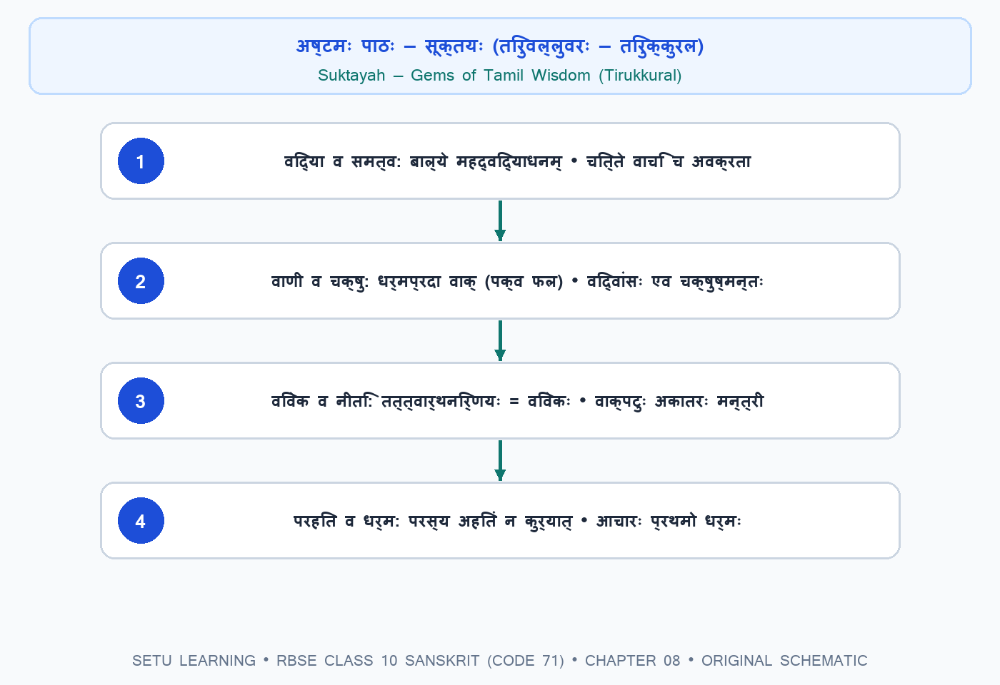

# अध्याय 8: अष्टमः पाठः — सूक्तयः (तिरुवल्लुवरः — तिरुक्कुरल) (Suktayah — Gems of Tamil Wisdom (Tirukkural))

## भाग 1: अध्याय प्रवेश एवं पाठ्यक्रम मैपिंग

> यह अध्ययन-सामग्री लेखक-रचित अभ्यास प्रश्नों और उत्तरों का चयन है; इसे सभी NCERT अभ्यासों के हल या संपूर्ण सत्यापित PYQ संग्रह न मानें.

**विषय कोड:** 71 (तृतीया भाषा — संस्कृतम्) · **श्रृंखला पुस्तक:** 6

**पाठ्यक्रम संदर्भ:** RBSE 2026–27 में पूरे पठित-अवबोधनम् घटक के 32 अंक हैं; इस पाठ के लिए अलग अंक-भार प्रकाशित नहीं है। नीचे दिए अभ्यास-अंक लेखक के अभ्यास हेतु हैं।

**सीखने के लक्ष्य:** तिरुक्कुरल से अनूदित आठ सूक्ति-श्लोकों का अन्वय, संस्कृत भावार्थ, विद्याधन, सत्यवाणी और धर्मप्रधानता का अध्ययन करना।

## भाग 2: शब्दावली एवं अवधारणा कैप्सूल

| शब्द / सूत्र | अर्थ / उपयोग |
|---|---|
| कृतज्ञता | उपकार मानने का भाव (पिताऽस्य किं तपस्तेपे इत्युक्तिस्तत्कृतज्ञता)। |
| अवक्रता | सरलता / सीधापन (अवक्रता यथा चित्ते तथा वाचि भवेद् यदि)। |
| धर्मप्रदा | धर्म प्रदान करने वाली (त्यक्त्वा धर्मप्रदां वाचं परुषां योऽभ्युदीरयेत्)। |
| परुषाम् | कठोर / कड़वी (परुषां वाचं अभ्युदीरयेत् सः अपक्वं फलं भुङ्क्ते)। |
| विद्वांसः | विद्वान लोग (विद्वांस एव लोकेऽस्मिन् चक्षुष्मन्तः प्रकीर्तिताः)। |
| अन्येषां वदने | दूसरों के मुख पर (अन्येषां वदने ये तु ते चक्षुर्नामनी मते)। |
| वाक्पटुः | बोलने में कुशल (मन्त्री वाक्पटुः धैर्यवान् सभायाम् अपि अकातरः भवेत्)। |
| प्राणेभ्योऽपि | प्राणों से भी बढ़कर (प्राणेभ्योऽपि सदा रक्ष्यः सदाचारः विशेषतः)। |
| आचारः | सदाचार / उत्तम आचरण (आचारः प्रथमो धर्मः इत्येतद् विदुषां वचः)। |
| चक्षुष्मन्तः | नेत्रों वाले (विद्वांसः एव लोकेऽस्मिन् चक्षुष्मन्तः प्रकीर्तिताः)। |

## भाग 3: विस्तृत शिक्षण पाठ

### पाठ-प्रवेश एवं 'तिरुक्कुरल' ग्रंथ-परिचय
प्रस्तुत पाठ तमिल भाषा के प्रसिद्ध कवि **तिरुवल्लुवर** विरचित **'तिरुक्कुरल'** नामक ग्रंथ से संकलित और संस्कृत में अनूदित है। NCERT के पाठ-परिचय में इसे तमिल भाषा का “वेद” कहा गया है; पाठ में ग्रंथ के धर्म, अर्थ और काम — तीन भाग बताए गए हैं। यह पाठ्यपुस्तक का वर्णन है, स्वतंत्र साहित्येतिहास-समीक्षा नहीं.

### श्लोक १ से ४: विद्याधन, सरलता, मधुर वाणी और विद्वान के चक्षु
**श्लोक १ (पिता का ऋण और विद्याधन):** "पिता यच्छति पुत्राय बाल्ये विद्याधनं महत्। पिताऽस्य किं तपस्तेपे इत्युक्तिस्तत्कृतज्ञता॥" — **अन्वयः:** पिता पुत्राय बाल्ये महत् विद्याधनं यच्छति। अस्य पिता किं तपः तेपे इति उक्तिः तत्कृतज्ञता (अस्ति)। **भावार्थ:** पिता बचपन में पुत्र को महान विद्या रूपी धन देता है; 'इसके पिता ने क्या तपस्या की थी' — लोगों का यह कथन ही पुत्र द्वारा पिता के प्रति कृतज्ञता है।
**श्लोक २ (मन और वाणी की सरलता):** "अवक्रता यथा चित्ते तथा वाचि भवेद् यदि। तदेवाहुः महात्मानः समत्वमिति तथ्यतः॥" — यदि जैसी सरलता (अवक्रता) मन में है, वैसी ही वाणी में भी हो, तो महात्मा लोग वास्तव में उसी को 'समत्व' (समानता) कहते हैं।
**श्लोक ३ (धर्मप्रदा वाणी बनाम कठोर वाणी):** "त्यक्त्वा धर्मप्रदां वाचं परुषां योऽभ्युदीरयेत्। परित्यज्य फलं पक्वं भुङ्क्तेऽपक्वं विमूढधीः॥" — जो मूर्ख बुद्धि वाला (विमूढधीः) धर्म देने वाली मधुर वाणी को छोड़कर कठोर (परुषाम्) वाणी बोलता है, वह पके हुए फल को छोड़कर कच्चा फल खाता है।
**श्लोक ४ (चक्षुष्मन्तः कौन हैं?):** "विद्वांस एव लोकेऽस्मिन् चक्षुष्मन्तः प्रकीर्तिताः। अन्येषां वदने ये तु ते चक्षुर्नामनी मते॥" — इस संसार में विद्वान ही वास्तव में नेत्रों वाले (चक्षुष्मन्तः) कहे गए हैं; दूसरों (मूर्खों) के मुख पर जो दो आँखें हैं, वे तो केवल नाममात्र की आँखें मानी गई हैं।

### श्लोक ५ से ८: विवेक, मंत्री के गुण, आत्म-कल्याण और सदाचार
**श्लोक ५ (तत्त्वार्थनिर्णयः):** "यत् प्रोक्तं येन केनापि तस्य तत्त्वार्थनिर्णयः। कर्तुं शक्यो भवेद् येन स विवेक इतीरितः॥" — जिस किसी के भी द्वारा जो कुछ कहा गया है, उसके वास्तविक अर्थ (तत्त्वार्थ) का निर्णय जिसके द्वारा किया जा सके, उसी को 'विवेक' कहा गया है।
**श्लोक ६ (कुशल मंत्री के लक्षण):** "वाक्पटुर्धैर्यवान् मन्त्री सभायामप्यकातरः। स केनापि प्रकारेण परैर्न परिभूयते॥" — जो मंत्री बोलने में चतुर (वाक्पटुः), धैर्यवान और सभा में भी निडर (अकातरः) होता है, वह किसी भी प्रकार से शत्रुओं या दूसरों द्वारा पराजित (अपमानित) नहीं किया जाता।
**श्लोक ७ (आत्मश्रेयः):** "य इच्छत्यात्मनः श्रेयः प्रभूतानि सुखानि च। न कुर्यादहितं कर्म स परेभ्यः कदापि च॥" — जो व्यक्ति अपना कल्याण (श्रेयः) और प्रचुर सुख चाहता है, उसे कभी भी दूसरों का अहित करने वाला कर्म नहीं करना चाहिए।
**श्लोक ८ (सदाचारः प्रथमो धर्मः):** "आचारः प्रथमो धर्मः इत्येतद् विदुषां वचः। तस्माद् रक्षेत् सदाचारं प्राणेभ्योऽपि विशेषतः॥" — सदाचार ही पहला धर्म है, यह विद्वानों का वचन है; इसलिए प्राणों से भी बढ़कर विशेष रूप से सदाचार की रक्षा करनी चाहिए।

सूक्तयः: तिरुक्कुरल की अष्ट सूक्तियों के नैतिक और व्यावहारिक स्तंभ।

## भाग 4: पाठ्यपुस्तक-अवधारणाओं पर मौलिक हल किए उदाहरण

नीचे के प्रश्न लेखक के मौलिक मॉडल हैं। ये किसी NCERT edition के प्रश्न क्रमांक या संपूर्ण in-text/exercise solution bank होने का दावा नहीं करते।

**हल किया उदाहरण 1: 'विद्वांस एव लोकेऽस्मिन् चक्षुष्मन्तः प्रकीर्तिताः...' श्लोक से पद्यांश प्रश्नोत्तर लिखें।**

१. एकपदेन: अस्मिन् लोके के चक्षुष्मन्तः प्रकीर्तिताः? उत्तर: विद्वांसः। २. पूर्णवाक्येन: अन्येषां वदने ये नेत्रे ते कीदृशी मते? उत्तर: अन्येषां वदने ये तु ते चक्षुर्नामनी एव मते। ३. भाषिककार्यम्: 'लोकेऽस्मिन्' = लोके + अस्मिन् (पूर्वरूप स्वर संधिः — RBSE 2026 मुख्य परीक्षा प्रश्न 1(ix))।

**हल किया उदाहरण 2: 'त्यक्त्वा धर्मप्रदां वाचं...' श्लोक का अन्वय-पूर्ति और भावार्थ लिखें।**

अन्वयः: यः (१) धर्मप्रदां वाचं त्यक्त्वा (२) परुषां (वाचम्) अभ्युदीरयेत्, सः (३) विमूढधीः पक्वं फलं परित्यज्य (४) अपक्वं (फलं) भुङ्क्ते। भावार्थ: मधुर और हितकारी वाणी छोड़कर कड़वे वचन बोलने वाला मूर्ख पके फल को छोड़कर कच्चा फल खाने वाले के समान है।

**हल किया उदाहरण 3: पाठ के प्रमुख समास और प्रत्यय पदों का विश्लेषण करें।**

१. विमूढधीः = विमूढा धीः (बुद्धिः) यस्य सः (बहुव्रीहि समासः — RBSE 2023 मुख्य परीक्षा प्रश्न 5(iii))। २. चक्षुष्मन्तः = चक्षुस् + मतुप् प्रत्ययः (प्रथमा बहुवचनम्)। ३. धैर्यवान् = धैर्य + मतुप्। ४. कृतज्ञता = कृतज्ञ + तल् प्रत्ययः; समत्वम् = सम + त्व प्रत्ययः।

## भाग 5: सत्यापित बोर्ड प्रश्न एवं स्रोत-स्थिति

स्रोत-मिलान: RBSE 2026 मुख्य परीक्षा प्रश्न 1(ix) में 'लोके + अस्मिन्' संधि; RBSE 2025 मुख्य परीक्षा प्रश्न 2(ii) में 'कृतज्ञ + तल्' से 'कृतज्ञताम्'; RBSE 2023 मुख्य परीक्षा प्रश्न 5(iii) में 'विमूढधीः' का समास; और प्रश्न 7(iii) में 'समत्वम्' प्रत्यय-रूप का प्रश्न है। इस अध्ययन-फ़ाइल के अतिरिक्त अभ्यास और उत्तर लेखक-रचित हैं।

[RBSE 2026 मुख्य S-71](https://rajeduboard.rajasthan.gov.in/books/PAPERS-2026/Sec/S-71.pdf) · [RBSE 2025 मुख्य S-71](https://rajeduboard.rajasthan.gov.in/books/PAPERS-2025/Sec/S-71.pdf) · [RBSE 2023 मुख्य S-71](https://rajeduboard.rajasthan.gov.in/books/PAPERS-2023/Sec/S-71.pdf)

## भाग 6: खंडवार मौलिक अभ्यास बैंक

**अभ्यास-अंक:** लेखक के स्व-अभ्यास के लिए हैं; RBSE की आधिकारिक marking scheme नहीं। उत्तर पहले स्वयं लिखें, फिर भाग 9 देखें।

## अ: बहुविकल्पीय प्रश्न — 15 × 1 अंक

**MCQ 1. 'सूक्तयः' पाठः मूलतः कस्याः भाषायाः ग्रन्थात् अनूदितः अस्ति?**

अ) तमिलभाषायाः  
ब) तेलुगुभाषायाः  
स) कन्नडभाषायाः  
द) मलयालमभाषायाः

**MCQ 2. पिता पुत्राय बाल्ये किं यच्छति?**

अ) सुवर्णमुद्राम्  
ब) राजसिंहासनम्  
स) अश्वरथम्  
द) महद्विद्याधनम्

**MCQ 3. चित्ते वाचि च अवक्रता (सरलता) भवेत् चेत् महात्मानः तत् किम् आहुः?**

अ) लघुत्वम्  
ब) वक्रत्वम्  
स) समत्वम्  
द) महत्त्वम्

**MCQ 4. विमूढधीः धर्मप्रदां वाचं त्यक्त्वा कीदृशीं वाचम् अभ्युदीरयेत्?**

अ) कोमलाम्  
ब) परुषाम्  
स) मधुराम्  
द) सत्याम्

**MCQ 5. पक्वं फलं परित्यज्य कः अपक्वं फलं भुङ्क्ते?**

अ) विमूढधीः  
ब) पण्डितः  
स) मन्त्री  
द) पिता

**MCQ 6. अस्मिन् लोके के एव चक्षुष्मन्तः प्रकीर्तिताः?**

अ) धनिकाः  
ब) बलिनः  
स) नृपाः  
द) विद्वांसः

**MCQ 7. तत्त्वार्थनिर्णयः येन कर्तुं शक्यः भवेत् सः कः इतीरितः?**

अ) लोभः  
ब) मोहः  
स) विवेकः  
द) क्रोधः

**MCQ 8. सभायाम् अकातरः कः भवति?**

अ) अलसः सेवकः  
ब) वाक्पटुः धैर्यवान् मन्त्री  
स) कातरः सैनिकः  
द) मूर्खः जनः

**MCQ 9. विदुषां वचः अनुसारं प्रथमः धर्मः कः अस्ति?**

अ) आचारः (सदाचारः)  
ब) धनार्जनम्  
स) युद्धम्  
द) तीर्थाटनम्

**MCQ 10. प्राणेभ्योऽपि विशेषतः कः रक्षणीयः?**

अ) कोशः  
ब) प्रासादः  
स) रथः  
द) सदाचारः

**MCQ 11. 'लोकेऽस्मिन्' पदे कः सन्धिः अस्ति?**

अ) वृद्धिसन्धिः  
ब) यण्सन्धिः  
स) पूर्वरूपसन्धिः  
द) गुणसन्धिः

**MCQ 12. 'विमूढधीः' पदे कः समासः वर्तते?**

अ) द्वन्द्वः  
ब) बहुव्रीहिः  
स) द्विगुः  
द) अव्ययीभावः

**MCQ 13. 'समत्वम्' इत्यत्र कः प्रत्ययः अस्ति?**

अ) त्व  
ब) तल्  
स) मतुप्  
द) ठक्

**MCQ 14. 'अकातरः' इति पदस्य कः अर्थः अस्ति?**

अ) भीतः  
ब) रोगी  
स) निर्धनः  
द) निर्भयः (निडर)

**MCQ 15. 'वदने' इति पदस्य पर्यायपदं किम्?**

अ) हस्ते  
ब) चरित्रे  
स) मुखे / आनने  
द) नेत्रे

## अ: रिक्त स्थान — 6 × 1 अंक

1. उपकार मानने का भाव (पिताऽस्य किं तपस्तेपे इत्युक्तिस्तत्कृतज्ञता)। — इस शब्द/सूत्र का नाम है: ____।  
2. सरलता / सीधापन (अवक्रता यथा चित्ते तथा वाचि भवेद् यदि)। — इस शब्द/सूत्र का नाम है: ____।  
3. धर्म प्रदान करने वाली (त्यक्त्वा धर्मप्रदां वाचं परुषां योऽभ्युदीरयेत्)। — इस शब्द/सूत्र का नाम है: ____।  
4. कठोर / कड़वी (परुषां वाचं अभ्युदीरयेत् सः अपक्वं फलं भुङ्क्ते)। — इस शब्द/सूत्र का नाम है: ____।  
5. विद्वानों के द्वारा (विद्वांस एव लोकेऽस्मिन् चक्षुष्मन्तः प्रकीर्तिताः)। — इस शब्द/सूत्र का नाम है: ____।  
6. दूसरों के मुख पर (अन्येषां वदने ये तु ते चक्षुर्नामनी मते)। — इस शब्द/सूत्र का नाम है: ____।

## अ: अतिलघु उत्तर — 8 × 1 अंक

1. 'सूक्तयः' पाठः मूलतः कस्याः भाषायाः ग्रन्थात् अनूदितः अस्ति?  
2. पिता पुत्राय बाल्ये किं यच्छति?  
3. चित्ते वाचि च अवक्रता (सरलता) भवेत् चेत् महात्मानः तत् किम् आहुः?  
4. विमूढधीः धर्मप्रदां वाचं त्यक्त्वा कीदृशीं वाचम् अभ्युदीरयेत्?  
5. पक्वं फलं परित्यज्य कः अपक्वं फलं भुङ्क्ते?  
6. अस्मिन् लोके के एव चक्षुष्मन्तः प्रकीर्तिताः?  
7. तत्त्वार्थनिर्णयः येन कर्तुं शक्यः भवेत् सः कः इतीरितः?  
8. सभायाम् अकातरः कः भवति?

## ब: लघु उत्तर — 6 × 2 अंक

**B1.** पिता पुत्राय बाल्ये किं यच्छति?

**B2.** विमूढधीः कीदृशीं वाचं परित्यजति?

**B3.** अस्मिन् लोके के एव चक्षुष्मन्तः प्रकीर्तिताः?

**B4.** महात्मानः समत्वम् इति किम् आहुः?

**B5.** कः परैः न परिभूयते?

**B6.** प्राणेभ्योऽपि विशेषतः कः रक्षणीयः?

## स: दीर्घ उत्तर — 4 × 3 अंक

आंतरिक विकल्प अभ्यास: C1 अथवा C2, तथा C3 अथवा C4 चुनें। पुनरावृत्ति में बचा विकल्प भी हल करें। यह लेखक की अभ्यास व्यवस्था है।

**C1.** 'सूक्तयः' पाठस्य आधारेण वाण्याः महत्त्वं स्पष्टीकुरुत।

**C2.** विद्वांसः एव चक्षुष्मन्तः कथं कथ्यन्ते?

**C3.** सदाचारस्य महत्त्वं प्रतिपादयत।

**C4.** 'वाक्पटुर्धैर्यवान् मन्त्री...' तथा 'यत् प्रोक्तं येन केनापि...' श्लोकयोः भावार्थं लिखत।

## द: विस्तृत उत्तर — 2 × 4 अंक

आंतरिक विकल्प अभ्यास: D1 अथवा D2 चुनें; बाद में दूसरा भी हल करें।

**D1.** 'पिता यच्छति पुत्राय...', 'अवक्रता यथा चित्ते...' तथा 'त्यक्त्वा धर्मप्रदां वाचं...' श्लोकत्रयस्य अन्वयं सप्रसंगं च हिन्दी-अनुवादं लिखत।

**D2.** पाठ में प्रयुक्त संधि, समास एवं प्रत्यय पदों का सोदाहरण विवेचन करें।

## भाग 7: सावधानियाँ एवं परीक्षा-त्रुटियाँ

- 'चक्षुष्मन्तः' में 'चक्षुस् + मतुप्' प्रत्यय है और यह पुल्लिंग प्रथमा बहुवचन है।
- 'परुषाम्' का अर्थ कठोर है, इसे 'पुरुषम्' न पढ़ें; इसका विलोम 'मधुराम् / कोमलाम्' है।
- 'विमूढधीः' में 'धीः' का अर्थ बुद्धि है (मूढ़ बुद्धि वाला)।
- 'लोकेऽस्मिन्' में पूर्वरूप स्वर संधि है, विसर्ग संधि नहीं (क्योंकि मूल पद 'लोके' सप्तमी एकवचन है)।
- 'त्यक्त्वा' (त्यज् + क्त्वा) और 'परित्यज्य' (परि + त्यज् + ल्यप्) दोनों का अर्थ 'छोड़कर' है।

## भाग 8: फटाफट पुनरावृत्ति — 25 बिंदु

1. कृतज्ञता: उपकार मानने का भाव (पिताऽस्य किं तपस्तेपे इत्युक्तिस्तत्कृतज्ञता)।  
2. अवक्रता: सरलता / सीधापन (अवक्रता यथा चित्ते तथा वाचि भवेद् यदि)।  
3. धर्मप्रदा: धर्म प्रदान करने वाली (त्यक्त्वा धर्मप्रदां वाचं परुषां योऽभ्युदीरयेत्)।  
4. परुषाम्: कठोर / कड़वी (परुषां वाचं अभ्युदीरयेत् सः अपक्वं फलं भुङ्क्ते)।  
5. विद्वांसः: विद्वान लोग (विद्वांस एव लोकेऽस्मिन् चक्षुष्मन्तः प्रकीर्तिताः)।  
6. अन्येषां वदने: दूसरों के मुख पर (अन्येषां वदने ये तु ते चक्षुर्नामनी मते)।  
7. वाक्पटुः: बोलने में कुशल (मन्त्री वाक्पटुः धैर्यवान् सभायाम् अपि अकातरः भवेत्)।  
8. प्राणेभ्योऽपि: प्राणों से भी बढ़कर (प्राणेभ्योऽपि सदा रक्ष्यः सदाचारः विशेषतः)।  
9. आचारः: सदाचार / उत्तम आचरण (आचारः प्रथमो धर्मः इत्येतद् विदुषां वचः)।  
10. चक्षुष्मन्तः: नेत्रों वाले (विद्वांसः एव लोकेऽस्मिन् चक्षुष्मन्तः प्रकीर्तिताः)।  
11. यह पाठ तमिल भाषा के प्रसिद्ध ग्रंथ 'तिरुक्कुरल' से संकलित है।  
12. प्रथम श्लोक के अनुसार — 'पिता यच्छति पुत्राय बाल्ये विद्याधनं महत्'।  
13. मन और वाणी की सरलता को महात्मा लोग 'समत्वम्' कहते हैं। RBSE 2023 Q7(iii) में यह प्रत्यय-रूप पूछा गया था.  
14. मूर्ख बुद्धि वाला धर्मप्रदा वाणी को छोड़कर कठोर (परुषाम्) वाणी बोलता है।  
15. मूर्ख बुद्धि वाला (विमूढधीः) पके फल को छोड़कर कच्चा फल खाता है।  
16. 'विद्वांस एव लोकेऽस्मिन् चक्षुष्मन्तः प्रकीर्तिताः' — विद्वान ही नेत्रवान कहे गए हैं।  
17. जिससे तत्त्वार्थ का निर्णय किया जा सके, उसे 'विवेकः' कहा गया है।  
18. वाक्पटु और धैर्यवान मंत्री सभा में भी निडर (अकातरः) होता है।  
19. 'आचारः प्रथमो धर्मः इत्येतद् विदुषां वचः' — सदाचार ही प्रथम धर्म है।  
20. 'तस्माद् रक्षेत् सदाचारं प्राणेभ्योऽपि विशेषतः'।  
21. पदान्त 'ए/ओ' के बाद ह्रस्व 'अ' आने से पूर्वरूप संधि (लोके + अस्मिन् = लोकेऽस्मिन्) होती है (RBSE 2026 मुख्य परीक्षा)।  
22. 'विमूढा धीः यस्य सः' — अन्यपदप्रधान होने से बहुव्रीहि समास है (RBSE 2023 मुख्य परीक्षा)।  
23. सम + त्व प्रत्यय से नपुंसकलिंग में 'समत्वम्' बनता है।  
24. कातरः का अर्थ भयभीत और अकातरः का अर्थ निडर (निर्भयः) है।  
25. 'अन्येषां वदने ये तु' में वदने का अर्थ मुख पर (मुखे/आनने) है।

## भाग 9: इस फ़ाइल के अभ्यासों की उत्तर-कुंजी

## MCQ: सही विकल्प और कारण

**1. अ — तमिलभाषायाः।** यह पाठ तमिल भाषा के प्रसिद्ध ग्रंथ 'तिरुक्कुरल' से संकलित है।

**2. द — महद्विद्याधनम्।** प्रथम श्लोक के अनुसार — 'पिता यच्छति पुत्राय बाल्ये विद्याधनं महत्'।

**3. स — समत्वम्।** मन और वाणी की सरलता को महात्मा लोग 'समत्वम्' कहते हैं। यह लेखक-रचित MCQ है; RBSE 2023 Q7(iii) अलग से इसी पद का प्रत्यय-रूप पूछता है.

**4. ब — परुषाम्।** मूर्ख बुद्धि वाला धर्मप्रदा वाणी को छोड़कर कठोर (परुषाम्) वाणी बोलता है।

**5. अ — विमूढधीः।** मूर्ख बुद्धि वाला (विमूढधीः) पके फल को छोड़कर कच्चा फल खाता है।

**6. द — विद्वांसः।** 'विद्वांस एव लोकेऽस्मिन् चक्षुष्मन्तः प्रकीर्तिताः' — विद्वान ही नेत्रवान कहे गए हैं।

**7. स — विवेकः।** जिससे तत्त्वार्थ का निर्णय किया जा सके, उसे 'विवेकः' कहा गया है।

**8. ब — वाक्पटुः धैर्यवान् मन्त्री।** वाक्पटु और धैर्यवान मंत्री सभा में भी निडर (अकातरः) होता है।

**9. अ — आचारः (सदाचारः)।** 'आचारः प्रथमो धर्मः इत्येतद् विदुषां वचः' — सदाचार ही प्रथम धर्म है।

**10. द — सदाचारः।** 'तस्माद् रक्षेत् सदाचारं प्राणेभ्योऽपि विशेषतः'।

**11. स — पूर्वरूपसन्धिः।** पदान्त 'ए/ओ' के बाद ह्रस्व 'अ' आने से पूर्वरूप संधि (लोके + अस्मिन् = लोकेऽस्मिन्) होती है (RBSE 2026 मुख्य परीक्षा)।

**12. ब — बहुव्रीहिः।** 'विमूढा धीः यस्य सः' — अन्यपदप्रधान होने से बहुव्रीहि समास है (RBSE 2023 मुख्य परीक्षा)।

**13. अ — त्व।** सम + त्व प्रत्यय से नपुंसकलिंग में 'समत्वम्' बनता है।

**14. द — निर्भयः (निडर)।** कातरः का अर्थ भयभीत और अकातरः का अर्थ निडर (निर्भयः) है।

**15. स — मुखे / आनने।** 'अन्येषां वदने ये तु' में वदने का अर्थ मुख पर (मुखे/आनने) है।

**रिक्त स्थान:** 1. कृतज्ञता; 2. अवक्रता; 3. धर्मप्रदा; 4. परुषाम्; 5. विद्वांसः; 6. अन्येषां वदने

**अतिलघु उत्तर:**

1. तमिलभाषायाः। यह पाठ तमिल भाषा के प्रसिद्ध ग्रंथ 'तिरुक्कुरल' से संकलित है।

2. महद्विद्याधनम्। प्रथम श्लोक के अनुसार — 'पिता यच्छति पुत्राय बाल्ये विद्याधनं महत्'।

3. समत्वम्। मन और वाणी की सरलता को महात्मा लोग 'समत्वम्' कहते हैं। यह लेखक-रचित MCQ है; RBSE 2023 Q7(iii) अलग से इसी पद का प्रत्यय-रूप पूछता है.

4. परुषाम्। मूर्ख बुद्धि वाला धर्मप्रदा वाणी को छोड़कर कठोर (परुषाम्) वाणी बोलता है।

5. विमूढधीः। मूर्ख बुद्धि वाला (विमूढधीः) पके फल को छोड़कर कच्चा फल खाता है।

6. विद्वांसः। 'विद्वांस एव लोकेऽस्मिन् चक्षुष्मन्तः प्रकीर्तिताः' — विद्वान ही नेत्रवान कहे गए हैं।

7. विवेकः। जिससे तत्त्वार्थ का निर्णय किया जा सके, उसे 'विवेकः' कहा गया है।

8. वाक्पटुः धैर्यवान् मन्त्री। वाक्पटु और धैर्यवान मंत्री सभा में भी निडर (अकातरः) होता है।

**B1. पिता पुत्राय बाल्ये किं यच्छति?**

पिता पुत्राय बाल्ये महत् विद्याधनं यच्छति।

**B2. विमूढधीः कीदृशीं वाचं परित्यजति?**

विमूढधीः धर्मप्रदां (मधुरां) वाचं परित्यजति परुषां च अभ्युदीरयेत्।

**B3. अस्मिन् लोके के एव चक्षुष्मन्तः प्रकीर्तिताः?**

अस्मिन् लोके विद्वांसः एव चक्षुष्मन्तः प्रकीर्तिताः।

**B4. महात्मानः समत्वम् इति किम् आहुः?**

चित्ते वाचि च यथा अवक्रता (सरलता) भवेत्, तदेव महात्मानः समत्वम् आहुः।

**B5. कः परैः न परिभूयते?**

यः मन्त्री वाक्पटुः, धैर्यवान् सभायां च अकातरः भवति, सः परैः न परिभूयते।

**B6. प्राणेभ्योऽपि विशेषतः कः रक्षणीयः?**

प्राणेभ्योऽपि विशेषतः सदाचारः (आचारः) रक्षणीयः।

**C1. 'सूक्तयः' पाठस्य आधारेण वाण्याः महत्त्वं स्पष्टीकुरुत।**

1. प्रस्तुत पाठ में वाणी की सरलता और मधुरता पर विशेष बल दिया गया है। 2. महात्माओं के अनुसार मन और वाणी में एक जैसी सरलता (अवक्रता) होना ही सच्चा समत्व है। 3. जो मूर्ख व्यक्ति धर्म देने वाली मधुर वाणी को छोड़कर कठोर वाणी बोलता है, वह पके मीठे फल को छोड़कर कच्चा फल खाता है। 4. सभा में वाक्पटु (बोलने में कुशल) और धैर्यवान मंत्री कभी शत्रुओं द्वारा अपमानित नहीं होता।

**C2. विद्वांसः एव चक्षुष्मन्तः कथं कथ्यन्ते?**

1. श्लोक का कथन है कि विद्वान इस लोक में 'चक्षुष्मन्तः' हैं, जबकि अन्य लोगों के मुख पर स्थित आँखें नाममात्र की आँखें कही गई हैं। 2. व्याख्यात्मक भावार्थ में ज्ञान और विवेक को वास्तविक दृष्टि माना गया है; श्लोक स्वयं शास्त्र-अध्ययन का उल्लेख नहीं करता.

**C3. सदाचारस्य महत्त्वं प्रतिपादयत।**

1. विद्वानों का वचन है कि 'आचारः प्रथमो धर्मः' अर्थात् उत्तम आचरण ही मनुष्य का सबसे पहला धर्म है। 2. जो व्यक्ति अपना कल्याण और प्रचुर सुख चाहता है, उसे कभी दूसरों का अहित नहीं करना चाहिए। 3. इसलिए श्लोक सदाचार की रक्षा प्राणों से भी विशेष रूप से करने को कहता है.

**C4. 'वाक्पटुर्धैर्यवान् मन्त्री...' तथा 'यत् प्रोक्तं येन केनापि...' श्लोकयोः भावार्थं लिखत।**

1. प्रथम श्लोक भावार्थ: जो मंत्री वाणी में निपुण, विपत्ति में धैर्यशाली और बड़ी सभा में भी निर्भीक होता है, उसे शत्रु किसी भी प्रकार से अपमानित नहीं कर सकते। 2. द्वितीय श्लोक भावार्थ: किसी भी व्यक्ति द्वारा कही गई बात के मूल तत्त्व और यथार्थ अर्थ का निर्णय जिस बुद्धि से किया जाता है, उसी को 'विवेक' कहते हैं।

**D1. 'पिता यच्छति पुत्राय...', 'अवक्रता यथा चित्ते...' तथा 'त्यक्त्वा धर्मप्रदां वाचं...' श्लोकत्रयस्य अन्वयं सप्रसंगं च हिन्दी-अनुवादं लिखत।**

1. प्रसंग: प्रस्तुत सूक्तियाँ 'शेमुषी भाग-2' के अष्टम पाठ 'सूक्तयः' से उद्धृत हैं, जो तमिल ग्रंथ 'तिरुक्कुरल' से अनूदित हैं। 2. श्लोक १: पिता बचपन में पुत्र को महान विद्या रूपी धन देता है; 'इसके पिता ने क्या तप किया था' यह कथन ही पुत्र की कृतज्ञता है। 3. श्लोक २: जैसी सरलता मन में हो वैसी ही यदि वाणी में भी हो, तो महात्मा लोग वास्तव में उसी को समत्व कहते हैं। 4. श्लोक ३: जो मूर्ख बुद्धि वाला धर्मप्रद मधुर वाणी को त्यागकर कठोर वाणी बोलता है, वह पके फल को छोड़कर कच्चा फल खाता है।

**D2. पाठ में प्रयुक्त संधि, समास एवं प्रत्यय पदों का सोदाहरण विवेचन करें।**

1. संधिः: लोकेऽस्मिन् = लोके + अस्मिन् (पूर्वरूप); प्राणेभ्योऽपि = प्राणेभ्यः + अपि (विसर्ग-संधि); अभ्युदीरयेत् = अभि + उदीरयेत् (यण्); इतीरितः = इति + ईरितः (दीर्घ)। 2. समासः: विद्याधनम् = विद्या-धनम् (विग्रह/अर्थ-संबंध; यहाँ समास-प्रकार का दावा नहीं); विमूढधीः = विमूढा धीः यस्य सः (बहुव्रीहिः); तत्त्वार्थनिर्णयः = तत्त्वार्थस्य निर्णयः (षष्ठी तत्पुरुषः); अकातरः = न कातरः (नञ् तत्पुरुषः)। 3. प्रत्ययः: चक्षुष्मन्तः = चक्षुस् + मतुप्; धैर्यवान् = धैर्य + मतुप्; कृतज्ञता = कृतज्ञ + तल्; समत्वम् = सम + त्व; त्यक्त्वा = त्यज् + क्त्वा; परित्यज्य = परि + त्यज् + ल्यप्।

## भाग 10: 10 मिनट / 10 अंक आत्म-मूल्यांकन एवं संदर्भ

समय: 10 मिनट। पहले पुस्तक बंद करें।

1. MCQ 3 और 11 हल करें। (1 + 1)
2. B2 और B5 के उत्तर लिखें। (2 + 2)
3. D1 हल करें। (4)

**कुंजी:** भाग 9 में संबंधित क्रमांक देखें। **स्व-मूल्यांकन:** 8–10: आगे बढ़ें; 5–7: छूटे कौशल का दोहराव; 0–4: भाग 2–4 फिर पढ़ें। यह अभ्यास-सुझाव है, बोर्ड grade नहीं।

[RBSE पाठ्यक्रम 2026–27](https://rajeduboard.rajasthan.gov.in/anudeshika-etc/10_2027.pdf) · [NCERT शेमुषी भाग-2, पाठ 8 PDF](https://ncert.nic.in/textbook/pdf/jhsk108.pdf) · [पाठ का पठनीय प्रतिलेख](https://philoid.com/ncert/chapter/jhsk108)

**आगे की कड़ी:** नवम पाठ 'भूकम्पविभीषिका' में २००१ के कच्छ-भुज भूकंप और प्राकृतिक आपदाओं के वैज्ञानिक कारण व निवारण पढ़ेंगे।
