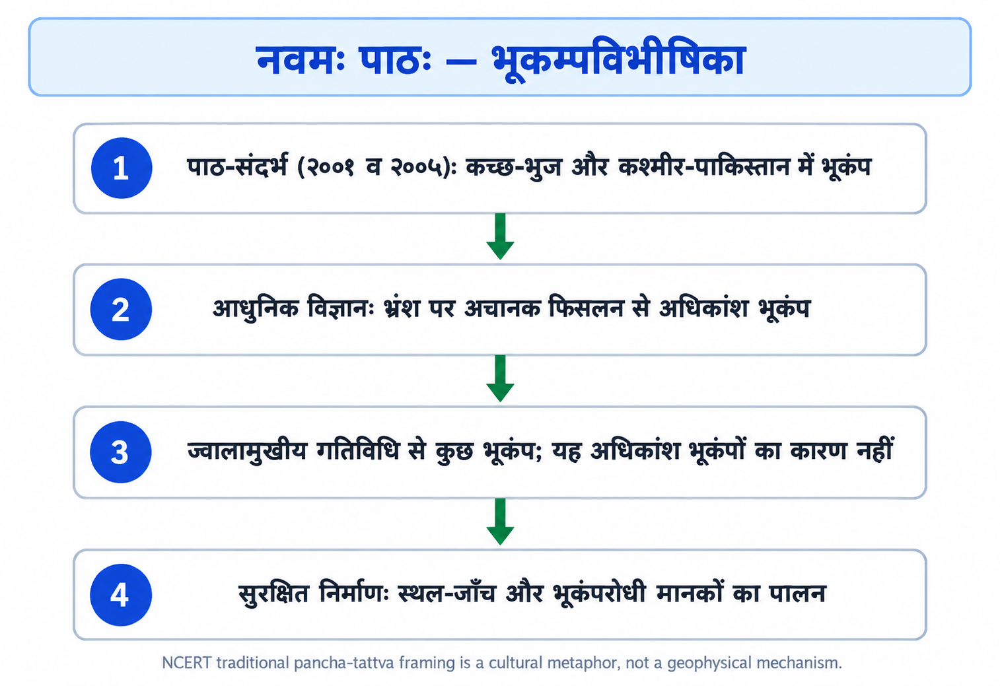

# अध्याय 9: नवमः पाठः — भूकम्पविभीषिका (प्रो. अभिराज राजेन्द्र मिश्रः) (Bhukampavibhishika — The Horror of Earthquakes)

## भाग 1: अध्याय प्रवेश एवं पाठ्यक्रम मैपिंग

> यह अध्ययन-सहायिका NCERT पाठ पर आधारित है। नीचे के प्रश्न लेखक-रचित अभ्यास हैं, जब तक किसी आधिकारिक RBSE प्रश्न का वर्ष और क्रमांक स्पष्ट रूप से न दिया हो। यह पूर्ण NCERT समाधान-संग्रह या संपूर्ण PYQ संग्रह नहीं है।

**विषय कोड:** 71 (तृतीया भाषा — संस्कृतम्) · **श्रृंखला पुस्तक:** 6

**पाठ्यक्रम आधार:** RBSE 2026–27 · **पठित-अवबोधनम्:** पूरे खंड के 32 अंक; इस पाठ का अलग भार प्रकाशित नहीं है ([आधिकारिक पाठ्यक्रम, विषय कोड 71, पृ. 17–18](https://rajeduboard.rajasthan.gov.in/anudeshika-etc/10_2027.pdf)).

**सीखने के लक्ष्य:** NCERT पाठ की कथा और पारंपरिक पंचतत्त्व-रूपक को पहचानना; उसके ऐतिहासिक दावों को सत्यापित भूकंप-विज्ञान और आपदा-जोखिम न्यूनीकरण से अलग समझना।

## भाग 2: शब्दावली एवं अवधारणा कैप्सूल

| शब्द / सूत्र | अर्थ / उपयोग |
|---|---|
| विभीषिका | भयानक त्रासदी / भय (एकविंशतिः शताब्द्याः प्रारम्भे गुर्जरराज्ये भूकम्पविभीषिका समुत्पन्ना)। |
| दारुणः | भयानक / कठोर; पाठ में “दारुणविभीषिका” समास में (दारुणविभीषिका गुजरातक्षेत्रे अभवत्)। |
| धराशायीनि | जमीन पर गिरे हुए / ध्वस्त (बहुभूमिकानि भवनानि धराशायीनि जातानि)। |
| उत्खाताः | उखड़ गए (उत्खाताः विद्युद्दीपस्तम्भाः, विशीर्णाः गृहसोपानमार्गाः)। |
| विशीर्णाः | टूट-फूट गए / बिखर गए (भूमिरपि विदीर्णा अभवत्)। |
| प्रणष्टाः | नष्ट / मारे गए; यह पाठ का वर्णन है, समय-मापन नहीं (सहस्रशः प्राणिनः क्षणेन मृताः इति पाठवर्णनम्)। |
| पाषाणशिलाः | पत्थर की चट्टानें (पृथिव्याः गर्भे विद्यमानाः महापाषाणशिलाः संघर्षणं कुर्वन्ति)। |
| ज्वालामुखपर्वताः | ज्वालामुखी पर्वत (विस्फोटैरपि भूकम्पः जायते)। |
| शमनोपायः | शांत करने / बचाव का उपाय (भूकम्पस्य कोऽपि स्थिरः शमनोपायः नास्ति)। |
| वामनकल्पः | बौने के समान (प्रकृतेः समक्षं अद्यापि विज्ञानगर्वितः मानवः वामनकल्पः एव)। |

## भाग 3: विस्तृत शिक्षण पाठ

### पाठ-प्रवेश एवं प्राकृतिक आपदा-संदर्भ
NCERT की कथा २६ जनवरी २००१ के गुजरात भूकंप और २००५ के कश्मीर-पाकिस्तान भूकंप का वर्णन करती है। नीचे “पाठ के अनुसार” दिए गए स्थान-विवरण और कारण NCERT के कथन हैं। अलग तथ्य-जाँच के अनुसार २००१ के भूकंप का उपरिकेंद्र भुज नगर में नहीं, भचाऊ के उत्तर-पश्चिम में था ([USGS घटना अभिलेख](https://earthquake.usgs.gov/earthquakes/eventpage/usp000a8ds/executive)); २००५ के भूकंप में लगभग ८६,००० से अधिक लोग मारे गए, “लाखों” नहीं ([USGS घटना अभिलेख](https://earthquake.usgs.gov/earthquakes/eventpage/usp000e12e/executive), [USGS मृत्यु-अनुमान](https://pubs.usgs.gov/of/2009/1136/pdf/OF09-1136.pdf))। “निमेषार्धेन” कथा की अतिशयोक्तिपूर्ण अभिव्यक्ति है, वास्तविक माप नहीं। पंचतत्त्वों का शांत/अशांत होना पाठ का पारंपरिक रूपक है, भूकंप का वैज्ञानिक कारण नहीं।

### प्रथम खंड: २६ जनवरी २००१ गुजरात भूकंप का दृश्य
NCERT का वर्णन कहता है कि २६ जनवरी २००१ को गुजरात भूकंप में कच्छ क्षेत्र और भुज नगर बुरी तरह प्रभावित हुए; पाठ भुज को केंद्र बताता है। **भौगोलिक सुधार:** USGS के कैटलॉग में उपरिकेंद्र लगभग २३.४१° उ., ७०.१८° पू. है, जो भचाऊ के उत्तर-पश्चिम और भुज से लगभग ५० किमी दूर है। भुज गंभीर रूप से प्रभावित नगर था, उपरिकेंद्र नहीं। पाठ में भवनों, बिजली के खंभों, सीढ़ियों और भूमि की क्षति का साहित्यिक वर्णन है।
धूल, धुएँ, क्षति और बचाव का यह भाग NCERT का मार्मिक कथा-वर्णन है। “आधे पल” को वास्तविक अवधि या माप के रूप में न पढ़ें। २००५ के कश्मीर-पाकिस्तान भूकंप के लिए USGS कम-से-कम ८६,००० मौतें बताता है; USGS के एक अध्ययन में ८७,३५१ का अनुमान है। इसलिए “लाखों” गलत है।

### द्वितीय खंड: भूकंप के वैज्ञानिक कारण एवं ज्वालामुखी
NCERT भूकंप को चट्टानों के संघर्षण और टूटने से जोड़ता है। **आधुनिक वैज्ञानिक संदर्भ:** अधिकांश भूकंप भ्रंश (fault) पर तनाव के बाद अचानक फिसलन से उत्पन्न होते हैं; प्लेटों की गति तनाव जमा करती है और ऊर्जा भूकंपीय तरंगों के रूप में निकलती है ([USGS: भूकंप कैसे आते हैं](https://www.usgs.gov/faqs/what-earthquake-and-what-causes-them-happen))। चट्टानें “रगड़ खाकर” सामान्यतः भूकंप का पर्याप्त/सटीक वर्णन नहीं है।
ज्वालामुखीय/मैग्माई गतिविधि से कुछ भूकंप हो सकते हैं, लेकिन अधिकांश भूकंप ज्वालामुखी विस्फोटों से नहीं आते ([USGS भूकंप-विज्ञान शब्दावली](https://www.usgs.gov/glossary/earthquake-hazards-program))। NCERT की लावा-धारा वाली पंक्ति पाठ-वर्णन है; लावा का तापमान प्रकार और संरचना के अनुसार बदलता है, इसलिए यहाँ ८००°C को सार्वभौमिक स्थिर मान न मानें।

### तृतीय खंड: बचाव के उपाय एवं पंचतत्त्व-संतुलन
भूकंप को रोकना संभव नहीं, पर जोखिम और क्षति घटाई जा सकती है। **सुरक्षा-संदर्भ:** बहुमंजिला भवन अपने-आप असुरक्षित नहीं होते; सुरक्षा भवन-डिजाइन, निर्माण-गुणवत्ता, स्थल-स्थितियों और लागू भूकंपरोधी मानकों पर निर्भर करती है। उपयुक्त भवन-नियमों का पालन, मौजूदा भवनों का जोखिम-आकलन/सुदृढ़ीकरण और तैयारी महत्वपूर्ण हैं ([FEMA: भूकंपरोधी डिजाइन](https://www.fema.gov/sites/default/files/documents/fema_p-749-earthquake-resistant-design-concepts_112022.pdf))। बड़े जलाशय कुछ भूगर्भीय परिस्थितियों में स्थानीय भूकंपीयता प्रभावित कर सकते हैं, पर बाँध या तटबंध से हर जगह भूकंप होगा, ऐसा निष्कर्ष सही नहीं ([USGS: जलाशय-प्रेरित भूकंपीयता](https://pubs.usgs.gov/of/1996/of96-011/induced.html))। पंचतत्त्वों का संतुलन NCERT का सांस्कृतिक/दार्शनिक रूपक है, वैज्ञानिक शमन उपाय नहीं।

भूकम्पविभीषिका: पाठ-वर्णन, आधुनिक भूकंप-विज्ञान और सुरक्षित निर्माण में अंतर। पंचतत्त्व-संदर्भ सांस्कृतिक रूपक है।

## भाग 4: पाठ्यपुस्तक-अवधारणाओं पर मौलिक हल किए उदाहरण

नीचे के प्रश्न लेखक के मौलिक मॉडल हैं। ये किसी NCERT edition के प्रश्न क्रमांक या संपूर्ण in-text/exercise solution bank होने का दावा नहीं करते।

**हल किया उदाहरण 1: 'एकविंशतिः शताब्द्याः प्रारम्भे २००१ तमे ख्रीष्टाब्दे...' गद्यांश से प्रश्नोत्तर लिखें।**

१. एकपदेन: कस्मिन् राज्ये भूकम्पविभीषिका समुत्पन्ना? उत्तर: गुर्जरराज्ये (गुजरातराज्ये)। २. पूर्णवाक्येन: भूकम्पस्य केन्द्रभूतः कः जनपदः आसीत्? उत्तर: भूकम्पस्य केन्द्रभूतः कच्छजनपदः (भुजनगरम्) आसीत्। ३. भाषिककार्यम्: 'बहुभूमिकानि भवनानि' में विशेषणपद 'बहुभूमिकानि' और विशेष्यपद 'भवनानि' है।

**हल किया उदाहरण 2: NCERT पाठ में बताए भूकंप के कारण संस्कृत में लिखें।**

१. पृथिव्याः गर्भे विद्यमानानां महापाषाणशिलानां संघर्षणेन भञ्जनेन च भीषणं संस्खलनं जायते, येन भूकम्पः भवति। २. ज्वालामुखपर्वतानां विस्फोटैः अपि भूकम्पः जायते।

**हल किया उदाहरण 3: रेखांकित पदों के आधार पर प्रश्न-निर्माण करें: (क) भूकम्पविभीषिका भुजनगरं भग्नावशेषेषु परिवर्तितवती। (ख) वैज्ञानिकाः कथयन्ति यत् पृथिव्याः अन्तर्गर्भे पाषाणशिलानां संघर्षणं भवति।**

(क) 'भुजनगरम्' (द्वितीया एकवचन नपुंसकलिंग/स्थान) → भूकम्पविभीषिका किम् / कुत्र भग्नावशेषेषु परिवर्तितवती? (ख) 'वैज्ञानिकाः' (प्रथमा बहुवचन पुल्लिंग) → के कथयन्ति यत् पृथिव्याः अन्तर्गर्भे पाषाणशिलानां संघर्षणं भवति?

## भाग 5: सत्यापित बोर्ड प्रश्न एवं स्रोत-स्थिति

2026 मुख्य परीक्षा, प्रश्न 11, PDF पृष्ठ 6 (मुद्रित पृष्ठ 5): 'भूकम्पविभीषिका' पाठ का हिन्दी सार, अथवा 'जननी तुल्यवत्सला' का सार (3 अंक)।

[RBSE 2026 मूल पेपर (S-71)](https://rajeduboard.rajasthan.gov.in/books/PAPERS-2026/Sec/S-71.pdf)। प्रश्न का संक्षिप्त विषय-संदर्भ है; शब्दशः पुनर्मुद्रण नहीं।

## भाग 6: खंडवार मौलिक अभ्यास बैंक

**अभ्यास-अंक:** लेखक के स्व-अभ्यास के लिए हैं; RBSE की आधिकारिक marking scheme नहीं। उत्तर पहले स्वयं लिखें, फिर भाग 9 देखें।

## अ: बहुविकल्पीय प्रश्न — 15 × 1 अंक

**MCQ 1. २००१ तमे ख्रीष्टाब्दे गणतन्त्रदिवसपर्वणि कस्मिन् राज्ये भूकम्पः आगतः?**

अ) राजस्थानराज्ये  
ब) बिहारराज्ये  
स) केरलराज्ये  
द) गुर्जरराज्ये

**MCQ 2. गुर्जरराज्यस्य कः जनपदः भूकम्पस्य केन्द्रभूतः आसीत्?**

अ) खेड़ाजनपदः  
ब) राजकोटजनपदः  
स) कच्छजनपदः  
द) सूरतजनपदः

**MCQ 3. २००५ के कश्मीर-पाकिस्तान भूकंप में लगभग कितने लोग मारे गए?**

अ) लगभग ८६,००० या अधिक  
ब) लगभग ८,६००  
स) लगभग ८००  
द) लाखों की पुष्ट संख्या

**MCQ 4. पृथिव्याः गर्भे विद्यमानाः काः संघर्षणं कुर्वन्ति?**

अ) महापाषाणशिलाः  
ब) लतातरुगुल्माः  
स) नद्यः  
द) नौकाः

**MCQ 5. ज्वालामुखपर्वतेभ्यः कः रसः बहिः निर्गच्छति?**

अ) आम्ररसः  
ब) इक्षुरसः  
स) अमृतरसः  
द) लावारसः

**MCQ 6. प्रकृतेः समक्षम् अद्यापि विज्ञानगर्वितः मानवः कीदृशः अस्ति?**

अ) देवकल्पः  
ब) पर्वतकल्पः  
स) वामनकल्पः  
द) दानवकल्पः

**MCQ 7. भूकंप से भवन-जोखिम घटाने का उपयुक्त उपाय कौन-सा है?**

अ) सभी बहुमंजिला भवनों पर प्रतिबंध  
ब) भवन-डिजाइन और निर्माण में लागू भूकंपरोधी मानकों का पालन  
स) सभी भवनों को बिना स्थल-जाँच बनाना  
द) तैयारी की आवश्यकता न मानना

**MCQ 8. कति तत्त्वानि शान्तानि सन्ति चेत् भूतलस्य योगक्षेमाभ्यां कल्पन्ते?**

अ) पञ्चतत्त्वानि  
ब) त्रितत्त्वानि  
स) दशतत्त्वानि  
द) सप्ततत्त्वानि

**MCQ 9. 'पावकः' इति पदस्य पर्यायपदं किम्?**

अ) पवनः  
ब) आकाशः  
स) जलम्  
द) अग्निः / वह्निः

**MCQ 10. 'समीरः' इति पदस्य कः अर्थः अस्ति?**

अ) समुद्रः  
ब) पर्वतः  
स) वायुः / पवनः  
द) सूर्यः

**MCQ 11. 'धराशायीनि भवनानि' इत्यत्र विशेष्यपदं किम्?**

अ) दारुणः  
ब) भवनानि  
स) धराशायीनि  
द) क्षणमात्रेण

**MCQ 12. 'शमनोपायः' इत्यस्य सन्धि-विच्छेदः कः?**

अ) शमन + उपायः  
ब) शम + नोपायः  
स) शमनो + पायः  
द) शमनः + उपायः

**MCQ 13. 'विशीर्णाः' इति पदस्य कः अर्थः अस्ति?**

अ) नूतनाः  
ब) उन्नताः  
स) सुन्दराः  
द) भग्नाः / टूटे-फूटे

**MCQ 14. 'निमेषार्धेन' इत्यस्य कः अर्थः अस्ति?**

अ) अर्धमासेन  
ब) सप्ताहेन  
स) पलक झपकने के आधे समय में  
द) अर्धवर्षेण

**MCQ 15. कस्मिन् पर्वे गुर्जरराज्ये भूकम्पविभीषिका समुत्पन्ना?**

अ) होलीकापर्वे  
ब) गणतन्त्रदिवसपर्वे  
स) स्वातन्त्र्यदिवसपर्वे  
द) दीपावलीपर्वे

## अ: रिक्त स्थान — 6 × 1 अंक

1. भयानक त्रासदी / भय (एकविंशतिः शताब्द्याः प्रारम्भे गुर्जरराज्ये भूकम्पविभीषिका समुत्पन्ना)। — इस शब्द/सूत्र का नाम है: ____।  
2. भयानक / कठोर (दारुणविभीषिका गुजरातक्षेत्रे अभवत्)। — इस शब्द/सूत्र का नाम है: ____।
3. जमीन पर गिरे हुए / ध्वस्त (बहुभूमिकानि भवनानि धराशायीनि जातानि)। — इस शब्द/सूत्र का नाम है: ____।  
4. उखड़ गए (उत्खाताः विद्युद्दीपस्तम्भाः, विशीर्णाः गृहसोपानमार्गाः)। — इस शब्द/सूत्र का नाम है: ____।  
5. टूट-फूट गए / बिखर गए (भूमिरपि विदीर्णा अभवत्)। — इस शब्द/सूत्र का नाम है: ____।  
6. नष्ट / मारे गए (सहस्रशः प्राणिनः क्षणेन मृताः इति पाठवर्णनम्)। — इस शब्द/सूत्र का नाम है: ____।

## अ: अतिलघु उत्तर — 8 × 1 अंक

1. २००१ तमे ख्रीष्टाब्दे गणतन्त्रदिवसपर्वणि कस्मिन् राज्ये भूकम्पः आगतः?  
2. गुर्जरराज्यस्य कः जनपदः भूकम्पस्य केन्द्रभूतः आसीत्?  
3. २००५ के कश्मीर-पाकिस्तान भूकंप में लगभग कितने लोग मारे गए?
4. पृथिव्याः गर्भे विद्यमानाः काः संघर्षणं कुर्वन्ति?  
5. ज्वालामुखपर्वतेभ्यः कः रसः बहिः निर्गच्छति?  
6. प्रकृतेः समक्षम् अद्यापि विज्ञानगर्वितः मानवः कीदृशः अस्ति?  
7. भूकम्पविशेषज्ञानां मते कीदृशं निर्माणं न करणीयम्?  
8. कति तत्त्वानि शान्तानि सन्ति चेत् भूतलस्य योगक्षेमाभ्यां कल्पन्ते?

## ब: लघु उत्तर — 6 × 2 अंक

**B1.** समग्रं भारतवर्षं कस्मिन् उल्लासे मग्नम् आसीत्?

**B2.** भूकम्पस्य केन्द्रबिन्दुः कः जनपदः आसीत्?

**B3.** पृथिव्याः स्खलनात् किं जायते?

**B4.** समग्रं विश्वं कैः आतङ्कितं दृश्यते?

**B5.** केषां विस्फोटैरपि भूकम्पः जायते?

**B6.** कीदृशानि भवनानि धराशायीनि जातानि?

## स: दीर्घ उत्तर — 4 × 3 अंक

आंतरिक विकल्प अभ्यास: C1 अथवा C2, तथा C3 अथवा C4 चुनें। पुनरावृत्ति में बचा विकल्प भी हल करें। यह लेखक की अभ्यास व्यवस्था है।

**C1.** 'भूकम्पविभीषिका' पाठस्य हिन्दीभाषायां सारं लिखत (RBSE 2026 मुख्य परीक्षा प्रश्न 11)।

**C2.** भूकम्पेन गुर्जरराज्ये कीदृशी हानिः अभवत्?

**C3.** भूकम्पस्य शमनोपायाः के सन्ति?

**C4.** पञ्चतत्त्वानि कानि सन्ति? तेषां सन्तुलनेन किं भवति?

## द: विस्तृत उत्तर — 2 × 4 अंक

आंतरिक विकल्प अभ्यास: D1 अथवा D2 चुनें; बाद में दूसरा भी हल करें।

**D1.** 'यद्यपि दैवप्रकोपोऽयं भूकम्पः नाम...' गद्यांश का सप्रसंग हिन्दी-अनुवाद लिखें।

**D2.** पाठ से संधि, समास एवं प्रत्यय के ८ प्रमुख पदों का विश्लेषण करें।

## भाग 7: सावधानियाँ एवं परीक्षा-त्रुटियाँ

- २००१ का भूकंप गुजरात के कच्छ (भुज) में और २००५ का भूकंप कश्मीर व पाकिस्तान में आया था — वर्षों को आपस में न बदलें।
- पंचतत्त्वों के संस्कृत नाम याद रखें: क्षिति (पृथ्वी), जल, पावक (अग्नि), समीर (वायु), गगन (आकाश)।
- 'वामनकल्पः' का अर्थ 'बौने के समान' है।
- 'उत्खाताः' का विशेष्य 'विद्युद्दीपस्तम्भाः' है और 'विशीर्णाः' का विशेष्य 'गृहसोपानमार्गाः' है।
- पाठसार में वैज्ञानिक कारण और बचाव के उपाय दोनों अवश्य लिखें।

## भाग 8: फटाफट पुनरावृत्ति — 25 बिंदु

1. विभीषिका: भयानक त्रासदी / भय (एकविंशतिः शताब्द्याः प्रारम्भे गुर्जरराज्ये भूकम्पविभीषिका समुत्पन्ना)।  
2. दारुणः: भयानक / कठोर; पाठ में “दारुणविभीषिका” समास में।
3. धराशायीनि: जमीन पर गिरे हुए / ध्वस्त (बहुभूमिकानि भवनानि धराशायीनि जातानि)।  
4. उत्खाताः: उखड़ गए (उत्खाताः विद्युद्दीपस्तम्भाः, विशीर्णाः गृहसोपानमार्गाः)।  
5. विशीर्णाः: टूट-फूट गए / बिखर गए (भूमिरपि विदीर्णा अभवत्)।  
6. प्रणष्टाः: नष्ट / मारे गए; यह पाठ-वर्णन है, वास्तविक समय-मापन नहीं।
7. पाषाणशिलाः: पत्थर की चट्टानें (पृथिव्याः गर्भे विद्यमानाः महापाषाणशिलाः संघर्षणं कुर्वन्ति)।  
8. ज्वालामुखपर्वताः: ज्वालामुखी पर्वत (विस्फोटैरपि भूकम्पः जायते)।  
9. शमनोपायः: शांत करने / बचाव का उपाय (भूकम्पस्य कोऽपि स्थिरः शमनोपायः नास्ति)।  
10. वामनकल्पः: बौने के समान (प्रकृतेः समक्षं अद्यापि विज्ञानगर्वितः मानवः वामनकल्पः एव)।  
11. २६ जनवरी २००१ को गुजरात राज्य (गुर्जरराज्ये) में भीषण भूकंप आया था।  
12. NCERT पाठ भुज को केंद्र कहता है; USGS उपरिकेंद्र को भचाऊ के उत्तर-पश्चिम में दर्ज करता है।  
13. सन् २००५ के कश्मीर-पाकिस्तान भूकंप में लगभग ८६,००० या अधिक लोग मारे गए।  
14. आधुनिक वैज्ञानिक व्याख्या में भ्रंश पर अचानक फिसलन अधिकांश भूकंपों का प्रमुख कारण है।  
15. ज्वालामुखीय गतिविधि से कुछ भूकंप हो सकते हैं; यह अधिकांश भूकंपों का कारण नहीं।  
16. प्रकृति के सामने विज्ञान पर गर्व करने वाला मानव आज भी बौने के समान (वामनकल्पः) है।  
17. बहुमंजिला भवनों की सुरक्षा उनके भूकंपरोधी डिजाइन, निर्माण और स्थल-स्थितियों पर निर्भर करती है।  
18. क्षिति, जल, पावक, समीर और गगन पाठ के पंचतत्त्व-रूपक हैं, वैज्ञानिक कारण नहीं।  
19. पावकः का अर्थ अग्नि (अग्निः / अनलः / वह्निः) है।  
20. समीरः का अर्थ वायु (पवनः) है।  
21. 'धराशायीनि' विशेषण है और 'भवनानि' (भवन) विशेष्य है।  
22. 'अ' के बाद 'उ' आने पर गुण संधि द्वारा 'ओ' होकर 'शमनोपायः' बनता है।  
23. 'विशीर्णाः गृहसोपानमार्गाः' में विशीर्णाः का अर्थ टूट-फूट गए (भग्नाः) है।  
24. निमेष का अर्थ पलक झपकना है; निमेषार्धेन = आधे पल में ही।  
25. २६ जनवरी २००१ को गणतंत्र दिवस पर्व के उल्लास के बीच यह आपदा आई थी।

## भाग 9: संपूर्ण अभ्यास उत्तर-कुंजी

## MCQ: सही विकल्प और कारण

**1. द — गुर्जरराज्ये।** २६ जनवरी २००१ को गुजरात राज्य (गुर्जरराज्ये) में भीषण भूकंप आया था।

**2. स — कच्छजनपदः।** यह NCERT पाठ की जानकारी पूछता है; भौगोलिक सुधार ऊपर दिया है।

**3. अ — लगभग ८६,००० या अधिक।** USGS कम-से-कम ८६,००० मौतें बताता है; एक USGS अध्ययन का अनुमान ८७,३५१ है।

**4. अ — महापाषाणशिलाः।** यह NCERT के सरलीकृत पाठ-वर्णन का उत्तर है; आधुनिक व्याख्या ऊपर दी है।

**5. द — लावारसः।** यह NCERT पाठ का वर्णन है; ज्वालामुखीय गतिविधि से कुछ भूकंप हो सकते हैं, अधिकांश भूकंप इससे नहीं आते।

**6. स — वामनकल्पः।** प्रकृति के सामने विज्ञान पर गर्व करने वाला मानव आज भी बौने के समान (वामनकल्पः) है।

**7. ब — भूकंपरोधी मानकों का पालन।** बहुमंजिला होना अपने-आप में असुरक्षा का प्रमाण नहीं।

**8. अ — पञ्चतत्त्वानि।** यह पाठ का रूपक है, वैज्ञानिक भूकंप-कारण नहीं।

**9. द — अग्निः / वह्निः।** पावकः का अर्थ अग्नि (अग्निः / अनलः / वह्निः) है।

**10. स — वायुः / पवनः।** समीरः का अर्थ वायु (पवनः) है।

**11. ब — भवनानि।** 'धराशायीनि' विशेषण है और 'भवनानि' (भवन) विशेष्य है।

**12. अ — शमन + उपायः।** 'अ' के बाद 'उ' आने पर गुण संधि द्वारा 'ओ' होकर 'शमनोपायः' बनता है।

**13. द — भग्नाः / टूटे-फूटे।** 'विशीर्णाः गृहसोपानमार्गाः' में विशीर्णाः का अर्थ टूट-फूट गए (भग्नाः) है।

**14. स — पलक झपकने के आधे समय में।** निमेष का अर्थ पलक झपकना है; निमेषार्धेन = आधे पल में ही।

**15. ब — गणतन्त्रदिवसपर्वे।** २६ जनवरी २००१ को गणतंत्र दिवस पर्व के उल्लास के बीच यह आपदा आई थी।

**रिक्त स्थान:** 1. विभीषिका; 2. दारुणः; 3. धराशायीनि; 4. उत्खाताः; 5. विशीर्णाः; 6. प्रणष्टाः

**अतिलघु उत्तर:**

1. गुर्जरराज्ये। २६ जनवरी २००१ को गुजरात राज्य (गुर्जरराज्ये) में भीषण भूकंप आया था।

2. कच्छजनपदः। यह NCERT पाठ का उत्तर है; वास्तविक उपरिकेंद्र भचाऊ के उत्तर-पश्चिम में था।

3. लगभग ८६,००० या अधिक लोग। USGS कम-से-कम ८६,००० मौतें बताता है; भूकंप कश्मीर-पाकिस्तान क्षेत्र में आया था।

4. पाठ का उत्तर: महापाषाणशिलाः। आधुनिक वैज्ञानिक व्याख्या में भ्रंश पर अचानक फिसलन अधिकांश भूकंपों का प्रमुख कारण है।

5. लावारसः। यह ज्वालामुखी संबंधी NCERT पाठ-वर्णन है; ताप और प्रवाह के विवरण हर घटना में समान नहीं होते।

6. वामनकल्पः। प्रकृति के सामने विज्ञान पर गर्व करने वाला मानव आज भी बौने के समान (वामनकल्पः) है।

7. पाठ में बहुमंजिला निर्माण से बचने को कहा गया है; आधुनिक सुरक्षा भवन-मानकों और सुरक्षित निर्माण पर निर्भर है।

8. पञ्चतत्त्वानि। क्षिति, जल, पावक, समीर और गगन — ये पाँच तत्त्व (पञ्चतत्त्वानि) शांत होने पर कल्याण करते हैं।

**B1. समग्रं भारतवर्षं कस्मिन् उल्लासे मग्नम् आसीत्?**

समग्रं भारतवर्षं गणतन्त्रदिवसस्य पर्वे नृत्य-गीत-वादित्राणाम् उल्लासे मग्नम् आसीत्।

**B2. भूकम्पस्य केन्द्रबिन्दुः कः जनपदः आसीत्?**

भूकम्पस्य केन्द्रबिन्दुः गुर्जरराज्यस्य कच्छजनपदः आसीत् इति पाठे कथितम्। तथ्यतः उपरिकेंद्र भचाऊ के उत्तर-पश्चिम में था।

**B3. पृथिव्याः स्खलनात् किं जायते?**

पाठानुसारं पाषाणशिलानां संघर्षणात् स्खलनात् च भूकम्पः जायते; आधुनिक विज्ञान अधिकांश भूकंपों को भ्रंश पर अचानक फिसलन से जोड़ता है।

**B4. समग्रं विश्वं कैः आतङ्कितं दृश्यते?**

पाठे समग्रं विश्वं भूकम्पैः ज्वालामुखपर्वतानां विस्फोटैः च आतङ्कितं दृश्यते इति वर्णितम्।

**B5. पाठानुसारं केषां विस्फोटैरपि भूकम्पः जायते?**

पाठानुसारं ज्वालामुखपर्वतानां विस्फोटैरपि भूकम्पः जायते; वैज्ञानिक रूप से यह भूकंपों का केवल एक संभावित प्रकार है।

**B6. कीदृशानि भवनानि धराशायीनि जातानि?**

बहुभूमिकानि भवनानि क्षणमात्रेण धराशायीनि जातानि।

**C1. 'भूकम्पविभीषिका' पाठस्य हिन्दीभाषायां सारं लिखत (RBSE 2026 मुख्य परीक्षा प्रश्न 11)।**

1. पाठ में २००१ के गुजरात भूकंप और २००५ के कश्मीर-पाकिस्तान भूकंप का वर्णन है। 2. “निमेषार्ध” और “लाखपरिमित” साहित्यिक/पाठ्य अभिव्यक्तियाँ हैं, सत्यापित आँकड़े नहीं; २००५ की मौतों का अनुमान लगभग ८६,०००–८७,००० है। 3. पाठ चट्टानों के संघर्षण और ज्वालामुखीय विस्फोट का उल्लेख करता है; आधुनिक विज्ञान अधिकांश भूकंपों को भ्रंश पर अचानक फिसलन से जोड़ता है। 4. जोखिम घटाने के लिए भूकंपरोधी मानकों के अनुसार निर्माण और तैयारी आवश्यक हैं। पंचतत्त्वों का संतुलन पाठ का पारंपरिक रूपक है।

**C2. भूकम्पेन गुर्जरराज्ये कीदृशी हानिः अभवत्?**

1. NCERT पाठ के अनुसार २००१ के भूकंप से कच्छ और भुज में भारी विनाश हुआ। 2. भवनों, बिजली के खंभों और भूमि की क्षति का पाठ में मार्मिक वर्णन है। 3. “आधे पल” साहित्यिक अतिशयोक्ति है, सत्यापित अवधि नहीं; मलबे में दबे लोगों और बचाव का प्रसंग भी पाठ-वर्णन है।

**C3. भूकम्पस्य शमनोपायाः के सन्ति?**

1. भूकंप को रोकना संभव नहीं, पर जोखिम घटाया जा सकता है। 2. भवनों को स्थल-जाँच, लागू भूकंपरोधी मानकों और सुरक्षित निर्माण-प्रथाओं के अनुसार बनाना चाहिए; बहुमंजिला भवनों पर सार्वभौमिक प्रतिबंध सही सलाह नहीं। 3. जलाशय-प्रेरित भूकंपीयता कुछ परिस्थितियों में संभव है; हर बाँध को भूकंप-कारण नहीं कहा जा सकता। 4. पाठ के पंचतत्त्व-विचार को सांस्कृतिक/दार्शनिक रूपक समझें, विज्ञान-आधारित शमन नीति नहीं।

**C4. पञ्चतत्त्वानि कानि सन्ति? तेषां सन्तुलनेन किं भवति?**

1. क्षितिः, जलम्, पावकः, समीरः, गगनं च इति पाठे पञ्चतत्त्वानि उक्तानि। 2. पाठ के सांस्कृतिक-दार्शनिक रूपक में इनके शांत होने को कल्याण से जोड़ा गया है। 3. इसे भूकंप का वैज्ञानिक कारण न मानें; आधुनिक व्याख्या में भ्रंश पर अचानक फिसलन प्रमुख कारण है।

**D1. 'यद्यपि दैवप्रकोपोऽयं भूकम्पः नाम...' गद्यांश का सप्रसंग हिन्दी-अनुवाद लिखें।**

1. प्रसंग: यह गद्यांश NCERT 'शेमुषी भाग-2' के नवम पाठ से है। 2. अनुवाद: पाठ भूकंप को दैवी प्रकोप कहता है और कहता है कि उसका कोई स्थिर शमन-उपाय नहीं दिखता; मनुष्य प्रकृति के सामने बौने समान है। आगे पाठ विशेषज्ञों के नाम पर बहुमंजिला निर्माण से बचने, बड़े जलाशय न बनाने और पंचतत्त्वों के शांत रहने की बात करता है। ये पाठ के कथन/रूपक हैं, वर्तमान भूकंप-सुरक्षा सलाह नहीं। आधुनिक संदर्भ में भवन-सुरक्षा भूकंपरोधी डिजाइन, निर्माण और स्थल-जाँच पर निर्भर है।

**D2. पाठ से संधि, समास एवं प्रत्यय के ८ प्रमुख पदों का विश्लेषण करें।**

1. दैवप्रकोपोऽयम् = दैवप्रकोपः + अयम् (विसर्ग-संधि)। 2. शमनोपायः = शमन + उपायः (गुण स्वर-संधि)। 3. अद्यापि = अद्य + अपि (दीर्घ स्वर-संधि)। 4. भूकम्पविभीषिका = भूकम्पस्य विभीषिका (षष्ठी-तत्पुरुष, पाठ्य vigraha)। 5. विज्ञानगर्वितः = विज्ञानेन गर्वितः (तृतीया-तत्पुरुष, पाठ्य vigraha)। 6. पञ्चतत्त्वानि = पञ्च तत्त्वानि (समस्त पद; समास-उपभेद यहाँ निर्दिष्ट नहीं)। 7. करणीयम् = कृ + अनीयर् प्रत्ययः (NCERT अभ्यास में दिया रूप)। 8. परिवर्तितवती = परि + वृत् + क्तवतु + ङीप् (स्त्रीलिंग; NCERT अभ्यास का दिया विश्लेषण)।

## भाग 10: 10 मिनट / 10 अंक आत्म-मूल्यांकन एवं संदर्भ

समय: 10 मिनट। पहले पुस्तक बंद करें।

1. MCQ 3 और 11 हल करें। (1 + 1)
2. B2 और B5 के उत्तर लिखें। (2 + 2)
3. D1 हल करें। (4)

**कुंजी:** भाग 9 में संबंधित क्रमांक देखें। **स्व-मूल्यांकन:** 8–10: आगे बढ़ें; 5–7: छूटे कौशल का दोहराव; 0–4: भाग 2–4 फिर पढ़ें। यह अभ्यास-सुझाव है, बोर्ड grade नहीं।

[RBSE 2026–27 पाठ्यक्रम](https://rajeduboard.rajasthan.gov.in/anudeshika-etc/10_2027.pdf) · [NCERT शेमुषी भाग-2 Lesson 9](https://ncert.nic.in/textbook/pdf/jhsk109.pdf) · [USGS: 2001 Gujarat earthquake](https://earthquake.usgs.gov/earthquakes/eventpage/usp000a8ds/executive) · [USGS: 2005 Kashmir earthquake](https://earthquake.usgs.gov/earthquakes/eventpage/usp000e12e/executive) · [USGS: earthquake causes](https://www.usgs.gov/faqs/what-earthquake-and-what-causes-them-happen) · [USGS: reservoir-induced seismicity](https://pubs.usgs.gov/of/1996/of96-011/induced.html) · [FEMA: earthquake-resistant design](https://www.fema.gov/sites/default/files/documents/fema_p-749-earthquake-resistant-design-concepts_112022.pdf)

**आगे की कड़ी:** दशम पाठ 'अन्योक्तयः' में राजहंस, कोकिल, चातक, मेघ और सुवर्ण के प्रतीकों से नीतिपरक अन्योक्ति-श्लोकों का अध्ययन करेंगे।
