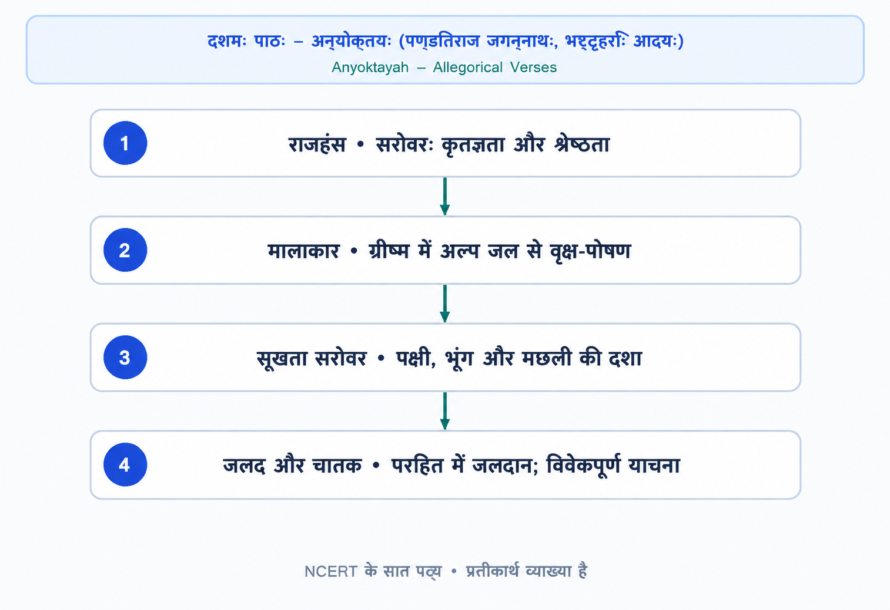

# अध्याय 10: दशमः पाठः — अन्योक्तयः (पण्डितराज जगन्नाथः, भर्तृहरिः आदयः) (Anyoktayah — Allegorical Verses)

## भाग 1: अध्याय प्रवेश एवं पाठ्यक्रम मैपिंग

> स्रोत-संशोधन: यह अध्याय NCERT के सात पद्यों और चुने हुए अभ्यासों पर आधारित है। नीचे दिए गए अतिरिक्त प्रश्न मौलिक अभ्यास हैं; इन्हें पूरे NCERT समाधान-संग्रह या ऐतिहासिक PYQ संग्रह का प्रतिनिधि न मानें।

**विषय कोड:** 71 (तृतीया भाषा — संस्कृतम्) · **श्रृंखला पुस्तक:** 6

**सत्यापित आधार:** RBSE 2026–27 पाठ्यक्रम। संस्कृत में पाठित-अवबोधनम् कुल 32 अंक है; पाठ 10 के लिए अलग आधिकारिक अंक-भार नहीं दिया गया।

**सीखने के लक्ष्य:** राजहंस, बक, मालाकार, पक्षी, भृंग, मछली, जलद और चातक पर आधारित सात अन्योक्तियों का अन्वय, भावार्थ और सम्भावित प्रतीकार्थ समझना।

## भाग 2: शब्दावली एवं अवधारणा कैप्सूल

| शब्द / सूत्र | अर्थ / उपयोग |
|---|---|
| राजहंसः | श्रेष्ठ हंस / गुणी महापुरुष का प्रतीक (एकेन राजहंसेन या शोभा सरसो भवेत्)। |
| बकसहस्रेण | हजारों बगुलों से (न सा बकसहस्रेण परितस्तीरवासिना)। |
| मृणालपटली | कमलनाल का समूह (भुक्ता मृणालपटली भवता निपीतानि अम्बूनि)। |
| तोयैः | थोड़े जल से (तोयैरल्पैरपि करुणया भीमभानौ निदाघे)। |
| उद्दामदावविधुराणि | प्रचण्ड वनाग्नि से व्याकुल / पीड़ित (काननानि) (NCERT पद्य 6)। |
| वारिधाराः | जल की धाराएँ (धारासारानपि विकिरता विश्वतो वारिदेन)। |
| मानी | स्वाभिमानी (एक एव खगो मानी वने वसति चातकः)। |
| नानानदीनदशतानि | अनेक नदियों और नदों के सैकड़ों प्रवाह (पूरयित्वा) (NCERT पद्य 6)। |
| रिक्तः | जलदान के बाद खाली (रिक्तोऽसि यज्जलद) (NCERT पद्य 6)। |
| आश्वास्य | तृप्त / आश्वस्त करके (पर्वतकुलम् आश्वास्य) (NCERT पद्य 6)। |

## भाग 3: विस्तृत शिक्षण पाठ

### पाठ-प्रवेश एवं अन्योक्ति-स्वरूप
'अन्योक्ति' में किसी अन्य पात्र या वस्तु के माध्यम से अप्रत्यक्ष रूप से गुण की प्रशंसा या दोष की निन्दा कही जाती है। NCERT इस पाठ को सात अन्योक्तियों का संग्रह कहता है; यहाँ इसे निश्चित अलंकार-वर्गीकरण के रूप में न पढ़ें।

### श्लोक १ से ४: राजहंस, सरोवर-कृतज्ञता, मालाकार और सूखता सरोवर
**श्लोक १ (राजहंस व हजार बगुले):** "एकेन राजहंसेन या शोभा सरसो भवेत्। न सा बकसहस्रेण परितस्तीरवासिना॥" — **अन्वयः:** एकेन राजहंसेन सरसः या शोभा भवेत्, सा (शोभा) परितः तीरवासिना बकसहस्रेण न (भवति)। **भावार्थ:** एक ही राजहंस से सरोवर की जो शोभा होती है, वह शोभा उसके चारों ओर किनारे पर रहने वाले हजारों बगुलों से नहीं होती। (प्रतीकार्थ: समाज/सभा की शोभा एक ही गुणी विद्वान से होती है, हजारों मूर्खों से नहीं।)
**श्लोक २ (राजहंस और सरोवर):** "भुक्ता मृणालपटली भवता निपीतान्यम्बूनि यत्र नलिनानि निषेवितानि। रे राजहंस! वद तस्य सरोवरस्य कृत्येन केन भवितासि कृतोपकारः॥" — हे राजहंस! जिस सरोवर में तुमने कमलनाल का समूह खाया, जल पिया और कमलों का सेवन किया, बताओ उस सरोवर के उपकार का बदला तुम किस कार्य से चुकाओगे? (प्रतीकार्थ: जिस मातृभूमि या आश्रयदाता ने हमें पाला, संकट में उसकी सेवा करना हमारा धर्म है।)
**श्लोक ३ (मालाकार और ग्रीष्म ऋतु):** "तोयैरल्पैरपि करुणया भीमभानौ निदाघे, मालाकार! व्यरचि भवता या तरोरस्य पुष्टिः। सा किं शक्या जनयितुमिह प्रावृषेण्येन वारां, धारासारानपि विकिरता विश्वतो वारिदेन॥" — हे माली (मालाकार)! प्रचंड सूर्य वाली ग्रीष्म ऋतु (निदाघे) में करुणापूर्वक थोड़े से जल से भी तुमने इस वृक्ष का जो पोषण किया है, क्या वह पोषण वर्षा ऋतु में चारों ओर मूसलाधार जल बरसाने वाले बादल (वारिदेन) द्वारा किया जा सकता है? (प्रतीकार्थ: संकट के समय की गई थोड़ी-सी सहायता भी संपन्नता में दी गई बड़ी सहायता से श्रेष्ठ होती है।)
**श्लोक ४ (सरोवर के सूखने पर पक्षी, भृंग और मछली):** "आपेदिरेऽम्बरपथं परितः पतङ्गाः, भृङ्गा रसालमुकुलानि समाश्रयन्ते। संकोचमञ्चति सरस्त्वयि दीनदीनो, मीना नु हन्त कतमां गतिमभ्युपैतु॥" — हे सरोवर! तुम्हारे सूखने (संकोच) पर पक्षी आकाश मार्ग में उड़ गए और भँवरे आम की मंजरियों का आश्रय लेने लगे; किंतु हाय! तुझमें रहने वाली दीन मछली (मीना) अब किस गति को प्राप्त करे?

### श्लोक ५ से ७: चातक, जलद और विवेकपूर्ण याचना
**श्लोक ५ (चातक का स्वाभिमान):** "एक एव खगो मानी वने वसति चातकः। पिपासितो वा म्रियते याचते वा पुरन्दरम्॥" — चातक नाम का एक ही स्वाभिमानी पक्षी वन में रहता है; वह प्यास से मरना स्वीकार करता है या इन्द्र (पुरन्दर) से याचना करता है। व्याख्या: इसे स्वाभिमान और चुनिंदा याचना के रूपक की तरह पढ़ा जा सकता है।
**श्लोक ६ (जलद का जलदान):** "आश्वास्य पर्वतकुलं तपनोष्णतप्तमुद्दामदावविधुराणि च काननानि। नानानदीनदशतानि च पूरयित्वा, रिक्तोऽसि यज्जलद! सैव तवोत्तमा श्रीः॥" — हे जलद! सूर्य-ताप से तपे पर्वतों को तृप्त करके, वनाग्नि से पीड़ित वनों को आश्वस्त करके और अनेक नदियों-नदों के सैकड़ों प्रवाह भरकर तुम जो रिक्त हो गए हो, वही तुम्हारी सर्वोत्तम शोभा है। **प्रतीकार्थ (व्याख्या):** परहित में अपना संसाधन देना यहाँ बादल की शोभा के रूप में प्रस्तुत है।
**श्लोक ७ (चातक को सावधान करना):** "रे रे चातक! सावधानमनसा मित्र क्षणं श्रूयताम्, अम्भोदा बहवो भवन्ति गगने सर्वेऽपि नैतादृशाः। केचिद् वृष्टिभिरार्द्रयन्ति वसुधां गर्जन्ति केचिद् वृथा, यं यं पश्यसि तस्य तस्य पुरतो मा ब्रूहि दीनं वचः॥" — मित्र चातक, ध्यान से सुनो: आकाश में अनेक बादल हैं, पर सभी समान नहीं। कुछ वर्षा से धरती को भिगोते हैं और कुछ व्यर्थ गरजते हैं; इसलिए हर किसी के सामने दीन वचन मत कहो। **प्रतीकार्थ (व्याख्या):** सहायता माँगने से पहले विवेक और आत्मसम्मान बनाए रखने की सीख के रूप में इसे पढ़ा जा सकता है।

अन्योक्तयः: सप्त प्रतीकों के माध्यम से मानव-जीवन के नीति-संदेशों का मानचित्र।

## भाग 4: पाठ्यपुस्तक-अवधारणाओं पर मौलिक हल किए उदाहरण

नीचे के प्रश्न लेखक के मौलिक मॉडल हैं। ये किसी NCERT edition के प्रश्न क्रमांक या संपूर्ण in-text/exercise solution bank होने का दावा नहीं करते।

**हल किया उदाहरण 1: RBSE 2026 मुख्य परीक्षा, प्रश्न 8 — 'एकेन राजहंसेन...' का हिन्दी भावार्थ।**

भावार्थ: प्रस्तुत अन्योक्ति में कवि कहता है कि एक ही राजहंस से सरोवर की जैसी शोभा होती है, वैसी शोभा सरोवर के चारों ओर किनारे पर रहने वाले हजारों बगुलों से भी नहीं होती। इसका प्रतीकार्थ यह है कि समाज, कुल या सभा का गौरव एक ही श्रेष्ठ व गुणी विद्वान से बढ़ता है, हजारों गुणहीन व्यक्तियों से नहीं।

**हल किया उदाहरण 2: 'रे रे चातक! सावधानमनसा...' पद्य 7 का अन्वय-पूर्ति और सम्भावित प्रतीकार्थ लिखें।**

अन्वयः: रे रे मित्र चातक! (१) सावधानमनसा क्षणं श्रूयताम्। गगने हि बहवः (२) अम्भोदाः सन्ति, सर्वे अपि एतादृशाः न (सन्ति)। केचित् वृष्टिभिः (३) वसुधाम् आर्द्रयन्ति, केचित् वृथा गर्जन्ति; अतः यं यं पश्यसि तस्य तस्य पुरतः (४) दीनं वचः मा ब्रूहि। प्रतीकार्थ: स्वाभिमानी व्यक्ति को प्रत्येक धनी के सामने याचना नहीं करनी चाहिए।

**हल किया उदाहरण 3: 'आश्वास्य पर्वतकुलम्...' पद्य से पद्यांश प्रश्नोत्तर लिखें।**

१. एकपदेन: कः रिक्तः भवति? उत्तर: जलदः। २. पूर्णवाक्येन: जलदः कानि पूरयित्वा रिक्तो भवति? उत्तर: जलदः नानानदीनदशतानि पूरयित्वा रिक्तो भवति। ३. भाषिककार्यम्: 'रिक्तः' इति पदस्य विलोमपदं 'पूर्णः' अस्ति।

## भाग 5: सत्यापित बोर्ड प्रश्न एवं स्रोत-स्थिति

2026 मुख्य परीक्षा, प्रश्न 8, मुद्रित पृष्ठ 5: 'एकेन राजहंसेन या शोभा सरसो भवेत्' श्लोक का हिन्दी भावार्थ (2 अंक)। 2017 मुख्य परीक्षा के उपलब्ध Sanskrit TL पेपर में 'मृणालपटली' प्रश्न नहीं मिला; इसलिए उसका PYQ दावा हटाया गया है।

[RBSE 2026 मूल पेपर (S-71)](https://rajeduboard.rajasthan.gov.in/books/PAPERS-2026/Sec/S-71.pdf) · [RBSE 2017 परीक्षा-पत्र सूची](https://rajeduboard.rajasthan.gov.in/books/PAPERS-2017/index.htm)। प्रश्न का संक्षिप्त विषय-संदर्भ है; शब्दशः पुनर्मुद्रण नहीं।

## भाग 6: खंडवार मौलिक अभ्यास बैंक

**अभ्यास-अंक:** लेखक के स्व-अभ्यास के लिए हैं; RBSE की आधिकारिक marking scheme नहीं। उत्तर पहले स्वयं लिखें, फिर भाग 9 देखें।

## अ: बहुविकल्पीय प्रश्न — 15 × 1 अंक

**MCQ 1. एकेन राजहंसेन कस्य शोभा भवेत्?**

अ) मरुस्थलस्य  
ब) भवनस्य  
स) सरसः (सरोवरस्य)  
द) पर्वतस्य

**MCQ 2. राजहंसेन सरोवरस्य का भुक्ता?**

अ) शफरी  
ब) मृणालपटली  
स) शफरी  
द) मञ्जूषा

**MCQ 3. 'निदाघे' इति पदस्य कः अर्थः अस्ति?**

अ) ग्रीष्मकाले  
ब) शीतकाले  
स) वर्षाकाले  
द) वसन्तकाले

**MCQ 4. अल्पैरपि तोयैः करुणया तरोः पुष्टिं कः अकरोत्?**

अ) वारिदः  
ब) राजहंसः  
स) चातकः  
द) मालाकारः

**MCQ 5. 'वारिदः' तथा 'अम्भोदः' इति पदयोः कः अर्थः अस्ति?**

अ) सूर्यः  
ब) पवनः  
स) मेघः  
द) समुद्रः

**MCQ 6. भृङ्गाः कानि समाश्रयन्ते?**

अ) कण्टकानि  
ब) रसालमुकुलानि  
स) पाषाणशिलाः  
द) पत्राणि

**MCQ 7. सरोवरस्य संकोचे का दीनदीना भवति?**

अ) मीना (मत्स्यः)  
ब) भृङ्गी  
स) बलाका  
द) नलिनी

**MCQ 8. 'रे रे चातक! सावधानमनसा मित्र क्षणं श्रूयताम्' — अत्र चातकः कं याचितुं वार्यते?**

अ) मालाकारम्  
ब) राजहंसम्  
स) सरोवरम्  
द) प्रत्येकं मेघम्

**MCQ 9. पद्य 6 में जलद की सर्वोत्तम शोभा किससे बताई गई है?**

अ) रिक्त होने से, परहित में जल देने के बाद  
ब) बादल बनकर आकाश में रहने से  
स) पर्वतों पर छाया करने से  
द) गरजने से

**MCQ 10. जलदः कानि पूरयित्वा रिक्तो भवति?**

अ) केवलं पर्वतकुलम्  
ब) नानानदीनदशतानि  
स) केवलं काननानि  
द) केवलं अम्बरपथम्

**MCQ 11. 'एक एव खगो मानी...' में पिपासितः चातकः किससे याचना करता है?**

अ) पुरन्दरम्  
ब) वारिदम्  
स) मालाकारम्  
द) सरोवरम्

**MCQ 12. 'रिक्तः' इति पदस्य कः अर्थः अस्ति?**

अ) पूर्णः  
ब) जलपूर्णः  
स) रिक्त / खाली  
द) मेघः

**MCQ 13. 'परितस्तीरवासिना' इत्यस्य सन्धि-विच्छेदः कः?**

अ) परि + तस्तीरवासिना  
ब) परितो + तीरवासिना  
स) परितः + तीरवासिना  
द) परितस् + तीरवासिना

**MCQ 14. 'अम्बूनि' इति पदस्य समानार्थकपदं किम्?**

अ) फलानि  
ब) जलानि / तोयानि  
स) कमलानि  
द) पत्राणि

**MCQ 15. 'बकसहस्रेण' इत्यत्र कः समासः अस्ति?**

अ) षष्ठी तत्पुरुषः  
ब) द्वन्द्वः  
स) अव्ययीभावः  
द) बहुव्रीहिः

## अ: रिक्त स्थान — 6 × 1 अंक

1. श्रेष्ठ हंस / गुणी महापुरुष का प्रतीक (एकेन राजहंसेन या शोभा सरसो भवेत्)। — इस शब्द/सूत्र का नाम है: ____।  
2. हजारों बगुलों से (न सा बकसहस्रेण परितस्तीरवासिना)। — इस शब्द/सूत्र का नाम है: ____।  
3. कमलनाल का समूह (भुक्ता मृणालपटली भवता निपीतानि अम्बूनि)। — इस शब्द/सूत्र का नाम है: ____।  
4. थोड़े जल से (तोयैरल्पैरपि करुणया भीमभानौ निदाघे)। — इस शब्द/सूत्र का नाम है: ____।  
5. मुरझाए हुए / प्यासे वृक्षों को (मालाकार! व्यरचि भवता या तरोरस्य पुष्टिः)। — इस शब्द/सूत्र का नाम है: ____।  
6. जल की धाराएँ (धारासारानपि विकिरता विश्वतो वारिदेन)। — इस शब्द/सूत्र का नाम है: ____।

## अ: अतिलघु उत्तर — 8 × 1 अंक

1. एकेन राजहंसेन कस्य शोभा भवेत्?  
2. राजहंसेन सरोवरस्य का भुक्ता?  
3. 'निदाघे' इति पदस्य कः अर्थः अस्ति?  
4. अल्पैरपि तोयैः करुणया तरोः पुष्टिं कः अकरोत्?  
5. 'वारिदः' तथा 'अम्भोदः' इति पदयोः कः अर्थः अस्ति?  
6. भृङ्गाः कानि समाश्रयन्ते?  
7. सरोवरस्य संकोचे का दीनदीना भवति?  
8. 'रे रे चातक! सावधानमनसा मित्र क्षणं श्रूयताम्' — अत्र चातकः कं याचितुं वार्यते?

## ब: लघु उत्तर — 6 × 2 अंक

**B1.** सरसः शोभा केन भवति?

**B2.** राजहंसः सरोवरस्य किं खादति स्म?

**B3.** मालाकारः कस्मिन् काले तरोः पुष्टिम् अकरोत्?

**B4.** के रसालमुकुलानि समाश्रयन्ते?

**B5.** चातकः केषां पुरतः दीनं वचः मा ब्रूयात्?

**B6.** जलदः किमर्थं रिक्तः भवति?

## स: दीर्घ उत्तर — 4 × 3 अंक

आंतरिक विकल्प अभ्यास: C1 अथवा C2, तथा C3 अथवा C4 चुनें। पुनरावृत्ति में बचा विकल्प भी हल करें। यह लेखक की अभ्यास व्यवस्था है।

**C1.** 'एक एव खगो मानी...' श्लोकस्य भावार्थं स्पष्टीकुरुत।

**C2.** मालाकारस्य वारिदस्य च तुलनां कुरुत।

**C3.** 'आश्वास्य पर्वतकुलम्...' पद्यस्य आशयं लिखत।

**C4.** 'रे रे चातक! सावधानमनसा...' श्लोकस्य आशयः लिखत।

## द: विस्तृत उत्तर — 2 × 4 अंक

आंतरिक विकल्प अभ्यास: D1 अथवा D2 चुनें; बाद में दूसरा भी हल करें।

**D1.** 'एकेन राजहंसेन...', 'भुक्ता मृणालपटली...' तथा 'तोयैरल्पैरपि करुणया...' श्लोकत्रयस्य अन्वयं सप्रसंगं च भावार्थं लिखत।

**D2.** पाठ में प्रयुक्त पर्यायपद, संधि एवं समास का उदाहरण सहित विश्लेषण करें।

## भाग 7: सावधानियाँ एवं परीक्षा-त्रुटियाँ

- 'निदाघः' का अर्थ ग्रीष्म ऋतु है और 'प्रावृट् / प्रावृषेण्य' वर्षा ऋतु से संबंधित है।
- 'भृङ्गाः' भँवरे हैं; 'पतङ्गाः' पद्य 4 में पक्षियों के लिए आया है।
- 'परितः' के योग में द्वितीया होती है, किंतु 'परितस्तीरवासिना' में 'तीरवासिना' बकसहस्रेण का तृतीया विशेषण है।
- 'उद्दामदावविधुराणि' पद्य 6 में वनाग्नि से व्याकुल वनों का विशेषण है।
- RBSE 2026 के नमूना/वास्तविक पेपर में एक पद्य का हिन्दी भावार्थ पूछा गया था; इससे भविष्य के प्रश्नों की आवृत्ति सिद्ध नहीं होती।

## भाग 8: फटाफट पुनरावृत्ति — 25 बिंदु

1. राजहंसः: श्रेष्ठ हंस / गुणी महापुरुष का प्रतीक (एकेन राजहंसेन या शोभा सरसो भवेत्)।  
2. बकसहस्रेण: हजारों बगुलों से (न सा बकसहस्रेण परितस्तीरवासिना)।  
3. मृणालपटली: कमलनाल का समूह (भुक्ता मृणालपटली भवता निपीतानि अम्बूनि)।  
4. तोयैः: थोड़े जल से (तोयैरल्पैरपि करुणया भीमभानौ निदाघे)।  
5. आश्वास्य: राहत / आश्वासन देकर (पर्वतकुलम् आश्वास्य)।  
6. वारिधाराः: जल की धाराएँ (धारासारानपि विकिरता विश्वतो वारिदेन)।  
7. मानी: स्वाभिमानी चातक (रे रे चातक! सावधानमनसा मित्र क्षणं श्रूयते)।  
8. नानानदीनदशतानि: अनेक नदी-प्रवाह (पूरयित्वा)।  
9. रिक्तः: खाली (रिक्तोऽसि यज्जलद)।  
10. मानी: स्वाभिमानी (एक एव खगो मानी वने वसति चातकः)।  
11. 'एकेन राजहंसेन या शोभा सरसो भवेत्' — एक राजहंस से सरोवर की शोभा होती है (RBSE 2026 मुख्य परीक्षा, प्रश्न 8)।  
12. पद्य 2 में राजहंस के सरोवर के कमलनाल-समूह खाने और जल पीने का वर्णन है।  
13. भीमभानौ निदाघे = प्रचंड सूर्य वाली ग्रीष्म ऋतु में।  
14. ग्रीष्म ऋतु में माली (मालाकारः) ने थोड़े जल से भी वृक्ष का पोषण किया।  
15. वारिदः और अम्भोदः दोनों बादल (मेघः) के पर्याय हैं।  
16. भँवरे आम की मंजरियों (रसालमुकुलानि) का आश्रय लेते हैं।  
17. सरोवर के संकुचित होने पर मछली दीन दशा में पड़ जाती है।  
18. कवि चातक को हर बादल के सामने दीन वचन बोलने से रोकता है।  
19. जलदान से पर्वत, वन और नदियों को राहत/जल मिलता है; रिक्त होना जलद की शोभा है।  
20. पिपासित चातक इन्द्र से याचना कर सकता है; पद्य उसे मानी कहता है।  
21. पद्य 5 का चातक प्यास से मरना या पुरन्दर से याचना करना चुनता है।  
22. 'आश्वास्य' का अर्थ सान्त्वना/राहत देकर है; 'रिक्तः' जलदान के बाद खाली होने का बोध देता है।  
23. विसर्ग के बाद 'त' आने से सत्व विसर्ग संधि द्वारा विसर्ग को 'स्' होकर 'परितस्तीरवासिना' बनता है।  
24. अम्बु का अर्थ जल है; 'अम्बूनि' नपुंसकलिंग प्रथमा/द्वितीया बहुवचन है।  
25. बकानां सहस्रम् = बकसहस्रम्, तेन (हजारों बगुलों के द्वारा — षष्ठी तत्पुरुषः)।

## भाग 9: संपूर्ण अभ्यास उत्तर-कुंजी

## MCQ: सही विकल्प और कारण

**1. स — सरसः (सरोवरस्य)।** 'एकेन राजहंसेन या शोभा सरसो भवेत्' — एक राजहंस से सरोवर की शोभा होती है (RBSE 2026 मुख्य परीक्षा)।

**2. ब — मृणालपटली।** पद्य 2 में राजहंस द्वारा कमलनाल-समूह खाने की बात है।

**3. अ — ग्रीष्मकाले।** भीमभानौ निदाघे = प्रचंड सूर्य वाली ग्रीष्म ऋतु में।

**4. द — मालाकारः।** ग्रीष्म ऋतु में माली (मालाकारः) ने थोड़े जल से भी वृक्ष का पोषण किया।

**5. स — मेघः।** वारिदः और अम्भोदः दोनों बादल (मेघः) के पर्याय हैं।

**6. ब — रसालमुकुलानि।** भँवरे आम की मंजरियों (रसालमुकुलानि) का आश्रय लेते हैं।

**7. अ — मीना (मत्स्यः)।** सरोवर के सूखने पर उसमें रहने वाली मछली (मीना) असहाय हो जाती है।

**8. द — प्रत्येकं मेघम्।** कवि चातक को हर बादल के सामने दीन वचन बोलने से रोकता है।

**9. अ — परहित में जल देने के बाद रिक्त होना।** यही पद्य में जलद की सर्वोत्तम श्री कहा गया है।

**10. ब — नानानदीनदशतानि।** जलद अनेक नदियों और नदों के प्रवाह भरता है।

**11. अ — पुरन्दरम्।** NCERT पद्य 5 में प्यासा चातक इन्द्र से याचना करता है।

**12. स — रिक्त / खाली।** पद्य 6 में जलद का जलदान के बाद रिक्त होना कहा गया है।

**13. स — परितः + तीरवासिना।** विसर्ग के बाद त् आने पर सत्व से 'परितस्तीरवासिना' बनता है।

**14. ब — जलानि / तोयानि।** अम्बु का अर्थ जल है; 'अम्बूनि' नपुंसकलिंग प्रथमा/द्वितीया बहुवचन है।

**15. अ — षष्ठी तत्पुरुषः।** बकानां सहस्रम् = बकसहस्रम्, तेन (हजारों बगुलों के द्वारा — षष्ठी तत्पुरुषः)।

**रिक्त स्थान:** 1. राजहंसः; 2. बकसहस्रेण; 3. मृणालपटली; 4. तोयैः; 5. उद्दामदावविधुराणि; 6. नानानदीनदशतानि

**अतिलघु उत्तर:**

1. सरसः (सरोवरस्य)। 'एकेन राजहंसेन या शोभा सरसो भवेत्' — एक राजहंस से सरोवर की शोभा होती है (RBSE 2026 मुख्य परीक्षा, प्रश्न 8)।

2. मृणालपटली। राजहंस ने सरोवर में कमलनाल-समूह खाया; इसे RBSE 2017 PYQ कहना उपलब्ध मुख्य पेपर से पुष्ट नहीं हुआ।

3. ग्रीष्मकाले। भीमभानौ निदाघे = प्रचण्ड सूर्य की ग्रीष्म ऋतु में।

4. मालाकारः। ग्रीष्म ऋतु में माली (मालाकारः) ने थोड़े जल से भी वृक्ष का पोषण किया।

5. मेघः। वारिदः और अम्भोदः दोनों बादल (मेघः) के पर्याय हैं।

6. रसालमुकुलानि। भँवरे आम की मंजरियों (रसालमुकुलानि) का आश्रय लेते हैं।

7. मीना (मत्स्यः)। सरोवर के सूखने पर उसमें रहने वाली मछली (मीना) असहाय हो जाती है।

8. प्रत्येकं मेघम्। कवि चातक को हर बादल के सामने दीन वचन बोलने से रोकता है।

**B1. सरसः शोभा केन भवति?**

सरसः शोभा एकेन राजहंसेन भवति।

**B2. राजहंसः सरोवरस्य किं खादति स्म?**

राजहंसः सरोवरस्य मृणालपटलीं (कमलनालसमूहं) खादति स्म।

**B3. मालाकारः कस्मिन् काले तरोः पुष्टिम् अकरोत्?**

मालाकारः भीमभानौ निदाघे (प्रचण्डग्रीष्मकाले) अल्पैः तोयैः अपि करुणया तरोः पुष्टिम् अकरोत्।

**B4. के रसालमुकुलानि समाश्रयन्ते?**

भृङ्गाः (भ्रमराः) रसालमुकुलानि (आम्रमञ्जरीः) समाश्रयन्ते।

**B5. चातकः केषां पुरतः दीनं वचः मा ब्रूयात्?**

चातकः सर्वेषाम् अम्भोदानां (मेघानां) पुरतः दीनं वचः मा ब्रूयात्।

**B6. जलदः किमर्थं रिक्तः भवति?**

पर्वतकुलम् आश्वास्य, काननानि आश्वास्य, नानानदीनदशतानि पूरयित्वा जलदः रिक्तः भवति।

**C1. 'एक एव खगो मानी...' श्लोकस्य भावार्थं स्पष्टीकुरुत।**

1. पद्य में चातक को मानी पक्षी कहा गया है, जो वन में रहता है। 2. प्यास से मरना स्वीकार करता है या इन्द्र (पुरन्दर) से याचना करता है। 3. व्याख्या: इसे स्वाभिमान और चुनिंदा याचना के रूपक की तरह पढ़ा जा सकता है; पद्य स्वाति नक्षत्र का उल्लेख नहीं करता।

**C2. मालाकारस्य वारिदस्य च तुलनां कुरुत।**

1. मालाकार (माली) भीषण ग्रीष्म ऋतु में जब सूर्य प्रचंड तपता है, तब थोड़े से जल से भी करुणापूर्वक पौधे को सींचकर जीवित रखता है। 2. इसके विपरीत बादल (वारिदः) वर्षा ऋतु में जब चारों ओर पानी ही पानी होता है, तब मूसलाधार जल बरसाता है। 3. कवि कहता है कि संकट (ग्रीष्म) में माली द्वारा दिया गया थोड़ा जल भी वर्षा के बादल से कहीं अधिक मूल्यवान है।

**C3. 'आश्वास्य पर्वतकुलम्...' पद्यस्य आशयं लिखत।**

1. जलद सूर्य-ताप से तपे पर्वतों को राहत देता है, वनाग्नि से व्याकुल वनों को शान्त करता है और अनेक नदियों-नदों के प्रवाह भरता है। 2. इस परहितकारी जलदान के बाद उसका रिक्त होना ही उसकी श्रेष्ठ शोभा कहा गया है। 3. यह श्लोक का कथ्य है; इससे आगे का नीति-सामान्यीकरण व्याख्या होगा।

**C4. 'रे रे चातक! सावधानमनसा...' श्लोकस्य आशयः लिखत।**

1. पद्य कहता है कि आकाश के सभी बादल वर्षा नहीं करते: कुछ धरती को भिगोते हैं और कुछ व्यर्थ गरजते हैं। 2. चातक को हर दिखने वाले बादल के आगे दीन वचन कहने से रोका गया है। 3. स्वाभिमान और विवेक का संदेश इसकी सम्भावित व्याख्या है।

**D1. 'एकेन राजहंसेन...', 'भुक्ता मृणालपटली...' तथा 'तोयैरल्पैरपि करुणया...' श्लोकत्रयस्य अन्वयं सप्रसंगं च भावार्थं लिखत।**

1. प्रसंग: प्रस्तुत पद्य NCERT 'शेमुषी भाग-2' के दशम पाठ 'अन्योक्तयः' में संकलित हैं। 2. पद्य 1 में एक राजहंस से सरोवर की शोभा की तुलना हजार किनारेवासी बगुलों से है; प्रतीकार्थ श्रेष्ठता की प्रशंसा है। 3. पद्य 2 में राजहंस से पूछा गया है कि जिस सरोवर से उसने लाभ पाया, उसका उपकार किस कार्य से चुकाएगा; कृतज्ञता इसका सम्भावित संदेश है। 4. पद्य 3 में ग्रीष्म में माली का थोड़ा जल देना वर्षा में बादल की जलधारा से अधिक पोषणकारी बताया गया है; कठिन समय की सहायता को मूल्यवान मानना सम्भावित व्याख्या है।

**D2. पाठ में प्रयुक्त पर्यायपद, संधि एवं समास का उदाहरण सहित विश्लेषण करें।**

1. पर्यायपदानि: सरः = तडागः / सरोवरः; निदाघः = ग्रीष्मकालः; वारिदः = अम्भोदः / मेघः / जलदः; भृङ्गः = भ्रमरः; वसुधा = पृथिवी / धरा। 2. संधिः: परितस्तीरवासिना = परितः + तीरवासिना (विसर्ग-सत्व); तोयैरल्पैरपि = तोयैः + अल्पैः + अपि (विसर्ग-रत्व)। 3. समासः: राजहंसः = राजा च असौ हंसः (कर्मधारयः; NCERT अभ्यास-विग्रह); बकसहस्रेण = बकानां सहस्रम्, तेन (षष्ठी तत्पुरुषः); भीमभानौ = भीमः भानुः यस्मिन् सः, तस्मिन् (बहुव्रीहिः)।

## भाग 10: 10 मिनट / 10 अंक आत्म-मूल्यांकन एवं संदर्भ

समय: 10 मिनट। पहले पुस्तक बंद करें।

1. MCQ 3 और 11 हल करें। (1 + 1)
2. B2 और B5 के उत्तर लिखें। (2 + 2)
3. D1 हल करें। (4)

**कुंजी:** भाग 9 में संबंधित क्रमांक देखें। **स्व-मूल्यांकन:** 8–10: आगे बढ़ें; 5–7: छूटे कौशल का दोहराव; 0–4: भाग 2–4 फिर पढ़ें। यह अभ्यास-सुझाव है, बोर्ड grade नहीं।

[RBSE 2026–27 पाठ्यक्रम](https://rajeduboard.rajasthan.gov.in/anudeshika-etc/10_2027.pdf) · [NCERT शेमुषी भाग-2 संदर्भ](https://ncert.nic.in/textbook/pdf/jhsk110.pdf) · [पठनीय NCERT पाठ प्रतिलिपि](https://philoid.com/ncert/chapter/jhsk110)

**आगे की कड़ी:** शेमुषी के १० पाठों के अध्ययन के पश्चात् अब प्रकरण ११ 'संधि-प्रकरणम्' से अनुप्रयुक्त-व्याकरणम् (२४ अंक) आरंभ करेंगे।

**स्रोत-सीमा:** NCERT का आधिकारिक PDF पाठ-स्रोत है; इस समीक्षा में वेब पर उपलब्ध संस्कृत text layer legacy encoding में होने के कारण श्लोक-पाठ को पठनीय [NCERT अध्याय प्रतिलिपि](https://philoid.com/ncert/chapter/jhsk110) से मिलाया। 2026 और 2017 के बोर्ड-पेपर दावे official PDFs/index से जाँचे। प्रतीकार्थ को व्याख्या के रूप में चिह्नित किया है।
