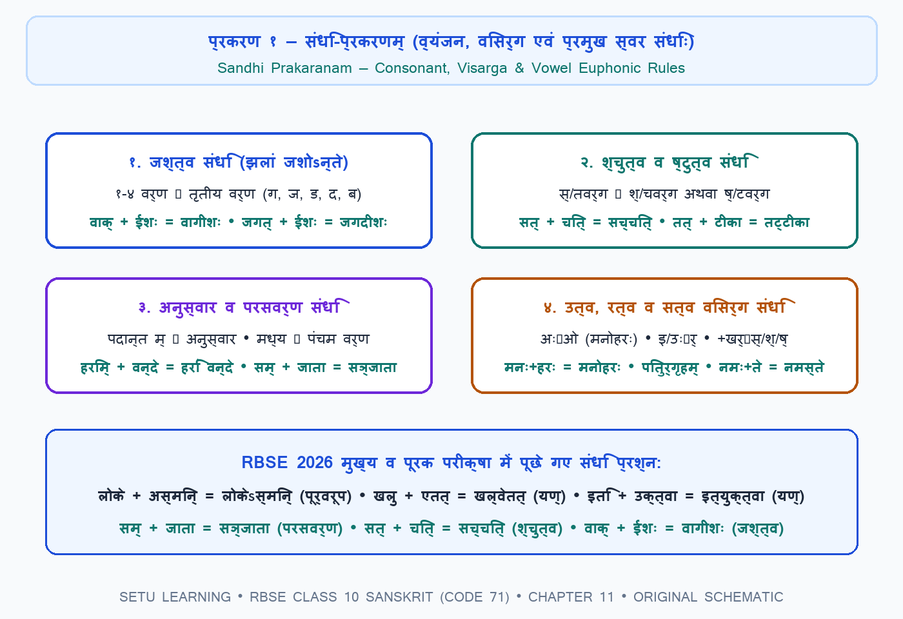

# अध्याय 11: प्रकरण १ — संधि-प्रकरणम् (व्यंजन, विसर्ग एवं प्रमुख स्वर संधिः) (Sandhi Prakaranam — Consonant, Visarga & Vowel Euphonic Rules)

## भाग 1: अध्याय प्रवेश एवं पाठ्यक्रम मैपिंग

> पाठ्यक्रम-सीमा: RBSE के 2026–27 पाठ्यक्रम में संधि अनुप्रयुक्त व्याकरण का विषय है; पूरे व्याकरण का भार 24 अंक है। इस document में अलग संधि-अंक प्रकाशित नहीं हैं। नीचे विस्तृत नियम और अतिरिक्त उदाहरण अभ्यास के लिए हैं; इन्हें सभी वर्तमान पाठ्यक्रम-विषयों या निश्चित बोर्ड-प्रश्नों की सूची न मानें। यह पृष्ठ NCERT के सभी प्रश्नों के हल होने का दावा नहीं करता।

**विषय कोड:** 71 (तृतीया भाषा — संस्कृतम्) · **श्रृंखला पुस्तक:** 6

**सत्यापित आधार:** RBSE कक्षा 10 संस्कृत पाठ्यक्रम 2026–27 · **संधि घटक:** पूरे अनुप्रयुक्त व्याकरण के लिए 24 अंक; अलग संधि-घटक का अंक-आवंटन इस syllabus PDF में नहीं मिला। अभ्यास-अंक या पुराने पेपर का भार current component weight नहीं है। [आधिकारिक पाठ्यक्रम](https://rajeduboard.rajasthan.gov.in/anudeshika-etc/10_2027.pdf)

**सीखने के लक्ष्य:** RBSE कक्षा 10 पाठ्यक्रम के अनुसार हल् (व्यंजन) संधि (श्चुत्व, ष्टुत्व, जश्त्व, चर्त्व, अनुनासिक, अनुस्वार, परसवर्ण), विसर्ग संधि (उत्व, रत्व, लोप, सत्व-षत्व-शत्व) तथा पाठ्यपुस्तक की स्वर संधियों का नियम व अभ्यास करना।

## भाग 2: शब्दावली एवं अवधारणा कैप्सूल

| शब्द / सूत्र | अर्थ / उपयोग |
|---|---|
| संहिता | वर्णों की अत्यधिक निकटता ('परः सन्निकर्षः संहिता')। |
| जश्त्व संधिः | झल् वर्ण का अपने वर्ग के तीसरे वर्ण से आदेश (कवर्ग: ग्, चवर्ग: ज्, टवर्ग: ड्, तवर्ग: द्, पवर्ग: ब्) (वाक् + ईशः = वागीशः)। |
| श्चुत्व संधिः | स् या तवर्ग का श् या चवर्ग के योग में श् या चवर्ग होना (सत् + चित् = सच्चित्)। |
| ष्टुत्व संधिः | स्/तवर्ग का ष्/टवर्ग के समीप मूर्धन्यादेश (धनुस् + टङ्कारः = धनुष्टङ्कारः)। |
| चर्त्व संधिः | झल् वर्णों का खर् परे रहने पर प्रथम वर्ण 'चर्' होना (उद् + पत्तिः = उत्पत्तिः)। |
| अनुनासिक संधिः | यर् वर्णों का अनुनासिक परे रहने पर पंचम वर्ण होना (जगत् + नाथः = जगन्नाथः)। |
| अनुस्वार-परसवर्ण | पदान्त म् का व्यंजन परे रहने पर अनुस्वार (म् → ं) और अपदान्त अनुस्वार का परसवर्ण (सम् + जाता = सञ्जाता)। |
| उत्व विसर्ग संधिः | अः + अ/हश् होने पर 'अः' को 'ओ' और बाद के 'अ' को अवग्रह 'ऽ' होना (मनः + हरः = मनोहरः)। |
| रत्व विसर्ग संधिः | अ/आ से भिन्न स्वर के बाद विसर्ग + स्वर/घोष वर्ण होने पर विसर्ग को 'र्' होना (पितुः + गृहम् = पितुर्गृहम्)। |
| सत्व विसर्ग संधिः | विसर्ग के बाद खर् परे रहने पर विसर्ग को स्/श्/ष् होना (नमः + ते = नमस्ते)। |

## भाग 3: विस्तृत शिक्षण पाठ

### १. हल् (व्यंजन) संधि के प्रमुख सूत्र एवं नियम
व्यंजन वर्ण के साथ व्यंजन अथवा स्वर के मेल से जो विकार होता है, उसे **हल् (व्यंजन) संधि** कहते हैं। RBSE कक्षा 10 में निम्नलिखित भेद सर्वाधिक महत्त्वपूर्ण हैं:

| संधि का नाम | पाणिनीय सूत्र | सरल नियम | उदाहरण (ऐतिहासिक वर्ष-टैग सत्यापनाधीन) |
|---|---|---|---|
| **१. जश्त्व संधिः** | झलां जशोऽन्ते | पदान्त में वर्ग के १, २, ३, ४ वर्ण के बाद स्वर या ३, ४, ५, य, र, ल, व, ह आए तो **तीसरा वर्ण (ग, ज, ड, द, ब)** हो जाता है। | वाक् + ईशः = **वागीशः**; दिक् + गजः = **दिग्गजः**; जगत् + ईशः = **जगदीशः**; अच् + अन्तः = **अजन्तः**; चलत् + अनिशम् = **चलदनिशम्** |
| **२. श्चुत्व संधिः** | स्तोः श्चुना श्चुः | 'स्' या तवर्ग (त्, थ्, द्, ध्, न्) के संधि-स्थल पर 'श्' या चवर्ग (च्, छ्, ज्, झ्, ञ्) के समीप आने पर संबंधित वर्ण श्/चवर्ग से मिलता है। | सत् + चित् = **सच्चित्** (2026 पूरक); रामस् + च = **रामश्च**; सत् + जनः = **सज्जनः**; मनस् + चञ्चलम् = **मनश्चञ्चलम्**; शार्ङ्गिन् + जय = **शार्ङ्गिञ्जय** |
| **३. ष्टुत्व संधिः** | ष्टुना ष्टुः | 'स्' या तवर्ग का योग 'ष्' या टवर्ग (ट्, ठ्, ड्, ढ्, ण्) से होने पर स् → **ष्** और तवर्ग → **टवर्ग** होता है। | तत् + टीका = **तट्टीका**; उद् + डयनम् = **उड्डयनम्**; रामस् + षष्ठः = **रामष्षष्ठः**; कृष् + नः = **कृष्णः**; धनुस् + टङ्कारः = **धनुष्टङ्कारः** |
| **४. चर्त्व संधिः** | खरि च | वर्ग के १, २, ३, ४ वर्ण के बाद वर्ग का १, २ वर्ण या श, ष, स आए तो पूर्व वर्ण अपने वर्ग का **प्रथम वर्ण (क, च, ट, त, प)** हो जाता है। | उद् + पत्तिः = **उत्पत्तिः**; सद् + कारः = **सत्कारः**; दिग + पालः = **दिक्पालः**; लभ् + स्यते = **लप्स्यते** |
| **५. अनुनासिक संधिः** | यरोऽनुनासिकेऽनुनासिको वा | पदान्त वर्ग के १, २, ३, ४ वर्ण के बाद पंचम वर्ण (न, म आदि) आए तो पूर्व वर्ण अपने वर्ग का **पंचम वर्ण (ङ, ञ, ण, न, म)** बन जाता है। | वाक् + मयम् = **वाङ्मयम्**; जगत् + नाथः = **जगन्नाथः**; षट् + मासः = **षण्मासः**; तत् + नयनम् = **तन्नयनम्**; एतद् + मुरारिः = **एतन्मुरारिः** |
| **६. अनुस्वार संधिः** | मोऽनुस्वारः | पदान्त 'म्' के बाद कोई भी व्यंजन आने पर 'म्' का **अनुस्वार (ं)** हो जाता है (स्वर आने पर म् जुड़ जाता है)। | हरिम् + वन्दे = **हरिं वन्दे**; सत्यम् + वद = **सत्यं वद**; धर्मम् + चर = **धर्मं चर** |
| **७. परसवर्ण संधिः** | अनुस्वारस्य ययि परसवर्णः | पद के मध्य अनुस्वार (या सम् के म्) के बाद वर्गीय व्यंजन आने पर अनुस्वार उसी वर्ग का **पंचम वर्ण** बन जाता है। | सम् + जाता = **सञ्जाता** (2026 मुख्य; पूरक-पेपर में यह sandhi-viccheda सत्यापित नहीं); अङ् + कितः = **अङ्कितः**; शम् + करः = **शङ्करः**; सम् + तोषः = **सन्तोषः** |
| **८. छत्व व तुगागम** | शश्छोऽटि / छे च | १, २, ३, ४ वर्ण के बाद 'श्' आने पर श् को 'छ्' होता है; ह्रस्व स्वर के बाद 'छ' आने पर बीच में 'च्' जुड़ता है। | तत् + शिवः = **तच्छिवः**; शिव + छाया = **शिवच्छाया**; तरु + छाया = **तरुच्छाया** |

### २. विसर्ग संधि के ४ प्रमुख भेद
विसर्ग (:) के पश्चात् स्वर या व्यंजन आने पर जो परिवर्तन होता है, उसे **विसर्ग संधि** कहते हैं:
1. **उत्व विसर्ग संधिः ('अतो रोरप्लुतादप्लुते' / 'हशि च'):** यदि विसर्ग से पहले ह्रस्व **'अ'** हो और बाद में भी ह्रस्व **'अ'** या घोष व्यंजन (वर्ग का ३, ४, ५ वर्ण या य, र, ल, व, ह) हो, तो 'अः' मिलकर **'ओ'** बन जाता है (बाद का 'अ' अवग्रह **'ऽ'** बन जाता है)।
   - उदाहरण: मनः + हरः = **मनोहरः**; मनः + रथः = **मनोरथः**; यशः + गानम् = **यशोगानम्**; रामः + हसति = **रामो हसति**; कः + अपि = **कोऽपि**; प्रथमः + अध्यायः = **प्रथमोऽध्यायः**।
2. **रत्व विसर्ग संधिः (ऋत्व):** यदि विसर्ग से पहले **'अ/आ' को छोड़कर कोई अन्य स्वर** (इ, ई, उ, ऊ, ए, ऐ, ओ, औ) हो तथा बाद में कोई स्वर या घोष व्यंजन हो (या 'पुनः/अन्तः/प्रातः' के बाद घोष वर्ण हो), तो विसर्ग का **'र्'** हो जाता है।
   - उदाहरण: प्रकृतिः + एव = **प्रकृतिरेव**; पितुः + गृहम् = **पितुर्गृहम्**; मुनिः + अयम् = **मुनिरयम्**; ज्योतिः + गमय = **ज्योतिर्गमय**; पुनः + अपि = **पुनरपि**; बहिः + अन्तः = **बहिरन्तः**।
3. **सत्व विसर्ग संधिः ('विसर्जनीयस्य सः'):** विसर्ग के बाद च, छ, श हो तो विसर्ग को **'श्'**; ट, ठ, ष हो तो **'ष्'**; तथा त, थ, स हो तो **'स्'** हो जाता है।
   - उदाहरण: नमः + ते = **नमस्ते**; विष्णुः + त्राता = **विष्णुस्त्राता**; निः + छलः = **निश्छलः**; कः + चित् = **कश्चित्**; धनुः + टङ्कारः = **धनुष्टङ्कारः**।
4. **विसर्ग लोप संधिः:** (क) 'अः' के बाद 'अ' से भिन्न कोई भी स्वर आए तो विसर्ग का लोप होता है: अतः + एव = **अत एव**। (ख) 'आः' के बाद कोई स्वर या घोष व्यंजन आए तो विसर्ग का लोप होता है: बालाः + अत्र = **बाला अत्र**; वृक्षाः + वर्धन्ते = **वृक्षा वर्धन्ते**। (ग) 'एषः / सः' के बाद 'अ' को छोड़कर कोई भी वर्ण आए तो विसर्ग का लोप होता है: सः + गच्छति = **स गच्छति**। (घ) 'र्' के बाद 'र्' आने पर पूर्व र का लोप और पूर्व ह्रस्व स्वर को दीर्घ होता है: निः + रोगः = **नीरोगः**; निः + रसः = **नीरसः**।

### ३. पाठ्यपुस्तक में प्रयुक्त प्रमुख स्वर संधियाँ (महत्त्वपूर्ण बोर्ड प्रश्न)
RBSE 2026 मुख्य/पूरक पेपर में कुछ sandhi-प्रश्न सीधे सत्यापित हुए हैं:
- **यण् संधिः ('इको यणचि'):** इति + उक्त्वा = **इत्युक्त्वा** (2026 पूरक); खलु + एतत् = **खल्वेतत्** (2026 मुख्य); सु + आगतम् = **स्वागतम्**; प्रति + आगच्छति = **प्रत्यागच्छति**।
- **पूर्वरूप संधिः ('एङः पदान्तादति'):** लोके + अस्मिन् = **लोकेऽस्मिन्** (2026 मुख्य)।
- **अयादि संधिः ('एचोऽयवायावः'):** नै + अकः = **नायकः**। वर्ष-टैग वाले अन्य उदाहरणों की provenance जाँच लंबित है; उन्हें अभी प्रमाणित PYQ न मानें।
- **गुण व वृद्धि संधिः:** यथा + इच्छम् = **यथेच्छम्**; एक + एकः = **एकैकः**; न + एकः = **नैकः**।

संधि-प्रकरणम्: व्यंजन (हल्) एवं विसर्ग संधि के नियमों का निर्णय-वृक्ष।

## भाग 4: पाठ्यपुस्तक-अवधारणाओं पर मौलिक हल किए उदाहरण

नीचे के प्रश्न लेखक के मौलिक मॉडल हैं। ये किसी NCERT edition के प्रश्न क्रमांक या संपूर्ण in-text/exercise solution bank होने का दावा नहीं करते।

**हल किया उदाहरण 1: RBSE 2026 मुख्य परीक्षा, प्रश्न 1(ix–xi): (क) लोकेऽस्मिन्, (ख) सम् + जाता, (ग) खल्वेतत् — संधि व विच्छेद बताएँ।**

(क) लोकेऽस्मिन् = लोके + अस्मिन् (पूर्वरूप स्वर संधिः)। (ख) सम् + जाता = सञ्जाता (अनुस्वार-परसवर्ण व्यंजन संधिः, क्योंकि 'ज' चवर्ग का है अतः 'ञ्' हुआ)। (ग) खल्वेतत् = खलु + एतत् (यण् स्वर संधिः)।

**हल किया उदाहरण 2: RBSE 2026 पूरक परीक्षा प्रश्न 1(x, xi): (क) इति + उक्त्वा, (ख) सच्चित् — संधि व नाम लिखें।**

(क) इति + उक्त्वा = इत्युक्त्वा (यण् संधिः — इ को य्)। (ख) सच्चित् = सत् + चित् (श्चुत्व व्यंजन संधिः — त् के बाद च् आने से त् को च्)।

**हल किया उदाहरण 3: मनोहरः, वागीशः, नमस्ते और हरिं वन्दे के नियम पहचानें।**

(क) मनोहरः = मनः + हरः (उत्व विसर्ग संधिः)। (ख) वागीशः = वाक् + ईशः (जश्त्व व्यंजन संधिः)। (ग) नमस्ते = नमः + ते (सत्व विसर्ग संधिः)। (घ) हरिम् + वन्दे = हरिं वन्दे (अनुस्वार व्यंजन संधिः)।

## भाग 5: सत्यापित बोर्ड प्रश्न एवं स्रोत-स्थिति

2026 मुख्य परीक्षा, प्रश्न 1(ix, x, xi): 'लोकेऽस्मिन्', 'सम् + जाता', 'खल्वेतत्' तथा 2026 पूरक परीक्षा: 'इति + उक्त्वा', 'सच्चित्'।

[RBSE 2026 मूल पेपर (S-71)](https://rajeduboard.rajasthan.gov.in/books/PAPERS-2026/Sec/S-71-Sankrit-TL-26.pdf)। प्रश्न का संक्षिप्त विषय-संदर्भ है; शब्दशः पुनर्मुद्रण नहीं।

## भाग 6: खंडवार मौलिक अभ्यास बैंक

**अभ्यास-अंक:** लेखक के स्व-अभ्यास के लिए हैं; RBSE की आधिकारिक marking scheme नहीं। उत्तर पहले स्वयं लिखें, फिर भाग 9 देखें।

## अ: बहुविकल्पीय प्रश्न — 15 × 1 अंक

**MCQ 1. 'सम् + जाता' इत्यस्य सन्धिपदं किम् अस्ति?**

अ) सङ्जाता  
ब) सञ्जाता  
स) सन्जाता  
द) समजाता

**MCQ 2. 'सच्चित्' इत्यस्य सन्धि-विच्छेदः कः?**

अ) सत् + चित्  
ब) सच् + चित्  
स) सद् + चित्  
द) सः + चित्

**MCQ 3. 'वाक् + ईशः' इत्यस्य सन्धिपदं किम्?**

अ) वाकीशः  
ब) वाङ्गीशः  
स) वाचीशः  
द) वागीशः

**MCQ 4. 'जगदीशः' पदे कः सन्धिः वर्तते?**

अ) श्चुत्वसन्धिः  
ब) ष्टुत्वसन्धिः  
स) जश्त्वसन्धिः  
द) चर्त्वसन्धिः

**MCQ 5. 'मनोहरः' इत्यस्य सन्धि-विच्छेदः कः?**

अ) मना + हरः  
ब) मनः + हरः  
स) मनो + हरः  
द) मनस् + ओहरः

**MCQ 6. 'नमः + ते' इत्यस्य सन्धिपदं किम्?**

अ) नमस्ते  
ब) नमोते  
स) नमश्ते  
द) नमष्टे

**MCQ 7. 'हरिम् + वन्दे' इत्यस्य सन्धियुक्तं पदं किम्?**

अ) हरिवन्दे  
ब) हरिन्वन्दे  
स) हरी वन्दे  
द) हरिं वन्दे

**MCQ 8. 'तट्टीका' पदे कः सन्धिः अस्ति?**

अ) जश्त्वसन्धिः  
ब) लोपसन्धिः  
स) ष्टुत्वसन्धिः  
द) श्चुत्वसन्धिः

**MCQ 9. 'निश्छलः' इत्यस्य सन्धि-विच्छेदः कः?**

अ) निस् + छलः  
ब) निः + छलः  
स) निश् + छलः  
द) नी + छलः

**MCQ 10. 'उत् + डयनम्' इत्यस्य सन्धिपदं किम्?**

अ) उड्डयनम्  
ब) उत्डयनम्  
स) उड्यनम्  
द) उण्डयनम्

**MCQ 11. 'वाङ्मयम्' इत्यस्य सन्धि-विच्छेदः कः?**

अ) वाङ् + मयम्  
ब) वाच् + मयम्  
स) वाग + मयम्  
द) वाक् + मयम्

**MCQ 12. 'विष्णुस्त्राता' पदे कः सन्धिः अस्ति?**

अ) रत्व-विसर्गसन्धिः  
ब) लोप-विसर्गसन्धिः  
स) सत्व-विसर्गसन्धिः  
द) उत्व-विसर्गसन्धिः

**MCQ 13. 'नायकः' इत्यस्य सन्धि-विच्छेदः कः?**

अ) पू + अनः  
ब) नै + अकः  
स) पौ + अनः  
द) पव + नः

**MCQ 14. 'सत्कारः' इत्यस्य सन्धि-विच्छेदः कः?**

अ) सद् + कारः  
ब) सत् + गारः  
स) सः + कारः  
द) सन् + कारः

**MCQ 15. 'कः + अपि' इत्यस्य सन्धिपदं किम्?**

अ) कअपि  
ब) करपि  
स) कपि  
द) कोऽपि

## अ: रिक्त स्थान — 6 × 1 अंक

1. वर्णों की अत्यधिक निकटता ('परः सन्निकर्षः संहिता')। — इस शब्द/सूत्र का नाम है: ____।  
2. झल् वर्णों के स्थान पर अपने वर्ग का तृतीय वर्ण 'जश्' (ग्, ज्, ड्, द्, ब्) होना (वाक् + ईशः = वागीशः)। — इस शब्द/सूत्र का नाम है: ____।  
3. स् या तवर्ग का श् या चवर्ग के योग में श् या चवर्ग होना (सत् + चित् = सच्चित्)। — इस शब्द/सूत्र का नाम है: ____।  
4. स् या तवर्ग का ष् या टवर्ग के योग में ष् या टवर्ग होना (धनुस् + टङ्कारः = धनुष्टङ्कारः)। — इस शब्द/सूत्र का नाम है: ____।  
5. झल् वर्णों का खर् परे रहने पर प्रथम वर्ण 'चर्' होना (उद् + पत्तिः = उत्पत्तिः)। — इस शब्द/सूत्र का नाम है: ____।  
6. यर् वर्णों का अनुनासिक परे रहने पर पंचम वर्ण होना (जगत् + नाथः = जगन्नाथः)। — इस शब्द/सूत्र का नाम है: ____।

## अ: अतिलघु उत्तर — 8 × 1 अंक

1. 'सम् + जाता' इत्यस्य सन्धिपदं किम् अस्ति?  
2. 'सच्चित्' इत्यस्य सन्धि-विच्छेदः कः?  
3. 'वाक् + ईशः' इत्यस्य सन्धिपदं किम्?  
4. 'जगदीशः' पदे कः सन्धिः वर्तते?  
5. 'मनोहरः' इत्यस्य सन्धि-विच्छेदः कः?  
6. 'नमः + ते' इत्यस्य सन्धिपदं किम्?  
7. 'हरिम् + वन्दे' इत्यस्य सन्धियुक्तं पदं किम्?  
8. 'तट्टीका' पदे कः सन्धिः अस्ति?

## ब: लघु उत्तर — 6 × 2 अंक

**B1.** 'वागीशः' इत्यस्य सन्धि-विच्छेदं कृत्वा सन्धेः नाम लिखत।

**B2.** 'जगन्नाथः' इत्यस्य सन्धि-विच्छेदं कुरुत।

**B3.** 'मनोरथः' पदे कः सन्धिः अस्ति?

**B4.** 'नमस्ते' इत्यस्य सन्धि-विच्छेदः कः?

**B5.** 'प्रकृतिरेव' पदे कः सन्धिः विद्यते?

**B6.** 'नीरोगः' इत्यस्य सन्धि-विच्छेदं कृत्वा नियमं लिखत।

## स: दीर्घ उत्तर — 4 × 3 अंक

आंतरिक विकल्प अभ्यास: C1 अथवा C2, तथा C3 अथवा C4 चुनें। पुनरावृत्ति में बचा विकल्प भी हल करें। यह लेखक की अभ्यास व्यवस्था है।

**C1.** जश्त्वसन्धेः नियमं सोदाहरणं स्पष्टीकुरुत।

**C2.** श्चुत्वसन्धेः ष्टुत्वसन्धेः च भेदं सोदाहरणं लिखत।

**C3.** उत्व-विसर्गसन्धेः रत्व-विसर्गसन्धेः च नियमौ उदाहरणसहितं लिखत।

**C4.** अनुस्वारसन्धेः परसवर्णसन्धेः च नियमं स्पष्टीकुरुत।

## द: विस्तृत उत्तर — 2 × 4 अंक

आंतरिक विकल्प अभ्यास: D1 अथवा D2 चुनें; बाद में दूसरा भी हल करें।

**D1.** संधि-अभ्यास के २० उदाहरण (इनमें केवल नीचे स्पष्ट रूप से स्रोत-मिलाए गए 2026 प्रश्न प्रमाणित बोर्ड प्रश्न हैं; पुराने वर्ष-टैग सत्यापनाधीन) लिखें।

**D2.** विसर्ग संधि के चार प्रमुख भेदों (उत्व, रत्व, सत्व, लोप) के पहचान-संकेत उदाहरण सहित समझाएँ।

## भाग 7: सावधानियाँ एवं परीक्षा-त्रुटियाँ

- 'वाक् + ईशः = वागीशः' में जश्त्व संधि है, इसे दीर्घ स्वर संधि न लिखें।
- 'मनोहरः' (मनः + हरः) में उत्व विसर्ग संधि है, गुण स्वर संधि नहीं।
- 'लोकेऽस्मिन्' (लोके + अस्मिन्) में पूर्वरूप स्वर संधि है, जबकि 'कोऽपि' (कः + अपि) में उत्व विसर्ग संधि है — अवग्रह चिह्न देखकर भ्रमित न हों।
- पदान्त 'म्' के बाद स्वर आने पर अनुस्वार नहीं होता (जैसे: त्वम् + अपि = त्वमपि), केवल व्यंजन आने पर अनुस्वार होता है (त्वम् + पठसि = त्वं पठसि)।
- 'सञ्जाता' (सम् + जाता) में 'ज' चवर्ग का है, इसलिए अनुस्वार 'ञ्' में बदलता है।

## भाग 8: फटाफट पुनरावृत्ति — 25 बिंदु

1. संहिता: वर्णों की अत्यधिक निकटता ('परः सन्निकर्षः संहिता')।  
2. जश्त्व संधिः: झल् वर्णों के स्थान पर अपने वर्ग का तृतीय वर्ण 'जश्' (ग्, ज्, ड्, द्, ब्) होना (वाक् + ईशः = वागीशः)।  
3. श्चुत्व संधिः: स् या तवर्ग का श् या चवर्ग के योग में श् या चवर्ग होना (सत् + चित् = सच्चित्)।  
4. ष्टुत्व संधिः: स् या तवर्ग का ष् या टवर्ग के योग में ष् या टवर्ग होना (धनुस् + टङ्कारः = धनुष्टङ्कारः)।  
5. चर्त्व संधिः: झल् वर्णों का खर् परे रहने पर प्रथम वर्ण 'चर्' होना (उद् + पत्तिः = उत्पत्तिः)।  
6. अनुनासिक संधिः: यर् वर्णों का अनुनासिक परे रहने पर पंचम वर्ण होना (जगत् + नाथः = जगन्नाथः)।  
7. अनुस्वार-परसवर्ण: पदान्त म् का व्यंजन परे रहने पर अनुस्वार (म् → ं) और अपदान्त अनुस्वार का परसवर्ण (सम् + जाता = सञ्जाता)।  
8. उत्व विसर्ग संधिः: अः + अ/हश् होने पर 'अः' को 'ओ' और बाद के 'अ' को अवग्रह 'ऽ' होना (मनः + हरः = मनोहरः)।  
9. रत्व विसर्ग संधिः: अ/आ से भिन्न स्वर के बाद विसर्ग + स्वर/घोष वर्ण होने पर विसर्ग को 'र्' होना (पितुः + गृहम् = पितुर्गृहम्)।  
10. सत्व विसर्ग संधिः: विसर्ग के बाद खर् परे रहने पर विसर्ग को स्/श्/ष् होना (नमः + ते = नमस्ते)।  
11. परसवर्ण संधि से 'ज' (चवर्ग) परे रहने पर अनुस्वार को चवर्ग का पंचम वर्ण 'ञ्' होकर 'सञ्जाता' बनता है (RBSE 2026 मुख्य, प्रश्न 1(x)।  
12. श्चुत्व व्यंजन संधि ('स्तोः श्चुना श्चुः') से त् का च् होकर 'सच्चित्' बनता है (RBSE 2026 पूरक परीक्षा)।  
13. जश्त्व संधि से पदान्त 'क्' को तृतीय वर्ण 'ग्' होकर 'वागीशः' बनता है।  
14. जगत् + ईशः = जगदीशः (त् को द् — जश्त्व संधिः)।  
15. उत्व विसर्ग संधि ('हशि च') से 'मनः + हरः = मनोहरः' बनता है।  
16. विसर्ग के बाद 'त' आने से सत्व विसर्ग संधि द्वारा 'नमस्ते' बनता है।  
17. 'मोऽनुस्वारः' सूत्र से पदान्त म् के बाद व्यंजन आने पर अनुस्वार होकर 'हरिं वन्दे' बनता है।  
18. तत् + टीका = तट्टीका ('ष्टुना ष्टुः' से त् का ट्)।  
19. विसर्ग के बाद 'छ' आने से सत्व/शत्व संधि द्वारा विसर्ग को 'श्' होकर 'निश्छलः' बनता है।  
20. 'उड्डयनम्' का रूप-विश्लेषण यहाँ अतिरिक्त अभ्यास है; इसे जश्त्व+ष्टुत्व का सरल संयुक्त उदाहरण न मानें।  
21. पदान्त 'क्' के बाद अनुनासिक 'म' आने से कवर्ग का पंचम वर्ण 'ङ्' होकर 'वाङ्मयम्' बनता है।  
22. विष्णुः + त्राता = विष्णुस्त्राता (विसर्ग के बाद 'त्' आने से 'स्' — वर्ष-स्रोत सत्यापनाधीन)।  
23. अयादि संधि का उदाहरण: नै + अकः = नायकः (ऐ → आय)।  
24. 'खरि च' सूत्र से चर्त्व संधि द्वारा द् को प्रथम वर्ण त् होकर 'सत्कारः' बनता है।  
25. 'अतो रोरप्लुतादप्लुते' और 'एङः पदान्तादति' से उत्व और पूर्वरूप होकर 'कोऽपि' बनता है।

## भाग 9: संपूर्ण अभ्यास उत्तर-कुंजी

## MCQ: सही विकल्प और कारण

**1. ब — सञ्जाता।** परसवर्ण संधि से 'ज' (चवर्ग) परे रहने पर अनुस्वार को चवर्ग का पंचम वर्ण 'ञ्' होकर 'सञ्जाता' बनता है (RBSE 2026 मुख्य, प्रश्न 1(x)।

**2. अ — सत् + चित्।** श्चुत्व व्यंजन संधि ('स्तोः श्चुना श्चुः') से त् का च् होकर 'सच्चित्' बनता है (RBSE 2026 पूरक परीक्षा)।

**3. द — वागीशः।** जश्त्व संधि से पदान्त 'क्' को तृतीय वर्ण 'ग्' होकर 'वागीशः' बनता है।

**4. स — जश्त्वसन्धिः।** जगत् + ईशः = जगदीशः (त् को द् — जश्त्व संधिः)।

**5. ब — मनः + हरः।** उत्व विसर्ग संधि ('हशि च') से 'मनः + हरः = मनोहरः' बनता है।

**6. अ — नमस्ते।** विसर्ग के बाद 'त' आने से सत्व विसर्ग संधि द्वारा 'नमस्ते' बनता है।

**7. द — हरिं वन्दे।** 'मोऽनुस्वारः' सूत्र से पदान्त म् के बाद व्यंजन आने पर अनुस्वार होकर 'हरिं वन्दे' बनता है।

**8. स — ष्टुत्वसन्धिः।** तत् + टीका = तट्टीका ('ष्टुना ष्टुः' से त् का ट्)।

**9. ब — निः + छलः।** विसर्ग के बाद 'छ' आने से सत्व/शत्व संधि द्वारा विसर्ग को 'श्' होकर 'निश्छलः' बनता है।

**10. अ — उड्डयनम्।** 'उड्डयनम्' को संयुक्त जश्त्व/ष्टुत्व उदाहरण बताने का दावा हटाएँ; व्युत्पत्ति यहाँ सत्यापित नहीं है।

**11. द — वाक् + मयम्।** पदान्त 'क्' के बाद अनुनासिक 'म' आने से कवर्ग का पंचम वर्ण 'ङ्' होकर 'वाङ्मयम्' बनता है।

**12. स — सत्व-विसर्गसन्धिः।** विष्णुः + त्राता = विष्णुस्त्राता (विसर्ग के बाद 'त्' आने से 'स्' — वर्ष-स्रोत सत्यापनाधीन)।

**13. ब — नै + अकः।** अयादि संधि में ऐ का आयादेश होकर नायकः बनता है।

**14. अ — सद् + कारः।** 'खरि च' सूत्र से चर्त्व संधि द्वारा द् को प्रथम वर्ण त् होकर 'सत्कारः' बनता है।

**15. द — कोऽपि।** 'अतो रोरप्लुतादप्लुते' और 'एङः पदान्तादति' से उत्व और पूर्वरूप होकर 'कोऽपि' बनता है।

**रिक्त स्थान:** 1. संहिता; 2. जश्त्व संधिः; 3. श्चुत्व संधिः; 4. ष्टुत्व संधिः; 5. चर्त्व संधिः; 6. अनुनासिक संधिः

**अतिलघु उत्तर:**

1. सञ्जाता। परसवर्ण संधि से 'ज' (चवर्ग) परे रहने पर अनुस्वार को चवर्ग का पंचम वर्ण 'ञ्' होकर 'सञ्जाता' बनता है (RBSE 2026 मुख्य, प्रश्न 1(x)।

2. सत् + चित्। श्चुत्व व्यंजन संधि ('स्तोः श्चुना श्चुः') से त् का च् होकर 'सच्चित्' बनता है (RBSE 2026 पूरक परीक्षा)।

3. वागीशः। जश्त्व संधि से पदान्त 'क्' को तृतीय वर्ण 'ग्' होकर 'वागीशः' बनता है।

4. जश्त्वसन्धिः। जगत् + ईशः = जगदीशः (त् को द् — जश्त्व संधिः)।

5. मनः + हरः। उत्व विसर्ग संधि ('हशि च') से 'मनः + हरः = मनोहरः' बनता है।

6. नमस्ते। विसर्ग के बाद 'त' आने से सत्व विसर्ग संधि द्वारा 'नमस्ते' बनता है।

7. हरिं वन्दे। 'मोऽनुस्वारः' सूत्र से पदान्त म् के बाद व्यंजन आने पर अनुस्वार होकर 'हरिं वन्दे' बनता है।

8. ष्टुत्वसन्धिः। तत् + टीका = तट्टीका ('ष्टुना ष्टुः' से त् का ट्)।

**B1. 'वागीशः' इत्यस्य सन्धि-विच्छेदं कृत्वा सन्धेः नाम लिखत।**

वाक् + ईशः = वागीशः (जश्त्व व्यंजन संधिः)।

**B2. 'जगन्नाथः' इत्यस्य सन्धि-विच्छेदं कुरुत।**

जगत् + नाथः = जगन्नाथः (अनुनासिक व्यंजन संधिः)।

**B3. 'मनोरथः' पदे कः सन्धिः अस्ति?**

मनः + रथः = मनोरथः (उत्व विसर्ग संधिः)।

**B4. 'नमस्ते' इत्यस्य सन्धि-विच्छेदः कः?**

नमः + ते = नमस्ते (सत्व विसर्ग संधिः)।

**B5. 'प्रकृतिरेव' पदे कः सन्धिः विद्यते?**

प्रकृतिः + एव = प्रकृतिरेव (रत्व / ऋत्व विसर्ग संधिः)।

**B6. 'नीरोगः' इत्यस्य सन्धि-विच्छेदं कृत्वा नियमं लिखत।**

निः (निर्) + रोगः = नीरोगः (रो रि सूत्र से पूर्व र् का लोप और 'ढ्रलोपे पूर्वस्य दीर्घोऽणः' से 'नि' को 'नी')।

**C1. जश्त्वसन्धेः नियमं सोदाहरणं स्पष्टीकुरुत।**

1. सूत्र: 'झलां जशोऽन्ते'। 2. नियम: जब पदान्त में किसी वर्ग के प्रथम, द्वितीय, तृतीय या चतुर्थ वर्ण के बाद कोई स्वर अथवा वर्ग का तृतीय, चतुर्थ, पंचम वर्ण या य, र, ल, व, ह आए, तो पूर्व वर्ण के स्थान पर उसी वर्ग का तृतीय वर्ण (जश् = ग्, ज्, ड्, द्, ब्) हो जाता है। 3. उदाहरण: वाक् + ईशः = वागीशः (क् → ग्); जगत् + ईशः = जगदीशः (त् → द्); दिक् + अम्बरः = दिगम्बरः; अच् + अन्तः = अजन्तः।

**C2. श्चुत्वसन्धेः ष्टुत्वसन्धेः च भेदं सोदाहरणं लिखत।**

1. श्चुत्व संधि ('स्तोः श्चुना श्चुः'): जब 'स्' या तवर्ग (त्, थ्, द्, ध्, न्) का योग 'श्' या चवर्ग (च्, छ्, ज्, झ्, ञ्) के साथ होता है, तो स् का 'श्' और तवर्ग का 'चवर्ग' हो जाता है; जैसे — सत् + चित् = सच्चित्, रामस् + च = रामश्च। 2. ष्टुत्व संधि ('ष्टुना ष्टुः'): जब 'स्' या तवर्ग का योग 'ष्' या टवर्ग (ट्, ठ्, ड्, ढ्, ण्) के साथ होता है, तो स् का 'ष्' और तवर्ग का 'टवर्ग' हो जाता है; जैसे — तत् + टीका = तट्टीका, उद् + डयनम् = उड्डयनम्।

**C3. उत्व-विसर्गसन्धेः रत्व-विसर्गसन्धेः च नियमौ उदाहरणसहितं लिखत।**

1. उत्व संधि: यदि विसर्ग से पूर्व ह्रस्व 'अ' हो और बाद में भी ह्रस्व 'अ' या घोष व्यंजन हो, तो 'अः' का 'ओ' हो जाता है; जैसे — मनः + हरः = मनोहरः, कः + अपि = कोऽपि। 2. रत्व संधि: यदि विसर्ग से पूर्व 'अ/आ' से भिन्न स्वर (इ, उ आदि) हो और बाद में स्वर या घोष व्यंजन हो, तो विसर्ग का 'र्' हो जाता है; जैसे — पितुः + गृहम् = पितुर्गृहम्, मुनिः + अयम् = मुनिरयम्।

**C4. अनुस्वारसन्धेः परसवर्णसन्धेः च नियमं स्पष्टीकुरुत।**

1. अनुस्वार संधि ('मोऽनुस्वारः'): पदान्त 'म्' के बाद कोई भी व्यंजन आने पर 'म्' को अनुस्वार (ं) हो जाता है; जैसे — हरिम् + वन्दे = हरिं वन्दे, सत्यम् + वद = सत्यं वद। 2. परसवर्ण संधि ('अनुस्वारस्य ययि परसवर्णः'): अपदान्त अनुस्वार के बाद वर्गीय व्यंजन आने पर अनुस्वार बाद वाले वर्ण के वर्ग का पंचम वर्ण बन जाता है; जैसे — सम् + जाता = सञ्जाता, शम् + करः = शङ्करः।

**D1. संधि-अभ्यास के २० उदाहरण।** नीचे के रूप अभ्यास-सामग्री हैं; 2026 मुख्य पेपर से मिलाए गए रूपों को स्पष्ट चिह्नित किया है, अन्य पुराने वर्ष-टैगों का प्रश्न-स्रोत सत्यापन लंबित है।

1. लोकेऽस्मिन् = लोके + अस्मिन् (पूर्वरूप; RBSE 2026 main Q1(ix)). 2. सञ्जाता = सम् + जाता (परसवर्ण; RBSE 2026 main Q1(x)). 3. खल्वेतत् = खलु + एतत् (यण्; RBSE 2026 main Q1(xi)). 4. इत्युक्त्वा = इति + उक्त्वा (यण्; RBSE 2026 supplementary Q1(x)). 5. सच्चित् = सत् + चित् (श्चुत्व; RBSE 2026 supplementary Q1(xi)). 6–20. मनोहरः, वागीशः, नमस्ते, हरिं वन्दे, यथेच्छम्, दिगम्बरः, रामो हसति, विष्णुस्त्राता, स्वागतम्, दिग्गजः, रामश्च, निश्छलः, जगदीशः और नायकः जैसे उदाहरणों का अभ्यास करें; इनके पुराने वर्ष/प्रश्न-संदर्भ अभी सत्यापित नहीं हैं।

**D2. विसर्ग संधि के चार प्रमुख भेदों (उत्व, रत्व, सत्व, लोप) के पहचान-संकेत और उदाहरण समझाएँ।**

1. पहचान सूत्र १ (उत्व): पद के मध्य में 'ओ' की मात्रा या 'ओऽ' दिखे और पूर्व पद सार्थक अकारान्त हो → मनः + हरः = मनोहरः, प्रथमः + अध्यायः = प्रथमोऽध्यायः। 2. पहचान सूत्र २ (रत्व): 'इ/उ/ए' के तुरंत बाद रेफ (र्) दिखे → कविः + अयम् = कविरयम्, धेनुः + इयम् = धेनुरियम्। 3. पहचान सूत्र ३ (सत्व): 'श्+च/छ', 'ष्+ट/ठ' या 'स्+त/थ' दिखे → कः + चित् = कश्चित्, धनुः + टङ्कारः = धनुष्टङ्कारः, नमः + ते = नमस्ते। 4. पहचान सूत्र ४ (लोप): दो पदों के बीच संधि योग्य स्वर होते हुए भी संधि न हुई हो → अतः + एव = अत एव, सः + पठति = स पठति।

## भाग 10: 10 मिनट / 10 अंक आत्म-मूल्यांकन एवं संदर्भ

समय: 10 मिनट। पहले पुस्तक बंद करें।

1. MCQ 3 और 11 हल करें। (1 + 1)
2. B2 और B5 के उत्तर लिखें। (2 + 2)
3. D1 हल करें। (4)

**कुंजी:** भाग 9 में संबंधित क्रमांक देखें। **स्व-मूल्यांकन:** 8–10: आगे बढ़ें; 5–7: छूटे कौशल का दोहराव; 0–4: भाग 2–4 फिर पढ़ें। यह अभ्यास-सुझाव है, बोर्ड grade नहीं।

[RBSE 2026–27 पाठ्यक्रम](https://rajeduboard.rajasthan.gov.in/anudeshika-etc/10_2027.pdf) · [NCERT शेमुषी भाग-2 संदर्भ](https://ncert.nic.in/textbook.php?jhsk1=0-12)

**आगे की कड़ी:** प्रकरण १२ 'समास-प्रकरणम्' में अव्ययीभाव, तत्पुरुष, कर्मधारय, द्विगु, द्वन्द्व और बहुव्रीहि समासों के विग्रह और समस्तपद का अध्ययन करेंगे।

**स्रोत-पुनः परीक्षण, 14 October 2026:** 10_2027.pdf के PDF pp. 18–19 का दृश्य परीक्षण किया। अलग topic-weight का पूर्व दावा हटाया गया; केवल 24-अंक कुल व्याकरण आवंटन स्पष्ट है। इस सुधार से सभी grammatical derivations/PYQ tags सत्यापित नहीं हो जाते।

**स्रोत-सीमा:** नियमों के पाणिनीय सूत्र और उदाहरणों की यह focused जाँच है, संपूर्ण व्याकरण-व्युत्पत्ति प्रमाणन नहीं। RBSE 2026 मुख्य S-71 में Q1(ix) लोके + अस्मिन्, Q1(x) सञ्जाता का विच्छेद, और Q1(xi) यण्-संधि है; पूरक S-71 में Q1(x) इत्युक्त्वा तथा Q1(xi) श्चुत्व का उदाहरण पूछा गया। इन प्रश्नों के अतिरिक्त वर्ष-टैग सत्यापनाधीन हैं। स्रोत: [RBSE 2026 मुख्य S-71](https://rajeduboard.rajasthan.gov.in/books/PAPERS-2026/Sec/S-71.pdf), [RBSE 2026 पूरक S-71](https://rajeduboard.rajasthan.gov.in/books/PAPERS-2026/SecSUP/S-71.pdf), [RBSE 2026–27 पाठ्यक्रम](https://rajeduboard.rajasthan.gov.in/anudeshika-etc/10_2027.pdf).
