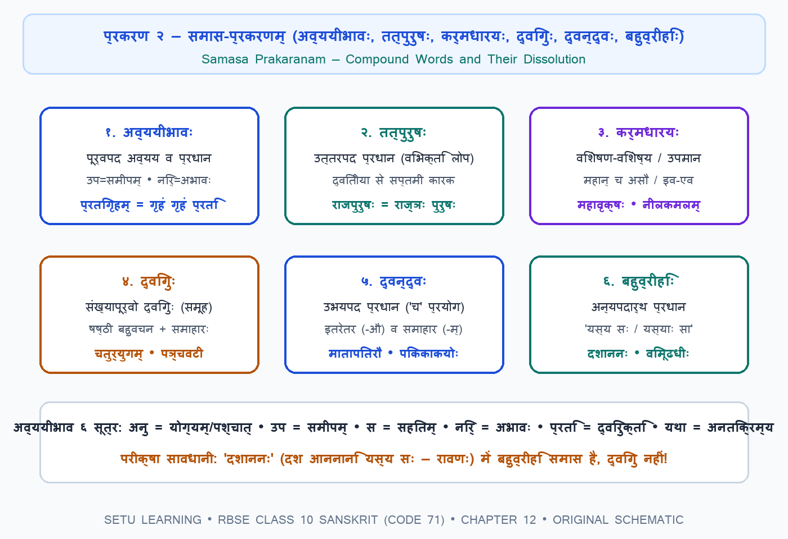

# अध्याय 12: प्रकरण २ — समास-प्रकरणम् (अव्ययीभावः, तत्पुरुषः, कर्मधारयः, द्विगुः, द्वन्द्वः, बहुव्रीहिः) (Samasa Prakaranam — Compound Words and Their Dissolution)

## भाग 1: अध्याय प्रवेश एवं पाठ्यक्रम मैपिंग

> पाठ्यक्रम-सीमा: RBSE के 2026–27 पाठ्यक्रम में समास अनुप्रयुक्त व्याकरण का विषय है; पूरे व्याकरण का भार 24 अंक है। इस document में अलग समास-अंक प्रकाशित नहीं हैं। नीचे विस्तृत नियम और अतिरिक्त उदाहरण अभ्यास के लिए हैं; इन्हें सभी वर्तमान पाठ्यक्रम-विषयों या निश्चित बोर्ड-प्रश्नों की सूची न मानें। यह पृष्ठ NCERT के सभी प्रश्नों के हल होने का दावा नहीं करता।

**विषय कोड:** 71 (तृतीया भाषा — संस्कृतम्) · **श्रृंखला पुस्तक:** 6

**सत्यापित आधार:** RBSE कक्षा 10 संस्कृत पाठ्यक्रम 2026–27 · **समास घटक:** पूरे अनुप्रयुक्त व्याकरण के लिए 24 अंक; अलग समास-घटक का 4-अंक आवंटन इस syllabus PDF में नहीं मिला। अभ्यास-अंक या पुराने पेपर का भार current component weight नहीं है। [आधिकारिक पाठ्यक्रम](https://rajeduboard.rajasthan.gov.in/anudeshika-etc/10_2027.pdf)

**सीखने के लक्ष्य:** RBSE कक्षा 10 पाठ्यक्रम के अनुसार छहों समासों के नियम, समस्तपद-निर्माण और समास-विग्रह में पूर्ण दक्षता प्राप्त करना।

## भाग 2: शब्दावली एवं अवधारणा कैप्सूल

| शब्द / सूत्र | अर्थ / उपयोग |
|---|---|
| समसनं समासः | संक्षिप्तीकरण को समास कहते हैं (अनेक पदों का एक पद बनना)। |
| अव्ययीभावः | पूर्वपद अव्यय व प्रधान तथा संपूर्ण पद नपुंसकलिंग एकवचन (यथाशक्ति = शक्तिम् अनतिक्रम्य)। |
| तत्पुरुषः | उत्तरपद प्रधान तथा पूर्वपद में द्वितीया से सप्तमी तक विभक्ति का लोप (ग्रामगतः = ग्रामं गतः)। |
| कर्मधारयः | विशेषण-विशेष्य अथवा उपमान-उपमेय संबंध (महावृक्षः = महान् च असौ वृक्षः)। |
| द्विगुः | संख्यापूर्वो द्विगुः — पूर्वपद संख्यावाची और समाहार अर्थ (चतुर्युगम् = चतुर्णां युगानां समाहारः)। |
| इतरेतर द्वन्द्वः | उभयपद प्रधान तथा विग्रह में प्रत्येक पद के बाद 'च' (मातापितरौ = माता च पिता च)। |
| समाहार द्वन्द्वः | अंगों या समूह का बोध, नपुंसकलिंग एकवचन (पाणिपादम् = पाणिश्च पादौ च तेषां समाहारः)। |
| बहुव्रीहिः | अन्यपदार्थप्रधानो बहुव्रीहिः — दोनों पद मिलकर किसी तीसरे अर्थ को बताएँ (दशाननः = दश आननानि यस्य सः)। |
| उपकृष्णम् | कृष्णस्य समीपम् ('उप' उपसर्ग का अर्थ 'समीपम्' और मूल पद में षष्ठी विभक्ति)। |
| निर्जनम् | जनानाम् अभावः ('निर्/निस्' उपसर्ग का अर्थ 'अभावः' और मूल पद में षष्ठी बहुवचन)। |

## भाग 3: विस्तृत शिक्षण पाठ

### १. अव्ययीभाव समासः (पूर्वपदप्रधानो अव्ययीभावः)
जिस समास में पूर्वपद अव्यय या उपसर्ग हो और वही प्रधान हो, उसे **अव्ययीभाव समास** कहते हैं। समस्तपद सदा **नपुंसकलिंग एकवचन** में रहता है। RBSE बोर्ड परीक्षा के ६ अनिवार्य नियम:

| उपसर्ग / अव्यय | विग्रह में प्रयुक्त शब्द | मूल शब्द की विभक्ति | बोर्ड परीक्षा के उदाहरण (समस्तपद = विग्रहः) |
|---|---|---|---|
| **१. अनु** | योग्यम् / पश्चात् | षष्ठी विभक्ति | **अनुरूपम्** = रूपस्य योग्यम्; **रथानु** (अनुरथम्) = रथस्य पश्चात् |
| **२. उप** | समीपम् | षष्ठी एकवचन | **उपकृष्णम्** = कृष्णस्य समीपम् (2020 पूरक); **उपनगरम्** = नगरस्य समीपम्; **उपगङ्गम्** = गङ्गायाः समीपम् |
| **३. सह / स** | सहितम् | तृतीया विभक्ति | **सचित्रम्** = चित्रेण सहितम्; **समलम्** = मलेन सहितम्; **सक्रोधम्** = क्रोधेन सहितम् |
| **४. निर् / निस्** | अभावः | षष्ठी विभक्ति | **निर्जनम्** = जनानाम् अभावः (2017, 2020); **निर्मक्षिकम्** = मक्षिकाणाम् अभावः; **निष्फलम्** = फलानाम् अभावः |
| **५. प्रति** | द्विरुक्ति + प्रति | द्वितीया / सप्तमी | **प्रतिगृहम्** = गृहं गृहं प्रति (2025 पूरक); **प्रतिदिनम्** = दिनं दिनं प्रति (2015, 2022); **प्रत्येकम्** = एकम् एकं प्रति |
| **६. यथा** | अनतिक्रम्य | द्वितीया एकवचन | **यथाशक्ति** = शक्तिम् अनतिक्रम्य (2014); **यथेच्छम्** = इच्छाम् अनतिक्रम्य; **यथामति** = मतिम् अनतिक्रम्य |

### २. तत्पुरुष, कर्मधारय एवं द्विगु समासः (उत्तरपदप्रधानः)
1. **विभक्ति तत्पुरुषः:** पूर्वपद की विभक्ति (द्वितीया से सप्तमी) का लोप होता है:
   - द्वितीया: ग्रामं गतः = **ग्रामगतः**; शरणम् आगतः = **शरणागतः**।
   - तृतीया: बाणेन आहतः = **बाणाहतः**; मदेन अन्धः = **मदान्धः**; विद्याया हीनः = **विद्याहीनः**।
   - चतुर्थी: भूतेभ्यः बलिः = **भूतबलिः**; दानाय पात्रम् = **दानपात्रम्**; राष्ट्राय भक्तिः = **राष्ट्रभक्तिः**।
   - पञ्चमी: चोरात् भयम् = **चोरभयम्**; सिंहात् भीतः = **सिंहभीतः**; पथः भ्रष्टः = **पथभ्रष्टः**।
   - षष्ठी: राज्ञः पुरुषः = **राजपुरुषः**; देवस्य आलयः = **देवालयः**; राष्ट्रस्य पतिः = **राष्ट्रपतिः**।
   - सप्तमी: कार्ये कुशलः = **कार्यकुशलः**; जले मग्नः = **जलमग्नः**; शास्त्रे प्रवीणः = **शास्त्रप्रवीणः**।
   - नञ् तत्पुरुषः: न धार्मिकः = **अधार्मिकः**; न सत्यम् = **असत्यम्**; न ईश्वः = **अनीशः**।
2. **कर्मधारय समासः (विशेषण-विशेष्य व उपमान-उपमेय):**
   - विशेषण-विशेष्य: महान् च असौ वृक्षः = **महावृक्षः** (2023, 2026 पूरक); महान् च असौ पुरुषः = **महापुरुषः** (2022); नीलं च तत् कमलम् = **नीलकमलम्** (2015); कृष्णः च असौ सर्पः = **कृष्णसर्पः** (2014); वीरः च असौ पुरुषः = **वीरपुरुषः** (2020 पूरक)।
   - उपमान-उपमेय: घनः इव श्यामः = **घनश्यामः**; चन्द्रः इव मुखम् = **चन्द्रमुखम्**; नरः सिंहः इव = **नरसिंहः**; विद्या एव धनम् = **विद्याधनम्**।
3. **द्विगु समासः ('संख्यापूर्वो द्विगुः'):** पूर्वपद संख्यावाची होता है और समूह (समाहारः) का बोध कराता है:
   - चतुर्णां युगानां समाहारः = **चतुर्युगम्** (2025 मुख्य); पञ्चानां वटानां समाहारः = **पञ्चवटी**; त्रयाणां भुवनानां समाहारः = **त्रिभुवनम्**; सप्तानां दिनानां समाहारः = **सप्ताहः**; नवानां रात्रीणां समाहारः = **नवरात्रम्**।

### ३. द्वन्द्व समासः एवं बहुव्रीहि समासः
1. **द्वन्द्व समासः ('उभयपदप्रधानो द्वन्द्वः' / 'चार्थे द्वन्द्वः'):**
   - **इतरेतर द्वन्द्वः:** दोनों पद प्रधान, संख्या के अनुसार द्विवचन या बहुवचन: माता च पिता च = **मातापितरौ / पितरौ** (2018, 2020 पूरक, 2022, 2025 मुख्य); रामः च लक्ष्मणः च = **रामलक्ष्मणौ**; शिवः च केशवः च = **शिवकेशवौ** (2014); पिकः च काकः च तयोः = **पिककाकयोः** (2023); धर्मः च अर्थः च कामः च मोक्षः च = **धर्मार्थकाममोक्षाः**।
   - **समाहार द्वन्द्वः:** समूह का बोध, नपुंसकलिंग एकवचन: पाणिः च पादौ च तेषां समाहारः = **पाणिपादम्** (2017); पत्रं च पुष्पं च अनयोः समाहारः = **पत्रपुष्पम्** (2015); छत्रं च उपानहौ च अनयोः समाहारः = **छत्रोपानहम्** (2018 पूरक)।
2. **बहुव्रीहि समासः ('अन्यपदार्थप्रधानो बहुव्रीहिः'):** विग्रह में **'यस्य सः / यस्याः सा / येन सः'** आता है:
   - दश आननानि यस्य सः = **दशाननः (रावणः)** (2022, 2026 मुख्य, 2026 पूरक); पीतम् अम्बरं यस्य सः = **पीताम्बरः (विष्णुः)** (2026 मुख्य); प्रक्षालितौ पादौ यस्य तम् = **प्रक्षालितपादम्** (2025 पूरक); विमूढा धीः यस्य सः = **विमूढधीः** (2023); चन्द्रः शेखरे यस्य सः = **चन्द्रशेखरः (शिवः)**; चत्वारि मुखानि यस्य सः = **चतुराननः (ब्रह्मा)**।

समास-प्रकरणम्: षड्-समास वर्गीकरण एवं अव्ययीभाव के ६ सूत्रों का प्रवाह-चक्र।

## भाग 4: पाठ्यपुस्तक-अवधारणाओं पर मौलिक हल किए उदाहरण

नीचे के प्रश्न लेखक के मौलिक मॉडल हैं। ये किसी NCERT edition के प्रश्न क्रमांक या संपूर्ण in-text/exercise solution bank होने का दावा नहीं करते।

**हल किया उदाहरण 1: RBSE 2026 मुख्य परीक्षा प्रश्न 1(xii) व प्रश्न 7: (क) 'दशाननः' में समास का नाम व विग्रह; (ख) 'पीताम्बरम्' का विग्रह व समास लिखें।**

(क) दशाननः = दश आननानि यस्य सः (रावणः) — बहुव्रीहि समासः। (ख) पीताम्बरम् = पीतं च तत् अम्बरम् (पीला वस्त्र — कर्मधारय समासः); यदि 'पीताम्बरः' (पुल्लिंग) हो तो 'पीतम् अम्बरं यस्य सः (विष्णुः)' — बहुव्रीहि समासः।

**हल किया उदाहरण 2: RBSE 2025 मुख्य परीक्षा प्रश्न 14: (i) चतुर्युगम्, (ii) माता च पिता च, (iii) अनुरूपम् — समास व विग्रह लिखें।**

(i) चतुर्युगम् = चतुर्णां युगानां समाहारः (द्विगु समासः)। (ii) माता च पिता च = मातापितरौ अथवा पितरौ (इतरेतर द्वन्द्व समासः)। (iii) अनुरूपम् = रूपस्य योग्यम् (अव्ययीभाव समासः)।

**हल किया उदाहरण 3: RBSE 2025 पूरक परीक्षा प्रश्न 14: (i) प्रतिगृहम्, (ii) प्रक्षालितौ पादौ यस्य तम्, (iii) पञ्चवटी — समास व विग्रह लिखें।**

(i) प्रतिगृहम् = गृहं गृहं प्रति (अव्ययीभाव समासः)। (ii) प्रक्षालितौ पादौ यस्य तम् = प्रक्षालितपादम् (बहुव्रीहि समासः)। (iii) पञ्चवटी = पञ्चानां वटानां समाहारः (द्विगु समासः)।

## भाग 5: सत्यापित बोर्ड प्रश्न एवं स्रोत-स्थिति

2026 मुख्य परीक्षा, प्रश्न 1(xii) ('दशाननः') व प्रश्न 7 ('पीताम्बरम्'); 2026 पूरक परीक्षा, प्रश्न 1(xii) ('महावृक्षः') व प्रश्न 7 ('दशाननः')।

[RBSE 2026 मूल पेपर (S-71)](https://rajeduboard.rajasthan.gov.in/books/PAPERS-2026/Sec/S-71-Sankrit-TL-26.pdf)। प्रश्न का संक्षिप्त विषय-संदर्भ है; शब्दशः पुनर्मुद्रण नहीं।

## भाग 6: खंडवार मौलिक अभ्यास बैंक

**अभ्यास-अंक:** लेखक के स्व-अभ्यास के लिए हैं; RBSE की आधिकारिक marking scheme नहीं। उत्तर पहले स्वयं लिखें, फिर भाग 9 देखें।

## अ: बहुविकल्पीय प्रश्न — 15 × 1 अंक

**MCQ 1. 'दशाननः' पदे कः समासः अस्ति?**

अ) बहुव्रीहिः  
ब) द्विगुः  
स) कर्मधारयः  
द) द्वन्द्वः

**MCQ 2. 'महावृक्षः' इत्यत्र कः समासः वर्तते?**

अ) तत्पुरुषः  
ब) बहुव्रीहिः  
स) अव्ययीभावः  
द) कर्मधारयः

**MCQ 3. 'चतुर्युगम्' इत्यस्य समास-विग्रहः कः?**

अ) चतुर्षु युगेषु  
ब) चत्वारि युगानि यस्य सः  
स) चतुर्णां युगानां समाहारः  
द) चत्वारः युगाः च

**MCQ 4. 'प्रतिगृहम्' इत्यस्य समास-विग्रहः कः?**

अ) गृहेण सहितम्  
ब) गृहं गृहं प्रति  
स) गृहस्य समीपम्  
द) गृहाणाम् अभावः

**MCQ 5. 'माता च पिता च' इत्यस्य समस्तपदं किम्?**

अ) मातापितरौ / पितरौ  
ब) मातापिता  
स) मातृपितरम्  
द) मातरपितरौ

**MCQ 6. 'निर्जनम्' इत्यस्य समास-विग्रहः कः?**

अ) जनस्य समीपम्  
ब) जनं जनं प्रति  
स) जनेन सहितम्  
द) जनानाम् अभावः

**MCQ 7. 'उपकृष्णम्' इत्यस्य समास-विग्रहः कः?**

अ) कृष्णं प्रति  
ब) कृष्णेन सहितम्  
स) कृष्णस्य समीपम्  
द) कृष्णस्य योग्यम्

**MCQ 8. 'यथाशक्ति' पदे कः समासः अस्ति?**

अ) द्वन्द्वः  
ब) अव्ययीभावः  
स) कर्मधारयः  
द) तत्पुरुषः

**MCQ 9. 'पञ्चवटी' पदे कः समासः वर्तते?**

अ) द्विगुः  
ब) बहुव्रीहिः  
स) द्वन्द्वः  
द) तत्पुरुषः

**MCQ 10. 'पाणिपादम्' इत्यत्र कः समासः अस्ति?**

अ) द्विगुः  
ब) अव्ययीभावः  
स) कर्मधारयः  
द) समाहार-द्वन्द्वः

**MCQ 11. 'नीलकमलम्' इत्यस्य समास-विग्रहः कः?**

अ) नीलम् इव कमलम्  
ब) नीलं कमलं यस्य सः  
स) नीलं च तत् कमलम्  
द) नीलस्य कमलम्

**MCQ 12. 'चन्द्रशेखरः' इत्यस्य समास-विग्रहः कः?**

अ) चन्द्रः इव शेखरः  
ब) चन्द्रः शेखरे यस्य सः  
स) चन्द्रस्य शेखरः  
द) चन्द्रः च शेखरः च

**MCQ 13. 'सचित्रम्' इत्यस्य समास-विग्रहः कः?**

अ) चित्रेण सहितम्  
ब) चित्रस्य समीपम्  
स) चित्राणाम् अभावः  
द) चित्रं चित्रं प्रति

**MCQ 14. 'अनुरूपम्' इत्यस्य समास-विग्रहः कः?**

अ) रूपेण सहितम्  
ब) रूपाणाम् अभावः  
स) रूपं रूपं प्रति  
द) रूपस्य योग्यम्

**MCQ 15. 'चोरभयम्' पदे कः तत्पुरुष-समासः अस्ति?**

अ) तृतीया तत्पुरुषः  
ब) सप्तमी तत्पुरुषः  
स) पञ्चमी तत्पुरुषः  
द) चतुर्थी तत्पुरुषः

## अ: रिक्त स्थान — 6 × 1 अंक

1. संक्षिप्तीकरण को समास कहते हैं (अनेक पदों का एक पद बनना)। — इस शब्द/सूत्र का नाम है: ____।  
2. पूर्वपद अव्यय व प्रधान तथा संपूर्ण पद नपुंसकलिंग एकवचन (यथाशक्ति = शक्तिम् अनतिक्रम्य)। — इस शब्द/सूत्र का नाम है: ____।  
3. उत्तरपद प्रधान तथा पूर्वपद में द्वितीया से सप्तमी तक विभक्ति का लोप (ग्रामगतः = ग्रामं गतः)। — इस शब्द/सूत्र का नाम है: ____।  
4. विशेषण-विशेष्य अथवा उपमान-उपमेय संबंध (महावृक्षः = महान् च असौ वृक्षः)। — इस शब्द/सूत्र का नाम है: ____।  
5. संख्यापूर्वो द्विगुः — पूर्वपद संख्यावाची और समाहार अर्थ (चतुर्युगम् = चतुर्णां युगानां समाहारः)। — इस शब्द/सूत्र का नाम है: ____।  
6. उभयपद प्रधान तथा विग्रह में प्रत्येक पद के बाद 'च' (मातापितरौ = माता च पिता च)। — इस शब्द/सूत्र का नाम है: ____।

## अ: अतिलघु उत्तर — 8 × 1 अंक

1. 'दशाननः' पदे कः समासः अस्ति?  
2. 'महावृक्षः' इत्यत्र कः समासः वर्तते?  
3. 'चतुर्युगम्' इत्यस्य समास-विग्रहः कः?  
4. 'प्रतिगृहम्' इत्यस्य समास-विग्रहः कः?  
5. 'माता च पिता च' इत्यस्य समस्तपदं किम्?  
6. 'निर्जनम्' इत्यस्य समास-विग्रहः कः?  
7. 'उपकृष्णम्' इत्यस्य समास-विग्रहः कः?  
8. 'यथाशक्ति' पदे कः समासः अस्ति?

## ब: लघु उत्तर — 6 × 2 अंक

**B1.** 'यथाशक्ति' इत्यस्य समास-विग्रहं कृत्वा समासस्य नाम लिखत।

**B2.** 'महावृक्षः' पदे कः समासः अस्ति? विग्रहं लिखत।

**B3.** 'चतुर्युगम्' इत्यस्य समास-विग्रहः कः?

**B4.** 'मातापितरौ' इत्यस्य समास-विग्रहं लिखत।

**B5.** 'दशाननः' पदे कः समासः वर्तते?

**B6.** 'निर्जनम्' इत्यस्य समास-विग्रहं कुरुत।

## स: दीर्घ उत्तर — 4 × 3 अंक

आंतरिक विकल्प अभ्यास: C1 अथवा C2, तथा C3 अथवा C4 चुनें। पुनरावृत्ति में बचा विकल्प भी हल करें। यह लेखक की अभ्यास व्यवस्था है।

**C1.** अव्ययीभावसमासस्य चत्वारि प्रमुखानि नियमानि सोदाहरणं लिखत।

**C2.** कर्मधारयसमासस्य बहुव्रीहिसमासस्य च भेदं 'पीताम्बर' उदाहरणेन स्पष्टीकुरुत।

**C3.** द्विगुसमासस्य बहुव्रीहिसमासस्य च भेदं स्पष्टीकुरुत।

**C4.** द्वन्द्वसमासस्य भेदौ उदाहरणसहितं लिखत।

## द: विस्तृत उत्तर — 2 × 4 अंक

आंतरिक विकल्प अभ्यास: D1 अथवा D2 चुनें; बाद में दूसरा भी हल करें।

**D1.** RBSE बोर्ड परीक्षा (२०१४–२०२६) में पूछे गए १८ प्रमुख समास-पदों का विग्रह व समास-नाम सहित संकलन लिखें।

**D2.** छहों समासों की त्वरित पहचान (Quick Identification) के नियम उदाहरण सहित लिखें।

## भाग 7: सावधानियाँ एवं परीक्षा-त्रुटियाँ

- 'दशाननः' में पूर्वपद 'दश' देखकर द्विगु समास न लिखें — यह रावण के लिए रूढ़ होने से बहुव्रीहि समास है!
- 'उप' (समीपम्), 'अनु' (योग्यम्/पश्चात्) और 'निर्' (अभावः) के विग्रह में मूल शब्द में षष्ठी विभक्ति लगाएँ।
- 'यथा' (अनतिक्रम्य) और 'प्रति' के विग्रह में मूल शब्द में द्वितीया विभक्ति लगाएँ।
- 'स' (सहितम्) के विग्रह में मूल शब्द में तृतीया विभक्ति ('चित्रेण सहितम्') लगाएँ।
- 'महा-' पूर्वपद आने पर विग्रह में पुल्लिंग हो तो 'महान् च असौ...' और स्त्रीलिंग हो तो 'महती च असौ...' लिखें।

## भाग 8: फटाफट पुनरावृत्ति — 25 बिंदु

1. समसनं समासः: संक्षिप्तीकरण को समास कहते हैं (अनेक पदों का एक पद बनना)।  
2. अव्ययीभावः: पूर्वपद अव्यय व प्रधान तथा संपूर्ण पद नपुंसकलिंग एकवचन (यथाशक्ति = शक्तिम् अनतिक्रम्य)।  
3. तत्पुरुषः: उत्तरपद प्रधान तथा पूर्वपद में द्वितीया से सप्तमी तक विभक्ति का लोप (ग्रामगतः = ग्रामं गतः)।  
4. कर्मधारयः: विशेषण-विशेष्य अथवा उपमान-उपमेय संबंध (महावृक्षः = महान् च असौ वृक्षः)।  
5. द्विगुः: संख्यापूर्वो द्विगुः — पूर्वपद संख्यावाची और समाहार अर्थ (चतुर्युगम् = चतुर्णां युगानां समाहारः)।  
6. इतरेतर द्वन्द्वः: उभयपद प्रधान तथा विग्रह में प्रत्येक पद के बाद 'च' (मातापितरौ = माता च पिता च)।  
7. समाहार द्वन्द्वः: अंगों या समूह का बोध, नपुंसकलिंग एकवचन (पाणिपादम् = पाणिश्च पादौ च तेषां समाहारः)।  
8. बहुव्रीहिः: अन्यपदार्थप्रधानो बहुव्रीहिः — दोनों पद मिलकर किसी तीसरे अर्थ को बताएँ (दशाननः = दश आननानि यस्य सः)।  
9. उपकृष्णम्: कृष्णस्य समीपम् ('उप' उपसर्ग का अर्थ 'समीपम्' और मूल पद में षष्ठी विभक्ति)।  
10. निर्जनम्: जनानाम् अभावः ('निर्/निस्' उपसर्ग का अर्थ 'अभावः' और मूल पद में षष्ठी बहुवचन)।  
11. 'दश आननानि यस्य सः (रावणः)' — संख्यावाची होने पर भी अन्यपद (रावण) प्रधान होने से बहुव्रीहि समास है (RBSE 2026 मुख्य व पूरक)।  
12. 'महान् च असौ वृक्षः' — विशेषण-विशेष्य संबंध होने से कर्मधारय समास है (RBSE 2026 पूरक)।  
13. 'संख्यापूर्वो द्विगुः' सूत्र से यहाँ द्विगु समास है (RBSE 2025 मुख्य)।  
14. 'प्रति' उपसर्ग के योग में द्विरुक्ति होकर 'गृहं गृहं प्रति' विग्रह होता है (RBSE 2025 पूरक)।  
15. इतरेतर द्वन्द्व तथा एकशेष द्वन्द्व से 'मातापितरौ' या 'पितरौ' बनता है (RBSE 2025 मुख्य)।  
16. 'निर्' उपसर्ग का प्रयोग अभाव अर्थ में षष्ठी बहुवचन के साथ होता है — जनानाम् अभावः।  
17. 'उप' उपसर्ग समीप अर्थ में षष्ठी के साथ आता है — कृष्णस्य समीपम् (RBSE 2020 पूरक)।  
18. 'शक्तिम् अनतिक्रम्य = यथाशक्ति' में अव्ययीभाव समास है।  
19. 'पञ्चानां वटानां समाहारः = पञ्चवटी' में संख्यापूर्व द्विगु समास है।  
20. 'पाणिः च पादौ च तेषां समाहारः = पाणिपादम्' में समाहार द्वन्द्व समास है।  
21. विशेषण-विशेष्य कर्मधारय समास से 'नीलं च तत् कमलम्' विग्रह होता है।  
22. जिसके शिखर/मस्तक पर चंद्रमा है वह (शिव) — व्यधिकरण बहुव्रीहि समास।  
23. 'स' उपसर्ग 'सहितम्' अर्थ में तृतीया विभक्ति ('चित्रेण सहितम्') लेता है।  
24. 'अनु' उपसर्ग योग्यम् अर्थ में षष्ठी विभक्ति ('रूपस्य योग्यम्') लेता है।  
25. 'चोरात् भयम् = चोरभयम्' ('भीत्रार्थानां भयहेतुः' से पंचमी विभक्ति)।

## भाग 9: संपूर्ण अभ्यास उत्तर-कुंजी

## MCQ: सही विकल्प और कारण

**1. अ — बहुव्रीहिः।** 'दश आननानि यस्य सः (रावणः)' — संख्यावाची होने पर भी अन्यपद (रावण) प्रधान होने से बहुव्रीहि समास है (RBSE 2026 मुख्य व पूरक)।

**2. द — कर्मधारयः।** 'महान् च असौ वृक्षः' — विशेषण-विशेष्य संबंध होने से कर्मधारय समास है (RBSE 2026 पूरक)।

**3. स — चतुर्णां युगानां समाहारः।** 'संख्यापूर्वो द्विगुः' सूत्र से यहाँ द्विगु समास है (RBSE 2025 मुख्य)।

**4. ब — गृहं गृहं प्रति।** 'प्रति' उपसर्ग के योग में द्विरुक्ति होकर 'गृहं गृहं प्रति' विग्रह होता है (RBSE 2025 पूरक)।

**5. अ — मातापितरौ / पितरौ।** इतरेतर द्वन्द्व तथा एकशेष द्वन्द्व से 'मातापितरौ' या 'पितरौ' बनता है (RBSE 2025 मुख्य)।

**6. द — जनानाम् अभावः।** 'निर्' उपसर्ग का प्रयोग अभाव अर्थ में षष्ठी बहुवचन के साथ होता है — जनानाम् अभावः।

**7. स — कृष्णस्य समीपम्।** 'उप' उपसर्ग समीप अर्थ में षष्ठी के साथ आता है — कृष्णस्य समीपम् (RBSE 2020 पूरक)।

**8. ब — अव्ययीभावः।** 'शक्तिम् अनतिक्रम्य = यथाशक्ति' में अव्ययीभाव समास है।

**9. अ — द्विगुः।** 'पञ्चानां वटानां समाहारः = पञ्चवटी' में संख्यापूर्व द्विगु समास है।

**10. द — समाहार-द्वन्द्वः।** 'पाणिः च पादौ च तेषां समाहारः = पाणिपादम्' में समाहार द्वन्द्व समास है।

**11. स — नीलं च तत् कमलम्।** विशेषण-विशेष्य कर्मधारय समास से 'नीलं च तत् कमलम्' विग्रह होता है।

**12. ब — चन्द्रः शेखरे यस्य सः।** जिसके शिखर/मस्तक पर चंद्रमा है वह (शिव) — व्यधिकरण बहुव्रीहि समास।

**13. अ — चित्रेण सहितम्।** 'स' उपसर्ग 'सहितम्' अर्थ में तृतीया विभक्ति ('चित्रेण सहितम्') लेता है।

**14. द — रूपस्य योग्यम्।** 'अनु' उपसर्ग योग्यम् अर्थ में षष्ठी विभक्ति ('रूपस्य योग्यम्') लेता है।

**15. स — पञ्चमी तत्पुरुषः।** 'चोरात् भयम् = चोरभयम्' ('भीत्रार्थानां भयहेतुः' से पंचमी विभक्ति)।

**रिक्त स्थान:** 1. समसनं समासः; 2. अव्ययीभावः; 3. तत्पुरुषः; 4. कर्मधारयः; 5. द्विगुः; 6. इतरेतर द्वन्द्वः

**अतिलघु उत्तर:**

1. बहुव्रीहिः। 'दश आननानि यस्य सः (रावणः)' — संख्यावाची होने पर भी अन्यपद (रावण) प्रधान होने से बहुव्रीहि समास है (RBSE 2026 मुख्य व पूरक)।

2. कर्मधारयः। 'महान् च असौ वृक्षः' — विशेषण-विशेष्य संबंध होने से कर्मधारय समास है (RBSE 2026 पूरक)।

3. चतुर्णां युगानां समाहारः। 'संख्यापूर्वो द्विगुः' सूत्र से यहाँ द्विगु समास है (RBSE 2025 मुख्य)।

4. गृहं गृहं प्रति। 'प्रति' उपसर्ग के योग में द्विरुक्ति होकर 'गृहं गृहं प्रति' विग्रह होता है (RBSE 2025 पूरक)।

5. मातापितरौ / पितरौ। इतरेतर द्वन्द्व तथा एकशेष द्वन्द्व से 'मातापितरौ' या 'पितरौ' बनता है (RBSE 2025 मुख्य)।

6. जनानाम् अभावः। 'निर्' उपसर्ग का प्रयोग अभाव अर्थ में षष्ठी बहुवचन के साथ होता है — जनानाम् अभावः।

7. कृष्णस्य समीपम्। 'उप' उपसर्ग समीप अर्थ में षष्ठी के साथ आता है — कृष्णस्य समीपम् (RBSE 2020 पूरक)।

8. अव्ययीभावः। 'शक्तिम् अनतिक्रम्य = यथाशक्ति' में अव्ययीभाव समास है।

**B1. 'यथाशक्ति' इत्यस्य समास-विग्रहं कृत्वा समासस्य नाम लिखत।**

शक्तिम् अनतिक्रम्य = यथाशक्ति (अव्ययीभाव समासः)।

**B2. 'महावृक्षः' पदे कः समासः अस्ति? विग्रहं लिखत।**

महान् च असौ वृक्षः = महावृक्षः (कर्मधारय समासः)।

**B3. 'चतुर्युगम्' इत्यस्य समास-विग्रहः कः?**

चतुर्णां युगानां समाहारः = चतुर्युगम् (द्विगु समासः)।

**B4. 'मातापितरौ' इत्यस्य समास-विग्रहं लिखत।**

माता च पिता च = मातापितरौ / पितरौ (इतरेतर द्वन्द्व समासः)।

**B5. 'दशाननः' पदे कः समासः वर्तते?**

दश आननानि यस्य सः (रावणः) = दशाननः (बहुव्रीहि समासः)।

**B6. 'निर्जनम्' इत्यस्य समास-विग्रहं कुरुत।**

जनानाम् अभावः = निर्जनम् (अव्ययीभाव समासः)।

**C1. अव्ययीभावसमासस्य चत्वारि प्रमुखानि नियमानि सोदाहरणं लिखत।**

1. 'उप' (समीपम् अर्थे षष्ठी): कृष्णस्य समीपम् = उपकृष्णम्, गङ्गायाः समीपम् = उपगङ्गम्। 2. 'निर्' (अभावः अर्थे षष्ठी): जनानाम् अभावः = निर्जनम्, मक्षिकाणाम् अभावः = निर्मक्षिकम्। 3. 'प्रति' (द्विरुक्ति + प्रति): दिनं दिनं प्रति = प्रतिदिनम्, गृहं गृहं प्रति = प्रतिगृहम्। 4. 'यथा' (अनतिक्रम्य अर्थे द्वितीया): शक्तिम् अनतिक्रम्य = यथाशक्ति, इच्छाम् अनतिक्रम्य = यथेच्छम्।

**C2. कर्मधारयसमासस्य बहुव्रीहिसमासस्य च भेदं 'पीताम्बर' उदाहरणेन स्पष्टीकुरुत।**

1. कर्मधारय समास में पूर्वपद विशेषण और उत्तरपद विशेष्य होता है: 'पीतं च तत् अम्बरम् = पीताम्बरम्' (पीला वस्त्र — नपुंसकलिंग)। 2. बहुव्रीहि समास में दोनों पद मिलकर किसी तीसरे व्यक्ति (अन्यपद) के विशेषण बनते हैं: 'पीतम् अम्बरं यस्य सः = पीताम्बरः' (पीले वस्त्र हैं जिसके अर्थात् श्रीविष्णु — पुल्लिंग)। 3. इसी प्रकार 'नीलकण्ठम्' (नीला कंठ = कर्मधारय) और 'नीलकण्ठः' (नीला है कंठ जिसका वह शिव = बहुव्रीहि) में भेद है।

**C3. द्विगुसमासस्य बहुव्रीहिसमासस्य च भेदं स्पष्टीकुरुत।**

1. द्विगु समास में पूर्वपद संख्यावाची होता है और समस्तपद समूह (समाहार) का बोध कराता है; जैसे — चतुर्णां युगानां समाहारः = चतुर्युगम्, पञ्चानां पात्राणां समाहारः = पञ्चपात्रम्। 2. किंतु जब पूर्वपद संख्यावाची होते हुए भी समस्तपद किसी तीसरे विशेष अर्थ (अन्यपद) का बोध कराए, तब बहुव्रीहि समास होता है; जैसे — दश आननानि यस्य सः = दशाननः (रावणः), त्रयम्बकः, चतुराननः।

**C4. द्वन्द्वसमासस्य भेदौ उदाहरणसहितं लिखत।**

1. इतरेतर द्वन्द्व: इसमें दोनों या सभी पद अपनी स्वतंत्र सत्ता रखते हैं और समस्तपद में द्विवचन या बहुवचन होता है; जैसे — रामः च लक्ष्मणः च = रामलक्ष्मणौ, माता च पिता च = मातापितरौ। 2. समाहार द्वन्द्व: इसमें पदों से समूह का बोध होता है और समस्तपद नपुंसकलिंग एकवचन में रहता है; जैसे — पाणिः च पादौ च तेषां समाहारः = पाणिपादम्, अहः च रात्रिः च अनयोः समाहारः = अहोरात्रम्।

**D1. RBSE बोर्ड परीक्षा (२०१४–२०२६) में पूछे गए १८ प्रमुख समास-पदों का विग्रह व समास-नाम सहित संकलन लिखें।**

1. दशाननः = दश आननानि यस्य सः (बहुव्रीहिः, 2026 मुख्य व पूरक, 2022)। 2. महावृक्षः = महान् च असौ वृक्षः (कर्मधारयः, 2026 पूरक, 2023)। 3. पीताम्बरम् = पीतं च तत् अम्बरम् (कर्मधारयः, 2026 मुख्य)। 4. चतुर्युगम् = चतुर्णां युगानां समाहारः (द्विगुः, 2025 मुख्य)। 5. मातापितरौ = माता च पिता च (द्वन्द्वः, 2025 मुख्य, 2022, 2020 पूरक, 2018)। 6. प्रतिगृहम् = गृहं गृहं प्रति (अव्ययीभावः, 2025 पूरक)। 7. प्रक्षालितपादम् = प्रक्षालितौ पादौ यस्य तम् (बहुव्रीहिः, 2025 पूरक)। 8. पिककाकयोः = पिकः च काकः च तयोः (द्वन्द्वः, 2023)। 9. विमूढधीः = विमूढा धीः यस्य सः (बहुव्रीहिः, 2023)। 10. प्रतिदिनम् = दिनं दिनं प्रति (अव्ययीभावः, 2022, 2015)। 11. महापुरुषः = महान् च असौ पुरुषः (कर्मधारयः, 2022)। 12. निर्जनम् = जनानाम् अभावः (अव्ययीभावः, 2020, 2017)। 13. उपकृष्णम् = कृष्णस्य समीपम् (अव्ययीभावः, 2020 पूरक)। 14. वीरपुरुषः = वीरः च असौ पुरुषः (कर्मधारयः, 2020 पूरक)। 15. पाणिपादम् = पाणिः च पादौ च तेषां समाहारः (समाहार द्वन्द्वः, 2017)। 16. नीलकमलम् = नीलं च तत् कमलम् (कर्मधारयः, 2015)। 17. यथाशक्ति = शक्तिम् अनतिक्रम्य (अव्ययीभावः, 2014)। 18. शिवकेशवौ = शिवः च केशवः च (इतरेतर द्वन्द्वः, 2014)।

**D2. छहों समासों की त्वरित पहचान (Quick Identification) के नियम उदाहरण सहित लिखें।**

1. प्रथम पद उपसर्ग/अव्यय (उप, अनु, निर्, प्रति, यथा, स) और अंत में 'म्' → अव्ययीभावः (उपगङ्गम्, प्रतिदिनम्)। 2. कारक चिह्न का लोप → तत्पुरुषः (राजपुरुषः, शरणागतः)। 3. विशेषण या 'महा-' अथवा 'इव/एव' → कर्मधारयः (महावृक्षः, घनश्यामः)। 4. प्रथम पद संख्या + समूह अर्थ → द्विगुः (पञ्चवटी, त्रिभुवनम्)। 5. दो संज्ञा युग्म (अंत में -औ या समाहार -म्) → द्वन्द्वः (रामलक्ष्मणौ, पाणिपादम्)। 6. देवी-देवता/पौराणिक उपाधि या अन्य व्यक्ति का विशेषण → बहुव्रीहिः (दशाननः, चन्द्रशेखरः)।

## भाग 10: 10 मिनट / 10 अंक आत्म-मूल्यांकन एवं संदर्भ

समय: 10 मिनट। पहले पुस्तक बंद करें।

1. MCQ 3 और 11 हल करें। (1 + 1)
2. B2 और B5 के उत्तर लिखें। (2 + 2)
3. D1 हल करें। (4)

**कुंजी:** भाग 9 में संबंधित क्रमांक देखें। **स्व-मूल्यांकन:** 8–10: आगे बढ़ें; 5–7: छूटे कौशल का दोहराव; 0–4: भाग 2–4 फिर पढ़ें। यह अभ्यास-सुझाव है, बोर्ड grade नहीं।

[सत्यापित RBSE 2025–26 पाठ्यक्रम](https://rajeduboard.rajasthan.gov.in/anudeshika-etc/10_2026.pdf) · [NCERT शेमुषी भाग-2 संदर्भ](https://ncert.nic.in/textbook.php?jhsk1=0-12)

**आगे की कड़ी:** प्रकरण १३ 'प्रत्यय-प्रकरणम्' में कृत् (तव्यत्, अनीयर्, शतृ, शानच्), तद्धित (मतुप्, इन्, ठक्, त्व, तल्) और स्त्री प्रत्ययों (टाप्, ङीप्) का अध्ययन करेंगे।

**स्रोत-पुनः परीक्षण, 14 October 2026:** 10_2027.pdf के PDF pp. 18–19 का दृश्य परीक्षण किया। 4-अंक component का पूर्व दावा हटाया गया; केवल 24-अंक कुल व्याकरण आवंटन स्पष्ट है। इस सुधार से सभी grammatical derivations/PYQ tags सत्यापित नहीं हो जाते।
