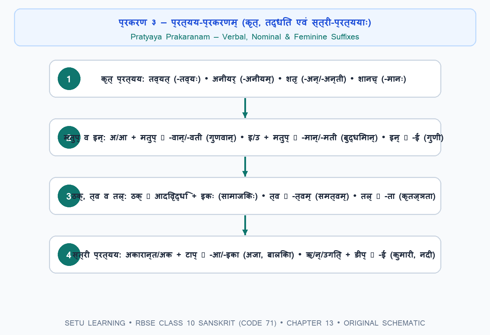

# अध्याय 13: प्रकरण ३ — प्रत्यय-प्रकरणम् (कृत्, तद्धित एवं स्त्री-प्रत्ययाः) (Pratyaya Prakaranam — Verbal, Nominal & Feminine Suffixes)

## भाग 1: अध्याय प्रवेश एवं पाठ्यक्रम मैपिंग

> संशोधित पाठ्यक्रम-सीमा: 2026–27 RBSE पाठ्यक्रम को 2025–26 सूची से अलग रखा गया है। इस अध्याय में कुछ पुराने और अतिरिक्त प्रत्यय अभ्यास के लिए बने हुए हैं; उन्हें वर्तमान बोर्ड-पाठ्यक्रम का हिस्सा या निश्चित प्रश्न न मानें। यह NCERT के सभी प्रश्नों का संपूर्ण समाधान होने का दावा नहीं करता।

**विषय कोड:** 71 (तृतीया भाषा — संस्कृतम्) · **श्रृंखला पुस्तक:** 6

**सत्यापित आधार:** RBSE कक्षा 10 संस्कृत पाठ्यक्रम 2026–27 · **प्रत्यय घटक:** पूरे अनुप्रयुक्त व्याकरण के लिए 24 अंक; अलग प्रत्यय-घटक का 4-अंक आवंटन इस syllabus PDF में नहीं मिला। अभ्यास-अंक या पुराने पेपर का भार current component weight नहीं है। [आधिकारिक 2026–27 पाठ्यक्रम](https://rajeduboard.rajasthan.gov.in/anudeshika-etc/10_2027.pdf)

**सीखने के लक्ष्य:** वर्तमान 2026–27 सूची में दिए प्रत्ययों के रूप पहचानना और बनाना। 2025–26 सूची में रहे शतृ और शानच् को तुलना/अतिरिक्त अभ्यास के रूप में चिह्नित किया गया है; ल्युट्, क्त्वा, ल्यप् और तुमुन् को भी अतिरिक्त अभ्यास मानें, जब तक वर्तमान RBSE पाठ्यक्रम या प्रश्नपत्र उन्हें स्पष्ट रूप से निर्धारित न करे।

**वर्तमान और अतिरिक्त सामग्री:** 2026–27 सूची में क्त और क्तवतु शामिल हैं; पुराने शतृ/शानच् को वर्तमान-सूची का अंश न समझें। नीचे वर्ष सहित दिए पुराने प्रश्न-संदर्भ ऐतिहासिक अभ्यास हैं, आगामी परीक्षा के निश्चित दायरे या प्रारूप का प्रमाण नहीं।

## भाग 2: शब्दावली एवं अवधारणा कैप्सूल

| शब्द / सूत्र | अर्थ / उपयोग |
|---|---|
| कृत् प्रत्ययः | धातुओं (क्रियाओं) के बाद जुड़ने वाले प्रत्यय (जैसे — तव्यत्, अनीयर्, शतृ, शानच्)। |
| तद्धित प्रत्ययः | संज्ञा, सर्वनाम या विशेषण शब्दों के बाद जुड़ने वाले प्रत्यय (जैसे — मतुप्, इन्, ठक्, त्व, तल्)। |
| स्त्री प्रत्ययः | पुल्लिंग शब्दों को स्त्रीलिंग बनाने वाले प्रत्यय (टाप् = आ, ङीप् = ई)। |
| तव्यत् / अनीयर् | 'चाहिए / योग्य' अर्थ में कर्मवाच्य व भाववाच्य में प्रयुक्त (पठितव्यः, करणीयम्)। |
| शतृ प्रत्ययः | परस्मैपदी धातुओं से 'हुआ/हुए' (वर्तमान काल) अर्थ में, शेष 'अत्' (पठन्, पठन्ती, पठत्)। |
| शानच् प्रत्ययः | आत्मनेपदी धातुओं से 'हुआ/हुए' अर्थ में, शेष 'आन / मान' (सेवमानः, वर्धमानः)। |
| मतुप् प्रत्ययः | 'वाला' अर्थ में, शेष 'मत् / वत्' (बुद्धिमान्, गुणवान्, बलवती)। |
| इन् (णिनि) प्रत्ययः | 'वाला' अर्थ में अकारान्त शब्दों से, शेष 'इन्' (गुणी, धनी, बली)। |
| ठक् प्रत्ययः | 'संबंधित' अर्थ में, शेष 'इक' तथा आदि स्वर को वृद्धि (समाज + ठक् = सामाजिकः)। |
| तल् एवं त्व | भाववाचक संज्ञा बनाने हेतु: तल् में 'ता' (स्त्रीलिंग) और त्व में 'त्वम्' (नपुंसकलिंग)। |

## भाग 3: विस्तृत शिक्षण पाठ

### १. कृत् प्रत्ययाः (धातु से जुड़ने वाले प्रत्यय)
धातु के पश्चात् जुड़कर संज्ञा, विशेषण या अव्यय बनाने वाले प्रत्यय **कृत् प्रत्यय** कहलाते हैं:

| प्रत्यय | शेष भाग व अर्थ | पुल्लिंग रूप | स्त्रीलिंग रूप | नपुंसकलिंग रूप | बोर्ड परीक्षा के उदाहरण |
|---|---|---|---|---|---|
| **१. तव्यत्** | **तव्य** (चाहिए/योग्य) | पठितव्यः, हन्तव्यः | पठितव्या, हन्तव्या | पठितव्यम्, हन्तव्यम् | हन् + तव्यत् = **हन्तव्यः** (2026 पूरक); सेव् + तव्यत् = **सेवितव्यः**; गम् + तव्यत् = **गन्तव्यम्** |
| **२. अनीयर्** | **अनीय** (चाहिए/योग्य) | करणीयः, शङ्कनीयः | करणीया, दर्शनीया | करणीयम्, पालनीयम् | कृ + अनीयर् = **करणीयम्** (2026 मुख्य, 2024 मुख्य); शङ्क् + अनीयर् = **शङ्कनीयः** (2023); दृश् + अनीयर् = **दर्शनीयम्** (2017) |
| **३. शतृ** | **अत्** (परस्मैपदी, करता हुआ) | पठन्, हसन्, गच्छन् | पठन्ती, नृत्यन्ती | पठत्, चलत्, गच्छत् | हस् + शतृ = **हसन्** (2025 मुख्य, 2017); नृत् + शतृ + ङीप् = **नृत्यन्ती** (2018 पूरक); गम् + शतृ = **गच्छन्** (2015) |
| **४. शानच्** | **मान/आन** (आत्मनेपदी, करता हुआ) | सेवमानः, शङ्कमानः | सेवमाना, कम्पमाना | सेवमानम्, वर्धमानम् | सेव् + शानच् = **सेवमानः** (2025 पूरक, 2020); शङ्क् + शानच् = **शङ्कमानः** (2018); वृध् + शानच् = **वर्धमानः** |
| **५. क्त / क्तवतु** | **त / तवत्** (भूतकाल) | पठितः / पठितवान् | विमुक्ता / कृतवती | पठितम् / कृतवत् | वि + मुच् + क्त + टाप् = **विमुक्ता** (2026 मुख्य); युज् + क्त + टाप् = **युक्ता** (2025 मुख्य); कृ + क्तवतु = **कृतवान्** |
| **६. क्त्वा / ल्यप् / तुमुन्** | **त्वा / य / तुम्** (अव्यय) | गत्वा, विहाय, पठितुम् | (अव्यय — रूप नहीं चलते) | (अव्यय) | गम् + ल्युट् = **गमनम्** (2025 पूरक); दृश् + क्त्वा = **दृष्ट्वा**; वि + हा + ल्यप् = **विहाय**; पा + तुमुन् = **पातुम्** |

### २. तद्धित प्रत्ययाः (शब्द से जुड़ने वाले प्रत्यय)
संज्ञा या विशेषण शब्दों के बाद जुड़ने वाले प्रत्यय **तद्धित प्रत्यय** कहलाते हैं:
1. **मतुप् प्रत्ययः ('तदस्यास्त्यस्मिन्निति मतुप्' — 'वाला' अर्थ में):**
   - **नियम:** यदि शब्द के अंत में **अ, आ** हो या उपधा में म्/वर्ण का १-४ अक्षर हो तो **'वत्' (वान्, वती, वत्)** जुड़ता है; और यदि अंत में **इ, ई, उ, ऊ** हो तो **'मत्' (मान्, मती, मत्)** जुड़ता है।
   - उदाहरण: बुद्धि + मतुप् = **बुद्धिमान्** (पु., 2026 मुख्य, 2017), **बुद्धिमती** (स्त्री., 2019); गुण + मतुप् = **गुणवान्** (2024 मुख्य); बल + मतुप् + ङीप् = **बलवती** (2024 पूरक); श्री + मतुप् + ङीप् = **श्रीमती** (2018 पूरक); धन + मतुप् = **धनवान्**; शक्ति + मतुप् = **शक्तिमान्**।
2. **इन् (णिनि) प्रत्ययः ('वाला' अर्थ में केवल अकारान्त शब्दों से):**
   - शेष **'इन्'** रहता है; पुल्लिंग प्रथमा एकवचन में **'-ई'** बनता है: गुण + इन् = **गुणी** (2026 पूरक); धन + इन् = **धनी** (2019); बल + इन् = **बली**; दण्ड + इन् = **दण्डी**; सुख + इन् = **सुखी**।
3. **ठक् प्रत्ययः ('इक' शेष तथा प्रथम स्वर की वृद्धिः — अ→आ, इ/ई/ए→ऐ, उ/ऊ/ओ→औ):**
   - समाज + ठक् = **सामाजिकः**; धर्म + ठक् = **धार्मिकः**; दिन + ठक् = **दैनिकः**; इतिहास + ठक् = **ऐतिहासिकः**; भूगोल + ठक् = **भौगोलिकः**; नौ + ठक् = **नाविकः** (2020 मुख्य); सप्ताह + ठक् = **साप्ताहिकः**।
4. **त्व एवं तल् प्रत्ययौ (भाववाचक संज्ञा बनाने के लिए):**
   - **त्व प्रत्ययः:** हमेशा **नपुंसकलिंग एकवचन ('-त्वम्')** में प्रयुक्त होता है: महत् + त्व = **महत्त्वम्** (2023, 2015); सम + त्व = **समत्वम्** (2023); नर + त्व = **नरत्वम्** (2024 पूरक); रम्य + त्व = **रम्यत्वम्** (2020 पूरक); पशु + त्व = **पशुत्वम्**।
   - **तल् प्रत्ययः:** हमेशा **स्त्रीलिंग आकारान्त ('-ता')** में प्रयुक्त होता है: कृतज्ञ + तल् (द्वितीया) = **कृतज्ञताम्** (2025 मुख्य); जन + तल् = **जनता** (2014); मूर्ख + तल् = **मूर्खता**; पटु + तल् = **पटुता**; बन्धु + तल् = **बन्धुता**।

### ३. स्त्री प्रत्ययौ (टाप् एवं ङीप्)
1. **टाप् प्रत्ययः ('अजाद्यतष्टाप्'):** अकारान्त शब्दों और 'अक' अन्त वाले शब्दों से स्त्रीलिंग बनाने के लिए **टाप् ('आ')** लगता है। यदि अंत में 'अक' हो तो 'इका' हो जाता है ('प्रत्ययस्थात् कात् पूर्वस्यात इदाप्यसुपः'):
   - अज + टाप् = **अजा** (2024 पूरक); चपल + टाप् = **चपला** (2014); चतुर + टाप् = **चतुरा** (2015); बालक + टाप् = **बालिका** (2018 पूरक); शिक्षक + टाप् = **शिक्षिका** (2019); सेवक + टाप् = **सेविका**; मूषक + टाप् = **मूषिका**।
2. **ङीप् प्रत्ययः ('ऋन्नेभ्यो ङीप्' / 'उगितश्च'):** ऋकारान्त, नकारान्त तथा उगित् (मतुप्, शतृ, क्तवतु आदि) शब्दों से स्त्रीलिंग में **ङीप् ('ई')** लगता है:
   - कुमार + ङीप् = **कुमारी** (2024 मुख्य, 2020 पूरक); नद + ङीप् = **नदी** (2025 पूरक); श्रीमत् + ङीप् = **श्रीमती**; बुद्धिमत् + ङीप् = **बुद्धिमती**; पठत् (शतृ) + ङीप् = **पठन्ती**; नर्तकी (ङीष्); दातृ + ङीप् = **दात्री**।

प्रत्यय-प्रकरणम्: कृत्, तद्धित एवं स्त्री प्रत्ययों की पहचान और लिंग-अन्वय का मानचित्र।

## भाग 4: पाठ्यपुस्तक-अवधारणाओं पर मौलिक हल किए उदाहरण

नीचे के प्रश्न लेखक के मौलिक मॉडल हैं। ये किसी NCERT edition के प्रश्न क्रमांक या संपूर्ण in-text/exercise solution bank होने का दावा नहीं करते।

**हल किया उदाहरण 1: RBSE 2026 मुख्य परीक्षा प्रश्न 2(i, ii, iii): रिक्त स्थानों की पूर्ति करें — (i) शुद्धीकरणं ____ (कृ + अनीयर्), (ii) लोके अन्योऽपि ____ (बुद्धि + मतुप्) मुच्यते, (iii) सा भयात् ____ (वि + मुच् + क्त + टाप्)।**

(i) कृ + अनीयर् (नपुंसकलिंग विशेष्य 'शुद्धीकरणम्' के अनुसार) = **करणीयम्**। (ii) बुद्धि + मतुप् (पुल्लिंग एकवचन) = **बुद्धिमान्**। (iii) वि + मुच् + क्त + टाप् (स्त्रीलिंग एकवचन 'सा' के अनुसार) = **विमुक्ता**।

**हल किया उदाहरण 2: RBSE 2026 पूरक परीक्षा प्रश्न 2(iv, vi): (क) हन् + तव्यत् (पुल्लिंग एकवचन), (ख) गुण + इन् (पुल्लिंग एकवचन) से पद बनाएँ।**

(क) हन् + तव्यत् = **हन्तव्यः**। (ख) गुण + इन् (णिनि) = **गुणी** ('गुणी गुणं वेत्ति न वेत्ति निर्गुणः')।

**हल किया उदाहरण 3: RBSE 2025 मुख्य व पूरक परीक्षा प्रश्न 2: (i) हस् + शतृ, (ii) कृतज्ञ + तल् (द्वितीया), (iii) नद + ङीप्, (iv) सेव् + शानच्।**

(i) हस् + शतृ (पुल्लिंग प्रथमा एकवचन) = **हसन्**। (ii) कृतज्ञ + तल् (द्वितीया एकवचन) = **कृतज्ञताम्**। (iii) नद + ङीप् = **नदी**। (iv) सेव् + शानच् (पुल्लिंग प्रथमा एकवचन) = **सेवमानः**।

## भाग 5: सत्यापित बोर्ड प्रश्न एवं स्रोत-स्थिति

2026 मुख्य परीक्षा, प्रश्न 2(i, ii, iii): 'करणीयम्', 'बुद्धिमान्', 'विमुक्ता' तथा 2026 पूरक परीक्षा: 'हन्तव्यः', 'गुणी'।

[RBSE 2026 मूल पेपर (S-71)](https://rajeduboard.rajasthan.gov.in/books/PAPERS-2026/Sec/S-71-Sankrit-TL-26.pdf)। प्रश्न का संक्षिप्त विषय-संदर्भ है; शब्दशः पुनर्मुद्रण नहीं।

## भाग 6: खंडवार मौलिक अभ्यास बैंक

**अभ्यास-अंक:** लेखक के स्व-अभ्यास के लिए हैं; RBSE की आधिकारिक marking scheme नहीं। उत्तर पहले स्वयं लिखें, फिर भाग 9 देखें।

## अ: बहुविकल्पीय प्रश्न — 15 × 1 अंक

**MCQ 1. 'कृ + अनीयर्' (नपुंसकलिंगे) इत्यस्य निष्पन्नं पदं किम्?**

अ) कर्तव्यम्  
ब) कृतम्  
स) कुर्वन्  
द) करणीयम्

**MCQ 2. 'बुद्धि + मतुप्' (पुल्लिंगे प्रथमा-एकवचने) रूपं किम् अस्ति?**

अ) बुद्धिमती  
ब) बुद्धिमत्  
स) बुद्धिमान्  
द) बुद्धिवान्

**MCQ 3. 'हन् + तव्यत्' (पुल्लिंगे) इत्यस्मात् किं पदं निष्पद्यते?**

अ) घ्नन्  
ब) हन्तव्यः  
स) हननीयः  
द) हतवान्

**MCQ 4. 'गुण + इन् (णिनि)' इत्यस्य पुल्लिंगे प्रथमा-एकवचने रूपं किम्?**

अ) गुणी  
ब) गुणवान्  
स) गुणता  
द) गुणत्वम्

**MCQ 5. 'हस् + शतृ' (पुल्लिंगे प्रथमा-एकवचने) किं रूपं भवति?**

अ) हसमानः  
ब) हसितव्यः  
स) हसन्ती  
द) हसन्

**MCQ 6. 'सेव् + शानच्' (पुल्लिंगे) इत्यस्य रूपं किम्?**

अ) सेवितव्यः  
ब) सेवनीयः  
स) सेवमानः  
द) सेवन्

**MCQ 7. 'कुमार + ङीप्' इत्यस्मात् किं स्त्रीलिंगपदं भवति?**

अ) कौमारी  
ब) कुमारी  
स) कुमारा  
द) कुमारिका

**MCQ 8. 'बालक + टाप्' इत्यस्य शुद्धं रूपं किम्?**

अ) बालिका  
ब) बालका  
स) बालकी  
द) बाला

**MCQ 9. 'महत् + त्व' इत्यस्य शुद्धं रूपं किम्?**

अ) महत्वम्  
ब) महत्ता  
स) महान्  
द) महत्त्वम्

**MCQ 10. 'कृतज्ञता' पदे कः तद्धित-प्रत्ययः अस्ति?**

अ) टाप्  
ब) मतुप्  
स) तल्  
द) त्व

**MCQ 11. 'नृत्यन्ती' पदे कौ प्रत्ययौ स्तः?**

अ) तव्यत् + टाप्  
ब) शतृ + ङीप्  
स) शानच् + टाप्  
द) क्त + ङीप्

**MCQ 12. 'नाविकः' पदे कः प्रत्ययः प्रयुक्तः?**

अ) ठक्  
ब) मतुप्  
स) इन्  
द) तल्

**MCQ 13. 'गुण + मतुप्' (पुल्लिंगे) रूपं किम् भवति?**

अ) गुणमान्  
ब) गुणी  
स) गुणता  
द) गुणवान्

**MCQ 14. 'अजा' पदे कः स्त्री-प्रत्ययः अस्ति?**

अ) ङीष्  
ब) ति  
स) टाप्  
द) ङीप्

**MCQ 15. 'दर्शनीयम्' पदे प्रकृति-प्रत्ययौ कौ स्तः?**

अ) दृश् + शतृ  
ब) दृश् + अनीयर्  
स) दर्श + अनीयर्  
द) दृश् + तव्यत्

## अ: रिक्त स्थान — 6 × 1 अंक

1. धातुओं (क्रियाओं) के बाद जुड़ने वाले प्रत्यय (जैसे — तव्यत्, अनीयर्, शतृ, शानच्)। — इस शब्द/सूत्र का नाम है: ____।  
2. संज्ञा, सर्वनाम या विशेषण शब्दों के बाद जुड़ने वाले प्रत्यय (जैसे — मतुप्, इन्, ठक्, त्व, तल्)। — इस शब्द/सूत्र का नाम है: ____।  
3. पुल्लिंग शब्दों को स्त्रीलिंग बनाने वाले प्रत्यय (टाप् = आ, ङीप् = ई)। — इस शब्द/सूत्र का नाम है: ____।  
4. 'चाहिए / योग्य' अर्थ में कर्मवाच्य व भाववाच्य में प्रयुक्त (पठितव्यः, करणीयम्)। — इस शब्द/सूत्र का नाम है: ____।  
5. परस्मैपदी धातुओं से 'हुआ/हुए' (वर्तमान काल) अर्थ में, शेष 'अत्' (पठन्, पठन्ती, पठत्)। — इस शब्द/सूत्र का नाम है: ____।  
6. आत्मनेपदी धातुओं से 'हुआ/हुए' अर्थ में, शेष 'आन / मान' (सेवमानः, वर्धमानः)। — इस शब्द/सूत्र का नाम है: ____।

## अ: अतिलघु उत्तर — 8 × 1 अंक

1. 'कृ + अनीयर्' (नपुंसकलिंगे) इत्यस्य निष्पन्नं पदं किम्?  
2. 'बुद्धि + मतुप्' (पुल्लिंगे प्रथमा-एकवचने) रूपं किम् अस्ति?  
3. 'हन् + तव्यत्' (पुल्लिंगे) इत्यस्मात् किं पदं निष्पद्यते?  
4. 'गुण + इन् (णिनि)' इत्यस्य पुल्लिंगे प्रथमा-एकवचने रूपं किम्?  
5. 'हस् + शतृ' (पुल्लिंगे प्रथमा-एकवचने) किं रूपं भवति?  
6. 'सेव् + शानच्' (पुल्लिंगे) इत्यस्य रूपं किम्?  
7. 'कुमार + ङीप्' इत्यस्मात् किं स्त्रीलिंगपदं भवति?  
8. 'बालक + टाप्' इत्यस्य शुद्धं रूपं किम्?

## ब: लघु उत्तर — 6 × 2 अंक

**B1.** 'करणीयम्' पदे प्रकृति-प्रत्ययौ पृथक् कुरुत।

**B2.** 'बुद्धिमान्' पदे कः प्रत्ययः अस्ति?

**B3.** 'सेवमानः' इत्यत्र प्रकृति-प्रत्ययौ लिखत।

**B4.** 'पठन्' तथा 'पठन्ती' पदयोः कः कृत्-प्रत्ययः अस्ति?

**B5.** 'महत्त्वम्' तथा 'जनता' पदयोः प्रकृति-प्रत्ययौ लिखत।

**B6.** 'बालिका' तथा 'कुमारी' पदयोः कौ स्त्री-प्रत्ययौ स्तः?

## स: दीर्घ उत्तर — 4 × 3 अंक

आंतरिक विकल्प अभ्यास: C1 अथवा C2, तथा C3 अथवा C4 चुनें। पुनरावृत्ति में बचा विकल्प भी हल करें। यह लेखक की अभ्यास व्यवस्था है।

**C1.** शतृ-प्रत्ययस्य शानच्-प्रत्ययस्य च प्रयोगभेदं सोदाहरणं स्पष्टीकुरुत।

**C2.** मतुप्-प्रत्यये कुत्र 'मान्' कुत्र च 'वान्' भवति? उदाहरणसहितं लिखत।

**C3.** त्व-प्रत्ययस्य तल्-प्रत्ययस्य च नियमं सोदाहरणं लिखत।

**C4.** तव्यत्-अनीयर्-प्रत्यययोः प्रयोगं सोदाहरणं स्पष्टीकुरुत।

## द: विस्तृत उत्तर — 2 × 4 अंक

आंतरिक विकल्प अभ्यास: D1 अथवा D2 चुनें; बाद में दूसरा भी हल करें।

**D1.** RBSE बोर्ड परीक्षा (२०१४–२०२६) में पूछे गए २० प्रमुख प्रत्यय-पदों की संपूर्ण समाधान-तालिका लिखें।

**D2.** ठक् प्रत्यय में आदि-वृद्धि के नियम तथा टाप्-ङीप् प्रत्यय के सूक्ष्म अंतर को उदाहरण सहित समझाएँ।

## भाग 7: सावधानियाँ एवं परीक्षा-त्रुटियाँ

- 'शिक्षिका, बालिका, गायिका, सेविका' में **टाप्** प्रत्यय है, इसे भूलकर भी 'ङीप्' या 'ठक्' न लिखें!
- 'जनता, मूर्खता, कृतज्ञता' में भाववाचक **तल्** प्रत्यय है, इसे स्त्री प्रत्यय 'टाप्' न मानें।
- 'गुणवान् / बलवान्' में भी **मतुप्** प्रत्यय ही है ('वतुप्' नाम का कोई अलग प्रत्यय नहीं होता)।
- रिक्त स्थान में विशेष्य का लिंग व वचन अवश्य देखें: 'सा कन्या बुद्धिमती' (स्त्री.), 'सः बालकः बुद्धिमान्' (पु.), 'तत् कार्यं करणीयम्' (नपुं.)।
- 'महत् + त्व = महत्त्वम्' में दो त् (त्त्व) लिखना अनिवार्य है।

## भाग 8: फटाफट पुनरावृत्ति — 25 बिंदु

1. कृत् प्रत्ययः: धातुओं (क्रियाओं) के बाद जुड़ने वाले प्रत्यय (जैसे — तव्यत्, अनीयर्, शतृ, शानच्)।  
2. तद्धित प्रत्ययः: संज्ञा, सर्वनाम या विशेषण शब्दों के बाद जुड़ने वाले प्रत्यय (जैसे — मतुप्, इन्, ठक्, त्व, तल्)।  
3. स्त्री प्रत्ययः: पुल्लिंग शब्दों को स्त्रीलिंग बनाने वाले प्रत्यय (टाप् = आ, ङीप् = ई)।  
4. तव्यत् / अनीयर्: 'चाहिए / योग्य' अर्थ में कर्मवाच्य व भाववाच्य में प्रयुक्त (पठितव्यः, करणीयम्)।  
5. शतृ प्रत्ययः: परस्मैपदी धातुओं से 'हुआ/हुए' (वर्तमान काल) अर्थ में, शेष 'अत्' (पठन्, पठन्ती, पठत्)।  
6. शानच् प्रत्ययः: आत्मनेपदी धातुओं से 'हुआ/हुए' अर्थ में, शेष 'आन / मान' (सेवमानः, वर्धमानः)।  
7. मतुप् प्रत्ययः: 'वाला' अर्थ में, शेष 'मत् / वत्' (बुद्धिमान्, गुणवान्, बलवती)।  
8. इन् (णिनि) प्रत्ययः: 'वाला' अर्थ में अकारान्त शब्दों से, शेष 'इन्' (गुणी, धनी, बली)।  
9. ठक् प्रत्ययः: 'संबंधित' अर्थ में, शेष 'इक' तथा आदि स्वर को वृद्धि (समाज + ठक् = सामाजिकः)।  
10. तल् एवं त्व: भाववाचक संज्ञा बनाने हेतु: तल् में 'ता' (स्त्रीलिंग) और त्व में 'त्वम्' (नपुंसकलिंग)।  
11. कृ धातु में अनीयर् प्रत्यय लगने पर नपुंसकलिंग एकवचन में 'करणीयम्' बनता है (RBSE 2026 मुख्य व 2024 मुख्य)।  
12. इकारान्त शब्द 'बुद्धि' से मतुप् प्रत्यय जुड़ने पर पुल्लिंग में 'बुद्धिमान्' बनता है (RBSE 2026 मुख्य)।  
13. हन् धातु में तव्यत् प्रत्यय जुड़ने पर पुल्लिंग प्रथमा एकवचन में 'हन्तव्यः' बनता है (RBSE 2026 पूरक)।  
14. गुण + इन् से प्रथमा एकवचन पुल्लिंग में 'गुणी' रूप बनता है (RBSE 2026 पूरक)।  
15. परस्मैपदी हस् धातु से शतृ प्रत्यय लगने पर पुल्लिंग एकवचन में 'हसन्' बनता है (RBSE 2025 मुख्य)।  
16. आत्मनेपदी सेव् धातु में शानच् प्रत्यय से 'सेवमानः' बनता है (RBSE 2025 पूरक)।  
17. कुमार शब्द में ङीप् प्रत्यय लगने से 'कुमारी' बनता है (RBSE 2024 मुख्य)।  
18. 'अक' अन्त वाले बालक शब्द में टाप् प्रत्यय लगने पर अक को इक होकर 'बालिका' बनता है (RBSE 2018 पूरक)।  
19. महत् (त् हलन्त) + त्वम् मिलने से दो 'त्' वाला 'महत्त्वम्' बनता है (RBSE 2023 मुख्य)।  
20. भाववाचक स्त्रीलिंग संज्ञा 'कृतज्ञता' में 'कृतज्ञ + तल्' प्रत्यय है (RBSE 2025 मुख्य)।  
21. नृत् + शतृ (नृत्यत्) में स्त्रीलिंग बनाने हेतु ङीप् जुड़कर 'नृत्यन्ती' बनता है (RBSE 2018 पूरक)।  
22. नौ + ठक् से आदिवृद्धि और अयादि (आव्) होकर 'नाविकः' बनता है (RBSE 2020 मुख्य)।  
23. अकारान्त शब्द 'गुण' से मतुप् में म् को व् होकर 'गुणवान्' बनता है (RBSE 2024 मुख्य)।  
24. अज + टाप् = अजा (RBSE 2024 पूरक)।  
25. मूल धातु 'दृश्' है, जिसमें अनीयर् प्रत्यय लगने पर गुण होकर 'दर्शनीयम्' बनता है।

## भाग 9: संपूर्ण अभ्यास उत्तर-कुंजी

## MCQ: सही विकल्प और कारण

**1. द — करणीयम्।** कृ धातु में अनीयर् प्रत्यय लगने पर नपुंसकलिंग एकवचन में 'करणीयम्' बनता है (RBSE 2026 मुख्य व 2024 मुख्य)।

**2. स — बुद्धिमान्।** इकारान्त शब्द 'बुद्धि' से मतुप् प्रत्यय जुड़ने पर पुल्लिंग में 'बुद्धिमान्' बनता है (RBSE 2026 मुख्य)।

**3. ब — हन्तव्यः।** हन् धातु में तव्यत् प्रत्यय जुड़ने पर पुल्लिंग प्रथमा एकवचन में 'हन्तव्यः' बनता है (RBSE 2026 पूरक)।

**4. अ — गुणी।** गुण + इन् से प्रथमा एकवचन पुल्लिंग में 'गुणी' रूप बनता है (RBSE 2026 पूरक)।

**5. द — हसन्।** परस्मैपदी हस् धातु से शतृ प्रत्यय लगने पर पुल्लिंग एकवचन में 'हसन्' बनता है (RBSE 2025 मुख्य)।

**6. स — सेवमानः।** आत्मनेपदी सेव् धातु में शानच् प्रत्यय से 'सेवमानः' बनता है (RBSE 2025 पूरक)।

**7. ब — कुमारी।** कुमार शब्द में ङीप् प्रत्यय लगने से 'कुमारी' बनता है (RBSE 2024 मुख्य)।

**8. अ — बालिका।** 'अक' अन्त वाले बालक शब्द में टाप् प्रत्यय लगने पर अक को इक होकर 'बालिका' बनता है (RBSE 2018 पूरक)।

**9. द — महत्त्वम्।** महत् (त् हलन्त) + त्वम् मिलने से दो 'त्' वाला 'महत्त्वम्' बनता है (RBSE 2023 मुख्य)।

**10. स — तल्।** भाववाचक स्त्रीलिंग संज्ञा 'कृतज्ञता' में 'कृतज्ञ + तल्' प्रत्यय है (RBSE 2025 मुख्य)।

**11. ब — शतृ + ङीप्।** नृत् + शतृ (नृत्यत्) में स्त्रीलिंग बनाने हेतु ङीप् जुड़कर 'नृत्यन्ती' बनता है (RBSE 2018 पूरक)।

**12. अ — ठक्।** नौ + ठक् से आदिवृद्धि और अयादि (आव्) होकर 'नाविकः' बनता है (RBSE 2020 मुख्य)।

**13. द — गुणवान्।** अकारान्त शब्द 'गुण' से मतुप् में म् को व् होकर 'गुणवान्' बनता है (RBSE 2024 मुख्य)।

**14. स — टाप्।** अज + टाप् = अजा (RBSE 2024 पूरक)।

**15. ब — दृश् + अनीयर्।** मूल धातु 'दृश्' है, जिसमें अनीयर् प्रत्यय लगने पर गुण होकर 'दर्शनीयम्' बनता है।

**रिक्त स्थान:** 1. कृत् प्रत्ययः; 2. तद्धित प्रत्ययः; 3. स्त्री प्रत्ययः; 4. तव्यत् / अनीयर्; 5. शतृ प्रत्ययः; 6. शानच् प्रत्ययः

**अतिलघु उत्तर:**

1. करणीयम्। कृ धातु में अनीयर् प्रत्यय लगने पर नपुंसकलिंग एकवचन में 'करणीयम्' बनता है (RBSE 2026 मुख्य व 2024 मुख्य)।

2. बुद्धिमान्। इकारान्त शब्द 'बुद्धि' से मतुप् प्रत्यय जुड़ने पर पुल्लिंग में 'बुद्धिमान्' बनता है (RBSE 2026 मुख्य)।

3. हन्तव्यः। हन् धातु में तव्यत् प्रत्यय जुड़ने पर पुल्लिंग प्रथमा एकवचन में 'हन्तव्यः' बनता है (RBSE 2026 पूरक)।

4. गुणी। गुण + इन् से प्रथमा एकवचन पुल्लिंग में 'गुणी' रूप बनता है (RBSE 2026 पूरक)।

5. हसन्। परस्मैपदी हस् धातु से शतृ प्रत्यय लगने पर पुल्लिंग एकवचन में 'हसन्' बनता है (RBSE 2025 मुख्य)।

6. सेवमानः। आत्मनेपदी सेव् धातु में शानच् प्रत्यय से 'सेवमानः' बनता है (RBSE 2025 पूरक)।

7. कुमारी। कुमार शब्द में ङीप् प्रत्यय लगने से 'कुमारी' बनता है (RBSE 2024 मुख्य)।

8. बालिका। 'अक' अन्त वाले बालक शब्द में टाप् प्रत्यय लगने पर अक को इक होकर 'बालिका' बनता है (RBSE 2018 पूरक)।

**B1. 'करणीयम्' पदे प्रकृति-प्रत्ययौ पृथक् कुरुत।**

कृ (धातुः) + अनीयर् (प्रत्ययः) = करणीयम्।

**B2. 'बुद्धिमान्' पदे कः प्रत्ययः अस्ति?**

बुद्धि (शब्दः) + मतुप् (प्रत्ययः) = बुद्धिमान्।

**B3. 'सेवमानः' इत्यत्र प्रकृति-प्रत्ययौ लिखत।**

सेव् (धातुः) + शानच् (प्रत्ययः) = सेवमानः।

**B4. 'पठन्' तथा 'पठन्ती' पदयोः कः कृत्-प्रत्ययः अस्ति?**

पठ् + शतृ = पठन् (पुल्लिंगे), पठ् + शतृ + ङीप् = पठन्ती (स्त्रीलिंगे)।

**B5. 'महत्त्वम्' तथा 'जनता' पदयोः प्रकृति-प्रत्ययौ लिखत।**

महत् + त्व = महत्त्वम्; जन + तल् = जनता।

**B6. 'बालिका' तथा 'कुमारी' पदयोः कौ स्त्री-प्रत्ययौ स्तः?**

बालक + टाप् = बालिका; कुमार + ङीप् = कुमारी।

**C1. शतृ-प्रत्ययस्य शानच्-प्रत्ययस्य च प्रयोगभेदं सोदाहरणं स्पष्टीकुरुत।**

1. दोनों प्रत्यय वर्तमान काल में 'करता हुआ / करती हुई' अर्थ में प्रयुक्त होते हैं। 2. शतृ प्रत्यय **परस्मैपदी धातुओं** में लगता है और इसका 'अत्' शेष रहता है; इसके रूप पुल्लिंग में 'पठन्', स्त्रीलिंग में 'पठन्ती' और नपुंसकलिंग में 'पठत्' चलते हैं (जैसे — हसन्, गच्छन्, लिखन्)। 3. शानच् प्रत्यय **आत्मनेपदी धातुओं** में लगता है और इसका 'मान / आन' शेष रहता है; इसके रूप 'सेवमानः, सेवमाना, सेवमानम्' चलते हैं (जैसे — कम्पमानः, वर्धमानः, शङ्कमानः)।

**C2. मतुप्-प्रत्यये कुत्र 'मान्' कुत्र च 'वान्' भवति? उदाहरणसहितं लिखत।**

1. मतुप् प्रत्यय 'वाला' अर्थ में संज्ञा शब्दों से जुड़ता है। 2. जब शब्द के अंत में 'अ' या 'आ' स्वर हो, तो 'मत्' को 'वत्' होकर पुल्लिंग में **'-वान्'** और स्त्रीलिंग में **'-वती'** जुड़ता है; जैसे — गुण + मतुप् = गुणवान्, धन + मतुप् = धनवान्, बल + मतुप् + ङीप् = बलवती, विद्या + मतुप् = विद्यावान्। 3. जब शब्द के अंत में 'इ, ई, उ, ऊ' स्वर हों, तो पुल्लिंग में **'-मान्'** और स्त्रीलिंग में **'-मती'** रहता है; जैसे — बुद्धि + मतुप् = बुद्धिमान्/बुद्धिमती, श्री + मतुप् = श्रीमान्/श्रीमती, शक्ति + मतुप् = शक्तिमान्।

**C3. त्व-प्रत्ययस्य तल्-प्रत्ययस्य च नियमं सोदाहरणं लिखत।**

1. 'त्व' और 'तल्' दोनों भाववाचक तद्धित प्रत्यय हैं और समान अर्थ ('ता / पन') देते हैं। 2. **त्व प्रत्यय** से बनने वाले शब्द सदा **नपुंसकलिंग एकवचन** में होते हैं और अंत में **'-त्वम्'** आता है; जैसे — सम + त्व = समत्वम्, नर + त्व = नरत्वम्, महत् + त्व = महत्त्वम् (यहाँ दो 'त्' आते हैं)। 3. **तल् प्रत्यय** का 'त' शेष रहता है और स्त्रीलिंग होने से 'आ' जुड़कर सदा **स्त्रीलिंग ('-ता')** शब्द बनता है; जैसे — जन + तल् = जनता, कृतज्ञ + तल् = कृतज्ञता, लघु + तल् = लघुता।

**C4. तव्यत्-अनीयर्-प्रत्यययोः प्रयोगं सोदाहरणं स्पष्टीकुरुत।**

1. तव्यत् और अनीयर् दोनों कृत् प्रत्यय 'चाहिए' या 'योग्य' अर्थ में प्रयुक्त होते हैं। 2. तव्यत् में 'तव्य' शेष रहता है और धातु के स्वर को गुण होता है: पठ् + तव्यत् = पठितव्यः/पठितव्या/पठितव्यम्; कृ + तव्यत् = कर्तव्यम्; हन् + तव्यत् = हन्तव्यः; सेव् + तव्यत् = सेवितव्यः। 3. अनीयर् में 'अनीय' शेष रहता है और धातु को गुण होता है: कृ + अनीयर् = करणीयः/करणीया/करणीयम् (ऋ → अर् और न → ण); दृश् + अनीयर् = दर्शनीयम्; पूज् + अनीयर् = पूजनीयः।

**D1. RBSE बोर्ड परीक्षा (२०१४–२०२६) में पूछे गए २० प्रमुख प्रत्यय-पदों की संपूर्ण समाधान-तालिका लिखें।**

1. कृ + अनीयर् = करणीयम् (2026 मुख्य, 2024 मुख्य)। 2. बुद्धि + मतुप् = बुद्धिमान् (2026 मुख्य, 2017)। 3. वि + मुच् + क्त + टाप् = विमुक्ता (2026 मुख्य)। 4. हन् + तव्यत् = हन्तव्यः (2026 पूरक)। 5. गुण + इन् = गुणी (2026 पूरक)। 6. हस् + शतृ = हसन् (2025 मुख्य, 2017)। 7. कृतज्ञ + तल् = कृतज्ञता (द्वितीया: कृतज्ञताम्, 2025 मुख्य)। 8. युज् + क्त + टाप् = युक्ता (2025 मुख्य)। 9. नद + ङीप् = नदी (2025 पूरक)। 10. सेव् + शानच् = सेवमानः (2025 पूरक, 2020)। 11. कुमार + ङीप् = कुमारी (2024 मुख्य, 2020 पूरक)। 12. गुण + मतुप् = गुणवान् (2024 मुख्य)। 13. अज + टाप् = अजा (2024 पूरक)। 14. नर + त्व = नरत्वम् (2024 पूरक)। 15. बल + मतुप् + ङीप् = बलवती (2024 पूरक)। 16. शङ्क् + अनीयर् = शङ्कनीयः (2023)। 17. महत् + त्व = महत्त्वम् (2023, 2015)। 18. सम + त्व = समत्वम् (2023)। 19. नौ + ठक् = नाविकः (2020)। 20. शिक्षक + टाप् = शिक्षिका (2019), बालक + टाप् = बालिका (2018 पूरक)।

**D2. ठक् प्रत्यय में आदि-वृद्धि के नियम तथा टाप्-ङीप् प्रत्यय के सूक्ष्म अंतर को उदाहरण सहित समझाएँ।**

1. ठक् प्रत्यय में 'ठक्' के स्थान पर 'इक' आदेश होता है और शब्द के प्रथम स्वर को वृद्धि होती है: (क) अ/आ → आ: समाज + ठक् = सामाजिकः, धर्म + ठक् = धार्मिकः; (ख) इ/ई/ए → ऐ: दिन + ठक् = दैनिकः, इतिहास + ठक् = ऐतिहासिकः, वेद + ठक् = वैदिकः; (ग) उ/ऊ/ओ → औ: पुराण + ठक् = पौराणिकः, भूगोल + ठक् = भौगोलिकः, नौ + ठक् = नाविकः (औ → आव्)। 2. टाप् बनाम ङीप्: 'शिक्षक + टाप् = शिक्षिका' और 'बालक + टाप् = बालिका' में अंत में 'ई' न होकर 'आ' है, इसलिए इनमें **टाप् प्रत्यय** है (अक को इक आदेश हुआ है), जबकि 'कुमारी' और 'नदी' के अंत में दीर्घ 'ई' है, अतः इनमें **ङीप् प्रत्यय** है।

## भाग 10: 10 मिनट / 10 अंक आत्म-मूल्यांकन एवं संदर्भ

समय: 10 मिनट। पहले पुस्तक बंद करें।

1. MCQ 3 और 11 हल करें। (1 + 1)
2. B2 और B5 के उत्तर लिखें। (2 + 2)
3. D1 हल करें। (4)

**कुंजी:** भाग 9 में संबंधित क्रमांक देखें। **स्व-मूल्यांकन:** 8–10: आगे बढ़ें; 5–7: छूटे कौशल का दोहराव; 0–4: भाग 2–4 फिर पढ़ें। यह अभ्यास-सुझाव है, बोर्ड grade नहीं।

[सत्यापित RBSE 2025–26 पाठ्यक्रम](https://rajeduboard.rajasthan.gov.in/anudeshika-etc/10_2026.pdf) · [NCERT शेमुषी भाग-2 संदर्भ](https://ncert.nic.in/textbook.php?jhsk1=0-12)

**आगे की कड़ी:** प्रकरण १४ 'अव्यय-पदानि' में पाठ्यक्रम में निर्धारित अव्ययों के अर्थ और वाक्य-प्रयोग में रिक्त-स्थान पूर्ति का अभ्यास करेंगे।

**स्रोत-पुनः परीक्षण, 14 October 2026:** 10_2027.pdf के PDF pp. 18–19 का दृश्य परीक्षण किया। 4-अंक component का पूर्व दावा हटाया गया; केवल 24-अंक कुल व्याकरण आवंटन स्पष्ट है। इस सुधार से सभी grammatical derivations/PYQ tags सत्यापित नहीं हो जाते।
