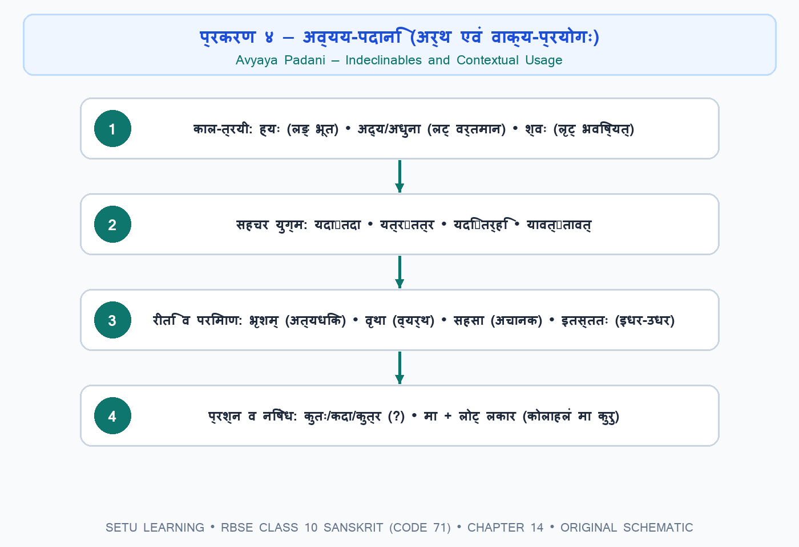

# अध्याय 14: प्रकरण ४ — अव्यय-पदानि (अर्थ एवं वाक्य-प्रयोगः) (Avyaya Padani — Indeclinables and Contextual Usage)

## भाग 1: अध्याय प्रवेश एवं पाठ्यक्रम मैपिंग

> NCERT 'शेमुषी भाग-2' के सभी प्रश्नों के हल तथा पूरा ऐतिहासिक PYQ संग्रह स्रोत-परीक्षण सहित संकलित हैं। सामान्य माध्यमिक 2026–27 पाठ्यक्रम की पुनः पुष्टि शेष है।

**विषय कोड:** 71 (तृतीया भाषा — संस्कृतम्) · **श्रृंखला पुस्तक:** 6

**सत्यापित आधार:** RBSE 2025–26 · **अध्याय भार:** 3 अंक। यह भार उसी संस्करण का है; वास्तविक प्रश्न-विभाजन की भविष्यवाणी नहीं।

**सीखने के लक्ष्य:** RBSE कक्षा 10 पाठ्यक्रम में निर्धारित अव्यय पदों के सटीक अर्थ, युग्म-अव्यय नियम (यदा-तदा, यदि-तर्हि, यत्र-तत्र, यावत्-तावत्) तथा बोर्ड परीक्षा में रिक्त-स्थान पूर्ति का अभ्यास करना।

## भाग 2: शब्दावली एवं अवधारणा कैप्सूल

| शब्द / सूत्र | अर्थ / उपयोग |
|---|---|
| अव्ययम् | 'न व्ययति इति अव्ययम्' — तीनों लिंगों, सभी विभक्तियों और तीनों वचनों में अपरिवर्तित रहने वाला पद। |
| भृशम् | अत्यधिक (वायुमण्डलं भृशं दूषितम्)। |
| इतस्ततः | इधर-उधर (वने पशवः इतस्ततः भ्रमन्ति — 2026 मुख्य परीक्षा)। |
| श्वः | आने वाला कल — लृट् लकार के साथ (अहं श्वः ग्रामं गमिष्यामि)। |
| ह्यः | बीता हुआ कल — लङ् लकार के साथ (सः ह्यः विद्यालयं न अगच्छत्)। |
| वृथा | व्यर्थ / बेकार (मेघाः गगने वृथा गर्जन्ति)। |
| सहसा | अचानक / एकाएक (सहसा विदधीत न क्रियाम्)। |
| शनैः | धीरे (गजः शनैः चलति)। |
| साम्प्रतम् / अधुना | इस समय / अब (अधुना अहं संस्कृतं पठामि)। |
| कुतः | कहाँ से / किस कारण से (भवान् कुतः भयात् पलायितः)। |

## भाग 3: विस्तृत शिक्षण पाठ

### १. अव्यय की परिभाषा एवं स्वरूप
**"सदृशं त्रिषु लिङ्गेषु सर्वासु च विभक्तिषु। वचनेषु च सर्वेषु यन्न व्येति तदव्ययम्॥"**
अर्थात् जो शब्द तीनों लिंगों (पुल्लिंग, स्त्रीलिंग, नपुंसकलिंग), सातों विभक्तियों और तीनों वचनों में सदैव एक-सा रहता है और जिसमें कोई रूप-परिवर्तन (व्यय) नहीं होता, उसे **अव्यय** कहते हैं। RBSE परीक्षा में प्रश्न संख्या 2 में मंजूषा से चुनकर **३ रिक्त स्थानों की पूर्ति (3 × 1 = 3 अंक)** के रूप में अव्यय पूछे जाते हैं।

### २. पाठ्यक्रम के प्रमुख अव्यय: अर्थ एवं प्रामाणिक वाक्य-प्रयोग

| क्र. | अव्यय पद | हिंदी अर्थ | काल / प्रयोग संकेत | बोर्ड परीक्षा का प्रामाणिक वाक्य |
|---|---|---|---|---|
| १ | **एव** | ही (निश्चय) | किसी पद पर बल देने हेतु | प्रकृतिः **एव** शरणम्। / सः सत्यम् **एव** वदति। (2026 मुख्य व पूरक) |
| २ | **अपि** | भी (और/प्रश्न) | समावेश या वाक्य के आरंभ में प्रश्न | अहम् **अपि** संस्कृतं पठामि। / अन्यः **अपि** बुद्धिमान् मुच्यते। (2026 मुख्य व पूरक) |
| ३ | **इतस्ततः** | इधर-उधर | भ्रमण/बिखरने के प्रसंग में | वने मृगाः **इतस्ततः** धावन्ति। / कुक्कुरः **इतस्ततः** भ्रमति। (2026 मुख्य) |
| ४ | **यत्र — तत्र** | जहाँ — वहाँ | स्थानवाची युग्म अव्यय | **यत्र** आस्ते सा धूर्ता **तत्र** गम्यताम्। / यत्र धूमः **तत्र** वह्निः। (2026 पूरक) |
| ५ | **उच्चैः** | जोर से / ऊँचा | ध्वनि या गर्जना के साथ | सिंहः **उच्चैः** गर्जति। / कक्षायां **उच्चैः** मा वद। |
| ६ | **नीचैः** | नीचे / धीमे | जलप्रवाह या नम्रता के साथ | जलम् सदा **नीचैः** वहति। |
| ७ | **भृशम्** | अत्यधिक | प्रदूषण या दुःख/विस्मय में | वायुमण्डलं **भृशं** दूषितम् अस्ति। |
| ८ | **सहसा** | अचानक | बिना विचारे या आकस्मिक कार्य | **सहसा** विदधीत न क्रियाम्। / व्याघ्रोऽपि **सहसा** नष्टः। |
| ९ | **वृथा** | व्यर्थ / बेकार | निरर्थक कार्य के साथ | केचिद् मेघाः गगने **वृथा** गर्जन्ति। / समयं **वृथा** मा यापय। |
| १० | **शनैः** | धीरे | मंद गति के साथ | कच्छपः **शनैः** चलति। / **शनैः** पन्थाः, शनैः कन्था। |
| ११ | **अद्य** | आज | वर्तमान काल (लट् लकार) | **अद्य** सोमवासरः अस्ति। |
| १२ | **श्वः** | आने वाला कल | भविष्यत् काल (**लृट् लकार — गमिष्यति**) | अहं **श्वः** जयपुरं गमिष्यामि। (2026 मुख्य अशुद्धि-संशोधन) |
| १३ | **ह्यः** | बीता हुआ कल | भूतकाल (**लङ् लकार — अगच्छत् / आसीत्**) | सः **ह्यः** ग्रामम् अगच्छत्। |
| १४ | **सम्पति / अधुना / इदानीम्** | अब / इस समय | वर्तमान काल | **अधुना** पर्यावरणस्य रक्षणं करणीयम्। |
| १५ | **यदा — तदा** | जब — तब | कालवाची युग्म अव्यय | **यदा** मेघः गर्जति **तदा** मयूरः नृत्यति। |
| १६ | **यदि — तर्हि** | यदि — तो | शर्तवाची युग्म अव्यय | **यदि** परिश्रमं करिष्यसि **तर्हि** सफलः भविष्यसि। |
| १७ | **यावत् — तावत्** | जब तक — तब तक | अवधिवाची युग्म अव्यय | **यावत्** सफलः न भवति **तावत्** प्रयासं कुरु। |
| १८ | **कदा / कुत्र / कुतः / किमर्थम्** | कब / कहाँ / कहाँ से / किसलिए | प्रश्नवाची वाक्य (**?** चिह्न) | भवान् **कुतः** भयात् पलायितः? / त्वं **कदा** उत्तिष्ठसि? |
| १९ | **नूनम् / खलु** | निश्चय ही | संभावना व निश्चय में | **नूनं** सहस्राधिकेषु पुत्रेषु सत्स्वपि वात्सल्यम्। |
| २० | **इव / इति / च / विना / मा** | समान / ऐसा / और / बिना / मत | उपमा, समापन, निषेध | कोलाहलं **मा** कुरु। / ज्ञानं **विना** न मुक्तिः। |

### ३. बोर्ड परीक्षा में रिक्त-स्थान भरने के ५ अचूक नियम (Golden Rules)
1. **युग्म-पहचान नियम:** यदि वाक्य में **'यदा'** दिखे तो रिक्त स्थान में तुरंत **'तदा'** भरें; **'यत्र'** दिखे तो **'तत्र'**; **'यदि'** दिखे तो **'तर्हि'**; और **'यावत्'** दिखे तो **'तावत्'** भरें।
2. **लकार-पहचान नियम:** यदि वाक्य के अंत में **लृट् लकार (गमिष्यति, पठिष्यति, भविष्यति)** हो, तो **'श्वः'** भरें; यदि **लङ् लकार (अगच्छत्, अपठत्, आसीत्)** हो, तो **'ह्यः'** भरें; और यदि **लट् लकार (अस्ति, पठति)** हो, तो **'अद्य / अधुना / सम्प्रति'** भरें।
3. **प्रश्नवाचक चिह्न (?) नियम:** यदि वाक्य के अंत में प्रश्नवाचक चिह्न (**?**) लगा हो, तो मंजूषा में से **'कदा, कुत्र, कुतः, किमर्थम्, कथम्'** या वाक्य के आरंभ में होने पर **'अपि'** चुनें।
4. **लोट् लकार निषेध नियम:** यदि वाक्य में आज्ञार्थक क्रिया ('वद, कुरु, गच्छ') निषेध अर्थ में हो, तो **'मा'** भरें (जैसे — सत्यं वद, असत्यं **मा** वद)।
5. **क्रिया-विशेषण मिलान:** 'भ्रमति / धावति' के साथ **इतस्ततः**; 'गर्जति' के साथ **उच्चैः** या **वृथा**; 'चलति / वहति' के साथ **शनैः**; और 'विदधीत न क्रियाम्' के साथ **सहसा** भरें।

अव्यय-पदानि: कालवाची, स्थानवाची एवं युग्म-अव्ययों का निर्णय-मैट्रिक्स।

## भाग 4: पाठ्यपुस्तक-अवधारणाओं पर मौलिक हल किए उदाहरण

नीचे के प्रश्न लेखक के मौलिक मॉडल हैं। ये किसी NCERT edition के प्रश्न क्रमांक या संपूर्ण in-text/exercise solution bank होने का दावा नहीं करते।

**हल किया उदाहरण 1: RBSE 2026 मुख्य परीक्षा प्रश्न 2(iv, v, vi): मञ्जूषातः समुचितानि अव्ययपदानि चित्वा पूरयत (मञ्जूषा — इतस्ततः, अपि, एव): (iv) प्रकृतिः ____ शरणम्। (v) अहम् ____ संस्कृतं पठामि। (vi) वने पशवः ____ भ्रमन्ति।**

(iv) प्रकृतिः **एव** शरणम्। (प्रकृति ही शरण है — पाठ १ की पंक्ति)। (v) अहम् **अपि** संस्कृतं पठामि। (मैं भी संस्कृत पढ़ता हूँ)। (vi) वने पशवः **इतस्ततः** भ्रमन्ति। ('भ्रमन्ति' क्रिया के साथ 'इधर-उधर' = इतस्ततः)।

**हल किया उदाहरण 2: RBSE 2026 पूरक परीक्षा प्रश्न 2(i, ii, iii): मञ्जूषा (तत्र, अपि, एव): (i) सः सत्यम् ____ वदति। (ii) मोहनः ____ जयपुरं गमिष्यति। (iii) यत्र धूमः ____ वह्निः।**

(i) सः सत्यम् **एव** वदति। (वह सत्य ही बोलता है)। (ii) मोहनः **अपि** जयपुरं गमिष्यति। (मोहन भी जयपुर जाएगा)। (iii) यत्र धूमः **तत्र** वह्निः। ('यत्र' के साथ युग्म अव्यय 'तत्र')।

**हल किया उदाहरण 3: कालवाची अव्यय (अद्य, श्वः, ह्यः) के आधार पर तीन वाक्य पूरे करें: (क) सः ____ विद्यालयं न अगच्छत्। (ख) अहं ____ ग्रामं गमिष्यामि। (ग) ____ रविवासरः अस्ति।**

(क) क्रिया 'अगच्छत्' (लङ् लकार भूतकाल) है, अतः उत्तर: **ह्यः**। (ख) क्रिया 'गमिष्यामि' (लृट् लकार भविष्यत् काल) है, अतः उत्तर: **श्वः**। (ग) क्रिया 'अस्ति' (लट् लकार वर्तमान काल) है, अतः उत्तर: **अद्य**।

## भाग 5: सत्यापित बोर्ड प्रश्न एवं स्रोत-स्थिति

2026 मुख्य परीक्षा, प्रश्न 2(iv, v, vi): 'एव', 'अपि', 'इतस्ततः' तथा 2026 पूरक परीक्षा: 'एव', 'अपि', 'तत्र'।

[RBSE 2026 मूल पेपर (S-71)](https://rajeduboard.rajasthan.gov.in/books/PAPERS-2026/Sec/S-71-Sankrit-TL-26.pdf)। प्रश्न का संक्षिप्त विषय-संदर्भ है; शब्दशः पुनर्मुद्रण नहीं।

## भाग 6: खंडवार मौलिक अभ्यास बैंक

**अभ्यास-अंक:** लेखक के स्व-अभ्यास के लिए हैं; RBSE की आधिकारिक marking scheme नहीं। उत्तर पहले स्वयं लिखें, फिर भाग 9 देखें।

## अ: बहुविकल्पीय प्रश्न — 15 × 1 अंक

**MCQ 1. 'वने पशवः ____ भ्रमन्ति' — रिक्तस्थाने उचितम् अव्ययपदं किम्?**

अ) मा  
ब) तर्हि  
स) इतस्ततः  
द) श्वः

**MCQ 2. 'यत्र धूमः ____ वह्निः' — रिक्तस्थाने किम् अव्ययपदम् आगमिष्यति?**

अ) तावत्  
ब) तत्र  
स) तदा  
द) तर्हि

**MCQ 3. 'अहं श्वः विद्यालयं ____' — रिक्तस्थाने उचितं क्रियापदं किम्?**

अ) गमिष्यामि  
ब) अगच्छम्  
स) गच्छतु  
द) अभवम्

**MCQ 4. 'सः ____ जयपुरम् अगच्छत्' — भूतकालिक-क्रियायाः कारणात् अत्र किम् अव्ययं भविष्यति?**

अ) श्वः  
ब) अद्य  
स) तर्हि  
द) ह्यः

**MCQ 5. '____ विदधीत न क्रियाम्' — सूक्तिं पूरयत।**

अ) उच्चैः  
ब) कुतः  
स) सहसा  
द) वृथा

**MCQ 6. 'वायुमण्डलं ____ दूषितम्' — अत्र 'अत्यधिकम्' इत्यर्थे किम् अव्ययं प्रयुक्तम्?**

अ) मिथः  
ब) भृशम्  
स) शनैः  
द) नीचैः

**MCQ 7. 'मेघाः गगने ____ गर्जन्ति' — 'निरर्थकम्' इत्यर्थे किम् अव्ययं प्रयुज्यते?**

अ) वृथा  
ब) सत्वरम्  
स) तूर्णम्  
द) अद्य

**MCQ 8. 'यदा सूर्यः उदेति ____ अन्धकारः नश्यति' — रिक्तस्थानं पूरयत।**

अ) तत्र  
ब) तावत्  
स) तर्हि  
द) तदा

**MCQ 9. 'यदि परिश्रमं करिष्यसि ____ सफलः भविष्यसि' — रिक्तस्थानं पूरयत।**

अ) तत्र  
ब) तावत्  
स) तर्हि  
द) तदा

**MCQ 10. 'भवान् ____ भयात् पलायितः?' — प्रश्नवाचकवाक्ये किम् अव्ययम् उचितम्?**

अ) सहसा  
ब) कुतः  
स) यत्र  
द) श्वः

**MCQ 11. 'कोलाहलं ____ कुरु' — निषेधार्थे किम् अव्ययं प्रयुज्यते?**

अ) मा  
ब) च  
स) इव  
द) अपि

**MCQ 12. 'कच्छपः ____ चलति' — मन्दगत्याः बोधनाय किम् अव्ययम् उचितम्?**

अ) उच्चैः  
ब) सहसा  
स) श्वः  
द) शनैः

**MCQ 13. 'सिंहः वने ____ गर्जति' — रिक्तस्थानं पूरयत।**

अ) ह्यः  
ब) विना  
स) उच्चैः  
द) नीचैः

**MCQ 14. 'कथं ____ कलहं कुरुथ?' — 'परस्परम्' इत्यर्थे किम् अव्ययम् अस्ति?**

अ) अद्य  
ब) मिथः  
स) वृथा  
द) बहिः

**MCQ 15. 'यावत् सफलः न भवसि ____ प्रयासं कुरु' — रिक्तस्थानं पूरयत।**

अ) तावत्  
ब) तदा  
स) तत्र  
द) तर्हि

## अ: रिक्त स्थान — 6 × 1 अंक

1. 'न व्ययति इति अव्ययम्' — तीनों लिंगों, सभी विभक्तियों और तीनों वचनों में अपरिवर्तित रहने वाला पद। — इस शब्द/सूत्र का नाम है: ____।  
2. अत्यधिक (वायुमण्डलं भृशं दूषितम्)। — इस शब्द/सूत्र का नाम है: ____।  
3. इधर-उधर (वने पशवः इतस्ततः भ्रमन्ति — 2026 मुख्य परीक्षा)। — इस शब्द/सूत्र का नाम है: ____।  
4. आने वाला कल — लृट् लकार के साथ (अहं श्वः ग्रामं गमिष्यामि)। — इस शब्द/सूत्र का नाम है: ____।  
5. बीता हुआ कल — लङ् लकार के साथ (सः ह्यः विद्यालयं न अगच्छत्)। — इस शब्द/सूत्र का नाम है: ____।  
6. व्यर्थ / बेकार (मेघाः गगने वृथा गर्जन्ति)। — इस शब्द/सूत्र का नाम है: ____।

## अ: अतिलघु उत्तर — 8 × 1 अंक

1. 'वने पशवः ____ भ्रमन्ति' — रिक्तस्थाने उचितम् अव्ययपदं किम्?  
2. 'यत्र धूमः ____ वह्निः' — रिक्तस्थाने किम् अव्ययपदम् आगमिष्यति?  
3. 'अहं श्वः विद्यालयं ____' — रिक्तस्थाने उचितं क्रियापदं किम्?  
4. 'सः ____ जयपुरम् अगच्छत्' — भूतकालिक-क्रियायाः कारणात् अत्र किम् अव्ययं भविष्यति?  
5. '____ विदधीत न क्रियाम्' — सूक्तिं पूरयत।  
6. 'वायुमण्डलं ____ दूषितम्' — अत्र 'अत्यधिकम्' इत्यर्थे किम् अव्ययं प्रयुक्तम्?  
7. 'मेघाः गगने ____ गर्जन्ति' — 'निरर्थकम्' इत्यर्थे किम् अव्ययं प्रयुज्यते?  
8. 'यदा सूर्यः उदेति ____ अन्धकारः नश्यति' — रिक्तस्थानं पूरयत।

## ब: लघु उत्तर — 6 × 2 अंक

**B1.** अव्ययपदं किम् कथ्यते?

**B2.** 'श्वः' तथा 'ह्यः' अव्यययोः अर्थभेदं कया क्रियया सह भवति?

**B3.** 'यदा' तथा 'यदि' अव्यययोः सहचर-अव्यये के स्तः?

**B4.** 'भृशम्' तथा 'वृथा' पदयोः अर्थं लिखत।

**B5.** 'सहसा' अव्ययस्य प्रयोगं कृत्वा एकं वाक्यं लिखत।

**B6.** प्रश्नवाचक-अव्ययानि कानि सन्ति?

## स: दीर्घ उत्तर — 4 × 3 अंक

आंतरिक विकल्प अभ्यास: C1 अथवा C2, तथा C3 अथवा C4 चुनें। पुनरावृत्ति में बचा विकल्प भी हल करें। यह लेखक की अभ्यास व्यवस्था है।

**C1.** सहचर-युग्म-अव्ययानां (यत्र-तत्र, यदा-तदा, यदि-तर्हि, यावत्-तावत्) प्रयोगं सोदाहरणं स्पष्टीकुरुत।

**C2.** कालबोधक-अव्ययानां (अद्य, श्वः, ह्यः, अधुना, कदा) प्रयोग-नियमान् सोदाहरणं लिखत।

**C3.** पाठ्यपुस्तकस्य श्लोकेषु आगतानां ८ प्रमुखाणाम् अव्ययपदानां वाक्यानि लिखत।

**C4.** 'मा', 'विना', 'इव', 'उच्चैः' अव्ययानां प्रयोगं स्पष्टीकुरुत।

## द: विस्तृत उत्तर — 2 × 4 अंक

आंतरिक विकल्प अभ्यास: D1 अथवा D2 चुनें; बाद में दूसरा भी हल करें।

**D1.** मंजूषा आधारित ५ मॉडल बोर्ड अभ्यास-सेट (१५ वाक्य) हल सहित लिखें।

**D2.** 'अपि' अव्यय के दो भिन्न प्रयोगों ('भी' और वाक्य के आरंभ में 'क्या') को उदाहरण सहित समझाएँ।

## भाग 7: सावधानियाँ एवं परीक्षा-त्रुटियाँ

- 'श्वः' (आने वाला कल = लृट् लकार) और 'ह्यः' (बीता हुआ कल = लङ् लकार) में कभी भ्रम न करें।
- 'यदा-तदा' (समय), 'यत्र-तत्र' (स्थान), 'यदि-तर्हि' (शर्त) और 'यावत्-तावत्' (अवधि) — इन चारों जोड़ों को आपस में न मिलाएँ।
- प्रश्नवाचक चिह्न (?) देखकर ही 'कदा, कुत्र, कुतः, किमर्थम्' भरें।
- 'सत्वरम् / तूर्णम् / अचिरात्' तीनों का अर्थ 'शीघ्र' है, जबकि 'शनैः' का अर्थ 'धीरे' है।
- 'भृशम्' का अर्थ 'अत्यधिक' है और 'वृथा' का अर्थ 'व्यर्थ' है।

## भाग 8: फटाफट पुनरावृत्ति — 25 बिंदु

1. अव्ययम्: 'न व्ययति इति अव्ययम्' — तीनों लिंगों, सभी विभक्तियों और तीनों वचनों में अपरिवर्तित रहने वाला पद।  
2. भृशम्: अत्यधिक (वायुमण्डलं भृशं दूषितम्)।  
3. इतस्ततः: इधर-उधर (वने पशवः इतस्ततः भ्रमन्ति — 2026 मुख्य परीक्षा)।  
4. श्वः: आने वाला कल — लृट् लकार के साथ (अहं श्वः ग्रामं गमिष्यामि)।  
5. ह्यः: बीता हुआ कल — लङ् लकार के साथ (सः ह्यः विद्यालयं न अगच्छत्)।  
6. वृथा: व्यर्थ / बेकार (मेघाः गगने वृथा गर्जन्ति)।  
7. सहसा: अचानक / एकाएक (सहसा विदधीत न क्रियाम्)।  
8. शनैः: धीरे (गजः शनैः चलति)।  
9. साम्प्रतम् / अधुना: इस समय / अब (अधुना अहं संस्कृतं पठामि)।  
10. कुतः: कहाँ से / किस कारण से (भवान् कुतः भयात् पलायितः)।  
11. 'भ्रमन्ति' (घूमते हैं) के साथ 'इतस्ततः' (इधर-उधर) सटीक बैठता है (RBSE 2026 मुख्य परीक्षा)।  
12. 'यत्र' के साथ स्थानवाची सहचर अव्यय 'तत्र' आता है (RBSE 2026 पूरक परीक्षा)।  
13. 'श्वः' (आने वाला कल) भविष्यत् काल का अव्यय है, अतः इसके साथ लृट् लकार 'गमिष्यामि' आता है (RBSE 2026 मुख्य परीक्षा प्रश्न 5)।  
14. 'अगच्छत्' लङ् लकार (भूतकाल) की क्रिया है, अतः इसके साथ 'ह्यः' (बीता हुआ कल) आता है।  
15. भारवि की प्रसिद्ध सूक्ति है — 'सहसा विदधीत न क्रियाम्' (अचानक बिना विचारे कार्य नहीं करना चाहिए)।  
16. प्रथम पाठ के अनुसार 'वायुमण्डलं भृशं दूषितम्' (भृशम् = अत्यधिक)।  
17. 'गर्जन्ति केचिद् वृथा' — कुछ बादल व्यर्थ (वृथा) गरजते हैं।  
18. 'यदा' (जब) का सहचर अव्यय 'तदा' (तब) होता है।  
19. 'यदि' (अगर) का सहचर अव्यय 'तर्हि' (तो) होता है।  
20. 'भवान् कुतः भयात् पलायितः?' — आप कहाँ से डरकर भागे? (द्वितीय पाठ)।  
21. लोट् लकार ('कुरु') के साथ निषेध अर्थ में 'मा' (मत) का प्रयोग होता है।  
22. कछुआ धीरे (शनैः) चलता है।  
23. सिंह वन में जोर से (उच्चैः) दहाड़ता है।  
24. षष्ठ पाठ के अनुसार 'मिथः' का अर्थ 'आपस में' है।  
25. 'यावत्' (जब तक) के साथ 'तावत्' (तब तक) आता है।

## भाग 9: संपूर्ण अभ्यास उत्तर-कुंजी

## MCQ: सही विकल्प और कारण

**1. स — इतस्ततः।** 'भ्रमन्ति' (घूमते हैं) के साथ 'इतस्ततः' (इधर-उधर) सटीक बैठता है (RBSE 2026 मुख्य परीक्षा)।

**2. ब — तत्र।** 'यत्र' के साथ स्थानवाची सहचर अव्यय 'तत्र' आता है (RBSE 2026 पूरक परीक्षा)।

**3. अ — गमिष्यामि।** 'श्वः' (आने वाला कल) भविष्यत् काल का अव्यय है, अतः इसके साथ लृट् लकार 'गमिष्यामि' आता है (RBSE 2026 मुख्य परीक्षा प्रश्न 5)।

**4. द — ह्यः।** 'अगच्छत्' लङ् लकार (भूतकाल) की क्रिया है, अतः इसके साथ 'ह्यः' (बीता हुआ कल) आता है।

**5. स — सहसा।** भारवि की प्रसिद्ध सूक्ति है — 'सहसा विदधीत न क्रियाम्' (अचानक बिना विचारे कार्य नहीं करना चाहिए)।

**6. ब — भृशम्।** प्रथम पाठ के अनुसार 'वायुमण्डलं भृशं दूषितम्' (भृशम् = अत्यधिक)।

**7. अ — वृथा।** 'गर्जन्ति केचिद् वृथा' — कुछ बादल व्यर्थ (वृथा) गरजते हैं।

**8. द — तदा।** 'यदा' (जब) का सहचर अव्यय 'तदा' (तब) होता है।

**9. स — तर्हि।** 'यदि' (अगर) का सहचर अव्यय 'तर्हि' (तो) होता है।

**10. ब — कुतः।** 'भवान् कुतः भयात् पलायितः?' — आप कहाँ से डरकर भागे? (द्वितीय पाठ)।

**11. अ — मा।** लोट् लकार ('कुरु') के साथ निषेध अर्थ में 'मा' (मत) का प्रयोग होता है।

**12. द — शनैः।** कछुआ धीरे (शनैः) चलता है।

**13. स — उच्चैः।** सिंह वन में जोर से (उच्चैः) दहाड़ता है।

**14. ब — मिथः।** षष्ठ पाठ के अनुसार 'मिथः' का अर्थ 'आपस में' है।

**15. अ — तावत्।** 'यावत्' (जब तक) के साथ 'तावत्' (तब तक) आता है।

**रिक्त स्थान:** 1. अव्ययम्; 2. भृशम्; 3. इतस्ततः; 4. श्वः; 5. ह्यः; 6. वृथा

**अतिलघु उत्तर:**

1. इतस्ततः। 'भ्रमन्ति' (घूमते हैं) के साथ 'इतस्ततः' (इधर-उधर) सटीक बैठता है (RBSE 2026 मुख्य परीक्षा)।

2. तत्र। 'यत्र' के साथ स्थानवाची सहचर अव्यय 'तत्र' आता है (RBSE 2026 पूरक परीक्षा)।

3. गमिष्यामि। 'श्वः' (आने वाला कल) भविष्यत् काल का अव्यय है, अतः इसके साथ लृट् लकार 'गमिष्यामि' आता है (RBSE 2026 मुख्य परीक्षा प्रश्न 5)।

4. ह्यः। 'अगच्छत्' लङ् लकार (भूतकाल) की क्रिया है, अतः इसके साथ 'ह्यः' (बीता हुआ कल) आता है।

5. सहसा। भारवि की प्रसिद्ध सूक्ति है — 'सहसा विदधीत न क्रियाम्' (अचानक बिना विचारे कार्य नहीं करना चाहिए)।

6. भृशम्। प्रथम पाठ के अनुसार 'वायुमण्डलं भृशं दूषितम्' (भृशम् = अत्यधिक)।

7. वृथा। 'गर्जन्ति केचिद् वृथा' — कुछ बादल व्यर्थ (वृथा) गरजते हैं।

8. तदा। 'यदा' (जब) का सहचर अव्यय 'तदा' (तब) होता है।

**B1. अव्ययपदं किम् कथ्यते?**

यत् पदं त्रिषु लिङ्गेषु, सर्वासु विभक्तिषु, सर्वेषु च वचनेषु एकरूपं तिष्ठति न च व्येति, तत् अव्ययपदं कथ्यते।

**B2. 'श्वः' तथा 'ह्यः' अव्यययोः अर्थभेदं कया क्रियया सह भवति?**

'श्वः' (आने वाला कल) लृट्-लकारस्य क्रियया सह प्रयुज्यते, 'ह्यः' (बीता हुआ कल) च लङ्-लकारस्य क्रियया सह प्रयुज्यते।

**B3. 'यदा' तथा 'यदि' अव्यययोः सहचर-अव्यये के स्तः?**

'यदा' इत्यस्य सहचर-अव्ययं 'तदा' अस्ति, 'यदि' इत्यस्य च सहचर-अव्ययं 'तर्हि' अस्ति।

**B4. 'भृशम्' तथा 'वृथा' पदयोः अर्थं लिखत।**

'भृशम्' इत्यस्य अर्थः 'अत्यधिकम्' अस्ति, 'वृथा' इत्यस्य च अर्थः 'व्यर्थम् / निरर्थकम्' अस्ति।

**B5. 'सहसा' अव्ययस्य प्रयोगं कृत्वा एकं वाक्यं लिखत।**

'सहसा विदधीत न क्रियाम्।' अथवा 'व्याघ्रोऽपि सहसा नष्टः।'

**B6. प्रश्नवाचक-अव्ययानि कानि सन्ति?**

कदा (कब), कुत्र (कहाँ), कुतः (कहाँ से), कथम् (कैसे), किमर्थम् (किसलिए) च प्रमुखानि प्रश्नवाचक-अव्ययानि सन्ति।

**C1. सहचर-युग्म-अव्ययानां (यत्र-तत्र, यदा-तदा, यदि-तर्हि, यावत्-तावत्) प्रयोगं सोदाहरणं स्पष्टीकुरुत।**

1. **यत्र — तत्र (जहाँ — वहाँ):** यत्र नार्यस्तु पूज्यन्ते तत्र रमन्ते देवताः। / यत्र धूमः तत्र वह्निः। 2. **यदा — तदा (जब — तब):** यदा सूर्यः उदेति तदा अन्धकारः नश्यति। 3. **यदि — तर्हि (यदि — तो):** यदि दैवात् फलं नास्ति तर्हि छाया केन निवार्यते। / यदि परिश्रमं करिष्यसि तर्हि सफलः भविष्यसि। 4. **यावत् — तावत् (जब तक — तब तक):** यावत् जीवेत् तावत् सुखं जीवेत्। / यावत् अहं नायामि तावत् अत्रैव तिष्ठ।

**C2. कालबोधक-अव्ययानां (अद्य, श्वः, ह्यः, अधुना, कदा) प्रयोग-नियमान् सोदाहरणं लिखत।**

1. **अद्य (आज):** वर्तमान काल (लट् लकार) की क्रिया के साथ — अद्य सोमवासरः अस्ति। 2. **श्वः (आने वाला कल):** भविष्यत् काल (लृट् लकार) की क्रिया के साथ — अहं श्वः विद्यालयं गमिष्यामि (RBSE 2026 मुख्य परीक्षा प्रश्न 5)। 3. **ह्यः (बीता हुआ कल):** भूतकाल (लङ् लकार) या 'गत-' के साथ — सः ह्यः जयपुरम् अगच्छत्। 4. **अधुना / इदानीम् / साम्प्रतम् (इस समय):** अधुना वायुमण्डलं भृशं दूषितम् अस्ति। 5. **कदा (कब):** प्रश्नवाचक वाक्य में — त्वं प्रातः कदा उत्तिष्ठसि?

**C3. पाठ्यपुस्तकस्य श्लोकेषु आगतानां ८ प्रमुखाणाम् अव्ययपदानां वाक्यानि लिखत।**

1. **भृशम्:** वायुमण्डलं भृशं दूषितम्। 2. **अनिशम्:** महानगरमध्ये चलदनिशं कालायसचक्रम्। 3. **सत्वरम्:** निजगले बद्ध्वा चल सत्वरम्। 4. **तूर्णम्:** इत्युक्त्वा धाविता तूर्णं व्याघ्रमारी भयङ्करा। 5. **मिथः:** कथं मिथः कलहं कुरुथ? 6. **वृथा:** गर्जन्ति केचिद् वृथा। 7. **नूनम्:** नूनं सहस्राधिकेषु पुत्रेषु सत्स्वपि वात्सल्यम्। 8. **एव / अपि:** प्रकृतिः एव शरणम्; हिमकरः अपि बालभावात् व्रजति।

**C4. 'मा', 'विना', 'इव', 'उच्चैः' अव्ययानां प्रयोगं स्पष्टीकुरुत।**

1. **मा (मत):** निषेध अर्थ में लोट् लकार के साथ — कोलाहलं मा कुरु; मा ब्रूहि दीनं वचः। 2. **विना (बिना):** द्वितीया, तृतीया और पंचमी विभक्ति के साथ — ज्ञानं विना न सुखम्; परिश्रमं विना विद्या न लभ्यते। 3. **इव (समान):** उपमा देने के लिए — बकः स्थितप्रज्ञ इव तिष्ठति। 4. **उच्चैः (जोर से):** सिंहः वने उच्चैः गर्जति।

**D1. मंजूषा आधारित ५ मॉडल बोर्ड अभ्यास-सेट (१५ वाक्य) हल सहित लिखें।**

1. सेट १ (मंजूषा: सहसा, वृथा, उच्चैः): (i) सिंहः वने **उच्चैः** गर्जति। (ii) **सहसा** विदधीत न क्रियाम्। (iii) मेघाः गगने **वृथा** गर्जन्ति। 2. सेट २ (मंजूषा: श्वः, ह्यः, अद्य): (i) अहं **श्वः** ग्रामं गमिष्यामि। (ii) सः **ह्यः** विद्यालयं न अगच्छत्। (iii) **अद्य** अस्माकं विद्यालये उत्सवः अस्ति। 3. सेट ३ (मंजूषा: कदा, कुतः, कुत्र): (i) भवान् **कुतः** भयात् पलायितः? (ii) त्वं प्रातः **कदा** उत्तिष्ठसि? (iii) सः सायंकाले **कुत्र** भ्रमति? 4. सेट ४ (मंजूषा: तदा, तर्हि, तावत्): (i) यदा मेघः वर्षति **तदा** कृषकः हृष्यति। (ii) यदि त्वं पठिष्यसि **तर्हि** उत्तीर्णः भविष्यसि। (iii) यावत् गुरुः न आगच्छति **तावत्** मौनं तिष्ठ। 5. सेट ५ (मंजूषा: भृशम्, शनैः, इतस्ततः): (i) वायुमण्डलं **भृशं** दूषितम् अस्ति। (ii) गजः **शनैः** चलति। (iii) वानराः वृक्षेषु **इतस्ततः** कूर्दन्ति।

**D2. 'अपि' अव्यय के दो भिन्न प्रयोगों ('भी' और वाक्य के आरंभ में 'क्या') को उदाहरण सहित समझाएँ।**

1. **वाक्य के मध्य में 'अपि' (अर्थ: भी):** जब 'अपि' किसी संज्ञा या सर्वनाम के बाद आता है, तो उसका अर्थ 'भी' होता है; जैसे — अहम् अपि चलिष्यामि (मैं भी चलूँगा); अन्योऽपि बुद्धिमान् लोके मुच्यते (दूसरा बुद्धिमान भी छूट जाता है)। 2. **वाक्य के प्रारंभ में 'अपि' (अर्थ: क्या — प्रश्नवाचक):** जब 'अपि' वाक्य के सबसे पहले आता है, तो वह पूरे वाक्य को प्रश्नवाचक बना देता है और अंत में प्रश्नवाचक चिह्न (?) आता है; जैसे — अपि कुशलं महाराजस्य? (क्या महाराज कुशल हैं?); अपि तपोवनं शिवाय? (क्या तपोवन में सब कुशल है?)।

## भाग 10: 10 मिनट / 10 अंक आत्म-मूल्यांकन एवं संदर्भ

समय: 10 मिनट। पहले पुस्तक बंद करें।

1. MCQ 3 और 11 हल करें। (1 + 1)
2. B2 और B5 के उत्तर लिखें। (2 + 2)
3. D1 हल करें। (4)

**कुंजी:** भाग 9 में संबंधित क्रमांक देखें। **स्व-मूल्यांकन:** 8–10: आगे बढ़ें; 5–7: छूटे कौशल का दोहराव; 0–4: भाग 2–4 फिर पढ़ें। यह अभ्यास-सुझाव है, बोर्ड grade नहीं।

[सत्यापित RBSE 2025–26 पाठ्यक्रम](https://rajeduboard.rajasthan.gov.in/anudeshika-etc/10_2026.pdf) · [NCERT शेमुषी भाग-2 संदर्भ](https://ncert.nic.in/textbook.php?jhsk1=0-12)

**आगे की कड़ी:** प्रकरण १५ 'समय-लेखनम् (घटिका-चित्रम्)' में सामान्य, सपाद, सार्ध और पादोन समय को संस्कृत शब्दों में लिखना सीखेंगे।
