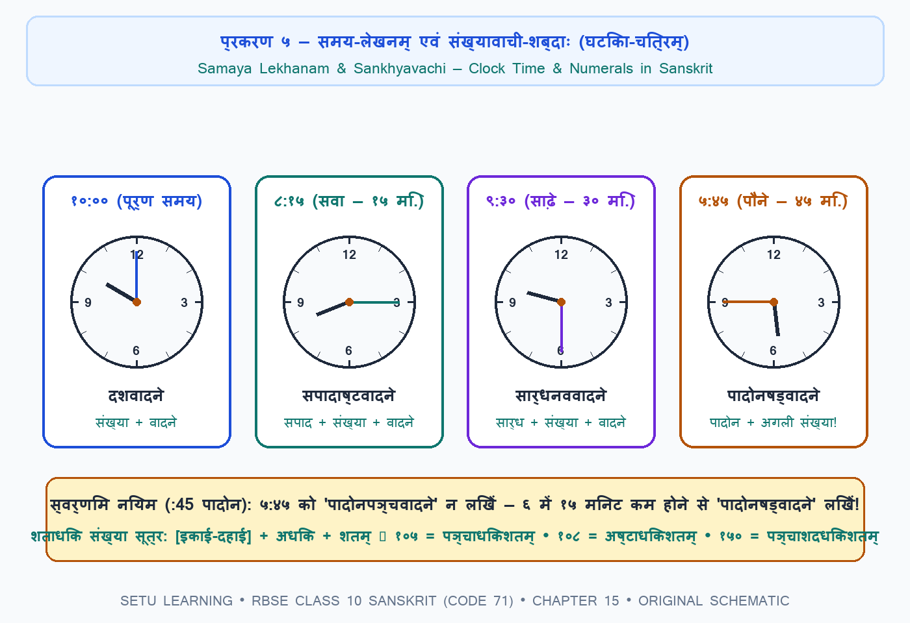

# अध्याय 15: प्रकरण ५ — समय-लेखनम् एवं संख्यावाची-शब्दाः (घटिका-चित्रम्) (Samaya Lekhanam & Sankhyavachi — Clock Time & Numerals in Sanskrit)

## भाग 1: अध्याय प्रवेश एवं पाठ्यक्रम मैपिंग

> प्रथम संपादकीय प्रारूप। NCERT 'शेमुषी भाग-2' के सभी प्रश्नों के हल तथा पूरा ऐतिहासिक PYQ संग्रह स्रोत-परीक्षण सहित संकलित हैं। सामान्य माध्यमिक 2026–27 पाठ्यक्रम की पुनः पुष्टि शेष है।

**विषय कोड:** 71 (तृतीया भाषा — संस्कृतम्) · **श्रृंखला पुस्तक:** 6

**सत्यापित आधार:** RBSE 2025–26 · **अध्याय भार:** 2 अंक। यह भार उसी संस्करण का है; वास्तविक प्रश्न-विभाजन की भविष्यवाणी नहीं।

**सीखने के लक्ष्य:** घटिका-चित्र अथवा अंकों में दिए समय (पूर्ण, सपाद, सार्ध, पादोन, निमेषाधिक/कलोन) तथा १०० से १००० तक संख्यावाची शब्दों को शुद्ध संस्कृत में लिखना।

## भाग 2: शब्दावली एवं अवधारणा कैप्सूल

| शब्द / सूत्र | अर्थ / उपयोग |
|---|---|
| वादनम् / वादने | बजे (स्वतंत्र रूप में 'वादनम्', वाक्य में सप्तमी विभक्ति 'वादने')। |
| सपाद | सवा — १५ मिनट अधिक (१:१५ = सपाद-एकवादनम्, ८:१५ = सपाद-अष्टवादनम्)। |
| सार्ध | साढ़े — ३० मिनट अधिक (९:३० = सार्ध-नववादने — 2026 मुख्य व पूरक)। |
| पादोन | पौने — अगली संख्या में १५ मिनट कम (५:४५ = पादोन-षड्वादने — 2026 मुख्य)। |
| निमेषाधिक / पलाधिक | मिनट अधिक (५:०५ = पञ्चनिमेषाधिक-पञ्चवादनम् / पञ्चाधिक-पञ्चवादनम्)। |
| निमेषोन / कलोन | मिनट कम (६:५० = दशनिमेषोन-सप्तवादनम् / दशोन-सप्तवादनम्)। |
| चतुरधिकशतम् | १०४ (१०० से अधिक संख्याओं में इकाई-दहाई पहले + अधिक + शतम्)। |
| पञ्चाशदधिकशतम् | १५० (पञ्चाशत् + अधिक + शतम् — 2025 मुख्य व 2022 मुख्य)। |
| अष्टाधिकशतम् | १०८ (अष्ट + अधिक + शतम् — 2025 पूरक)। |
| सहस्रम् | १००० (१०२५ = पञ्चविंशत्यधिक-सहस्रम् — 2022 मुख्य)। |

## भाग 3: विस्तृत शिक्षण पाठ

### १. घटिका समय-लेखनम् के ४ आधारभूत स्तंभ (RBSE 2026 नवीनतम पैटर्न)
RBSE कक्षा 10 संस्कृत प्रश्न-पत्र में समय-लेखन से **३ अंक (१ MCQ + २ लिखित प्रश्न = १ + २ अंक)** के प्रश्न आते हैं। घड़ी (घटिका) के समय को संस्कृत में लिखने के लिए पहले १ से १२ तक की संख्याएँ याद रखें:
**१ = एक, २ = द्वि, ३ = त्रि, ४ = चतुर्, ५ = पञ्च, ६ = षट् (षड्), ७ = सप्त, ८ = अष्ट, ९ = नव, १० = दश, ११ = एकादश, १२ = द्वादश।**
- **नियम १:** यदि समय केवल घड़ी के नीचे अकेला लिखना हो तो **'वादनम्'** लिखें; और यदि वाक्य के रिक्त स्थान में ("रामः प्रातः ____ उत्तिष्ठति") भरना हो तो सप्तमी एकवचन **'वादने'** लिखें!

| समय का प्रकार | संस्कृत उपसर्ग | सूत्र एवं संधि | १ से १२ बजे के प्रामाणिक उदाहरण (सप्तमी 'वादने' सहित) |
|---|---|---|---|
| **१. पूर्ण समय (:00)** | (केवल संख्या) | संख्या + वादने | १:०० = **एकवादने**; ४:०० = **चतुर्वादने**; ६:०० = **षड्वादने**; १०:०० = **दशवादने** (2026 पूरक) |
| **२. सवा (:15)** | **सपाद-** | सपाद + संख्या + वादने | १:१५ = **सपादैकवादने**; २:१५ = **सपादद्विवादने**; ४:१५ = **सपादचतुर्वादने**; ८:१५ = **सपादाष्टवादने / सपाद-अष्टवादने** (2026 मुख्य MCQ) |
| **३. साढ़े (:30)** | **सार्ध-** | सार्ध + संख्या + वादने | १:३० = **सार्धैकवादने**; ३:३० = **सार्धत्रिवादने**; ८:३० = **सार्धाष्टवादने / सार्ध-अष्टवादने** (2026 पूरक); ९:३० = **सार्धनववादने** (2026 मुख्य व पूरक) |
| **४. पौने (:45)** | **पादोन-** | पादोन + **अगली संख्या** + वादने | १:४५ = **पादोनद्विवादने**; ३:४५ = **पादोनचतुर्वादने**; ५:४५ = **पादोनषड्वादने** (2026 मुख्य); ११:४५ = **पादोनद्वादशवादने** |

### २. मिनटों का समय (5, 10, 20, 25 मिनट अधिक या कम)
- **अधिक मिनट (:05, :10, :20, :25):** `[मिनट संख्या] + अधिक (या निमेषाधिक / कलाधिक) + [घंटे की संख्या] + वादने`
  - ४:०५ = **पञ्चाधिक-चतुर्वादने** (अथवा पञ्चनिमेषाधिक-चतुर्वादने)
  - ७:१० = **दशाधिक-सप्तवादने**
  - ८:२० = **विंशत्यधिक-अष्टवादने**
- **कम मिनट (:50, :55, :40):** `[कम मिनट] + ऊन (या निमेषोन / कलोन) + [अगले घंटे की संख्या] + वादने`
  - ६:५५ = **पञ्चोन-सप्तवादने** (७ बजने में ५ मिनट कम)
  - ९:५० = **दशोन-दशवादने** (१० बजने में १० मिनट कम)

### ३. संख्यावाची शब्दाः (१ से १००० तक — RBSE 2014–2025 बोर्ड पैटर्न)
1. **१ से ४ तक तीनों लिंगों में रूप चलते हैं:**
   - **१:** एकः (पु.), एका (स्त्री.), एकम् (नपुं.)
   - **२:** द्वौ (पु. — 2016 मुख्य), द्वे (स्त्री.), द्वे (नपुं.)
   - **३:** त्रयः (पु.), तिस्रः (स्त्री.), त्रीणि (नपुं.)
   - **४:** चत्वारः (पु. — 2017 पूरक), चतस्रः (स्त्री.), चत्वारि (नपुं.)
2. **१०० से ऊपर की संख्याओं का स्वर्णिम सूत्र:**
   **`[अंतिम दो अंकों की संस्कृत संख्या] + अधिक + [शतम् / द्विशतम् / त्रिशतम् / चतुःशतम् / सहस्रम्]`**
   - **१०५** = पञ्च + अधिक + शतम् = **पञ्चाधिकशतम्** (2025 मुख्य)
   - **१०८** = अष्ट + अधिक + शतम् = **अष्टाधिकशतम्** (2025 पूरक)
   - **१२५** = पञ्चविंशति + अधिक + शतम् = **पञ्चविंशत्यधिकशतम्** (2024 पूरक)
   - **१३०** = त्रिंशत् + अधिक + शतम् = **त्रिंशदधिकशतम्** (2023 मुख्य)
   - **१४१** = एकचत्वारिंशत् + अधिक + शतम् = **एकचत्वारिंशदधिकशतम्** (2025 पूरक)
   - **१५०** = पञ्चाशत् + अधिक + शतम् = **पञ्चाशदधिकशतम्** (2025 मुख्य, 2022 मुख्य)
   - **३२८** = अष्टाविंशति + अधिक + त्रिशतम् = **अष्टाविंशत्यधिकत्रिशतम्** (2024 पूरक)
   - **४४५** = पञ्चचत्वारिंशत् + अधिक + चतुःशतम् = **पञ्चचत्वारिंशदधिकचतुःशतम्** (2023 मुख्य)
   - **१०२५** = पञ्चविंशति + अधिक + सहस्रम् = **पञ्चविंशत्यधिकसहस्रम्** (2022 मुख्य)

समय-लेखनम् एवं संख्या-ज्ञानम्: घटिका के ४ चरण (पूर्ण, सपाद, सार्ध, पादोन) और शताधिक संख्या-सूत्र।

## भाग 4: पाठ्यपुस्तक-अवधारणाओं पर मौलिक हल किए उदाहरण

नीचे के प्रश्न लेखक के मौलिक मॉडल हैं। ये किसी NCERT edition के प्रश्न क्रमांक या संपूर्ण in-text/exercise solution bank होने का दावा नहीं करते।

**हल किया उदाहरण 1: RBSE 2026 मुख्य परीक्षा प्रश्न 1(xvii) व प्रश्न 4: (क) 8:15, (ख) 9:30, (ग) 5:45 को संस्कृत में लिखें।**

(क) 8:15 = **सपाद-अष्टवादने** (अथवा सपादाष्टवादने)। (ख) 9:30 (रामः रात्रौ 9:30 वादने स्वपिति) = **सार्धनववादने**। (ग) 5:45 (मोहनः प्रातः 5:45 वादने उत्तिष्ठति) = **पादोनषड्वादने** (यहाँ ५:४५ को पौने छह = पादोन-षड् लिखें, पादोन-पञ्च नहीं!)।

**हल किया उदाहरण 2: RBSE 2026 पूरक परीक्षा प्रश्न 1(xvii) व प्रश्न 4: (क) 9:30, (ख) 8:30, (ग) 10:00 को संस्कृत में लिखें।**

(क) 9:30 = **सार्ध-नववादने**। (ख) 8:30 = **सार्ध-अष्टवादने** (अथवा सार्धाष्टवादने)। (ग) 10:00 = **दशवादने**।

**हल किया उदाहरण 3: RBSE 2025 मुख्य व पूरक परीक्षा प्रश्न 5: (i) 105, (ii) 150, (iii) 108, (iv) 141 को संस्कृत शब्दों में लिखें।**

(i) 105 = **पञ्चाधिकशतम्**। (ii) 150 = **पञ्चाशदधिकशतम्** (अथवा सार्धशतम्)। (iii) 108 = **अष्टाधिकशतम्**। (iv) 141 = **एकचत्वारिंशदधिकशतम्**।

## भाग 5: सत्यापित बोर्ड प्रश्न एवं स्रोत-स्थिति

2026 मुख्य परीक्षा, प्रश्न 1(xvii) (8:15 = सपाद-अष्ट), प्रश्न 4(i) (9:30 = सार्धनववादने) व प्रश्न 4(ii) (5:45 = पादोनषड्वादने)।

[RBSE 2026 मूल पेपर (S-71)](https://rajeduboard.rajasthan.gov.in/books/PAPERS-2026/Sec/S-71-Sankrit-TL-26.pdf)। प्रश्न का संक्षिप्त विषय-संदर्भ है; शब्दशः पुनर्मुद्रण नहीं।

## भाग 6: खंडवार मौलिक अभ्यास बैंक

**अभ्यास-अंक:** लेखक के स्व-अभ्यास के लिए हैं; RBSE की आधिकारिक marking scheme नहीं। उत्तर पहले स्वयं लिखें, फिर भाग 9 देखें।

## अ: बहुविकल्पीय प्रश्न — 15 × 1 अंक

**MCQ 1. 'रामः प्रातः (8:15) ____ वादने विद्यालयं गच्छति' — उचितं समयपदं किम्?**

अ) पादोन-नव  
ब) सपाद-अष्ट  
स) सार्ध-अष्ट  
द) पादोन-अष्ट

**MCQ 2. 'रामः रात्रौ (9:30) ____ स्वपिति' — अङ्कानां स्थाने संस्कृतपदं लिखत।**

अ) सार्धनववादने  
ब) सपादनववादने  
स) पादोनदशवादने  
द) नववादने

**MCQ 3. 'मोहनः प्रातः (5:45) ____ उत्तिष्ठति' — अङ्कानां स्थाने शुद्धं संस्कृतपदं किम्?**

अ) पादोनपञ्चवादने  
ब) सार्धपञ्चवादने  
स) सपादषड्वादने  
द) पादोनषड्वादने

**MCQ 4. 'सीता प्रातः (8:30) ____ भोजनं पचति' — रिक्तस्थाने समयपदं किम्?**

अ) पादोन-नववादने  
ब) अष्टवादने  
स) सार्ध-अष्टवादने  
द) सपाद-अष्टवादने

**MCQ 5. 'सः (10:00) ____ कार्यालयं गच्छति' — अङ्कस्थाने संस्कृतपदं किम्?**

अ) एकादशवादने  
ब) दशवादने  
स) सपाददशवादने  
द) सार्धदशवादने

**MCQ 6. '४:००' इत्यस्य शुद्धं संस्कृत-समयपदं किम्?**

अ) चतुर्वादने  
ब) चतुःवादने  
स) चत्वारिवादने  
द) चतुरवादने

**MCQ 7. '६:००' इत्यस्य शुद्धं संस्कृत-समयपदं किम्?**

अ) षट्वादने  
ब) षष्ठवादने  
स) षडिवादने  
द) षड्वादने

**MCQ 8. '१२:४५' इत्यस्य शुद्धं संस्कृत-समयपदं किम्?**

अ) सार्धद्वादशवादने  
ब) सपादैकवादने  
स) पादोनैकवादने  
द) पादोनद्वादशवादने

**MCQ 9. '१०५' इत्यस्य कृते संस्कृत-संख्यापदं किम्?**

अ) पञ्चदशशतम्  
ब) पञ्चाधिकशतम्  
स) पञ्चशतम्  
द) पञ्चाशदधिकशतम्

**MCQ 10. '१५०' इत्यस्य कृते संस्कृत-संख्यापदं किम्?**

अ) पञ्चाशदधिकशतम्  
ब) पञ्चाधिकशतम्  
स) पञ्चदशाधिकशतम्  
द) पञ्चशतम्

**MCQ 11. '१०८' इत्यस्य कृते संस्कृत-संख्यापदं किम्?**

अ) अष्टशतम्  
ब) अशीत्यधिकशतम्  
स) अष्टादशशतम्  
द) अष्टाधिकशतम्

**MCQ 12. '१२५' इत्यस्य कृते संस्कृत-संख्यापदं किम्?**

अ) विंशत्यधिकशतम्  
ब) पञ्चत्रिंशदधिकशतम्  
स) पञ्चविंशत्यधिकशतम्  
द) पञ्चाधिकद्विशतम्

**MCQ 13. 'वने ____ (4) सिंहाः वसन्ति' — रिक्तस्थाने पुल्लिंगे संख्यापदं किम्?**

अ) चतुर्  
ब) चत्वारः  
स) चतस्रः  
द) चत्वारि

**MCQ 14. 'कक्षायाम् ____ (3) बालिकाः पठन्ति' — स्त्रीलिंगे संख्यापदं किम्?**

अ) तिस्रः  
ब) त्रयः  
स) त्रीणि  
द) त्रि

**MCQ 15. 'वृक्षात् ____ (2) फले अपतताम्' — नपुंसकलिंगे संख्यापदं किम्?**

अ) द्वौ  
ब) द्वयम्  
स) द्वाभ्याम्  
द) द्वे

## अ: रिक्त स्थान — 6 × 1 अंक

1. बजे (स्वतंत्र रूप में 'वादनम्', वाक्य में सप्तमी विभक्ति 'वादने')। — इस शब्द/सूत्र का नाम है: ____।  
2. सवा — १५ मिनट अधिक (१:१५ = सपाद-एकवादनम्, ८:१५ = सपाद-अष्टवादनम्)। — इस शब्द/सूत्र का नाम है: ____।  
3. साढ़े — ३० मिनट अधिक (९:३० = सार्ध-नववादने — 2026 मुख्य व पूरक)। — इस शब्द/सूत्र का नाम है: ____।  
4. पौने — अगली संख्या में १५ मिनट कम (५:४५ = पादोन-षड्वादने — 2026 मुख्य)। — इस शब्द/सूत्र का नाम है: ____।  
5. मिनट अधिक (५:०५ = पञ्चनिमेषाधिक-पञ्चवादनम् / पञ्चाधिक-पञ्चवादनम्)। — इस शब्द/सूत्र का नाम है: ____।  
6. मिनट कम (६:५० = दशनिमेषोन-सप्तवादनम् / दशोन-सप्तवादनम्)। — इस शब्द/सूत्र का नाम है: ____।

## अ: अतिलघु उत्तर — 8 × 1 अंक

1. 'रामः प्रातः (8:15) ____ वादने विद्यालयं गच्छति' — उचितं समयपदं किम्?  
2. 'रामः रात्रौ (9:30) ____ स्वपिति' — अङ्कानां स्थाने संस्कृतपदं लिखत।  
3. 'मोहनः प्रातः (5:45) ____ उत्तिष्ठति' — अङ्कानां स्थाने शुद्धं संस्कृतपदं किम्?  
4. 'सीता प्रातः (8:30) ____ भोजनं पचति' — रिक्तस्थाने समयपदं किम्?  
5. 'सः (10:00) ____ कार्यालयं गच्छति' — अङ्कस्थाने संस्कृतपदं किम्?  
6. '४:००' इत्यस्य शुद्धं संस्कृत-समयपदं किम्?  
7. '६:००' इत्यस्य शुद्धं संस्कृत-समयपदं किम्?  
8. '१२:४५' इत्यस्य शुद्धं संस्कृत-समयपदं किम्?

## ब: लघु उत्तर — 6 × 2 अंक

**B1.** '४:१५' तथा '४:३०' समयं संस्कृतपदेन लिखत।

**B2.** '५:४५' तथा '११:४५' समयं संस्कृतपदेन लिखत।

**B3.** '६:००' तथा '४:००' समययोः शुद्धं संस्कृतरूपं किम्?

**B4.** '१०५' तथा '१०८' संख्यावाची-शब्दौ संस्कृते लिखत।

**B5.** '१२५' तथा '१५०' संख्यावाची-शब्दौ संस्कृते लिखत।

**B6.** १ से ४ तक संख्याओं के पुल्लिंग, स्त्रीलिंग व नपुंसकलिंग रूप लिखत।

## स: दीर्घ उत्तर — 4 × 3 अंक

आंतरिक विकल्प अभ्यास: C1 अथवा C2, तथा C3 अथवा C4 चुनें। पुनरावृत्ति में बचा विकल्प भी हल करें। यह लेखक की अभ्यास व्यवस्था है।

**C1.** घटिका-समयलेखनस्य चत्वारि प्रमुखानि नियमानि सोदाहरणं स्पष्टीकुरुत।

**C2.** 'पादोन' समय-लेखने छात्रैः क्रियमाणां सामान्य-त्रुटिं सोदाहरणं निवारयत।

**C3.** शताधिक-संख्यालेखनस्य (१०१–१०००) सूत्रं सोदाहरणं लिखत।

**C4.** दैनिक-दिनचर्यायाः ५ वाक्यानि समय-प्रयोगेण सह संस्कृते लिखत।

## द: विस्तृत उत्तर — 2 × 4 अंक

आंतरिक विकल्प अभ्यास: D1 अथवा D2 चुनें; बाद में दूसरा भी हल करें।

**D1.** १:०० से १२:४५ तक की संपूर्ण घटिका-तालिका (४८ समय-बिंदुओं का सूत्रबद्ध चार्ट) प्रस्तुत करें।

**D2.** १ से १०० तक प्रमुख दहाई संख्याएँ तथा RBSE बोर्ड परीक्षा में पूछे गए सभी संख्या-प्रश्न हल सहित लिखें।

## भाग 7: सावधानियाँ एवं परीक्षा-त्रुटियाँ

- **सबसे बड़ा परीक्षा-जाल (:45 पादोन):** ५:४५ को कभी भी 'पादोन-पञ्चवादने' न लिखें — ५:४५ का अर्थ पौने छह है, इसलिए **'पादोन-षड्वादने'** लिखें!
- यदि प्रश्न के वाक्य में पहले से 'वादने' लिखा हो तो केवल 'सार्धनव' लिखें, और यदि 'वादने' न लिखा हो तो पूरा **'सार्धनववादने'** लिखें।
- ४ के साथ हमेशा रेफ (**चतुर्वादने**) और ६ के साथ हमेशा ड् (**षड्वादने**) लिखें।
- १०५ (**पञ्चाधिकशतम्**) और १५० (**पञ्चाशदधिकशतम्**) में 'पञ्च' और 'पञ्चाशत्' का अंतर ध्यान से देखें।
- १, २, ३, ४ के रूप विशेष्य के लिंग के अनुसार बदलते हैं (पु.: एकः, द्वौ, त्रयः, चत्वारः; स्त्री.: एका, द्वे, तिस्रः, चतस्रः; नपुं.: एकम्, द्वे, त्रीणि, चत्वारि)।

## भाग 8: फटाफट पुनरावृत्ति — 25 बिंदु

1. वादनम् / वादने: बजे (स्वतंत्र रूप में 'वादनम्', वाक्य में सप्तमी विभक्ति 'वादने')।  
2. सपाद: सवा — १५ मिनट अधिक (१:१५ = सपाद-एकवादनम्, ८:१५ = सपाद-अष्टवादनम्)।  
3. सार्ध: साढ़े — ३० मिनट अधिक (९:३० = सार्ध-नववादने — 2026 मुख्य व पूरक)।  
4. पादोन: पौने — अगली संख्या में १५ मिनट कम (५:४५ = पादोन-षड्वादने — 2026 मुख्य)।  
5. निमेषाधिक / पलाधिक: मिनट अधिक (५:०५ = पञ्चनिमेषाधिक-पञ्चवादनम् / पञ्चाधिक-पञ्चवादनम्)।  
6. निमेषोन / कलोन: मिनट कम (६:५० = दशनिमेषोन-सप्तवादनम् / दशोन-सप्तवादनम्)।  
7. चतुरधिकशतम्: १०४ (१०० से अधिक संख्याओं में इकाई-दहाई पहले + अधिक + शतम्)।  
8. पञ्चाशदधिकशतम्: १५० (पञ्चाशत् + अधिक + शतम् — 2025 मुख्य व 2022 मुख्य)।  
9. अष्टाधिकशतम्: १०८ (अष्ट + अधिक + शतम् — 2025 पूरक)।  
10. सहस्रम्: १००० (१०२५ = पञ्चविंशत्यधिक-सहस्रम् — 2022 मुख्य)।  
11. ८:१५ का अर्थ सवा आठ है, अतः 'सपाद-अष्टवादने' सही उत्तर है (RBSE 2026 मुख्य परीक्षा प्रश्न 1(xvii))।  
12. ९:३० का अर्थ साढ़े नौ है, अतः 'सार्धनववादने' (RBSE 2026 मुख्य व पूरक परीक्षा)।  
13. ५:४५ का अर्थ पौने छह (६ में १५ मिनट कम) है, अतः 'पादोनषड्वादने' होगा (RBSE 2026 मुख्य परीक्षा प्रश्न 4(ii))।  
14. ८:३० का अर्थ साढ़े आठ है, अतः 'सार्ध-अष्टवादने' (RBSE 2026 पूरक परीक्षा प्रश्न 4(i))।  
15. १०:०० पूर्ण समय है, अतः 'दशवादने' (RBSE 2026 पूरक परीक्षा प्रश्न 4(ii))।  
16. 'चतुः + वादने' में विसर्ग के बाद 'व' आने से रत्व होकर 'चतुर्वादने' बनता है।  
17. 'षट् + वादने' में जश्त्व संधि से 'ट्' को 'ड्' होकर 'षड्वादने' बनता है।  
18. १२:४५ का अर्थ पौने एक (१ बजने में १५ मिनट कम) है, अतः 'पादोनैकवादने' होता है।  
19. ५ + अधिक + १०० = पञ्चाधिकशतम् (RBSE 2025 मुख्य परीक्षा)।  
20. ५० (पञ्चाशत्) + अधिक + १०० (शतम्) = पञ्चाशदधिकशतम् (RBSE 2025 व 2022 मुख्य परीक्षा)।  
21. ८ (अष्ट) + अधिक + १०० (शतम्) = अष्टाधिकशतम् (RBSE 2025 पूरक परीक्षा)।  
22. २५ (पञ्चविंशति) + अधिक + शतम् = पञ्चविंशत्यधिकशतम् (RBSE 2024 पूरक परीक्षा)।  
23. 'सिंहाः' पुल्लिंग बहुवचन है, अतः पुल्लिंग रूप 'चत्वारः' आएगा (RBSE 2017 पूरक परीक्षा)।  
24. 'बालिकाः' स्त्रीलिंग बहुवचन है, अतः ३ का स्त्रीलिंग रूप 'तिस्रः' आता है।  
25. 'फले' नपुंसकलिंग द्विवचन है, अतः २ का नपुंसकलिंग रूप 'द्वे' आएगा।

## भाग 9: संपूर्ण अभ्यास उत्तर-कुंजी

## MCQ: सही विकल्प और कारण

**1. ब — सपाद-अष्ट।** ८:१५ का अर्थ सवा आठ है, अतः 'सपाद-अष्टवादने' सही उत्तर है (RBSE 2026 मुख्य परीक्षा प्रश्न 1(xvii))।

**2. अ — सार्धनववादने।** ९:३० का अर्थ साढ़े नौ है, अतः 'सार्धनववादने' (RBSE 2026 मुख्य व पूरक परीक्षा)।

**3. द — पादोनषड्वादने।** ५:४५ का अर्थ पौने छह (६ में १५ मिनट कम) है, अतः 'पादोनषड्वादने' होगा (RBSE 2026 मुख्य परीक्षा प्रश्न 4(ii))।

**4. स — सार्ध-अष्टवादने।** ८:३० का अर्थ साढ़े आठ है, अतः 'सार्ध-अष्टवादने' (RBSE 2026 पूरक परीक्षा प्रश्न 4(i))।

**5. ब — दशवादने।** १०:०० पूर्ण समय है, अतः 'दशवादने' (RBSE 2026 पूरक परीक्षा प्रश्न 4(ii))।

**6. अ — चतुर्वादने।** 'चतुः + वादने' में विसर्ग के बाद 'व' आने से रत्व होकर 'चतुर्वादने' बनता है।

**7. द — षड्वादने।** 'षट् + वादने' में जश्त्व संधि से 'ट्' को 'ड्' होकर 'षड्वादने' बनता है।

**8. स — पादोनैकवादने।** १२:४५ का अर्थ पौने एक (१ बजने में १५ मिनट कम) है, अतः 'पादोनैकवादने' होता है।

**9. ब — पञ्चाधिकशतम्।** ५ + अधिक + १०० = पञ्चाधिकशतम् (RBSE 2025 मुख्य परीक्षा)।

**10. अ — पञ्चाशदधिकशतम्।** ५० (पञ्चाशत्) + अधिक + १०० (शतम्) = पञ्चाशदधिकशतम् (RBSE 2025 व 2022 मुख्य परीक्षा)।

**11. द — अष्टाधिकशतम्।** ८ (अष्ट) + अधिक + १०० (शतम्) = अष्टाधिकशतम् (RBSE 2025 पूरक परीक्षा)।

**12. स — पञ्चविंशत्यधिकशतम्।** २५ (पञ्चविंशति) + अधिक + शतम् = पञ्चविंशत्यधिकशतम् (RBSE 2024 पूरक परीक्षा)।

**13. ब — चत्वारः।** 'सिंहाः' पुल्लिंग बहुवचन है, अतः पुल्लिंग रूप 'चत्वारः' आएगा (RBSE 2017 पूरक परीक्षा)।

**14. अ — तिस्रः।** 'बालिकाः' स्त्रीलिंग बहुवचन है, अतः ३ का स्त्रीलिंग रूप 'तिस्रः' आता है।

**15. द — द्वे।** 'फले' नपुंसकलिंग द्विवचन है, अतः २ का नपुंसकलिंग रूप 'द्वे' आएगा।

**रिक्त स्थान:** 1. वादनम् / वादने; 2. सपाद; 3. सार्ध; 4. पादोन; 5. निमेषाधिक / पलाधिक; 6. निमेषोन / कलोन

**अतिलघु उत्तर:**

1. सपाद-अष्ट। ८:१५ का अर्थ सवा आठ है, अतः 'सपाद-अष्टवादने' सही उत्तर है (RBSE 2026 मुख्य परीक्षा प्रश्न 1(xvii))।

2. सार्धनववादने। ९:३० का अर्थ साढ़े नौ है, अतः 'सार्धनववादने' (RBSE 2026 मुख्य व पूरक परीक्षा)।

3. पादोनषड्वादने। ५:४५ का अर्थ पौने छह (६ में १५ मिनट कम) है, अतः 'पादोनषड्वादने' होगा (RBSE 2026 मुख्य परीक्षा प्रश्न 4(ii))।

4. सार्ध-अष्टवादने। ८:३० का अर्थ साढ़े आठ है, अतः 'सार्ध-अष्टवादने' (RBSE 2026 पूरक परीक्षा प्रश्न 4(i))।

5. दशवादने। १०:०० पूर्ण समय है, अतः 'दशवादने' (RBSE 2026 पूरक परीक्षा प्रश्न 4(ii))।

6. चतुर्वादने। 'चतुः + वादने' में विसर्ग के बाद 'व' आने से रत्व होकर 'चतुर्वादने' बनता है।

7. षड्वादने। 'षट् + वादने' में जश्त्व संधि से 'ट्' को 'ड्' होकर 'षड्वादने' बनता है।

8. पादोनैकवादने। १२:४५ का अर्थ पौने एक (१ बजने में १५ मिनट कम) है, अतः 'पादोनैकवादने' होता है।

**B1. '४:१५' तथा '४:३०' समयं संस्कृतपदेन लिखत।**

४:१५ = सपाद-चतुर्वादने; ४:३० = सार्ध-चतुर्वादने।

**B2. '५:४५' तथा '११:४५' समयं संस्कृतपदेन लिखत।**

५:४५ = पादोन-षड्वादने; ११:४५ = पादोन-द्वादशवादने।

**B3. '६:००' तथा '४:००' समययोः शुद्धं संस्कृतरूपं किम्?**

६:०० = षड्वादने (जश्त्व संधि से ट् का ड्); ४:०० = चतुर्वादने (विसर्ग का रेफ 'र्')।

**B4. '१०५' तथा '१०८' संख्यावाची-शब्दौ संस्कृते लिखत।**

१०५ = पञ्चाधिकशतम्; १०८ = अष्टाधिकशतम्।

**B5. '१२५' तथा '१५०' संख्यावाची-शब्दौ संस्कृते लिखत।**

१२५ = पञ्चविंशत्यधिकशतम्; १५० = पञ्चाशदधिकशतम्।

**B6. १ से ४ तक संख्याओं के पुल्लिंग, स्त्रीलिंग व नपुंसकलिंग रूप लिखत।**

१: एकः, एका, एकम्; २: द्वौ, द्वे, द्वे; ३: त्रयः, तिस्रः, त्रीणि; ४: चत्वारः, चतस्रः, चत्वारि।

**C1. घटिका-समयलेखनस्य चत्वारि प्रमुखानि नियमानि सोदाहरणं स्पष्टीकुरुत।**

1. **पूर्ण समय (:00):** घंटे की संख्या के साथ 'वादनम्/वादने' लगाते हैं; जैसे — ३:०० = त्रिवादने, १०:०० = दशवादने। 2. **सपाद (:15 — १५ मिनट अधिक):** 'सपाद' + वर्तमान घंटे की संख्या + वादने; जैसे — ७:१५ = सपादसप्तवादने, ८:१५ = सपादाष्टवादने। 3. **सार्ध (:30 — ३० मिनट अधिक):** 'सार्ध' + वर्तमान घंटे की संख्या + वादने; जैसे — ८:३० = सार्धाष्टवादने, ९:३० = सार्धनववादने। 4. **पादोन (:45 — १५ मिनट कम):** 'पादोन' + **अगले घंटे की संख्या** + वादने; जैसे — ५:४५ = पादोनषड्वादने, ८:४५ = पादोननववादने।

**C2. 'पादोन' समय-लेखने छात्रैः क्रियमाणां सामान्य-त्रुटिं सोदाहरणं निवारयत।**

1. सामान्य त्रुटि: छात्र ५:४५ को देखकर 'पादोन-पञ्चवादने' लिख देते हैं, जिसका अर्थ ४:४५ (पौने पाँच) हो जाता है। 2. सही नियम: 'पादोन' का अर्थ है 'एक चौथाई (१५ मिनट) कम'। ५ बजकर ४५ मिनट का अर्थ है ६ बजने में १५ मिनट कम (पौने छह)। 3. अतः :45 वाले समय में हमेशा **अगली संख्या** लिखनी चाहिए: १:४५ = पादोनद्विवादने, ३:४५ = पादोनचतुर्वादने, ५:४५ = पादोनषड्वादने, १२:४५ = पादोनैकवादने।

**C3. शताधिक-संख्यालेखनस्य (१०१–१०००) सूत्रं सोदाहरणं लिखत।**

1. १०० से अधिक संख्या लिखने के लिए पहले अंतिम दो अंकों (इकाई+दहाई) की संस्कृत संख्या लिखते हैं, फिर 'अधिक' और अंत में 'शतम् / द्विशतम् / त्रिशतम् / सहस्रम्' जोड़ते हैं। 2. संधि नियम: यदि संख्या के अंत में 'अ/आ' हो तो दीर्घ संधि ('अष्ट + अधिक = अष्टाधिक'), 'इ' हो तो यण् संधि ('विंशति + अधिक = विंशत्यधिक') और 'त्' हो तो जश्त्व संधि ('त्रिंशत् + अधिक = त्रिंशदधिक') होती है। 3. उदाहरण: १०५ = पञ्चाधिकशतम्, १२५ = पञ्चविंशत्यधिकशतम्, १३० = त्रिंशदधिकशतम्, ३२८ = अष्टाविंशत्यधिकत्रिशतम्।

**C4. दैनिक-दिनचर्यायाः ५ वाक्यानि समय-प्रयोगेण सह संस्कृते लिखत।**

1. अहं प्रातः पञ्चवादने (5:00) उत्तिष्ठामि। 2. अहं सपाद-षड्वादने (6:15) योगाभ्यासं करोमि। 3. अहं सार्ध-सप्तवादने (7:30) विद्यालयं गच्छामि। 4. अहं सायं पादोन-पञ्चवादने (4:45) क्रीडाङ्गणे क्रीडामि। 5. अहं रात्रौ सार्ध-नववादने (9:30) स्वपिमि।

**D1. १:०० से १२:४५ तक की संपूर्ण घटिका-तालिका (४८ समय-बिंदुओं का सूत्रबद्ध चार्ट) प्रस्तुत करें।**

1. **१ बजे के रूप:** १:०० एकवादने, १:१५ सपादैकवादने, १:३० सार्धैकवादने, १:४५ पादोनद्विवादने। 2. **२ व ३ बजे के रूप:** २:०० द्विवादने, २:१५ सपादद्विवादने, २:३० सार्धद्विवादने, २:४५ पादोनत्रिवादने; ३:०० त्रिवादने, ३:१५ सपादत्रिवादने, ३:३० सार्धत्रिवादने, ३:४५ पादोनचतुर्वादने। 3. **४ से ६ बजे के रूप:** ४:०० चतुर्वादने, ४:१५ सपादचतुर्वादने, ४:३० सार्धचतुर्वादने, ४:४५ पादोनपञ्चवादने; ५:०० पञ्चवादने, ५:१५ सपादपञ्चवादने, ५:३० सार्धपञ्चवादने, ५:४५ पादोनषड्वादने; ६:०० षड्वादने, ६:१५ सपादषड्वादने, ६:३० सार्धषड्वादने, ६:४५ पादोनसप्तवादने। 4. **७ से १२ बजे के रूप:** ७:०० सप्तवादने, ७:४५ पादोनाष्टवादने; ८:१५ सपादाष्टवादने, ८:३० सार्धाष्टवादने, ८:४५ पादोननववादने; ९:३० सार्धनववादने, ९:४५ पादोनदशवादने; १०:०० दशवादने, १०:४५ पादोनैकादशवादने; ११:४५ पादोनद्वादशवादने; १२:४५ पादोनैकवादने।

**D2. १ से १०० तक प्रमुख दहाई संख्याएँ तथा RBSE बोर्ड परीक्षा में पूछे गए सभी संख्या-प्रश्न हल सहित लिखें।**

1. **प्रमुख दहाइयाँ:** १० दश, २० विंशतिः (2016), ३० त्रिंशत् (2017 पूरक), ४० चत्वारिंशत्, ५० पञ्चाशत्, ६० षष्टिः, ७० सप्ततिः, ८० अशीतिः, ९० नवतिः, १०० शतम्, १००० सहस्रम्। 2. **RBSE बोर्ड हल:** १२ = द्वादश (2015); १०५ = पञ्चाधिकशतम् (2025); १०८ = अष्टाधिकशतम् (2025 पूरक); १२५ = पञ्चविंशत्यधिकशतम् (2024 पूरक); १३० = त्रिंशदधिकशतम् (2023); १४१ = एकचत्वारिंशदधिकशतम् (2025 पूरक); १५० = पञ्चाशदधिकशतम् (2025, 2022); ३२८ = अष्टाविंशत्यधिकत्रिशतम् (2024 पूरक); ४४५ = पञ्चचत्वारिंशदधिकचतुःशतम् (2023); १०२५ = पञ्चविंशत्यधिकसहस्रम् (2022)।

## भाग 10: 10 मिनट / 10 अंक आत्म-मूल्यांकन एवं संदर्भ

समय: 10 मिनट। पहले पुस्तक बंद करें।

1. MCQ 3 और 11 हल करें। (1 + 1)
2. B2 और B5 के उत्तर लिखें। (2 + 2)
3. D1 हल करें। (4)

**कुंजी:** भाग 9 में संबंधित क्रमांक देखें। **स्व-मूल्यांकन:** 8–10: आगे बढ़ें; 5–7: छूटे कौशल का दोहराव; 0–4: भाग 2–4 फिर पढ़ें। यह अभ्यास-सुझाव है, बोर्ड grade नहीं।

[सत्यापित RBSE 2025–26 पाठ्यक्रम](https://rajeduboard.rajasthan.gov.in/anudeshika-etc/10_2026.pdf) · [NCERT शेमुषी भाग-2 संदर्भ](https://ncert.nic.in/textbook.php?jhsk1=0-12)

**आगे की कड़ी:** प्रकरण १६ 'वाच्य-परिवर्तनम्' में कर्तृवाच्य, कर्मवाच्य और भाववाच्य (१२१ और ३११ सूत्र) का रूपांतरण सीखेंगे।
