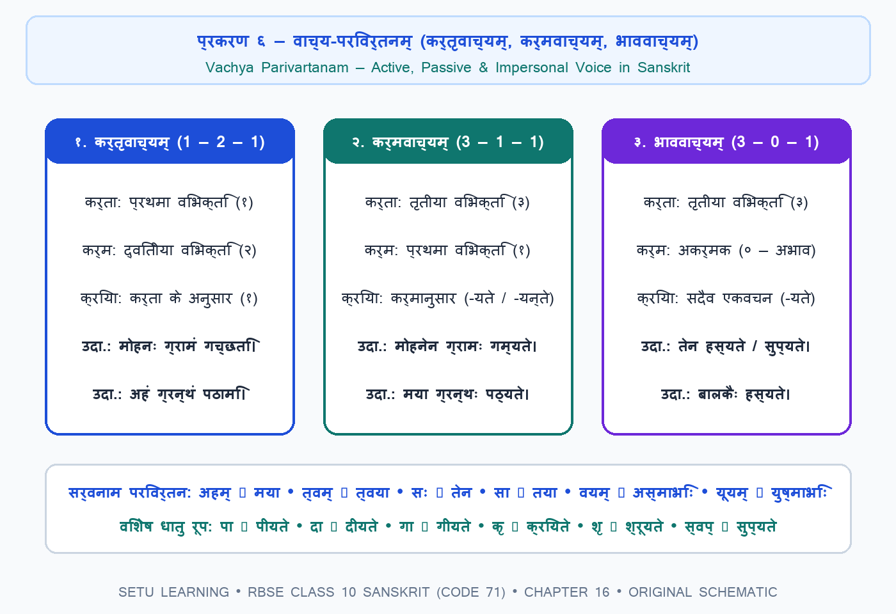

# अध्याय 16: प्रकरण ६ — वाच्य-परिवर्तनम् (कर्तृवाच्यम्, कर्मवाच्यम्, भाववाच्यम्) (Vachya Parivartanam — Active, Passive & Impersonal Voice in Sanskrit)

## भाग 1: अध्याय प्रवेश एवं पाठ्यक्रम मैपिंग

> प्रथम संपादकीय प्रारूप। NCERT 'शेमुषी भाग-2' के सभी प्रश्नों के हल तथा पूरा ऐतिहासिक PYQ संग्रह स्रोत-परीक्षण सहित संकलित हैं। सामान्य माध्यमिक 2026–27 पाठ्यक्रम की पुनः पुष्टि शेष है।

**विषय कोड:** 71 (तृतीया भाषा — संस्कृतम्) · **श्रृंखला पुस्तक:** 6

**सत्यापित आधार:** RBSE 2025–26 · **अध्याय भार:** 3 अंक। यह भार उसी संस्करण का है; वास्तविक प्रश्न-विभाजन की भविष्यवाणी नहीं।

**सीखने के लक्ष्य:** लट् लकार में कर्तृवाच्य (१-२-१ नियम), कर्मवाच्य (३-१-१ नियम) और भाववाच्य (३-०-१ नियम) की पहचान, सर्वनाम परिवर्तन और वाक्य-रूपांतरण में दक्षता प्राप्त करना।

## भाग 2: शब्दावली एवं अवधारणा कैप्सूल

| शब्द / सूत्र | अर्थ / उपयोग |
|---|---|
| कर्तृवाच्यम् (1-2-1) | कर्ता प्रथमा विभक्ति (१), कर्म द्वितीया विभक्ति (२), क्रिया कर्ता के अनुसार (१) — रामः ग्रन्थं पठति। |
| कर्मवाच्यम् (3-1-1) | कर्ता तृतीया विभक्ति (३), कर्म प्रथमा विभक्ति (१), क्रिया कर्म के अनुसार आत्मनेपद 'यते/यन्ते' (१) — रामेण ग्रन्थः पठ्यते। |
| भाववाच्यम् (3-0-1) | अकर्मक धातु: कर्ता तृतीया (३), कर्म का अभाव (०), क्रिया सदैव प्रथम पुरुष एकवचन (१) — तेन हस्यते। |
| मया | अहम् (मैं) का तृतीया एकवचन रूप (अहं पठामि → मया पठ्यते)। |
| त्वया | त्वम् (तुम) का तृतीया एकवचन रूप (त्वया किम् क्रियते — 2026 मुख्य परीक्षा)। |
| तेन / तया | सः (पु.) का तृतीया 'तेन' और सा (स्त्री.) का तृतीया 'तया'। |
| अस्माभिः / युष्माभिः | वयम् का तृतीया 'अस्माभिः' और यूयम् का तृतीया 'युष्माभिः'। |
| गम्यते / पठ्यते | गम् + य + ते = गम्यते (मोहनेन ग्रामः गम्यते — 2026 मुख्य परीक्षा); पठ् + य + ते = पठ्यते। |
| दीयते / पीयते | आकारान्त धातुओं (दा, पा, स्था, गा) में 'आ' को 'ई' होकर दीयते, पीयते, स्थीयते, गीयते बनता है। |
| क्रियते / स्मर्यते | कृ → क्रियते, स्मृ → स्मर्यते, शृ → श्रूयते, प्रच्छ् → पृच्छ्यते, दृश् → दृश्यते। |

## भाग 3: विस्तृत शिक्षण पाठ

### १. वाच्य के तीन भेद एवं गणितीय सूत्र (१२१ बनाम ३११)
संस्कृत में कथन के ढंग को **वाच्य** कहते हैं। RBSE कक्षा 10 में केवल **लट् लकार (वर्तमान काल)** में वाच्य-परिवर्तन पूछा जाता है (१ MCQ + १ लिखित रूपांतरण = २ से ३ अंक):

| वाच्य का नाम | गणितीय सूत्र | कर्ता की विभक्ति | कर्म की विभक्ति | क्रिया का पुरुष व वचन | उदाहरण |
|---|---|---|---|---|---|
| **१. कर्तृवाच्यम्** | **१ — २ — १** | **प्रथमा (१)** | **द्वितीया (२)** | **कर्ता (१)** के पुरुष व वचन के अनुसार (पठति/पठसि/पठामि) | मोहनः ग्रामं गच्छति। |
| **२. कर्मवाच्यम्** | **३ — १ — १** | **तृतीया (३)** | **प्रथमा (१)** | **कर्म (१)** के पुरुष व वचन के अनुसार (गम्यते / गम्येते / गम्यन्ते) | मोहनेन ग्रामः गम्यते। (2026 मुख्य) |
| **३. भाववाच्यम्** | **३ — ० — १** | **तृतीया (३)** | (कर्म नहीं होता) | **सदैव प्रथम पुरुष एकवचन** (हस्यते, सुप्यते, स्थीयते) | बालकेन हस्यते। / तेन सुप्यते। |

### २. कर्ता (प्रथमा ↔ तृतीया) रूपांतरण तालिका
वाच्य बदलते समय कर्ता की प्रथमा और तृतीया विभक्ति का यह चार्ट कंठस्थ रखें:

| प्रथमा विभक्ति (कर्तृवाच्य में कर्ता) | तृतीया विभक्ति (कर्मवाच्य / भाववाच्य में कर्ता) | बोर्ड परीक्षा संदर्भ |
|---|---|---|
| **अहम्** (मैं) ↔ **वयम्** (हम सब) | **मया** (मेरे द्वारा) ↔ **अस्माभिः** (हमारे द्वारा) | 2020 मुख्य व पूरक, 2018 पूरक |
| **त्वम्** (तुम) ↔ **यूयम्** (तुम सब) | **त्वया** (तुम्हारे द्वारा) ↔ **युष्माभिः** (तुम सबके द्वारा) | 2026 मुख्य प्रश्न 1(xvi), 2018 मुख्य |
| **सः** (वह पु.) ↔ **ते** (वे सब पु.) | **तेन** ↔ **तैः** | 2020 मुख्य व पूरक |
| **सा** (वह स्त्री.) ↔ **ताः** (वे सब स्त्री.) | **तया** ↔ **ताभिः** | सामान्य सर्वनाम |
| **भवान्** (आप पु.) ↔ **भवती** (आप स्त्री.) | **भवता** ↔ **भवत्या** | सम्मानसूचक सर्वनाम |
| **रामः / छात्रः / आचार्यः** (अकारान्त पु.) | **रामेण / छात्रेण / आचार्येण** (र/ष के बाद ण) | 2026 मुख्य व पूरक |
| **सीता / लता / बालिका** (आकारान्त स्त्री.) | **सीतया / लतया / बालिकया** | 2020 मुख्य, 2018 पूरक |
| **हरिः / कविः** (इकारान्त) • **गुरुः** (उकारान्त) | **हरिणा / कविना** • **गुरुणा** | संज्ञा शब्द |

### ३. कर्म और क्रिया के विशेष नियम (यते / यन्ते)
1. **नपुंसकलिंग कर्म का वचन पहचानना:** 'फलम्, पुस्तकम्, पत्रम्, भोजनम्, गीतम्, काव्यम्' प्रथमा और द्वितीया में एक समान रहते हैं!
   - एकवचन: रामः **पुस्तकं** पठति → रामेण **पुस्तकं पठ्यते**।
   - बहुवचन: रामः **पुस्तकानि** पठति → रामेण **पुस्तकानि पठ्यन्ते**! (यहाँ कर्म बहुवचन होने से क्रिया भी बहुवचन **'पठ्यन्ते'** होगी!)
2. **धातुओं के कर्मवाच्य रूप (मूल धातु + य + ते/एते/न्ते):**
   - सामान्य धातुएँ: पठ् → **पठ्यते**, लिख् → **लिख्यते**, खाद् → **खाद्यते**, हस् → **हस्यते**, क्रीड् → **क्रीड्यते**, गम् → **गम्यते**, दृश् → **दृश्यते**, त्यज् → **त्यज्यते**।
   - आकारान्त धातुएँ (आ → ई): पा (पिबति) → **पीयते**, दा (यच्छति) → **दीयते**, गा (गायति) → **गीयते**, स्था (तिष्ठति) → **स्थीयते**।
   - ऋकारान्त व संप्रसारण धातुएँ: कृ (करोति) → **क्रियते**, हृ (हरति) → **ह्रियते**, स्मृ → **स्मर्यते**, शृ (शृणोति) → **श्रूयते**, वद् → **उद्यते**, वच् → **उच्यते**, स्वप् → **सुप्यते**, प्रच्छ् → **पृच्छ्यते**, ग्रह् → **गृह्यते**।

वाच्य-परिवर्तनम्: कर्तृवाच्य (१-२-१), कर्मवाच्य (३-१-१) एवं भाववाच्य (३-०-१) का रूपांतरण-चक्र।

## भाग 4: पाठ्यपुस्तक-अवधारणाओं पर मौलिक हल किए उदाहरण

नीचे के प्रश्न लेखक के मौलिक मॉडल हैं। ये किसी NCERT edition के प्रश्न क्रमांक या संपूर्ण in-text/exercise solution bank होने का दावा नहीं करते।

**हल किया उदाहरण 1: RBSE 2026 मुख्य परीक्षा प्रश्न 1(xvi) व प्रश्न 6: (क) '____ किम् क्रियते?' (त्वम्/त्वया/त्वाम्/तव); (ख) 'मोहनः ग्रामं गच्छति' का वाच्य-परिवर्तन करें।**

(क) क्रिया 'क्रियते' कर्मवाच्य की है, अतः कर्ता तृतीया विभक्ति में होगा: **त्वया** किम् क्रियते? (ख) 'मोहनः ग्रामं गच्छति' (१-२-१) → कर्ता 'मोहनः' को तृतीया **मोहनेन**, कर्म 'ग्रामम्' को प्रथमा **ग्रामः**, और क्रिया 'गच्छति' को कर्मवाच्य एकवचन **गम्यते** → **"मोहनेन ग्रामः गम्यते।"**

**हल किया उदाहरण 2: RBSE 2026 पूरक परीक्षा प्रश्न 1(xvi) व प्रश्न 6: (क) '____ ग्रन्थः पठ्यते' (छात्रः/छात्रम्/छात्रेण/छात्राय); (ख) 'आचार्यः ग्रन्थं पठति' का वाच्य-परिवर्तन करें।**

(क) 'पठ्यते' कर्मवाच्य है, अतः कर्ता तृतीया में: **छात्रेण** ग्रन्थः पठ्यते। (ख) 'आचार्यः ग्रन्थं पठति' → **"आचार्येण ग्रन्थः पठ्यते।"**

**हल किया उदाहरण 3: कर्म बहुवचन होने पर वाच्य-परिवर्तन करें: (क) अहं पुस्तकानि पठामि। (ख) बालिकाः गीतानि गायन्ति।**

(क) अहम् → **मया**, पुस्तकानि (प्रथमा बहुवचन) → **पुस्तकानि**, पठामि (कर्म बहुवचन के अनुसार) → **पठ्यन्ते** = **"मया पुस्तकानि पठ्यन्ते।"** (ख) बालिकाः → **बालिकाभिः**, गीतानि → **गीतानि**, गायन्ति → **गीयन्ते** = **"बालिकाभिः गीतानि गीयन्ते।"**

## भाग 5: सत्यापित बोर्ड प्रश्न एवं स्रोत-स्थिति

2026 मुख्य परीक्षा, प्रश्न 1(xvi) ('त्वया') व प्रश्न 6 ('मोहनेन ग्रामः गम्यते'); 2026 पूरक परीक्षा, प्रश्न 1(xvi) ('छात्रेण') व प्रश्न 6 ('आचार्येण ग्रन्थः पठ्यते')।

[RBSE 2026 मूल पेपर (S-71)](https://rajeduboard.rajasthan.gov.in/books/PAPERS-2026/Sec/S-71-Sankrit-TL-26.pdf)। प्रश्न का संक्षिप्त विषय-संदर्भ है; शब्दशः पुनर्मुद्रण नहीं।

## भाग 6: खंडवार मौलिक अभ्यास बैंक

**अभ्यास-अंक:** लेखक के स्व-अभ्यास के लिए हैं; RBSE की आधिकारिक marking scheme नहीं। उत्तर पहले स्वयं लिखें, फिर भाग 9 देखें।

## अ: बहुविकल्पीय प्रश्न — 15 × 1 अंक

**MCQ 1. '____ किम् क्रियते?' — रिक्तस्थाने उचितं कर्तृपदं किम्?**

अ) त्वया  
ब) त्वम्  
स) त्वाम्  
द) तव

**MCQ 2. 'मोहनः ग्रामं गच्छति' — अस्य वाक्यस्य कर्मवाच्ये रूपं किम्?**

अ) मोहनेन ग्रामं गम्यते  
ब) मोहनः ग्रामः गम्यते  
स) मोहनाय ग्रामः गच्छति  
द) मोहनेन ग्रामः गम्यते

**MCQ 3. '____ ग्रन्थः पठ्यते' — रिक्तस्थाने उचितं पदं चिनुत।**

अ) छात्रम्  
ब) छात्राय  
स) छात्रेण  
द) छात्रः

**MCQ 4. 'आचार्यः ग्रन्थं पठति' — अस्य कर्मवाच्ये रूपं किम्?**

अ) आचार्याय ग्रन्थः पठ्यते  
ब) आचार्येण ग्रन्थः पठ्यते  
स) आचार्येण ग्रन्थं पठ्यते  
द) आचार्यः ग्रन्थः पठ्यते

**MCQ 5. 'सीतया गीतं गीयते' — अस्य कर्तृवाच्ये रूपं किम्?**

अ) सीता गीतं गायति  
ब) सीता गीतः गायति  
स) सीतया गीतं गायति  
द) सीता गीतं गीयते

**MCQ 6. 'अहं ग्रन्थं पठामि' — अस्य कर्मवाच्ये रूपं किम्?**

अ) अहं ग्रन्थः पठ्यते  
ब) मया ग्रन्थं पठामि  
स) मया ग्रन्थः पठ्यन्ते  
द) मया ग्रन्थः पठ्यते

**MCQ 7. 'त्वया पाठः लिख्यते' — अस्य कर्तृवाच्ये शुद्धं रूपं किम्?**

अ) त्वया पाठं लिखसि  
ब) त्वं पाठः लिखसि  
स) त्वं पाठं लिखसि  
द) त्वं पाठं लिखति

**MCQ 8. 'सः स्वपिति' — अस्य भाववाच्ये रूपं किम्?**

अ) तस्मै सुप्यते  
ब) तेन सुप्यते  
स) तेन स्वप्यते  
द) सः सुप्यते

**MCQ 9. 'सः हसति' — अस्य भाववाच्ये रूपं किम्?**

अ) तेन हस्यते  
ब) सः हस्यते  
स) तेन हसति  
द) तस्य हस्यते

**MCQ 10. 'रामेण जलं ____' — रिक्तस्थाने कर्मवाच्यस्य क्रियापदं किम्?**

अ) पिब्यते  
ब) पायते  
स) पिबति  
द) पीयते

**MCQ 11. 'बालकाः हसन्ति' — अस्य भाववाच्ये शुद्धं रूपं किम्?**

अ) बालकेन हस्यते  
ब) बालकाः हस्यते  
स) बालकैः हस्यते  
द) बालकैः हस्यन्ते

**MCQ 12. 'मया पुस्तकानि ____' — रिक्तस्थाने उचितं क्रियापदं किम्?**

अ) पठन्ति  
ब) पठ्यन्ते  
स) पठ्यते  
द) पठामि

**MCQ 13. 'अहं साधुं पश्यामि' — अस्य कर्मवाच्ये रूपं किम्?**

अ) मया साधुः दृश्यते  
ब) मया साधुं पश्यते  
स) अहं साधुः दृश्यते  
द) मया साधुः पश्यति

**MCQ 14. 'भक्तेन ईश्वरः ____' — 'स्मृ' धातोः कर्मवाच्यरूपं किम्?**

अ) स्मरते  
ब) स्मर्यन्ते  
स) स्मृतिः  
द) स्मर्यते

**MCQ 15. 'धनिकेन भिक्षुकाय धनं ____' — 'दा' धातोः कर्मवाच्यरूपं किम्?**

अ) यच्छ्यते  
ब) दास्यते  
स) दीयते  
द) दद्यते

## अ: रिक्त स्थान — 6 × 1 अंक

1. कर्ता प्रथमा विभक्ति (१), कर्म द्वितीया विभक्ति (२), क्रिया कर्ता के अनुसार (१) — रामः ग्रन्थं पठति। — इस शब्द/सूत्र का नाम है: ____।  
2. कर्ता तृतीया विभक्ति (३), कर्म प्रथमा विभक्ति (१), क्रिया कर्म के अनुसार आत्मनेपद 'यते/यन्ते' (१) — रामेण ग्रन्थः पठ्यते। — इस शब्द/सूत्र का नाम है: ____।  
3. अकर्मक धातु: कर्ता तृतीया (३), कर्म का अभाव (०), क्रिया सदैव प्रथम पुरुष एकवचन (१) — तेन हस्यते। — इस शब्द/सूत्र का नाम है: ____।  
4. अहम् (मैं) का तृतीया एकवचन रूप (अहं पठामि → मया पठ्यते)। — इस शब्द/सूत्र का नाम है: ____।  
5. त्वम् (तुम) का तृतीया एकवचन रूप (त्वया किम् क्रियते — 2026 मुख्य परीक्षा)। — इस शब्द/सूत्र का नाम है: ____।  
6. सः (पु.) का तृतीया 'तेन' और सा (स्त्री.) का तृतीया 'तया'। — इस शब्द/सूत्र का नाम है: ____।

## अ: अतिलघु उत्तर — 8 × 1 अंक

1. '____ किम् क्रियते?' — रिक्तस्थाने उचितं कर्तृपदं किम्?  
2. 'मोहनः ग्रामं गच्छति' — अस्य वाक्यस्य कर्मवाच्ये रूपं किम्?  
3. '____ ग्रन्थः पठ्यते' — रिक्तस्थाने उचितं पदं चिनुत।  
4. 'आचार्यः ग्रन्थं पठति' — अस्य कर्मवाच्ये रूपं किम्?  
5. 'सीतया गीतं गीयते' — अस्य कर्तृवाच्ये रूपं किम्?  
6. 'अहं ग्रन्थं पठामि' — अस्य कर्मवाच्ये रूपं किम्?  
7. 'त्वया पाठः लिख्यते' — अस्य कर्तृवाच्ये शुद्धं रूपं किम्?  
8. 'सः स्वपिति' — अस्य भाववाच्ये रूपं किम्?

## ब: लघु उत्तर — 6 × 2 अंक

**B1.** 'रामः पुस्तकं पठति' — अस्य वाक्यस्य कर्मवाच्ये परिवर्तनं कुरुत।

**B2.** 'सीतया गीतं गीयते' — अस्य वाक्यस्य कर्तृवाच्ये परिवर्तनं कुरुत।

**B3.** 'अहं ग्रन्थं पठामि' — वाच्य-परिवर्तनं कुरुत।

**B4.** 'सः हसति' तथा 'सः स्वपिति' — भाववाच्ये परिवर्तयत।

**B5.** 'त्वया पाठः लिख्यते' — कर्तृवाच्ये परिवर्तयत।

**B6.** 'बालकः विद्यालयं गच्छति' — कर्मवाच्ये परिवर्तयत।

## स: दीर्घ उत्तर — 4 × 3 अंक

आंतरिक विकल्प अभ्यास: C1 अथवा C2, तथा C3 अथवा C4 चुनें। पुनरावृत्ति में बचा विकल्प भी हल करें। यह लेखक की अभ्यास व्यवस्था है।

**C1.** कर्तृवाच्यस्य कर्मवाच्यस्य च नियमान् सोदाहरणं स्पष्टीकुरुत।

**C2.** भाववाच्यं किम् भवति? अस्य त्रीणि उदाहरणानि लिखत।

**C3.** वाच्य-परिवर्तने वचन-परिवर्तनस्य (एकवचन-बहुवचन) प्रभावम् उदाहरणेन दर्शयत।

**C4.** विशेष-धातूनां (पा, दा, गा, शृ, कृ, प्रच्छ्, स्वप्) कर्मवाच्य-रूपाणि लिखत।

## द: विस्तृत उत्तर — 2 × 4 अंक

आंतरिक विकल्प अभ्यास: D1 अथवा D2 चुनें; बाद में दूसरा भी हल करें।

**D1.** RBSE बोर्ड परीक्षा (२०१४–२०२६) में पूछे गए १५ प्रमुख वाच्य-परिवर्तन प्रश्नों का संपूर्ण हल लिखें।

**D2.** कर्मवाच्य से पुनः कर्तृवाच्य में लौटते समय उत्तम पुरुष ('अहम्') और मध्यम पुरुष ('त्वम्') की क्रिया-सहमति कैसे साधें?

## भाग 7: सावधानियाँ एवं परीक्षा-त्रुटियाँ

- कर्मवाच्य में बदलते समय कर्म की द्वितीया विभक्ति ('ग्रामम् / ग्रन्थम्') को प्रथमा विभक्ति (**'ग्रामः / ग्रन्थः'**) में बदलना कभी न भूलें!
- नपुंसकलिंग शब्द ('पुस्तकम्, फलम्, गीतम्, जलम्, पत्रम्') प्रथमा और द्वितीया में एक जैसे रहते हैं, अतः उन्हें 'पुस्तकः' या 'जलः' न बनाएँ!
- कर्तृवाच्य में वापस बदलते समय 'मया' से 'अहम्' बनने पर क्रिया में **'-आमि' (पठामि, लिखामि)** और 'त्वया' से 'त्वम्' बनने पर **'-असि' (पठसि, लिखसि)** लगाएँ।
- भाववाच्य में क्रिया कभी बहुवचन ('हस्यन्ते') नहीं होती, हमेशा एकवचन (**'हस्यते'**) रहती है।
- पा → पीयते, दा → दीयते, गा → गीयते, स्था → स्थीयते, शृ → श्रूयते, स्वप् → सुप्यते याद रखें।

## भाग 8: फटाफट पुनरावृत्ति — 25 बिंदु

1. कर्तृवाच्यम् (1-2-1): कर्ता प्रथमा विभक्ति (१), कर्म द्वितीया विभक्ति (२), क्रिया कर्ता के अनुसार (१) — रामः ग्रन्थं पठति।  
2. कर्मवाच्यम् (3-1-1): कर्ता तृतीया विभक्ति (३), कर्म प्रथमा विभक्ति (१), क्रिया कर्म के अनुसार आत्मनेपद 'यते/यन्ते' (१) — रामेण ग्रन्थः पठ्यते।  
3. भाववाच्यम् (3-0-1): अकर्मक धातु: कर्ता तृतीया (३), कर्म का अभाव (०), क्रिया सदैव प्रथम पुरुष एकवचन (१) — तेन हस्यते।  
4. मया: अहम् (मैं) का तृतीया एकवचन रूप (अहं पठामि → मया पठ्यते)।  
5. त्वया: त्वम् (तुम) का तृतीया एकवचन रूप (त्वया किम् क्रियते — 2026 मुख्य परीक्षा)।  
6. तेन / तया: सः (पु.) का तृतीया 'तेन' और सा (स्त्री.) का तृतीया 'तया'।  
7. अस्माभिः / युष्माभिः: वयम् का तृतीया 'अस्माभिः' और यूयम् का तृतीया 'युष्माभिः'।  
8. गम्यते / पठ्यते: गम् + य + ते = गम्यते (मोहनेन ग्रामः गम्यते — 2026 मुख्य परीक्षा); पठ् + य + ते = पठ्यते।  
9. दीयते / पीयते: आकारान्त धातुओं (दा, पा, स्था, गा) में 'आ' को 'ई' होकर दीयते, पीयते, स्थीयते, गीयते बनता है।  
10. क्रियते / स्मर्यते: कृ → क्रियते, स्मृ → स्मर्यते, शृ → श्रूयते, प्रच्छ् → पृच्छ्यते, दृश् → दृश्यते।  
11. 'क्रियते' कर्मवाच्य की क्रिया है, अतः कर्ता तृतीया विभक्ति ('त्वया') में होगा (RBSE 2026 मुख्य परीक्षा प्रश्न 1(xvi))।  
12. मोहनः → मोहनेन (तृतीया), ग्रामम् → ग्रामः (प्रथमा), गच्छति → गम्यते (RBSE 2026 मुख्य परीक्षा प्रश्न 6)।  
13. 'पठ्यते' कर्मवाच्य है, अतः तृतीया विभक्ति 'छात्रेण' आएगी (RBSE 2026 पूरक परीक्षा प्रश्न 1(xvi))।  
14. आचार्यः → आचार्येण, ग्रन्थम् → ग्रन्थः, पठति → पठ्यते (RBSE 2026 पूरक परीक्षा प्रश्न 6)।  
15. सीतया → सीता, गीतम् → गीतम्, गीयते → गायति (RBSE 2020 मुख्य परीक्षा)।  
16. अहम् → मया, ग्रन्थम् → ग्रन्थः, पठामि → पठ्यते (RBSE 2020 मुख्य परीक्षा)।  
17. 'त्वम्' मध्यम पुरुष एकवचन है, अतः क्रिया 'लिखसि' होगी, 'लिखति' नहीं (RBSE 2018 मुख्य परीक्षा)।  
18. स्वप् धातु का भाववाच्य में संप्रसारण होकर 'सुप्यते' बनता है (RBSE 2020 मुख्य परीक्षा)।  
19. अकर्मक धातु होने से भाववाच्य 'तेन हस्यते' बनता है (RBSE 2020 पूरक परीक्षा)।  
20. पा (पिबति) धातु का कर्मवाच्य रूप 'पीयते' होता है।  
21. भाववाच्य में कर्ता बहुवचन ('बालकैः') होने पर भी क्रिया सदैव एकवचन ('हस्यते') रहती है।  
22. कर्म 'पुस्तकानि' प्रथमा बहुवचन है, अतः क्रिया भी बहुवचन 'पठ्यन्ते' होगी।  
23. अहम् → मया, साधुम् → साधुः, पश्यामि (दृश्) → दृश्यते (RBSE 2018 मुख्य परीक्षा)।  
24. स्मृ धातु से कर्मवाच्य एकवचन में 'स्मर्यते' बनता है।  
25. दा (यच्छ्) धातु से कर्मवाच्य में 'आ' को 'ई' होकर 'दीयते' बनता है।

## भाग 9: संपूर्ण अभ्यास उत्तर-कुंजी

## MCQ: सही विकल्प और कारण

**1. अ — त्वया।** 'क्रियते' कर्मवाच्य की क्रिया है, अतः कर्ता तृतीया विभक्ति ('त्वया') में होगा (RBSE 2026 मुख्य परीक्षा प्रश्न 1(xvi))।

**2. द — मोहनेन ग्रामः गम्यते।** मोहनः → मोहनेन (तृतीया), ग्रामम् → ग्रामः (प्रथमा), गच्छति → गम्यते (RBSE 2026 मुख्य परीक्षा प्रश्न 6)।

**3. स — छात्रेण।** 'पठ्यते' कर्मवाच्य है, अतः तृतीया विभक्ति 'छात्रेण' आएगी (RBSE 2026 पूरक परीक्षा प्रश्न 1(xvi))।

**4. ब — आचार्येण ग्रन्थः पठ्यते।** आचार्यः → आचार्येण, ग्रन्थम् → ग्रन्थः, पठति → पठ्यते (RBSE 2026 पूरक परीक्षा प्रश्न 6)।

**5. अ — सीता गीतं गायति।** सीतया → सीता, गीतम् → गीतम्, गीयते → गायति (RBSE 2020 मुख्य परीक्षा)।

**6. द — मया ग्रन्थः पठ्यते।** अहम् → मया, ग्रन्थम् → ग्रन्थः, पठामि → पठ्यते (RBSE 2020 मुख्य परीक्षा)।

**7. स — त्वं पाठं लिखसि।** 'त्वम्' मध्यम पुरुष एकवचन है, अतः क्रिया 'लिखसि' होगी, 'लिखति' नहीं (RBSE 2018 मुख्य परीक्षा)।

**8. ब — तेन सुप्यते।** स्वप् धातु का भाववाच्य में संप्रसारण होकर 'सुप्यते' बनता है (RBSE 2020 मुख्य परीक्षा)।

**9. अ — तेन हस्यते।** अकर्मक धातु होने से भाववाच्य 'तेन हस्यते' बनता है (RBSE 2020 पूरक परीक्षा)।

**10. द — पीयते।** पा (पिबति) धातु का कर्मवाच्य रूप 'पीयते' होता है।

**11. स — बालकैः हस्यते।** भाववाच्य में कर्ता बहुवचन ('बालकैः') होने पर भी क्रिया सदैव एकवचन ('हस्यते') रहती है।

**12. ब — पठ्यन्ते।** कर्म 'पुस्तकानि' प्रथमा बहुवचन है, अतः क्रिया भी बहुवचन 'पठ्यन्ते' होगी।

**13. अ — मया साधुः दृश्यते।** अहम् → मया, साधुम् → साधुः, पश्यामि (दृश्) → दृश्यते (RBSE 2018 मुख्य परीक्षा)।

**14. द — स्मर्यते।** स्मृ धातु से कर्मवाच्य एकवचन में 'स्मर्यते' बनता है।

**15. स — दीयते।** दा (यच्छ्) धातु से कर्मवाच्य में 'आ' को 'ई' होकर 'दीयते' बनता है।

**रिक्त स्थान:** 1. कर्तृवाच्यम् (1-2-1); 2. कर्मवाच्यम् (3-1-1); 3. भाववाच्यम् (3-0-1); 4. मया; 5. त्वया; 6. तेन / तया

**अतिलघु उत्तर:**

1. त्वया। 'क्रियते' कर्मवाच्य की क्रिया है, अतः कर्ता तृतीया विभक्ति ('त्वया') में होगा (RBSE 2026 मुख्य परीक्षा प्रश्न 1(xvi))।

2. मोहनेन ग्रामः गम्यते। मोहनः → मोहनेन (तृतीया), ग्रामम् → ग्रामः (प्रथमा), गच्छति → गम्यते (RBSE 2026 मुख्य परीक्षा प्रश्न 6)।

3. छात्रेण। 'पठ्यते' कर्मवाच्य है, अतः तृतीया विभक्ति 'छात्रेण' आएगी (RBSE 2026 पूरक परीक्षा प्रश्न 1(xvi))।

4. आचार्येण ग्रन्थः पठ्यते। आचार्यः → आचार्येण, ग्रन्थम् → ग्रन्थः, पठति → पठ्यते (RBSE 2026 पूरक परीक्षा प्रश्न 6)।

5. सीता गीतं गायति। सीतया → सीता, गीतम् → गीतम्, गीयते → गायति (RBSE 2020 मुख्य परीक्षा)।

6. मया ग्रन्थः पठ्यते। अहम् → मया, ग्रन्थम् → ग्रन्थः, पठामि → पठ्यते (RBSE 2020 मुख्य परीक्षा)।

7. त्वं पाठं लिखसि। 'त्वम्' मध्यम पुरुष एकवचन है, अतः क्रिया 'लिखसि' होगी, 'लिखति' नहीं (RBSE 2018 मुख्य परीक्षा)।

8. तेन सुप्यते। स्वप् धातु का भाववाच्य में संप्रसारण होकर 'सुप्यते' बनता है (RBSE 2020 मुख्य परीक्षा)।

**B1. 'रामः पुस्तकं पठति' — अस्य वाक्यस्य कर्मवाच्ये परिवर्तनं कुरुत।**

रामेण पुस्तकं पठ्यते।

**B2. 'सीतया गीतं गीयते' — अस्य वाक्यस्य कर्तृवाच्ये परिवर्तनं कुरुत।**

सीता गीतं गायति (RBSE 2020 मुख्य परीक्षा)।

**B3. 'अहं ग्रन्थं पठामि' — वाच्य-परिवर्तनं कुरुत।**

मया ग्रन्थः पठ्यते (RBSE 2020 मुख्य परीक्षा)।

**B4. 'सः हसति' तथा 'सः स्वपिति' — भाववाच्ये परिवर्तयत।**

तेन हस्यते (2020 पूरक); तेन सुप्यते (2020 मुख्य)।

**B5. 'त्वया पाठः लिख्यते' — कर्तृवाच्ये परिवर्तयत।**

त्वं पाठं लिखसि (RBSE 2018 मुख्य परीक्षा — 'त्वम्' के साथ मध्यम पुरुष एकवचन 'लिखसि')।

**B6. 'बालकः विद्यालयं गच्छति' — कर्मवाच्ये परिवर्तयत।**

बालकेन विद्यालयः गम्यते।

**C1. कर्तृवाच्यस्य कर्मवाच्यस्य च नियमान् सोदाहरणं स्पष्टीकुरुत।**

1. **कर्तृवाच्य (१-२-१ नियम):** इसमें कर्ता प्रधान होता है; कर्ता में प्रथमा विभक्ति, कर्म में द्वितीया विभक्ति होती है और क्रिया का पुरुष व वचन कर्ता के अनुसार होता है; जैसे — अहं ग्रन्थं पठामि, त्वं लेखं लिखसि। 2. **कर्मवाच्य (३-१-१ नियम):** इसमें कर्म प्रधान होता है; कर्ता में तृतीया विभक्ति, कर्म में प्रथमा विभक्ति होती है और क्रिया का पुरुष व वचन कर्म के अनुसार आत्मनेपद ('यते, येते, यन्ते') में होता है; जैसे — मया ग्रन्थः पठ्यते, त्वया लेखः लिख्यते।

**C2. भाववाच्यं किम् भवति? अस्य त्रीणि उदाहरणानि लिखत।**

1. जब वाक्य में कर्म नहीं होता (अकर्मक धातु — जैसे हस्, रुद्, स्वप्, स्था, उपविश्, नृत्), तब कर्तृवाच्य को बदलने पर **भाववाच्य (३-०-१)** बनता है। 2. भाववाच्य में कर्ता तृतीया विभक्ति में होता है और क्रिया वचन से प्रभावित हुए बिना **सदैव प्रथम पुरुष एकवचन** में रहती है। 3. उदाहरण: (क) सः हसति → तेन हस्यते; (ख) बालकाः हसन्ति → बालकैः हस्यते (यहाँ 'हस्यन्ते' नहीं होगा!); (ग) अहं स्वपिमि → मया सुप्यते।

**C3. वाच्य-परिवर्तने वचन-परिवर्तनस्य (एकवचन-बहुवचन) प्रभावम् उदाहरणेन दर्शयत।**

1. कर्मवाच्य में क्रिया कर्ता के वचन से नहीं, अपितु **कर्म के वचन** से चलती है। 2. यदि कर्ता बहुवचन हो और कर्म एकवचन हो: 'छात्राः पाठं पठन्ति' → 'छात्रैः पाठः पठ्यते' (कर्म 'पाठः' एकवचन है, अतः 'पठ्यते')। 3. यदि कर्ता एकवचन हो और कर्म बहुवचन हो: 'छात्रः पाठान् पठति' → 'छात्रेण पाठाः पठ्यन्ते' (कर्म 'पाठाः' बहुवचन है, अतः 'पठ्यन्ते')।

**C4. विशेष-धातूनां (पा, दा, गा, शृ, कृ, प्रच्छ्, स्वप्) कर्मवाच्य-रूपाणि लिखत।**

1. पा (पिबति) → पीयते (रामेण जलं पीयते)। 2. दा (यच्छति) → दीयते (धनिकेन धनं दीयते)। 3. गा (गायति) → गीयते (सीतया गीतं गीयते)। 4. शृ (शृणोति) → श्रूयते (भक्तेन कथा श्रूयते)। 5. कृ (करोति) → क्रियते (त्वया कार्यं क्रियते)। 6. प्रच्छ् (पृच्छति) → पृच्छ्यते (गुरवे प्रश्नः पृच्छ्यते)। 7. स्वप् (स्वपिति) → सुप्यते (तेन सुप्यते)।

**D1. RBSE बोर्ड परीक्षा (२०१४–२०२६) में पूछे गए १५ प्रमुख वाच्य-परिवर्तन प्रश्नों का संपूर्ण हल लिखें।**

1. मोहनः ग्रामं गच्छति → मोहनेन ग्रामः गम्यते (2026 मुख्य)। 2. त्वया किम् क्रियते → त्वं किं करोषि (2026 मुख्य)। 3. आचार्यः ग्रन्थं पठति → आचार्येण ग्रन्थः पठ्यते (2026 पूरक)। 4. छात्रेण ग्रन्थः पठ्यते → छात्रः ग्रन्थं पठति (2026 पूरक)। 5. सीतया गीतं गीयते → सीता गीतं गायति (2020 मुख्य)। 6. अहं ग्रन्थं पठामि → मया ग्रन्थः पठ्यते (2020 मुख्य)। 7. सः स्वपिति → तेन सुप्यते (2020 मुख्य)। 8. मया पठ्यते → अहं पठामि (2020 पूरक)। 9. छात्रेण विद्यालयः गम्यते → छात्रः विद्यालयं गच्छति (2020 पूरक)। 10. सः हसति → तेन हस्यते (2020 पूरक)। 11. त्वया पाठः लिख्यते → त्वं पाठं लिखसि (2018 मुख्य)। 12. रामः पुस्तकं पठति → रामेण पुस्तकं पठ्यते (2018 मुख्य)। 13. अहं साधुं पश्यामि → मया साधुः दृश्यते (2018 मुख्य)। 14. बालिकया गृहकार्यं लिख्यते → बालिका गृहकार्यं लिखति (2018 पूरक)। 15. बालकः पशुं पश्यति → बालकेन पशुः दृश्यते (2018 पूरक)।

**D2. कर्मवाच्य से पुनः कर्तृवाच्य में लौटते समय उत्तम पुरुष ('अहम्') और मध्यम पुरुष ('त्वम्') की क्रिया-सहमति कैसे साधें?**

1. छात्र प्रायः 'मया ग्रन्थः पठ्यते' को कर्तृवाच्य में बदलते समय 'अहं ग्रन्थं पठति' लिख देते हैं, जो अशुद्ध है! 2. कर्तृवाच्य में लौटते ही क्रिया कर्ता के पुरुष के अनुसार चलती है: यदि कर्ता **'अहम्'** बना है, तो क्रिया उत्तम पुरुष एकवचन (**पठामि, लिखामि, गच्छामि, करोमि, पश्यामि**) होगी। 3. यदि कर्ता **'त्वम्'** बना है ('त्वया पाठः लिख्यते'), तो क्रिया मध्यम पुरुष एकवचन (**लिखसि, पठसि, गच्छसि, करोषि**) होगी।

## भाग 10: 10 मिनट / 10 अंक आत्म-मूल्यांकन एवं संदर्भ

समय: 10 मिनट। पहले पुस्तक बंद करें।

1. MCQ 3 और 11 हल करें। (1 + 1)
2. B2 और B5 के उत्तर लिखें। (2 + 2)
3. D1 हल करें। (4)

**कुंजी:** भाग 9 में संबंधित क्रमांक देखें। **स्व-मूल्यांकन:** 8–10: आगे बढ़ें; 5–7: छूटे कौशल का दोहराव; 0–4: भाग 2–4 फिर पढ़ें। यह अभ्यास-सुझाव है, बोर्ड grade नहीं।

[सत्यापित RBSE 2025–26 पाठ्यक्रम](https://rajeduboard.rajasthan.gov.in/anudeshika-etc/10_2026.pdf) · [NCERT शेमुषी भाग-2 संदर्भ](https://ncert.nic.in/textbook.php?jhsk1=0-12)

**आगे की कड़ी:** प्रकरण १७ 'कारक एवं अशुद्धि-संशोधनम्' में उपपद-विभक्ति के नियमों और बोर्ड परीक्षा में वाक्य-संशोधन का अध्ययन करेंगे।
