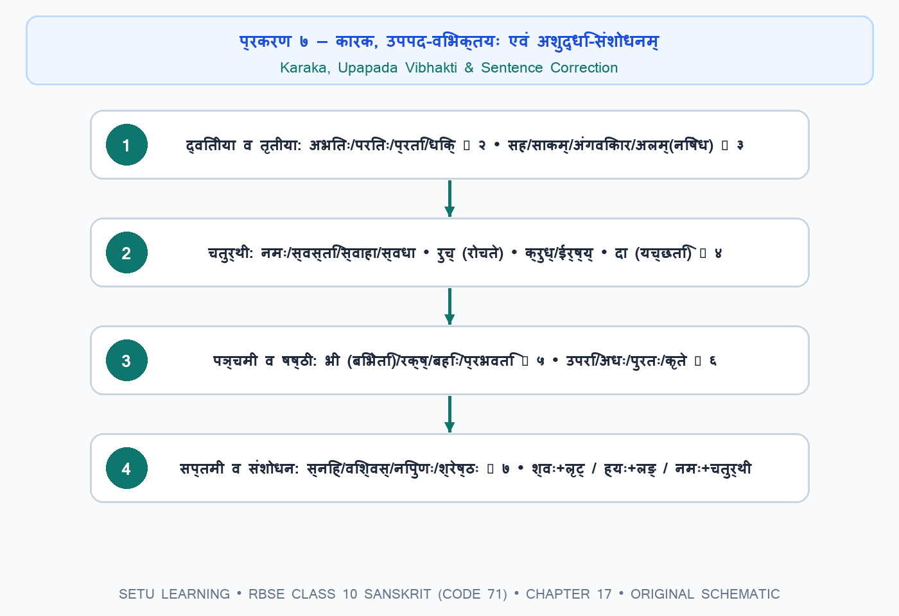

# अध्याय 17: प्रकरण ७ — कारक, उपपद-विभक्तयः एवं अशुद्धि-संशोधनम् (Karaka, Upapada Vibhakti & Sentence Correction)

## भाग 1: अध्याय प्रवेश एवं पाठ्यक्रम मैपिंग

> NCERT 'शेमुषी भाग-2' के सभी प्रश्नों के हल तथा पूरा ऐतिहासिक PYQ संग्रह स्रोत-परीक्षण सहित संकलित हैं। सामान्य माध्यमिक 2026–27 पाठ्यक्रम की पुनः पुष्टि शेष है।

**विषय कोड:** 71 (तृतीया भाषा — संस्कृतम्) · **श्रृंखला पुस्तक:** 6

**सत्यापित आधार:** RBSE 2025–26 · **अध्याय भार:** 4 अंक। यह भार उसी संस्करण का है; वास्तविक प्रश्न-विभाजन की भविष्यवाणी नहीं।

**सीखने के लक्ष्य:** द्वितीया से सप्तमी तक सभी कारक व उपपद-विभक्ति सूत्रों (अभितः, परितः, धिक्, सह, अलम्, नमः, स्वाहा, रुच्, क्रुध्, दा, भी, जनिकर्तुः प्रकृतिः) तथा अशुद्धि-संशोधन में पूर्ण अंक प्राप्त करना।

## भाग 2: शब्दावली एवं अवधारणा कैप्सूल

| शब्द / सूत्र | अर्थ / उपयोग |
|---|---|
| अभितः / परितः | दोनों ओर / चारों ओर — योग में द्वितीया विभक्ति (ग्रामम् अभितः वृक्षाः सन्ति — 2026 मुख्य परीक्षा)। |
| धिक् / प्रति / विना | धिक्कार / की ओर / बिना — योग में द्वितीया विभक्ति (धिक् चौरम् — 2026 पूरक परीक्षा)। |
| सह / साकम् / समम् / सार्धम् | साथ — योग में तृतीया विभक्ति (सीता रामेण सह वनं गच्छति — 2026 पूरक; मया साकम् — 2025 पूरक)। |
| येनाङ्गविकारः | शरीर के जिस अंग में विकार हो उसमें तृतीया विभक्ति (सः नेत्रेण काणः, कर्णेन बधिरः, पादेन खञ्जः)। |
| नमः / स्वस्ति / स्वाहा / स्वधा | नमस्कार व आहुति — योग में चतुर्थी विभक्ति (गणेशाय नमः — 2026 पूरक; अग्नये स्वाहा — 2026 मुख्य)। |
| रुच्यर्थानां प्रीयमाणः | रुच् (अच्छा लगना) धातु के योग में जिसे अच्छा लगे उसमें चतुर्थी (बालकाय मोदकं रोचते)। |
| क्रुध्-द्रुह्-ईर्ष्य्-असूय | क्रोध व ईर्ष्या अर्थ की धातुओं के योग में जिस पर क्रोध किया जाए उसमें चतुर्थी (पिता पुत्राय क्रुध्यति)। |
| भीत्रार्थानां भयहेतुः | भय (बिभेति) और रक्षा (त्रायते) के योग में भय के कारण में पञ्चमी (बालकः सिंहात् बिभेति — 2026 मुख्य)। |
| जनिकर्तुः प्रकृतिः / भूवः प्रभवः | उत्पत्ति-स्रोत व नदी के उद्गम स्थान में पञ्चमी (गङ्गा हिमालयात् प्रभवति)। |
| यस्य च भावेन भावलक्षणम् / निर्धारणम् | सति सप्तमी और श्रेष्ठता-निर्धारण में षष्ठी/सप्तमी (कविषु / कवीनां कालिदासः श्रेष्ठः)। |

## भाग 3: विस्तृत शिक्षण पाठ

### १. विभक्तिवार उपपद-नियम एवं सूत्र-सारणी (RBSE 2026 में ४ अंक!)
RBSE कक्षा 10 संस्कृत परीक्षा में कारक और अशुद्धि-संशोधन से **४ से ५ प्रश्न** (प्रश्न 1 में 3-4 MCQs + प्रश्न 5 में 2 अंक का अशुद्धि-संशोधन) पूछे जाते हैं। नीचे दी गई तालिका प्रत्येक प्रश्न को १० सेकंड में हल कराती है:

| विभक्ति | प्रमुख उपपद शब्द एवं पाणिनीय सूत्र | नियम का सार | बोर्ड परीक्षा के प्रामाणिक उदाहरण |
|---|---|---|---|
| **द्वितीया विभक्तिः** | **अभितः** (दोनों ओर), **परितः** (चारों ओर), **समया/निकषा** (समीप), **हा** (दुःख), **प्रति** (की ओर), **धिक्** (धिक्कार), **उभयतः** (दोनों ओर), **सर्वतः** (सब ओर), **अधि+शीङ्/स्था/आस्**, **अभिनिविश्** | इन शब्दों के योग में संज्ञा में **द्वितीया विभक्ति** लगती है। | **ग्रामम्** अभितः वृक्षाः सन्ति (2026 मुख्य); **विद्यालयं** परितः वृक्षाः सन्ति; धिक् **चौरम्** (2026 पूरक); हरिः **वैकुण्ठम्** अधिशेते; नृपः **सिंहासनम्** अध्यासते। |
| **तृतीया विभक्तिः** | **सह, साकम्, समम्, सार्धम्** (साथ), **अलम्** (मना करना/बस), **हीनम, विना**, **येनाङ्गविकारः** (अंग-विकार), **हेतौ** | 'साथ' अर्थ वाले शब्दों, अंग-विकार और निषेधार्थक 'अलम्' के योग में **तृतीया विभक्ति** लगती है। | सीता **रामेण** सह गच्छति (2026 पूरक); **मया** साकं चल (2025 पूरक); अलं **विवादेन / अतिदाक्षिण्येन** (2025 मुख्य); सः **नेत्रेण** काणः; **पादेन** खञ्जः। |
| **चतुर्थी विभक्तिः** | **नमः, स्वस्ति, स्वाहा, स्वधा, अलम्** (समर्थ/पर्याप्त), **दा/यच्छ्** (देना), **रुच्** (अच्छा लगना), **क्रुध्, द्रुह्, ईर्ष्य्, असूय**, **स्पृह्** | नमः, स्वाहा, दान के पात्र, रुच् और क्रुध् के योग में **चतुर्थी विभक्ति** लगती है। | **गणेशाय** नमः / **शिवाय** नमः (2026 पूरक, 2019); **अग्नये** स्वाहा (2026 मुख्य); **बालकाय** मोदकं रोचते; पिता **पुत्राय** क्रुध्यति; नृपः **निर्धनाय** धनं ददाति। |
| **पञ्चमी विभक्तिः** | **भी (बिभेति)**, **त्रै (त्रायते)**, **बहिः** (बाहर), **प्रभृति, आरभ्य**, **ऋते, पूर्वम्, परम्**, **प्र+भू** (निकलना), **प्रमाद** | भय के कारण, रक्षा, 'बहिः' और नदी के उद्गम स्थान में **पञ्चमी विभक्ति** लगती है। | बालकः **सिंहात्** बिभेति (2026 मुख्य); **ग्रामात्** बहिः उद्यानम् अस्ति; गङ्गा **हिमालयात्** प्रभवति; वृक्षात् पत्रं पतति। |
| **षष्ठी विभक्तिः** | **उपरि, अधः, पुरतः, पृष्ठतः, वामतः, दक्षिणतः, कृते** (के लिए), **तुल्य/सदृश**, **निर्धारण** | दिशा/स्थानवाची शब्दों व 'कृते' के योग में **षष्ठी विभक्ति** लगती है। | वृक्षस्य **उपरि** खगाः सन्ति; विद्यालयस्य **पुरतः** उद्यानम् अस्ति; बालकस्य **कृते** दुग्धम् आनय। |
| **सप्तमी विभक्तिः** | **स्निह्** (स्नेह करना), **विश्वस्** (विश्वास करना), **कुशलः, निपुणः, प्रवीणः, चतुरः**, **यतः च निर्धारणम्** (श्रेष्ठता) | स्नेह, विश्वास, कुशलता और समूह में श्रेष्ठ बताने में **सप्तमी विभक्ति** लगती है। | माता **पुत्रे** स्निह्यति; सः **शास्त्रे** निपुणः अस्ति; **कविषु** (वा कवीनां) कालिदासः श्रेष्ठः। |

### २. अपवाद नियम (जहाँ छात्र प्रायः गलती करते हैं!)
1. **'नमः' बनाम 'प्रणमति / नमति':** केवल **'नमः'** अव्यय के साथ चतुर्थी होती है (**गुरवे नमः / गणेशाय नमः**); किंतु यदि **'नमति' या 'प्रणमति'** क्रियापद हो, तो द्वितीया विभक्ति होती है (**सः गुरुं प्रणमति / भक्ताः ईश्वरं नमन्ति**)!
2. **'अभितः/परितः' बनाम 'उभयतः/सर्वतः/उपर्युपरि/अधोऽधः/अध्यधि':** इन सभी के साथ **द्वितीया विभक्ति** होती है (**मन्दिरम् उपर्युपरि** — 2019 मुख्य; **लोकम् अधोऽधः**), किंतु केवल अकेले **'उपरि / अधः'** आने पर **षष्ठी विभक्ति** होती है (**वृक्षस्य उपरि**)!
3. **'क्रुध्' बनाम 'अभि+क्रुध् / सम्+क्रुध्':** साधारण 'क्रुध्यति' के साथ चतुर्थी (**पुत्राय क्रुध्यति**), किंतु उपसर्ग जुड़ने ('अभिक्रुध्यति') पर द्वितीया (**पुत्रम् अभिक्रुध्यति**) होती है!
4. **'वसति' बनाम 'अधि+वसति / उप+वसति / अनु+वसति / आ+वसति':** साधारण 'वसति' के साथ सप्तमी (**ग्रामे वसति, गृहे वसति** — 2026 मुख्य प्रश्न 1(xviii)), किंतु 'अधिवसति / उपवसति' के साथ द्वितीया (**वैकुण्ठम् अधिवसति**) होती है!
5. **'अलम्' के दो अर्थ:** निषेध (मत करो) अर्थ में तृतीया (**अलं विवादेन**), और समर्थ/पर्याप्त अर्थ में चतुर्थी (**दैत्येभ्यः हरिः अलम् / मल्लो मल्लाय अलम्**)!

### ३. अशुद्धि-संशोधनम् (RBSE प्रश्न संख्या 5 — २ अंक)
बोर्ड परीक्षा में वाक्य के रेखांकित अशुद्ध पद को शुद्ध करने के लिए ये ४ जांच-बिंदु लगाएँ:
1. **कारक/उपपद जाँच:** 'गणेशं नमः' (अशुद्ध) → **'गणेशाय नमः'** (शुद्ध — 2026 पूरक प्रश्न 5); 'ग्रामस्य परितः' (अशुद्ध) → **'ग्रामं परितः'**; 'रामेण भ्राता सह' → **'भ्रात्रा सह'**।
2. **काल/लकार जाँच:** 'अहं श्वः विद्यालयं गच्छामि' (अशुद्ध) → **'अहं श्वः विद्यालयं गमिष्यामि'** (शुद्ध — 2026 मुख्य प्रश्न 5, क्योंकि 'श्वः' के साथ लृट् लकार आता है); 'सः ह्यः पठति' → **'सः ह्यः अपठत्'**।
3. **कर्ता-क्रिया पुरुष/वचन जाँच:** 'अहं पठति' → **'अहं पठामि'**; 'त्वं गच्छति' → **'त्वं गच्छसि'**; 'वृक्षाः फलति' → **'वृक्षाः फलन्ति'**।
4. **विशेषण-विशेष्य लिंग/वचन जाँच:** 'चत्वारः बालिकाः' → **'चतस्रः बालिकाः'**; 'सुन्दरः फलम्' → **'सुन्दरं फलम्'**; 'तीस्रः बालकाः' → **'त्रयः बालकाः'**।

कारक एवं उपपद-विभक्तयः: द्वितीया से सप्तमी तक उपपद-शब्दों और अशुद्धि-संशोधन का मानचित्र।

## भाग 4: पाठ्यपुस्तक-अवधारणाओं पर मौलिक हल किए उदाहरण

नीचे के प्रश्न लेखक के मौलिक मॉडल हैं। ये किसी NCERT edition के प्रश्न क्रमांक या संपूर्ण in-text/exercise solution bank होने का दावा नहीं करते।

**हल किया उदाहरण 1: RBSE 2026 मुख्य परीक्षा प्रश्न 1(xiii, xiv, xv, xviii) व प्रश्न 5 हल करें।**

१. (xiii) 'ग्रामम् ____ वृक्षाः सन्ति' → ग्रामम् द्वितीया है, अतः **अभितः**। २. (xiv) 'सिंहात् बिभेति' — यहाँ पंचमी का कारण है → **भय** ('भीत्रार्थानां भयहेतुः')। ३. (xv) 'अग्नये ____' → चतुर्थी के योग में **स्वाहा**। ४. (xviii) 'सः गृहे ____' → प्रथम पुरुष एकवचन लट् लकार **वसति**। ५. प्रश्न 5 (अशुद्धि-संशोधन): 'अहं श्वः विद्यालयं गच्छामि' → शुद्ध: **अहं श्वः विद्यालयं गमिष्यामि** ('श्वः' के कारण लृट् लकार)।

**हल किया उदाहरण 2: RBSE 2026 पूरक परीक्षा प्रश्न 1(xiii, xiv, xv, xviii) व प्रश्न 5 हल करें।**

१. (xiii) 'सीता रामेण सह वनं गच्छति' — 'रामेण' में विभक्ति: **तृतीया**। २. (xiv) 'धिक् चौरम्' — 'चौरम्' में विभक्ति: **द्वितीया**। ३. (xv) 'शिवाय नमः' — 'शिवाय' में विभक्ति: **चतुर्थी**। ४. (xviii) 'सत्यमेव जयते, असत्यं पराजितं ____' → **भवति**। ५. प्रश्न 5 (अशुद्धि-संशोधन): 'गणेशं नमः' → शुद्ध: **गणेशाय नमः** ('नमः' के योग में चतुर्थी विभक्ति)।

**हल किया उदाहरण 3: RBSE 2025 मुख्य व पूरक परीक्षा प्रश्न 4: रेखांकित पद की विभक्ति और कारण लिखें — (क) 'अलम् अतिदाक्षिण्येन', (ख) 'मया साकं चल'।**

(क) **अतिदाक्षिण्येन:** विभक्ति — **तृतीया विभक्तिः**; कारणम् — निषेधार्थे **'अलम्'** अव्ययस्य योगे तृतीया विभक्तिः भवति। (ख) **मया:** विभक्ति — **तृतीया विभक्तिः**; कारणम् — **'साकम्'** अव्ययस्य योगे तृतीया विभक्तिः भवति।

## भाग 5: सत्यापित बोर्ड प्रश्न एवं स्रोत-स्थिति

2026 मुख्य परीक्षा, प्रश्न 1(xiii, xiv, xv, xviii) व प्रश्न 5 ('अहं श्वः विद्यालयं गमिष्यामि'); 2026 पूरक परीक्षा प्रश्न 5 ('गणेशाय नमः')।

[RBSE 2026 मूल पेपर (S-71)](https://rajeduboard.rajasthan.gov.in/books/PAPERS-2026/Sec/S-71-Sankrit-TL-26.pdf)। प्रश्न का संक्षिप्त विषय-संदर्भ है; शब्दशः पुनर्मुद्रण नहीं।

## भाग 6: खंडवार मौलिक अभ्यास बैंक

**अभ्यास-अंक:** लेखक के स्व-अभ्यास के लिए हैं; RBSE की आधिकारिक marking scheme नहीं। उत्तर पहले स्वयं लिखें, फिर भाग 9 देखें।

## अ: बहुविकल्पीय प्रश्न — 15 × 1 अंक

**MCQ 1. 'ग्रामम् ____ वृक्षाः सन्ति' — रिक्तस्थाने उचितम् अव्ययपदं किम्?**

अ) बहिः  
ब) सह  
स) नमः  
द) अभितः

**MCQ 2. 'बालकः सिंहात् बिभेति' — अत्र 'सिंहात्' पदे पञ्चमी विभक्तेः कारणं किम्?**

अ) रुच्-धातुयोगे  
ब) सह-योगे  
स) भयहेतुः ('भी' धातुयोगे)  
द) अंगविकारः

**MCQ 3. 'अग्नये ____' — चतुर्थी-विभक्तेः योगे रिक्तस्थाने किम् उचितम्?**

अ) बहिः  
ब) स्वाहा  
स) सह  
द) परितः

**MCQ 4. 'सीता रामेण सह वनं गच्छति' — अत्र 'रामेण' पदे का विभक्तिः अस्ति?**

अ) तृतीया  
ब) द्वितीया  
स) चतुर्थी  
द) पञ्चमी

**MCQ 5. 'धिक् चौरम्' — अत्र 'चौरम्' पदे का विभक्तिः वर्तते?**

अ) प्रथमा  
ब) तृतीया  
स) सप्तमी  
द) द्वितीया

**MCQ 6. 'शिवाय नमः' — अत्र 'शिवाय' पदे का विभक्तिः अस्ति?**

अ) पञ्चमी  
ब) षष्ठी  
स) चतुर्थी  
द) तृतीया

**MCQ 7. 'गणेशं नमः' — अस्य वाक्यस्य शुद्धं रूपं किम्?**

अ) गणेशे नमः  
ब) गणेशाय नमः  
स) गणेशेन नमः  
द) गणेशस्य नमः

**MCQ 8. 'अलं विवादेन' — अत्र 'विवादेन' पदे केन कारणेन तृतीया विभक्तिः अस्ति?**

अ) 'अलम्' (निषेधार्थे) योगे  
ब) 'सह' योगे  
स) अंगविकारे  
द) 'बिभेति' योगे

**MCQ 9. 'बालकाय मोदकं रोचते' — अत्र चतुर्थी विभक्तिः कस्य धातोः योगे अस्ति?**

अ) क्रुध्  
ब) भी  
स) दा  
द) रुच्

**MCQ 10. 'सः ____ खञ्जः अस्ति' — अंगविकारे रिक्तस्थाने उचितं पदं किम्?**

अ) पादाय  
ब) पादात्  
स) पादेन  
द) पादम्

**MCQ 11. 'ग्रामात् बहिः उद्यानम् अस्ति' — 'बहिः' योगे का विभक्तिः प्रयुक्ता?**

अ) तृतीया  
ब) पञ्चमी  
स) चतुर्थी  
द) द्वितीया

**MCQ 12. 'पिता ____ क्रुध्यति' — रिक्तस्थाने शुद्धं पदं किम्?**

अ) पुत्राय  
ब) पुत्रम्  
स) पुत्रेण  
द) पुत्रात्

**MCQ 13. 'गङ्गा ____ प्रभवति' — उद्गमस्थाने उचितं पदं किम्?**

अ) हिमालयेन  
ब) हिमालयाय  
स) हिमालयम्  
द) हिमालयात्

**MCQ 14. 'माता ____ स्निह्यति' — 'स्निह्' धातोः योगे उचितं पदं किम्?**

अ) पुत्रेण  
ब) पुत्रात्  
स) पुत्रे  
द) पुत्राय

**MCQ 15. 'मन्दिरम् उपर्युपरि' — अत्र 'उपर्युपरि' योगे 'मन्दिरम्' पदे का विभक्तिः अस्ति?**

अ) प्रथमा  
ब) द्वितीया  
स) षष्ठी  
द) सप्तमी

## अ: रिक्त स्थान — 6 × 1 अंक

1. दोनों ओर / चारों ओर — योग में द्वितीया विभक्ति (ग्रामम् अभितः वृक्षाः सन्ति — 2026 मुख्य परीक्षा)। — इस शब्द/सूत्र का नाम है: ____।  
2. धिक्कार / की ओर / बिना — योग में द्वितीया विभक्ति (धिक् चौरम् — 2026 पूरक परीक्षा)। — इस शब्द/सूत्र का नाम है: ____।  
3. साथ — योग में तृतीया विभक्ति (सीता रामेण सह वनं गच्छति — 2026 पूरक; मया साकम् — 2025 पूरक)। — इस शब्द/सूत्र का नाम है: ____।  
4. शरीर के जिस अंग में विकार हो उसमें तृतीया विभक्ति (सः नेत्रेण काणः, कर्णेन बधिरः, पादेन खञ्जः)। — इस शब्द/सूत्र का नाम है: ____।  
5. नमस्कार व आहुति — योग में चतुर्थी विभक्ति (गणेशाय नमः — 2026 पूरक; अग्नये स्वाहा — 2026 मुख्य)। — इस शब्द/सूत्र का नाम है: ____।  
6. रुच् (अच्छा लगना) धातु के योग में जिसे अच्छा लगे उसमें चतुर्थी (बालकाय मोदकं रोचते)। — इस शब्द/सूत्र का नाम है: ____।

## अ: अतिलघु उत्तर — 8 × 1 अंक

1. 'ग्रामम् ____ वृक्षाः सन्ति' — रिक्तस्थाने उचितम् अव्ययपदं किम्?  
2. 'बालकः सिंहात् बिभेति' — अत्र 'सिंहात्' पदे पञ्चमी विभक्तेः कारणं किम्?  
3. 'अग्नये ____' — चतुर्थी-विभक्तेः योगे रिक्तस्थाने किम् उचितम्?  
4. 'सीता रामेण सह वनं गच्छति' — अत्र 'रामेण' पदे का विभक्तिः अस्ति?  
5. 'धिक् चौरम्' — अत्र 'चौरम्' पदे का विभक्तिः वर्तते?  
6. 'शिवाय नमः' — अत्र 'शिवाय' पदे का विभक्तिः अस्ति?  
7. 'गणेशं नमः' — अस्य वाक्यस्य शुद्धं रूपं किम्?  
8. 'अलं विवादेन' — अत्र 'विवादेन' पदे केन कारणेन तृतीया विभक्तिः अस्ति?

## ब: लघु उत्तर — 6 × 2 अंक

**B1.** 'ग्रामम् अभितः वृक्षाः सन्ति' — अत्र 'ग्रामम्' पदे का विभक्तिः किमर्थं च?

**B2.** 'सीता रामेण सह गच्छति' — अत्र 'रामेण' पदे विभक्तिं कारणं च लिखत।

**B3.** 'बालकाय मोदकं रोचते' — अत्र 'बालकाय' पदे का विभक्तिः किमर्थं च?

**B4.** 'बालकः सिंहात् बिभेति' — अत्र 'सिंहात्' पदे विभक्तिं कारणं च लिखत।

**B5.** 'गङ्गा हिमालयात् प्रभवति' — अत्र 'हिमालयात्' पदे का विभक्तिः किमर्थं च?

**B6.** 'कविषु कालिदासः श्रेष्ठः' — अत्र 'कविषु' पदे का विभक्तिः किमर्थं च?

## स: दीर्घ उत्तर — 4 × 3 अंक

आंतरिक विकल्प अभ्यास: C1 अथवा C2, तथा C3 अथवा C4 चुनें। पुनरावृत्ति में बचा विकल्प भी हल करें। यह लेखक की अभ्यास व्यवस्था है।

**C1.** द्वितीया-विभक्तेः चत्वारि प्रमुखानि उपपद-नियमानि सोदाहरणं लिखत।

**C2.** तृतीया-विभक्तेः चत्वारि प्रमुखानि नियमानि सोदाहरणं स्पष्टीकुरुत।

**C3.** चतुर्थी-विभक्तेः पञ्च प्रमुखानि नियमानि सोदाहरणं लिखत।

**C4.** पञ्चमी-सप्तमी-विभक्त्योः प्रमुखानि नियमानि सोदाहरणं लिखत।

## द: विस्तृत उत्तर — 2 × 4 अंक

आंतरिक विकल्प अभ्यास: D1 अथवा D2 चुनें; बाद में दूसरा भी हल करें।

**D1.** निम्नलिखित १० अशुद्ध वाक्यों का कारण सहित शुद्ध संशोधन करें।

**D2.** RBSE बोर्ड परीक्षा में 'विभक्तिं तत्कारणं च लिखत' प्रश्न का पूर्ण अंक दिलाने वाला आदर्श उत्तर-प्रारूप समझाएँ।

## भाग 7: सावधानियाँ एवं परीक्षा-त्रुटियाँ

- 'नमः' के साथ **चतुर्थी** ('गुरवे नमः'), किंतु 'नमति / प्रणमति' के साथ **द्वितीया** ('गुरुं प्रणमति') होती है!
- 'उपरि' के साथ **षष्ठी** ('वृक्षस्य उपरि'), किंतु 'उपर्युपरि' के साथ **द्वितीया** ('मन्दिरम् उपर्युपरि') होती है!
- 'क्रुध्यति' के साथ **चतुर्थी** ('पुत्राय क्रुध्यति'), किंतु उपसर्ग युक्त 'अभिक्रुध्यति' के साथ **द्वितीया** ('पुत्रम् अभिक्रुध्यति') होती है!
- 'बिभेति' (डरता है) के साथ हमेशा **पञ्चमी** ('सिंहात् बिभेति') लगाएँ, तृतीया ('सिंहेन') नहीं।
- 'श्वः' के साथ हमेशा **लृट् लकार** ('गमिष्यामि') और 'ह्यः' के साथ **लङ् लकार** ('अगच्छम्') रखें।

## भाग 8: फटाफट पुनरावृत्ति — 25 बिंदु

1. अभितः / परितः: दोनों ओर / चारों ओर — योग में द्वितीया विभक्ति (ग्रामम् अभितः वृक्षाः सन्ति — 2026 मुख्य परीक्षा)।  
2. धिक् / प्रति / विना: धिक्कार / की ओर / बिना — योग में द्वितीया विभक्ति (धिक् चौरम् — 2026 पूरक परीक्षा)।  
3. सह / साकम् / समम् / सार्धम्: साथ — योग में तृतीया विभक्ति (सीता रामेण सह वनं गच्छति — 2026 पूरक; मया साकम् — 2025 पूरक)।  
4. येनाङ्गविकारः: शरीर के जिस अंग में विकार हो उसमें तृतीया विभक्ति (सः नेत्रेण काणः, कर्णेन बधिरः, पादेन खञ्जः)।  
5. नमः / स्वस्ति / स्वाहा / स्वधा: नमस्कार व आहुति — योग में चतुर्थी विभक्ति (गणेशाय नमः — 2026 पूरक; अग्नये स्वाहा — 2026 मुख्य)।  
6. रुच्यर्थानां प्रीयमाणः: रुच् (अच्छा लगना) धातु के योग में जिसे अच्छा लगे उसमें चतुर्थी (बालकाय मोदकं रोचते)।  
7. क्रुध्-द्रुह्-ईर्ष्य्-असूय: क्रोध व ईर्ष्या अर्थ की धातुओं के योग में जिस पर क्रोध किया जाए उसमें चतुर्थी (पिता पुत्राय क्रुध्यति)।  
8. भीत्रार्थानां भयहेतुः: भय (बिभेति) और रक्षा (त्रायते) के योग में भय के कारण में पञ्चमी (बालकः सिंहात् बिभेति — 2026 मुख्य)।  
9. जनिकर्तुः प्रकृतिः / भूवः प्रभवः: उत्पत्ति-स्रोत व नदी के उद्गम स्थान में पञ्चमी (गङ्गा हिमालयात् प्रभवति)।  
10. यस्य च भावेन भावलक्षणम् / निर्धारणम्: सति सप्तमी और श्रेष्ठता-निर्धारण में षष्ठी/सप्तमी (कविषु / कवीनां कालिदासः श्रेष्ठः)।  
11. 'ग्रामम्' में द्वितीया विभक्ति है, अतः द्वितीया के योग वाला उपपद 'अभितः' आएगा (RBSE 2026 मुख्य परीक्षा)।  
12. 'भीत्रार्थानां भयहेतुः' सूत्र से भय के कारण में पंचमी विभक्ति होती है (RBSE 2026 मुख्य परीक्षा)।  
13. 'नमः स्वस्ति स्वाहा स्वधाऽलं वषड्योगाच्च' सूत्र से स्वाहा के योग में चतुर्थी होती है (RBSE 2026 मुख्य परीक्षा)।  
14. 'सह' के योग में 'रामेण' में तृतीया विभक्ति है (RBSE 2026 पूरक परीक्षा)।  
15. 'धिक्' अव्यय के योग में द्वितीया विभक्ति होती है (RBSE 2026 पूरक परीक्षा)।  
16. 'नमः' के योग में 'शिवाय' में चतुर्थी विभक्ति है (RBSE 2026 पूरक व 2019 मुख्य परीक्षा)।  
17. 'नमः' के योग में चतुर्थी विभक्ति लगने से 'गणेशाय नमः' शुद्ध रूप है (RBSE 2026 पूरक परीक्षा प्रश्न 5)।  
18. निषेध (मना करने) के अर्थ में 'अलम्' के योग में तृतीया विभक्ति होती है (RBSE 2025 मुख्य परीक्षा)।  
19. 'रुच्यर्थानां प्रीयमाणः' से रुच् धातु के योग में चतुर्थी विभक्ति होती है।  
20. 'येनाङ्गविकारः' सूत्र से विकृत अंग में तृतीया विभक्ति ('पादेन') लगती है।  
21. 'बहिः' (बाहर) अव्यय के योग में पंचमी विभक्ति ('ग्रामात्') होती है।  
22. 'क्रुध्' धातु के योग में जिस पर क्रोध किया जाए उसमें चतुर्थी विभक्ति ('पुत्राय') होती है।  
23. 'भूवः प्रभवः' सूत्र से उद्गम स्थान में पंचमी विभक्ति ('हिमालयात्') होती है।  
24. 'स्निह्' (स्नेह करना) धातु के योग में सप्तमी विभक्ति ('पुत्रे') होती है।  
25. आम्ग्रेडित 'उपर्युपरि / अधोऽधः / अध्यधि' के योग में द्वितीया विभक्ति होती है (RBSE 2019 मुख्य परीक्षा)।

## भाग 9: संपूर्ण अभ्यास उत्तर-कुंजी

## MCQ: सही विकल्प और कारण

**1. द — अभितः।** 'ग्रामम्' में द्वितीया विभक्ति है, अतः द्वितीया के योग वाला उपपद 'अभितः' आएगा (RBSE 2026 मुख्य परीक्षा)।

**2. स — भयहेतुः ('भी' धातुयोगे)।** 'भीत्रार्थानां भयहेतुः' सूत्र से भय के कारण में पंचमी विभक्ति होती है (RBSE 2026 मुख्य परीक्षा)।

**3. ब — स्वाहा।** 'नमः स्वस्ति स्वाहा स्वधाऽलं वषड्योगाच्च' सूत्र से स्वाहा के योग में चतुर्थी होती है (RBSE 2026 मुख्य परीक्षा)।

**4. अ — तृतीया।** 'सह' के योग में 'रामेण' में तृतीया विभक्ति है (RBSE 2026 पूरक परीक्षा)।

**5. द — द्वितीया।** 'धिक्' अव्यय के योग में द्वितीया विभक्ति होती है (RBSE 2026 पूरक परीक्षा)।

**6. स — चतुर्थी।** 'नमः' के योग में 'शिवाय' में चतुर्थी विभक्ति है (RBSE 2026 पूरक व 2019 मुख्य परीक्षा)।

**7. ब — गणेशाय नमः।** 'नमः' के योग में चतुर्थी विभक्ति लगने से 'गणेशाय नमः' शुद्ध रूप है (RBSE 2026 पूरक परीक्षा प्रश्न 5)।

**8. अ — 'अलम्' (निषेधार्थे) योगे।** निषेध (मना करने) के अर्थ में 'अलम्' के योग में तृतीया विभक्ति होती है (RBSE 2025 मुख्य परीक्षा)।

**9. द — रुच्।** 'रुच्यर्थानां प्रीयमाणः' से रुच् धातु के योग में चतुर्थी विभक्ति होती है।

**10. स — पादेन।** 'येनाङ्गविकारः' सूत्र से विकृत अंग में तृतीया विभक्ति ('पादेन') लगती है।

**11. ब — पञ्चमी।** 'बहिः' (बाहर) अव्यय के योग में पंचमी विभक्ति ('ग्रामात्') होती है।

**12. अ — पुत्राय।** 'क्रुध्' धातु के योग में जिस पर क्रोध किया जाए उसमें चतुर्थी विभक्ति ('पुत्राय') होती है।

**13. द — हिमालयात्।** 'भूवः प्रभवः' सूत्र से उद्गम स्थान में पंचमी विभक्ति ('हिमालयात्') होती है।

**14. स — पुत्रे।** 'स्निह्' (स्नेह करना) धातु के योग में सप्तमी विभक्ति ('पुत्रे') होती है।

**15. ब — द्वितीया।** आम्ग्रेडित 'उपर्युपरि / अधोऽधः / अध्यधि' के योग में द्वितीया विभक्ति होती है (RBSE 2019 मुख्य परीक्षा)।

**रिक्त स्थान:** 1. अभितः / परितः; 2. धिक् / प्रति / विना; 3. सह / साकम् / समम् / सार्धम्; 4. येनाङ्गविकारः; 5. नमः / स्वस्ति / स्वाहा / स्वधा; 6. रुच्यर्थानां प्रीयमाणः

**अतिलघु उत्तर:**

1. अभितः। 'ग्रामम्' में द्वितीया विभक्ति है, अतः द्वितीया के योग वाला उपपद 'अभितः' आएगा (RBSE 2026 मुख्य परीक्षा)।

2. भयहेतुः ('भी' धातुयोगे)। 'भीत्रार्थानां भयहेतुः' सूत्र से भय के कारण में पंचमी विभक्ति होती है (RBSE 2026 मुख्य परीक्षा)।

3. स्वाहा। 'नमः स्वस्ति स्वाहा स्वधाऽलं वषड्योगाच्च' सूत्र से स्वाहा के योग में चतुर्थी होती है (RBSE 2026 मुख्य परीक्षा)।

4. तृतीया। 'सह' के योग में 'रामेण' में तृतीया विभक्ति है (RBSE 2026 पूरक परीक्षा)।

5. द्वितीया। 'धिक्' अव्यय के योग में द्वितीया विभक्ति होती है (RBSE 2026 पूरक परीक्षा)।

6. चतुर्थी। 'नमः' के योग में 'शिवाय' में चतुर्थी विभक्ति है (RBSE 2026 पूरक व 2019 मुख्य परीक्षा)।

7. गणेशाय नमः। 'नमः' के योग में चतुर्थी विभक्ति लगने से 'गणेशाय नमः' शुद्ध रूप है (RBSE 2026 पूरक परीक्षा प्रश्न 5)।

8. 'अलम्' (निषेधार्थे) योगे। निषेध (मना करने) के अर्थ में 'अलम्' के योग में तृतीया विभक्ति होती है (RBSE 2025 मुख्य परीक्षा)।

**B1. 'ग्रामम् अभितः वृक्षाः सन्ति' — अत्र 'ग्रामम्' पदे का विभक्तिः किमर्थं च?**

'ग्रामम्' पदे द्वितीया विभक्तिः अस्ति; 'अभितः' अव्ययस्य योगे द्वितीया विभक्तिः भवति।

**B2. 'सीता रामेण सह गच्छति' — अत्र 'रामेण' पदे विभक्तिं कारणं च लिखत।**

'रामेण' पदे तृतीया विभक्तिः अस्ति; 'सह' अव्ययस्य योगे तृतीया विभक्तिः भवति।

**B3. 'बालकाय मोदकं रोचते' — अत्र 'बालकाय' पदे का विभक्तिः किमर्थं च?**

'बालकाय' पदे चतुर्थी विभक्तिः अस्ति; 'रुच्' धातोः योगे चतुर्थी विभक्तिः भवति।

**B4. 'बालकः सिंहात् बिभेति' — अत्र 'सिंहात्' पदे विभक्तिं कारणं च लिखत।**

'सिंहात्' पदे पञ्चमी विभक्तिः अस्ति; 'भी' (बिभेति) धातोः योगे भयहेतौ पञ्चमी विभक्तिः भवति।

**B5. 'गङ्गा हिमालयात् प्रभवति' — अत्र 'हिमालयात्' पदे का विभक्तिः किमर्थं च?**

'हिमालयात्' पदे पञ्चमी विभक्तिः अस्ति; 'प्र+भू' (प्रभवति) धातोः योगे प्रभवस्थाने पञ्चमी भवति।

**B6. 'कविषु कालिदासः श्रेष्ठः' — अत्र 'कविषु' पदे का विभक्तिः किमर्थं च?**

'कविषु' पदे सप्तमी विभक्तिः अस्ति; निर्धारणे (श्रेष्ठता-प्रदर्शने) सप्तमी विभक्तिः भवति।

**C1. द्वितीया-विभक्तेः चत्वारि प्रमुखानि उपपद-नियमानि सोदाहरणं लिखत।**

1. **अभितः / परितः / उभयतः / सर्वतः योगे:** ग्रामम् अभितः जलम् अस्ति; विद्यालयं परितः वृक्षाः सन्ति। 2. **समया / निकषा / हा / प्रति योगे:** ग्रामं निकषा नदी वहति; छात्रः विद्यालयं प्रति गच्छति। 3. **धिक् योगे:** धिक् चौरम्; धिक् देशद्रोहिणम्। 4. **अधि + शीङ् / स्था / आस् योगे:** हरिः वैकुण्ठम् अधिशेते; राजा सिंहासनम् अध्यासते।

**C2. तृतीया-विभक्तेः चत्वारि प्रमुखानि नियमानि सोदाहरणं स्पष्टीकुरुत।**

1. **सह / साकम् / समम् / सार्धम् योगे:** पुत्रः पित्रा सह आपणं गच्छति; मया साकं चल। 2. **येनाङ्गविकारः (अंग-विकार में):** सः नेत्रेण काणः अस्ति; भिक्षुकः पादेन खञ्जः अस्ति; सः कर्णेन बधिरः अस्ति। 3. **निषेधार्थे 'अलम्' योगे:** अलं विवादेन; अलं कोलाहलेन। 4. **साधकतमं करणम्:** रामः कलमेन पत्रं लिखति।

**C3. चतुर्थी-विभक्तेः पञ्च प्रमुखानि नियमानि सोदाहरणं लिखत।**

1. **नमः / स्वस्ति / स्वाहा / स्वधा योगे:** श्रीगणेशाय नमः; प्रजाभ्यः स्वस्ति; अग्नये स्वाहा; पितृभ्यः स्वधा। 2. **रुच्यर्थानां प्रीयमाणः ('रुच्' योगे):** मह्यं संस्कृतं रोचते; बालकाय दुग्धं रोचते। 3. **क्रुध् / द्रुह् / ईर्ष्य् / असूय योगे:** पिता पुत्राय क्रुध्यति; दुर्जनः सज्जनाय ईर्ष्यति। 4. **दा / यच्छ् (दानार्थे):** धनिकः भिक्षुकाय धनं यच्छति। 5. **समर्थार्थे 'अलम्' योगे:** दैत्येभ्यः हरिः अलम्।

**C4. पञ्चमी-सप्तमी-विभक्त्योः प्रमुखानि नियमानि सोदाहरणं लिखत।**

1. **भीत्रार्थानां भयहेतुः (पञ्चमी):** बालकः चौरात् बिभेति; रक्षकः सिंहात् बालं त्रायते। 2. **बहिः योगे (पञ्चमी):** ग्रामात् बहिः सरोवरः अस्ति। 3. **भूवः प्रभवः (पञ्चमी):** गङ्गा हिमालयात् प्रभवति। 4. **स्निह् / विश्वस् / निपुणः / कुशलः योगे (सप्तमी):** माता पुत्रे स्निह्यति; रामः स्वमित्रे विश्वसिति; गार्गी शास्त्रे प्रवीणा आसीत्।

**D1. निम्नलिखित १० अशुद्ध वाक्यों का कारण सहित शुद्ध संशोधन करें।**

1. **गणेशं नमः** → शुद्ध: **गणेशाय नमः** ('नमः' के योग में चतुर्थी)। 2. **अहं श्वः विद्यालयं गच्छामि** → शुद्ध: **अहं श्वः विद्यालयं गमिष्यामि** ('श्वः' के साथ लृट् लकार)। 3. **विद्यालयस्य परितः वृक्षाः सन्ति** → शुद्ध: **विद्यालयं परितः वृक्षाः सन्ति** ('परितः' के योग में द्वितीया)। 4. **सः नेत्राभ्यां काणः अस्ति** → शुद्ध: **सः नेत्रेण काणः अस्ति** (एक आँख से काणा होने से तृतीया एकवचन)। 5. **पिता पुत्रं क्रुध्यति** → शुद्ध: **पिता पुत्राय क्रुध्यति** ('क्रुध्' के योग में चतुर्थी)। 6. **बालकः सिंहेन बिभेति** → शुद्ध: **बालकः सिंहात् बिभेति** ('भी' के योग में पंचमी)। 7. **रामः जनकस्य सह गच्छति** → शुद्ध: **रामः जनकेन सह गच्छति** ('सह' के योग में तृतीया)। 8. **बालकं मोदकं रोचते** → शुद्ध: **बालकाय मोदकं रोचते** ('रुच्' के योग में चतुर्थी)। 9. **वृक्षं उपरि खगाः सन्ति** → शुद्ध: **वृक्षस्य उपरि खगाः सन्ति** ('उपरि' के योग में षष्ठी)। 10. **गुरवे प्रणमति** → शुद्ध: **गुरुं प्रणमति** ('प्रणमति' क्रिया के साथ द्वितीया)।

**D2. RBSE बोर्ड परीक्षा में 'विभक्तिं तत्कारणं च लिखत' प्रश्न का पूर्ण अंक दिलाने वाला आदर्श उत्तर-प्रारूप समझाएँ।**

1. जब बोर्ड परीक्षा में रेखांकित पद की विभक्ति और कारण पूछा जाए, तो उत्तर सदैव दो स्पष्ट भागों में लिखें: **विभक्तिः** और **कारणम्**। 2. उदाहरण १: रेखांकित पद 'अतिदाक्षिण्येन' — **विभक्तिः:** तृतीया विभक्तिः; **कारणम्:** निषेधार्थे 'अलम्' अव्ययस्य योगे तृतीया विभक्तिः भवति। 3. उदाहरण २: रेखांकित पद 'पुत्रे' (माता पुत्रे स्निह्यति) — **विभक्तिः:** सप्तमी विभक्तिः; **कारणम्:** 'स्निह्' धातोः योगे सप्तमी विभक्तिः भवति। 4. इस प्रारूप से परीक्षक पूरे २ में से २ अंक प्रदान करता है।

## भाग 10: 10 मिनट / 10 अंक आत्म-मूल्यांकन एवं संदर्भ

समय: 10 मिनट। पहले पुस्तक बंद करें।

1. MCQ 3 और 11 हल करें। (1 + 1)
2. B2 और B5 के उत्तर लिखें। (2 + 2)
3. D1 हल करें। (4)

**कुंजी:** भाग 9 में संबंधित क्रमांक देखें। **स्व-मूल्यांकन:** 8–10: आगे बढ़ें; 5–7: छूटे कौशल का दोहराव; 0–4: भाग 2–4 फिर पढ़ें। यह अभ्यास-सुझाव है, बोर्ड grade नहीं।

[सत्यापित RBSE 2025–26 पाठ्यक्रम](https://rajeduboard.rajasthan.gov.in/anudeshika-etc/10_2026.pdf) · [NCERT शेमुषी भाग-2 संदर्भ](https://ncert.nic.in/textbook.php?jhsk1=0-12)

**आगे की कड़ी:** प्रकरण १८ 'अपठित-अवबोधनम्' में ८ अंकों के अपठित गद्यांश के सभी उपप्रश्नों (एकपदेन, पूर्णवाक्येन, शीर्षक, भाषिक-कार्य) को हल करने की विधि सीखेंगे।
