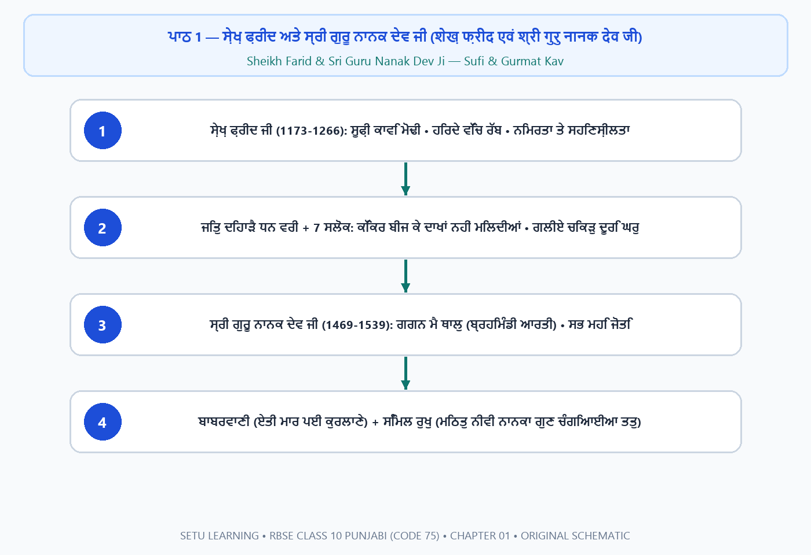

# ਪਾਠ 1 — ਸ਼ੇਖ਼ ਫ਼ਰੀਦ ਅਤੇ ਸ੍ਰੀ ਗੁਰੂ ਨਾਨਕ ਦੇਵ ਜੀ (शेख़ फ़रीद एवं श्री गुरु नानक देव जी) (Sheikh Farid & Sri Guru Nanak Dev Ji — Sufi & Gurmat Kav)

## भाग 1: अध्याय प्रवेश एवं पाठ्यक्रम मैपिंग (ਪਾਠ-ਪ੍ਰਵੇਸ਼ ਅਤੇ ਪਾਠਕ੍ਰਮ ਮੈਪਿੰਗ)

> ਪਹਿਲਾ ਸੰਪਾਦਕੀ ਪ੍ਰਾਰੂਪ (प्रथम संपादकीय प्रारूप)। RBSE ਜਮਾਤ 10 ਪੰਜਾਬੀ ਪਾਠ-ਪੁਸਤਕ 'ਸਾਹਿਤ ਸੁਗੰਧੀਆਂ' ਦੇ ਸਾਰੇ ਪ੍ਰਸ਼ਨਾਂ ਦੇ ਹੱਲ ਅਤੇ 2014–2026 ਦਾ ਪੂਰਾ ਇਤਿਹਾਸਕ PYQ ਸੰਗ੍ਰਹਿ ਸਰੋਤ-ਪ੍ਰੀਖਣ ਸਮੇਤ ਸੰਕਲਿਤ ਹਨ।

**ਵਿਸ਼ਾ ਕੋਡ (विषय कोड):** 75 (ਤੀਜੀ ਭਾਸ਼ਾ — ਪੰਜਾਬੀ / तृतीया भाषा — पंजाबी) · **ਲੜੀ ਪੁਸਤਕ (श्रृंखला पुस्तक):** 7

**ਪ੍ਰਮਾਣਿਤ ਆਧਾਰ:** RBSE 2025–26 · **ਪਾਠ ਅੰਕ-ਭਾਰ:** 3 ਅੰਕ। ਇਹ ਭਾਰ ਉਸੇ ਸੰਸਕਰਣ ਦਾ ਹੈ; ਅਸਲ ਪ੍ਰਸ਼ਨ-ਵੰਡ ਦੀ ਭਵਿੱਖਬਾਣੀ ਨਹੀਂ।

**ਸਿੱਖਣ ਦੇ ਉਦੇਸ਼ (सीखने के लक्ष्य):** ਬਾਬਾ ਸ਼ੇਖ਼ ਫ਼ਰੀਦ ਜੀ ਦੇ ਸ਼ਬਦ ('ਜਿਤੁ ਦਿਹਾੜੈ ਧਨ ਵਰੀ') ਤੇ 7 ਸਲੋਕਾਂ ਅਤੇ ਸ੍ਰੀ ਗੁਰੂ ਨਾਨਕ ਦੇਵ ਜੀ ਦੀਆਂ ਰਚਨਾਵਾਂ ('ਗਗਨ ਮੈ ਥਾਲੁ', 'ਖੁਰਾਸਾਨ ਖਸਮਾਨਾ ਕੀਆ', 'ਸਿੰਮਲ ਰੁਖੁ ਸਰਾਇਰਾ') ਦੀ ਪ੍ਰਸੰਗ ਸਹਿਤ ਵਿਆਖਿਆ, ਕੇਂਦਰੀ ਭਾਵ ਅਤੇ ਔਖੇ ਸ਼ਬਦ-ਅਰਥ ਸਮਝਣਾ।

## भाग 2: शब्दावली एवं अवधारणा कैप्सूल (ਸ਼ਬਦਾਵਲੀ ਅਤੇ ਸੰਕਲਪ ਕੈਪਸੂਲ)

| ਸ਼ਬਦ / ਸੰਕਲਪ | ਅਰਥ / ਵਿਆਖਿਆ |
|---|---|
| ਧਨ (धनु) | ਜੀਵ-ਇਸਤਰੀ / ਮਨੁੱਖੀ ਆਤਮਾ (ਜਿਤੁ ਦਿਹਾੜੈ ਧਨ ਵਰੀ ਸਾਹੇ ਲਏ ਲਿਖਾਇ)। |
| ਮਲਕੁ (मलकु) | ਮੌਤ ਦਾ ਫ਼ਰਿਸ਼ਤਾ / ਅਜ਼ਰਾਈਲ (ਮਲਕੁ ਜਿ ਕੰਨੀ ਸੁਣੀਦਾ ਮੁਹੁ ਦੇਖਾਲੇ ਆਇ)। |
| ਦਾਖ ਬਿਜਉਰੀਆਂ (दाख बिजउरीआं) | ਬਿਜੌਰ ਦੇ ਇਲਾਕੇ ਦੇ ਮਿੱਠੇ ਅੰਗੂਰ / ਸੌਗੀ (ਲੋੜੈ ਦਾਖ ਬਿਜਉਰੀਆਂ ਕਿਕਰਿ ਬੀਜੈ ਜਟੁ)। |
| ਮਾਖਿਓੁ (माखिओ) | ਸ਼ਹਿਦ (ਸਕਰ ਖੰਡੁ ਨਿਵਾਤ ਗੁੜੁ ਮਾਖਿਓੁ ਮਾਂਝਾ ਦੁਧੁ)। |
| ਘੜੀਆਲੁ (घड़ीआलु) | ਘੰਟਾ / ਸਮਾਂ ਦੱਸਣ ਵਾਲਾ ਘੜਿਆਲ ਜਿਸ ਉੱਤੇ ਚੋਟ ਮਾਰੀ ਜਾਂਦੀ ਹੈ। |
| ਗਗਨ (गगन) | ਆਕਾਸ਼ ਰੂਪੀ ਥਾਲ (ਗਗਨ ਮੈ ਥਾਲੁ ਰਵਿ ਚੰਦੁ ਦੀਪਕ ਬਨੇ)। |
| ਮਲਆਨਲੋ (मलआनलो) | ਮਲਯ ਪਰਬਤ ਤੋਂ ਆਉਣ ਵਾਲੀ ਚੰਦਨ ਦੀ ਸੁਗੰਧਿਤ ਹਵਾ (ਧੂਪੁ ਮਲਆਨਲੋ ਪਵਣੁ ਚਵਰੋ ਕਰੇ)। |
| ਅਨਹਤਾ ਸ਼ਬਦ (अनहता शब्द) | ਬਿਨਾਂ ਵਜਾਏ ਵੱਜਣ ਵਾਲਾ ਇਲਾਹੀ ਨਾਦ / ਜੀਵਨ-ਰੌਂ (ਅਨਹਤਾ ਸ਼ਬਦ ਵਾਜੰਤ ਭੇਰੀ)। |
| ਖਸਮਾਨਾ (खसमाना) | ਸਪੁਰਦਗੀ / ਰਾਖੀ (ਖੁਰਾਸਾਨ ਖਸਮਾਨਾ ਕੀਆ ਹਿੰਦੁਸਤਾਨੁ ਡਰਾਇਆ)। |
| ਸਿੰਮਲ ਰੁਖੁ (सिम्मल रुखु) | ਸਿੰਬਲ ਦਾ ਉੱਚਾ ਤੇ ਸਿੱਧਾ ਰੁੱਖ ਜਿਸ ਦੇ ਫਲ ਬੇਸੁਆਦੇ ਹੁੰਦੇ ਹਨ (ਹੰਕਾਰੀ ਮਨੁੱਖ ਦਾ ਪ੍ਰਤੀਕ)। |

## भाग 3: विस्तृत शिक्षण पाठ (ਵਿਸਤ੍ਰਿਤ ਅਧਿਆਪਨ ਪਾਠ)

### 1. ਕਵੀ-ਪਛਾਣ: ਬਾਬਾ ਸ਼ੇਖ਼ ਫ਼ਰੀਦ ਜੀ (1173–1266 ਈ.) ਅਤੇ ਸ੍ਰੀ ਗੁਰੂ ਨਾਨਕ ਦੇਵ ਜੀ (1469–1539 ਈ.)
**ਬਾਬਾ ਸ਼ੇਖ਼ ਫ਼ਰੀਦ ਜੀ (ਸ਼ਕਰਗੰਜ):** ਪੰਜਾਬੀ ਸੂਫ਼ੀ ਕਾਵਿ-ਧਾਰਾ ਦੇ ਮੋਢੀ ਕਵੀ ਬਾਬਾ ਫ਼ਰੀਦ ਜੀ ਦਾ ਜਨਮ 1173 ਈ. ਵਿੱਚ ਪਿੰਡ ਖੋਤਵਾਲ (ਜ਼ਿਲ੍ਹਾ ਮੁਲਤਾਨ) ਵਿਖੇ ਪਿਤਾ ਸ਼ੇਖ਼ ਜਮਾਲ-ਉਦ-ਦੀਨ ਸੁਲੇਮਾਨ ਅਤੇ ਮਾਤਾ ਮਰੀਅਮ (ਕਰਸੂਮ) ਦੇ ਘਰ ਹੋਇਆ। ਉਹਨਾਂ ਨੇ ਪਾਕਪਟਨ (ਅਜੋਧਨ) ਨੂੰ ਆਪਣਾ ਨਿਵਾਸ ਬਣਾਇਆ। ਸ੍ਰੀ ਗੁਰੂ ਗ੍ਰੰਥ ਸਾਹਿਬ ਵਿੱਚ ਉਹਨਾਂ ਦੇ **4 ਸ਼ਬਦ ਅਤੇ 112 ਸਲੋਕ** ਦਰਜ ਹਨ।
**ਸ੍ਰੀ ਗੁਰੂ ਨਾਨਕ ਦੇਵ ਜੀ:** ਸਿੱਖ ਧਰਮ ਦੇ ਬਾਨੀ ਸ੍ਰੀ ਗੁਰੂ ਨਾਨਕ ਦੇਵ ਜੀ ਦਾ ਜਨਮ 1469 ਈ. ਵਿੱਚ ਰਾਇ ਭੋਇੰ ਦੀ ਤਲਵੰਡੀ (ਨਨਕਾਣਾ ਸਾਹਿਬ) ਵਿਖੇ ਪਿਤਾ ਮਹਿਤਾ ਕਾਲੂ ਜੀ ਅਤੇ ਮਾਤਾ ਤ੍ਰਿਪਤਾ ਦੇਵੀ ਜੀ ਦੇ ਘਰ ਹੋਇਆ। ਉਹਨਾਂ ਨੇ ਚਾਰ ਉਦਾਸੀਆਂ ਕੀਤੀਆਂ ਅਤੇ ਕਰਤਾਰਪੁਰ ਵਿਖੇ 1539 ਈ. ਵਿੱਚ ਜੋਤੀ-ਜੋਤਿ ਸਮਾਏ।

### 2. ਸ਼ੇਖ਼ ਫ਼ਰੀਦ ਜੀ ਦੀ ਬਾਣੀ: ਸ਼ਬਦ ਅਤੇ ਸਲੋਕ (प्रसंग एवं भावार्थ)
1. **ਸ਼ਬਦ — 'ਜਿਤੁ ਦਿਹਾੜੈ ਧਨ ਵਰੀ ਸਾਹੇ ਲਏ ਲਿਖਾਇ':** ਜਿਸ ਦਿਨ ਜੀਵ-ਇਸਤਰੀ (ਧਨ) ਵਿਆਹੀ ਜਾਣੀ ਹੈ ਭਾਵ ਮੌਤ ਦਾ ਸਮਾਂ (ਸਾਹੇ) ਪਹਿਲਾਂ ਹੀ ਲਿਖਿਆ ਹੋਇਆ ਹੈ। ਮੌਤ ਦਾ ਫ਼ਰਿਸ਼ਤਾ (ਮਲਕੁ) ਜਿਸ ਬਾਰੇ ਕੰਨਾਂ ਨਾਲ ਸੁਣੀਦਾ ਸੀ, ਉਹ ਸਾਹਮਣੇ ਆ ਕੇ ਮੂੰਹ ਵਿਖਾਉਂਦਾ ਹੈ ਅਤੇ ਨਿਮਾਣੀ ਜਿੰਦ ਨੂੰ ਹੱਡੀਆਂ ਕੜਕਾ ਕੇ ਕੱਢ ਲੈਂਦਾ ਹੈ। ਸ਼ੇਖ਼ ਫ਼ਰੀਦ ਜੀ ਸਮਝਾਉਂਦੇ ਹਨ ਕਿ ਜੀਵ-ਰੂਪੀ ਵਹੁਟੀ ਨੂੰ ਪੁਲ-ਸਿਰਾਤ (ਵਾਲ ਤੋਂ ਨਿੱਕੀ ਤੇ ਕੰਨਾਂ ਬੋਲੇ ਪੁਲ) ਤੋਂ ਲੰਘਣਾ ਪੈਣਾ ਹੈ, ਇਸ ਲਈ ਆਪਣੇ ਆਪ ਨੂੰ ਬੁਰੇ ਕਰਮਾਂ ਤੋਂ ਲੁੱਟਣ ਨਾ ਦੇਵੀਂ।
2. **ਸਲੋਕ 1 — 'ਫਰੀਦਾ ਜੋ ਤੈ ਮਾਰਨਿ ਮੁਕੀਆਂ ਤਿਨ੍ਹਾਂ ਨ ਮਾਰੇ ਘੁੰਮਿ':** ਹੇ ਫ਼ਰੀਦ! ਜੋ ਤੈਨੂੰ ਮੁੱਕੀਆਂ ਮਾਰਦੇ ਹਨ (ਦੁੱਖ ਦਿੰਦੇ ਹਨ), ਉਹਨਾਂ ਨੂੰ ਪਰਤ ਕੇ ਨਾ ਮਾਰ, ਸਗੋਂ ਉਹਨਾਂ ਦੇ ਪੈਰ ਚੁੰਮ ਕੇ ਆਪਣੇ ਘਰ (ਹਿਰਦੇ ਦੀ ਸ਼ਾਂਤੀ ਵਿੱਚ) ਚਲਾ ਜਾ। ਇਹ ਸਲੋਕ **ਸਹਿਣਸ਼ੀਲਤਾ ਤੇ ਖਿਮਾ** ਦਾ ਸੰਦੇਸ਼ ਦਿੰਦਾ ਹੈ।
3. **ਸਲੋਕ 2 — 'ਦੇਖੁ ਫਰੀਦਾ ਜੁ ਥੀਆ ਦਾੜੀ ਹੋਈ ਭੂਰ':** ਦਾੜ੍ਹੀ ਚਿੱਟੀ (ਭੂਰ) ਹੋ ਗਈ ਹੈ, ਮੌਤ (ਅਗਹੁ) ਨੇੜੇ ਆ ਗਈ ਹੈ ਤੇ ਪਿਛਲਾ ਜੀਵਨ ਦੂਰ ਰਹਿ ਗਿਆ ਹੈ; ਹੁਣ ਵੀ ਰੱਬ ਦੀ ਬੰਦਗੀ ਕਰ।
4. **ਸਲੋਕ 3 — 'ਜੰਗਲੁ ਜੰਗਲੁ ਕਿਆ ਭਵਹਿ ਵਣਿ ਕੰਡਾ ਮੋੜੇਹਿ':** ਫ਼ਰੀਦ ਜੀ ਕਹਿੰਦੇ ਹਨ ਕਿ ਰੱਬ ਨੂੰ ਲੱਭਣ ਲਈ ਜੰਗਲਾਂ ਵਿੱਚ ਭਟਕਣ ਤੇ ਕੰਡੇ ਮੋੜਨ ਦੀ ਲੋੜ ਨਹੀਂ; **ਰੱਬ ਤਾਂ ਮਨੁੱਖ ਦੇ ਹਿਰਦੇ ('ਵਸੀ ਰਬੁ ਹਿਆਲੀਐ') ਵਿੱਚ ਵੱਸਦਾ ਹੈ**।
5. **ਸਲੋਕ 4 — 'ਲੋੜੈ ਦਾਖ ਬਿਜਉਰੀਆਂ ਕਿਕਰਿ ਬੀਜੈ ਜਟੁ':** ਮਨੁੱਖ ਬੀਜਦਾ ਤਾਂ ਕਿੱਕਰਾਂ (ਬੁਰੇ ਕਰਮ) ਹੈ ਪਰ ਇੱਛਾ ਬਿਜੌਰ ਦੀਆਂ ਮਿੱਠੀਆਂ ਦਾਖਾਂ (ਅੰਗੂਰਾਂ) ਦੀ ਰੱਖਦਾ ਹੈ; ਉੱਨ ਕੱਤਦਾ ਫਿਰਦਾ ਹੈ ਪਰ ਰੇਸ਼ਮ (ਪਟੁ) ਪਹਿਨਣਾ ਚਾਹੁੰਦਾ ਹੈ — ਭਾਵ **ਜਿਹੋ ਜਿਹੇ ਕਰਮ ਬੀਜੋਗੇ, ਉਹੋ ਜਿਹਾ ਫਲ ਮਿਲੇਗਾ**।
6. **ਸਲੋਕ 5 — 'ਗਲੀਏ ਚਿਕੜੁ ਦੂਰਿ ਘਰੁ ਨਾਲਿ ਪਿਆਰੇ ਨੇਹੁ':** ਗਲੀ ਵਿੱਚ ਚਿੱਕੜ (ਸੰਸਾਰਕ ਮਾਇਆ ਤੇ ਔਕੜਾਂ) ਹੈ, ਪਿਆਰੇ ਰੱਬ ਦਾ ਘਰ ਦੂਰ ਹੈ; ਜੇ ਚੱਲਾਂ ਤਾਂ ਭਗਤੀ ਦੀ ਕੰਬਲੀ ਭਿੱਜਦੀ ਹੈ, ਜੇ ਰੁਕਾਂ ਤਾਂ ਪ੍ਰੇਮ ਟੁੱਟਦਾ ਹੈ। ਫ਼ਰੀਦ ਜੀ ਕਹਿੰਦੇ ਹਨ — ਕੰਬਲੀ ਭਾਵੇਂ ਮੀਂਹ (ਰੱਬ ਦੇ ਮੋਹ) ਵਿੱਚ ਭਿੱਜ ਜਾਵੇ, ਮੈਂ ਸੱਜਣ-ਪ੍ਰਭੂ ਨੂੰ ਜ਼ਰੂਰ ਮਿਲਾਂਗਾ ਤਾਂ ਜੋ ਨੇਹੁ (ਪ੍ਰੇਮ) ਨਾ ਟੁੱਟੇ।
7. **ਸਲੋਕ 6 — 'ਸਕਰ ਖੰਡੁ ਨਿਵਾਤ ਗੁੜੁ ਮਾਖਿਓੁ ਮਾਂਝਾ ਦੁਧੁ':** ਸ਼ੱਕਰ, ਖੰਡ, ਮਿਸ਼ਰੀ (ਨਿਵਾਤ), ਗੁੜ, ਸ਼ਹਿਦ (ਮਾਖਿਓੁ) ਤੇ ਮੱਝ ਦਾ ਦੁੱਧ — ਇਹ ਸਾਰੀਆਂ ਵਸਤੂਆਂ ਮਿੱਠੀਆਂ ਹਨ, ਪਰ ਪ੍ਰਭੂ-ਭਗਤੀ ਦੇ ਮਿਠਾਸ ('ਰਬ ਨ ਪੁਜਨਿ ਤੁਧੁ') ਦੀ ਬਰਾਬਰੀ ਨਹੀਂ ਕਰ ਸਕਦੀਆਂ।
8. **ਸਲੋਕ 7 — 'ਦਰਿ ਦਰਵਾਜੈ ਜਾਇ ਕੈ ਕਿਉ ਡਿਠੋ ਘੜੀਆਲੁ':** ਇਹ ਨਿਰਦੋਸ਼ ਘੜਿਆਲ ਹਰ ਘੜੀ ਕੁੱਟਿਆ ਜਾਂਦਾ ਹੈ, ਤਾਂ ਫਿਰ ਅਸੀਂ ਜੋ ਗੁਨਾਹਗਾਰ (ਦੋਸਾਂ ਦਾ ਭਰਿਆ) ਹਾਂ, ਸਾਡਾ ਅੰਤ ਵੇਲੇ ਕੀ ਹਾਲ ਹੋਵੇਗਾ?

### 3. ਸ੍ਰੀ ਗੁਰੂ ਨਾਨਕ ਦੇਵ ਜੀ ਦੀਆਂ ਤਿੰਨ ਰਚਨਾਵਾਂ (आरती, बाबरवाणी एवं सिम्मल रुखु)
1. **ਗਗਨ ਮੈ ਥਾਲੁ (ਆਰਤੀ):** ਗੁਰੂ ਨਾਨਕ ਦੇਵ ਜੀ ਨੇ ਜਗਨਨਾਥ ਪੁਰੀ ਵਿਖੇ ਥਾਲ ਵਿੱਚ ਦੀਵੇ ਰੱਖ ਕੇ ਕੀਤੀ ਜਾਂਦੀ ਰਸਮੀ ਆਰਤੀ ਦੇ ਥਾਂ ਕੁਦਰਤ ਵੱਲੋਂ ਕੀਤੀ ਜਾ ਰਹੀ ਬ੍ਰਹਿਮੰਡੀ ਆਰਤੀ ਦਾ ਚਿੱਤਰ ਖਿੱਚਿਆ ਹੈ — ਆਕਾਸ਼ (ਗਗਨ) ਥਾਲ ਹੈ, ਸੂਰਜ ਤੇ ਚੰਦ (ਰਵਿ-ਚੰਦੁ) ਦੀਵੇ ਹਨ, ਤਾਰਿਆਂ ਦਾ ਸਮੂਹ ਮੋਤੀ ਹਨ, ਮਲਯ ਪਰਬਤ ਦੀ ਚੰਦਨ-ਹਵਾ ਧੂਪ ਹੈ, ਪਵਣ ਚੌਰ ਝੁਲਾ ਰਿਹਾ ਹੈ, ਸਾਰੀ ਬਨਸਪਤੀ ਫੁੱਲ ਚੜ੍ਹਾ ਰਹੀ ਹੈ ਅਤੇ ਅਨਹਦ ਸ਼ਬਦ ਦਾ ਨਗਾਰਾ (ਭੇਰੀ) ਵੱਜ ਰਿਹਾ ਹੈ। **'ਸਭ ਮਹਿ ਜੋਤਿ ਜੋਤਿ ਹੈ ਸੋਇ । ਤਿਸ ਦੈ ਚਾਨਣਿ ਸਭ ਮਹਿ ਚਾਨਣੁ ਹੋਇ ॥'** — ਭਾਵ ਪ੍ਰਭੂ ਦੀ ਜੋਤ ਸਭ ਜੀਵਾਂ ਵਿੱਚ ਵਿਆਪਕ ਹੈ।
2. **ਖੁਰਾਸਾਨ ਖਸਮਾਨਾ ਕੀਆ ਹਿੰਦੁਸਤਾਨੁ ਡਰਾਇਆ (ਬਾਬਰਵਾਣੀ):** ਬਾਬਰ ਦੇ ਹਮਲੇ ਸਮੇਂ ਨਿਹੱਥੇ ਲੋਕਾਂ ਉੱਤੇ ਹੋਏ ਜ਼ੁਲਮ ਨੂੰ ਵੇਖ ਕੇ ਗੁਰੂ ਜੀ ਰੱਬ ਨੂੰ ਪ੍ਰੇਮ-ਭਰਿਆ ਉਲਾਂਭਾ ਦਿੰਦੇ ਹਨ — **'ਏਤੀ ਮਾਰ ਪਈ ਕੁਰਲਾਣੇ ਤੈ ਕੀ ਦਰਦੁ ਨ ਆਇਆ ॥'** ਗੁਰੂ ਜੀ ਕਹਿੰਦੇ ਹਨ ਕਿ ਜੇ ਤਕੜਾ (ਸਕਤਾ) ਤਕੜੇ ਨੂੰ ਮਾਰੇ ਤਾਂ ਮਨ ਵਿੱਚ ਰੋਸ ਨਹੀਂ ਹੁੰਦਾ, ਪਰ ਜੇ ਸ਼ੀਂਹ (ਸ਼ੇਰ ਵਰਗਾ ਹਮਲਾਵਰ ਬਾਬਰ) ਨਿਹੱਥੀਆਂ ਗਊਆਂ (ਆਮ ਪਰਜਾ) ਉੱਤੇ ਹਮਲਾ ਕਰੇ ਤਾਂ ਮਾਲਕ (ਰੱਬ) ਨੂੰ ਪੁੱਛਿਆ ਜਾਂਦਾ ਹੈ।
3. **ਸਿੰਮਲ ਰੁਖੁ ਸਰਾਇਰਾ ਅਤਿ ਦੀਰਘ ਅਤਿ ਮੁਚੁ:** ਸਿੰਬਲ ਦਾ ਰੁੱਖ ਸਿੱਧਾ, ਬਹੁਤ ਉੱਚਾ (ਦੀਰਘ) ਤੇ ਮੋਟਾ (ਮੁਚੁ) ਹੁੰਦਾ ਹੈ, ਪਰ ਪੰਛੀ ਜਦੋਂ ਆਸ ਲੈ ਕੇ ਆਉਂਦੇ ਹਨ ਤਾਂ ਨਿਰਾਸ਼ ਮੁੜਦੇ ਹਨ ਕਿਉਂਕਿ ਉਸ ਦੇ ਫਲ ਫਿੱਕੇ, ਫੁੱਲ ਬਕਬਕੇ ਤੇ ਪੱਤੇ ਬੇਕਾਰ ਹਨ। ਇਹ ਹੰਕਾਰੀ ਮਨੁੱਖ ਦਾ ਪ੍ਰਤੀਕ ਹੈ। ਅੰਤਿਮ ਤੁਕ ਵਿੱਚ ਗੁਰੂ ਜੀ ਨਿਮਰਤਾ ਦਾ ਤੱਤ ਦੱਸਦੇ ਹਨ — **'ਮਿਠਤੁ ਨੀਵੀ ਨਾਨਕਾ ਗੁਣ ਚੰਗਿਆਈਆ ਤਤੁ ॥'** (ਮਿਠਾਸ ਅਤੇ ਨਿਮਰਤਾ ਸਾਰੇ ਗੁਣਾਂ ਤੇ ਚੰਗਿਆਈਆਂ ਦਾ ਨਿਚੋੜ ਹੈ)।

ਪਾਠ 1: ਸ਼ੇਖ਼ ਫ਼ਰੀਦ ਜੀ ਦੇ ਸਲੋਕ ਅਤੇ ਸ੍ਰੀ ਗੁਰੂ ਨਾਨਕ ਦੇਵ ਜੀ ਦੀ ਬਾਣੀ ਦਾ ਸੰਕਲਪ ਚਿੱਤਰ

## भाग 4: पाठ्यपुस्तक-अवधारणाओं पर मौलिक हल किए उदाहरण (ਹੱਲ ਕੀਤੇ ਮਿਆਰੀ ਉਦਾਹਰਣ)

ਹੇਠਾਂ ਦਿੱਤੇ ਪ੍ਰਸ਼ਨ ਪਾਠ-ਪੁਸਤਕ 'ਸਾਹਿਤ ਸੁਗੰਧੀਆਂ' ਅਤੇ ਵਿਆਕਰਣ ਦੇ ਸੰਕਲਪਾਂ ਉੱਤੇ ਆਧਾਰਿਤ ਮੌਲਿਕ ਆਦਰਸ਼ ਹੱਲ ਹਨ।

**ਹੱਲ ਕੀਤਾ ਉਦਾਹਰਣ 1: 'ਗਗਨ ਮੈ ਥਾਲੁ ਰਵਿ ਚੰਦੁ ਦੀਪਕ ਬਨੇ...' ਕਾਵਿ-ਬੰਦ ਦੀ ਪ੍ਰਸੰਗ ਸਹਿਤ ਵਿਆਖਿਆ ਕਰੋ।**

ਪ੍ਰਸੰਗ: ਇਹ ਕਾਵਿ-ਬੰਦ ਸਾਡੀ ਪੰਜਾਬੀ ਦੀ ਪਾਠ-ਪੁਸਤਕ 'ਸਾਹਿਤ ਸੁਗੰਧੀਆਂ' ਵਿੱਚ ਦਰਜ ਸ੍ਰੀ ਗੁਰੂ ਨਾਨਕ ਦੇਵ ਜੀ ਦੇ ਸ਼ਬਦ 'ਗਗਨ ਮੈ ਥਾਲੁ (ਆਰਤੀ)' ਵਿੱਚੋਂ ਲਿਆ ਗਿਆ ਹੈ। ਵਿਆਖਿਆ: ਗੁਰੂ ਜੀ ਫ਼ੁਰਮਾਉਂਦੇ ਹਨ ਕਿ ਹੇ ਜਨਮ-ਮਰਨ ਦੇ ਨਾਸ਼ਕ ਪ੍ਰਭੂ! ਸਾਰਾ ਆਕਾਸ਼ ਤੇਰੀ ਆਰਤੀ ਲਈ ਥਾਲ ਬਣਿਆ ਹੋਇਆ ਹੈ, ਸੂਰਜ ਤੇ ਚੰਦ ਦੀਵੇ ਹਨ, ਤਾਰਾਮੰਡਲ ਮੋਤੀ ਹਨ, ਮਲਯ ਪਰਬਤ ਦੀ ਸੁਗੰਧਿਤ ਹਵਾ ਧੂਪ ਹੈ, ਹਵਾ ਚੌਰ ਕਰ ਰਹੀ ਹੈ ਤੇ ਸਾਰੀ ਬਨਸਪਤੀ ਫੁੱਲ ਭੇਟ ਕਰ ਰਹੀ ਹੈ। ਬਿਨਾਂ ਵਜਾਏ ਇਕ-ਰਸ ਇਲਾਹੀ ਸ਼ਬਦ ਦੇ ਨਗਾਰੇ (ਭੇਰੀ) ਵੱਜ ਰਹੇ ਹਨ।

**ਹੱਲ ਕੀਤਾ ਉਦਾਹਰਣ 2: 'ਲੋੜੈ ਦਾਖ ਬਿਜਉਰੀਆਂ ਕਿਕਰਿ ਬੀਜੈ ਜਟੁ' ਸਲੋਕ ਦਾ ਕੇਂਦਰੀ ਭਾਵ ਸਪੱਸ਼ਟ ਕਰੋ।**

ਇਸ ਸਲੋਕ ਵਿੱਚ ਸ਼ੇਖ਼ ਫ਼ਰੀਦ ਜੀ ਕਰਮ-ਸਿੱਧਾਂਤ ਸਮਝਾਉਂਦੇ ਹਨ ਕਿ ਜੇ ਕਿਸਾਨ (ਮਨੁੱਖ) ਖੇਤ ਵਿੱਚ ਕਿੱਕਰਾਂ (ਬੁਰੇ ਕਰਮ ਤੇ ਪਾਪ) ਬੀਜਦਾ ਹੈ ਤਾਂ ਉਹ ਬਿਜੌਰ ਦੇ ਮਿੱਠੇ ਅੰਗੂਰਾਂ (ਸੁੱਖ ਤੇ ਮੁਕਤੀ) ਦੀ ਆਸ ਨਹੀਂ ਰੱਖ ਸਕਦਾ, ਅਤੇ ਉੱਨ ਕੱਤਣ ਵਾਲਾ ਰੇਸ਼ਮ ਨਹੀਂ ਪਹਿਨ ਸਕਦਾ। ਮਨੁੱਖ ਜਿਹੋ ਜਿਹਾ ਬੀਜ ਬੀਜਦਾ ਹੈ, ਉਹੋ ਜਿਹਾ ਫਲ ਪਾਉਂਦਾ ਹੈ।

**ਹੱਲ ਕੀਤਾ ਉਦਾਹਰਣ 3: 'ਏਤੀ ਮਾਰ ਪਈ ਕੁਰਲਾਣੇ ਤੈ ਕੀ ਦਰਦੁ ਨ ਆਇਆ' — ਇੱਥੇ ਗੁਰੂ ਜੀ ਰੱਬ ਨੂੰ ਕੀ ਉਲਾਂਭਾ ਦੇ ਰਹੇ ਹਨ?**

ਬਾਬਰ ਦੇ ਹਿੰਦੁਸਤਾਨ ਉੱਤੇ ਹਮਲੇ ਸਮੇਂ ਜਦੋਂ ਬੇਦੋਸ਼ੇ ਤੇ ਨਿਹੱਥੇ ਲੋਕਾਂ ਉੱਤੇ ਭਾਰੀ ਅਤਿਆਚਾਰ ਹੋਇਆ ਅਤੇ ਲੋਕ ਕੁਰਲਾ ਉੱਠੇ, ਤਾਂ ਗੁਰੂ ਨਾਨਕ ਦੇਵ ਜੀ ਨੇ ਪਰਮਾਤਮਾ ਨੂੰ ਦਰਦ ਭਰਿਆ ਉਲਾਂਭਾ ਦਿੱਤਾ ਕਿ ਹੇ ਕਰਤਾਰ! ਤੂੰ ਸਭਨਾਂ ਦਾ ਮਾਲਕ ਹੈਂ, ਪਰ ਇੰਨੀ ਮਾਰ ਪੈਣ 'ਤੇ ਵੀ ਤੈਨੂੰ ਤਰਸ ਕਿਉਂ ਨਹੀਂ ਆਇਆ?

## भाग 5: सत्यापित बोर्ड प्रश्न एवं स्रोत-स्थिति (ਪ੍ਰਮਾਣਿਤ ਬੋਰਡ ਪ੍ਰਸ਼ਨ ਅਤੇ ਸਰੋਤ-ਸਥਿਤੀ)

RBSE 2026 Main (`S-75`, Q18) ਅਤੇ 2025 Supp (`S-75`, Q1-iii, Q2-i, Q18) ਵਿੱਚ 'ਖੁਰਾਸਾਨ ਖਸਮਾਨਾ ਕੀਆ', 'ਗਲੀਏ ਚਿਕੜੁ ਦੂਰਿ ਘਰੁ', 'ਦਾਖ ਬਿਜਉਰੀਆਂ' ਅਤੇ 'ਮਿਠਤੁ ਨੀਵੀ ਨਾਨਕਾ' ਸਿੱਧੇ ਪੁੱਛੇ ਗਏ ਹਨ।

[RBSE 2026 ਮੂਲ ਪੇਪਰ (S-75)](https://rajeduboard.rajasthan.gov.in/books/PAPERS-2026/Sec/S-75.pdf)। ਪ੍ਰਸ਼ਨ ਦਾ ਸੰਖੇਪ ਵਿਸ਼ਾ-ਸੰਦਰਭ ਹੈ; ਸ਼ਬਦ-ਬ-ਸ਼ਬਦ ਪੁਨਰ-ਮੁਦਰਣ ਨਹੀਂ।

## भाग 6: खंडवार मौलिक अभ्यास बैंक (ਖੰਡ-ਵਾਰ ਮੌਲਿਕ ਅਭਿਆਸ ਬੈਂਕ)

**ਅਭਿਆਸ-ਅੰਕ:** ਵਿਦਿਆਰਥੀਆਂ ਦੇ ਸਵੈ-ਅਭਿਆਸ ਲਈ ਹਨ; ਉੱਤਰ ਪਹਿਲਾਂ ਆਪ ਲਿਖੋ, ਫਿਰ ਭਾਗ 9 ਵੇਖੋ।

## ੳ: ਬਹੁ-ਵਿਕਲਪੀ ਪ੍ਰਸ਼ਨ (MCQ) — 15 × 1 ਅੰਕ

**MCQ 1. 'ਜਿਤੁ ਦਿਹਾੜੈ ਧਨ ਵਰੀ ਸਾਹੇ ਲਏ ਲਿਖਾਇ' ਸ਼ਬਦ ਕਿਸ ਕਵੀ ਦੀ ਰਚਨਾ ਹੈ?**

ੳ) ਗੁਰੂ ਨਾਨਕ ਦੇਵ ਜੀ  
ਅ) ਭਾਈ ਗੁਰਦਾਸ ਜੀ  
ੲ) ਬੁੱਲ੍ਹੇ ਸ਼ਾਹ  
ਸ) ਸ਼ੇਖ਼ ਫ਼ਰੀਦ ਜੀ

**MCQ 2. 'ਫਰੀਦਾ ਲੋੜੈ ਦਾਖ ਬਿਜਉਰੀਆਂ ਕਿਕਰਿ ਬੀਜੈ ਜਟੁ' — ਇੱਥੇ 'ਦਾਖ' ਸ਼ਬਦ ਦਾ ਸਹੀ ਅਰਥ ਕੀ ਹੈ?**

ੳ) ਸੇਬ  
ਅ) ਚੀਕੂ  
ੲ) ਅੰਗੂਰ / ਸੌਗੀ  
ਸ) ਕਲਾਕੰਦ

**MCQ 3. 'ਫਰੀਦਾ ਸਕਰ ਖੰਡੁ ਨਿਵਾਤ ਗੁੜੁ ਮਾਖਿਓੁ ਮਾਂਝਾ ਦੁਧੁ' ਤੁਕ ਵਿੱਚ 'ਮਾਖਿਓੁ' ਸ਼ਬਦ ਦਾ ਕੀ ਅਰਥ ਹੈ?**

ੳ) ਦਹੀਂ  
ਅ) ਸ਼ਹਿਦ  
ੲ) ਮੱਖਣ  
ਸ) ਮਿਸ਼ਰੀ

**MCQ 4. ਸ਼ੇਖ਼ ਫ਼ਰੀਦ ਜੀ ਅਨੁਸਾਰ ਰੱਬ ਦਾ ਵਾਸ ਕਿੱਥੇ ਹੈ?**

ੳ) ਮਨੁੱਖ ਦੇ ਹਿਰਦੇ ਵਿੱਚ ('ਵਸੀ ਰਬੁ ਹਿਆਲੀਐ')  
ਅ) ਜੰਗਲਾਂ ਵਿੱਚ  
ੲ) ਪਹਾੜਾਂ ਉੱਤੇ  
ਸ) ਅਸਮਾਨ ਵਿੱਚ

**MCQ 5. 'ਗਗਨ ਮੈ ਥਾਲੁ ਰਵਿ ਚੰਦੁ ਦੀਪਕ ਬਨੇ' ਸ਼ਬਦ ਕਿਸ ਗੁਰੂ ਸਾਹਿਬ ਦੀ ਰਚਨਾ ਹੈ?**

ੳ) ਸ੍ਰੀ ਗੁਰੂ ਅਮਰਦਾਸ ਜੀ  
ਅ) ਸ੍ਰੀ ਗੁਰੂ ਰਾਮਦਾਸ ਜੀ  
ੲ) ਸ੍ਰੀ ਗੁਰੂ ਅਰਜਨ ਦੇਵ ਜੀ  
ਸ) ਸ੍ਰੀ ਗੁਰੂ ਨਾਨਕ ਦੇਵ ਜੀ

**MCQ 6. 'ਸਭ ਮਹਿ ਜੋਤਿ ਜੋਤਿ ਹੈ ਸੋਇ । ਤਿਸ ਦੈ ਚਾਨਣਿ ਸਭ ਮਹਿ ਚਾਨਣੁ ਹੋਇ ॥' ਸਤਰਾਂ ਕਿਸ ਕਵੀ ਦੀਆਂ ਹਨ?**

ੳ) ਭਾਈ ਗੁਰਦਾਸ ਜੀ  
ਅ) ਸ਼ੇਖ਼ ਫ਼ਰੀਦ ਜੀ  
ੲ) ਸ੍ਰੀ ਗੁਰੂ ਨਾਨਕ ਦੇਵ ਜੀ  
ਸ) ਸ੍ਰੀ ਗੁਰੂ ਅਮਰਦਾਸ ਜੀ

**MCQ 7. 'ਖੁਰਾਸਾਨ ਖਸਮਾਨਾ ਕੀਆ ਹਿੰਦੁਸਤਾਨੁ ਡਰਾਇਆ' ਸ਼ਬਦ ਵਿੱਚ ਕਿਸ ਮੁਗ਼ਲ ਹਮਲਾਵਰ ਦਾ ਜ਼ਿਕਰ ਹੈ?**

ੳ) ਤੈਮੂਰ ਦਾ  
ਅ) ਬਾਬਰ ਦਾ  
ੲ) ਅਕਬਰ ਦਾ  
ਸ) ਔਰੰਗਜ਼ੇਬ ਦਾ

**MCQ 8. 'ਸਿੰਮਲ ਰੁਖੁ ਸਰਾਇਰਾ ਅਤਿ ਦੀਰਘ ਅਤਿ ਮੁਚੁ' ਸਤਰਾਂ ਦੇ ਰਚਨਾਕਾਰ ਕੌਣ ਹਨ?**

ੳ) ਸ੍ਰੀ ਗੁਰੂ ਨਾਨਕ ਦੇਵ ਜੀ  
ਅ) ਸ਼ੇਖ਼ ਫ਼ਰੀਦ ਜੀ  
ੲ) ਭਾਈ ਗੁਰਦਾਸ ਜੀ  
ਸ) ਗੁਰੂ ਰਾਮਦਾਸ ਜੀ

**MCQ 9. 'ਮਿਠਤੁ ਨੀਵੀ ਨਾਨਕਾ ਗੁਣ ਚੰਗਿਆਈਆ ਤਤੁ' ਕਾਵਿ-ਤੁਕ ਕਿਹੜੀ ਕਵਿਤਾ ਵਿੱਚੋਂ ਹੈ?**

ੳ) ਗਗਨ ਮੈ ਥਾਲੁ  
ਅ) ਖੁਰਾਸਾਨ ਖਸਮਾਨਾ ਕੀਆ  
ੲ) ਮਨ ਤੂੰ ਜੋਤਿ ਸਰੂਪੁ ਹੈ  
ਸ) ਸਿੰਮਲ ਰੁਖੁ ਸਰਾਇਰਾ

**MCQ 10. ਸਿੰਬਲ ਦੇ ਰੁੱਖ ਉੱਤੇ ਆਉਣ ਵਾਲੇ ਪੰਛੀ ਨਿਰਾਸ਼ ਹੋ ਕੇ ਕਿਉਂ ਮੁੜ ਜਾਂਦੇ ਹਨ?**

ੳ) ਕਿਉਂਕਿ ਰੁੱਖ ਛੋਟਾ ਹੁੰਦਾ ਹੈ  
ਅ) ਕਿਉਂਕਿ ਰੁੱਖ ਸੁੱਕਾ ਹੁੰਦਾ ਹੈ  
ੲ) ਕਿਉਂਕਿ ਉਸ ਦੇ ਫਲ ਫਿੱਕੇ, ਫੁੱਲ ਬਕਬਕੇ ਤੇ ਪੱਤੇ ਬੇਕਾਰ ਹੁੰਦੇ ਹਨ  
ਸ) ਕਿਉਂਕਿ ਉੱਥੇ ਸ਼ਿਕਾਰੀ ਬੈਠਾ ਹੁੰਦਾ ਹੈ

**MCQ 11. 'ਗਲੀਏ ਚਿਕੜੁ ਦੂਰਿ ਘਰੁ ਨਾਲਿ ਪਿਆਰੇ ਨੇਹੁ' ਸਲੋਕ ਵਿੱਚ 'ਕੰਬਲੀ' ਅਤੇ 'ਚਿਕੜੁ' ਕਿਸ ਦੇ ਪ੍ਰਤੀਕ ਹਨ?**

ੳ) ਜੰਗਲ ਅਤੇ ਪਹਾੜ  
ਅ) ਭਗਤੀ/ਆਤਮਾ ਅਤੇ ਸੰਸਾਰਕ ਮਾਇਆ ਦੀਆਂ ਔਕੜਾਂ  
ੲ) ਸਰਦੀ ਅਤੇ ਮੀਂਹ  
ਸ) ਅਮੀਰੀ ਅਤੇ ਗ਼ਰੀਬੀ

**MCQ 12. 'ਧੂਪੁ ਮਲਆਨਲੋ ਪਵਣੁ ਚਵਰੋ ਕਰੇ' ਵਿੱਚ 'ਮਲਆਨਲੋ' ਦਾ ਕੀ ਅਰਥ ਹੈ?**

ੳ) ਮਲਯ ਪਰਬਤ ਤੋਂ ਆਉਣ ਵਾਲੀ ਚੰਦਨ ਦੀ ਸੁਗੰਧਿਤ ਹਵਾ  
ਅ) ਅੱਗ ਦੀ ਲਾਟ  
ੲ) ਸਮੁੰਦਰ ਦੀ ਲਹਿਰ  
ਸ) ਮੀਂਹ ਦੀ ਫੁਹਾਰ

**MCQ 13. 'ਜੇ ਸਕਤਾ ਸਕਤੇ ਕਉ ਮਾਰੇ ਤਾ ਮਨਿ ਰੋਸੁ ਨ ਹੋਈ' ਵਿੱਚ 'ਰੋਸੁ' ਸ਼ਬਦ ਦਾ ਕੀ ਅਰਥ ਹੈ?**

ੳ) ਖ਼ੁਸ਼ੀ  
ਅ) ਡਰ  
ੲ) ਪਿਆਰ  
ਸ) ਗੁੱਸਾ / ਗਿਲਾ

**MCQ 14. ਬਾਬਾ ਸ਼ੇਖ਼ ਫ਼ਰੀਦ ਜੀ ਦਾ ਜਨਮ ਕਦੋਂ ਅਤੇ ਕਿੱਥੇ ਹੋਇਆ?**

ੳ) 1680 ਈ. ਵਿੱਚ ਕਸੂਰ ਵਿਖੇ  
ਅ) 1551 ਈ. ਵਿੱਚ ਬਾਸਰਕੇ ਵਿਖੇ  
ੲ) 1173 ਈ. ਵਿੱਚ ਪਿੰਡ ਖੋਤਵਾਲ (ਮੁਲਤਾਨ) ਵਿਖੇ  
ਸ) 1469 ਈ. ਵਿੱਚ ਤਲਵੰਡੀ ਵਿਖੇ

**MCQ 15. 'ਜਿਤੁ ਦਿਹਾੜੈ ਧਨ ਵਰੀ' ਵਿੱਚ 'ਮਲਕੁ' ਕਿਸ ਨੂੰ ਕਿਹਾ ਗਿਆ ਹੈ?**

ੳ) ਮਲਾਹ ਨੂੰ  
ਅ) ਮੌਤ ਦੇ ਫ਼ਰਿਸ਼ਤੇ (ਅਜ਼ਰਾਈਲ) ਨੂੰ  
ੲ) ਰਾਜੇ ਨੂੰ  
ਸ) ਵਪਾਰੀ ਨੂੰ

## ੳ: ਖਾਲੀ ਥਾਵਾਂ ਭਰੋ — 6 × 1 ਅੰਕ

1. ਜੀਵ-ਇਸਤਰੀ / ਮਨੁੱਖੀ ਆਤਮਾ (ਜਿਤੁ ਦਿਹਾੜੈ ਧਨ ਵਰੀ ਸਾਹੇ ਲਏ ਲਿਖਾਇ)। — ਇਸ ਸ਼ਬਦ/ਸੰਕਲਪ ਦਾ ਨਾਂ ਹੈ: ____।  
2. ਮੌਤ ਦਾ ਫ਼ਰਿਸ਼ਤਾ / ਅਜ਼ਰਾਈਲ (ਮਲਕੁ ਜਿ ਕੰਨੀ ਸੁਣੀਦਾ ਮੁਹੁ ਦੇਖਾਲੇ ਆਇ)। — ਇਸ ਸ਼ਬਦ/ਸੰਕਲਪ ਦਾ ਨਾਂ ਹੈ: ____।  
3. ਬਿਜੌਰ ਦੇ ਇਲਾਕੇ ਦੇ ਮਿੱਠੇ ਅੰਗੂਰ / ਸੌਗੀ (ਲੋੜੈ ਦਾਖ ਬਿਜਉਰੀਆਂ ਕਿਕਰਿ ਬੀਜੈ ਜਟੁ)। — ਇਸ ਸ਼ਬਦ/ਸੰਕਲਪ ਦਾ ਨਾਂ ਹੈ: ____।  
4. ਸ਼ਹਿਦ (ਸਕਰ ਖੰਡੁ ਨਿਵਾਤ ਗੁੜੁ ਮਾਖਿਓੁ ਮਾਂਝਾ ਦੁਧੁ)। — ਇਸ ਸ਼ਬਦ/ਸੰਕਲਪ ਦਾ ਨਾਂ ਹੈ: ____।  
5. ਘੰਟਾ / ਸਮਾਂ ਦੱਸਣ ਵਾਲਾ ਘੜਿਆਲ ਜਿਸ ਉੱਤੇ ਚੋਟ ਮਾਰੀ ਜਾਂਦੀ ਹੈ। — ਇਸ ਸ਼ਬਦ/ਸੰਕਲਪ ਦਾ ਨਾਂ ਹੈ: ____।  
6. ਆਕਾਸ਼ ਰੂਪੀ ਥਾਲ (ਗਗਨ ਮੈ ਥਾਲੁ ਰਵਿ ਚੰਦੁ ਦੀਪਕ ਬਨੇ)। — ਇਸ ਸ਼ਬਦ/ਸੰਕਲਪ ਦਾ ਨਾਂ ਹੈ: ____।

## ੳ: ਅਤਿ-ਲਘੂ ਉੱਤਰਾਂ ਵਾਲੇ ਪ੍ਰਸ਼ਨ — 8 × 1 ਅੰਕ

1. 'ਜਿਤੁ ਦਿਹਾੜੈ ਧਨ ਵਰੀ ਸਾਹੇ ਲਏ ਲਿਖਾਇ' ਸ਼ਬਦ ਕਿਸ ਕਵੀ ਦੀ ਰਚਨਾ ਹੈ?  
2. 'ਫਰੀਦਾ ਲੋੜੈ ਦਾਖ ਬਿਜਉਰੀਆਂ ਕਿਕਰਿ ਬੀਜੈ ਜਟੁ' — ਇੱਥੇ 'ਦਾਖ' ਸ਼ਬਦ ਦਾ ਸਹੀ ਅਰਥ ਕੀ ਹੈ?  
3. 'ਫਰੀਦਾ ਸਕਰ ਖੰਡੁ ਨਿਵਾਤ ਗੁੜੁ ਮਾਖਿਓੁ ਮਾਂਝਾ ਦੁਧੁ' ਤੁਕ ਵਿੱਚ 'ਮਾਖਿਓੁ' ਸ਼ਬਦ ਦਾ ਕੀ ਅਰਥ ਹੈ?  
4. ਸ਼ੇਖ਼ ਫ਼ਰੀਦ ਜੀ ਅਨੁਸਾਰ ਰੱਬ ਦਾ ਵਾਸ ਕਿੱਥੇ ਹੈ?  
5. 'ਗਗਨ ਮੈ ਥਾਲੁ ਰਵਿ ਚੰਦੁ ਦੀਪਕ ਬਨੇ' ਸ਼ਬਦ ਕਿਸ ਗੁਰੂ ਸਾਹਿਬ ਦੀ ਰਚਨਾ ਹੈ?  
6. 'ਸਭ ਮਹਿ ਜੋਤਿ ਜੋਤਿ ਹੈ ਸੋਇ । ਤਿਸ ਦੈ ਚਾਨਣਿ ਸਭ ਮਹਿ ਚਾਨਣੁ ਹੋਇ ॥' ਸਤਰਾਂ ਕਿਸ ਕਵੀ ਦੀਆਂ ਹਨ?  
7. 'ਖੁਰਾਸਾਨ ਖਸਮਾਨਾ ਕੀਆ ਹਿੰਦੁਸਤਾਨੁ ਡਰਾਇਆ' ਸ਼ਬਦ ਵਿੱਚ ਕਿਸ ਮੁਗ਼ਲ ਹਮਲਾਵਰ ਦਾ ਜ਼ਿਕਰ ਹੈ?  
8. 'ਸਿੰਮਲ ਰੁਖੁ ਸਰਾਇਰਾ ਅਤਿ ਦੀਰਘ ਅਤਿ ਮੁਚੁ' ਸਤਰਾਂ ਦੇ ਰਚਨਾਕਾਰ ਕੌਣ ਹਨ?

## ਅ: ਲਘੂ ਉੱਤਰਾਂ ਵਾਲੇ ਪ੍ਰਸ਼ਨ — 6 × 2 ਅੰਕ

**B1.** ਸ਼ੇਖ਼ ਫ਼ਰੀਦ ਜੀ ਰੱਬ ਦਾ ਵਾਸ ਕਿੱਥੇ ਦੱਸਦੇ ਹਨ?

**B2.** 'ਫਰੀਦਾ ਸਕਰ ਖੰਡੁ ਨਿਵਾਤ ਗੁੜੁ ਮਾਖਿਓੁ ਮਾਂਝਾ ਦੁਧੁ' ਤੁਕ ਵਿੱਚ 'ਮਾਖਿਓੁ' ਅਤੇ 'ਨਿਵਾਤ' ਸ਼ਬਦਾਂ ਦੇ ਅਰਥ ਲਿਖੋ।

**B3.** 'ਮਿਠਤੁ ਨੀਵੀ ਨਾਨਕਾ ਗੁਣ ਚੰਗਿਆਈਆ ਤਤੁ' ਕਾਵਿ-ਤੁਕ ਕਿਹੜੀ ਕਵਿਤਾ ਵਿੱਚੋਂ ਹੈ ਅਤੇ ਇਸ ਦਾ ਕੀ ਭਾਵ ਹੈ?

**B4.** 'ਮਾਲਕ-ਪ੍ਰਭੂ ਸਭ ਜੀਵਾਂ ਵਿੱਚ ਵਿਆਪਕ ਹੈ' — ਗੁਰੂ ਨਾਨਕ ਦੇਵ ਜੀ ਦੀ ਆਰਤੀ ਵਿੱਚੋਂ ਇਹ ਅਰਥ ਦੇਣ ਵਾਲੀ ਤੁਕ ਲਿਖੋ।

**B5.** 'ਜੇ ਸਕਤਾ ਸਕਤੇ ਕਉ ਮਾਰੇ ਤਾ ਮਨਿ ਰੋਸੁ ਨ ਹੋਈ' ਤੁਕ ਵਿੱਚ 'ਸਕਤਾ' ਸ਼ਬਦ ਦਾ ਕੀ ਅਰਥ ਹੈ?

**B6.** ਸ਼ੇਖ਼ ਫ਼ਰੀਦ ਜੀ ਨੇ ਘੜਿਆਲ (ਘੰਟੇ) ਦੀ ਉਦਾਹਰਣ ਰਾਹੀਂ ਮਨੁੱਖ ਨੂੰ ਕੀ ਚੇਤਾਵਨੀ ਦਿੱਤੀ ਹੈ?

## ੲ: ਦੀਰਘ ਉੱਤਰਾਂ ਵਾਲੇ ਪ੍ਰਸ਼ਨ — 4 × 3 ਅੰਕ

ਅੰਦਰੂਨੀ ਵਿਕਲਪ ਅਭਿਆਸ: ਪਹਿਲਾਂ ਇੱਕ ਵਿਕਲਪ ਹੱਲ ਕਰੋ ਅਤੇ ਦੁਹਰਾਈ ਵੇਲੇ ਬਾਕੀ ਪ੍ਰਸ਼ਨ ਵੀ ਹੱਲ ਕਰੋ।

**C1.** 'ਗਗਨ ਮੈ ਥਾਲੁ (ਆਰਤੀ)' ਸ਼ਬਦ ਵਿੱਚ ਪ੍ਰਗਟ ਕੀਤੇ ਗਏ ਵਿਚਾਰਾਂ ਦਾ ਸਾਰ ਆਪਣੇ ਸ਼ਬਦਾਂ ਵਿੱਚ ਲਿਖੋ।

**C2.** 'ਸਿੰਮਲ ਰੁਖੁ ਸਰਾਇਰਾ' ਸ਼ਬਦ ਦਾ ਸਾਰ ਅਤੇ ਸਿੱਖਿਆ ਆਪਣੇ ਸ਼ਬਦਾਂ ਵਿੱਚ ਲਿਖੋ।

**C3.** 'ਖੁਰਾਸਾਨ ਖਸਮਾਨਾ ਕੀਆ ਹਿੰਦੁਸਤਾਨੁ ਡਰਾਇਆ' ਸ਼ਬਦ ਵਿੱਚ ਗੁਰੂ ਜੀ ਨੇ ਬਾਬਰ ਦੇ ਹਮਲੇ ਦਾ ਕੀ ਚਿੱਤਰ ਖਿੱਚਿਆ ਹੈ?

**C4.** ਸ਼ੇਖ਼ ਫ਼ਰੀਦ ਜੀ ਦੇ ਸਲੋਕਾਂ ਦੇ ਆਧਾਰ 'ਤੇ ਉਹਨਾਂ ਦੀਆਂ ਪ੍ਰਮੁੱਖ ਸਿੱਖਿਆਵਾਂ ਉੱਤੇ ਚਾਨਣਾ ਪਾਓ।

## ਸ: ਨਿਬੰਧਾਤਮਕ / ਵਿਸਤ੍ਰਿਤ ਉੱਤਰਾਂ ਵਾਲੇ ਪ੍ਰਸ਼ਨ — 2 × 4 ਅੰਕ

ਅੰਦਰੂਨੀ ਵਿਕਲਪ ਅਭਿਆਸ: D1 ਜਾਂ D2 ਚੁਣੋ; ਬਾਅਦ ਵਿੱਚ ਦੂਜਾ ਵੀ ਹੱਲ ਕਰੋ।

**D1.** 'ਜਿਤੁ ਦਿਹਾੜੈ ਧਨ ਵਰੀ ਸਾਹੇ ਲਏ ਲਿਖਾਇ...' ਅਤੇ 'ਫਰੀਦਾ ਗਲੀਏ ਚਿਕੜੁ ਦੂਰਿ ਘਰੁ...' ਕਾਵਿ-ਬੰਦਾਂ ਦੀ ਪ੍ਰਸੰਗ ਸਹਿਤ ਵਿਆਖਿਆ ਕਰੋ।

**D2.** ਸ੍ਰੀ ਗੁਰੂ ਨਾਨਕ ਦੇਵ ਜੀ ਅਤੇ ਬਾਬਾ ਸ਼ੇਖ਼ ਫ਼ਰੀਦ ਜੀ ਦੀ ਕਾਵਿ-ਸ਼ੈਲੀ ਤੇ ਵਿਚਾਰਧਾਰਾ ਦੀ ਤੁਲਨਾਤਮਕ ਸਮੀਖਿਆ ਕਰੋ।

## भाग 7: सावधानियाँ एवं परीक्षा-त्रुटियाँ (ਸਾਵਧਾਨੀਆਂ ਅਤੇ ਪ੍ਰੀਖਿਆ-ਗ਼ਲਤੀਆਂ)

- **ਗ਼ਲਤੀ 1:** 'ਸਭ ਮਹਿ ਜੋਤਿ ਜੋਤਿ ਹੈ ਸੋਇ' ਅਤੇ 'ਮਨ ਤੂੰ ਜੋਤਿ ਸਰੂਪੁ ਹੈ' ਵਿੱਚ ਭੁਲੇਖਾ ਖਾਣਾ — ਯਾਦ ਰੱਖੋ: **'ਸਭ ਮਹਿ ਜੋਤਿ ਜੋਤਿ ਹੈ ਸੋਇ'** ਸ੍ਰੀ ਗੁਰੂ ਨਾਨਕ ਦੇਵ ਜੀ ('ਗਗਨ ਮੈ ਥਾਲੁ') ਦੀ ਤੁਕ ਹੈ, ਜਦੋਂਕਿ **'ਮਨ ਤੂੰ ਜੋਤਿ ਸਰੂਪੁ ਹੈ ਆਪਣਾ ਮੂਲੁ ਪਛਾਣੁ'** ਤੀਜੇ ਗੁਰੂ ਸ੍ਰੀ ਗੁਰੂ ਅਮਰਦਾਸ ਜੀ ਦੀ ਰਚਨਾ ਹੈ।
- **ਗ਼ਲਤੀ 2:** 'ਮਾਖਿਓੁ' ਦਾ ਅਰਥ 'ਮੱਖਣ' ਲਿਖ ਦੇਣਾ — 'ਮਾਖਿਓੁ' ਦਾ ਸਹੀ ਅਰਥ **'ਸ਼ਹਿਦ'** ਹੈ ਅਤੇ 'ਨਿਵਾਤ' ਦਾ ਅਰਥ **'ਮਿਸ਼ਰੀ'** ਹੈ।
- **ਗ਼ਲਤੀ 3:** ਖਾਲੀ ਥਾਵਾਂ ਭਰਨ ਵੇਲੇ ਅਧੂਰੀ ਤੁਕ ਨੂੰ ਗ਼ਲਤ ਜੋੜਨਾ — 'ਫਰੀਦਾ ਗਲੀਏ ਚਿਕੜੁ ਦੂਰਿ ਘਰੁ **ਨਾਲਿ ਪਿਆਰੇ ਨੇਹੁ**' ਅਤੇ 'ਮਿਠਤੁ ਨੀਵੀ ਨਾਨਕਾ **ਗੁਣ ਚੰਗਿਆਈਆ ਤਤੁ**' ਨੂੰ ਸ਼ੁੱਧ ਗੁਰਮੁਖੀ ਵਿੱਚ ਯਾਦ ਰੱਖੋ।

## भाग 8: फटाफट पुनरावृत्ति — 25 बिंदु (ਫਟਾਫਟ ਦੁਹਰਾਈ — 25 ਬਿੰਦੂ)

1. ਧਨ (धनु): ਜੀਵ-ਇਸਤਰੀ / ਮਨੁੱਖੀ ਆਤਮਾ (ਜਿਤੁ ਦਿਹਾੜੈ ਧਨ ਵਰੀ ਸਾਹੇ ਲਏ ਲਿਖਾਇ)।  
2. ਮਲਕੁ (मलकु): ਮੌਤ ਦਾ ਫ਼ਰਿਸ਼ਤਾ / ਅਜ਼ਰਾਈਲ (ਮਲਕੁ ਜਿ ਕੰਨੀ ਸੁਣੀਦਾ ਮੁਹੁ ਦੇਖਾਲੇ ਆਇ)।  
3. ਦਾਖ ਬਿਜਉਰੀਆਂ (दाख बिजउरीआं): ਬਿਜੌਰ ਦੇ ਇਲਾਕੇ ਦੇ ਮਿੱਠੇ ਅੰਗੂਰ / ਸੌਗੀ (ਲੋੜੈ ਦਾਖ ਬਿਜਉਰੀਆਂ ਕਿਕਰਿ ਬੀਜੈ ਜਟੁ)।  
4. ਮਾਖਿਓੁ (माखिओ): ਸ਼ਹਿਦ (ਸਕਰ ਖੰਡੁ ਨਿਵਾਤ ਗੁੜੁ ਮਾਖਿਓੁ ਮਾਂਝਾ ਦੁਧੁ)।  
5. ਘੜੀਆਲੁ (घड़ीआलु): ਘੰਟਾ / ਸਮਾਂ ਦੱਸਣ ਵਾਲਾ ਘੜਿਆਲ ਜਿਸ ਉੱਤੇ ਚੋਟ ਮਾਰੀ ਜਾਂਦੀ ਹੈ।  
6. ਗਗਨ (गगन): ਆਕਾਸ਼ ਰੂਪੀ ਥਾਲ (ਗਗਨ ਮੈ ਥਾਲੁ ਰਵਿ ਚੰਦੁ ਦੀਪਕ ਬਨੇ)।  
7. ਮਲਆਨਲੋ (मलआनलो): ਮਲਯ ਪਰਬਤ ਤੋਂ ਆਉਣ ਵਾਲੀ ਚੰਦਨ ਦੀ ਸੁਗੰਧਿਤ ਹਵਾ (ਧੂਪੁ ਮਲਆਨਲੋ ਪਵਣੁ ਚਵਰੋ ਕਰੇ)।  
8. ਅਨਹਤਾ ਸ਼ਬਦ (अनहता शब्द): ਬਿਨਾਂ ਵਜਾਏ ਵੱਜਣ ਵਾਲਾ ਇਲਾਹੀ ਨਾਦ / ਜੀਵਨ-ਰੌਂ (ਅਨਹਤਾ ਸ਼ਬਦ ਵਾਜੰਤ ਭੇਰੀ)।  
9. ਖਸਮਾਨਾ (खसमाना): ਸਪੁਰਦਗੀ / ਰਾਖੀ (ਖੁਰਾਸਾਨ ਖਸਮਾਨਾ ਕੀਆ ਹਿੰਦੁਸਤਾਨੁ ਡਰਾਇਆ)।  
10. ਸਿੰਮਲ ਰੁਖੁ (सिम्मल रुखु): ਸਿੰਬਲ ਦਾ ਉੱਚਾ ਤੇ ਸਿੱਧਾ ਰੁੱਖ ਜਿਸ ਦੇ ਫਲ ਬੇਸੁਆਦੇ ਹੁੰਦੇ ਹਨ (ਹੰਕਾਰੀ ਮਨੁੱਖ ਦਾ ਪ੍ਰਤੀਕ)।  
11. ਇਹ ਸ਼ਬਦ ਸੂਫ਼ੀ ਕਾਵਿ ਦੇ ਮੋਢੀ ਬਾਬਾ ਸ਼ੇਖ਼ ਫ਼ਰੀਦ ਜੀ ਦੀ ਰਚਨਾ ਹੈ (RBSE 2018 Main, 2024 Main)।  
12. 'ਦਾਖ ਬਿਜਉਰੀਆਂ' ਦਾ ਅਰਥ ਬਿਜੌਰ ਦੇ ਇਲਾਕੇ ਦੇ ਮਿੱਠੇ ਅੰਗੂਰ (किशमिश/अंगूर) ਹੈ (RBSE 2025 Supp Q1-iii)।  
13. 'ਮਾਖਿਓੁ' (संस्कृत माक्षिक) ਦਾ ਅਰਥ 'ਸ਼ਹਿਦ' ਹੈ (RBSE 2022 Main Q3-ii)।  
14. 'ਵਸੀ ਰਬੁ ਹਿਆਲੀਐ ਜੰਗਲੁ ਕਿਆ ਢੂਢੇਹਿ' — ਰੱਬ ਮਨੁੱਖ ਦੇ ਹਿਰਦੇ ਵਿੱਚ ਵੱਸਦਾ ਹੈ (RBSE 2026 Supp Q3-I)।  
15. ਇਹ ਵਿਸ਼ਵ-ਪ੍ਰਸਿੱਧ ਆਰਤੀ ਸ੍ਰੀ ਗੁਰੂ ਨਾਨਕ ਦੇਵ ਜੀ ਦੀ ਰਚਨਾ ਹੈ (RBSE 2020 Main, 2022 Main)।  
16. ਇਹ ਤੁਕਾਂ ਸ੍ਰੀ ਗੁਰੂ ਨਾਨਕ ਦੇਵ ਜੀ ਦੇ ਸ਼ਬਦ 'ਗਗਨ ਮੈ ਥਾਲੁ' ਵਿੱਚੋਂ ਹਨ (RBSE 2022 Main Q1-iii)।  
17. ਇਹ ਸ਼ਬਦ 'ਬਾਬਰਵਾਣੀ' ਵਿੱਚੋਂ ਹੈ ਜਿਸ ਵਿੱਚ ਬਾਬਰ ਦੇ ਹਿੰਦੁਸਤਾਨ ਉੱਤੇ ਹਮਲੇ ਦਾ ਵਰਣਨ ਹੈ (RBSE 2026 Supp Q1-I)।  
18. ਇਹ ਰਚਨਾ ਸ੍ਰੀ ਗੁਰੂ ਨਾਨਕ ਦੇਵ ਜੀ ਦੀ ਹੈ ਜਿਸ ਵਿੱਚ ਸਿੰਬਲ ਦੇ ਰੁੱਖ ਰਾਹੀਂ ਹੰਕਾਰੀ ਮਨੁੱਖ ਦਾ ਚਿੱਤਰ ਖਿੱਚਿਆ ਹੈ (RBSE 2024 Main Q1-i)।  
19. ਇਹ ਤੁਕ ਗੁਰੂ ਨਾਨਕ ਦੇਵ ਜੀ ਦੀ ਰਚਨਾ 'ਸਿੰਮਲ ਰੁਖੁ ਸਰਾਇਰਾ' ਦੇ ਅੰਤ ਵਿੱਚ ਆਉਂਦੀ ਹੈ (RBSE 2022 Main Q3-iii, 2025 Supp Q2-i)।  
20. 'ਫਲ ਫਿਕੇ ਫੁਲ ਬਕਬਕੇ ਕੰਮਿ ਨ ਆਵਹਿ ਪਤ' — ਇਸ ਕਾਰਨ ਪੰਛੀ ਨਿਰਾਸ਼ ਮੁੜਦੇ ਹਨ।  
21. ਫ਼ਰੀਦ ਜੀ ਨੇ ਸੰਸਾਰਕ ਮੋਹ-ਮਾਇਆ ਨੂੰ 'ਚਿੱਕੜ' ਅਤੇ ਸੂਫ਼ੀ ਭਗਤੀ/ਚੋਲੇ ਨੂੰ 'ਕੰਬਲੀ' ਕਿਹਾ ਹੈ।  
22. 'ਮਲਆਨਲੋ' (मलय + अनिल) ਮਲਯ ਪਰਬਤ ਦੇ ਚੰਦਨ ਦੇ ਰੁੱਖਾਂ ਨੂੰ ਛੂਹ ਕੇ ਆਉਣ ਵਾਲੀ ਖੁਸ਼ਬੂਦਾਰ ਹਵਾ ਹੈ।  
23. 'ਰੋਸੁ' ਦਾ ਅਰਥ ਗੁੱਸਾ ਜਾਂ ਉਲਾਂਭਾ ਹੈ (RBSE 2025 Supp Q18)।  
24. ਸ਼ੇਖ਼ ਫ਼ਰੀਦ ਜੀ ਦਾ ਜਨਮ 1173 ਈ. ਵਿੱਚ ਮੁਲਤਾਨ ਦੇ ਪਿੰਡ ਖੋਤਵਾਲ ਵਿਖੇ ਹੋਇਆ।  
25. 'ਮਲਕੁ ਜਿ ਕੰਨੀ ਸੁਣੀਦਾ' ਵਿੱਚ ਮਲਕੁ (ਮਲਕ-ਉਲ-ਮੌਤ) ਮੌਤ ਦੇ ਫ਼ਰਿਸ਼ਤੇ ਨੂੰ ਕਿਹਾ ਗਿਆ ਹੈ।

## भाग 9: संपूर्ण अभ्यास उत्तर-कुंजी (ਸੰਪੂਰਨ ਅਭਿਆਸ ਉੱਤਰ-ਕੁੰਜੀ)

## MCQ: ਸਹੀ ਵਿਕਲਪ ਅਤੇ ਕਾਰਨ

**1. ਸ — ਸ਼ੇਖ਼ ਫ਼ਰੀਦ ਜੀ।** ਇਹ ਸ਼ਬਦ ਸੂਫ਼ੀ ਕਾਵਿ ਦੇ ਮੋਢੀ ਬਾਬਾ ਸ਼ੇਖ਼ ਫ਼ਰੀਦ ਜੀ ਦੀ ਰਚਨਾ ਹੈ (RBSE 2018 Main, 2024 Main)।

**2. ੲ — ਅੰਗੂਰ / ਸੌਗੀ।** 'ਦਾਖ ਬਿਜਉਰੀਆਂ' ਦਾ ਅਰਥ ਬਿਜੌਰ ਦੇ ਇਲਾਕੇ ਦੇ ਮਿੱਠੇ ਅੰਗੂਰ (किशमिश/अंगूर) ਹੈ (RBSE 2025 Supp Q1-iii)।

**3. ਅ — ਸ਼ਹਿਦ।** 'ਮਾਖਿਓੁ' (संस्कृत माक्षिक) ਦਾ ਅਰਥ 'ਸ਼ਹਿਦ' ਹੈ (RBSE 2022 Main Q3-ii)।

**4. ੳ — ਮਨੁੱਖ ਦੇ ਹਿਰਦੇ ਵਿੱਚ ('ਵਸੀ ਰਬੁ ਹਿਆਲੀਐ')।** 'ਵਸੀ ਰਬੁ ਹਿਆਲੀਐ ਜੰਗਲੁ ਕਿਆ ਢੂਢੇਹਿ' — ਰੱਬ ਮਨੁੱਖ ਦੇ ਹਿਰਦੇ ਵਿੱਚ ਵੱਸਦਾ ਹੈ (RBSE 2026 Supp Q3-I)।

**5. ਸ — ਸ੍ਰੀ ਗੁਰੂ ਨਾਨਕ ਦੇਵ ਜੀ।** ਇਹ ਵਿਸ਼ਵ-ਪ੍ਰਸਿੱਧ ਆਰਤੀ ਸ੍ਰੀ ਗੁਰੂ ਨਾਨਕ ਦੇਵ ਜੀ ਦੀ ਰਚਨਾ ਹੈ (RBSE 2020 Main, 2022 Main)।

**6. ੲ — ਸ੍ਰੀ ਗੁਰੂ ਨਾਨਕ ਦੇਵ ਜੀ।** ਇਹ ਤੁਕਾਂ ਸ੍ਰੀ ਗੁਰੂ ਨਾਨਕ ਦੇਵ ਜੀ ਦੇ ਸ਼ਬਦ 'ਗਗਨ ਮੈ ਥਾਲੁ' ਵਿੱਚੋਂ ਹਨ (RBSE 2022 Main Q1-iii)।

**7. ਅ — ਬਾਬਰ ਦਾ।** ਇਹ ਸ਼ਬਦ 'ਬਾਬਰਵਾਣੀ' ਵਿੱਚੋਂ ਹੈ ਜਿਸ ਵਿੱਚ ਬਾਬਰ ਦੇ ਹਿੰਦੁਸਤਾਨ ਉੱਤੇ ਹਮਲੇ ਦਾ ਵਰਣਨ ਹੈ (RBSE 2026 Supp Q1-I)।

**8. ੳ — ਸ੍ਰੀ ਗੁਰੂ ਨਾਨਕ ਦੇਵ ਜੀ।** ਇਹ ਰਚਨਾ ਸ੍ਰੀ ਗੁਰੂ ਨਾਨਕ ਦੇਵ ਜੀ ਦੀ ਹੈ ਜਿਸ ਵਿੱਚ ਸਿੰਬਲ ਦੇ ਰੁੱਖ ਰਾਹੀਂ ਹੰਕਾਰੀ ਮਨੁੱਖ ਦਾ ਚਿੱਤਰ ਖਿੱਚਿਆ ਹੈ (RBSE 2024 Main Q1-i)।

**9. ਸ — ਸਿੰਮਲ ਰੁਖੁ ਸਰਾਇਰਾ।** ਇਹ ਤੁਕ ਗੁਰੂ ਨਾਨਕ ਦੇਵ ਜੀ ਦੀ ਰਚਨਾ 'ਸਿੰਮਲ ਰੁਖੁ ਸਰਾਇਰਾ' ਦੇ ਅੰਤ ਵਿੱਚ ਆਉਂਦੀ ਹੈ (RBSE 2022 Main Q3-iii, 2025 Supp Q2-i)।

**10. ੲ — ਕਿਉਂਕਿ ਉਸ ਦੇ ਫਲ ਫਿੱਕੇ, ਫੁੱਲ ਬਕਬਕੇ ਤੇ ਪੱਤੇ ਬੇਕਾਰ ਹੁੰਦੇ ਹਨ।** 'ਫਲ ਫਿਕੇ ਫੁਲ ਬਕਬਕੇ ਕੰਮਿ ਨ ਆਵਹਿ ਪਤ' — ਇਸ ਕਾਰਨ ਪੰਛੀ ਨਿਰਾਸ਼ ਮੁੜਦੇ ਹਨ।

**11. ਅ — ਭਗਤੀ/ਆਤਮਾ ਅਤੇ ਸੰਸਾਰਕ ਮਾਇਆ ਦੀਆਂ ਔਕੜਾਂ।** ਫ਼ਰੀਦ ਜੀ ਨੇ ਸੰਸਾਰਕ ਮੋਹ-ਮਾਇਆ ਨੂੰ 'ਚਿੱਕੜ' ਅਤੇ ਸੂਫ਼ੀ ਭਗਤੀ/ਚੋਲੇ ਨੂੰ 'ਕੰਬਲੀ' ਕਿਹਾ ਹੈ।

**12. ੳ — ਮਲਯ ਪਰਬਤ ਤੋਂ ਆਉਣ ਵਾਲੀ ਚੰਦਨ ਦੀ ਸੁਗੰਧਿਤ ਹਵਾ।** 'ਮਲਆਨਲੋ' (मलय + अनिल) ਮਲਯ ਪਰਬਤ ਦੇ ਚੰਦਨ ਦੇ ਰੁੱਖਾਂ ਨੂੰ ਛੂਹ ਕੇ ਆਉਣ ਵਾਲੀ ਖੁਸ਼ਬੂਦਾਰ ਹਵਾ ਹੈ।

**13. ਸ — ਗੁੱਸਾ / ਗਿਲਾ।** 'ਰੋਸੁ' ਦਾ ਅਰਥ ਗੁੱਸਾ ਜਾਂ ਉਲਾਂਭਾ ਹੈ (RBSE 2025 Supp Q18)।

**14. ੲ — 1173 ਈ. ਵਿੱਚ ਪਿੰਡ ਖੋਤਵਾਲ (ਮੁਲਤਾਨ) ਵਿਖੇ।** ਸ਼ੇਖ਼ ਫ਼ਰੀਦ ਜੀ ਦਾ ਜਨਮ 1173 ਈ. ਵਿੱਚ ਮੁਲਤਾਨ ਦੇ ਪਿੰਡ ਖੋਤਵਾਲ ਵਿਖੇ ਹੋਇਆ।

**15. ਅ — ਮੌਤ ਦੇ ਫ਼ਰਿਸ਼ਤੇ (ਅਜ਼ਰਾਈਲ) ਨੂੰ।** 'ਮਲਕੁ ਜਿ ਕੰਨੀ ਸੁਣੀਦਾ' ਵਿੱਚ ਮਲਕੁ (ਮਲਕ-ਉਲ-ਮੌਤ) ਮੌਤ ਦੇ ਫ਼ਰਿਸ਼ਤੇ ਨੂੰ ਕਿਹਾ ਗਿਆ ਹੈ।

**ਖਾਲੀ ਥਾਵਾਂ:** 1. ਧਨ (धनु); 2. ਮਲਕੁ (मलकु); 3. ਦਾਖ ਬਿਜਉਰੀਆਂ (दाख बिजउरीआं); 4. ਮਾਖਿਓੁ (माखिओ); 5. ਘੜੀਆਲੁ (घड़ीआलु); 6. ਗਗਨ (गगन)

**ਅਤਿ-ਲਘੂ ਉੱਤਰ:**

1. ਸ਼ੇਖ਼ ਫ਼ਰੀਦ ਜੀ। ਇਹ ਸ਼ਬਦ ਸੂਫ਼ੀ ਕਾਵਿ ਦੇ ਮੋਢੀ ਬਾਬਾ ਸ਼ੇਖ਼ ਫ਼ਰੀਦ ਜੀ ਦੀ ਰਚਨਾ ਹੈ (RBSE 2018 Main, 2024 Main)।

2. ਅੰਗੂਰ / ਸੌਗੀ। 'ਦਾਖ ਬਿਜਉਰੀਆਂ' ਦਾ ਅਰਥ ਬਿਜੌਰ ਦੇ ਇਲਾਕੇ ਦੇ ਮਿੱਠੇ ਅੰਗੂਰ (किशमिश/अंगूर) ਹੈ (RBSE 2025 Supp Q1-iii)।

3. ਸ਼ਹਿਦ। 'ਮਾਖਿਓੁ' (संस्कृत माक्षिक) ਦਾ ਅਰਥ 'ਸ਼ਹਿਦ' ਹੈ (RBSE 2022 Main Q3-ii)।

4. ਮਨੁੱਖ ਦੇ ਹਿਰਦੇ ਵਿੱਚ ('ਵਸੀ ਰਬੁ ਹਿਆਲੀਐ')। 'ਵਸੀ ਰਬੁ ਹਿਆਲੀਐ ਜੰਗਲੁ ਕਿਆ ਢੂਢੇਹਿ' — ਰੱਬ ਮਨੁੱਖ ਦੇ ਹਿਰਦੇ ਵਿੱਚ ਵੱਸਦਾ ਹੈ (RBSE 2026 Supp Q3-I)।

5. ਸ੍ਰੀ ਗੁਰੂ ਨਾਨਕ ਦੇਵ ਜੀ। ਇਹ ਵਿਸ਼ਵ-ਪ੍ਰਸਿੱਧ ਆਰਤੀ ਸ੍ਰੀ ਗੁਰੂ ਨਾਨਕ ਦੇਵ ਜੀ ਦੀ ਰਚਨਾ ਹੈ (RBSE 2020 Main, 2022 Main)।

6. ਸ੍ਰੀ ਗੁਰੂ ਨਾਨਕ ਦੇਵ ਜੀ। ਇਹ ਤੁਕਾਂ ਸ੍ਰੀ ਗੁਰੂ ਨਾਨਕ ਦੇਵ ਜੀ ਦੇ ਸ਼ਬਦ 'ਗਗਨ ਮੈ ਥਾਲੁ' ਵਿੱਚੋਂ ਹਨ (RBSE 2022 Main Q1-iii)।

7. ਬਾਬਰ ਦਾ। ਇਹ ਸ਼ਬਦ 'ਬਾਬਰਵਾਣੀ' ਵਿੱਚੋਂ ਹੈ ਜਿਸ ਵਿੱਚ ਬਾਬਰ ਦੇ ਹਿੰਦੁਸਤਾਨ ਉੱਤੇ ਹਮਲੇ ਦਾ ਵਰਣਨ ਹੈ (RBSE 2026 Supp Q1-I)।

8. ਸ੍ਰੀ ਗੁਰੂ ਨਾਨਕ ਦੇਵ ਜੀ। ਇਹ ਰਚਨਾ ਸ੍ਰੀ ਗੁਰੂ ਨਾਨਕ ਦੇਵ ਜੀ ਦੀ ਹੈ ਜਿਸ ਵਿੱਚ ਸਿੰਬਲ ਦੇ ਰੁੱਖ ਰਾਹੀਂ ਹੰਕਾਰੀ ਮਨੁੱਖ ਦਾ ਚਿੱਤਰ ਖਿੱਚਿਆ ਹੈ (RBSE 2024 Main Q1-i)।

**B1. ਸ਼ੇਖ਼ ਫ਼ਰੀਦ ਜੀ ਰੱਬ ਦਾ ਵਾਸ ਕਿੱਥੇ ਦੱਸਦੇ ਹਨ?**

ਸ਼ੇਖ਼ ਫ਼ਰੀਦ ਜੀ ਅਨੁਸਾਰ ਰੱਬ ਜੰਗਲਾਂ ਵਿੱਚ ਨਹੀਂ ਸਗੋਂ ਮਨੁੱਖ ਦੇ ਆਪਣੇ ਹਿਰਦੇ ('ਵਸੀ ਰਬੁ ਹਿਆਲੀਐ') ਵਿੱਚ ਵੱਸਦਾ ਹੈ।

**B2. 'ਫਰੀਦਾ ਸਕਰ ਖੰਡੁ ਨਿਵਾਤ ਗੁੜੁ ਮਾਖਿਓੁ ਮਾਂਝਾ ਦੁਧੁ' ਤੁਕ ਵਿੱਚ 'ਮਾਖਿਓੁ' ਅਤੇ 'ਨਿਵਾਤ' ਸ਼ਬਦਾਂ ਦੇ ਅਰਥ ਲਿਖੋ।**

'ਮਾਖਿਓੁ' ਸ਼ਬਦ ਦਾ ਅਰਥ 'ਸ਼ਹਿਦ' (मधु) ਹੈ ਅਤੇ 'ਨਿਵਾਤ' ਦਾ ਅਰਥ 'ਮਿਸ਼ਰੀ' ਹੈ।

**B3. 'ਮਿਠਤੁ ਨੀਵੀ ਨਾਨਕਾ ਗੁਣ ਚੰਗਿਆਈਆ ਤਤੁ' ਕਾਵਿ-ਤੁਕ ਕਿਹੜੀ ਕਵਿਤਾ ਵਿੱਚੋਂ ਹੈ ਅਤੇ ਇਸ ਦਾ ਕੀ ਭਾਵ ਹੈ?**

ਇਹ ਤੁਕ ਸ੍ਰੀ ਗੁਰੂ ਨਾਨਕ ਦੇਵ ਜੀ ਦੀ ਰਚਨਾ 'ਸਿੰਮਲ ਰੁਖੁ ਸਰਾਇਰਾ' ਵਿੱਚੋਂ ਹੈ। ਇਸ ਦਾ ਭਾਵ ਹੈ ਕਿ ਮਿਠਾਸ ਅਤੇ ਨਿਮਰਤਾ ਸਾਰੇ ਗੁਣਾਂ ਦਾ ਨਿਚੋੜ (ਤੱਤ) ਹੈ।

**B4. 'ਮਾਲਕ-ਪ੍ਰਭੂ ਸਭ ਜੀਵਾਂ ਵਿੱਚ ਵਿਆਪਕ ਹੈ' — ਗੁਰੂ ਨਾਨਕ ਦੇਵ ਜੀ ਦੀ ਆਰਤੀ ਵਿੱਚੋਂ ਇਹ ਅਰਥ ਦੇਣ ਵਾਲੀ ਤੁਕ ਲਿਖੋ।**

ਇਹ ਅਰਥ ਦੇਣ ਵਾਲੀ ਤੁਕ ਹੈ — 'ਸਭ ਮਹਿ ਜੋਤਿ ਜੋਤਿ ਹੈ ਸੋਇ । ਤਿਸ ਦੈ ਚਾਨਣਿ ਸਭ ਮਹਿ ਚਾਨਣੁ ਹੋਇ ॥'

**B5. 'ਜੇ ਸਕਤਾ ਸਕਤੇ ਕਉ ਮਾਰੇ ਤਾ ਮਨਿ ਰੋਸੁ ਨ ਹੋਈ' ਤੁਕ ਵਿੱਚ 'ਸਕਤਾ' ਸ਼ਬਦ ਦਾ ਕੀ ਅਰਥ ਹੈ?**

ਇੱਥੇ 'ਸਕਤਾ' ਸ਼ਬਦ ਦਾ ਅਰਥ 'ਤਕੜਾ / ਸ਼ਕਤੀਸ਼ਾਲੀ' (बलवान शासक या सेना) ਹੈ।

**B6. ਸ਼ੇਖ਼ ਫ਼ਰੀਦ ਜੀ ਨੇ ਘੜਿਆਲ (ਘੰਟੇ) ਦੀ ਉਦਾਹਰਣ ਰਾਹੀਂ ਮਨੁੱਖ ਨੂੰ ਕੀ ਚੇਤਾਵਨੀ ਦਿੱਤੀ ਹੈ?**

ਫ਼ਰੀਦ ਜੀ ਕਹਿੰਦੇ ਹਨ ਕਿ ਜਦੋਂ ਬੇਦੋਸ਼ਾ ਘੜਿਆਲ ਹਰ ਪਹਿਰ ਕੁੱਟਿਆ ਜਾਂਦਾ ਹੈ, ਤਾਂ ਪਾਪਾਂ ਤੇ ਦੋਸ਼ਾਂ ਨਾਲ ਭਰੇ ਮਨੁੱਖ ਦਾ ਰੱਬ ਦੀ ਦਰਗਾਹ ਵਿੱਚ ਕੀ ਹਾਲ ਹੋਵੇਗਾ?

**C1. 'ਗਗਨ ਮੈ ਥਾਲੁ (ਆਰਤੀ)' ਸ਼ਬਦ ਵਿੱਚ ਪ੍ਰਗਟ ਕੀਤੇ ਗਏ ਵਿਚਾਰਾਂ ਦਾ ਸਾਰ ਆਪਣੇ ਸ਼ਬਦਾਂ ਵਿੱਚ ਲਿਖੋ।**

1. 'ਗਗਨ ਮੈ ਥਾਲੁ' ਸ਼ਬਦ ਵਿੱਚ ਸ੍ਰੀ ਗੁਰੂ ਨਾਨਕ ਦੇਵ ਜੀ ਨੇ ਰਸਮੀ ਆਰਤੀ ਦਾ ਖੰਡਨ ਕਰਕੇ ਕੁਦਰਤ ਵੱਲੋਂ ਕੀਤੀ ਜਾ ਰਹੀ ਬ੍ਰਹਿਮੰਡੀ ਆਰਤੀ ਦਾ ਵਰਣਨ ਕੀਤਾ ਹੈ। 2. ਗੁਰੂ ਜੀ ਅਨੁਸਾਰ ਆਕਾਸ਼ ਥਾਲ ਹੈ, ਸੂਰਜ ਤੇ ਚੰਦ ਦੀਵੇ ਹਨ, ਤਾਰੇ ਮੋਤੀ ਹਨ, ਮਲਯ ਪਰਬਤ ਦੀ ਹਵਾ ਧੂਪ ਹੈ, ਪਵਣ ਚੌਰ ਕਰਦਾ ਹੈ ਤੇ ਸਾਰੀ ਬਨਸਪਤੀ ਫੁੱਲ ਭੇਟ ਕਰਦੀ ਹੈ। 3. ਸਾਰੇ ਜੀਵਾਂ ਵਿੱਚ ਇੱਕੋ ਪਰਮਾਤਮਾ ਦੀ ਜੋਤ ਜਗ ਰਹੀ ਹੈ। 4. ਸੱਚੇ ਗੁਰੂ ਦੀ ਸਿੱਖਿਆ ਨਾਲ ਹੀ ਇਹ ਸੱਚੀ ਆਰਤੀ ਪੂਰੀ ਹੁੰਦੀ ਹੈ ਅਤੇ ਕਵੀ ਪ੍ਰਭੂ ਦੇ ਚਰਨ-ਕਮਲਾਂ ਦੀ ਧੂੜ ਮੰਗਦਾ ਹੈ।

**C2. 'ਸਿੰਮਲ ਰੁਖੁ ਸਰਾਇਰਾ' ਸ਼ਬਦ ਦਾ ਸਾਰ ਅਤੇ ਸਿੱਖਿਆ ਆਪਣੇ ਸ਼ਬਦਾਂ ਵਿੱਚ ਲਿਖੋ।**

1. ਇਸ ਸ਼ਬਦ ਵਿੱਚ ਗੁਰੂ ਨਾਨਕ ਦੇਵ ਜੀ ਨੇ ਸਿੰਬਲ ਦੇ ਉੱਚੇ ਤੇ ਮੋਟੇ ਰੁੱਖ ਦੀ ਉਦਾਹਰਣ ਦਿੱਤੀ ਹੈ ਜਿਸ ਦੇ ਫਲ ਫਿੱਕੇ, ਫੁੱਲ ਬਕਬਕੇ ਤੇ ਪੱਤੇ ਕਿਸੇ ਕੰਮ ਦੇ ਨਹੀਂ ਹੁੰਦੇ। 2. ਉਸ ਉੱਤੇ ਆਸ ਰੱਖ ਕੇ ਆਉਣ ਵਾਲੇ ਪੰਛੀ ਨਿਰਾਸ਼ ਹੋ ਕੇ ਜਾਂਦੇ ਹਨ; ਇਹੋ ਹਾਲ ਹੰਕਾਰੀ ਤੇ ਵਿਖਾਵੇਬਾਜ਼ ਮਨੁੱਖ ਦਾ ਹੁੰਦਾ ਹੈ। 3. ਤੱਕੜੀ ਦਾ ਜਿਹੜਾ ਪੱਲੜਾ ਭਾਰਾ ਹੁੰਦਾ ਹੈ ਉਹ ਹੇਠਾਂ ਝੁਕਦਾ ਹੈ। 4. ਇਸ ਲਈ ਗੁਰੂ ਜੀ ਉਪਦੇਸ਼ ਦਿੰਦੇ ਹਨ ਕਿ ਮਿਠਾਸ ਅਤੇ ਨਿਮਰਤਾ ਹੀ ਸਾਰੇ ਗੁਣਾਂ ਤੇ ਚੰਗਿਆਈਆਂ ਦਾ ਤੱਤ (ਨਿਚੋੜ) ਹੈ।

**C3. 'ਖੁਰਾਸਾਨ ਖਸਮਾਨਾ ਕੀਆ ਹਿੰਦੁਸਤਾਨੁ ਡਰਾਇਆ' ਸ਼ਬਦ ਵਿੱਚ ਗੁਰੂ ਜੀ ਨੇ ਬਾਬਰ ਦੇ ਹਮਲੇ ਦਾ ਕੀ ਚਿੱਤਰ ਖਿੱਚਿਆ ਹੈ?**

1. ਬਾਬਰ ਨੇ ਖੁਰਾਸਾਨ ਦਾ ਰਾਜ ਕਿਸੇ ਹੋਰ ਦੇ ਸਪੁਰਦ ਕਰਕੇ ਹਿੰਦੁਸਤਾਨ ਉੱਤੇ ਹਮਲਾ ਕਰਕੇ ਭੈ-ਭੀਤ ਕਰ ਦਿੱਤਾ। 2. ਮੁਗ਼ਲ ਰੂਪੀ ਜਮਰਾਜ ਨੇ ਨਿਹੱਥੇ ਲੋਕਾਂ ਉੱਤੇ ਇੰਨੀ ਮਾਰ ਪਾਈ ਕਿ ਲੋਕ ਕੁਰਲਾ ਉੱਠੇ। 3. ਗੁਰੂ ਜੀ ਰੱਬ ਨੂੰ ਪੁੱਛਦੇ ਹਨ ਕਿ ਜੇ ਤਕੜਾ ਤਕੜੇ ਨੂੰ ਮਾਰੇ ਤਾਂ ਰੋਸ ਨਹੀਂ ਹੁੰਦਾ, ਪਰ ਜਦੋਂ ਬਲਵਾਨ ਸ਼ੇਰ (ਸ਼ੀਂਹ) ਨਿਹੱਥੀਆਂ ਗਊਆਂ (ਆਮ ਲੋਕਾਂ) ਉੱਤੇ ਟੁੱਟ ਪਵੇ ਤਾਂ ਮਾਲਕ ਨੂੰ ਜਵਾਬਦੇਹ ਹੋਣਾ ਪੈਂਦਾ ਹੈ। 4. ਹੰਕਾਰੀ ਹਾਕਮ ਮਰਨ ਪਿੱਛੋਂ ਮਿੱਟੀ ਵਿੱਚ ਮਿਲ ਜਾਂਦੇ ਹਨ ਤੇ ਪਰਮਾਤਮਾ ਆਪ ਹੀ ਵਡਿਆਈ ਬਖ਼ਸ਼ਦਾ ਹੈ।

**C4. ਸ਼ੇਖ਼ ਫ਼ਰੀਦ ਜੀ ਦੇ ਸਲੋਕਾਂ ਦੇ ਆਧਾਰ 'ਤੇ ਉਹਨਾਂ ਦੀਆਂ ਪ੍ਰਮੁੱਖ ਸਿੱਖਿਆਵਾਂ ਉੱਤੇ ਚਾਨਣਾ ਪਾਓ।**

1. ਮਨੁੱਖੀ ਜੀਵਨ ਨਾਸ਼ਵਾਨ ਹੈ ਅਤੇ ਮੌਤ ਦਾ ਸਮਾਂ ਨਿਸ਼ਚਿਤ ਹੈ, ਇਸ ਲਈ ਬੁਰੇ ਕਰਮ ਛੱਡ ਕੇ ਨੇਕ ਕਮਾਈ ਕਰਨੀ ਚਾਹੀਦੀ ਹੈ। 2. ਦੁੱਖ ਦੇਣ ਵਾਲਿਆਂ ਪ੍ਰਤੀ ਵੀ ਖਿਮਾ ਅਤੇ ਸਹਿਣਸ਼ੀਲਤਾ ਰੱਖਣੀ ਚਾਹੀਦੀ ਹੈ ('ਤਿਨ੍ਹਾਂ ਨ ਮਾਰੇ ਘੁੰਮਿ')। 3. ਰੱਬ ਜੰਗਲਾਂ ਵਿੱਚ ਨਹੀਂ ਸਗੋਂ ਮਨੁੱਖ ਦੇ ਆਪਣੇ ਹਿਰਦੇ ਵਿੱਚ ਵੱਸਦਾ ਹੈ। 4. ਸੰਸਾਰਕ ਚਿੱਕੜ ਤੇ ਔਕੜਾਂ ਦੀ ਪਰਵਾਹ ਕੀਤੇ ਬਿਨਾਂ ਰੱਬ ਨਾਲ ਸੱਚਾ ਨੇਹੁ (ਪ੍ਰੇਮ) ਨਿਭਾਉਣਾ ਚਾਹੀਦਾ ਹੈ।

**D1. 'ਜਿਤੁ ਦਿਹਾੜੈ ਧਨ ਵਰੀ ਸਾਹੇ ਲਏ ਲਿਖਾਇ...' ਅਤੇ 'ਫਰੀਦਾ ਗਲੀਏ ਚਿਕੜੁ ਦੂਰਿ ਘਰੁ...' ਕਾਵਿ-ਬੰਦਾਂ ਦੀ ਪ੍ਰਸੰਗ ਸਹਿਤ ਵਿਆਖਿਆ ਕਰੋ।**

1. ਪ੍ਰਸੰਗ: ਇਹ ਕਾਵਿ-ਬੰਦ 'ਸਾਹਿਤ ਸੁਗੰਧੀਆਂ' ਪੁਸਤਕ ਵਿੱਚ ਦਰਜ ਸੂਫ਼ੀ ਫ਼ਕੀਰ ਬਾਬਾ ਸ਼ੇਖ਼ ਫ਼ਰੀਦ ਜੀ ਦੀ ਰਚਨਾ ਵਿੱਚੋਂ ਲਏ ਗਏ ਹਨ। 2. ਪਹਿਲੇ ਕਾਵਿ-ਬੰਦ ਦੀ ਵਿਆਖਿਆ: ਜਿਸ ਦਿਨ ਜੀਵ-ਇਸਤਰੀ (ਧਨ) ਨੇ ਵਿਆਹੀ ਜਾਣਾ ਹੈ ਭਾਵ ਮੌਤ ਆਉਣੀ ਹੈ, ਉਹ ਸਮਾਂ ਪਹਿਲਾਂ ਹੀ ਲਿਖਿਆ ਹੋਇਆ ਹੈ। ਮੌਤ ਦਾ ਫ਼ਰਿਸ਼ਤਾ (ਮਲਕੁ) ਆ ਕੇ ਹੱਡੀਆਂ ਕੜਕਾ ਕੇ ਨਿਮਾਣੀ ਜਿੰਦ ਕੱਢ ਲੈਂਦਾ ਹੈ; ਲਿਖਿਆ ਲੇਖ ਟਲਦਾ ਨਹੀਂ। 3. ਦੂਜੇ ਸਲੋਕ ਦੀ ਵਿਆਖਿਆ: ਗਲੀ ਵਿੱਚ ਮਾਇਆ ਦਾ ਚਿੱਕੜ ਹੈ ਤੇ ਪਿਆਰੇ ਪ੍ਰਭੂ ਦਾ ਘਰ ਦੂਰ ਹੈ। ਜੇ ਚੱਲਾਂ ਤਾਂ ਭਗਤੀ ਦੀ ਕੰਬਲੀ ਭਿੱਜਦੀ ਹੈ ਤੇ ਜੇ ਰੁਕਾਂ ਤਾਂ ਪ੍ਰੇਮ ਟੁੱਟਦਾ ਹੈ। ਫ਼ਰੀਦ ਜੀ ਕਹਿੰਦੇ ਹਨ ਕਿ ਪ੍ਰਭੂ ਦੇ ਮੀਂਹ ਵਿੱਚ ਕੰਬਲੀ ਭਾਵੇਂ ਭਿੱਜ ਜਾਵੇ, ਮੈਂ ਸੱਜਣ-ਪ੍ਰਭੂ ਨੂੰ ਮਿਲਣ ਜ਼ਰੂਰ ਜਾਵਾਂਗਾ। 4. ਵਿਸ਼ੇਸ਼: ठेठ लहँदी/मुलतानी शब्दावली एवं प्रतीकात्मक शैली।

**D2. ਸ੍ਰੀ ਗੁਰੂ ਨਾਨਕ ਦੇਵ ਜੀ ਅਤੇ ਬਾਬਾ ਸ਼ੇਖ਼ ਫ਼ਰੀਦ ਜੀ ਦੀ ਕਾਵਿ-ਸ਼ੈਲੀ ਤੇ ਵਿਚਾਰਧਾਰਾ ਦੀ ਤੁਲਨਾਤਮਕ ਸਮੀਖਿਆ ਕਰੋ।**

1. ਦੋਵੇਂ ਮਹਾਨ ਕਵੀ ਬਾਹਰੀ ਕਰਮਕਾਂਡਾਂ, ਪਾਖੰਡਾਂ ਅਤੇ ਹੰਕਾਰ ਦਾ ਖੰਡਨ ਕਰਦੇ ਹਨ। 2. ਸ਼ੇਖ਼ ਫ਼ਰੀਦ ਜੀ ਮੌਤ ਦੀ ਯਾਦ, ਸਵੈ-ਪੜਚੋਲ, ਖਿਮਾ ਤੇ ਰੱਬੀ ਇਸ਼ਕ ਉੱਤੇ ਜ਼ੋਰ ਦਿੰਦੇ ਹਨ। 3. ਗੁਰੂ ਨਾਨਕ ਦੇਵ ਜੀ ਸਰਬ-ਵਿਆਪਕ ਜੋਤ ('ਸਭ ਮਹਿ ਜੋਤਿ'), ਨਿਮਰਤਾ ('ਮਿਠਤੁ ਨੀਵੀ') ਅਤੇ ਜ਼ੁਲਮ ਵਿਰੁੱਧ ਆਵਾਜ਼ ਉਠਾਉਣ ('ਏਤੀ ਮਾਰ ਪਈ ਕੁਰਲਾਣੇ') ਦਾ ਸੰਦੇਸ਼ ਦਿੰਦੇ ਹਨ। 4. ਦੋਹਾਂ ਕਵੀਆਂ ਨੇ ਕੁਦਰਤ ਅਤੇ ਰੋਜ਼ਾਨਾ ਜੀਵਨ ਦੇ ਪ੍ਰਤੀਕਾਂ (ਕਿੱਕਰ, ਦਾਖ, ਕੰਬਲੀ, ਸਿੰਬਲ ਰੁੱਖ, ਦੀਵੇ, ਤੱਕੜੀ) ਰਾਹੀਂ ਡੂੰਘੇ ਅਧਿਆਤਮਿਕ ਸੱਚ ਪ੍ਰਗਟ ਕੀਤੇ ਹਨ।

## भाग 10: 10 मिनट / 10 अंक आत्म-मूल्यांकन एवं संदर्भ (10 ਮਿੰਟ / 10 ਅੰਕ ਸਵੈ-ਮੁਲਾਂਕਣ)

ਸਮਾਂ: 10 ਮਿੰਟ। ਪਹਿਲਾਂ ਪੁਸਤਕ ਬੰਦ ਕਰੋ।

1. MCQ 3 ਅਤੇ 11 ਹੱਲ ਕਰੋ। (1 + 1)
2. B1 ਅਤੇ B3 ਦੇ ਉੱਤਰ ਲਿਖੋ। (2 + 2)
3. D1 ਹੱਲ ਕਰੋ। (4)

**ਉੱਤਰ-ਕੁੰਜੀ:** ਭਾਗ 9 ਵਿੱਚ ਸੰਬੰਧਿਤ ਕ੍ਰਮਾਂਕ ਵੇਖੋ। **ਸਵੈ-ਮੁਲਾਂਕਣ:** 8–10: ਅੱਗੇ ਵਧੋ; 5–7: ਛੁੱਟੇ ਵਿਸ਼ੇ ਦੀ ਦੁਹਰਾਈ; 0–4: ਭਾਗ 2–4 ਦੁਬਾਰਾ ਪੜ੍ਹੋ।

[ਪ੍ਰਮਾਣਿਤ RBSE 2025–26 ਪਾਠਕ੍ਰਮ](https://rajeduboard.rajasthan.gov.in/anudeshika-etc/10_2026.pdf) · [RBSE ਸਾਹਿਤ ਸੁਗੰਧੀਆਂ ਪਾਠ-ਪੁਸਤਕ PDF](../../artifacts/rbse10_punjabi/reference/textbook_cls10_punjabi.pdf)

**ਅੱਗੇ ਦੀ ਕੜੀ:** ਆਗੇ ਕੀ ਕੜੀ: ਸ਼ੇਖ਼ ਫ਼ਰੀਦ ਅਤੇ ਗੁਰੂ ਨਾਨਕ ਦੇਵ ਜੀ ਦੀ ਬਾਣੀ ਤੋਂ ਬਾਅਦ ਪਾਠ 2 ਵਿੱਚ ਅਸੀਂ ਸ੍ਰੀ ਗੁਰੂ ਅਮਰਦਾਸ ਜੀ ਅਤੇ ਸ੍ਰੀ ਗੁਰੂ ਰਾਮਦਾਸ ਜੀ ਦੀਆਂ ਰਚਨਾਵਾਂ ਪੜ੍ਹਾਂਗੇ।
