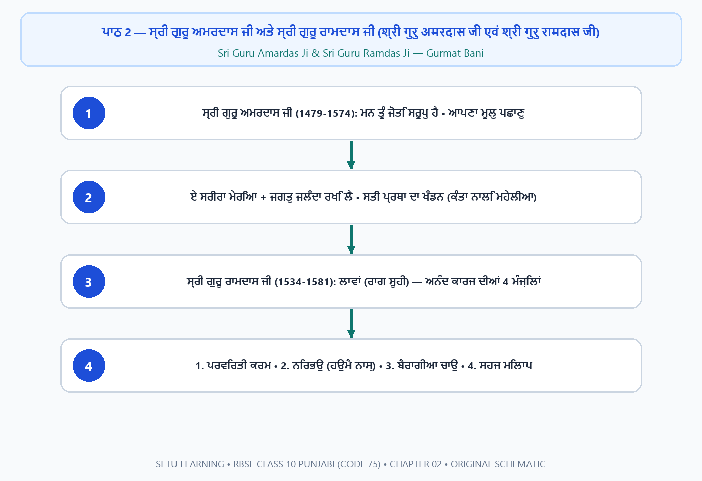

# ਪਾਠ 2 — ਸ੍ਰੀ ਗੁਰੂ ਅਮਰਦਾਸ ਜੀ ਅਤੇ ਸ੍ਰੀ ਗੁਰੂ ਰਾਮਦਾਸ ਜੀ (श्री गुरु अमरदास जी एवं श्री गुरु रामदास जी) (Sri Guru Amardas Ji & Sri Guru Ramdas Ji — Gurmat Bani)

## भाग 1: अध्याय प्रवेश एवं पाठ्यक्रम मैपिंग (ਪਾਠ-ਪ੍ਰਵੇਸ਼ ਅਤੇ ਪਾਠਕ੍ਰਮ ਮੈਪਿੰਗ)

> ਪਹਿਲਾ ਸੰਪਾਦਕੀ ਪ੍ਰਾਰੂਪ (प्रथम संपादकीय प्रारूप)। RBSE ਜਮਾਤ 10 ਪੰਜਾਬੀ ਪਾਠ-ਪੁਸਤਕ 'ਸਾਹਿਤ ਸੁਗੰਧੀਆਂ' ਦੇ ਸਾਰੇ ਪ੍ਰਸ਼ਨਾਂ ਦੇ ਹੱਲ ਅਤੇ 2014–2026 ਦਾ ਪੂਰਾ ਇਤਿਹਾਸਕ PYQ ਸੰਗ੍ਰਹਿ ਸਰੋਤ-ਪ੍ਰੀਖਣ ਸਮੇਤ ਸੰਕਲਿਤ ਹਨ।

**ਵਿਸ਼ਾ ਕੋਡ (विषय कोड):** 75 (ਤੀਜੀ ਭਾਸ਼ਾ — ਪੰਜਾਬੀ / तृतीया भाषा — पंजाबी) · **ਲੜੀ ਪੁਸਤਕ (श्रृंखला पुस्तक):** 7

**ਪ੍ਰਮਾਣਿਤ ਆਧਾਰ:** RBSE 2025–26 · **ਪਾਠ ਅੰਕ-ਭਾਰ:** 3 ਅੰਕ। ਇਹ ਭਾਰ ਉਸੇ ਸੰਸਕਰਣ ਦਾ ਹੈ; ਅਸਲ ਪ੍ਰਸ਼ਨ-ਵੰਡ ਦੀ ਭਵਿੱਖਬਾਣੀ ਨਹੀਂ।

**ਸਿੱਖਣ ਦੇ ਉਦੇਸ਼ (सीखने के लक्ष्य):** ਤੀਜੇ ਪਾਤਸ਼ਾਹ ਸ੍ਰੀ ਗੁਰੂ ਅਮਰਦਾਸ ਜੀ ('ਮਨ ਤੂੰ ਜੋਤਿ ਸਰੂਪੁ ਹੈ', 'ਏ ਸਰੀਰਾ ਮੇਰਿਆ', 'ਜਗਤੁ ਜਲੰਦਾ ਰਖਿ ਲੈ') ਅਤੇ ਚੌਥੇ ਪਾਤਸ਼ਾਹ ਸ੍ਰੀ ਗੁਰੂ ਰਾਮਦਾਸ ਜੀ ('ਲਾਵਾਂ — ਰਾਗ ਸੂਹੀ', 'ਉਤਪਤਿ ਸਭ ਸੰਸਾਰ', 'ਮੂਰਖੁ ਹੋਵੈ ਸੋ ਸੁਣੈ') ਦੀ ਬਾਣੀ ਦੀ ਵਿਆਖਿਆ ਤੇ ਕੇਂਦਰੀ ਭਾਵ ਸਮਝਣਾ।

## भाग 2: शब्दावली एवं अवधारणा कैप्सूल (ਸ਼ਬਦਾਵਲੀ ਅਤੇ ਸੰਕਲਪ ਕੈਪਸੂਲ)

| ਸ਼ਬਦ / ਸੰਕਲਪ | ਅਰਥ / ਵਿਆਖਿਆ |
|---|---|
| ਜੋਤਿ ਸਰੂਪੁ (जोति सरूपु) | ਪਰਮਾਤਮਾ ਦੇ ਨੂਰ/ਚਾਨਣ ਦਾ ਰੂਪ (ਮਨ ਤੂੰ ਜੋਤਿ ਸਰੂਪੁ ਹੈ ਆਪਣਾ ਮੂਲੁ ਪਛਾਣੁ)। |
| ਮੂਲੁ (मूलु) | ਅਸਲਾ / ਮੁੱਢ / ਪਰਮਾਤਮਾ (ਆਪਣਾ ਮੂਲੁ ਪਛਾਣੁ)। |
| ਜਗਤੁ ਜਲੰਦਾ (जगतु जलंदा) | ਵਿਕਾਰਾਂ ਅਤੇ ਤ੍ਰਿਸ਼ਨਾ ਦੀ ਅੱਗ ਵਿੱਚ ਸੜ ਰਿਹਾ ਸੰਸਾਰ (ਜਗਤੁ ਜਲੰਦਾ ਰਖਿ ਲੈ ਆਪਣੀ ਕਿਰਪਾ ਧਾਰਿ)। |
| ਮਹੇਲੀਆ (महेलीआ) | ਇਸਤਰੀਆਂ / ਜੀਵ-ਇਸਤਰੀਆਂ (ਕੰਤਾ ਨਾਲਿ ਮਹੇਲੀਆ ਸੇਤੀ ਅਗਿ ਜਲਾਹਿ)। |
| ਪਿਰੁ / ਕੰਤੁ (पिरु / कंतु) | ਪਤੀ / ਪ੍ਰਭੂ-ਪਤੀ (ਜੇ ਜਾਣਹਿ ਪਿਰੁ ਆਪਣਾ ਤਾ ਤਨਿ ਦੁਖ ਸਹਾਹਿ)। |
| ਪਰਵਿਰਤੀ ਕਰਮ (परविरती करम) | ਗ੍ਰਹਿਸਥ ਜੀਵਨ ਦੇ ਕਰਤੱਵ ਅਤੇ ਧਰਮ ਵਿੱਚ ਦ੍ਰਿੜ੍ਹ ਹੋਣਾ (ਹਰਿ ਪਹਿਲੜੀ ਲਾਵ ਪਰਵਿਰਤੀ ਕਰਮ ਦ੍ਰਿੜਾਇਆ)। |
| ਨਿਰਭਉ (निरभउ) | ਡਰ ਤੋਂ ਰਹਿਤ ਅਵਸਥਾ (ਹਰਿ ਦੂਜੜੀ ਲਾਵ ਸਤਿਗੁਰੁ ਪੁਰਖੁ ਮਿਲਾਇਆ ਨਿਰਭਉ ਭੈ ਮਨੁ ਹੋਇ)। |
| ਬੈਰਾਗੀਆ (बैरागीआ) | ਮਾਇਆ ਤੋਂ ਉਪਰਾਮ ਹੋ ਕੇ ਰੱਬੀ ਪ੍ਰੇਮ ਵਿੱਚ ਲੀਨ ਮਨ (ਹਰਿ ਤੀਜੜੀ ਲਾਵ ਮਨਿ ਚਾਉ ਭਇਆ ਬੈਰਾਗੀਆ)। |
| ਸਹਜ (सहज) | ਆਤਮਿਕ ਅਡੋਲਤਾ ਤੇ ਸ਼ਾਂਤੀ (ਹਰਿ ਚਉਥੜੀ ਲਾਵ ਮਨਿ ਸਹਜੁ ਭਇਆ ਹਰਿ ਪਾਇਆ)। |
| ਅਸਵਾਰੀ (असवारी) | ਸਵਾਰੀ (ਮੂਰਖ ਦੇ ਹਿਰਦੇ ਉੱਤੇ ਹੰਕਾਰ ਤੇ ਅਗਿਆਨਤਾ ਦੀ ਸਵਾਰੀ)। |

## भाग 3: विस्तृत शिक्षण पाठ (ਵਿਸਤ੍ਰਿਤ ਅਧਿਆਪਨ ਪਾਠ)

### 1. ਗੁਰੂ-ਪਛਾਣ: ਸ੍ਰੀ ਗੁਰੂ ਅਮਰਦਾਸ ਜੀ (1479–1574 ਈ.) ਅਤੇ ਸ੍ਰੀ ਗੁਰੂ ਰਾਮਦਾਸ ਜੀ (1534–1581 ਈ.)
**ਸ੍ਰੀ ਗੁਰੂ ਅਮਰਦਾਸ ਜੀ:** ਸਿੱਖਾਂ ਦੇ ਤੀਜੇ ਗੁਰੂ ਸ੍ਰੀ ਗੁਰੂ ਅਮਰਦਾਸ ਜੀ ਦਾ ਜਨਮ 1479 ਈ. ਵਿੱਚ ਪਿੰਡ ਬਾਸਰਕੇ (ਜ਼ਿਲ੍ਹਾ ਅੰਮ੍ਰਿਤਸਰ) ਵਿਖੇ ਪਿਤਾ ਤੇਜ ਭਾਨ ਜੀ ਅਤੇ ਮਾਤਾ ਬਖ਼ਤ ਕੌਰ (ਲੱਖਮੀ ਜੀ) ਦੇ ਘਰ ਹੋਇਆ। ਆਪ ਜੀ ਨੇ ਗੋਇੰਦਵਾਲ ਸਾਹਿਬ ਵਿਖੇ ਬੌਲੀ ਸਾਹਿਬ ਦਾ ਨਿਰਮਾਣ ਕਰਵਾਇਆ, ਸਤੀ ਪ੍ਰਥਾ ਤੇ ਪਰਦਾ ਪ੍ਰਥਾ ਦਾ ਖੰਡਨ ਕੀਤਾ ਅਤੇ 907 ਸ਼ਬਦਾਂ ਦੀ ਰਚਨਾ ਕੀਤੀ (ਪ੍ਰਸਿੱਧ ਰਚਨਾ: 'ਅਨੰਦੁ ਸਾਹਿਬ')।
**ਸ੍ਰੀ ਗੁਰੂ ਰਾਮਦਾਸ ਜੀ:** ਚੌਥੇ ਗੁਰੂ ਸ੍ਰੀ ਗੁਰੂ ਰਾਮਦਾਸ ਜੀ (ਪਹਿਲਾ ਨਾਂ ਭਾਈ ਜੇਠਾ ਜੀ) ਦਾ ਜਨਮ 1534 ਈ. ਵਿੱਚ ਚੂਨਾ ਮੰਡੀ, ਲਾਹੌਰ ਵਿਖੇ ਪਿਤਾ ਹਰੀਦਾਸ ਜੀ ਅਤੇ ਮਾਤਾ ਦਇਆ ਕੌਰ ਜੀ ਦੇ ਘਰ ਹੋਇਆ। ਆਪ ਜੀ ਨੇ 'ਗੁਰੂ ਕਾ ਚੱਕ' (ਸ੍ਰੀ ਅੰਮ੍ਰਿਤਸਰ ਸਾਹਿਬ) ਵਸਾਇਆ ਅਤੇ 30 ਰਾਗਾਂ ਵਿੱਚ 679 ਸ਼ਬਦ ਰਚੇ।

### 2. ਸ੍ਰੀ ਗੁਰੂ ਅਮਰਦਾਸ ਜੀ ਦੀਆਂ ਤਿੰਨ ਰਚਨਾਵਾਂ
1. **ਮਨ ਤੂੰ ਜੋਤਿ ਸਰੂਪੁ ਹੈ ਆਪਣਾ ਮੂਲੁ ਪਛਾਣੁ:** ਹੇ ਮੇਰੇ ਮਨ! ਤੂੰ ਨਿਰਾ ਸੰਸਾਰਕ ਪਦਾਰਥਾਂ ਦਾ ਗ਼ੁਲਾਮ ਨਹੀਂ ਸਗੋਂ ਪਰਮਾਤਮਾ ਦੀ ਜੋਤ (ਨੂਰ) ਦਾ ਹੀ ਅੰਸ਼ ਹੈਂ। ਤੂੰ ਆਪਣੇ ਅਸਲੇ (ਮੂਲ — ਪਰਮਾਤਮਾ) ਨੂੰ ਪਛਾਣ। ਸਤਿਗੁਰੂ ਦੀ ਸਿੱਖਿਆ ਰਾਹੀਂ ਜਦੋਂ ਮਨ ਆਪਣੇ ਮੂਲ ਨੂੰ ਪਛਾਣ ਲੈਂਦਾ ਹੈ, ਤਾਂ ਤ੍ਰਿਸ਼ਨਾ ਮਿਟ ਜਾਂਦੀ ਹੈ ਤੇ ਸਦੀਵੀ ਆਨੰਦ ਪ੍ਰਾਪਤ ਹੁੰਦਾ ਹੈ।
2. **ਏ ਸਰੀਰਾ ਮੇਰਿਆ ਹਰਿ ਤੁਮ ਮਹਿ ਜੋਤਿ ਰਖੀ ਤਾ ਤੂੰ ਜਗ ਮਹਿ ਆਇਆ:** ਹੇ ਮੇਰੇ ਸਰੀਰ! ਪਰਮਾਤਮਾ ਨੇ ਤੇਰੇ ਅੰਦਰ ਆਪਣੀ ਜੋਤ ਰੱਖੀ ਤਾਂ ਹੀ ਤੂੰ ਸੰਸਾਰ ਵਿੱਚ ਜਨਮ ਲਿਆ। ਪਰ ਸੰਸਾਰ ਵਿੱਚ ਆ ਕੇ ਜੀਵ ਮਾਇਆ ਦੇ ਮੋਹ ਵਿੱਚ ਫਸ ਕੇ ਸਿਰਜਣਹਾਰ ਨੂੰ ਭੁੱਲ ਜਾਂਦਾ ਹੈ।
3. **ਜਗਤੁ ਜਲੰਦਾ ਰਖਿ ਲੈ ਆਪਣੀ ਕਿਰਪਾ ਧਾਰਿ (ਅਤੇ ਸਤੀ ਪ੍ਰਥਾ ਦਾ ਖੰਡਨ):**
   - **ਪਹਿਲਾ ਸਲੋਕ:** ਇਹ ਸੰਸਾਰ ਕਾਮ, ਕ੍ਰੋਧ, ਲੋਭ, ਮੋਹ ਤੇ ਹੰਕਾਰ ਦੀ ਅੱਗ ਵਿੱਚ ਸੜ ਰਿਹਾ ਹੈ। ਗੁਰੂ ਜੀ ਅਰਦਾਸ ਕਰਦੇ ਹਨ — ਹੇ ਪ੍ਰਭੂ! ਆਪਣੀ ਮਿਹਰ ਕਰਕੇ ਇਸ ਸੜਦੇ ਸੰਸਾਰ ਨੂੰ ਬਚਾ ਲੈ; ਜਿਵੇਂ ਵੀ ਇਹ ਉਬਰ (ਬਚ) ਸਕਦਾ ਹੈ, ਉਸੇ ਦੁਆਰ (ਰਸਤੇ) ਰਾਹੀਂ ਇਸ ਨੂੰ ਬਚਾ ਲੈ ('ਜਿਤੁ ਦੁਆਰੈ ਉਬਰੈ ਤਿਤੈ ਲੈਹੁ ਉਬਾਰਿ')।
   - **ਦੂਜਾ ਤੇ ਤੀਜਾ ਸਲੋਕ (ਸਤੀ ਦੀ ਅਸਲ ਪਰਿਭਾਸ਼ਾ):** **'ਸਤੀਆ ਏਹਿ ਨ ਆਖੀਅਨਿ ਜੋ ਮੜਿਆ ਲਗਿ ਜਲੰਨਿ ॥ ਨਾਨਕ ਸਤੀਆ ਜਾਣੀਅਨਿ ਜਿ ਬਿਰਹੇ ਚੋਟ ਮਰੰਨਿ ॥'** ਅਤੇ **'ਕੰਤਾ ਨਾਲਿ ਮਹੇਲੀਆ ਸੇਤੀ ਅਗਿ ਜਲਾਹਿ...'** — ਗੁਰੂ ਜੀ ਸਮਾਜਿਕ ਕੁਰੀਤੀ 'ਸਤੀ ਪ੍ਰਥਾ' ਦਾ ਖੰਡਨ ਕਰਦੇ ਹੋਏ ਫ਼ੁਰਮਾਉਂਦੇ ਹਨ ਕਿ ਮ੍ਰਿਤਕ ਪਤੀ ਦੀ ਲਾਸ਼ (ਮੜ੍ਹੀ) ਨਾਲ ਅੱਗ ਵਿੱਚ ਸੜਨ ਵਾਲੀਆਂ ਇਸਤਰੀਆਂ ਅਸਲ ਸਤੀ ਨਹੀਂ ਹਨ; ਅਸਲ ਸਤੀ ਉਹ ਹਨ ਜੋ ਪਤੀ ਦੇ ਵਿਛੋੜੇ (ਬਿਰਹਾ) ਦੀ ਚੋਟ ਸਹਿੰਦੀਆਂ ਹਨ ਅਤੇ ਜਿਉਂਦੇ-ਜੀਅ ਪਤੀ (ਜਾਂ ਪ੍ਰਭੂ-ਪਤੀ) ਨਾਲ ਸੱਚਾ ਪ੍ਰੇਮ ਤੇ ਸੇਵਾ ਨਿਭਾਉਂਦੀਆਂ ਹਨ।

### 3. ਸ੍ਰੀ ਗੁਰੂ ਰਾਮਦਾਸ ਜੀ ਦੀਆਂ ਤਿੰਨ ਰਚਨਾਵਾਂ
1. **ਲਾਵਾਂ (ਰਾਗ ਸੂਹੀ — 'ਹਰਿ ਪਹਿਲੜੀ ਲਾਵ ਪਰਵਿਰਤੀ ਕਰਮ ਦ੍ਰਿੜਾਇਆ'):** ਸਿੱਖ ਵਿਆਹ-ਪੱਧਤੀ (ਅਨੰਦ ਕਾਰਜ) ਦੀਆਂ ਚਾਰ ਲਾਵਾਂ ਰਾਗ ਸੂਹੀ ਵਿੱਚ ਦਰਜ ਹਨ, ਜੋ ਜੀਵ-ਆਤਮਾ ਦੇ ਪਰਮਾਤਮਾ ਨਾਲ ਮਿਲਾਪ ਦੀਆਂ ਚਾਰ ਅਧਿਆਤਮਿਕ ਮੰਜ਼ਿਲਾਂ ਹਨ:
   - **ਪਹਿਲੀ ਲਾਂਵ:** ਗ੍ਰਹਿਸਥ ਦੇ ਕਰਤੱਵਾਂ (ਪਰਵਿਰਤੀ ਕਰਮ) ਵਿੱਚ ਦ੍ਰਿੜ੍ਹ ਹੋਣਾ, ਪਾਪ ਤਿਆਗ ਕੇ ਧਰਮ ਤੇ ਹਰਿ-ਨਾਮ ਸਿਮਰਨਾ।
   - **ਦੂਜੀ ਲਾਂਵ:** ਸਤਿਗੁਰੂ ਪੁਰਖ ਦਾ ਮਿਲਾਪ ਹੋਣਾ, ਮਨ ਵਿੱਚੋਂ ਡਰ ਤੇ ਹਉਮੈ ਦੀ ਮੈਲ ਧੁਲ ਜਾਣਾ ('ਨਿਰਭਉ ਭੈ ਮਨੁ ਹੋਇ ਹਉਮੈ ਮੈਲੁ ਗਵਾਇਆ')।
   - **ਤੀਜੀ ਲਾਂਵ:** ਮਨ ਵਿੱਚ ਪ੍ਰਭੂ-ਮਿਲਾਪ ਦਾ ਚਾਉ ਅਤੇ ਵੈਰਾਗ ਪੈਦਾ ਹੋਣਾ ('ਮਨਿ ਚਾਉ ਭਇਆ ਬੈਰਾਗੀਆ') ਤੇ ਸੰਤ ਜਨਾਂ ਦੀ ਸੰਗਤ ਮਿਲਣੀ।
   - **ਚੌਥੀ ਲਾਂਵ:** ਮਨ ਵਿੱਚ ਸਹਿਜ (ਅਡੋਲਤਾ) ਪੈਦਾ ਹੋਣਾ ਅਤੇ ਜੀਵ-ਇਸਤਰੀ ਦਾ ਪ੍ਰਭੂ-ਪਤੀ ਨਾਲ ਅਭੇਦ ਮਿਲਾਪ ਹੋ ਜਾਣਾ ('ਹਰਿ ਚਉਥੜੀ ਲਾਵ ਮਨਿ ਸਹਜੁ ਭਇਆ ਹਰਿ ਪਾਇਆ')।
2. **ਉਤਪਤਿ ਸਭ ਸੰਸਾਰ:** ਪਰਮਾਤਮਾ ਨੇ ਆਪ ਹੀ ਸਾਰੀ ਸ੍ਰਿਸ਼ਟੀ ਦੀ ਉਤਪੱਤੀ ਕੀਤੀ ਹੈ ਅਤੇ ਆਪ ਹੀ ਸਭ ਦੀ ਸੰਭਾਲ ਕਰਦਾ ਹੈ।
3. **ਮੂਰਖੁ ਹੋਵੈ ਸੋ ਸੁਣੈ ਮੂਰਖ ਕਾ ਕਹਣਾ (ਮੂਰਖ ਨੇ ਅਸਵਾਰੀ):** ਮੂਰਖ ਮਨੁੱਖ ਹੀ ਮੂਰਖ ਦੀ ਗੱਲ ਸੁਣਦਾ ਹੈ; ਉਸ ਦੇ ਹਿਰਦੇ ਉੱਤੇ ਹੰਕਾਰ, ਝੂਠ ਤੇ ਅਗਿਆਨਤਾ ਦੀ ਸਵਾਰੀ ਹੁੰਦੀ ਹੈ, ਜਦੋਂਕਿ ਗੁਰਮੁਖ ਸਤਿਗੁਰੂ ਦੀ ਸ਼ਰਨ ਵਿੱਚ ਰਹਿ ਕੇ ਸੱਚ ਕਮਾਉਂਦੇ ਹਨ।

ਪਾਠ 2: ਸ੍ਰੀ ਗੁਰੂ ਅਮਰਦਾਸ ਜੀ ਅਤੇ ਸ੍ਰੀ ਗੁਰੂ ਰਾਮਦਾਸ ਜੀ ਦੀ ਬਾਣੀ ਦਾ ਸੰਕਲਪ ਚਿੱਤਰ

## भाग 4: पाठ्यपुस्तक-अवधारणाओं पर मौलिक हल किए उदाहरण (ਹੱਲ ਕੀਤੇ ਮਿਆਰੀ ਉਦਾਹਰਣ)

ਹੇਠਾਂ ਦਿੱਤੇ ਪ੍ਰਸ਼ਨ ਪਾਠ-ਪੁਸਤਕ 'ਸਾਹਿਤ ਸੁਗੰਧੀਆਂ' ਅਤੇ ਵਿਆਕਰਣ ਦੇ ਸੰਕਲਪਾਂ ਉੱਤੇ ਆਧਾਰਿਤ ਮੌਲਿਕ ਆਦਰਸ਼ ਹੱਲ ਹਨ।

**ਹੱਲ ਕੀਤਾ ਉਦਾਹਰਣ 1: 'ਕੰਤਾ ਨਾਲਿ ਮਹੇਲੀਆ ਸੇਤੀ ਅਗਿ ਜਲਾਹਿ...' ਸਲੋਕ ਦੀ ਪ੍ਰਸੰਗ ਸਹਿਤ ਵਿਆਖਿਆ ਕਰੋ।**

ਪ੍ਰਸੰਗ: ਇਹ ਸਲੋਕ 'ਸਾਹਿਤ ਸੁਗੰਧੀਆਂ' ਪੁਸਤਕ ਵਿੱਚ ਦਰਜ ਤੀਜੇ ਗੁਰੂ ਸ੍ਰੀ ਗੁਰੂ ਅਮਰਦਾਸ ਜੀ ਦੀ ਬਾਣੀ ਵਿੱਚੋਂ ਹੈ। ਵਿਆਖਿਆ: ਗੁਰੂ ਜੀ ਫ਼ੁਰਮਾਉਂਦੇ ਹਨ ਕਿ ਲੋਕ-ਲਾਜ ਜਾਂ ਰਸਮ ਕਾਰਨ ਕਈ ਇਸਤਰੀਆਂ (ਮਹੇਲੀਆ) ਆਪਣੇ ਮਰੇ ਹੋਏ ਪਤੀਆਂ (ਕੰਤਾਂ) ਦੇ ਨਾਲ ਅੱਗ ਵਿੱਚ ਸੜ ਜਾਂਦੀਆਂ ਹਨ। ਜੇ ਉਹ ਸੱਚਮੁੱਚ ਆਪਣੇ ਪਤੀ ਨੂੰ ਜਾਣਦੀਆਂ ਤੇ ਪਿਆਰ ਕਰਦੀਆਂ ਹਨ ਤਾਂ ਉਹਨਾਂ ਨੂੰ ਸਰੀਰ ਉੱਤੇ ਇਹ ਦੁੱਖ ਸਹਿਣਾ ਪੈਂਦਾ ਹੈ, ਪਰ ਜੋ ਜਿਉਂਦੇ-ਜੀਅ ਪਤੀ ਦੀ ਕਦਰ ਨਹੀਂ ਜਾਣਦੀਆਂ, ਉਹ ਦੁੱਖ-ਸੁੱਖ ਵਿੱਚ ਦੂਰ ਭੱਜਦੀਆਂ ਹਨ।

**ਹੱਲ ਕੀਤਾ ਉਦਾਹਰਣ 2: 'ਲਾਵਾਂ (ਰਾਗ ਸੂਹੀ)' ਸ਼ਬਦ ਦਾ ਕੇਂਦਰੀ ਭਾਵ ਆਪਣੇ ਸ਼ਬਦਾਂ ਵਿੱਚ ਲਿਖੋ।**

ਸ੍ਰੀ ਗੁਰੂ ਰਾਮਦਾਸ ਜੀ ਰਚਿਤ 'ਲਾਵਾਂ' (ਰਾਗ ਸੂਹੀ) ਵਿੱਚ ਚਾਰ ਲਾਵਾਂ ਰਾਹੀਂ ਗ੍ਰਹਿਸਥੀ ਜੀਵਨ ਦੇ ਆਦਰਸ਼ ਅਤੇ ਜੀਵ-ਆਤਮਾ ਦੇ ਪਰਮਾਤਮਾ ਨਾਲ ਮਿਲਾਪ ਦੀਆਂ ਚਾਰ ਅਵਸਥਾਵਾਂ (ਧਰਮ-ਦ੍ਰਿੜ੍ਹਤਾ, ਨਿਰਭਉਤਾ, ਵੈਰਾਗ-ਚਾਉ ਅਤੇ ਸਹਿਜ-ਮਿਲਾਪ) ਦਾ ਵਰਣਨ ਕੀਤਾ ਗਿਆ ਹੈ।

**ਹੱਲ ਕੀਤਾ ਉਦਾਹਰਣ 3: ਗੁਰੂ ਅਮਰਦਾਸ ਜੀ ਅਨੁਸਾਰ ਅਸਲ ਸਤੀ ਇਸਤਰੀਆਂ ਕਿੰਨ੍ਹਾਂ ਨੂੰ ਆਖਿਆ ਜਾ ਸਕਦਾ ਹੈ?**

ਗੁਰੂ ਅਮਰਦਾਸ ਜੀ ਅਨੁਸਾਰ ਮ੍ਰਿਤਕ ਪਤੀ ਦੀ ਲਾਸ਼ ਨਾਲ ਅੱਗ ਵਿੱਚ ਸੜਨ ਵਾਲੀਆਂ ਇਸਤਰੀਆਂ ਸਤੀ ਨਹੀਂ ਹਨ; ਅਸਲ ਸਤੀ ਉਹ ਹਨ ਜੋ ਪਤੀ ਦੇ ਵਿਛੋੜੇ (ਬਿਰਹਾ) ਦੀ ਚੋਟ ਨਾਲ ਮਰਦੀਆਂ ਹਨ ਅਤੇ ਜਿਉਂਦੇ-ਜੀਅ ਪਤੀ ਨਾਲ ਸੱਚਾ ਪ੍ਰੇਮ, ਸੇਵਾ ਤੇ ਸੰਤੋਖ ਨਿਭਾਉਂਦੀਆਂ ਹਨ।

## भाग 5: सत्यापित बोर्ड प्रश्न एवं स्रोत-स्थिति (ਪ੍ਰਮਾਣਿਤ ਬੋਰਡ ਪ੍ਰਸ਼ਨ ਅਤੇ ਸਰੋਤ-ਸਥਿਤੀ)

RBSE 2026 Supp (`S-75`, Q1-II, Q9, Q14) ਅਤੇ 2025 Supp (`S-75`, Q1-i, Q1-vi, Q13) ਵਿੱਚ 'ਏ ਸਰੀਰਾ ਮੇਰਿਆ', 'ਲਾਵਾਂ (ਰਾਗ ਸੂਹੀ)', 'ਮਹੇਲੀਆ', 'ਮਨ ਤੂੰ ਜੋਤਿ ਸਰੂਪੁ ਹੈ' ਅਤੇ ਸਤੀ ਪ੍ਰਥਾ ਵਾਲੇ ਪ੍ਰਸ਼ਨ ਪੁੱਛੇ ਗਏ ਹਨ।

[RBSE 2026 ਮੂਲ ਪੇਪਰ (S-75)](https://rajeduboard.rajasthan.gov.in/books/PAPERS-2026/Sec/S-75.pdf)। ਪ੍ਰਸ਼ਨ ਦਾ ਸੰਖੇਪ ਵਿਸ਼ਾ-ਸੰਦਰਭ ਹੈ; ਸ਼ਬਦ-ਬ-ਸ਼ਬਦ ਪੁਨਰ-ਮੁਦਰਣ ਨਹੀਂ।

## भाग 6: खंडवार मौलिक अभ्यास बैंक (ਖੰਡ-ਵਾਰ ਮੌਲਿਕ ਅਭਿਆਸ ਬੈਂਕ)

**ਅਭਿਆਸ-ਅੰਕ:** ਵਿਦਿਆਰਥੀਆਂ ਦੇ ਸਵੈ-ਅਭਿਆਸ ਲਈ ਹਨ; ਉੱਤਰ ਪਹਿਲਾਂ ਆਪ ਲਿਖੋ, ਫਿਰ ਭਾਗ 9 ਵੇਖੋ।

## ੳ: ਬਹੁ-ਵਿਕਲਪੀ ਪ੍ਰਸ਼ਨ (MCQ) — 15 × 1 ਅੰਕ

**MCQ 1. 'ਮਨ ਤੂੰ ਜੋਤਿ ਸਰੂਪੁ ਹੈ ਆਪਣਾ ਮੂਲੁ ਪਛਾਣੁ' ਕਿਸ ਗੁਰੂ ਸਾਹਿਬ ਦੀ ਰਚਨਾ ਹੈ?**

ੳ) ਸ੍ਰੀ ਗੁਰੂ ਰਾਮਦਾਸ ਜੀ  
ਅ) ਸ੍ਰੀ ਗੁਰੂ ਅਰਜਨ ਦੇਵ ਜੀ  
ੲ) ਸ੍ਰੀ ਗੁਰੂ ਅਮਰਦਾਸ ਜੀ  
ਸ) ਸ੍ਰੀ ਗੁਰੂ ਨਾਨਕ ਦੇਵ ਜੀ

**MCQ 2. 'ਏ ਸਰੀਰਾ ਮੇਰਿਆ' ਰਚਨਾ ਕਿਸ ਗੁਰੂ ਸਾਹਿਬ ਜੀ ਦੀ ਰਚਨਾ ਹੈ?**

ੳ) ਸ੍ਰੀ ਗੁਰੂ ਅਰਜਨ ਦੇਵ ਜੀ  
ਅ) ਸ੍ਰੀ ਗੁਰੂ ਅਮਰਦਾਸ ਜੀ  
ੲ) ਸ੍ਰੀ ਗੁਰੂ ਨਾਨਕ ਦੇਵ ਜੀ  
ਸ) ਸ੍ਰੀ ਗੁਰੂ ਅੰਗਦ ਦੇਵ ਜੀ

**MCQ 3. 'ਜਗਤੁ ਜਲੰਦਾ ਰਖਿ ਲੈ ਆਪਣੀ ਕਿਰਪਾ ਧਾਰਿ' ਸ਼ਬਦ ਦੇ ਕਰਤਾ ਕੌਣ ਹਨ?**

ੳ) ਸ੍ਰੀ ਗੁਰੂ ਅਮਰਦਾਸ ਜੀ  
ਅ) ਸ਼ੇਖ਼ ਫ਼ਰੀਦ ਜੀ  
ੲ) ਭਾਈ ਗੁਰਦਾਸ ਜੀ  
ਸ) ਸ੍ਰੀ ਗੁਰੂ ਰਾਮਦਾਸ ਜੀ

**MCQ 4. 'ਕੰਤਾ ਨਾਲਿ ਮਹੇਲੀਆ ਸੇਤੀ ਅਗਿ ਜਲਾਹਿ' ਸਤਰ ਵਿੱਚ ਆਏ ਸ਼ਬਦ 'ਮਹੇਲੀਆ' ਦਾ ਸਹੀ ਅਰਥ ਕੀ ਹੈ?**

ੳ) ਸਹੇਲੀਆਂ  
ਅ) ਸਤੀਆਂ  
ੲ) ਜੀਵ-ਆਤਮਾ  
ਸ) ਇਸਤਰੀਆਂ

**MCQ 5. ਗੁਰੂ ਅਮਰਦਾਸ ਜੀ ਨੇ ਆਪਣੇ ਸਲੋਕਾਂ ਵਿੱਚ ਕਿਹੜੀ ਸਮਾਜਿਕ ਕੁਰੀਤੀ ਦਾ ਖੰਡਨ ਕੀਤਾ ਹੈ?**

ੳ) ਦਾਜ ਪ੍ਰਥਾ ਦਾ  
ਅ) ਸ਼ਰਾਬਖੋਰੀ ਦਾ  
ੲ) ਸਤੀ ਪ੍ਰਥਾ ਦਾ  
ਸ) ਬਾਲ-ਵਿਆਹ ਦਾ

**MCQ 6. ਸ੍ਰੀ ਗੁਰੂ ਰਾਮਦਾਸ ਜੀ ਦੀ ਰਚਨਾ 'ਲਾਵਾਂ' ਕਿਹੜੇ ਰਾਗ ਵਿੱਚ ਰਚਿਤ ਹੈ?**

ੳ) ਰਾਗ ਵਡਹੰਸ  
ਅ) ਰਾਗ ਸੂਹੀ  
ੲ) ਰਾਗ ਜੈਜਾਵੰਤੀ  
ਸ) ਰਾਗ ਰਾਮਕਲੀ

**MCQ 7. 'ਲਾਵਾਂ' ਬਾਣੀ ਵਿੱਚ ਕੁੱਲ ਕਿੰਨੀਆਂ ਲਾਵਾਂ (ਪਉੜੀਆਂ) ਹਨ?**

ੳ) ਚਾਰ (4)  
ਅ) ਤਿੰਨ (3)  
ੲ) ਪੰਜ (5)  
ਸ) ਸੱਤ (7)

**MCQ 8. 'ਹਰਿ ਪਹਿਲੜੀ ਲਾਵ ਪਰਵਿਰਤੀ ਕਰਮ ਦ੍ਰਿੜਾਇਆ' ਵਿੱਚ 'ਪਰਵਿਰਤੀ ਕਰਮ' ਤੋਂ ਕੀ ਭਾਵ ਹੈ?**

ੳ) ਘਰ-ਬਾਰ ਛੱਡ ਕੇ ਜੰਗਲ ਜਾਣਾ  
ਅ) ਕੇਵਲ ਤੀਰਥ-ਯਾਤਰਾ ਕਰਨਾ  
ੲ) ਵਪਾਰ ਛੱਡ ਦੇਣਾ  
ਸ) ਗ੍ਰਹਿਸਥ ਜੀਵਨ ਦੇ ਫ਼ਰਜ਼ ਨਿਭਾਉਂਦੇ ਹੋਏ ਧਰਮ ਵਿੱਚ ਦ੍ਰਿੜ੍ਹ ਹੋਣਾ

**MCQ 9. ਲਾਵਾਂ ਦੀ ਕਿਹੜੀ ਲਾਂਵ ਵਿੱਚ 'ਮਨਿ ਸਹਜੁ ਭਇਆ ਹਰਿ ਪਾਇਆ' ਦਾ ਵਰਣਨ ਹੈ?**

ੳ) ਦੂਜੀ ਲਾਂਵ ਵਿੱਚ  
ਅ) ਤੀਜੀ ਲਾਂਵ ਵਿੱਚ  
ੲ) ਚੌਥੀ ਲਾਂਵ ਵਿੱਚ  
ਸ) ਪਹਿਲੀ ਲਾਂਵ ਵਿੱਚ

**MCQ 10. 'ਮੂਰਖੁ ਹੋਵੈ ਸੋ ਸੁਣੈ ਮੂਰਖ ਕਾ ਕਹਣਾ' ਰਚਨਾ ਕਿਸ ਗੁਰੂ ਸਾਹਿਬ ਦੀ ਹੈ?**

ੳ) ਭਾਈ ਗੁਰਦਾਸ ਜੀ  
ਅ) ਸ੍ਰੀ ਗੁਰੂ ਰਾਮਦਾਸ ਜੀ  
ੲ) ਸ੍ਰੀ ਗੁਰੂ ਨਾਨਕ ਦੇਵ ਜੀ  
ਸ) ਸ੍ਰੀ ਗੁਰੂ ਅਮਰਦਾਸ ਜੀ

**MCQ 11. ਸ੍ਰੀ ਗੁਰੂ ਅਮਰਦਾਸ ਜੀ ਦਾ ਜਨਮ ਕਦੋਂ ਅਤੇ ਕਿੱਥੇ ਹੋਇਆ?**

ੳ) 1479 ਈ. ਵਿੱਚ ਪਿੰਡ ਬਾਸਰਕੇ (ਅੰਮ੍ਰਿਤਸਰ) ਵਿਖੇ  
ਅ) 1534 ਈ. ਵਿੱਚ ਚੂਨਾ ਮੰਡੀ ਲਾਹੌਰ ਵਿਖੇ  
ੲ) 1469 ਈ. ਵਿੱਚ ਤਲਵੰਡੀ ਵਿਖੇ  
ਸ) 1551 ਈ. ਵਿੱਚ ਗੋਇੰਦਵਾਲ ਵਿਖੇ

**MCQ 12. ਸ੍ਰੀ ਗੁਰੂ ਰਾਮਦਾਸ ਜੀ ਦਾ ਜਨਮ ਕਦੋਂ ਅਤੇ ਕਿੱਥੇ ਹੋਇਆ?**

ੳ) 1479 ਈ. ਵਿੱਚ ਬਾਸਰਕੇ ਵਿਖੇ  
ਅ) 1469 ਈ. ਵਿੱਚ ਤਲਵੰਡੀ ਵਿਖੇ  
ੲ) 1666 ਈ. ਵਿੱਚ ਪਟਨਾ ਸਾਹਿਬ ਵਿਖੇ  
ਸ) 1534 ਈ. ਵਿੱਚ ਚੂਨਾ ਮੰਡੀ, ਲਾਹੌਰ ਵਿਖੇ

**MCQ 13. 'ਸਤੀਆ ਜਾਣੀਅਨਿ ਜਿ ਬਿਰਹੇ ਚੋਟ ਮਰੰਨਿ' ਵਿੱਚ 'ਬਿਰਹੇ' ਸ਼ਬਦ ਦਾ ਕੀ ਅਰਥ ਹੈ?**

ੳ) ਗੁੱਸਾ  
ਅ) ਹੰਕਾਰ  
ੲ) ਵਿਛੋੜਾ  
ਸ) ਮਿਲਾਪ

**MCQ 14. 'ਉਤਪਤਿ ਸਭ ਸੰਸਾਰ' ਰਚਨਾ ਕਿਸ ਗੁਰੂ ਸਾਹਿਬ ਦੀ ਹੈ?**

ੳ) ਸ਼ੇਖ਼ ਫ਼ਰੀਦ ਜੀ  
ਅ) ਸ੍ਰੀ ਗੁਰੂ ਰਾਮਦਾਸ ਜੀ  
ੲ) ਸ੍ਰੀ ਗੁਰੂ ਨਾਨਕ ਦੇਵ ਜੀ  
ਸ) ਸ੍ਰੀ ਗੁਰੂ ਅਮਰਦਾਸ ਜੀ

**MCQ 15. 'ਹਰਿ ਦੂਜੜੀ ਲਾਵ ਸਤਿਗੁਰੁ ਪੁਰਖੁ ਮਿਲਾਇਆ' ਨਾਲ ਮਨ ਵਿੱਚੋਂ ਕਿਹੜੀ ਮੈਲ ਦੂਰ ਹੁੰਦੀ ਹੈ?**

ੳ) ਹਉਮੈ (ਹੰਕਾਰ) ਦੀ ਮੈਲ  
ਅ) ਗ਼ਰੀਬੀ ਦੀ ਮੈਲ  
ੲ) ਆਲਸ ਦੀ ਮੈਲ  
ਸ) ਥਕਾਵਟ ਦੀ ਮੈਲ

## ੳ: ਖਾਲੀ ਥਾਵਾਂ ਭਰੋ — 6 × 1 ਅੰਕ

1. ਪਰਮਾਤਮਾ ਦੇ ਨੂਰ/ਚਾਨਣ ਦਾ ਰੂਪ (ਮਨ ਤੂੰ ਜੋਤਿ ਸਰੂਪੁ ਹੈ ਆਪਣਾ ਮੂਲੁ ਪਛਾਣੁ)। — ਇਸ ਸ਼ਬਦ/ਸੰਕਲਪ ਦਾ ਨਾਂ ਹੈ: ____।  
2. ਅਸਲਾ / ਮੁੱਢ / ਪਰਮਾਤਮਾ (ਆਪਣਾ ਮੂਲੁ ਪਛਾਣੁ)। — ਇਸ ਸ਼ਬਦ/ਸੰਕਲਪ ਦਾ ਨਾਂ ਹੈ: ____।  
3. ਵਿਕਾਰਾਂ ਅਤੇ ਤ੍ਰਿਸ਼ਨਾ ਦੀ ਅੱਗ ਵਿੱਚ ਸੜ ਰਿਹਾ ਸੰਸਾਰ (ਜਗਤੁ ਜਲੰਦਾ ਰਖਿ ਲੈ ਆਪਣੀ ਕਿਰਪਾ ਧਾਰਿ)। — ਇਸ ਸ਼ਬਦ/ਸੰਕਲਪ ਦਾ ਨਾਂ ਹੈ: ____।  
4. ਇਸਤਰੀਆਂ / ਜੀਵ-ਇਸਤਰੀਆਂ (ਕੰਤਾ ਨਾਲਿ ਮਹੇਲੀਆ ਸੇਤੀ ਅਗਿ ਜਲਾਹਿ)। — ਇਸ ਸ਼ਬਦ/ਸੰਕਲਪ ਦਾ ਨਾਂ ਹੈ: ____।  
5. ਪਤੀ / ਪ੍ਰਭੂ-ਪਤੀ (ਜੇ ਜਾਣਹਿ ਪਿਰੁ ਆਪਣਾ ਤਾ ਤਨਿ ਦੁਖ ਸਹਾਹਿ)। — ਇਸ ਸ਼ਬਦ/ਸੰਕਲਪ ਦਾ ਨਾਂ ਹੈ: ____।  
6. ਗ੍ਰਹਿਸਥ ਜੀਵਨ ਦੇ ਕਰਤੱਵ ਅਤੇ ਧਰਮ ਵਿੱਚ ਦ੍ਰਿੜ੍ਹ ਹੋਣਾ (ਹਰਿ ਪਹਿਲੜੀ ਲਾਵ ਪਰਵਿਰਤੀ ਕਰਮ ਦ੍ਰਿੜਾਇਆ)। — ਇਸ ਸ਼ਬਦ/ਸੰਕਲਪ ਦਾ ਨਾਂ ਹੈ: ____।

## ੳ: ਅਤਿ-ਲਘੂ ਉੱਤਰਾਂ ਵਾਲੇ ਪ੍ਰਸ਼ਨ — 8 × 1 ਅੰਕ

1. 'ਮਨ ਤੂੰ ਜੋਤਿ ਸਰੂਪੁ ਹੈ ਆਪਣਾ ਮੂਲੁ ਪਛਾਣੁ' ਕਿਸ ਗੁਰੂ ਸਾਹਿਬ ਦੀ ਰਚਨਾ ਹੈ?  
2. 'ਏ ਸਰੀਰਾ ਮੇਰਿਆ' ਰਚਨਾ ਕਿਸ ਗੁਰੂ ਸਾਹਿਬ ਜੀ ਦੀ ਰਚਨਾ ਹੈ?  
3. 'ਜਗਤੁ ਜਲੰਦਾ ਰਖਿ ਲੈ ਆਪਣੀ ਕਿਰਪਾ ਧਾਰਿ' ਸ਼ਬਦ ਦੇ ਕਰਤਾ ਕੌਣ ਹਨ?  
4. 'ਕੰਤਾ ਨਾਲਿ ਮਹੇਲੀਆ ਸੇਤੀ ਅਗਿ ਜਲਾਹਿ' ਸਤਰ ਵਿੱਚ ਆਏ ਸ਼ਬਦ 'ਮਹੇਲੀਆ' ਦਾ ਸਹੀ ਅਰਥ ਕੀ ਹੈ?  
5. ਗੁਰੂ ਅਮਰਦਾਸ ਜੀ ਨੇ ਆਪਣੇ ਸਲੋਕਾਂ ਵਿੱਚ ਕਿਹੜੀ ਸਮਾਜਿਕ ਕੁਰੀਤੀ ਦਾ ਖੰਡਨ ਕੀਤਾ ਹੈ?  
6. ਸ੍ਰੀ ਗੁਰੂ ਰਾਮਦਾਸ ਜੀ ਦੀ ਰਚਨਾ 'ਲਾਵਾਂ' ਕਿਹੜੇ ਰਾਗ ਵਿੱਚ ਰਚਿਤ ਹੈ?  
7. 'ਲਾਵਾਂ' ਬਾਣੀ ਵਿੱਚ ਕੁੱਲ ਕਿੰਨੀਆਂ ਲਾਵਾਂ (ਪਉੜੀਆਂ) ਹਨ?  
8. 'ਹਰਿ ਪਹਿਲੜੀ ਲਾਵ ਪਰਵਿਰਤੀ ਕਰਮ ਦ੍ਰਿੜਾਇਆ' ਵਿੱਚ 'ਪਰਵਿਰਤੀ ਕਰਮ' ਤੋਂ ਕੀ ਭਾਵ ਹੈ?

## ਅ: ਲਘੂ ਉੱਤਰਾਂ ਵਾਲੇ ਪ੍ਰਸ਼ਨ — 6 × 2 ਅੰਕ

**B1.** 'ਏ ਸਰੀਰਾ ਮੇਰਿਆ' ਰਚਨਾ ਕਿਸ ਗੁਰੂ ਸਾਹਿਬ ਜੀ ਦੀ ਹੈ?

**B2.** ਗੁਰੂ ਰਾਮਦਾਸ ਜੀ ਦੀ ਰਚਨਾ 'ਲਾਵਾਂ' ਕਿਹੜੇ ਰਾਗ ਵਿੱਚ ਰਚਿਤ ਹੈ?

**B3.** 'ਕੰਤਾ ਨਾਲਿ ਮਹੇਲੀਆ ਸੇਤੀ ਅਗਿ ਜਲਾਹਿ' ਤੁਕ ਵਿੱਚ 'ਮਹੇਲੀਆ' ਅਤੇ 'ਕੰਤ' ਸ਼ਬਦਾਂ ਦੇ ਅਰਥ ਲਿਖੋ।

**B4.** 'ਜਗਤੁ ਜਲੰਦਾ ਰਖਿ ਲੈ' ਸ਼ਬਦ ਦੇ ਕਰਤਾ ਦਾ ਨਾਂ ਲਿਖੋ ਅਤੇ ਦੱਸੋ ਕਿ ਜਗਤ ਕਿਸ ਚੀਜ਼ ਨਾਲ ਜਲ ਰਿਹਾ ਹੈ?

**B5.** 'ਮਨ ਤੂੰ ਜੋਤਿ ਸਰੂਪੁ ਹੈ' ਸ਼ਬਦ ਵਿੱਚ ਮਨ ਨੂੰ ਕੀ ਪਛਾਣਨ ਲਈ ਕਿਹਾ ਗਿਆ ਹੈ?

**B6.** ਲਾਵਾਂ ਦੀ ਚੌਥੀ ਲਾਂਵ ਵਿੱਚ ਮਨ ਦੀ ਕਿਹੜੀ ਅਵਸਥਾ ਬਿਆਨ ਕੀਤੀ ਗਈ ਹੈ?

## ੲ: ਦੀਰਘ ਉੱਤਰਾਂ ਵਾਲੇ ਪ੍ਰਸ਼ਨ — 4 × 3 ਅੰਕ

ਅੰਦਰੂਨੀ ਵਿਕਲਪ ਅਭਿਆਸ: ਪਹਿਲਾਂ ਇੱਕ ਵਿਕਲਪ ਹੱਲ ਕਰੋ ਅਤੇ ਦੁਹਰਾਈ ਵੇਲੇ ਬਾਕੀ ਪ੍ਰਸ਼ਨ ਵੀ ਹੱਲ ਕਰੋ।

**C1.** 'ਮਨ ਤੂੰ ਜੋਤਿ ਸਰੂਪੁ ਹੈ' ਸ਼ਬਦ ਦਾ ਕੇਂਦਰੀ ਭਾਵ ਅਤੇ ਸਾਰ ਆਪਣੇ ਸ਼ਬਦਾਂ ਵਿੱਚ ਲਿਖੋ।

**C2.** 'ਜਗਤੁ ਜਲੰਦਾ ਰਖਿ ਲੈ' ਸ਼ਬਦ ਦਾ ਸਾਰ ਆਪਣੇ ਸ਼ਬਦਾਂ ਵਿੱਚ ਲਿਖੋ।

**C3.** 'ਲਾਵਾਂ (ਰਾਗ ਸੂਹੀ)' ਬਾਣੀ ਗੁਰਸਿੱਖਾਂ ਵਾਸਤੇ ਕਿਹੜਾ ਦਰਜਾ ਰੱਖਦੀ ਹੈ ਅਤੇ ਚਾਰ ਲਾਵਾਂ ਦਾ ਕੀ ਮਹੱਤਵ ਹੈ?

**C4.** 'ਮੂਰਖੁ ਹੋਵੈ ਸੋ ਸੁਣੈ ਮੂਰਖ ਕਾ ਕਹਣਾ' ਰਚਨਾ ਵਿੱਚ ਗੁਰੂ ਰਾਮਦਾਸ ਜੀ ਨੇ ਮੂਰਖ ਦੇ ਕੀ ਲੱਛਣ ਦੱਸੇ ਹਨ?

## ਸ: ਨਿਬੰਧਾਤਮਕ / ਵਿਸਤ੍ਰਿਤ ਉੱਤਰਾਂ ਵਾਲੇ ਪ੍ਰਸ਼ਨ — 2 × 4 ਅੰਕ

ਅੰਦਰੂਨੀ ਵਿਕਲਪ ਅਭਿਆਸ: D1 ਜਾਂ D2 ਚੁਣੋ; ਬਾਅਦ ਵਿੱਚ ਦੂਜਾ ਵੀ ਹੱਲ ਕਰੋ।

**D1.** ਸ੍ਰੀ ਗੁਰੂ ਅਮਰਦਾਸ ਜੀ ਦੀ ਬਾਣੀ ਵਿੱਚ ਸਮਾਜ-ਸੁਧਾਰ ਅਤੇ ਅਧਿਆਤਮਿਕ ਗਿਆਨ ਦਾ ਸੁਮੇਲ ਕਿਵੇਂ ਹੋਇਆ ਹੈ? ਉਦਾਹਰਣਾਂ ਸਹਿਤ ਸਪੱਸ਼ਟ ਕਰੋ।

**D2.** 'ਹਰਿ ਪਹਿਲੜੀ ਲਾਵ ਪਰਵਿਰਤੀ ਕਰਮ ਦ੍ਰਿੜਾਇਆ...' ਸ਼ਬਦ ਦੀਆਂ ਚਾਰੇ ਲਾਵਾਂ ਦੀ ਕ੍ਰਮਵਾਰ ਵਿਆਖਿਆ ਕਰੋ।

## भाग 7: सावधानियाँ एवं परीक्षा-त्रुटियाँ (ਸਾਵਧਾਨੀਆਂ ਅਤੇ ਪ੍ਰੀਖਿਆ-ਗ਼ਲਤੀਆਂ)

- **ਗ਼ਲਤੀ 1:** 'ਲਾਵਾਂ' ਦਾ ਰਾਗ ਪੁੱਛੇ ਜਾਣ 'ਤੇ 'ਰਾਮਕਲੀ' ਲਿਖ ਦੇਣਾ — ਯਾਦ ਰੱਖੋ: ਗੁਰੂ ਅਮਰਦਾਸ ਜੀ ਦੀ 'ਅਨੰਦੁ ਸਾਹਿਬ' ਰਾਗ ਰਾਮਕਲੀ ਵਿੱਚ ਹੈ, ਪਰ ਗੁਰੂ ਰਾਮਦਾਸ ਜੀ ਦੀਆਂ **'ਲਾਵਾਂ' ਰਾਗ ਸੂਹੀ** ਵਿੱਚ ਹਨ।
- **ਗ਼ਲਤੀ 2:** 'ਕੰਤਾ ਨਾਲਿ ਮਹੇਲੀਆ' ਵਿੱਚ 'ਮਹੇਲੀਆ' ਦਾ ਅਰਥ 'ਸਹੇਲੀਆਂ' ਚੁਣ ਲੈਣਾ — ਬੋਰਡ ਪੇਪਰ 2026 Supp ਵਿੱਚ 'ਸਹੇਲੀਆਂ' ਭੁਲੇਖਾ ਪਾਉਣ ਵਾਲਾ ਵਿਕਲਪ ਸੀ; 'ਮਹੇਲੀਆ' (महिला) ਦਾ ਸਹੀ ਅਰਥ **'ਇਸਤਰੀਆਂ'** ਹੈ।
- **ਗ਼ਲਤੀ 3:** ਚਾਰ ਲਾਵਾਂ ਦਾ ਕ੍ਰਮ ਉਲਟਾ ਕਰ ਦੇਣਾ — ਕ੍ਰਮ ਯਾਦ ਰੱਖੋ: **1. ਪਰਵਿਰਤੀ ਕਰਮ → 2. ਸਤਿਗੁਰੁ ਪੁਰਖੁ ਮਿਲਾਇਆ (ਨਿਰਭਉ) → 3. ਮਨਿ ਚਾਉ ਭਇਆ ਬੈਰਾਗੀਆ → 4. ਮਨਿ ਸਹਜੁ ਭਇਆ ਹਰਿ ਪਾਇਆ**।

## भाग 8: फटाफट पुनरावृत्ति — 25 बिंदु (ਫਟਾਫਟ ਦੁਹਰਾਈ — 25 ਬਿੰਦੂ)

1. ਜੋਤਿ ਸਰੂਪੁ (जोति सरूपु): ਪਰਮਾਤਮਾ ਦੇ ਨੂਰ/ਚਾਨਣ ਦਾ ਰੂਪ (ਮਨ ਤੂੰ ਜੋਤਿ ਸਰੂਪੁ ਹੈ ਆਪਣਾ ਮੂਲੁ ਪਛਾਣੁ)।  
2. ਮੂਲੁ (मूलु): ਅਸਲਾ / ਮੁੱਢ / ਪਰਮਾਤਮਾ (ਆਪਣਾ ਮੂਲੁ ਪਛਾਣੁ)।  
3. ਜਗਤੁ ਜਲੰਦਾ (जगतु जलंदा): ਵਿਕਾਰਾਂ ਅਤੇ ਤ੍ਰਿਸ਼ਨਾ ਦੀ ਅੱਗ ਵਿੱਚ ਸੜ ਰਿਹਾ ਸੰਸਾਰ (ਜਗਤੁ ਜਲੰਦਾ ਰਖਿ ਲੈ ਆਪਣੀ ਕਿਰਪਾ ਧਾਰਿ)।  
4. ਮਹੇਲੀਆ (महेलीआ): ਇਸਤਰੀਆਂ / ਜੀਵ-ਇਸਤਰੀਆਂ (ਕੰਤਾ ਨਾਲਿ ਮਹੇਲੀਆ ਸੇਤੀ ਅਗਿ ਜਲਾਹਿ)।  
5. ਪਿਰੁ / ਕੰਤੁ (पिरु / कंतु): ਪਤੀ / ਪ੍ਰਭੂ-ਪਤੀ (ਜੇ ਜਾਣਹਿ ਪਿਰੁ ਆਪਣਾ ਤਾ ਤਨਿ ਦੁਖ ਸਹਾਹਿ)।  
6. ਪਰਵਿਰਤੀ ਕਰਮ (परविरती करम): ਗ੍ਰਹਿਸਥ ਜੀਵਨ ਦੇ ਕਰਤੱਵ ਅਤੇ ਧਰਮ ਵਿੱਚ ਦ੍ਰਿੜ੍ਹ ਹੋਣਾ (ਹਰਿ ਪਹਿਲੜੀ ਲਾਵ ਪਰਵਿਰਤੀ ਕਰਮ ਦ੍ਰਿੜਾਇਆ)।  
7. ਨਿਰਭਉ (निरभउ): ਡਰ ਤੋਂ ਰਹਿਤ ਅਵਸਥਾ (ਹਰਿ ਦੂਜੜੀ ਲਾਵ ਸਤਿਗੁਰੁ ਪੁਰਖੁ ਮਿਲਾਇਆ ਨਿਰਭਉ ਭੈ ਮਨੁ ਹੋਇ)।  
8. ਬੈਰਾਗੀਆ (बैरागीआ): ਮਾਇਆ ਤੋਂ ਉਪਰਾਮ ਹੋ ਕੇ ਰੱਬੀ ਪ੍ਰੇਮ ਵਿੱਚ ਲੀਨ ਮਨ (ਹਰਿ ਤੀਜੜੀ ਲਾਵ ਮਨਿ ਚਾਉ ਭਇਆ ਬੈਰਾਗੀਆ)।  
9. ਸਹਜ (सहज): ਆਤਮਿਕ ਅਡੋਲਤਾ ਤੇ ਸ਼ਾਂਤੀ (ਹਰਿ ਚਉਥੜੀ ਲਾਵ ਮਨਿ ਸਹਜੁ ਭਇਆ ਹਰਿ ਪਾਇਆ)।  
10. ਅਸਵਾਰੀ (असवारी): ਸਵਾਰੀ (ਮੂਰਖ ਦੇ ਹਿਰਦੇ ਉੱਤੇ ਹੰਕਾਰ ਤੇ ਅਗਿਆਨਤਾ ਦੀ ਸਵਾਰੀ)।  
11. ਇਹ ਰਚਨਾ ਸਿੱਖਾਂ ਦੇ ਤੀਜੇ ਗੁਰੂ ਸ੍ਰੀ ਗੁਰੂ ਅਮਰਦਾਸ ਜੀ ਦੀ ਹੈ (RBSE 2026 Supp Q9)।  
12. ਇਹ ਰਚਨਾ ਸ੍ਰੀ ਗੁਰੂ ਅਮਰਦਾਸ ਜੀ ਦੀ ਬਾਣੀ 'ਅਨੰਦੁ ਸਾਹਿਬ' ਦਾ ਅੰਸ਼ ਹੈ (RBSE 2025 Supp Q1-i)।  
13. ਇਹ ਸਲੋਕ ਤੀਜੇ ਗੁਰੂ ਸ੍ਰੀ ਗੁਰੂ ਅਮਰਦਾਸ ਜੀ ਦਾ ਹੈ (RBSE 2020 Supp Q7-ੳ, 2024 Main Q3-i)।  
14. 'ਮਹੇਲੀਆ' ਦਾ ਅਰਥ 'ਇਸਤਰੀਆਂ / ਪਤਨੀਆਂ' ਹੈ ਜੋ ਮ੍ਰਿਤਕ ਪਤੀ ਨਾਲ ਅੱਗ ਵਿੱਚ ਸੜਦੀਆਂ ਸਨ (RBSE 2019 Main Q6-ੳ, 2026 Supp Q1-II)।  
15. 'ਸਤੀਆ ਏਹਿ ਨ ਆਖੀਅਨਿ ਜੋ ਮੜਿਆ ਲਗਿ ਜਲੰਨਿ' ਰਾਹੀਂ ਗੁਰੂ ਜੀ ਨੇ ਸਤੀ ਪ੍ਰਥਾ ਦਾ ਖੰਡਨ ਕੀਤਾ ਹੈ (RBSE 2025 Supp Q13)।  
16. ਸ੍ਰੀ ਗੁਰੂ ਰਾਮਦਾਸ ਜੀ ਦੀ ਰਚਨਾ 'ਲਾਵਾਂ' ਰਾਗ ਸੂਹੀ ਵਿੱਚ ਦਰਜ ਹੈ (RBSE 2018 Main Q7-ੲ, 2025 Supp Q1-vi, 2026 Supp Q14)।  
17. 'ਲਾਵਾਂ' ਵਿੱਚ ਚਾਰ ਲਾਵਾਂ (ਪਹਿਲੜੀ, ਦੂਜੜੀ, ਤੀਜੜੀ, ਚਉਥੜੀ) ਹਨ।  
18. 'ਪਰਵਿਰਤੀ' ਦਾ ਅਰਥ ਗ੍ਰਹਿਸਥੀ ਜੀਵਨ ਦੇ ਕਰਤੱਵ ਨਿਭਾਉਂਦਿਆਂ ਰੱਬ ਨੂੰ ਯਾਦ ਰੱਖਣਾ ਹੈ।  
19. 'ਹਰਿ ਚਉਥੜੀ ਲਾਵ ਮਨਿ ਸਹਜੁ ਭਇਆ ਹਰਿ ਪਾਇਆ' — ਚੌਥੀ ਲਾਂਵ ਵਿੱਚ ਸਹਿਜ-ਮਿਲਾਪ ਦਾ ਵਰਣਨ ਹੈ।  
20. ਇਹ ਰਚਨਾ ਚੌਥੇ ਗੁਰੂ ਸ੍ਰੀ ਗੁਰੂ ਰਾਮਦਾਸ ਜੀ ਦੀ ਹੈ।  
21. ਗੁਰੂ ਅਮਰਦਾਸ ਜੀ ਦਾ ਜਨਮ 1479 ਈ. ਵਿੱਚ ਪਿੰਡ ਬਾਸਰਕੇ ਵਿਖੇ ਹੋਇਆ।  
22. ਚੌਥੇ ਗੁਰੂ ਸ੍ਰੀ ਗੁਰੂ ਰਾਮਦਾਸ ਜੀ (ਭਾਈ ਜੇਠਾ ਜੀ) ਦਾ ਜਨਮ 1534 ਈ. ਵਿੱਚ ਚੂਨਾ ਮੰਡੀ, ਲਾਹੌਰ ਵਿਖੇ ਹੋਇਆ।  
23. 'ਬਿਰਹਾ' ਦਾ ਅਰਥ ਪਿਆਰੇ ਪਤੀ/ਪ੍ਰਭੂ ਤੋਂ ਵਿਛੋੜੇ ਦਾ ਦਰਦ ਹੈ।  
24. 'ਉਤਪਤਿ ਸਭ ਸੰਸਾਰ' ਚੌਥੇ ਗੁਰੂ ਸ੍ਰੀ ਗੁਰੂ ਰਾਮਦਾਸ ਜੀ ਦੀ ਰਚਨਾ ਹੈ।  
25. 'ਨਿਰਭਉ ਭੈ ਮਨੁ ਹੋਇ ਹਉਮੈ ਮੈਲੁ ਗਵਾਇਆ' — ਸਤਿਗੁਰੂ ਦੇ ਮਿਲਾਪ ਨਾਲ ਹਉਮੈ ਦੀ ਮੈਲ ਧੁਲ ਜਾਂਦੀ ਹੈ।

## भाग 9: संपूर्ण अभ्यास उत्तर-कुंजी (ਸੰਪੂਰਨ ਅਭਿਆਸ ਉੱਤਰ-ਕੁੰਜੀ)

## MCQ: ਸਹੀ ਵਿਕਲਪ ਅਤੇ ਕਾਰਨ

**1. ੲ — ਸ੍ਰੀ ਗੁਰੂ ਅਮਰਦਾਸ ਜੀ।** ਇਹ ਰਚਨਾ ਸਿੱਖਾਂ ਦੇ ਤੀਜੇ ਗੁਰੂ ਸ੍ਰੀ ਗੁਰੂ ਅਮਰਦਾਸ ਜੀ ਦੀ ਹੈ (RBSE 2026 Supp Q9)।

**2. ਅ — ਸ੍ਰੀ ਗੁਰੂ ਅਮਰਦਾਸ ਜੀ।** ਇਹ ਰਚਨਾ ਸ੍ਰੀ ਗੁਰੂ ਅਮਰਦਾਸ ਜੀ ਦੀ ਬਾਣੀ 'ਅਨੰਦੁ ਸਾਹਿਬ' ਦਾ ਅੰਸ਼ ਹੈ (RBSE 2025 Supp Q1-i)।

**3. ੳ — ਸ੍ਰੀ ਗੁਰੂ ਅਮਰਦਾਸ ਜੀ।** ਇਹ ਸਲੋਕ ਤੀਜੇ ਗੁਰੂ ਸ੍ਰੀ ਗੁਰੂ ਅਮਰਦਾਸ ਜੀ ਦਾ ਹੈ (RBSE 2020 Supp Q7-ੳ, 2024 Main Q3-i)।

**4. ਸ — ਇਸਤਰੀਆਂ।** 'ਮਹੇਲੀਆ' ਦਾ ਅਰਥ 'ਇਸਤਰੀਆਂ / ਪਤਨੀਆਂ' ਹੈ ਜੋ ਮ੍ਰਿਤਕ ਪਤੀ ਨਾਲ ਅੱਗ ਵਿੱਚ ਸੜਦੀਆਂ ਸਨ (RBSE 2019 Main Q6-ੳ, 2026 Supp Q1-II)।

**5. ੲ — ਸਤੀ ਪ੍ਰਥਾ ਦਾ।** 'ਸਤੀਆ ਏਹਿ ਨ ਆਖੀਅਨਿ ਜੋ ਮੜਿਆ ਲਗਿ ਜਲੰਨਿ' ਰਾਹੀਂ ਗੁਰੂ ਜੀ ਨੇ ਸਤੀ ਪ੍ਰਥਾ ਦਾ ਖੰਡਨ ਕੀਤਾ ਹੈ (RBSE 2025 Supp Q13)।

**6. ਅ — ਰਾਗ ਸੂਹੀ।** ਸ੍ਰੀ ਗੁਰੂ ਰਾਮਦਾਸ ਜੀ ਦੀ ਰਚਨਾ 'ਲਾਵਾਂ' ਰਾਗ ਸੂਹੀ ਵਿੱਚ ਦਰਜ ਹੈ (RBSE 2018 Main Q7-ੲ, 2025 Supp Q1-vi, 2026 Supp Q14)।

**7. ੳ — ਚਾਰ (4)।** 'ਲਾਵਾਂ' ਵਿੱਚ ਚਾਰ ਲਾਵਾਂ (ਪਹਿਲੜੀ, ਦੂਜੜੀ, ਤੀਜੜੀ, ਚਉਥੜੀ) ਹਨ।

**8. ਸ — ਗ੍ਰਹਿਸਥ ਜੀਵਨ ਦੇ ਫ਼ਰਜ਼ ਨਿਭਾਉਂਦੇ ਹੋਏ ਧਰਮ ਵਿੱਚ ਦ੍ਰਿੜ੍ਹ ਹੋਣਾ।** 'ਪਰਵਿਰਤੀ' ਦਾ ਅਰਥ ਗ੍ਰਹਿਸਥੀ ਜੀਵਨ ਦੇ ਕਰਤੱਵ ਨਿਭਾਉਂਦਿਆਂ ਰੱਬ ਨੂੰ ਯਾਦ ਰੱਖਣਾ ਹੈ।

**9. ੲ — ਚੌਥੀ ਲਾਂਵ ਵਿੱਚ।** 'ਹਰਿ ਚਉਥੜੀ ਲਾਵ ਮਨਿ ਸਹਜੁ ਭਇਆ ਹਰਿ ਪਾਇਆ' — ਚੌਥੀ ਲਾਂਵ ਵਿੱਚ ਸਹਿਜ-ਮਿਲਾਪ ਦਾ ਵਰਣਨ ਹੈ।

**10. ਅ — ਸ੍ਰੀ ਗੁਰੂ ਰਾਮਦਾਸ ਜੀ।** ਇਹ ਰਚਨਾ ਚੌਥੇ ਗੁਰੂ ਸ੍ਰੀ ਗੁਰੂ ਰਾਮਦਾਸ ਜੀ ਦੀ ਹੈ।

**11. ੳ — 1479 ਈ. ਵਿੱਚ ਪਿੰਡ ਬਾਸਰਕੇ (ਅੰਮ੍ਰਿਤਸਰ) ਵਿਖੇ।** ਗੁਰੂ ਅਮਰਦਾਸ ਜੀ ਦਾ ਜਨਮ 1479 ਈ. ਵਿੱਚ ਪਿੰਡ ਬਾਸਰਕੇ ਵਿਖੇ ਹੋਇਆ।

**12. ਸ — 1534 ਈ. ਵਿੱਚ ਚੂਨਾ ਮੰਡੀ, ਲਾਹੌਰ ਵਿਖੇ।** ਚੌਥੇ ਗੁਰੂ ਸ੍ਰੀ ਗੁਰੂ ਰਾਮਦਾਸ ਜੀ (ਭਾਈ ਜੇਠਾ ਜੀ) ਦਾ ਜਨਮ 1534 ਈ. ਵਿੱਚ ਚੂਨਾ ਮੰਡੀ, ਲਾਹੌਰ ਵਿਖੇ ਹੋਇਆ।

**13. ੲ — ਵਿਛੋੜਾ।** 'ਬਿਰਹਾ' ਦਾ ਅਰਥ ਪਿਆਰੇ ਪਤੀ/ਪ੍ਰਭੂ ਤੋਂ ਵਿਛੋੜੇ ਦਾ ਦਰਦ ਹੈ।

**14. ਅ — ਸ੍ਰੀ ਗੁਰੂ ਰਾਮਦਾਸ ਜੀ।** 'ਉਤਪਤਿ ਸਭ ਸੰਸਾਰ' ਚੌਥੇ ਗੁਰੂ ਸ੍ਰੀ ਗੁਰੂ ਰਾਮਦਾਸ ਜੀ ਦੀ ਰਚਨਾ ਹੈ।

**15. ੳ — ਹਉਮੈ (ਹੰਕਾਰ) ਦੀ ਮੈਲ।** 'ਨਿਰਭਉ ਭੈ ਮਨੁ ਹੋਇ ਹਉਮੈ ਮੈਲੁ ਗਵਾਇਆ' — ਸਤਿਗੁਰੂ ਦੇ ਮਿਲਾਪ ਨਾਲ ਹਉਮੈ ਦੀ ਮੈਲ ਧੁਲ ਜਾਂਦੀ ਹੈ।

**ਖਾਲੀ ਥਾਵਾਂ:** 1. ਜੋਤਿ ਸਰੂਪੁ (जोति सरूपु); 2. ਮੂਲੁ (मूलु); 3. ਜਗਤੁ ਜਲੰਦਾ (जगतु जलंदा); 4. ਮਹੇਲੀਆ (महेलीआ); 5. ਪਿਰੁ / ਕੰਤੁ (पिरु / कंतु); 6. ਪਰਵਿਰਤੀ ਕਰਮ (परविरती करम)

**ਅਤਿ-ਲਘੂ ਉੱਤਰ:**

1. ਸ੍ਰੀ ਗੁਰੂ ਅਮਰਦਾਸ ਜੀ। ਇਹ ਰਚਨਾ ਸਿੱਖਾਂ ਦੇ ਤੀਜੇ ਗੁਰੂ ਸ੍ਰੀ ਗੁਰੂ ਅਮਰਦਾਸ ਜੀ ਦੀ ਹੈ (RBSE 2026 Supp Q9)।

2. ਸ੍ਰੀ ਗੁਰੂ ਅਮਰਦਾਸ ਜੀ। ਇਹ ਰਚਨਾ ਸ੍ਰੀ ਗੁਰੂ ਅਮਰਦਾਸ ਜੀ ਦੀ ਬਾਣੀ 'ਅਨੰਦੁ ਸਾਹਿਬ' ਦਾ ਅੰਸ਼ ਹੈ (RBSE 2025 Supp Q1-i)।

3. ਸ੍ਰੀ ਗੁਰੂ ਅਮਰਦਾਸ ਜੀ। ਇਹ ਸਲੋਕ ਤੀਜੇ ਗੁਰੂ ਸ੍ਰੀ ਗੁਰੂ ਅਮਰਦਾਸ ਜੀ ਦਾ ਹੈ (RBSE 2020 Supp Q7-ੳ, 2024 Main Q3-i)।

4. ਇਸਤਰੀਆਂ। 'ਮਹੇਲੀਆ' ਦਾ ਅਰਥ 'ਇਸਤਰੀਆਂ / ਪਤਨੀਆਂ' ਹੈ ਜੋ ਮ੍ਰਿਤਕ ਪਤੀ ਨਾਲ ਅੱਗ ਵਿੱਚ ਸੜਦੀਆਂ ਸਨ (RBSE 2019 Main Q6-ੳ, 2026 Supp Q1-II)।

5. ਸਤੀ ਪ੍ਰਥਾ ਦਾ। 'ਸਤੀਆ ਏਹਿ ਨ ਆਖੀਅਨਿ ਜੋ ਮੜਿਆ ਲਗਿ ਜਲੰਨਿ' ਰਾਹੀਂ ਗੁਰੂ ਜੀ ਨੇ ਸਤੀ ਪ੍ਰਥਾ ਦਾ ਖੰਡਨ ਕੀਤਾ ਹੈ (RBSE 2025 Supp Q13)।

6. ਰਾਗ ਸੂਹੀ। ਸ੍ਰੀ ਗੁਰੂ ਰਾਮਦਾਸ ਜੀ ਦੀ ਰਚਨਾ 'ਲਾਵਾਂ' ਰਾਗ ਸੂਹੀ ਵਿੱਚ ਦਰਜ ਹੈ (RBSE 2018 Main Q7-ੲ, 2025 Supp Q1-vi, 2026 Supp Q14)।

7. ਚਾਰ (4)। 'ਲਾਵਾਂ' ਵਿੱਚ ਚਾਰ ਲਾਵਾਂ (ਪਹਿਲੜੀ, ਦੂਜੜੀ, ਤੀਜੜੀ, ਚਉਥੜੀ) ਹਨ।

8. ਗ੍ਰਹਿਸਥ ਜੀਵਨ ਦੇ ਫ਼ਰਜ਼ ਨਿਭਾਉਂਦੇ ਹੋਏ ਧਰਮ ਵਿੱਚ ਦ੍ਰਿੜ੍ਹ ਹੋਣਾ। 'ਪਰਵਿਰਤੀ' ਦਾ ਅਰਥ ਗ੍ਰਹਿਸਥੀ ਜੀਵਨ ਦੇ ਕਰਤੱਵ ਨਿਭਾਉਂਦਿਆਂ ਰੱਬ ਨੂੰ ਯਾਦ ਰੱਖਣਾ ਹੈ।

**B1. 'ਏ ਸਰੀਰਾ ਮੇਰਿਆ' ਰਚਨਾ ਕਿਸ ਗੁਰੂ ਸਾਹਿਬ ਜੀ ਦੀ ਹੈ?**

'ਏ ਸਰੀਰਾ ਮੇਰਿਆ' ਰਚਨਾ ਸਿੱਖਾਂ ਦੇ ਤੀਜੇ ਗੁਰੂ ਸ੍ਰੀ ਗੁਰੂ ਅਮਰਦਾਸ ਜੀ ਦੀ ਹੈ (RBSE 2025 Supp Q1-i)।

**B2. ਗੁਰੂ ਰਾਮਦਾਸ ਜੀ ਦੀ ਰਚਨਾ 'ਲਾਵਾਂ' ਕਿਹੜੇ ਰਾਗ ਵਿੱਚ ਰਚਿਤ ਹੈ?**

'ਲਾਵਾਂ' ਬਾਣੀ 'ਰਾਗ ਸੂਹੀ' ਵਿੱਚ ਰਚਿਤ ਹੈ (RBSE 2025 Supp Q1-vi)।

**B3. 'ਕੰਤਾ ਨਾਲਿ ਮਹੇਲੀਆ ਸੇਤੀ ਅਗਿ ਜਲਾਹਿ' ਤੁਕ ਵਿੱਚ 'ਮਹੇਲੀਆ' ਅਤੇ 'ਕੰਤ' ਸ਼ਬਦਾਂ ਦੇ ਅਰਥ ਲਿਖੋ।**

'ਮਹੇਲੀਆ' ਦਾ ਅਰਥ 'ਇਸਤਰੀਆਂ / ਪਤਨੀਆਂ' ਹੈ ਅਤੇ 'ਕੰਤ' ਦਾ ਅਰਥ 'ਪਤੀ' ਹੈ (RBSE 2026 Supp Q1-II)।

**B4. 'ਜਗਤੁ ਜਲੰਦਾ ਰਖਿ ਲੈ' ਸ਼ਬਦ ਦੇ ਕਰਤਾ ਦਾ ਨਾਂ ਲਿਖੋ ਅਤੇ ਦੱਸੋ ਕਿ ਜਗਤ ਕਿਸ ਚੀਜ਼ ਨਾਲ ਜਲ ਰਿਹਾ ਹੈ?**

ਇਸ ਸ਼ਬਦ ਦੇ ਕਰਤਾ ਸ੍ਰੀ ਗੁਰੂ ਅਮਰਦਾਸ ਜੀ ਹਨ। ਜਗਤ ਹਉਮੈ, ਤ੍ਰਿਸ਼ਨਾ ਅਤੇ ਪੰਜ ਵਿਕਾਰਾਂ ਦੀ ਅੱਗ ਨਾਲ ਜਲ ਰਿਹਾ ਹੈ (RBSE 2024 Main Q3-i)।

**B5. 'ਮਨ ਤੂੰ ਜੋਤਿ ਸਰੂਪੁ ਹੈ' ਸ਼ਬਦ ਵਿੱਚ ਮਨ ਨੂੰ ਕੀ ਪਛਾਣਨ ਲਈ ਕਿਹਾ ਗਿਆ ਹੈ?**

ਇਸ ਸ਼ਬਦ ਵਿੱਚ ਮਨ ਨੂੰ ਆਪਣਾ ਅਸਲਾ ਭਾਵ 'ਮੂਲੁ' (ਪਰਮਾਤਮਾ ਦੀ ਜੋਤ) ਪਛਾਣਨ ਲਈ ਕਿਹਾ ਗਿਆ ਹੈ।

**B6. ਲਾਵਾਂ ਦੀ ਚੌਥੀ ਲਾਂਵ ਵਿੱਚ ਮਨ ਦੀ ਕਿਹੜੀ ਅਵਸਥਾ ਬਿਆਨ ਕੀਤੀ ਗਈ ਹੈ?**

ਚੌਥੀ ਲਾਂਵ ਵਿੱਚ ਮਨ ਵਿੱਚ 'ਸਹਜ' (ਆਤਮਿਕ ਅਡੋਲਤਾ) ਪੈਦਾ ਹੋਣ ਅਤੇ ਪ੍ਰਭੂ-ਮਿਲਾਪ ('ਹਰਿ ਚਉਥੜੀ ਲਾਵ ਮਨਿ ਸਹਜੁ ਭਇਆ ਹਰਿ ਪਾਇਆ') ਦੀ ਅਵਸਥਾ ਬਿਆਨ ਕੀਤੀ ਗਈ ਹੈ।

**C1. 'ਮਨ ਤੂੰ ਜੋਤਿ ਸਰੂਪੁ ਹੈ' ਸ਼ਬਦ ਦਾ ਕੇਂਦਰੀ ਭਾਵ ਅਤੇ ਸਾਰ ਆਪਣੇ ਸ਼ਬਦਾਂ ਵਿੱਚ ਲਿਖੋ।**

1. ਸ੍ਰੀ ਗੁਰੂ ਅਮਰਦਾਸ ਜੀ ਇਸ ਸ਼ਬਦ ਵਿੱਚ ਮਨੁੱਖੀ ਮਨ ਨੂੰ ਸਮਝਾਉਂਦੇ ਹਨ ਕਿ ਉਹ ਨਾਸ਼ਵਾਨ ਮਾਇਆ ਦਾ ਦਾਸ ਨਹੀਂ ਸਗੋਂ ਪਰਮਾਤਮਾ ਦੀ ਜੋਤ (ਨੂਰ) ਦਾ ਸਰੂਪ ਹੈ। 2. ਮਨੁੱਖ ਨੂੰ ਆਪਣੇ ਮੂਲ (ਪਰਮਾਤਮਾ) ਨੂੰ ਪਛਾਣਨਾ ਚਾਹੀਦਾ ਹੈ। 3. ਸਤਿਗੁਰੂ ਦੀ ਸ਼ਰਨ ਵਿੱਚ ਜਾ ਕੇ ਜਦੋਂ ਮਨੁੱਖ ਆਪਣੇ ਅਸਲੇ ਨੂੰ ਪਛਾਣ ਲੈਂਦਾ ਹੈ, ਤਾਂ ਉਸ ਦੇ ਅੰਦਰੋਂ ਹਉਮੈ ਤੇ ਤ੍ਰਿਸ਼ਨਾ ਖ਼ਤਮ ਹੋ ਜਾਂਦੀ ਹੈ। 4. ਅਜਿਹੇ ਗੁਰਮੁਖ ਦੇ ਹਿਰਦੇ ਵਿੱਚ ਸਦੀਵੀ ਸ਼ਾਂਤੀ ਤੇ ਆਨੰਦ ਵੱਸ ਜਾਂਦਾ ਹੈ।

**C2. 'ਜਗਤੁ ਜਲੰਦਾ ਰਖਿ ਲੈ' ਸ਼ਬਦ ਦਾ ਸਾਰ ਆਪਣੇ ਸ਼ਬਦਾਂ ਵਿੱਚ ਲਿਖੋ।**

1. ਸ੍ਰੀ ਗੁਰੂ ਅਮਰਦਾਸ ਜੀ ਸੰਸਾਰ ਦੀ ਤਰਸਯੋਗ ਹਾਲਤ ਵੇਖ ਕੇ ਪ੍ਰਭੂ ਅੱਗੇ ਅਰਦਾਸ ਕਰਦੇ ਹਨ ਕਿ ਇਹ ਜਗਤ ਵਿਕਾਰਾਂ ਤੇ ਹਉਮੈ ਦੀ ਅੱਗ ਵਿੱਚ ਸੜ ਰਿਹਾ ਹੈ, ਆਪਣੀ ਕਿਰਪਾ ਕਰਕੇ ਇਸ ਨੂੰ ਬਚਾ ਲਓ। 2. ਸਤਿਗੁਰੂ ਨੇ ਸ਼ਬਦ ਦੀ ਵਿਚਾਰ ਰਾਹੀਂ ਸੱਚਾ ਰਸਤਾ ਵਿਖਾਇਆ ਹੈ। 3. ਨਾਲ ਹੀ ਗੁਰੂ ਜੀ ਨੇ ਸਤੀ ਪ੍ਰਥਾ ਦਾ ਖੰਡਨ ਕਰਦਿਆਂ ਦੱਸਿਆ ਹੈ ਕਿ ਮੜ੍ਹੀ ਨਾਲ ਸੜਨ ਵਾਲੀ ਸਤੀ ਨਹੀਂ, ਸਗੋਂ ਵਿਛੋੜੇ ਤੇ ਪ੍ਰੇਮ ਵਿੱਚ ਜਿਊਣ ਵਾਲੀ ਅਸਲ ਸਤੀ ਹੈ। 4. ਪਤੀ-ਪਤਨੀ ਦਾ ਅਸਲ ਰਿਸ਼ਤਾ ਆਤਮਿਕ ਏਕਤਾ ਅਤੇ ਸੇਵਾ ਦਾ ਹੈ।

**C3. 'ਲਾਵਾਂ (ਰਾਗ ਸੂਹੀ)' ਬਾਣੀ ਗੁਰਸਿੱਖਾਂ ਵਾਸਤੇ ਕਿਹੜਾ ਦਰਜਾ ਰੱਖਦੀ ਹੈ ਅਤੇ ਚਾਰ ਲਾਵਾਂ ਦਾ ਕੀ ਮਹੱਤਵ ਹੈ?**

1. ਸ੍ਰੀ ਗੁਰੂ ਰਾਮਦਾਸ ਜੀ ਰਚਿਤ 'ਲਾਵਾਂ' (ਰਾਗ ਸੂਹੀ) ਸਿੱਖ ਧਰਮ ਵਿੱਚ ਵਿਆਹ (ਅਨੰਦ ਕਾਰਜ) ਦੀ ਪਵਿੱਤਰ ਬਾਣੀ ਹੈ। 2. ਪਹਿਲੀ ਲਾਂਵ ਗ੍ਰਹਿਸਥ ਧਰਮ ਵਿੱਚ ਦ੍ਰਿੜ੍ਹ ਹੋਣ ਤੇ ਪਾਪ ਤਿਆਗ ਕੇ ਨਾਮ ਜਪਣ ਦੀ ਪ੍ਰੇਰਨਾ ਦਿੰਦੀ ਹੈ। 3. ਦੂਜੀ ਲਾਂਵ ਸਤਿਗੁਰੂ ਦੇ ਮਿਲਾਪ ਨਾਲ ਮਨ ਨੂੰ ਨਿਰਭਉ ਤੇ ਨਿਰਮਲ ਬਣਾਉਂਦੀ ਹੈ। 4. ਤੀਜੀ ਲਾਂਵ ਮਨ ਵਿੱਚ ਰੱਬੀ ਪ੍ਰੇਮ ਦਾ ਚਾਉ ਤੇ ਵੈਰਾਗ ਜਗਾਉਂਦੀ ਹੈ ਅਤੇ ਚੌਥੀ ਲਾਂਵ ਰਾਹੀਂ ਸਹਿਜ ਅਵਸਥਾ ਵਿੱਚ ਆਤਮਾ ਤੇ ਪਰਮਾਤਮਾ ਦਾ ਅਭੇਦ ਮਿਲਾਪ ਹੋ ਜਾਂਦਾ ਹੈ।

**C4. 'ਮੂਰਖੁ ਹੋਵੈ ਸੋ ਸੁਣੈ ਮੂਰਖ ਕਾ ਕਹਣਾ' ਰਚਨਾ ਵਿੱਚ ਗੁਰੂ ਰਾਮਦਾਸ ਜੀ ਨੇ ਮੂਰਖ ਦੇ ਕੀ ਲੱਛਣ ਦੱਸੇ ਹਨ?**

1. ਗੁਰੂ ਰਾਮਦਾਸ ਜੀ ਅਨੁਸਾਰ ਮੂਰਖ ਮਨੁੱਖ ਹੀ ਦੂਜੇ ਮੂਰਖ ਦੀਆਂ ਬੇਅਰਥ ਗੱਲਾਂ ਸੁਣਦਾ ਤੇ ਮੰਨਦਾ ਹੈ। 2. ਮੂਰਖ ਦੇ ਮਨ ਉੱਤੇ ਹੰਕਾਰ, ਕਾਮ, ਕ੍ਰੋਧ ਤੇ ਲੋਭ ਦੀ ਸਵਾਰੀ ਹੁੰਦੀ ਹੈ। 3. ਉਹ ਸੱਚੇ ਗੁਰੂ ਦੀ ਸਿੱਖਿਆ ਛੱਡ ਕੇ ਕੂੜ (ਝੂਠ) ਦਾ ਵਪਾਰ ਕਰਦਾ ਹੈ ਤੇ ਅੰਤ ਪਛਤਾਉਂਦਾ ਹੈ। 4. ਕੇਵਲ ਗੁਰੂ ਦੀ ਕਿਰਪਾ ਨਾਲ ਹੀ ਮਨੁੱਖ ਅਗਿਆਨਤਾ ਤੋਂ ਬਚ ਸਕਦਾ ਹੈ।

**D1. ਸ੍ਰੀ ਗੁਰੂ ਅਮਰਦਾਸ ਜੀ ਦੀ ਬਾਣੀ ਵਿੱਚ ਸਮਾਜ-ਸੁਧਾਰ ਅਤੇ ਅਧਿਆਤਮਿਕ ਗਿਆਨ ਦਾ ਸੁਮੇਲ ਕਿਵੇਂ ਹੋਇਆ ਹੈ? ਉਦਾਹਰਣਾਂ ਸਹਿਤ ਸਪੱਸ਼ਟ ਕਰੋ।**

1. ਸ੍ਰੀ ਗੁਰੂ ਅਮਰਦਾਸ ਜੀ ਨੇ ਅਧਿਆਤਮਿਕ ਗਿਆਨ ਦੇ ਨਾਲ-ਨਾਲ ਸਮਾਜਿਕ ਕੁਰੀਤੀਆਂ ਵਿਰੁੱਧ ਜ਼ੋਰਦਾਰ ਆਵਾਜ਼ ਉਠਾਈ। 2. 'ਮਨ ਤੂੰ ਜੋਤਿ ਸਰੂਪੁ ਹੈ' ਅਤੇ 'ਏ ਸਰੀਰਾ ਮੇਰਿਆ' ਵਿੱਚ ਉਹਨਾਂ ਨੇ ਮਨੁੱਖ ਨੂੰ ਆਤਮ-ਗਿਆਨ ਦਿੱਤਾ ਕਿ ਹਰ ਜੀਵ ਅੰਦਰ ਰੱਬੀ ਜੋਤ ਹੈ। 3. 'ਜਗਤੁ ਜਲੰਦਾ ਰਖਿ ਲੈ' ਵਿੱਚ ਉਹਨਾਂ ਨੇ ਸੜਦੇ ਵਿਸ਼ਵ ਦੇ ਕਲਿਆਣ ਦੀ ਅਰਦਾਸ ਕੀਤੀ। 4. 'ਸਤੀਆ ਏਹਿ ਨ ਆਖੀਅਨਿ ਜੋ ਮੜਿਆ ਲਗਿ ਜਲੰਨਿ' ਅਤੇ 'ਕੰਤਾ ਨਾਲਿ ਮਹੇਲੀਆ' ਸਲੋਕਾਂ ਰਾਹੀਂ ਉਹਨਾਂ ਨੇ ਮੱਧਕਾਲੀ ਸਮਾਜ ਵਿੱਚ ਪ੍ਰਚਲਿਤ ਸਤੀ ਪ੍ਰਥਾ ਦਾ ਡਟ ਕੇ ਵਿਰੋਧ ਕੀਤਾ ਅਤੇ ਇਸਤਰੀ ਦੇ ਸਨਮਾਨ ਤੇ ਸੱਚੇ ਪ੍ਰੇਮ ਨੂੰ ਉੱਚਾ ਦਰਜਾ ਦਿੱਤਾ।

**D2. 'ਹਰਿ ਪਹਿਲੜੀ ਲਾਵ ਪਰਵਿਰਤੀ ਕਰਮ ਦ੍ਰਿੜਾਇਆ...' ਸ਼ਬਦ ਦੀਆਂ ਚਾਰੇ ਲਾਵਾਂ ਦੀ ਕ੍ਰਮਵਾਰ ਵਿਆਖਿਆ ਕਰੋ।**

1. ਪਹਿਲੀ ਲਾਂਵ: ਪ੍ਰਭੂ ਨੇ ਗ੍ਰਹਿਸਥ ਦੇ ਕਰਤੱਵ ਦ੍ਰਿੜ੍ਹ ਕਰਵਾਏ ਹਨ, ਗੁਰਬਾਣੀ ਨੂੰ ਬ੍ਰਹਮਾ ਦਾ ਵੇਦ ਜਾਣ ਕੇ ਧਰਮ ਵਿੱਚ ਟਿਕਣਾ ਅਤੇ ਹਰਿ-ਨਾਮ ਧਿਆਉਣਾ ਚਾਹੀਦਾ ਹੈ। 2. ਦੂਜੀ ਲਾਂਵ: ਸਤਿਗੁਰੂ ਪੁਰਖ ਮਿਲਾਇਆ ਗਿਆ ਹੈ, ਮਨ ਡਰ-ਰਹਿਤ (ਨਿਰਭਉ) ਹੋ ਗਿਆ ਹੈ, ਹਉਮੈ ਦੀ ਮੈਲ ਧੁਲ ਗਈ ਹੈ ਤੇ ਸਰਬ-ਵਿਆਪਕ ਰਾਮ ਨਜ਼ਰ ਆਉਂਦਾ ਹੈ। 3. ਤੀਜੀ ਲਾਂਵ: ਮਨ ਵਿੱਚ ਪ੍ਰਭੂ-ਮਿਲਾਪ ਦਾ ਚਾਉ ਤੇ ਵੈਰਾਗ ਪੈਦਾ ਹੋਇਆ ਹੈ, ਸੰਤ ਜਨਾਂ ਦੀ ਸੰਗਤ ਵਿੱਚ ਹਰਿ-ਜਸ ਗਾਇਆ ਜਾਂਦਾ ਹੈ। 4. ਚੌਥੀ ਲਾਂਵ: ਮਨ ਵਿੱਚ ਸਹਿਜ (ਅਡੋਲਤਾ) ਪੈਦਾ ਹੋ ਗਿਆ ਹੈ, ਗੁਰਮੁਖਿ ਹੋ ਕੇ ਪ੍ਰਭੂ ਸਹਿਜੇ ਹੀ ਮਿਲ ਪਿਆ ਹੈ ਅਤੇ ਜੀਵ-ਇਸਤਰੀ ਨੂੰ ਰਾਮ-ਨਾਮ ਮਿੱਠਾ ਲੱਗਣ ਲੱਗ ਪਿਆ ਹੈ।

## भाग 10: 10 मिनट / 10 अंक आत्म-मूल्यांकन एवं संदर्भ (10 ਮਿੰਟ / 10 ਅੰਕ ਸਵੈ-ਮੁਲਾਂਕਣ)

ਸਮਾਂ: 10 ਮਿੰਟ। ਪਹਿਲਾਂ ਪੁਸਤਕ ਬੰਦ ਕਰੋ।

1. MCQ 3 ਅਤੇ 11 ਹੱਲ ਕਰੋ। (1 + 1)
2. B1 ਅਤੇ B3 ਦੇ ਉੱਤਰ ਲਿਖੋ। (2 + 2)
3. D1 ਹੱਲ ਕਰੋ। (4)

**ਉੱਤਰ-ਕੁੰਜੀ:** ਭਾਗ 9 ਵਿੱਚ ਸੰਬੰਧਿਤ ਕ੍ਰਮਾਂਕ ਵੇਖੋ। **ਸਵੈ-ਮੁਲਾਂਕਣ:** 8–10: ਅੱਗੇ ਵਧੋ; 5–7: ਛੁੱਟੇ ਵਿਸ਼ੇ ਦੀ ਦੁਹਰਾਈ; 0–4: ਭਾਗ 2–4 ਦੁਬਾਰਾ ਪੜ੍ਹੋ।

[ਪ੍ਰਮਾਣਿਤ RBSE 2025–26 ਪਾਠਕ੍ਰਮ](https://rajeduboard.rajasthan.gov.in/anudeshika-etc/10_2026.pdf) · [RBSE ਸਾਹਿਤ ਸੁਗੰਧੀਆਂ ਪਾਠ-ਪੁਸਤਕ PDF](../../artifacts/rbse10_punjabi/reference/textbook_cls10_punjabi.pdf)

**ਅੱਗੇ ਦੀ ਕੜੀ:** ਆਗੇ ਕੀ ਕੜੀ: ਗੁਰੂ ਅਮਰਦਾਸ ਜੀ ਅਤੇ ਗੁਰੂ ਰਾਮਦਾਸ ਜੀ ਦੀ ਬਾਣੀ ਤੋਂ ਬਾਅਦ ਪਾਠ 3 ਵਿੱਚ ਅਸੀਂ ਗੁਰਬਾਣੀ ਦੀ ਕੁੰਜੀ ਕਹੇ ਜਾਂਦੇ ਭਾਈ ਗੁਰਦਾਸ ਜੀ ਦੀਆਂ ਵਾਰਾਂ ਦਾ ਅਧਿਐਨ ਕਰਾਂਗੇ।
