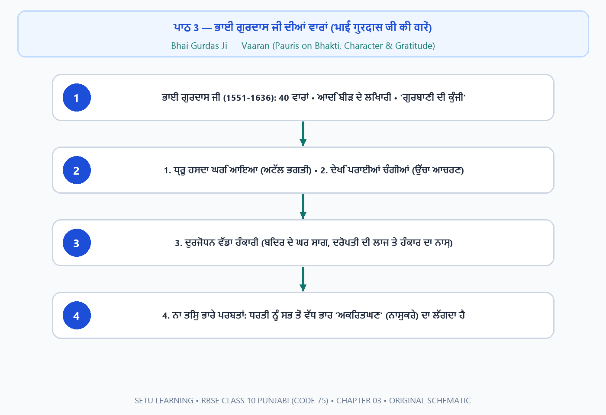

# ਪਾਠ 3 — ਭਾਈ ਗੁਰਦਾਸ ਜੀ ਦੀਆਂ ਵਾਰਾਂ (भाई गुरदास जी की वारें) (Bhai Gurdas Ji — Vaaran (Pauris on Bhakti, Character & Gratitude))

## भाग 1: अध्याय प्रवेश एवं पाठ्यक्रम मैपिंग (ਪਾਠ-ਪ੍ਰਵੇਸ਼ ਅਤੇ ਪਾਠਕ੍ਰਮ ਮੈਪਿੰਗ)

> ਪਹਿਲਾ ਸੰਪਾਦਕੀ ਪ੍ਰਾਰੂਪ (प्रथम संपादकीय प्रारूप)। RBSE ਜਮਾਤ 10 ਪੰਜਾਬੀ ਪਾਠ-ਪੁਸਤਕ 'ਸਾਹਿਤ ਸੁਗੰਧੀਆਂ' ਦੇ ਸਾਰੇ ਪ੍ਰਸ਼ਨਾਂ ਦੇ ਹੱਲ ਅਤੇ 2014–2026 ਦਾ ਪੂਰਾ ਇਤਿਹਾਸਕ PYQ ਸੰਗ੍ਰਹਿ ਸਰੋਤ-ਪ੍ਰੀਖਣ ਸਮੇਤ ਸੰਕਲਿਤ ਹਨ।

**ਵਿਸ਼ਾ ਕੋਡ (विषय कोड):** 75 (ਤੀਜੀ ਭਾਸ਼ਾ — ਪੰਜਾਬੀ / तृतीया भाषा — पंजाबी) · **ਲੜੀ ਪੁਸਤਕ (श्रृंखला पुस्तक):** 7

**ਪ੍ਰਮਾਣਿਤ ਆਧਾਰ:** RBSE 2025–26 · **ਪਾਠ ਅੰਕ-ਭਾਰ:** 3 ਅੰਕ। ਇਹ ਭਾਰ ਉਸੇ ਸੰਸਕਰਣ ਦਾ ਹੈ; ਅਸਲ ਪ੍ਰਸ਼ਨ-ਵੰਡ ਦੀ ਭਵਿੱਖਬਾਣੀ ਨਹੀਂ।

**ਸਿੱਖਣ ਦੇ ਉਦੇਸ਼ (सीखने के लक्ष्य):** ਭਾਈ ਗੁਰਦਾਸ ਜੀ ਦੀਆਂ ਚਾਰ ਪਉੜੀਆਂ ('ਧ੍ਰੂ ਹਸਦਾ ਘਰਿ ਆਇਆ', 'ਦੇਖਿ ਪਰਾਈਆਂ ਚੰਗੀਆਂ', 'ਦੁਰਜੋਧਨ ਵੱਡਾ ਹੰਕਾਰੀ', 'ਨਾ ਤਿਸੁ ਭਾਰੇ ਪਰਬਤਾਂ / ਭਾਰੇ ਭੁਈਂ ਅਕਿਰਤਘਣ') ਦੀ ਪ੍ਰਸੰਗ ਸਹਿਤ ਵਿਆਖਿਆ, ਸਾਰ ਅਤੇ ਨੈਤਿਕ ਸੰਦੇਸ਼ ਸਮਝਣਾ।

## भाग 2: शब्दावली एवं अवधारणा कैप्सूल (ਸ਼ਬਦਾਵਲੀ ਅਤੇ ਸੰਕਲਪ ਕੈਪਸੂਲ)

| ਸ਼ਬਦ / ਸੰਕਲਪ | ਅਰਥ / ਵਿਆਖਿਆ |
|---|---|
| ਵਾਰ (वार) | ਵੀਰ-ਰਸੀ ਜਾਂ ਅਧਿਆਤਮਿਕ ਕਾਵਿ-ਰੂਪ ਜੋ ਪਉੜੀਆਂ ਵਿੱਚ ਰਚਿਆ ਜਾਂਦਾ ਹੈ (ਭਾਈ ਗੁਰਦਾਸ ਜੀ ਨੇ 40 ਵਾਰਾਂ ਰਚੀਆਂ)। |
| ਮਤ੍ਰੇਈ (मत्रेई) | ਮਤਰੇਈ ਮਾਂ — ਧ੍ਰੂ ਭਗਤ ਦੀ ਮਤਰੇਈ ਮਾਂ ਸੁਰੂਚੀ ਜਿਸ ਨੇ ਉਸ ਨੂੰ ਪਿਤਾ ਦੀ ਗੋਦ ਵਿੱਚੋਂ ਉਠਾਇਆ। |
| ਪਰਾਈਆਂ ਚੰਗੀਆਂ (पराईआं चंगीआं) | ਪਰਾਈਆਂ ਸੁੰਦਰ ਇਸਤਰੀਆਂ (ਦੇਖਿ ਪਰਾਈਆਂ ਚੰਗੀਆਂ ਮਾਵਾਂ ਭੈਣਾਂ ਧੀਆਂ ਜਾਣੈ)। |
| ਪਰਦਰਬੁ (परदरबु) | ਪਰਾਇਆ ਧਨ — ਜੋ ਗੁਰਸਿੱਖ ਲਈ ਗਊ-ਮਾਸ/ਸੂਰ ਸਮਾਨ ਤਿਆਗਣਯੋਗ ਹੈ। |
| ਦੁਰਜੋਧਨ (दुरजोधन) | ਮਹਾਭਾਰਤ ਦਾ ਹੰਕਾਰੀ ਕੌਰਵ ਰਾਜਕੁਮਾਰ ਜਿਸ ਨੇ ਭਗਵਾਨ ਕ੍ਰਿਸ਼ਨ ਜੀ ਦੀ ਗੱਲ ਨਾ ਮੰਨੀ। |
| ਦਰੋਪਤੀ (दरोपती) | ਪਾਂਡਵਾਂ ਦੀ ਪਤਨੀ ਜਿਸ ਦੀ ਭਰੀ ਸਭਾ ਵਿੱਚ ਭਗਵਾਨ ਨੇ ਪੈਜ (ਇੱਜ਼ਤ) ਰੱਖੀ। |
| ਅਕਿਰਤਘਣ (अकिरतघण) | ਕੀਤੇ ਹੋਏ ਉਪਕਾਰ ਨੂੰ ਭੁੱਲਣ ਵਾਲਾ ਨਾਸ਼ੁਕਰਾ ਮਨੁੱਖ (ਭਾਰੇ ਭੁਈਂ ਅਕਿਰਤਘਣ ਮੰਦੀ ਹੂੰ ਮੰਦੇ)। |
| ਭੁਈਂ (भुईं) | ਧਰਤੀ / ਜ਼ਮੀਨ (ਧਰਤੀ ਨੂੰ ਪਹਾੜਾਂ ਤੇ ਸਮੁੰਦਰਾਂ ਦਾ ਭਾਰ ਨਹੀਂ ਲੱਗਦਾ, ਅਕਿਰਤਘਣ ਦਾ ਭਾਰ ਲੱਗਦਾ ਹੈ)। |
| ਕੋਟ ਗੜ੍ਹ (कोट गढ़) | ਕਿਲ੍ਹੇ ਅਤੇ ਮਹੱਲ (ਨਾ ਤਿਸੁ ਭਾਰੇ ਕੋਟ ਗੜ੍ਹ ਘਰ ਬਾਰ ਦਿਸੰਦੇ)। |
| ਗੁਰਬਾਣੀ ਦੀ ਕੁੰਜੀ (गुरबाणी दी कुंजी) | ਸ੍ਰੀ ਗੁਰੂ ਅਰਜਨ ਦੇਵ ਜੀ ਨੇ ਭਾਈ ਗੁਰਦਾਸ ਜੀ ਦੀਆਂ ਵਾਰਾਂ ਨੂੰ 'ਗੁਰਬਾਣੀ ਦੀ ਕੁੰਜੀ' ਆਖਿਆ। |

## भाग 3: विस्तृत शिक्षण पाठ (ਵਿਸਤ੍ਰਿਤ ਅਧਿਆਪਨ ਪਾਠ)

### 1. ਕਵੀ-ਪਛਾਣ: ਭਾਈ ਗੁਰਦਾਸ ਜੀ (1551–1636 ਈ.)
ਭਾਈ ਗੁਰਦਾਸ ਜੀ ਦਾ ਜਨਮ 1551 ਈ. ਵਿੱਚ ਪਿੰਡ ਬਾਸਰਕੇ (ਜ਼ਿਲ੍ਹਾ ਅੰਮ੍ਰਿਤਸਰ) ਵਿਖੇ ਪਿਤਾ ਈਸ਼ਰ ਦਾਸ ਜੀ (ਗੁਰੂ ਅਮਰਦਾਸ ਜੀ ਦੇ ਚਚੇਰੇ ਭਰਾ) ਅਤੇ ਮਾਤਾ ਜੀਵਨੀ ਦੇ ਘਰ ਹੋਇਆ। ਆਪ ਜੀ ਨੇ ਸ੍ਰੀ ਗੁਰੂ ਅਰਜਨ ਦੇਵ ਜੀ ਦੀ ਅਗਵਾਈ ਹੇਠ **ਆਦਿ ਸ੍ਰੀ ਗੁਰੂ ਗ੍ਰੰਥ ਸਾਹਿਬ ਜੀ ਦੀ ਪਹਿਲੀ ਬੀੜ** ਆਪਣੇ ਹੱਥੀਂ ਲਿਖੀ। ਆਪ ਜੀ ਨੇ ਪੰਜਾਬੀ ਵਿੱਚ **40 ਵਾਰਾਂ** (ਅਤੇ ਬ੍ਰਜ ਭਾਸ਼ਾ ਵਿੱਚ 675 ਕਬਿੱਤ-ਸਵੱਈਏ) ਰਚੇ। ਪੰਜਵੇਂ ਪਾਤਸ਼ਾਹ ਸ੍ਰੀ ਗੁਰੂ ਅਰਜਨ ਦੇਵ ਜੀ ਨੇ ਆਪ ਦੀਆਂ ਵਾਰਾਂ ਨੂੰ **'ਗੁਰਬਾਣੀ ਦੀ ਕੁੰਜੀ'** ਹੋਣ ਦਾ ਵਰਦਾਨ ਦਿੱਤਾ।

### 2. ਪਾਠ ਵਿੱਚ ਸ਼ਾਮਲ ਚਾਰ ਪਉੜੀਆਂ ਦਾ ਵਿਸਤ੍ਰਿਤ ਅਧਿਐਨ
1. **ਪਉੜੀ 1 — 'ਧ੍ਰੂ ਹਸਦਾ ਘਰਿ ਆਇਆ' (ਭਗਤ ਧ੍ਰੂ ਦੀ ਅਟੱਲ ਭਗਤੀ):**
   - **ਕਥਾ ਤੇ ਭਾਵ:** ਰਾਜਾ ਉੱਤਾਨਪਾਦ ਦੇ ਪੁੱਤਰ ਬਾਲਕ ਧ੍ਰੂ ਨੇ ਜਦੋਂ ਪਿਤਾ ਦੀ ਗੋਦ ਵਿੱਚ ਬੈਠਣਾ ਚਾਹਿਆ ਤਾਂ ਮਤਰੇਈ ਮਾਂ (ਸੁਰੂਚੀ) ਨੇ ਉਸ ਨੂੰ ਬੇਇੱਜ਼ਤ ਕਰਕੇ ਉਠਾ ਦਿੱਤਾ। ਧ੍ਰੂ ਨੇ ਆਪਣੀ ਸਕੀ ਮਾਂ (ਸੁਨੀਤੀ) ਨੂੰ ਪੁੱਛਿਆ ਤਾਂ ਮਾਂ ਨੇ ਸੱਚੇ ਪਰਮਾਤਮਾ ਦੀ ਭਗਤੀ ਕਰਨ ਦਾ ਰਾਹ ਦੱਸਿਆ। ਨਾਰਦ ਮੁਨੀ ਦੇ ਉਪਦੇਸ਼ ਨਾਲ ਧ੍ਰੂ ਨੇ ਜੰਗਲ ਵਿੱਚ ਜਾ ਕੇ ਅਟੱਲ ਭਗਤੀ ਕੀਤੀ, ਪ੍ਰਭੂ ਨੇ ਦਰਸ਼ਨ ਦਿੱਤੇ ਅਤੇ ਧ੍ਰੂ ਨੂੰ ਅਟੱਲ ਪਦਵੀ (ਧਰੁਵ ਤਾਰੇ ਦਾ ਸਥਾਨ) ਬਖ਼ਸ਼ੀ।
2. **ਪਉੜੀ 2 — 'ਦੇਖਿ ਪਰਾਈਆਂ ਚੰਗੀਆਂ ਮਾਵਾਂ ਭੈਣਾਂ ਧੀਆਂ ਜਾਣੈ' (ਉੱਚਾ ਸਦਾਚਾਰਕ ਆਚਰਣ):**
   - **ਮੂਲ ਤੁਕਾਂ:** **'ਦੇਖਿ ਪਰਾਈਆਂ ਚੰਗੀਆਂ ਮਾਵਾਂ ਭੈਣਾਂ ਧੀਆਂ ਜਾਣੈ । ਉਸੁ ਸੂਅਰੁ ਉਸੁ ਗਾਇ ਹੈ ਪਰਦਰਬੁ ਹਿੰਦੂ ਮੁਸਲਮਾਣੈ ।' / 'ਗੁਰਸਿਖ ਲੈਦਾ ਅਉਗਣਿਆਰੇ ਗੁਣ ਪਰਵਾਣੈ ।' / 'ਕਾਮ ਕ੍ਰੋਧੁ ਅহੰਕਾਰੁ ਨਿਵਾਰੈ ।' / 'ਪਰ ਨਿੰਦਾ ਕੰਨੀ ਨ ਸੁਣਾਵੈ ।' / 'ਗੁਰਮੁਖਿ ਹੋਇ ਸੁ ਭਉਜਲੁ ਤਰੈ ॥'**
   - **ਵਿਆਖਿਆ:** ਸੱਚਾ ਗੁਰਸਿੱਖ ਪਰਾਈਆਂ ਸੁੰਦਰ ਇਸਤਰੀਆਂ ਨੂੰ ਵੇਖ ਕੇ ਆਪਣੀ ਉਮਰ ਅਨੁਸਾਰ ਵੱਡੀ ਨੂੰ ਮਾਂ, ਬਰਾਬਰ ਦੀ ਨੂੰ ਭੈਣ ਅਤੇ ਛੋਟੀ ਨੂੰ ਧੀ ਸਮਝਦਾ ਹੈ। ਉਹ ਪਰਾਏ ਧਨ (ਪਰਦਰਬੁ) ਨੂੰ ਹਿੰਦੂ ਲਈ ਗਊ-ਮਾਸ ਅਤੇ ਮੁਸਲਮਾਨ ਲਈ ਸੂਰ ਦੇ ਮਾਸ ਵਾਂਗ ਹਰਾਮ ਸਮਝਦਾ ਹੈ। ਉਹ ਪਰਾਈ ਨਿੰਦਾ ਕੰਨਾਂ ਨਾਲ ਨਹੀਂ ਸੁਣਦਾ, ਕਾਮ-ਕ੍ਰੋਧ-ਹੰਕਾਰ ਤਿਆਗਦਾ ਹੈ ਅਤੇ ਨਿਮਰਤਾ ਨਾਲ ਜੀਵਨ ਜਿਉਂਦਾ ਹੈ।
3. **ਪਉੜੀ 3 — 'ਦੁਰਜੋਧਨ ਵੱਡਾ ਹੰਕਾਰੀ' (ਹੰਕਾਰ ਦਾ ਅੰਤ ਤੇ ਭਗਤ-ਵੱਛਲਤਾ):**
   - **ਭਾਵ:** ਮਹਾਭਾਰਤ ਵਿੱਚ ਦੁਰਜੋਧਨ ਨੇ ਆਪਣੇ ਰਾਜ ਤੇ ਬਲ ਦਾ ਵੱਡਾ ਹੰਕਾਰ ਕੀਤਾ। ਉਸ ਨੇ ਭਰੀ ਸਭਾ ਵਿੱਚ ਦਰੋਪਤੀ ਦੀ ਬੇਪੱਤੀ ਕਰਨੀ ਚਾਹੀ, ਪਰ ਭਗਵਾਨ ਕ੍ਰਿਸ਼ਨ ਜੀ ਨੇ ਦਰੋਪਤੀ ਦੀ ਲਾਜ ਰੱਖੀ। ਕ੍ਰਿਸ਼ਨ ਜੀ ਨੇ ਦੁਰਜੋਧਨ ਦੇ ਛੱਤੀ ਪ੍ਰਕਾਰ ਦੇ ਭੋਜਨ ਛੱਡ ਕੇ ਗ਼ਰੀਬ ਭਗਤ ਬਿਦਰ ਦੇ ਘਰ ਸਾਗ ਖਾਧਾ। ਅੰਤ ਕੌਰਵਾਂ ਦਾ ਹੰਕਾਰ ਚੂਰ-ਚੂਰ ਹੋਇਆ ਅਤੇ ਪਾਂਡਵਾਂ ਦੀ ਜਿੱਤ ਹੋਈ।
4. **ਪਉੜੀ 4 — 'ਨਾ ਤਿਸੁ ਭਾਰੇ ਪਰਬਤਾਂ ਅਸਮਾਨ ਖਹੰਦੇ' (ਭਾਰੇ ਭੁਈਂ ਅਕਿਰਤਘਣ):**
   - **ਮੂਲ ਤੁਕਾਂ:** **'ਨਾ ਤਿਸੁ ਭਾਰੇ ਪਰਬਤਾਂ ਅਸਮਾਨ ਖਹੰਦੇ ॥ ਨਾ ਤਿਸੁ ਭਾਰੇ ਕੋਟ ਗੜ੍ਹ ਘਰ ਬਾਰ ਦਿਸੰਦੇ ॥ ਨਾ ਤਿਸੁ ਭਾਰੇ ਸਾਇਰਾਂ ਨਦ ਵਾਹ ਵਹੰਦੇ ॥ ਨਾ ਤਿਸੁ ਭਾਰੇ ਤਰੁਵਰਾਂ ਫਲ ਸੁਫਲ ਫਲੰਦੇ ॥ ਨਾ ਤਿਸੁ ਭਾਰੇ ਜੀਅ ਜੰਤ ਅਣਗਣਤ ਫਿਰੰਦੇ ॥ ਭਾਰੇ ਭੁਈਂ ਅਕਿਰਤਘਣ ਮੰਦੀ ਹੂੰ ਮੰਦੇ ॥'**
   - **ਵਿਆਖਿਆ:** ਧਰਤੀ (ਭੁਈਂ) ਨੂੰ ਅਸਮਾਨ ਨਾਲ ਖਹਿਣ ਵਾਲੇ ਉੱਚੇ ਪਹਾੜਾਂ ਦਾ ਭਾਰ ਮਹਿਸੂਸ ਨਹੀਂ ਹੁੰਦਾ; ਨਾ ਹੀ ਕਿਲ੍ਹਿਆਂ (ਕੋਟ ਗੜ੍ਹ), ਮਹੱਲਾਂ, ਸਮੁੰਦਰਾਂ (ਸਾਇਰਾਂ), ਨਦੀਆਂ, ਫਲਦਾਰ ਰੁੱਖਾਂ (ਤਰੁਵਰਾਂ) ਅਤੇ ਅਣਗਿਣਤ ਜੀਵ-ਜੰਤੂਆਂ ਦਾ ਭਾਰ ਲੱਗਦਾ ਹੈ। **ਧਰਤੀ ਨੂੰ ਸਭ ਤੋਂ ਵੱਧ ਭਾਰ 'ਅਕਿਰਤਘਣ' (ਉਪਕਾਰ ਭੁੱਲਣ ਵਾਲੇ ਨਾਸ਼ੁਕਰੇ ਮਨੁੱਖ) ਦਾ ਲੱਗਦਾ ਹੈ**, ਜੋ ਬੁਰਿਆਂ ਤੋਂ ਵੀ ਬੁਰਾ ('ਮੰਦੀ ਹੂੰ ਮੰਦੇ') ਹੁੰਦਾ ਹੈ।

ਪਾਠ 3: ਭਾਈ ਗੁਰਦਾਸ ਜੀ ਦੀਆਂ ਚਾਰ ਪਉੜੀਆਂ ਦਾ ਸੰਕਲਪ ਚਿੱਤਰ

## भाग 4: पाठ्यपुस्तक-अवधारणाओं पर मौलिक हल किए उदाहरण (ਹੱਲ ਕੀਤੇ ਮਿਆਰੀ ਉਦਾਹਰਣ)

ਹੇਠਾਂ ਦਿੱਤੇ ਪ੍ਰਸ਼ਨ ਪਾਠ-ਪੁਸਤਕ 'ਸਾਹਿਤ ਸੁਗੰਧੀਆਂ' ਅਤੇ ਵਿਆਕਰਣ ਦੇ ਸੰਕਲਪਾਂ ਉੱਤੇ ਆਧਾਰਿਤ ਮੌਲਿਕ ਆਦਰਸ਼ ਹੱਲ ਹਨ।

**ਹੱਲ ਕੀਤਾ ਉਦਾਹਰਣ 1: 'ਨਾ ਤਿਸੁ ਭਾਰੇ ਪਰਬਤਾਂ ਅਸਮਾਨ ਖਹੰਦੇ...' ਪਉੜੀ ਦੀ ਪ੍ਰਸੰਗ ਸਹਿਤ ਵਿਆਖਿਆ ਕਰੋ।**

ਪ੍ਰਸੰਗ: ਇਹ ਕਾਵਿ-ਬੰਦ 'ਸਾਹਿਤ ਸੁਗੰਧੀਆਂ' ਪੁਸਤਕ ਵਿੱਚ ਦਰਜ ਭਾਈ ਗੁਰਦਾਸ ਜੀ ਦੀਆਂ ਵਾਰਾਂ ਵਿੱਚੋਂ ਲਿਆ ਗਿਆ ਹੈ। ਵਿਆਖਿਆ: ਭਾਈ ਗੁਰਦਾਸ ਜੀ ਫ਼ੁਰਮਾਉਂਦੇ ਹਨ ਕਿ ਧਰਤੀ ਨੂੰ ਅਸਮਾਨ ਛੂਹਣ ਵਾਲੇ ਪਹਾੜਾਂ, ਵੱਡੇ ਕਿਲ੍ਹਿਆਂ ਤੇ ਘਰਾਂ, ਸਮੁੰਦਰਾਂ ਤੇ ਵਗਦੀਆਂ ਨਦੀਆਂ, ਫਲਾਂ ਨਾਲ ਲੱਦੇ ਰੁੱਖਾਂ ਅਤੇ ਅਣਗਿਣਤ ਜੀਵ-ਜੰਤੂਆਂ ਦਾ ਭਾਰ ਨਹੀਂ ਲੱਗਦਾ। ਧਰਤੀ ਨੂੰ ਕੇਵਲ 'ਅਕਿਰਤਘਣ' (ਕੀਤੇ ਉਪਕਾਰ ਨੂੰ ਭੁੱਲਣ ਵਾਲੇ ਨਾਸ਼ੁਕਰੇ ਮਨੁੱਖ) ਦਾ ਭਾਰ ਲੱਗਦਾ ਹੈ, ਜੋ ਸਭ ਤੋਂ ਮੰਦੇ ਹਨ।

**ਹੱਲ ਕੀਤਾ ਉਦਾਹਰਣ 2: 'ਦੇਖਿ ਪਰਾਈਆਂ ਚੰਗੀਆਂ' ਸ਼ਬਦ ਦਾ ਸਾਰ ਆਪਣੇ ਸ਼ਬਦਾਂ ਵਿੱਚ ਲਿਖੋ।**

ਇਸ ਪਉੜੀ ਵਿੱਚ ਭਾਈ ਗੁਰਦਾਸ ਜੀ ਨੇ ਆਦਰਸ਼ ਗੁਰਸਿੱਖ ਦੇ ਸਦਾਚਾਰਕ ਜੀਵਨ ਦਾ ਚਿੱਤਰ ਖਿੱਚਿਆ ਹੈ। ਸੱਚਾ ਮਨੁੱਖ ਪਰਾਈਆਂ ਸੁੰਦਰ ਇਸਤਰੀਆਂ ਨੂੰ ਮਾਵਾਂ, ਭੈਣਾਂ ਤੇ ਧੀਆਂ ਸਮਝਦਾ ਹੈ, ਪਰਾਏ ਧਨ ਨੂੰ ਹਿੰਦੂ ਲਈ ਗਊ ਤੇ ਮੁਸਲਮਾਨ ਲਈ ਸੂਰ ਦੇ ਮਾਸ ਸਮਾਨ ਤਿਆਗਦਾ ਹੈ, ਪਰਾਈ ਨਿੰਦਾ ਨਹੀਂ ਸੁਣਦਾ, ਪੁੱਤਰ-ਇਸਤਰੀ ਦੇ ਮੋਹ ਵਿੱਚ ਫਸ ਕੇ ਧਰਮ ਨਹੀਂ ਭੁੱਲਦਾ ਅਤੇ ਪਰਉਪਕਾਰੀ ਜੀਵਨ ਜਿਉਂਦਾ ਹੈ।

**ਹੱਲ ਕੀਤਾ ਉਦਾਹਰਣ 3: 'ਧ੍ਰੂ ਹਸਦਾ ਘਰਿ ਆਇਆ' ਪਉੜੀ ਤੋਂ ਸਾਨੂੰ ਕੀ ਸਿੱਖਿਆ ਮਿਲਦੀ ਹੈ?**

ਇਸ ਪਉੜੀ ਤੋਂ ਸਿੱਖਿਆ ਮਿਲਦੀ ਹੈ ਕਿ ਜਦੋਂ ਮਤਰੇਈ ਮਾਂ ਦੇ ਨਿਰਾਦਰ ਤੋਂ ਬਾਅਦ ਬਾਲਕ ਧ੍ਰੂ ਨੇ ਆਪਣੀ ਮਾਂ ਤੇ ਨਾਰਦ ਮੁਨੀ ਦੇ ਉਪਦੇਸ਼ ਅਨੁਸਾਰ ਸੱਚੇ ਮਨ ਨਾਲ ਪ੍ਰਭੂ-ਭਗਤੀ ਕੀਤੀ, ਤਾਂ ਉਸ ਨੂੰ ਸੰਸਾਰ ਵਿੱਚ ਅਟੱਲ ਪਦਵੀ ਮਿਲੀ। ਸੱਚੀ ਭਗਤੀ ਨਾਲ ਮਨੁੱਖ ਹਰ ਦੁੱਖ ਤੇ ਨਿਰਾਦਰ ਉੱਤੇ ਜਿੱਤ ਪਾ ਲੈਂਦਾ ਹੈ।

## भाग 5: सत्यापित बोर्ड प्रश्न एवं स्रोत-स्थिति (ਪ੍ਰਮਾਣਿਤ ਬੋਰਡ ਪ੍ਰਸ਼ਨ ਅਤੇ ਸਰੋਤ-ਸਥਿਤੀ)

RBSE 2025 Main, 2025 Supp (`S-75`, Q2-ii, Q3-v), 2024 Main (Q2-ii) ਅਤੇ 2022 Main (Q2-ii, Q16) ਵਿੱਚ ਭਾਈ ਗੁਰਦਾਸ ਜੀ ਦੀਆਂ ਪਉੜੀਆਂ ਸਿੱਧੀਆਂ ਪੁੱਛੀਆਂ ਗਈਆਂ ਹਨ।

[RBSE 2026 ਮੂਲ ਪੇਪਰ (S-75)](https://rajeduboard.rajasthan.gov.in/books/PAPERS-2026/Sec/S-75.pdf)। ਪ੍ਰਸ਼ਨ ਦਾ ਸੰਖੇਪ ਵਿਸ਼ਾ-ਸੰਦਰਭ ਹੈ; ਸ਼ਬਦ-ਬ-ਸ਼ਬਦ ਪੁਨਰ-ਮੁਦਰਣ ਨਹੀਂ।

## भाग 6: खंडवार मौलिक अभ्यास बैंक (ਖੰਡ-ਵਾਰ ਮੌਲਿਕ ਅਭਿਆਸ ਬੈਂਕ)

**ਅਭਿਆਸ-ਅੰਕ:** ਵਿਦਿਆਰਥੀਆਂ ਦੇ ਸਵੈ-ਅਭਿਆਸ ਲਈ ਹਨ; ਉੱਤਰ ਪਹਿਲਾਂ ਆਪ ਲਿਖੋ, ਫਿਰ ਭਾਗ 9 ਵੇਖੋ।

## ੳ: ਬਹੁ-ਵਿਕਲਪੀ ਪ੍ਰਸ਼ਨ (MCQ) — 15 × 1 ਅੰਕ

**MCQ 1. ਭਾਈ ਗੁਰਦਾਸ ਜੀ ਅਨੁਸਾਰ ਧਰਤੀ ਕਿਸ ਦਾ ਭਾਰ ਸਭ ਤੋਂ ਵੱਧ ਮਹਿਸੂਸ ਕਰਦੀ ਹੈ?**

ੳ) ਡੂੰਘੇ ਸਮੁੰਦਰਾਂ ਦਾ  
ਅ) ਅਕਿਰਤਘਣ (ਉਪਕਾਰ ਨਾ ਮੰਨਣ ਵਾਲੇ) ਮਨੁੱਖ ਦਾ  
ੲ) ਉੱਚੇ ਪਹਾੜਾਂ ਦਾ  
ਸ) ਵੱਡੇ ਕਿਲ੍ਹਿਆਂ ਦਾ

**MCQ 2. 'ਦੇਖਿ ਪਰਾਈਆਂ ਚੰਗੀਆਂ ਮਾਵਾਂ ਭੈਣਾਂ ਧੀਆਂ ਜਾਣੈ' ਪਉੜੀ ਕਿਸ ਕਵੀ ਦੀ ਰਚਨਾ ਹੈ?**

ੳ) ਭਾਈ ਗੁਰਦਾਸ ਜੀ  
ਅ) ਸ਼ੇਖ਼ ਫ਼ਰੀਦ ਜੀ  
ੲ) ਮੀਆਂ ਵਜੀਦ  
ਸ) ਬੁੱਲ੍ਹੇ ਸ਼ਾਹ

**MCQ 3. ਖਾਲੀ ਥਾਂ ਭਰੋ: 'ਨਾ ਤਿਸੁ ਭਾਰੇ ਪਰਬਤਾਂ ................' (RBSE 2024 Main Q2-ii)**

ੳ) ਫਲ ਸੁਫਲ ਫਲੰਦੇ  
ਅ) ਘਰ ਬਾਰ ਦਿਸੰਦੇ  
ੲ) ਨਦ ਵਾਹ ਵਹੰਦੇ  
ਸ) ਅਸਮਾਨ ਖਹੰਦੇ

**MCQ 4. ਖਾਲੀ ਥਾਂ ਭਰੋ: 'ਭਾਰੇ ਭੁਈਂ ਅਕਿਰਤਘਣ ................' (RBSE 2022 Main Q2-ii)**

ੳ) ਉੱਚੀ ਹੂੰ ਉੱਚੇ  
ਅ) ਸੱਚੀ ਹੂੰ ਸੱਚੇ  
ੲ) ਮੰਦੀ ਹੂੰ ਮੰਦੇ  
ਸ) ਚੰਗੀ ਹੂੰ ਚੰਗੇ

**MCQ 5. 'ਧ੍ਰੂ ਹਸਦਾ ਘਰਿ ਆਇਆ' ਕਵਿਤਾ ਕਿਸ ਕਵੀ ਦੀ ਰਚਨਾ ਹੈ?**

ੳ) ਧਨੀ ਰਾਮ ਚਾਤ੍ਰਿਕ  
ਅ) ਭਾਈ ਗੁਰਦਾਸ ਜੀ  
ੲ) ਗੁਰੂ ਰਾਮਦਾਸ ਜੀ  
ਸ) ਭਾਈ ਵੀਰ ਸਿੰਘ

**MCQ 6. ਭਾਈ ਗੁਰਦਾਸ ਜੀ ਨੇ ਪਰਾਏ ਧਨ ('ਪਰਦਰਬੁ') ਨੂੰ ਹਿੰਦੂ ਅਤੇ ਮੁਸਲਮਾਨ ਲਈ ਕਿਸ ਸਮਾਨ ਦੱਸਿਆ ਹੈ?**

ੳ) ਗਊ-ਮਾਸ ਅਤੇ ਸੂਰ ਦੇ ਮਾਸ ਸਮਾਨ  
ਅ) ਸੋਨੇ ਅਤੇ ਚਾਂਦੀ ਸਮਾਨ  
ੲ) ਦੁੱਧ ਅਤੇ ਸ਼ਹਿਦ ਸਮਾਨ  
ਸ) ਪਾਣੀ ਅਤੇ ਹਵਾ ਸਮਾਨ

**MCQ 7. 'ਦੁਰਜੋਧਨ ਵੱਡਾ ਹੰਕਾਰੀ' ਪਉੜੀ ਵਿੱਚ ਭਗਵਾਨ ਕ੍ਰਿਸ਼ਨ ਜੀ ਨੇ ਭਰੀ ਸਭਾ ਵਿੱਚ ਕਿਸ ਦੀ ਲਾਜ ਰੱਖੀ?**

ੳ) ਕੁੰਤੀ ਦੀ  
ਅ) ਗਾਂਧਾਰੀ ਦੀ  
ੲ) ਸੁਭੱਦਰਾ ਦੀ  
ਸ) ਦਰੋਪਤੀ ਦੀ

**MCQ 8. ਭਗਵਾਨ ਕ੍ਰਿਸ਼ਨ ਜੀ ਨੇ ਦੁਰਜੋਧਨ ਦੇ ਸ਼ਾਹੀ ਭੋਜਨ ਛੱਡ ਕੇ ਕਿਸ ਗ਼ਰੀਬ ਭਗਤ ਦੇ ਘਰ ਸਾਗ ਖਾਧਾ?**

ੳ) ਭਗਤ ਸੁਦਾਮਾ ਦੇ ਘਰ  
ਅ) ਭਗਤ ਪ੍ਰਹਿਲਾਦ ਦੇ ਘਰ  
ੲ) ਭਗਤ ਬਿਦਰ ਦੇ ਘਰ  
ਸ) ਭਗਤ ਧ੍ਰੂ ਦੇ ਘਰ

**MCQ 9. 'ਨਾ ਤਿਸੁ ਭਾਰੇ ਸਾਇਰਾਂ ਨਦ ਵਾਹ ਵਹੰਦੇ' ਵਿੱਚ 'ਸਾਇਰਾਂ' ਸ਼ਬਦ ਦਾ ਕੀ ਅਰਥ ਹੈ?**

ੳ) ਰੁੱਖਾਂ  
ਅ) ਸਮੁੰਦਰਾਂ / ਸਾਗਰਾਂ  
ੲ) ਸ਼ਾਇਰਾਂ / ਕਵੀਆਂ  
ਸ) ਪਹਾੜਾਂ

**MCQ 10. 'ਨਾ ਤਿਸੁ ਭਾਰੇ ਤਰੁਵਰਾਂ ਫਲ ਸੁਫਲ ਫਲੰਦੇ' ਵਿੱਚ 'ਤਰੁਵਰਾਂ' ਦਾ ਕੀ ਅਰਥ ਹੈ?**

ੳ) ਸ੍ਰੇਸ਼ਠ ਰੁੱਖਾਂ / ਬਿਰਛਾਂ  
ਅ) ਤਲਵਾਰਾਂ  
ੲ) ਤਾਰਿਆਂ  
ਸ) ਤਾਲਾਬਾਂ

**MCQ 11. ਭਾਈ ਗੁਰਦਾਸ ਜੀ ਦੀਆਂ ਵਾਰਾਂ ਨੂੰ ਕਿਸ ਗੁਰੂ ਸਾਹਿਬ ਨੇ 'ਗੁਰਬਾਣੀ ਦੀ ਕੁੰਜੀ' ਕਿਹਾ ਸੀ?**

ੳ) ਸ੍ਰੀ ਗੁਰੂ ਨਾਨਕ ਦੇਵ ਜੀ ਨੇ  
ਅ) ਸ੍ਰੀ ਗੁਰੂ ਅਮਰਦਾਸ ਜੀ ਨੇ  
ੲ) ਸ੍ਰੀ ਗੁਰੂ ਗੋਬਿੰਦ ਸਿੰਘ ਜੀ ਨੇ  
ਸ) ਸ੍ਰੀ ਗੁਰੂ ਅਰਜਨ ਦੇਵ ਜੀ ਨੇ

**MCQ 12. ਭਾਈ ਗੁਰਦਾਸ ਜੀ ਨੇ ਪੰਜਾਬੀ ਵਿੱਚ ਕੁੱਲ ਕਿੰਨੀਆਂ ਵਾਰਾਂ ਰਚੀਆਂ?**

ੳ) 15 ਵਾਰਾਂ  
ਅ) 52 ਵਾਰਾਂ  
ੲ) 40 ਵਾਰਾਂ  
ਸ) 22 ਵਾਰਾਂ

**MCQ 13. ਬਾਲਕ ਧ੍ਰੂ ਨੂੰ ਪਿਤਾ ਦੀ ਗੋਦ ਵਿੱਚੋਂ ਕਿਸ ਨੇ ਬਾਂਹ ਫੜ ਕੇ ਉਠਾਇਆ ਸੀ?**

ੳ) ਵਜ਼ੀਰ ਨੇ  
ਅ) ਮਤਰੇਈ ਮਾਂ ਨੇ  
ੲ) ਸਕੀ ਮਾਂ ਨੇ  
ਸ) ਵੱਡੇ ਭਰਾ ਨੇ

**MCQ 14. ਭਾਈ ਗੁਰਦਾਸ ਜੀ ਦਾ ਜਨਮ ਕਦੋਂ ਅਤੇ ਕਿੱਥੇ ਹੋਇਆ?**

ੳ) 1551 ਈ. ਵਿੱਚ ਪਿੰਡ ਬਾਸਰਕੇ ਵਿਖੇ  
ਅ) 1479 ਈ. ਵਿੱਚ ਲਾਹੌਰ ਵਿਖੇ  
ੲ) 1680 ਈ. ਵਿੱਚ ਕਸੂਰ ਵਿਖੇ  
ਸ) 1872 ਈ. ਵਿੱਚ ਅੰਮ੍ਰਿਤਸਰ ਵਿਖੇ

**MCQ 15. 'ਅਕਿਰਤਘਣ' ਸ਼ਬਦ ਦਾ ਸਹੀ ਅਰਥ ਕੀ ਹੈ?**

ੳ) ਕੀਤੇ ਹੋਏ ਉਪਕਾਰ ਨੂੰ ਮੰਨਣ ਵਾਲਾ  
ਅ) ਬਹੁਤ ਮਿਹਨਤੀ ਮਨੁੱਖ  
ੲ) ਈਸ਼ਵਰ ਨੂੰ ਨਾ ਮੰਨਣ ਵਾਲਾ  
ਸ) ਕੀਤੇ ਹੋਏ ਉਪਕਾਰ ਨੂੰ ਨਾ ਮੰਨਣ ਵਾਲਾ (ਨਾਸ਼ੁਕਰਾ)

## ੳ: ਖਾਲੀ ਥਾਵਾਂ ਭਰੋ — 6 × 1 ਅੰਕ

1. ਵੀਰ-ਰਸੀ ਜਾਂ ਅਧਿਆਤਮਿਕ ਕਾਵਿ-ਰੂਪ ਜੋ ਪਉੜੀਆਂ ਵਿੱਚ ਰਚਿਆ ਜਾਂਦਾ ਹੈ (ਭਾਈ ਗੁਰਦਾਸ ਜੀ ਨੇ 40 ਵਾਰਾਂ ਰਚੀਆਂ)। — ਇਸ ਸ਼ਬਦ/ਸੰਕਲਪ ਦਾ ਨਾਂ ਹੈ: ____।  
2. ਮਤਰੇਈ ਮਾਂ — ਧ੍ਰੂ ਭਗਤ ਦੀ ਮਤਰੇਈ ਮਾਂ ਸੁਰੂਚੀ ਜਿਸ ਨੇ ਉਸ ਨੂੰ ਪਿਤਾ ਦੀ ਗੋਦ ਵਿੱਚੋਂ ਉਠਾਇਆ। — ਇਸ ਸ਼ਬਦ/ਸੰਕਲਪ ਦਾ ਨਾਂ ਹੈ: ____।  
3. ਪਰਾਈਆਂ ਸੁੰਦਰ ਇਸਤਰੀਆਂ (ਦੇਖਿ ਪਰਾਈਆਂ ਚੰਗੀਆਂ ਮਾਵਾਂ ਭੈਣਾਂ ਧੀਆਂ ਜਾਣੈ)। — ਇਸ ਸ਼ਬਦ/ਸੰਕਲਪ ਦਾ ਨਾਂ ਹੈ: ____।  
4. ਪਰਾਇਆ ਧਨ — ਜੋ ਗੁਰਸਿੱਖ ਲਈ ਗਊ-ਮਾਸ/ਸੂਰ ਸਮਾਨ ਤਿਆਗਣਯੋਗ ਹੈ। — ਇਸ ਸ਼ਬਦ/ਸੰਕਲਪ ਦਾ ਨਾਂ ਹੈ: ____।  
5. ਮਹਾਭਾਰਤ ਦਾ ਹੰਕਾਰੀ ਕੌਰਵ ਰਾਜਕੁਮਾਰ ਜਿਸ ਨੇ ਭਗਵਾਨ ਕ੍ਰਿਸ਼ਨ ਜੀ ਦੀ ਗੱਲ ਨਾ ਮੰਨੀ। — ਇਸ ਸ਼ਬਦ/ਸੰਕਲਪ ਦਾ ਨਾਂ ਹੈ: ____।  
6. ਪਾਂਡਵਾਂ ਦੀ ਪਤਨੀ ਜਿਸ ਦੀ ਭਰੀ ਸਭਾ ਵਿੱਚ ਭਗਵਾਨ ਨੇ ਪੈਜ (ਇੱਜ਼ਤ) ਰੱਖੀ। — ਇਸ ਸ਼ਬਦ/ਸੰਕਲਪ ਦਾ ਨਾਂ ਹੈ: ____।

## ੳ: ਅਤਿ-ਲਘੂ ਉੱਤਰਾਂ ਵਾਲੇ ਪ੍ਰਸ਼ਨ — 8 × 1 ਅੰਕ

1. ਭਾਈ ਗੁਰਦਾਸ ਜੀ ਅਨੁਸਾਰ ਧਰਤੀ ਕਿਸ ਦਾ ਭਾਰ ਸਭ ਤੋਂ ਵੱਧ ਮਹਿਸੂਸ ਕਰਦੀ ਹੈ?  
2. 'ਦੇਖਿ ਪਰਾਈਆਂ ਚੰਗੀਆਂ ਮਾਵਾਂ ਭੈਣਾਂ ਧੀਆਂ ਜਾਣੈ' ਪਉੜੀ ਕਿਸ ਕਵੀ ਦੀ ਰਚਨਾ ਹੈ?  
3. ਖਾਲੀ ਥਾਂ ਭਰੋ: 'ਨਾ ਤਿਸੁ ਭਾਰੇ ਪਰਬਤਾਂ ................' (RBSE 2024 Main Q2-ii)  
4. ਖਾਲੀ ਥਾਂ ਭਰੋ: 'ਭਾਰੇ ਭੁਈਂ ਅਕਿਰਤਘਣ ................' (RBSE 2022 Main Q2-ii)  
5. 'ਧ੍ਰੂ ਹਸਦਾ ਘਰਿ ਆਇਆ' ਕਵਿਤਾ ਕਿਸ ਕਵੀ ਦੀ ਰਚਨਾ ਹੈ?  
6. ਭਾਈ ਗੁਰਦਾਸ ਜੀ ਨੇ ਪਰਾਏ ਧਨ ('ਪਰਦਰਬੁ') ਨੂੰ ਹਿੰਦੂ ਅਤੇ ਮੁਸਲਮਾਨ ਲਈ ਕਿਸ ਸਮਾਨ ਦੱਸਿਆ ਹੈ?  
7. 'ਦੁਰਜੋਧਨ ਵੱਡਾ ਹੰਕਾਰੀ' ਪਉੜੀ ਵਿੱਚ ਭਗਵਾਨ ਕ੍ਰਿਸ਼ਨ ਜੀ ਨੇ ਭਰੀ ਸਭਾ ਵਿੱਚ ਕਿਸ ਦੀ ਲਾਜ ਰੱਖੀ?  
8. ਭਗਵਾਨ ਕ੍ਰਿਸ਼ਨ ਜੀ ਨੇ ਦੁਰਜੋਧਨ ਦੇ ਸ਼ਾਹੀ ਭੋਜਨ ਛੱਡ ਕੇ ਕਿਸ ਗ਼ਰੀਬ ਭਗਤ ਦੇ ਘਰ ਸਾਗ ਖਾਧਾ?

## ਅ: ਲਘੂ ਉੱਤਰਾਂ ਵਾਲੇ ਪ੍ਰਸ਼ਨ — 6 × 2 ਅੰਕ

**B1.** ਭਾਈ ਗੁਰਦਾਸ ਜੀ ਅਨੁਸਾਰ ਧਰਤੀ ਕਿਸ ਦਾ ਭਾਰ ਸਭ ਤੋਂ ਵੱਧ ਮਹਿਸੂਸ ਕਰਦੀ ਹੈ?

**B2.** ਖਾਲੀ ਥਾਵਾਂ ਭਰੋ: (i) ਦੇਖਿ ਪਰਾਈਆਂ ਚੰਗੀਆਂ ................ (ii) ਭਾਰੇ ਭੁਈਂ ਅਕਿਰਤਘਣ ................

**B3.** ਭਾਈ ਗੁਰਦਾਸ ਜੀ ਦੀਆਂ ਵਾਰਾਂ ਨੂੰ ਕਿਸ ਗੁਰੂ ਸਾਹਿਬ ਨੇ 'ਗੁਰਬਾਣੀ ਦੀ ਕੁੰਜੀ' ਕਿਹਾ ਹੈ?

**B4.** ਭਾਈ ਗੁਰਦਾਸ ਜੀ ਨੇ ਪਰਾਏ ਧਨ ('ਪਰਦਰਬੁ') ਦੀ ਤੁਲਨਾ ਕਿਸ ਨਾਲ ਕੀਤੀ ਹੈ?

**B5.** ਬਾਲਕ ਧ੍ਰੂ ਨੂੰ ਜੰਗਲ ਵਿੱਚ ਕਿਸ ਨੇ ਭਗਤੀ ਦਾ ਉਪਦੇਸ਼ ਦਿੱਤਾ ਸੀ?

**B6.** 'ਦੁਰਜੋਧਨ ਵੱਡਾ ਹੰਕਾਰੀ' ਪਉੜੀ ਵਿੱਚ ਭਗਵਾਨ ਕ੍ਰਿਸ਼ਨ ਨੇ ਕਿਸ ਭਗਤ ਦੇ ਘਰ ਸਾਗ ਖਾਧਾ ਅਤੇ ਕਿਸ ਦੀ ਲਾਜ ਰੱਖੀ?

## ੲ: ਦੀਰਘ ਉੱਤਰਾਂ ਵਾਲੇ ਪ੍ਰਸ਼ਨ — 4 × 3 ਅੰਕ

ਅੰਦਰੂਨੀ ਵਿਕਲਪ ਅਭਿਆਸ: ਪਹਿਲਾਂ ਇੱਕ ਵਿਕਲਪ ਹੱਲ ਕਰੋ ਅਤੇ ਦੁਹਰਾਈ ਵੇਲੇ ਬਾਕੀ ਪ੍ਰਸ਼ਨ ਵੀ ਹੱਲ ਕਰੋ।

**C1.** 'ਧ੍ਰੂ ਹਸਦਾ ਘਰਿ ਆਇਆ' ਸ਼ਬਦ ਦਾ ਸਾਰ ਆਪਣੇ ਸ਼ਬਦਾਂ ਵਿੱਚ ਲਿਖੋ।

**C2.** 'ਦੇਖਿ ਪਰਾਈਆਂ ਚੰਗੀਆਂ' ਪਉੜੀ ਵਿੱਚ ਭਾਈ ਗੁਰਦਾਸ ਜੀ ਨੇ ਗੁਰਸਿੱਖ ਦੇ ਕਿਹੜੇ ਨੈਤਿਕ ਗੁਣ ਦੱਸੇ ਹਨ?

**C3.** 'ਦੁਰਜੋਧਨ ਵੱਡਾ ਹੰਕਾਰੀ' ਪਉੜੀ ਦਾ ਕੇਂਦਰੀ ਭਾਵ ਅਤੇ ਸਾਰ ਲਿਖੋ।

**C4.** 'ਨਾ ਤਿਸੁ ਭਾਰੇ ਪਰਬਤਾਂ' (ਭਾਰੇ ਭੁਈਂ ਅਕਿਰਤਘਣ) ਪਉੜੀ ਦਾ ਸਾਰ ਲਿਖੋ।

## ਸ: ਨਿਬੰਧਾਤਮਕ / ਵਿਸਤ੍ਰਿਤ ਉੱਤਰਾਂ ਵਾਲੇ ਪ੍ਰਸ਼ਨ — 2 × 4 ਅੰਕ

ਅੰਦਰੂਨੀ ਵਿਕਲਪ ਅਭਿਆਸ: D1 ਜਾਂ D2 ਚੁਣੋ; ਬਾਅਦ ਵਿੱਚ ਦੂਜਾ ਵੀ ਹੱਲ ਕਰੋ।

**D1.** ਭਾਈ ਗੁਰਦਾਸ ਜੀ ਦੀਆਂ ਚਾਰੇ ਪਉੜੀਆਂ ਦੇ ਆਧਾਰ 'ਤੇ ਉਹਨਾਂ ਦੀ ਨੈਤਿਕ ਅਤੇ ਅਧਿਆਤਮਿਕ ਵਿਚਾਰਧਾਰਾ ਉੱਤੇ ਵਿਸਤਾਰ ਨਾਲ ਚਾਨਣਾ ਪਾਓ।

**D2.** 'ਦੇਖਿ ਪਰਾਈਆਂ ਚੰਗੀਆਂ...' ਅਤੇ 'ਨਾ ਤਿਸੁ ਭਾਰੇ ਪਰਬਤਾਂ...' ਪਉੜੀਆਂ ਦੀ ਪ੍ਰਸੰਗ ਸਹਿਤ ਵਿਆਖਿਆ ਕਰੋ।

## भाग 7: सावधानियाँ एवं परीक्षा-त्रुटियाँ (ਸਾਵਧਾਨੀਆਂ ਅਤੇ ਪ੍ਰੀਖਿਆ-ਗ਼ਲਤੀਆਂ)

- **ਗ਼ਲਤੀ 1:** 'ਅਕਿਰਤਘਣ' ਅਤੇ 'ਨਾਸਤਿਕ' ਵਿੱਚ ਭੁਲੇਖਾ — ਰੱਬ ਨੂੰ ਨਾ ਮੰਨਣ ਵਾਲਾ 'ਨਾਸਤਿਕ' ਹੁੰਦਾ ਹੈ, ਜਦੋਂਕਿ **ਕੀਤੇ ਉਪਕਾਰ ਨੂੰ ਭੁੱਲਣ ਵਾਲਾ 'ਅਕਿਰਤਘਣ'** ਹੁੰਦਾ ਹੈ (ਅਤੇ ਉਪਕਾਰ ਮੰਨਣ ਵਾਲਾ 'ਕ੍ਰਿਤੱਗ')।
- **ਗ਼ਲਤੀ 2:** ਖਾਲੀ ਥਾਂ ਭਰੋ ਵਿੱਚ 'ਨਾ ਤਿਸੁ ਭਾਰੇ ਪਰਬਤਾਂ **ਅਸਮਾਨ ਖਹੰਦੇ**' ਅਤੇ 'ਦੇਖਿ ਪਰਾਈਆਂ ਚੰਗੀਆਂ **ਮਾਵਾਂ ਭੈਣਾਂ ਧੀਆਂ ਜਾਣੈ**' ਦੀਆਂ ਤੁਕਾਂ ਸ਼ੁੱਧ ਸ਼ਬਦ-ਜੋੜਾਂ ਨਾਲ ਲਿਖੋ।

## भाग 8: फटाफट पुनरावृत्ति — 25 बिंदु (ਫਟਾਫਟ ਦੁਹਰਾਈ — 25 ਬਿੰਦੂ)

1. ਵਾਰ (वार): ਵੀਰ-ਰਸੀ ਜਾਂ ਅਧਿਆਤਮਿਕ ਕਾਵਿ-ਰੂਪ ਜੋ ਪਉੜੀਆਂ ਵਿੱਚ ਰਚਿਆ ਜਾਂਦਾ ਹੈ (ਭਾਈ ਗੁਰਦਾਸ ਜੀ ਨੇ 40 ਵਾਰਾਂ ਰਚੀਆਂ)।  
2. ਮਤ੍ਰੇਈ (मत्रेई): ਮਤਰੇਈ ਮਾਂ — ਧ੍ਰੂ ਭਗਤ ਦੀ ਮਤਰੇਈ ਮਾਂ ਸੁਰੂਚੀ ਜਿਸ ਨੇ ਉਸ ਨੂੰ ਪਿਤਾ ਦੀ ਗੋਦ ਵਿੱਚੋਂ ਉਠਾਇਆ।  
3. ਪਰਾਈਆਂ ਚੰਗੀਆਂ (पराईआं चंगीआं): ਪਰਾਈਆਂ ਸੁੰਦਰ ਇਸਤਰੀਆਂ (ਦੇਖਿ ਪਰਾਈਆਂ ਚੰਗੀਆਂ ਮਾਵਾਂ ਭੈਣਾਂ ਧੀਆਂ ਜਾਣੈ)।  
4. ਪਰਦਰਬੁ (परदरबु): ਪਰਾਇਆ ਧਨ — ਜੋ ਗੁਰਸਿੱਖ ਲਈ ਗਊ-ਮਾਸ/ਸੂਰ ਸਮਾਨ ਤਿਆਗਣਯੋਗ ਹੈ।  
5. ਦੁਰਜੋਧਨ (दुरजोधन): ਮਹਾਭਾਰਤ ਦਾ ਹੰਕਾਰੀ ਕੌਰਵ ਰਾਜਕੁਮਾਰ ਜਿਸ ਨੇ ਭਗਵਾਨ ਕ੍ਰਿਸ਼ਨ ਜੀ ਦੀ ਗੱਲ ਨਾ ਮੰਨੀ।  
6. ਦਰੋਪਤੀ (दरोपती): ਪਾਂਡਵਾਂ ਦੀ ਪਤਨੀ ਜਿਸ ਦੀ ਭਰੀ ਸਭਾ ਵਿੱਚ ਭਗਵਾਨ ਨੇ ਪੈਜ (ਇੱਜ਼ਤ) ਰੱਖੀ।  
7. ਅਕਿਰਤਘਣ (अकिरतघण): ਕੀਤੇ ਹੋਏ ਉਪਕਾਰ ਨੂੰ ਭੁੱਲਣ ਵਾਲਾ ਨਾਸ਼ੁਕਰਾ ਮਨੁੱਖ (ਭਾਰੇ ਭੁਈਂ ਅਕਿਰਤਘਣ ਮੰਦੀ ਹੂੰ ਮੰਦੇ)।  
8. ਭੁਈਂ (भुईं): ਧਰਤੀ / ਜ਼ਮੀਨ (ਧਰਤੀ ਨੂੰ ਪਹਾੜਾਂ ਤੇ ਸਮੁੰਦਰਾਂ ਦਾ ਭਾਰ ਨਹੀਂ ਲੱਗਦਾ, ਅਕਿਰਤਘਣ ਦਾ ਭਾਰ ਲੱਗਦਾ ਹੈ)।  
9. ਕੋਟ ਗੜ੍ਹ (कोट गढ़): ਕਿਲ੍ਹੇ ਅਤੇ ਮਹੱਲ (ਨਾ ਤਿਸੁ ਭਾਰੇ ਕੋਟ ਗੜ੍ਹ ਘਰ ਬਾਰ ਦਿਸੰਦੇ)।  
10. ਗੁਰਬਾਣੀ ਦੀ ਕੁੰਜੀ (गुरबाणी दी कुंजी): ਸ੍ਰੀ ਗੁਰੂ ਅਰਜਨ ਦੇਵ ਜੀ ਨੇ ਭਾਈ ਗੁਰਦਾਸ ਜੀ ਦੀਆਂ ਵਾਰਾਂ ਨੂੰ 'ਗੁਰਬਾਣੀ ਦੀ ਕੁੰਜੀ' ਆਖਿਆ।  
11. 'ਭਾਰੇ ਭੁਈਂ ਅਕਿਰਤਘਣ ਮੰਦੀ ਹੂੰ ਮੰਦੇ' — ਧਰਤੀ ਨੂੰ ਅਕਿਰਤਘਣ ਦਾ ਭਾਰ ਸਭ ਤੋਂ ਵੱਧ ਲੱਗਦਾ ਹੈ (RBSE 2025 Main, 2025 Supp Q3-v)।  
12. ਇਹ ਪ੍ਰਸਿੱਧ ਪਉੜੀ ਭਾਈ ਗੁਰਦਾਸ ਜੀ ਦੀ ਰਚਨਾ ਹੈ (RBSE 2022 Main Q16, 2025 Supp Q2-ii)।  
13. ਪੂਰੀ ਤੁਕ ਹੈ — 'ਨਾ ਤਿਸੁ ਭਾਰੇ ਪਰਬਤਾਂ ਅਸਮਾਨ ਖਹੰਦੇ ॥' (RBSE 2024 Main Q2-ii)।  
14. ਪੂਰੀ ਤੁਕ ਹੈ — 'ਭਾਰੇ ਭੁਈਂ ਅਕਿਰਤਘਣ ਮੰਦੀ ਹੂੰ ਮੰਦੇ ॥' (RBSE 2022 Main Q2-ii)।  
15. 'ਧ੍ਰੂ ਹਸਦਾ ਘਰਿ ਆਇਆ' ਭਾਈ ਗੁਰਦਾਸ ਜੀ ਦੀ ਵਾਰ ਵਿੱਚੋਂ ਹੈ (RBSE 2019 Main Q7-ੳ)।  
16. 'ਉਸੁ ਸੂਅਰੁ ਉਸੁ ਗਾਇ ਹੈ ਪਰਦਰਬੁ ਹਿੰਦੂ ਮੁਸਲਮਾਣੈ' — ਪਰਾਇਆ ਧਨ ਹਰਾਮ ਦੱਸਿਆ ਹੈ।  
17. ਭਗਵਾਨ ਕ੍ਰਿਸ਼ਨ ਜੀ ਨੇ ਭਰੀ ਸਭਾ ਵਿੱਚ ਦਰੋਪਤੀ ਦੀ ਲਾਜ (ਪੈਜ) ਰੱਖੀ।  
18. ਪ੍ਰਭੂ ਨੇ ਹੰਕਾਰੀ ਦੁਰਜੋਧਨ ਦਾ ਤਿਆਗ ਕਰਕੇ ਨਿਮਾਣੇ ਭਗਤ ਬਿਦਰ ਦੇ ਘਰ ਸਾਗ ਖਾਧਾ।  
19. 'ਸਾਇਰਾਂ' (सागर) ਦਾ ਅਰਥ ਸਮੁੰਦਰਾਂ ਹੈ।  
20. 'ਤਰੁਵਰਾਂ' (तरुवर) ਦਾ ਅਰਥ ਫਲਦਾਰ ਰੁੱਖਾਂ ਹੈ।  
21. ਪੰਜਵੇਂ ਗੁਰੂ ਸ੍ਰੀ ਗੁਰੂ ਅਰਜਨ ਦੇਵ ਜੀ ਨੇ ਭਾਈ ਗੁਰਦਾਸ ਜੀ ਦੀਆਂ ਵਾਰਾਂ ਨੂੰ 'ਗੁਰਬਾਣੀ ਦੀ ਕੁੰਜੀ' ਕਿਹਾ।  
22. ਭਾਈ ਗੁਰਦਾਸ ਜੀ ਨੇ ਕੁੱਲ 40 ਵਾਰਾਂ ਦੀ ਰਚਨਾ ਕੀਤੀ।  
23. ਮਤਰੇਈ ਮਾਂ ਨੇ ਧ੍ਰੂ ਨੂੰ ਪਿਤਾ ਰਾਜਾ ਉੱਤਾਨਪਾਦ ਦੀ ਗੋਦ ਵਿੱਚੋਂ ਉਠਾ ਦਿੱਤਾ ਸੀ।  
24. ਭਾਈ ਗੁਰਦਾਸ ਜੀ ਦਾ ਜਨਮ 1551 ਈ. ਵਿੱਚ ਪਿੰਡ ਬਾਸਰਕੇ ਵਿਖੇ ਹੋਇਆ।  
25. 'ਅਕਿਰਤਘਣ' (अकृतघ्न) ਉਹ ਮਨੁੱਖ ਹੈ ਜੋ ਕਿਸੇ ਦੇ ਕੀਤੇ ਭਲੇ/ਉਪਕਾਰ ਨੂੰ ਭੁੱਲ ਜਾਂਦਾ ਹੈ; ਇਸ ਦਾ ਵਿਰੋਧੀ ਸ਼ਬਦ 'ਕ੍ਰਿਤੱਗ' ਹੈ।

## भाग 9: संपूर्ण अभ्यास उत्तर-कुंजी (ਸੰਪੂਰਨ ਅਭਿਆਸ ਉੱਤਰ-ਕੁੰਜੀ)

## MCQ: ਸਹੀ ਵਿਕਲਪ ਅਤੇ ਕਾਰਨ

**1. ਅ — ਅਕਿਰਤਘਣ (ਉਪਕਾਰ ਨਾ ਮੰਨਣ ਵਾਲੇ) ਮਨੁੱਖ ਦਾ।** 'ਭਾਰੇ ਭੁਈਂ ਅਕਿਰਤਘਣ ਮੰਦੀ ਹੂੰ ਮੰਦੇ' — ਧਰਤੀ ਨੂੰ ਅਕਿਰਤਘਣ ਦਾ ਭਾਰ ਸਭ ਤੋਂ ਵੱਧ ਲੱਗਦਾ ਹੈ (RBSE 2025 Main, 2025 Supp Q3-v)।

**2. ੳ — ਭਾਈ ਗੁਰਦਾਸ ਜੀ।** ਇਹ ਪ੍ਰਸਿੱਧ ਪਉੜੀ ਭਾਈ ਗੁਰਦਾਸ ਜੀ ਦੀ ਰਚਨਾ ਹੈ (RBSE 2022 Main Q16, 2025 Supp Q2-ii)।

**3. ਸ — ਅਸਮਾਨ ਖਹੰਦੇ।** ਪੂਰੀ ਤੁਕ ਹੈ — 'ਨਾ ਤਿਸੁ ਭਾਰੇ ਪਰਬਤਾਂ ਅਸਮਾਨ ਖਹੰਦੇ ॥' (RBSE 2024 Main Q2-ii)।

**4. ੲ — ਮੰਦੀ ਹੂੰ ਮੰਦੇ।** ਪੂਰੀ ਤੁਕ ਹੈ — 'ਭਾਰੇ ਭੁਈਂ ਅਕਿਰਤਘਣ ਮੰਦੀ ਹੂੰ ਮੰਦੇ ॥' (RBSE 2022 Main Q2-ii)।

**5. ਅ — ਭਾਈ ਗੁਰਦਾਸ ਜੀ।** 'ਧ੍ਰੂ ਹਸਦਾ ਘਰਿ ਆਇਆ' ਭਾਈ ਗੁਰਦਾਸ ਜੀ ਦੀ ਵਾਰ ਵਿੱਚੋਂ ਹੈ (RBSE 2019 Main Q7-ੳ)।

**6. ੳ — ਗਊ-ਮਾਸ ਅਤੇ ਸੂਰ ਦੇ ਮਾਸ ਸਮਾਨ।** 'ਉਸੁ ਸੂਅਰੁ ਉਸੁ ਗਾਇ ਹੈ ਪਰਦਰਬੁ ਹਿੰਦੂ ਮੁਸਲਮਾਣੈ' — ਪਰਾਇਆ ਧਨ ਹਰਾਮ ਦੱਸਿਆ ਹੈ।

**7. ਸ — ਦਰੋਪਤੀ ਦੀ।** ਭਗਵਾਨ ਕ੍ਰਿਸ਼ਨ ਜੀ ਨੇ ਭਰੀ ਸਭਾ ਵਿੱਚ ਦਰੋਪਤੀ ਦੀ ਲਾਜ (ਪੈਜ) ਰੱਖੀ।

**8. ੲ — ਭਗਤ ਬਿਦਰ ਦੇ ਘਰ।** ਪ੍ਰਭੂ ਨੇ ਹੰਕਾਰੀ ਦੁਰਜੋਧਨ ਦਾ ਤਿਆਗ ਕਰਕੇ ਨਿਮਾਣੇ ਭਗਤ ਬਿਦਰ ਦੇ ਘਰ ਸਾਗ ਖਾਧਾ।

**9. ਅ — ਸਮੁੰਦਰਾਂ / ਸਾਗਰਾਂ।** 'ਸਾਇਰਾਂ' (सागर) ਦਾ ਅਰਥ ਸਮੁੰਦਰਾਂ ਹੈ।

**10. ੳ — ਸ੍ਰੇਸ਼ਠ ਰੁੱਖਾਂ / ਬਿਰਛਾਂ।** 'ਤਰੁਵਰਾਂ' (तरुवर) ਦਾ ਅਰਥ ਫਲਦਾਰ ਰੁੱਖਾਂ ਹੈ।

**11. ਸ — ਸ੍ਰੀ ਗੁਰੂ ਅਰਜਨ ਦੇਵ ਜੀ ਨੇ।** ਪੰਜਵੇਂ ਗੁਰੂ ਸ੍ਰੀ ਗੁਰੂ ਅਰਜਨ ਦੇਵ ਜੀ ਨੇ ਭਾਈ ਗੁਰਦਾਸ ਜੀ ਦੀਆਂ ਵਾਰਾਂ ਨੂੰ 'ਗੁਰਬਾਣੀ ਦੀ ਕੁੰਜੀ' ਕਿਹਾ।

**12. ੲ — 40 ਵਾਰਾਂ।** ਭਾਈ ਗੁਰਦਾਸ ਜੀ ਨੇ ਕੁੱਲ 40 ਵਾਰਾਂ ਦੀ ਰਚਨਾ ਕੀਤੀ।

**13. ਅ — ਮਤਰੇਈ ਮਾਂ ਨੇ।** ਮਤਰੇਈ ਮਾਂ ਨੇ ਧ੍ਰੂ ਨੂੰ ਪਿਤਾ ਰਾਜਾ ਉੱਤਾਨਪਾਦ ਦੀ ਗੋਦ ਵਿੱਚੋਂ ਉਠਾ ਦਿੱਤਾ ਸੀ।

**14. ੳ — 1551 ਈ. ਵਿੱਚ ਪਿੰਡ ਬਾਸਰਕੇ ਵਿਖੇ।** ਭਾਈ ਗੁਰਦਾਸ ਜੀ ਦਾ ਜਨਮ 1551 ਈ. ਵਿੱਚ ਪਿੰਡ ਬਾਸਰਕੇ ਵਿਖੇ ਹੋਇਆ।

**15. ਸ — ਕੀਤੇ ਹੋਏ ਉਪਕਾਰ ਨੂੰ ਨਾ ਮੰਨਣ ਵਾਲਾ (ਨਾਸ਼ੁਕਰਾ)।** 'ਅਕਿਰਤਘਣ' (अकृतघ्न) ਉਹ ਮਨੁੱਖ ਹੈ ਜੋ ਕਿਸੇ ਦੇ ਕੀਤੇ ਭਲੇ/ਉਪਕਾਰ ਨੂੰ ਭੁੱਲ ਜਾਂਦਾ ਹੈ; ਇਸ ਦਾ ਵਿਰੋਧੀ ਸ਼ਬਦ 'ਕ੍ਰਿਤੱਗ' ਹੈ।

**ਖਾਲੀ ਥਾਵਾਂ:** 1. ਵਾਰ (वार); 2. ਮਤ੍ਰੇਈ (मत्रेई); 3. ਪਰਾਈਆਂ ਚੰਗੀਆਂ (पराईआं चंगीआं); 4. ਪਰਦਰਬੁ (परदरबु); 5. ਦੁਰਜੋਧਨ (दुरजोधन); 6. ਦਰੋਪਤੀ (दरोपती)

**ਅਤਿ-ਲਘੂ ਉੱਤਰ:**

1. ਅਕਿਰਤਘਣ (ਉਪਕਾਰ ਨਾ ਮੰਨਣ ਵਾਲੇ) ਮਨੁੱਖ ਦਾ। 'ਭਾਰੇ ਭੁਈਂ ਅਕਿਰਤਘਣ ਮੰਦੀ ਹੂੰ ਮੰਦੇ' — ਧਰਤੀ ਨੂੰ ਅਕਿਰਤਘਣ ਦਾ ਭਾਰ ਸਭ ਤੋਂ ਵੱਧ ਲੱਗਦਾ ਹੈ (RBSE 2025 Main, 2025 Supp Q3-v)।

2. ਭਾਈ ਗੁਰਦਾਸ ਜੀ। ਇਹ ਪ੍ਰਸਿੱਧ ਪਉੜੀ ਭਾਈ ਗੁਰਦਾਸ ਜੀ ਦੀ ਰਚਨਾ ਹੈ (RBSE 2022 Main Q16, 2025 Supp Q2-ii)।

3. ਅਸਮਾਨ ਖਹੰਦੇ। ਪੂਰੀ ਤੁਕ ਹੈ — 'ਨਾ ਤਿਸੁ ਭਾਰੇ ਪਰਬਤਾਂ ਅਸਮਾਨ ਖਹੰਦੇ ॥' (RBSE 2024 Main Q2-ii)।

4. ਮੰਦੀ ਹੂੰ ਮੰਦੇ। ਪੂਰੀ ਤੁਕ ਹੈ — 'ਭਾਰੇ ਭੁਈਂ ਅਕਿਰਤਘਣ ਮੰਦੀ ਹੂੰ ਮੰਦੇ ॥' (RBSE 2022 Main Q2-ii)।

5. ਭਾਈ ਗੁਰਦਾਸ ਜੀ। 'ਧ੍ਰੂ ਹਸਦਾ ਘਰਿ ਆਇਆ' ਭਾਈ ਗੁਰਦਾਸ ਜੀ ਦੀ ਵਾਰ ਵਿੱਚੋਂ ਹੈ (RBSE 2019 Main Q7-ੳ)।

6. ਗਊ-ਮਾਸ ਅਤੇ ਸੂਰ ਦੇ ਮਾਸ ਸਮਾਨ। 'ਉਸੁ ਸੂਅਰੁ ਉਸੁ ਗਾਇ ਹੈ ਪਰਦਰਬੁ ਹਿੰਦੂ ਮੁਸਲਮਾਣੈ' — ਪਰਾਇਆ ਧਨ ਹਰਾਮ ਦੱਸਿਆ ਹੈ।

7. ਦਰੋਪਤੀ ਦੀ। ਭਗਵਾਨ ਕ੍ਰਿਸ਼ਨ ਜੀ ਨੇ ਭਰੀ ਸਭਾ ਵਿੱਚ ਦਰੋਪਤੀ ਦੀ ਲਾਜ (ਪੈਜ) ਰੱਖੀ।

8. ਭਗਤ ਬਿਦਰ ਦੇ ਘਰ। ਪ੍ਰਭੂ ਨੇ ਹੰਕਾਰੀ ਦੁਰਜੋਧਨ ਦਾ ਤਿਆਗ ਕਰਕੇ ਨਿਮਾਣੇ ਭਗਤ ਬਿਦਰ ਦੇ ਘਰ ਸਾਗ ਖਾਧਾ।

**B1. ਭਾਈ ਗੁਰਦਾਸ ਜੀ ਅਨੁਸਾਰ ਧਰਤੀ ਕਿਸ ਦਾ ਭਾਰ ਸਭ ਤੋਂ ਵੱਧ ਮਹਿਸੂਸ ਕਰਦੀ ਹੈ?**

ਭਾਈ ਗੁਰਦਾਸ ਜੀ ਅਨੁਸਾਰ ਧਰਤੀ 'ਅਕਿਰਤਘਣ' (ਕੀਤੇ ਉਪਕਾਰ ਨੂੰ ਭੁੱਲਣ ਵਾਲੇ ਨਾਸ਼ੁਕਰੇ ਮਨੁੱਖ) ਦਾ ਭਾਰ ਸਭ ਤੋਂ ਵੱਧ ਮਹਿਸੂਸ ਕਰਦੀ ਹੈ (RBSE 2025 Main, 2025 Supp Q3-v)।

**B2. ਖਾਲੀ ਥਾਵਾਂ ਭਰੋ: (i) ਦੇਖਿ ਪਰਾਈਆਂ ਚੰਗੀਆਂ ................ (ii) ਭਾਰੇ ਭੁਈਂ ਅਕਿਰਤਘਣ ................**

(i) ਦੇਖਿ ਪਰਾਈਆਂ ਚੰਗੀਆਂ **ਮਾਵਾਂ ਭੈਣਾਂ ਧੀਆਂ ਜਾਣੈ**। (ii) ਭਾਰੇ ਭੁਈਂ ਅਕਿਰਤਘਣ **ਮੰਦੀ ਹੂੰ ਮੰਦੇ** (RBSE 2022 Main Q2-ii, 2025 Supp Q2-ii)।

**B3. ਭਾਈ ਗੁਰਦਾਸ ਜੀ ਦੀਆਂ ਵਾਰਾਂ ਨੂੰ ਕਿਸ ਗੁਰੂ ਸਾਹਿਬ ਨੇ 'ਗੁਰਬਾਣੀ ਦੀ ਕੁੰਜੀ' ਕਿਹਾ ਹੈ?**

ਪੰਜਵੇਂ ਗੁਰੂ ਸ੍ਰੀ ਗੁਰੂ ਅਰਜਨ ਦੇਵ ਜੀ ਨੇ ਭਾਈ ਗੁਰਦਾਸ ਜੀ ਦੀਆਂ ਵਾਰਾਂ ਨੂੰ 'ਗੁਰਬਾਣੀ ਦੀ ਕੁੰਜੀ' ਕਿਹਾ ਹੈ।

**B4. ਭਾਈ ਗੁਰਦਾਸ ਜੀ ਨੇ ਪਰਾਏ ਧਨ ('ਪਰਦਰਬੁ') ਦੀ ਤੁਲਨਾ ਕਿਸ ਨਾਲ ਕੀਤੀ ਹੈ?**

ਭਾਈ ਗੁਰਦਾਸ ਜੀ ਨੇ ਪਰਾਏ ਧਨ ਦੀ ਤੁਲਨਾ ਹਿੰਦੂ ਲਈ ਗਊ-ਮਾਸ ਅਤੇ ਮੁਸਲਮਾਨ ਲਈ ਸੂਰ ਦੇ ਮਾਸ ('ਉਸੁ ਸੂਅਰੁ ਉਸੁ ਗਾਇ ਹੈ') ਨਾਲ ਕੀਤੀ ਹੈ।

**B5. ਬਾਲਕ ਧ੍ਰੂ ਨੂੰ ਜੰਗਲ ਵਿੱਚ ਕਿਸ ਨੇ ਭਗਤੀ ਦਾ ਉਪਦੇਸ਼ ਦਿੱਤਾ ਸੀ?**

ਬਾਲਕ ਧ੍ਰੂ ਨੂੰ ਜੰਗਲ ਵਿੱਚ ਦੇਵਰਿਸ਼ੀ ਨਾਰਦ ਮੁਨੀ ਨੇ ਪ੍ਰਭੂ-ਭਗਤੀ ਦਾ ਉਪਦੇਸ਼ ਦਿੱਤਾ ਸੀ।

**B6. 'ਦੁਰਜੋਧਨ ਵੱਡਾ ਹੰਕਾਰੀ' ਪਉੜੀ ਵਿੱਚ ਭਗਵਾਨ ਕ੍ਰਿਸ਼ਨ ਨੇ ਕਿਸ ਭਗਤ ਦੇ ਘਰ ਸਾਗ ਖਾਧਾ ਅਤੇ ਕਿਸ ਦੀ ਲਾਜ ਰੱਖੀ?**

ਭਗਵਾਨ ਕ੍ਰਿਸ਼ਨ ਜੀ ਨੇ ਦੁਰਜੋਧਨ ਦੇ ਸ਼ਾਹੀ ਭੋਜਨ ਛੱਡ ਕੇ ਭਗਤ ਬਿਦਰ ਦੇ ਘਰ ਸਾਗ ਖਾਧਾ ਅਤੇ ਭਰੀ ਸਭਾ ਵਿੱਚ ਦਰੋਪਤੀ ਦੀ ਲਾਜ (ਪੈਜ) ਰੱਖੀ।

**C1. 'ਧ੍ਰੂ ਹਸਦਾ ਘਰਿ ਆਇਆ' ਸ਼ਬਦ ਦਾ ਸਾਰ ਆਪਣੇ ਸ਼ਬਦਾਂ ਵਿੱਚ ਲਿਖੋ।**

1. ਬਾਲਕ ਧ੍ਰੂ ਹੱਸਦਾ ਹੋਇਆ ਘਰ ਆਇਆ ਤੇ ਪਿਤਾ ਰਾਜਾ ਉੱਤਾਨਪਾਦ ਦੀ ਗੋਦ ਵਿੱਚ ਬੈਠਣ ਲੱਗਾ, ਪਰ ਮਤਰੇਈ ਮਾਂ ਨੇ ਉਸ ਨੂੰ ਬਾਂਹ ਫੜ ਕੇ ਉਠਾ ਦਿੱਤਾ। 2. ਧ੍ਰੂ ਨੇ ਰੋਂਦੇ ਹੋਏ ਆਪਣੀ ਸਕੀ ਮਾਂ ਨੂੰ ਦੱਸਿਆ, ਤਾਂ ਮਾਂ ਨੇ ਉਸ ਨੂੰ ਪਰਮਾਤਮਾ ਦਾ ਸਿਮਰਨ ਕਰਨ ਦੀ ਪ੍ਰੇਰਨਾ ਦਿੱਤੀ। 3. ਧ੍ਰੂ ਜੰਗਲ ਵੱਲ ਤੁਰ ਪਿਆ ਜਿੱਥੇ ਨਾਰਦ ਮੁਨੀ ਨੇ ਉਸ ਨੂੰ ਨਾਮ-ਸਿਮਰਨ ਦੀ ਜੁਗਤ ਦੱਸੀ। 4. ਧ੍ਰੂ ਦੀ ਅਟੱਲ ਭਗਤੀ ਨਾਲ ਪ੍ਰਭੂ ਪ੍ਰਸੰਨ ਹੋਏ ਅਤੇ ਉਸ ਨੂੰ ਸਦਾ ਲਈ ਅਟੱਲ ਪਦਵੀ ਬਖ਼ਸ਼ੀ।

**C2. 'ਦੇਖਿ ਪਰਾਈਆਂ ਚੰਗੀਆਂ' ਪਉੜੀ ਵਿੱਚ ਭਾਈ ਗੁਰਦਾਸ ਜੀ ਨੇ ਗੁਰਸਿੱਖ ਦੇ ਕਿਹੜੇ ਨੈਤਿਕ ਗੁਣ ਦੱਸੇ ਹਨ?**

1. ਗੁਰਸਿੱਖ ਪਰਾਈਆਂ ਸੁੰਦਰ ਇਸਤਰੀਆਂ ਨੂੰ ਮਾਵਾਂ, ਭੈਣਾਂ ਅਤੇ ਧੀਆਂ ਸਮਝਦਾ ਹੈ। 2. ਉਹ ਪਰਾਏ ਹੱਕ ਅਤੇ ਪਰਾਏ ਧਨ ਨੂੰ ਹਿੰਦੂ ਲਈ ਗਊ ਤੇ ਮੁਸਲਮਾਨ ਲਈ ਸੂਰ ਵਾਂਗ ਤਿਆਗਣਯੋਗ ਮੰਨਦਾ ਹੈ। 3. ਉਹ ਪਰਾਈ ਨਿੰਦਾ ਤੇ ਚੁਗ਼ਲੀ ਤੋਂ ਦੂਰ ਰਹਿੰਦਾ ਹੈ ਅਤੇ ਕਾਮ, ਕ੍ਰੋਧ ਤੇ ਹੰਕਾਰ ਨੂੰ ਵੱਸ ਵਿੱਚ ਰੱਖਦਾ ਹੈ। 4. ਉਹ ਪਰਉਪਕਾਰ ਕਰਦਾ ਹੋਇਆ ਭਵਸਾਗਰ ਤੋਂ ਪਾਰ ਹੋ ਜਾਂਦਾ ਹੈ।

**C3. 'ਦੁਰਜੋਧਨ ਵੱਡਾ ਹੰਕਾਰੀ' ਪਉੜੀ ਦਾ ਕੇਂਦਰੀ ਭਾਵ ਅਤੇ ਸਾਰ ਲਿਖੋ।**

1. ਇਸ ਪਉੜੀ ਵਿੱਚ ਭਾਈ ਗੁਰਦਾਸ ਜੀ ਨੇ ਦੱਸਿਆ ਹੈ ਕਿ ਪਰਮਾਤਮਾ ਹੰਕਾਰੀ ਦਾ ਹੰਕਾਰ ਤੋੜਦਾ ਹੈ ਤੇ ਨਿਮਾਣੇ ਭਗਤਾਂ ਦੀ ਰੱਖਿਆ ਕਰਦਾ ਹੈ। 2. ਦੁਰਜੋਧਨ ਆਪਣੇ ਰਾਜ-ਭਾਗ ਦੇ ਹੰਕਾਰ ਵਿੱਚ ਅੰਨ੍ਹਾ ਹੋ ਗਿਆ ਸੀ। 3. ਜਦੋਂ ਉਸ ਨੇ ਭਰੀ ਸਭਾ ਵਿੱਚ ਦਰੋਪਤੀ ਦੀ ਬੇਇੱਜ਼ਤੀ ਕਰਨੀ ਚਾਹੀ ਤਾਂ ਪ੍ਰਭੂ ਨੇ ਦਰੋਪਤੀ ਦੀ ਪੈਜ ਰੱਖੀ। 4. ਕ੍ਰਿਸ਼ਨ ਜੀ ਨੇ ਦੁਰਜੋਧਨ ਦੇ ਪਕਵਾਨ ਤਿਆਗ ਕੇ ਬਿਦਰ ਦੇ ਘਰ ਸਾਗ ਖਾਧਾ ਤੇ ਅੰਤ ਹੰਕਾਰੀ ਦੁਰਜੋਧਨ ਦਾ ਨਾਸ਼ ਹੋਇਆ।

**C4. 'ਨਾ ਤਿਸੁ ਭਾਰੇ ਪਰਬਤਾਂ' (ਭਾਰੇ ਭੁਈਂ ਅਕਿਰਤਘਣ) ਪਉੜੀ ਦਾ ਸਾਰ ਲਿਖੋ।**

1. ਭਾਈ ਗੁਰਦਾਸ ਜੀ ਦੱਸਦੇ ਹਨ ਕਿ ਧਰਤੀ ਬਹੁਤ ਸਹਿਣਸ਼ੀਲ ਹੈ। 2. ਉਸ ਨੂੰ ਅਸਮਾਨ ਛੂਹਣ ਵਾਲੇ ਪਹਾੜਾਂ, ਕਿਲ੍ਹਿਆਂ, ਮਹੱਲਾਂ, ਸਮੁੰਦਰਾਂ, ਨਦੀਆਂ, ਰੁੱਖਾਂ ਤੇ ਕਰੋੜਾਂ ਜੀਵ-ਜੰਤੂਆਂ ਦਾ ਭਾਰ ਮਹਿਸੂਸ ਨਹੀਂ ਹੁੰਦਾ। 3. ਪਰ ਜਿਹੜਾ ਮਨੁੱਖ ਕਿਸੇ ਦਾ ਕੀਤਾ ਉਪਕਾਰ ਭੁੱਲ ਜਾਂਦਾ ਹੈ (ਅਕਿਰਤਘਣ), ਉਸ ਦਾ ਭਾਰ ਧਰਤੀ ਨੂੰ ਸਭ ਤੋਂ ਵੱਧ ਲੱਗਦਾ ਹੈ। 4. ਇਸ ਲਈ ਮਨੁੱਖ ਨੂੰ ਹਮੇਸ਼ਾ ਕ੍ਰਿਤੱਗ (ਸ਼ੁਕਰਗੁਜ਼ਾਰ) ਰਹਿਣਾ ਚਾਹੀਦਾ ਹੈ।

**D1. ਭਾਈ ਗੁਰਦਾਸ ਜੀ ਦੀਆਂ ਚਾਰੇ ਪਉੜੀਆਂ ਦੇ ਆਧਾਰ 'ਤੇ ਉਹਨਾਂ ਦੀ ਨੈਤਿਕ ਅਤੇ ਅਧਿਆਤਮਿਕ ਵਿਚਾਰਧਾਰਾ ਉੱਤੇ ਵਿਸਤਾਰ ਨਾਲ ਚਾਨਣਾ ਪਾਓ।**

1. ਭਾਈ ਗੁਰਦਾਸ ਜੀ ਨੇ ਗੁਰਮਤਿ ਦੇ ਡੂੰਘੇ ਸਿਧਾਂਤਾਂ ਨੂੰ ਸਰਲ ਪੰਜਾਬੀ ਅਤੇ ਪੌਰਾਣਿਕ-ਇਤਿਹਾਸਕ ਦ੍ਰਿਸ਼ਟਾਂਤਾਂ ਰਾਹੀਂ ਸਮਝਾਇਆ ਹੈ। 2. 'ਧ੍ਰੂ ਹਸਦਾ ਘਰਿ ਆਇਆ' ਰਾਹੀਂ ਸੱਚੀ ਭਗਤੀ ਦੀ ਸ਼ਕਤੀ ਦੱਸੀ ਹੈ। 3. 'ਦੇਖਿ ਪਰਾਈਆਂ ਚੰਗੀਆਂ' ਰਾਹੀਂ ਇਸਤਰੀ-ਸਨਮਾਨ, ਇਮਾਨਦਾਰੀ ਤੇ ਉੱਚੇ ਆਚਰਣ ਦੀ ਸਿੱਖਿਆ ਦਿੱਤੀ ਹੈ। 4. 'ਦੁਰਜੋਧਨ ਵੱਡਾ ਹੰਕਾਰੀ' ਰਾਹੀਂ ਹੰਕਾਰ ਦੇ ਵਿਨਾਸ਼ ਅਤੇ 'ਭਾਰੇ ਭੁਈਂ ਅਕਿਰਤਘਣ' ਰਾਹੀਂ ਨਾਸ਼ੁਕਰੇਪਣ ਦੇ ਪਾਪ ਤੋਂ ਬਚਣ ਦਾ ਸੰਦੇਸ਼ ਦਿੱਤਾ ਹੈ।

**D2. 'ਦੇਖਿ ਪਰਾਈਆਂ ਚੰਗੀਆਂ...' ਅਤੇ 'ਨਾ ਤਿਸੁ ਭਾਰੇ ਪਰਬਤਾਂ...' ਪਉੜੀਆਂ ਦੀ ਪ੍ਰਸੰਗ ਸਹਿਤ ਵਿਆਖਿਆ ਕਰੋ।**

1. ਪ੍ਰਸੰਗ: ਇਹ ਦੋਵੇਂ ਪਉੜੀਆਂ 'ਸਾਹਿਤ ਸੁਗੰਧੀਆਂ' ਵਿੱਚ ਦਰਜ ਭਾਈ ਗੁਰਦਾਸ ਜੀ ਦੀਆਂ ਵਾਰਾਂ ਵਿੱਚੋਂ ਹਨ। 2. ਪਹਿਲੀ ਪਉੜੀ ਦੀ ਵਿਆਖਿਆ: ਗੁਰਮੁਖ ਪਰਾਈਆਂ ਸੁੰਦਰ ਇਸਤਰੀਆਂ ਨੂੰ ਮਾਵਾਂ, ਭੈਣਾਂ ਤੇ ਧੀਆਂ ਜਾਣਦਾ ਹੈ, ਪਰਾਏ ਧਨ ਨੂੰ ਗਊ-ਮਾਸ ਤੇ ਸੂਰ ਵਾਂਗ ਤਿਆਗਦਾ ਹੈ, ਪਰਾਈ ਨਿੰਦਾ ਨਹੀਂ ਸੁਣਦਾ ਅਤੇ ਹੰਕਾਰ ਛੱਡ ਕੇ ਸੇਵਾ ਕਰਦਾ ਹੈ। 3. ਦੂਜੀ ਪਉੜੀ ਦੀ ਵਿਆਖਿਆ: ਧਰਤੀ ਨੂੰ ਪਹਾੜਾਂ, ਕਿਲ੍ਹਿਆਂ, ਸਮੁੰਦਰਾਂ, ਨਦੀਆਂ, ਰੁੱਖਾਂ ਤੇ ਜੀਵ-ਜੰਤੂਆਂ ਦਾ ਭਾਰ ਨਹੀਂ ਲੱਗਦਾ; ਧਰਤੀ ਨੂੰ ਸਭ ਤੋਂ ਵੱਧ ਭਾਰ ਉਪਕਾਰ ਭੁੱਲਣ ਵਾਲੇ ਅਕਿਰਤਘਣ ਮਨੁੱਖ ਦਾ ਲੱਗਦਾ ਹੈ।

## भाग 10: 10 मिनट / 10 अंक आत्म-मूल्यांकन एवं संदर्भ (10 ਮਿੰਟ / 10 ਅੰਕ ਸਵੈ-ਮੁਲਾਂਕਣ)

ਸਮਾਂ: 10 ਮਿੰਟ। ਪਹਿਲਾਂ ਪੁਸਤਕ ਬੰਦ ਕਰੋ।

1. MCQ 3 ਅਤੇ 11 ਹੱਲ ਕਰੋ। (1 + 1)
2. B1 ਅਤੇ B3 ਦੇ ਉੱਤਰ ਲਿਖੋ। (2 + 2)
3. D1 ਹੱਲ ਕਰੋ। (4)

**ਉੱਤਰ-ਕੁੰਜੀ:** ਭਾਗ 9 ਵਿੱਚ ਸੰਬੰਧਿਤ ਕ੍ਰਮਾਂਕ ਵੇਖੋ। **ਸਵੈ-ਮੁਲਾਂਕਣ:** 8–10: ਅੱਗੇ ਵਧੋ; 5–7: ਛੁੱਟੇ ਵਿਸ਼ੇ ਦੀ ਦੁਹਰਾਈ; 0–4: ਭਾਗ 2–4 ਦੁਬਾਰਾ ਪੜ੍ਹੋ।

[ਪ੍ਰਮਾਣਿਤ RBSE 2025–26 ਪਾਠਕ੍ਰਮ](https://rajeduboard.rajasthan.gov.in/anudeshika-etc/10_2026.pdf) · [RBSE ਸਾਹਿਤ ਸੁਗੰਧੀਆਂ ਪਾਠ-ਪੁਸਤਕ PDF](../../artifacts/rbse10_punjabi/reference/textbook_cls10_punjabi.pdf)

**ਅੱਗੇ ਦੀ ਕੜੀ:** ਆਗੇ ਕੀ ਕੜੀ: ਭਾਈ ਗੁਰਦਾਸ ਜੀ ਦੀਆਂ ਵਾਰਾਂ ਤੋਂ ਬਾਅਦ ਪਾਠ 4 ਵਿੱਚ ਅਸੀਂ ਸੰਤ ਕਵੀ ਮੀਆਂ ਵਜੀਦ ਦੇ ਸਲੋਕਾਂ ਅਤੇ ਸੂਫ਼ੀ ਕਵੀ ਬੁੱਲ੍ਹੇ ਸ਼ਾਹ ਦੀਆਂ ਕਾਫ਼ੀਆਂ ਦਾ ਅਧਿਐਨ ਕਰਾਂਗੇ।
