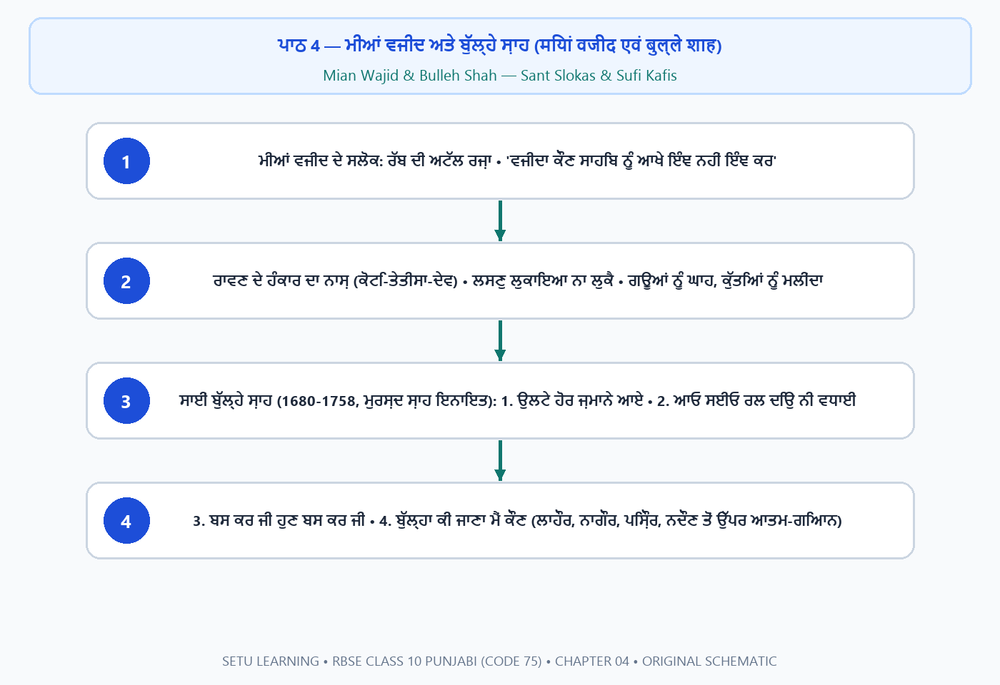

# ਪਾਠ 4 — ਮੀਆਂ ਵਜੀਦ ਅਤੇ ਬੁੱਲ੍ਹੇ ਸ਼ਾਹ (मियां वजीद एवं बुल्ले शाह) (Mian Wajid & Bulleh Shah — Sant Slokas & Sufi Kafis)

## भाग 1: अध्याय प्रवेश एवं पाठ्यक्रम मैपिंग (ਪਾਠ-ਪ੍ਰਵੇਸ਼ ਅਤੇ ਪਾਠਕ੍ਰਮ ਮੈਪਿੰਗ)

> RBSE ਜਮਾਤ 10 ਪੰਜਾਬੀ ਪਾਠ-ਪੁਸਤਕ 'ਸਾਹਿਤ ਸੁਗੰਧੀਆਂ' ਦੇ ਸਾਰੇ ਪ੍ਰਸ਼ਨਾਂ ਦੇ ਹੱਲ ਅਤੇ 2014–2026 ਦਾ ਪੂਰਾ ਇਤਿਹਾਸਕ PYQ ਸੰਗ੍ਰਹਿ ਸਰੋਤ-ਪ੍ਰੀਖਣ ਸਮੇਤ ਸੰਕਲਿਤ ਹਨ।

**ਵਿਸ਼ਾ ਕੋਡ (विषय कोड):** 75 (ਤੀਜੀ ਭਾਸ਼ਾ — ਪੰਜਾਬੀ / तृतीया भाषा — पंजाबी) · **ਲੜੀ ਪੁਸਤਕ (श्रृंखला पुस्तक):** 7

**ਪ੍ਰਮਾਣਿਤ ਆਧਾਰ:** RBSE 2025–26 · **ਪਾਠ ਅੰਕ-ਭਾਰ:** 3 ਅੰਕ। ਇਹ ਭਾਰ ਉਸੇ ਸੰਸਕਰਣ ਦਾ ਹੈ; ਅਸਲ ਪ੍ਰਸ਼ਨ-ਵੰਡ ਦੀ ਭਵਿੱਖਬਾਣੀ ਨਹੀਂ।

**ਸਿੱਖਣ ਦੇ ਉਦੇਸ਼ (सीखने के लक्ष्य):** ਮੀਆਂ ਵਜੀਦ ਦੇ ਸਲੋਕਾਂ ('ਵਜੀਦਾ ਕੌਣ ਸਾਹਿਬ ਨੂੰ ਆਖੇ ਇੰਞ ਨਹੀਂ ਇੰਞ ਕਰ') ਅਤੇ ਸੂਫ਼ੀ ਸ਼ਾਇਰ ਬੁੱਲ੍ਹੇ ਸ਼ਾਹ ਦੀਆਂ ਚਾਰ ਕਾਫ਼ੀਆਂ ('ਉਲਟੇ ਹੋਰ ਜ਼ਮਾਨੇ ਆਏ', 'ਆਓ ਸਈਓ ਰਲ ਦਿਉ ਨੀ ਵਧਾਈ', 'ਬਸ ਕਰ ਜੀ ਹੁਣ ਬਸ ਕਰ ਜੀ', 'ਬੁੱਲ੍ਹਾ ਕੀ ਜਾਣਾ ਮੈਂ ਕੌਣ') ਦੀ ਵਿਆਖਿਆ ਤੇ ਕੇਂਦਰੀ ਭਾਵ ਸਮਝਣਾ।

## भाग 2: शब्दावली एवं अवधारणा कैप्सूल (ਸ਼ਬਦਾਵਲੀ ਅਤੇ ਸੰਕਲਪ ਕੈਪਸੂਲ)

| ਸ਼ਬਦ / ਸੰਕਲਪ | ਅਰਥ / ਵਿਆਖਿਆ |
|---|---|
| ਮੰਡਪ-ਮਾੜੀਆਂ (मंडप-माड़ीआं) | ਉੱਚੇ ਮਹੱਲ ਅਤੇ ਪੱਕੀਆਂ ਹਵੇਲੀਆਂ (ਇਕਨਾ ਮਹਲ ਉਸਾਰੇ ਮੰਡਪ-ਮਾੜੀਆਂ)। |
| ਮਲੀਂਦਾ (मलींदा) | ਘਿਉ ਅਤੇ ਮਿੱਠਾ ਮਿਲਾ ਕੇ ਤਿਆਰ ਕੀਤਾ ਚੂਰਮਾ (ਗਊਆਂ ਦੇਂਦਾ ਘਾਹ ਮਲੀਂਦਾ ਕੁੱਤਿਆਂ)। |
| ਕੋਟਿ-ਤੇਤੀਸਾ-ਦੇਵ (कोटि-तेतीसा-देव) | ਤੇਤੀ ਕਰੋੜ ਦੇਵਤੇ — ਜਿਨ੍ਹਾਂ ਨੂੰ ਰਾਵਣ ਨੇ ਆਪਣੀ ਕੈਦ ਵਿੱਚ ਬੰਦੀ ਬਣਾਇਆ ਸੀ। |
| ਕਾਫ਼ੀ (काफ़ी) | ਸੂਫ਼ੀ ਕਾਵਿ ਦਾ ਪ੍ਰਮੁੱਖ ਪ੍ਰਗੀਤਕ ਕਾਵਿ-ਰੂਪ ਜੋ ਰਾਗਾਂ ਵਿੱਚ ਗਾਇਆ ਜਾਂਦਾ ਹੈ। |
| ਇਰਾਕੀਆਂ (इराकीआं) | ਉੱਚੀ ਨਸਲ ਦੇ ਅਰਬੀ/ਇਰਾਕੀ ਘੋੜੇ (ਇਰਾਕੀਆਂ ਨੂੰ ਪਏ ਚਾਬਕ ਪੈਂਦੇ, ਗੱਦੋਂ ਖ਼ੂਦ ਖਵਾਏ)। |
| ਗੱਦੋਂ (गद्दों) | ਗਧੇ / ਖੋਤੇ — ਅਯੋਗ ਤੇ ਮੂਰਖ ਲੋਕਾਂ ਦਾ ਪ੍ਰਤੀਕ। |
| ਲਗੜ (लगड़) | ਸ਼ਿਕਾਰੀ ਬਾਜ਼ ਪੰਛੀ (ਕਾਉਂ ਲਗੜ ਨੂੰ ਮਾਰਨ ਲੱਗੇ, ਚਿੜੀਆਂ ਜੁੱਰੇ ਖਾਏ)। |
| ਰਾਂਝਾ ਮਾਹੀ (रांझा माही) | ਬੁੱਲ੍ਹੇ ਸ਼ਾਹ ਨੇ ਆਪਣੇ ਮੁਰਸ਼ਦ (ਸ਼ਾਹ ਇਨਾਇਤ) ਅਤੇ ਰੱਬ ਲਈ 'ਰਾਂਝਾ ਮਾਹੀ' ਪ੍ਰਤੀਕ ਵਰਤਿਆ ਹੈ। |
| ਹੱਦ (हद्द) | ਸੀਮਾ / ਦਾਇਰਾ (ਬੇਹੱਦ ਰੱਬ ਨੂੰ ਹੱਦਾਂ ਤੇ ਮੰਦਰ-ਮਸੀਤ ਵਿੱਚ ਬੰਦ ਕਰਨਾ)। |
| ਅਲਫ਼ (अलफ़) | ਫ਼ਾਰਸੀ/ਅਰਬੀ ਵਰਣਮਾਲਾ ਦਾ ਪਹਿਲਾ ਅੱਖਰ ਜੋ 'ਇੱਕ ਰੱਬ' (ਏਕੰਕਾਰ) ਦਾ ਪ੍ਰਤੀਕ ਹੈ। |

## भाग 3: विस्तृत शिक्षण पाठ (ਵਿਸਤ੍ਰਿਤ ਅਧਿਆਪਨ ਪਾਠ)

### 1. ਕਵੀ-ਪਛਾਣ: ਮੀਆਂ ਵਜੀਦ ਅਤੇ ਸਾਈਂ ਬੁੱਲ੍ਹੇ ਸ਼ਾਹ (1680–1758 ਈ.)
**ਮੀਆਂ ਵਜੀਦ:** ਮੀਆਂ ਵਜੀਦ (ਜਨਮ 16ਵੀਂ ਸਦੀ ਦੇ ਮੱਧ ਵਿੱਚ, ਪਠਾਣ ਪਰਿਵਾਰ) ਭਗਤੀ ਤੇ ਸੂਫ਼ੀ ਪਰੰਪਰਾ ਦੇ ਪ੍ਰਸਿੱਧ ਸੰਤ ਕਵੀ ਹੋਏ ਹਨ। ਉਹਨਾਂ ਨੇ ਰੱਬ ਦੀ ਬੇਪਰਵਾਹੀ ਅਤੇ ਭਾਣੇ (ਰਜ਼ਾ) ਉੱਤੇ 150 ਦੇ ਕਰੀਬ ਅੜਿੱਲਾਂ ਤੇ ਸਲੋਕਾਂ ਦੀ ਰਚਨਾ ਕੀਤੀ, ਜਿਨ੍ਹਾਂ ਦੀ ਅੰਤਿਮ ਤੁਕ **'ਵਜੀਦਾ ਕੌਣ ਸਾਹਿਬ ਨੂੰ ਆਖੇ ਇੰਞ ਨਹੀਂ ਇੰਞ ਕਰ'** ਬਹੁਤ ਪ੍ਰਸਿੱਧ ਹੈ।
**ਬੁੱਲ੍ਹੇ ਸ਼ਾਹ (1680–1758 ਈ.):** ਪੰਜਾਬੀ ਸੂਫ਼ੀ ਕਾਵਿ ਦੇ ਸਿਖਰ ਸਾਈਂ ਬੁੱਲ੍ਹੇ ਸ਼ਾਹ (ਅਸਲ ਨਾਂ ਅਬਦੁੱਲਾ ਸ਼ਾਹ) ਦਾ ਜਨਮ 1680 ਈ. ਵਿੱਚ ਪਿੰਡ ਪਾਂਡੋਕੇ (ਤਹਿਸੀਲ ਕਸੂਰ, ਜ਼ਿਲ੍ਹਾ ਲਾਹੌਰ) ਵਿਖੇ ਪਿਤਾ ਸਖ਼ੀ ਮੁਹੰਮਦ ਦਰਵੇਸ਼ ਦੇ ਘਰ ਹੋਇਆ। ਉਹਨਾਂ ਦੇ ਮੁਰਸ਼ਦ (ਗੁਰੂ) ਲਾਹੌਰ ਦੇ ਅਰਾਈਂ ਜਾਤ ਦੇ ਸੂਫ਼ੀ ਫ਼ਕੀਰ **ਸ਼ਾਹ ਇਨਾਇਤ ਕਾਦਰੀ** ਸਨ। ਬੁੱਲ੍ਹੇ ਸ਼ਾਹ ਨੇ **156 ਕਾਫ਼ੀਆਂ**, 49 ਦੋਹੜੇ, 40 ਗੰਢਾਂ, 1 ਅਠਵਾਰਾ, 1 ਬਾਰਾਂਮਾਹ ਅਤੇ 3 ਸੀਹਰਫ਼ੀਆਂ ਰਚੀਆਂ।

### 2. ਮੀਆਂ ਵਜੀਦ ਦੇ ਤਿੰਨ ਸਲੋਕ (रज़ा एवं अहंकारी शासकों का अंत)
1. **ਇਕਨਾਂ ਦੇ ਘਰਿ ਪੁੱਤ, ਪੁੱਤਾਂ ਘਰਿ ਪੋਤਰੇ:** ਰੱਬ ਦੀ ਲੀਲ੍ਹਾ ਅਜਬ ਹੈ — ਕਿਸੇ ਦੇ ਘਰ ਪੁੱਤਰ ਤੇ ਅੱਗੋਂ ਪੋਤਰੇ ਹਨ, ਤੇ ਕਿਸੇ ਨੂੰ ਇੱਕ ਧੀ ਦੇ ਕੇ ਹੀ ਓਤਰਾ (ਨਿਪੁੱਤਾ) ਰੱਖਿਆ ਹੈ; ਕਿਸੇ ਦੇ ਘਰ ਬਾਰਾਂ ਪੁੱਤਰ ਹਨ ਤੇ ਸਾਰੇ ਕੁਆਰੇ ਫਿਰਦੇ ਹਨ — **'ਵਜੀਦਾ ਕੌਣ ਸਾਹਿਬ ਨੂੰ ਆਖੇ ਇੰਞ ਨਹੀਂ ਇੰਞ ਕਰ'** (ਰੱਬ ਅੱਗੇ ਕਿਸੇ ਦਾ ਜ਼ੋਰ ਨਹੀਂ ਚੱਲਦਾ)।
2. **ਗਊਆਂ ਦੇਂਦਾ ਘਾਹ, ਮਲੀਂਦਾ ਕੁੱਤਿਆਂ:** ਦੁੱਧ ਦੇਣ ਵਾਲੀਆਂ ਗਊਆਂ ਨੂੰ ਸੁੱਕਾ ਘਾਹ ਮਿਲਦਾ ਹੈ ਤੇ ਕੁੱਤਿਆਂ ਨੂੰ ਮਲੀਂਦਾ (ਚੂਰਮਾ) ਖਵਾਇਆ ਜਾਂਦਾ ਹੈ; ਭਲੇ ਪੁਰਸ਼ਾਂ ਦੇ ਹੱਥ ਸੱਖਣੇ ਹਨ ਤੇ ਚੋਰਾਂ-ਠੱਗਾਂ ਦੇ ਖੀਸੇ ਭਰੇ ਹਨ — ਵਜੀਦਾ ਕੌਣ ਸਾਹਿਬ ਨੂੰ ਆਖੇ ਇੰਞ ਨਹੀਂ ਇੰਞ ਕਰ।
3. **ਇਕਨਾ ਮਹਲ ਉਸਾਰੇ, ਮੰਡਪ-ਮਾੜੀਆਂ (ਅਤੇ ਰਾਵਣ ਦਾ ਦ੍ਰਿਸ਼ਟਾਂਤ):** ਕਿਸੇ ਨੇ ਉੱਚੇ ਮਹੱਲ ਤੇ ਮਾੜੀਆਂ ਉਸਾਰੀਆਂ ਤੇ ਕਿਸੇ ਨੂੰ ਕੱਖਾਂ ਦੀ ਕੁੱਲੀ ਵੀ ਨਸੀਬ ਨਹੀਂ। ਦੂਜੇ ਬੰਦ ਵਿੱਚ ਮੀਆਂ ਵਜੀਦ **ਰਾਵਣ ਦੇ ਹੰਕਾਰ** ਦਾ ਇਤਿਹਾਸਕ ਹਵਾਲਾ ਦਿੰਦੇ ਹਨ — **'ਕੋਟਿ-ਤੇਤੀਸਾ-ਦੇਵ, ਬੰਦੀ ਜਿਤ ਦਰਿ । ਦਿਤੋਮੁ ਖਾਕ ਰੁਲਾਇ, ਇਕਸੇ ਪਲਕ ਭਰਿ ।' / 'ਲਸਣੁ ਲੁਕਾਇਆ ਨਾ ਲੁਕੈ, ਭਾਵੇਂ ਪਰਬਤ ਅੰਦਰਿ ਧਰ ।' / 'ਰਾਵਣ ਵੱਡਾ ਹੰਕਾਰੀ...'** — ਜਿਸ ਰਾਵਣ ਦੇ ਦਰਵਾਜ਼ੇ 'ਤੇ 33 ਕਰੋੜ ਦੇਵਤੇ ਬੰਦੀ ਸਨ, ਰੱਬ ਨੇ ਉਸ ਨੂੰ ਇੱਕ ਪਲ ਵਿੱਚ ਖ਼ਾਕ (ਮਿੱਟੀ) ਵਿੱਚ ਰੁਲਾ ਦਿੱਤਾ। ਜਿਵੇਂ ਲਸਣ ਦੀ ਬੋਅ ਪਹਾੜ ਹੇਠ ਦੱਬਿਆਂ ਵੀ ਨਹੀਂ ਲੁਕਦੀ, ਤਿਵੇਂ ਪਾਪ ਤੇ ਹੰਕਾਰ ਨਹੀਂ ਲੁਕਦਾ।

### 3. ਬੁੱਲ੍ਹੇ ਸ਼ਾਹ ਦੀਆਂ ਚਾਰ ਕਾਫ਼ੀਆਂ (प्रसंग, व्याख्या एवं केंद्रीय भाव)
1. **ਕਾਫ਼ੀ 1 — 'ਉਲਟੇ ਹੋਰ ਜ਼ਮਾਨੇ ਆਏ, ਤਾਂ ਮੈਂ ਭੇਤ ਸੱਜਣ ਦੇ ਪਾਏ':**
   - **ਮੁੱਖ ਤੁਕਾਂ:** *'ਸੱਚਿਆਂ ਨੂੰ ਹੁਣ ਮਿਲਦੇ ਧੱਕੇ, ਝੂਠੇ ਕੋਲ ਬਹਾਏ । ਇਰਾਕੀਆਂ ਨੂੰ ਪਏ ਚਾਬਕ ਪੈਂਦੇ, ਗੱਦੋਂ ਖ਼ੂਦ ਖਵਾਏ । ਕਾਉਂ ਲਗੜ ਨੂੰ ਮਾਰਨ ਲੱਗੇ, ਚਿੜੀਆਂ ਜੁੱਰੇ ਖਾਏ । ਅਗਲੇ ਜਾਏ ਬੰਗਾਲੇ ਬੈਠੇ, ਪਿਛਲਿਆਂ ਫ਼ਰਸ਼ ਵਿਛਾਏ ।'*
   - **ਕੇਂਦਰੀ ਭਾਵ:** 18ਵੀਂ ਸਦੀ ਦੇ ਰਾਜਸੀ ਤੇ ਸਮਾਜਿਕ ਉਲਟ-ਪੁਲਟ ਦਾ ਚਿੱਤਰ ਖਿੱਚਦਿਆਂ ਬੁੱਲ੍ਹੇ ਸ਼ਾਹ ਕਹਿੰਦੇ ਹਨ ਕਿ ਜ਼ਮਾਨਾ ਉਲਟ ਗਿਆ ਹੈ — ਕਾਂ ਬਾਜ਼ਾਂ (ਲਗੜ) ਨੂੰ ਮਾਰ ਰਹੇ ਹਨ, ਚਿੜੀਆਂ ਜੁੱਰੇ (ਸ਼ਿਕਾਰੀ ਬਾਜ਼) ਨੂੰ ਖਾ ਰਹੀਆਂ ਹਨ, ਵਧੀਆ ਇਰਾਕੀ ਘੋੜਿਆਂ ਨੂੰ ਚਾਬਕ ਪੈਂਦੇ ਹਨ ਤੇ ਗਧਿਆਂ ਨੂੰ ਹਰਾ ਜੌਂ (ਖ਼ੂਦ) ਖਵਾਇਆ ਜਾਂਦਾ ਹੈ, ਸੱਚਿਆਂ ਨੂੰ ਧੱਕੇ ਮਿਲਦੇ ਹਨ ਤੇ ਝੂਠਿਆਂ ਨੂੰ ਕੋਲ ਬਿਠਾਇਆ ਜਾਂਦਾ ਹੈ। ਇਹ ਰੱਬ ਦੀ ਬੇਪਰਵਾਹੀ ਦਾ ਭੇਤ ਹੈ।
2. **ਕਾਫ਼ੀ 2 — 'ਆਓ ਸਈਓ ਰਲ ਦਿਉ ਨੀ ਵਧਾਈ, ਮੈਂ ਵਰ ਪਾਇਆ ਰਾਂਝਾ ਮਾਹੀ':**
   - **ਕੇਂਦਰੀ ਭਾਵ:** ਬੁੱਲ੍ਹੇ ਸ਼ਾਹ ਨੇ ਆਪਣੇ ਮੁਰਸ਼ਦ ਸ਼ਾਹ ਇਨਾਇਤ ਅਤੇ ਪਰਮਾਤਮਾ ਨੂੰ 'ਰਾਂਝਾ ਮਾਹੀ' ਅਤੇ ਆਪਣੇ ਆਪ ਨੂੰ 'ਹੀਰ' ਮੰਨ ਕੇ ਰੂਹਾਨੀ ਮਿਲਾਪ ਦੀ ਖ਼ੁਸ਼ੀ ਪ੍ਰਗਟ ਕੀਤੀ ਹੈ। ਸਈਆਂ (ਸਹੇਲੀਆਂ) ਨੂੰ ਵਧਾਈ ਦੇਣ ਲਈ ਕਿਹਾ ਗਿਆ ਹੈ ਕਿ ਅੱਜ ਵਿਹੜੇ ਵਿੱਚ ਰੱਬੀ ਨੂਰ ਦਾ ਚਾਨਣ ਹੋ ਗਿਆ ਹੈ।
3. **ਕਾਫ਼ੀ 3 — 'ਬਸ ਕਰ ਜੀ ਹੁਣ ਬਸ ਕਰ ਜੀ, ਇਕ ਗੱਲ ਅਸਾਂ ਨਾਲ ਹੱਸ ਕਰ ਜੀ':**
   - **ਕੇਂਦਰੀ ਭਾਵ:** ਕਵੀ ਰੱਬ ਨੂੰ ਬੇਨਤੀ ਕਰਦਾ ਹੈ ਕਿ ਹੇ ਪ੍ਰਭੂ! ਤੂੰ ਇੰਨਾ ਬੇਪਰਵਾਹ ਨਾ ਬਣ, ਹੁਣ ਇਮਤਿਹਾਨ ਤੇ ਵਿਛੋੜੇ ਦੀ ਹੱਦ ਬਸ ਕਰ ਅਤੇ ਸਾਡੇ ਨਾਲ ਇੱਕ ਮਿੱਠੀ ਗੱਲ ਹੱਸ ਕੇ ਕਰ। ਤੂੰ ਬੇਹੱਦ ਹੈਂ ਪਰ ਲੋਕਾਂ ਨੇ ਤੈਨੂੰ ਹੱਦਾਂ (ਮੰਦਰ-ਮਸੀਤ) ਵਿੱਚ ਬੰਦ ਕਰ ਰੱਖਿਆ ਹੈ।
4. **ਕਾਫ਼ੀ 4 — 'ਬੁੱਲ੍ਹਾ ਕੀ ਜਾਣਾ ਮੈਂ ਕੌਣ':**
   - **ਮੁੱਖ ਤੁਕਾਂ:** *'ਨਾ ਮੈਂ ਮੋਮਨ ਵਿੱਚ ਮਸੀਤਾਂ, ਨਾ ਮੈਂ ਵਿੱਚ ਕੁਫ਼ਰ ਦੀਆਂ ਰੀਤਾਂ... ਨਾ ਮੈਂ ਅਰਬੀ ਨਾ ਲਾਹੌਰੀ, ਨਾ ਮੈਂ ਹਿੰਦੀ ਸ਼ਹਿਰ ਨਗੌਰੀ, ਨਾ ਹਿੰਦੂ ਨਾ ਤੁਰਕ ਪਸ਼ੌਰੀ, ਨਾ ਮੈਂ ਰਹਿੰਦਾ ਵਿੱਚ ਨਦੌਣ । ਬੁੱਲ੍ਹਾ ਕੀ ਜਾਣਾ ਮੈਂ ਕੌਣ ।'*
   - **ਕੇਂਦਰੀ ਭਾਵ:** ਜਦੋਂ ਮਨੁੱਖ ਨੂੰ ਆਤਮ-ਗਿਆਨ ਹੋ ਜਾਂਦਾ ਹੈ ਤਾਂ ਉਸ ਦੇ ਅੰਦਰੋਂ ਜਾਤ, ਧਰਮ, ਮਜ਼ਹਬ, ਦੇਸ਼ ਤੇ ਸ਼ਹਿਰ (ਲਾਹੌਰ, ਨਾਗੌਰ, ਪਿਸ਼ੌਰ, ਨਦੌਣ) ਦੇ ਸਾਰੇ ਵਖਰੇਵੇਂ ਮਿਟ ਜਾਂਦੇ ਹਨ ਅਤੇ ਉਹ ਸ਼ੁੱਧ ਆਤਮ-ਸਰੂਪ ਹੋ ਜਾਂਦਾ ਹੈ।

ਪਾਠ 4: ਮੀਆਂ ਵਜੀਦ ਦੇ ਸਲੋਕ ਅਤੇ ਬੁੱਲ੍ਹੇ ਸ਼ਾਹ ਦੀਆਂ ਕਾਫ਼ੀਆਂ ਦਾ ਸੰਕਲਪ ਚਿੱਤਰ

## भाग 4: पाठ्यपुस्तक-अवधारणाओं पर मौलिक हल किए उदाहरण (ਹੱਲ ਕੀਤੇ ਮਿਆਰੀ ਉਦਾਹਰਣ)

ਹੇਠਾਂ ਦਿੱਤੇ ਪ੍ਰਸ਼ਨ ਪਾਠ-ਪੁਸਤਕ 'ਸਾਹਿਤ ਸੁਗੰਧੀਆਂ' ਅਤੇ ਵਿਆਕਰਣ ਦੇ ਸੰਕਲਪਾਂ ਉੱਤੇ ਆਧਾਰਿਤ ਮੌਲਿਕ ਆਦਰਸ਼ ਹੱਲ ਹਨ।

**ਹੱਲ ਕੀਤਾ ਉਦਾਹਰਣ 1: 'ਸੱਚਿਆਂ ਨੂੰ ਹੁਣ ਮਿਲਦੇ ਧੱਕੇ, ਝੂਠੇ ਕੋਲ ਬਹਾਏ...' ਕਾਵਿ-ਬੰਦ ਦੀ ਪ੍ਰਸੰਗ ਸਹਿਤ ਵਿਆਖਿਆ ਕਰੋ।**

ਪ੍ਰਸੰਗ: ਇਹ ਕਾਵਿ-ਬੰਦ 'ਸਾਹਿਤ ਸੁਗੰਧੀਆਂ' ਪੁਸਤਕ ਵਿੱਚ ਦਰਜ ਸੂਫ਼ੀ ਕਵੀ ਬੁੱਲ੍ਹੇ ਸ਼ਾਹ ਦੀ ਕਾਫ਼ੀ 'ਉਲਟੇ ਹੋਰ ਜ਼ਮਾਨੇ ਆਏ' ਵਿੱਚੋਂ ਲਿਆ ਗਿਆ ਹੈ। ਵਿਆਖਿਆ: ਬੁੱਲ੍ਹੇ ਸ਼ਾਹ ਸਮੇਂ ਦੇ ਉਲਟ-ਪੁਲਟ ਦਾ ਵਰਣਨ ਕਰਦੇ ਹੋਏ ਕਹਿੰਦੇ ਹਨ ਕਿ ਅੱਜ ਸੱਚ ਬੋਲਣ ਵਾਲਿਆਂ ਨੂੰ ਧੱਕੇ ਪੈ ਰਹੇ ਹਨ ਅਤੇ ਝੂਠਿਆਂ ਨੂੰ ਆਦਰ ਨਾਲ ਕੋਲ ਬਿਠਾਇਆ ਜਾਂਦਾ ਹੈ। ਵਧੀਆ ਨਸਲ ਦੇ ਇਰਾਕੀ ਘੋੜਿਆਂ ਨੂੰ ਚਾਬਕਾਂ ਨਾਲ ਕੁੱਟਿਆ ਜਾਂਦਾ ਹੈ ਅਤੇ ਗਧਿਆਂ (ਗੱਦੋਂ) ਨੂੰ ਹਰੀ ਚਰੀ (ਖ਼ੂਦ) ਖਵਾਈ ਜਾਂਦੀ ਹੈ। ਕਾਂ ਬਾਜ਼ਾਂ (ਲਗੜ) ਨੂੰ ਮਾਰਨ ਲੱਗ ਪਏ ਹਨ ਤੇ ਚਿੜੀਆਂ ਸ਼ਿਕਾਰੀ ਬਾਜ਼ (ਜੁੱਰੇ) ਨੂੰ ਖਾ ਰਹੀਆਂ ਹਨ।

**ਹੱਲ ਕੀਤਾ ਉਦਾਹਰਣ 2: 'ਕੋਟਿ-ਤੇਤੀਸਾ-ਦੇਵ, ਬੰਦੀ ਜਿਤ ਦਰਿ । ਦਿਤੋਮੁ ਖਾਕ ਰੁਲਾਇ, ਇਕਸੇ ਪਲਕ ਭਰਿ ।' — ਇਹਨਾਂ ਸਤਰਾਂ ਵਿੱਚ ਮੀਆਂ ਵਜੀਦ ਕਿਸ ਬਾਰੇ ਸੰਕੇਤ ਕਰ ਰਿਹਾ ਹੈ?**

ਇਹਨਾਂ ਸਤਰਾਂ ਵਿੱਚ ਮੀਆਂ ਵਜੀਦ ਲੰਕਾ ਦੇ ਹੰਕਾਰੀ ਰਾਜੇ 'ਰਾਵਣ' ਵੱਲ ਸੰਕੇਤ ਕਰ ਰਿਹਾ ਹੈ, ਜਿਸ ਦੇ ਦਰਵਾਜ਼ੇ ਉੱਤੇ ਤੇਤੀ ਕਰੋੜ ਦੇਵਤੇ ਕੈਦੀ (ਬੰਦੀ) ਬਣੇ ਖੜ੍ਹੇ ਰਹਿੰਦੇ ਸਨ, ਪਰ ਪਰਮਾਤਮਾ ਨੇ ਉਸ ਦੇ ਹੰਕਾਰ ਨੂੰ ਇੱਕ ਪਲ ਵਿੱਚ ਮਿੱਟੀ (ਖ਼ਾਕ) ਵਿੱਚ ਮਿਲਾ ਦਿੱਤਾ।

**ਹੱਲ ਕੀਤਾ ਉਦਾਹਰਣ 3: 'ਬੁੱਲ੍ਹਾ ਕੀ ਜਾਣਾ ਮੈਂ ਕੌਣ' ਕਾਫ਼ੀ ਵਿੱਚ ਆਏ ਸ਼ਹਿਰਾਂ ਦੇ ਨਾਮ ਅਤੇ ਕਾਫ਼ੀ ਦਾ ਕੇਂਦਰੀ ਭਾਵ ਲਿਖੋ।**

ਇਸ ਕਾਫ਼ੀ ਵਿੱਚ **ਲਾਹੌਰ (ਲਾਹੌਰੀ), ਨਾਗੌਰ (ਨਗੌਰੀ), ਪਿਸ਼ੌਰ (ਪਸ਼ੌਰੀ) ਅਤੇ ਨਦੌਣ** ਚਾਰ ਸ਼ਹਿਰਾਂ ਦੇ ਨਾਮ ਆਏ ਹਨ। ਕਾਫ਼ੀ ਦਾ ਕੇਂਦਰੀ ਭਾਵ ਇਹ ਹੈ ਕਿ ਸੱਚੇ ਰੱਬੀ ਗਿਆਨ ਤੋਂ ਬਾਅਦ ਮਨੁੱਖ ਮੰਦਰ-ਮਸੀਤ, ਹਿੰਦੂ-ਤੁਰਕ, ਪਾਪ-ਪੁੰਨ ਅਤੇ ਇਲਾਕਾਈ ਹੱਦਬੰਦੀਆਂ ਤੋਂ ਉੱਪਰ ਉੱਠ ਕੇ ਰੱਬ ਨਾਲ ਇੱਕ-ਮਿੱਕ ਹੋ ਜਾਂਦਾ ਹੈ।

## भाग 5: सत्यापित बोर्ड प्रश्न एवं स्रोत-स्थिति (ਪ੍ਰਮਾਣਿਤ ਬੋਰਡ ਪ੍ਰਸ਼ਨ ਅਤੇ ਸਰੋਤ-ਸਥਿਤੀ)

RBSE 2026 Supp (`S-75`, Q14), 2025 Supp (Q1-ii, Q3-i, Q14) ਅਤੇ 2024 Main (Q1-iv, Q3-iii, Q17) ਵਿੱਚ ਮੀਆਂ ਵਜੀਦ ਅਤੇ ਬੁੱਲ੍ਹੇ ਸ਼ਾਹ ਦੀਆਂ ਰਚਨਾਵਾਂ ਸਿੱਧੀਆਂ ਪੁੱਛੀਆਂ ਗਈਆਂ ਹਨ।

[RBSE 2026 ਮੂਲ ਪੇਪਰ (S-75)](https://rajeduboard.rajasthan.gov.in/books/PAPERS-2026/Sec/S-75.pdf)। ਪ੍ਰਸ਼ਨ ਦਾ ਸੰਖੇਪ ਵਿਸ਼ਾ-ਸੰਦਰਭ ਹੈ; ਸ਼ਬਦ-ਬ-ਸ਼ਬਦ ਪੁਨਰ-ਮੁਦਰਣ ਨਹੀਂ।

## भाग 6: खंडवार मौलिक अभ्यास बैंक (ਖੰਡ-ਵਾਰ ਮੌਲਿਕ ਅਭਿਆਸ ਬੈਂਕ)

**ਅਭਿਆਸ-ਅੰਕ:** ਵਿਦਿਆਰਥੀਆਂ ਦੇ ਸਵੈ-ਅਭਿਆਸ ਲਈ ਹਨ; ਉੱਤਰ ਪਹਿਲਾਂ ਆਪ ਲਿਖੋ, ਫਿਰ ਭਾਗ 9 ਵੇਖੋ।

## ੳ: ਬਹੁ-ਵਿਕਲਪੀ ਪ੍ਰਸ਼ਨ (MCQ) — 15 × 1 ਅੰਕ

**MCQ 1. ਮੀਆਂ ਵਜੀਦ ਜੀ ਦੀ ਰਚਨਾ ਕਿਹੜੀ ਹੈ? (RBSE 2025 Supp Q1-ii)**

ੳ) ਲਸਣੁ ਲੁਕਾਇਆ ਨਾ ਲੁਕੈ  
ਅ) ਉਲਟੇ ਹੋਰ ਜ਼ਮਾਨੇ ਆਏ  
ੲ) ਕੀ ਜਾਣਾ ਮੈਂ ਕੌਣ  
ਸ) ਦੁਰਜੋਧਨ ਵੱਡਾ ਹੰਕਾਰੀ

**MCQ 2. 'ਅਗਲੇ ਜਾਏ ਬੰਗਾਲੇ ਬੈਠੇ, ਪਿਛਲਿਆਂ ਫ਼ਰਸ਼ ਵਿਛਾਏ' ਸਤਰਾਂ ਕਿਹੜੀ ਕਵਿਤਾ ਦੀਆਂ ਹਨ?**

ੳ) ਬੁੱਲ੍ਹਾ ਕੀ ਜਾਣਾ ਮੈਂ ਕੌਣ  
ਅ) ਆਓ ਸਈਓ ਰਲ ਦਿਉ ਨੀ ਵਧਾਈ  
ੲ) ਇਕਨਾ ਮਹਲ ਉਸਾਰੇ  
ਸ) ਉਲਟੇ ਹੋਰ ਜ਼ਮਾਨੇ ਆਏ

**MCQ 3. 'ਆਓ ਸਈਓ ਰਲ ਦਿਉ ਨੀ ਵਧਾਈ' ਕਾਫ਼ੀ ਕਿਸ ਕਵੀ ਦੀ ਰਚਨਾ ਹੈ?**

ੳ) ਮੀਆਂ ਵਜੀਦ  
ਅ) ਸ਼ਾਹ ਹੁਸੈਨ  
ੲ) ਬੁੱਲ੍ਹੇ ਸ਼ਾਹ  
ਸ) ਸ਼ੇਖ਼ ਫ਼ਰੀਦ

**MCQ 4. 'ਕੋਟਿ-ਤੇਤੀਸਾ-ਦੇਵ, ਬੰਦੀ ਜਿਤ ਦਰਿ' ਸਤਰ ਵਿੱਚ ਮੀਆਂ ਵਜੀਦ ਕਿਸ ਹੰਕਾਰੀ ਰਾਜੇ ਵੱਲ ਸੰਕੇਤ ਕਰਦਾ ਹੈ?**

ੳ) ਹਰਨਾਖਸ਼ ਵੱਲ  
ਅ) ਰਾਵਣ ਵੱਲ  
ੲ) ਦੁਰਜੋਧਨ ਵੱਲ  
ਸ) ਕੰਸ ਵੱਲ

**MCQ 5. 'ਇਰਾਕੀਆਂ ਨੂੰ ਪਏ ਚਾਬਕ ਪੈਂਦੇ, ਗੱਦੋਂ ਖ਼ੂਦ ਖਵਾਏ' ਤੁਕ ਵਿੱਚ 'ਇਰਾਕੀਆਂ' ਦਾ ਕੀ ਅਰਥ ਹੈ?**

ੳ) ਉੱਚੀ ਨਸਲ ਦੇ ਅਰਬੀ/ਇਰਾਕੀ ਘੋੜੇ  
ਅ) ਇਰਾਕ ਦੇ ਲੋਕ  
ੲ) ਸ਼ਿਕਾਰੀ ਪੰਛੀ  
ਸ) ਹਾਥੀ

**MCQ 6. 'ਬੁੱਲ੍ਹਾ ਕੀ ਜਾਣਾ ਮੈਂ ਕੌਣ' ਕਾਫ਼ੀ ਵਿੱਚ ਹੇਠ ਲਿਖਿਆਂ ਵਿੱਚੋਂ ਕਿਹੜੇ ਸ਼ਹਿਰਾਂ ਦਾ ਜ਼ਿਕਰ ਆਇਆ ਹੈ?**

ੳ) ਅੰਮ੍ਰਿਤਸਰ, ਜਲੰਧਰ ਅਤੇ ਪਟਿਆਲਾ  
ਅ) ਦਿੱਲੀ, ਆਗਰਾ ਅਤੇ ਜੈਪੁਰ  
ੲ) ਮੁਲਤਾਨ, ਪਾਕਪਟਨ ਅਤੇ ਕਸੂਰ  
ਸ) ਲਾਹੌਰ, ਨਾਗੌਰ, ਪਿਸ਼ੌਰ ਅਤੇ ਨਦੌਣ

**MCQ 7. ਸਾਈਂ ਬੁੱਲ੍ਹੇ ਸ਼ਾਹ ਦੇ ਮੁਰਸ਼ਦ (ਗੁਰੂ) ਦਾ ਕੀ ਨਾਂ ਸੀ?**

ੳ) ਬਖ਼ਤਿਆਰ ਕਾਕੀ  
ਅ) ਮੀਆਂ ਮੀਰ  
ੲ) ਸ਼ਾਹ ਇਨਾਇਤ ਕਾਦਰੀ  
ਸ) ਹਜ਼ਰਤ ਨਿਜ਼ਾਮੁੱਦੀਨ

**MCQ 8. 'ਗਊਆਂ ਦੇਂਦਾ ਘਾਹ, ਮਲੀਂਦਾ ਕੁੱਤਿਆਂ' ਤੁਕ ਵਿੱਚ 'ਮਲੀਂਦਾ' ਸ਼ਬਦ ਦਾ ਕੀ ਅਰਥ ਹੈ?**

ੳ) ਡੰਡਾ  
ਅ) ਘਿਉ ਅਤੇ ਮਿੱਠਾ ਮਿਲਾ ਕੇ ਬਣਾਇਆ ਚੂਰਮਾ  
ੲ) ਸੁੱਕੀ ਰੋਟੀ  
ਸ) ਠੰਢਾ ਪਾਣੀ

**MCQ 9. 'ਕਾਉਂ ਲਗੜ ਨੂੰ ਮਾਰਨ ਲੱਗੇ, ਚਿੜੀਆਂ ਜੁੱਰੇ ਖਾਏ' ਵਿੱਚ 'ਲਗੜ' ਅਤੇ 'ਜੁੱਰੇ' ਕੀ ਹਨ?**

ੳ) ਸ਼ਿਕਾਰੀ ਬਾਜ਼ ਪੰਛੀ  
ਅ) ਘੋੜਿਆਂ ਦੀਆਂ ਕਿਸਮਾਂ  
ੲ) ਦਰਿਆਵਾਂ ਦੇ ਨਾਂ  
ਸ) ਹਥਿਆਰਾਂ ਦੇ ਨਾਂ

**MCQ 10. 'ਵਜੀਦਾ ਕੌਣ ਸਾਹਿਬ ਨੂੰ ਆਖੇ ਇੰਞ ਨਹੀਂ ਇੰਞ ਕਰ' ਤੁਕ ਵਿੱਚ 'ਸਾਹਿਬ' ਕਿਸ ਨੂੰ ਕਿਹਾ ਗਿਆ ਹੈ?**

ੳ) ਰਾਜੇ ਨੂੰ  
ਅ) ਮੁਰਸ਼ਦ ਨੂੰ  
ੲ) ਪਿੰਡ ਦੇ ਚੌਧਰੀ ਨੂੰ  
ਸ) ਪਰਮਾਤਮਾ (ਰੱਬ) ਨੂੰ

**MCQ 11. 'ਆਓ ਸਈਓ ਰਲ ਦਿਉ ਨੀ ਵਧਾਈ' ਵਿੱਚ ਬੁੱਲ੍ਹੇ ਸ਼ਾਹ ਨੇ ਕਿਸ ਨੂੰ ਵਰ (ਪਤੀ) ਦੇ ਰੂਪ ਵਿੱਚ ਪਾਇਆ ਹੈ?**

ੳ) ਸੁਲਤਾਨ ਨੂੰ  
ਅ) ਸੌਦਾਗਰ ਨੂੰ  
ੲ) ਰਾਂਝਾ ਮਾਹੀ (ਮੁਰਸ਼ਦ / ਪਰਮਾਤਮਾ) ਨੂੰ  
ਸ) ਦੁਨਿਆਵੀ ਰਾਜੇ ਨੂੰ

**MCQ 12. 'ਬਸ ਕਰ ਜੀ ਹੁਣ ਬਸ ਕਰ ਜੀ, ਇਕ ਗੱਲ ਅਸਾਂ ਨਾਲ ਹੱਸ ਕਰ ਜੀ' ਕਾਫ਼ੀ ਕਿਸ ਕਵੀ ਦੀ ਹੈ?**

ੳ) ਸੁਰਜੀਤ ਪਾਤਰ  
ਅ) ਬੁੱਲ੍ਹੇ ਸ਼ਾਹ  
ੲ) ਸ਼ੇਖ਼ ਫ਼ਰੀਦ  
ਸ) ਮੀਆਂ ਵਜੀਦ

**MCQ 13. ਬੁੱਲ੍ਹੇ ਸ਼ਾਹ ਦਾ ਜਨਮ ਕਦੋਂ ਹੋਇਆ?**

ੳ) 1680 ਈ. ਵਿੱਚ  
ਅ) 1173 ਈ. ਵਿੱਚ  
ੲ) 1469 ਈ. ਵਿੱਚ  
ਸ) 1872 ਈ. ਵਿੱਚ

**MCQ 14. 'ਉਲਟੇ ਹੋਰ ਜ਼ਮਾਨੇ ਆਏ' ਕਾਫ਼ੀ ਅਨੁਸਾਰ ਧੱਕੇ ਕਿੰਨ੍ਹਾਂ ਨੂੰ ਮਿਲਦੇ ਹਨ ਤੇ ਕੋਲ ਕਿੰਨ੍ਹਾਂ ਨੂੰ ਬਿਠਾਇਆ ਜਾਂਦਾ ਹੈ?**

ੳ) ਝੂਠਿਆਂ ਨੂੰ ਧੱਕੇ ਤੇ ਸੱਚਿਆਂ ਨੂੰ ਆਦਰ  
ਅ) ਅਮੀਰਾਂ ਨੂੰ ਧੱਕੇ ਤੇ ਗ਼ਰੀਬਾਂ ਨੂੰ ਆਦਰ  
ੲ) ਵਿਦਵਾਨਾਂ ਨੂੰ ਆਦਰ ਤੇ ਮੂਰਖਾਂ ਨੂੰ ਧੱਕੇ  
ਸ) ਸੱਚਿਆਂ ਨੂੰ ਧੱਕੇ ਮਿਲਦੇ ਹਨ ਅਤੇ ਝੂਠਿਆਂ ਨੂੰ ਕੋਲ ਬਿਠਾਇਆ ਜਾਂਦਾ ਹੈ

**MCQ 15. ਮੀਆਂ ਵਜੀਦ ਨੇ ਪਾਪ ਅਤੇ ਬੁਰਾਈ ਦੇ ਨਾ ਲੁਕਣ ਲਈ ਕਿਸ ਚੀਜ਼ ਦੀ ਉਦਾਹਰਣ ਦਿੱਤੀ ਹੈ?**

ੳ) ਧੂੰਏਂ ਦੀ  
ਅ) ਕਸਤੂਰੀ ਦੀ  
ੲ) ਲਸਣ ਦੀ ('ਲਸਣੁ ਲੁਕਾਇਆ ਨਾ ਲੁਕੈ')  
ਸ) ਅੱਗ ਦੀ

## ੳ: ਖਾਲੀ ਥਾਵਾਂ ਭਰੋ — 6 × 1 ਅੰਕ

1. ਉੱਚੇ ਮਹੱਲ ਅਤੇ ਪੱਕੀਆਂ ਹਵੇਲੀਆਂ (ਇਕਨਾ ਮਹਲ ਉਸਾਰੇ ਮੰਡਪ-ਮਾੜੀਆਂ)। — ਇਸ ਸ਼ਬਦ/ਸੰਕਲਪ ਦਾ ਨਾਂ ਹੈ: ____।  
2. ਘਿਉ ਅਤੇ ਮਿੱਠਾ ਮਿਲਾ ਕੇ ਤਿਆਰ ਕੀਤਾ ਚੂਰਮਾ (ਗਊਆਂ ਦੇਂਦਾ ਘਾਹ ਮਲੀਂਦਾ ਕੁੱਤਿਆਂ)। — ਇਸ ਸ਼ਬਦ/ਸੰਕਲਪ ਦਾ ਨਾਂ ਹੈ: ____।  
3. ਤੇਤੀ ਕਰੋੜ ਦੇਵਤੇ — ਜਿਨ੍ਹਾਂ ਨੂੰ ਰਾਵਣ ਨੇ ਆਪਣੀ ਕੈਦ ਵਿੱਚ ਬੰਦੀ ਬਣਾਇਆ ਸੀ। — ਇਸ ਸ਼ਬਦ/ਸੰਕਲਪ ਦਾ ਨਾਂ ਹੈ: ____।  
4. ਸੂਫ਼ੀ ਕਾਵਿ ਦਾ ਪ੍ਰਮੁੱਖ ਪ੍ਰਗੀਤਕ ਕਾਵਿ-ਰੂਪ ਜੋ ਰਾਗਾਂ ਵਿੱਚ ਗਾਇਆ ਜਾਂਦਾ ਹੈ। — ਇਸ ਸ਼ਬਦ/ਸੰਕਲਪ ਦਾ ਨਾਂ ਹੈ: ____।  
5. ਉੱਚੀ ਨਸਲ ਦੇ ਅਰਬੀ/ਇਰਾਕੀ ਘੋੜੇ (ਇਰਾਕੀਆਂ ਨੂੰ ਪਏ ਚਾਬਕ ਪੈਂਦੇ, ਗੱਦੋਂ ਖ਼ੂਦ ਖਵਾਏ)। — ਇਸ ਸ਼ਬਦ/ਸੰਕਲਪ ਦਾ ਨਾਂ ਹੈ: ____।  
6. ਗਧੇ / ਖੋਤੇ — ਅਯੋਗ ਤੇ ਮੂਰਖ ਲੋਕਾਂ ਦਾ ਪ੍ਰਤੀਕ। — ਇਸ ਸ਼ਬਦ/ਸੰਕਲਪ ਦਾ ਨਾਂ ਹੈ: ____।

## ੳ: ਅਤਿ-ਲਘੂ ਉੱਤਰਾਂ ਵਾਲੇ ਪ੍ਰਸ਼ਨ — 8 × 1 ਅੰਕ

1. ਮੀਆਂ ਵਜੀਦ ਜੀ ਦੀ ਰਚਨਾ ਕਿਹੜੀ ਹੈ? (RBSE 2025 Supp Q1-ii)  
2. 'ਅਗਲੇ ਜਾਏ ਬੰਗਾਲੇ ਬੈਠੇ, ਪਿਛਲਿਆਂ ਫ਼ਰਸ਼ ਵਿਛਾਏ' ਸਤਰਾਂ ਕਿਹੜੀ ਕਵਿਤਾ ਦੀਆਂ ਹਨ?  
3. 'ਆਓ ਸਈਓ ਰਲ ਦਿਉ ਨੀ ਵਧਾਈ' ਕਾਫ਼ੀ ਕਿਸ ਕਵੀ ਦੀ ਰਚਨਾ ਹੈ?  
4. 'ਕੋਟਿ-ਤੇਤੀਸਾ-ਦੇਵ, ਬੰਦੀ ਜਿਤ ਦਰਿ' ਸਤਰ ਵਿੱਚ ਮੀਆਂ ਵਜੀਦ ਕਿਸ ਹੰਕਾਰੀ ਰਾਜੇ ਵੱਲ ਸੰਕੇਤ ਕਰਦਾ ਹੈ?  
5. 'ਇਰਾਕੀਆਂ ਨੂੰ ਪਏ ਚਾਬਕ ਪੈਂਦੇ, ਗੱਦੋਂ ਖ਼ੂਦ ਖਵਾਏ' ਤੁਕ ਵਿੱਚ 'ਇਰਾਕੀਆਂ' ਦਾ ਕੀ ਅਰਥ ਹੈ?  
6. 'ਬੁੱਲ੍ਹਾ ਕੀ ਜਾਣਾ ਮੈਂ ਕੌਣ' ਕਾਫ਼ੀ ਵਿੱਚ ਹੇਠ ਲਿਖਿਆਂ ਵਿੱਚੋਂ ਕਿਹੜੇ ਸ਼ਹਿਰਾਂ ਦਾ ਜ਼ਿਕਰ ਆਇਆ ਹੈ?  
7. ਸਾਈਂ ਬੁੱਲ੍ਹੇ ਸ਼ਾਹ ਦੇ ਮੁਰਸ਼ਦ (ਗੁਰੂ) ਦਾ ਕੀ ਨਾਂ ਸੀ?  
8. 'ਗਊਆਂ ਦੇਂਦਾ ਘਾਹ, ਮਲੀਂਦਾ ਕੁੱਤਿਆਂ' ਤੁਕ ਵਿੱਚ 'ਮਲੀਂਦਾ' ਸ਼ਬਦ ਦਾ ਕੀ ਅਰਥ ਹੈ?

## ਅ: ਲਘੂ ਉੱਤਰਾਂ ਵਾਲੇ ਪ੍ਰਸ਼ਨ — 6 × 2 ਅੰਕ

**B1.** 'ਆਓ ਸਈਓ ਰਲ ਦਿਉ ਨੀ ਵਧਾਈ' ਕਵਿਤਾ ਕਿਸ ਕਵੀ ਦੀ ਰਚਨਾ ਹੈ ਅਤੇ ਉਹ ਕਿਸ ਗੱਲ ਦੀ ਵਧਾਈ ਮੰਗਦਾ ਹੈ?

**B2.** 'ਬੁੱਲ੍ਹਾ ਕੀ ਜਾਣਾ ਮੈਂ ਕੌਣ' ਕਾਫ਼ੀ ਵਿੱਚ ਆਏ ਦੋ ਸ਼ਹਿਰਾਂ ਦੇ ਨਾਮ ਲਿਖੋ।

**B3.** 'ਅਗਲੇ ਜਾਏ ਬੰਗਾਲੇ ਬੈਠੇ, ਪਿਛਲਿਆਂ ਫ਼ਰਸ਼ ਵਿਛਾਏ' ਸਤਰਾਂ ਕਿਹੜੀ ਕਵਿਤਾ ਦੀਆਂ ਹਨ?

**B4.** ਮੀਆਂ ਵਜੀਦ ਜੀ ਦੀ ਹਰ ਰਚਨਾ ਦੇ ਅੰਤ ਵਿੱਚ ਕਿਹੜੀ ਟੇਕ-ਤੁਕ ਆਉਂਦੀ ਹੈ?

**B5.** ਬੁੱਲ੍ਹੇ ਸ਼ਾਹ ਦੇ ਮੁਰਸ਼ਦ (ਗੁਰੂ) ਕੌਣ ਸਨ ਅਤੇ ਉਹ ਕਿੱਥੋਂ ਦੇ ਰਹਿਣ ਵਾਲੇ ਸਨ?

**B6.** 'ਉਲਟੇ ਹੋਰ ਜ਼ਮਾਨੇ ਆਏ' ਵਿੱਚ 'ਇਰਾਕੀਆਂ', 'ਗੱਦੋਂ' ਅਤੇ 'ਲਗੜ' ਸ਼ਬਦਾਂ ਦੇ ਅਰਥ ਲਿਖੋ।

## ੲ: ਦੀਰਘ ਉੱਤਰਾਂ ਵਾਲੇ ਪ੍ਰਸ਼ਨ — 4 × 3 ਅੰਕ

ਅੰਦਰੂਨੀ ਵਿਕਲਪ ਅਭਿਆਸ: ਪਹਿਲਾਂ ਇੱਕ ਵਿਕਲਪ ਹੱਲ ਕਰੋ ਅਤੇ ਦੁਹਰਾਈ ਵੇਲੇ ਬਾਕੀ ਪ੍ਰਸ਼ਨ ਵੀ ਹੱਲ ਕਰੋ।

**C1.** 'ਉਲਟੇ ਹੋਰ ਜ਼ਮਾਨੇ ਆਏ' ਕਾਫ਼ੀ ਵਿੱਚ ਪ੍ਰਗਟ ਕੀਤੇ ਗਏ ਵਿਚਾਰਾਂ ਦਾ ਸਾਰ ਆਪਣੇ ਸ਼ਬਦਾਂ ਵਿੱਚ ਲਿਖੋ।

**C2.** 'ਬਸ ਕਰ ਜੀ ਹੁਣ ਬਸ ਕਰ ਜੀ' ਕਾਫ਼ੀ ਦਾ ਸਾਰ ਆਪਣੇ ਸ਼ਬਦਾਂ ਵਿੱਚ ਲਿਖੋ।

**C3.** ਮੀਆਂ ਵਜੀਦ ਦੇ ਸਲੋਕਾਂ ਵਿੱਚ ਰੱਬ ਦੀ ਰਜ਼ਾ ਅਤੇ ਹੰਕਾਰੀ ਮਨੁੱਖ ਦੀ ਦੁਰਦਸ਼ਾ ਦਾ ਚਿੱਤਰਣ ਕਿਵੇਂ ਹੋਇਆ ਹੈ?

**C4.** 'ਆਓ ਸਈਓ ਰਲ ਦਿਉ ਨੀ ਵਧਾਈ' ਕਾਫ਼ੀ ਦਾ ਸਾਰ ਲਿਖੋ।

## ਸ: ਨਿਬੰਧਾਤਮਕ / ਵਿਸਤ੍ਰਿਤ ਉੱਤਰਾਂ ਵਾਲੇ ਪ੍ਰਸ਼ਨ — 2 × 4 ਅੰਕ

ਅੰਦਰੂਨੀ ਵਿਕਲਪ ਅਭਿਆਸ: D1 ਜਾਂ D2 ਚੁਣੋ; ਬਾਅਦ ਵਿੱਚ ਦੂਜਾ ਵੀ ਹੱਲ ਕਰੋ।

**D1.** ਸੂਫ਼ੀ ਕਵੀ ਬੁੱਲ੍ਹੇ ਸ਼ਾਹ ਦੀਆਂ ਕਾਫ਼ੀਆਂ ਦੇ ਆਧਾਰ 'ਤੇ ਉਹਨਾਂ ਦੀ ਵਿਚਾਰਧਾਰਾ ਅਤੇ ਕਾਵਿ-ਕਲਾ ਉੱਤੇ ਵਿਸਤਾਰ ਨਾਲ ਚਾਨਣਾ ਪਾਓ।

**D2.** ਮੀਆਂ ਵਜੀਦ ਦੇ ਤਿੰਨਾਂ ਸਲੋਕਾਂ ਦੀ ਪ੍ਰਸੰਗ ਸਹਿਤ ਵਿਆਖਿਆ ਅਤੇ ਕੇਂਦਰੀ ਭਾਵ ਲਿਖੋ।

## भाग 7: सावधानियाँ एवं परीक्षा-त्रुटियाँ (ਸਾਵਧਾਨੀਆਂ ਅਤੇ ਪ੍ਰੀਖਿਆ-ਗ਼ਲਤੀਆਂ)

- **ਗ਼ਲਤੀ 1:** 'ਦੁਰਜੋਧਨ ਵੱਡਾ ਹੰਕਾਰੀ' ਅਤੇ 'ਰਾਵਣ ਵੱਡਾ ਹੰਕਾਰੀ' ਵਿੱਚ ਭੁਲੇਖਾ — ਯਾਦ ਰੱਖੋ: **'ਦੁਰਜੋਧਨ ਵੱਡਾ ਹੰਕਾਰੀ'** ਭਾਈ ਗੁਰਦਾਸ ਜੀ ਦੀ ਪਉੜੀ ਹੈ, ਜਦੋਂਕਿ **ਰਾਵਣ ('ਕੋਟਿ-ਤੇਤੀਸਾ-ਦੇਵ, ਬੰਦੀ ਜਿਤ ਦਰਿ' / 'ਲਸਣੁ ਲੁਕਾਇਆ ਨਾ ਲੁਕੈ')** ਦਾ ਜ਼ਿਕਰ ਮੀਆਂ ਵਜੀਦ ਦੇ ਸਲੋਕ ਵਿੱਚ ਹੈ (RBSE 2025 Supp Q1-ii)।
- **ਗ਼ਲਤੀ 2:** 'ਬੁੱਲ੍ਹਾ ਕੀ ਜਾਣਾ ਮੈਂ ਕੌਣ' ਵਿੱਚ ਆਏ ਚਾਰ ਸ਼ਹਿਰਾਂ ਦੇ ਨਾਮ ਭੁੱਲ ਜਾਣਾ — ਚਾਰੇ ਸ਼ਹਿਰ ਯਾਦ ਰੱਖੋ: **ਲਾਹੌਰ (ਲਾਹੌਰੀ), ਨਾਗੌਰ (ਨਗੌਰੀ), ਪਿਸ਼ੌਰ (ਪਸ਼ੌਰੀ) ਅਤੇ ਨਦੌਣ**।

## भाग 8: फटाफट पुनरावृत्ति — 25 बिंदु (ਫਟਾਫਟ ਦੁਹਰਾਈ — 25 ਬਿੰਦੂ)

1. ਮੰਡਪ-ਮਾੜੀਆਂ (मंडप-माड़ीआं): ਉੱਚੇ ਮਹੱਲ ਅਤੇ ਪੱਕੀਆਂ ਹਵੇਲੀਆਂ (ਇਕਨਾ ਮਹਲ ਉਸਾਰੇ ਮੰਡਪ-ਮਾੜੀਆਂ)।  
2. ਮਲੀਂਦਾ (मलींदा): ਘਿਉ ਅਤੇ ਮਿੱਠਾ ਮਿਲਾ ਕੇ ਤਿਆਰ ਕੀਤਾ ਚੂਰਮਾ (ਗਊਆਂ ਦੇਂਦਾ ਘਾਹ ਮਲੀਂਦਾ ਕੁੱਤਿਆਂ)।  
3. ਕੋਟਿ-ਤੇਤੀਸਾ-ਦੇਵ (कोटि-तेतीसा-देव): ਤੇਤੀ ਕਰੋੜ ਦੇਵਤੇ — ਜਿਨ੍ਹਾਂ ਨੂੰ ਰਾਵਣ ਨੇ ਆਪਣੀ ਕੈਦ ਵਿੱਚ ਬੰਦੀ ਬਣਾਇਆ ਸੀ।  
4. ਕਾਫ਼ੀ (काफ़ी): ਸੂਫ਼ੀ ਕਾਵਿ ਦਾ ਪ੍ਰਮੁੱਖ ਪ੍ਰਗੀਤਕ ਕਾਵਿ-ਰੂਪ ਜੋ ਰਾਗਾਂ ਵਿੱਚ ਗਾਇਆ ਜਾਂਦਾ ਹੈ।  
5. ਇਰਾਕੀਆਂ (इराकीआं): ਉੱਚੀ ਨਸਲ ਦੇ ਅਰਬੀ/ਇਰਾਕੀ ਘੋੜੇ (ਇਰਾਕੀਆਂ ਨੂੰ ਪਏ ਚਾਬਕ ਪੈਂਦੇ, ਗੱਦੋਂ ਖ਼ੂਦ ਖਵਾਏ)।  
6. ਗੱਦੋਂ (गद्दों): ਗਧੇ / ਖੋਤੇ — ਅਯੋਗ ਤੇ ਮੂਰਖ ਲੋਕਾਂ ਦਾ ਪ੍ਰਤੀਕ।  
7. ਲਗੜ (लगड़): ਸ਼ਿਕਾਰੀ ਬਾਜ਼ ਪੰਛੀ (ਕਾਉਂ ਲਗੜ ਨੂੰ ਮਾਰਨ ਲੱਗੇ, ਚਿੜੀਆਂ ਜੁੱਰੇ ਖਾਏ)।  
8. ਰਾਂਝਾ ਮਾਹੀ (रांझा माही): ਬੁੱਲ੍ਹੇ ਸ਼ਾਹ ਨੇ ਆਪਣੇ ਮੁਰਸ਼ਦ (ਸ਼ਾਹ ਇਨਾਇਤ) ਅਤੇ ਰੱਬ ਲਈ 'ਰਾਂਝਾ ਮਾਹੀ' ਪ੍ਰਤੀਕ ਵਰਤਿਆ ਹੈ।  
9. ਹੱਦ (हद्द): ਸੀਮਾ / ਦਾਇਰਾ (ਬੇਹੱਦ ਰੱਬ ਨੂੰ ਹੱਦਾਂ ਤੇ ਮੰਦਰ-ਮਸੀਤ ਵਿੱਚ ਬੰਦ ਕਰਨਾ)।  
10. ਅਲਫ਼ (अलफ़): ਫ਼ਾਰਸੀ/ਅਰਬੀ ਵਰਣਮਾਲਾ ਦਾ ਪਹਿਲਾ ਅੱਖਰ ਜੋ 'ਇੱਕ ਰੱਬ' (ਏਕੰਕਾਰ) ਦਾ ਪ੍ਰਤੀਕ ਹੈ।  
11. 'ਲਸਣੁ ਲੁਕਾਇਆ ਨਾ ਲੁਕੈ, ਭਾਵੇਂ ਪਰਬਤ ਅੰਦਰਿ ਧਰ' ਮੀਆਂ ਵਜੀਦ ਦੇ ਸਲੋਕ ਦੀ ਤੁਕ ਹੈ (RBSE 2025 Supp Q1-ii)।  
12. ਇਹ ਸਤਰਾਂ ਬੁੱਲ੍ਹੇ ਸ਼ਾਹ ਦੀ ਕਾਫ਼ੀ 'ਉਲਟੇ ਹੋਰ ਜ਼ਮਾਨੇ ਆਏ' ਵਿੱਚੋਂ ਹਨ (RBSE 2024 Main Q1-iv)।  
13. ਇਹ ਕਾਫ਼ੀ ਸੂਫ਼ੀ ਕਵੀ ਸਾਈਂ ਬੁੱਲ੍ਹੇ ਸ਼ਾਹ ਦੀ ਰਚਨਾ ਹੈ (RBSE 2022 Main Q3-i)।  
14. ਲੰਕਾ ਦੇ ਰਾਜੇ ਰਾਵਣ ਨੇ 33 ਕਰੋੜ ਦੇਵਤਿਆਂ ਨੂੰ ਬੰਦੀ ਬਣਾਇਆ ਸੀ, ਜਿਸ ਨੂੰ ਰੱਬ ਨੇ ਇੱਕ ਪਲ ਵਿੱਚ ਖ਼ਾਕ ਵਿੱਚ ਮਿਲਾ ਦਿੱਤਾ (RBSE 2024 Main Q3-iii)।  
15. 'ਇਰਾਕੀਆਂ' ਤੋਂ ਭਾਵ ਵਧੀਆ ਨਸਲ ਦੇ ਇਰਾਕੀ ਘੋੜੇ ਹਨ ਅਤੇ 'ਗੱਦੋਂ' ਤੋਂ ਭਾਵ ਗਧੇ ਹਨ (RBSE 2020 Main Q6-ੳ)।  
16. 'ਨਾ ਮੈਂ ਅਰਬੀ ਨਾ ਲਾਹੌਰੀ, ਨਾ ਮੈਂ ਹਿੰਦੀ ਸ਼ਹਿਰ ਨਗੌਰੀ, ਨਾ ਹਿੰਦੂ ਨਾ ਤੁਰਕ ਪਸ਼ੌਰੀ, ਨਾ ਮੈਂ ਰਹਿੰਦਾ ਵਿੱਚ ਨਦੌਣ' (RBSE 2025 Supp Q3-i)।  
17. ਬੁੱਲ੍ਹੇ ਸ਼ਾਹ ਦੇ ਮੁਰਸ਼ਦ ਲਾਹੌਰ ਦੇ ਸੂਫ਼ੀ ਫ਼ਕੀਰ ਸ਼ਾਹ ਇਨਾਇਤ ਕਾਦਰੀ ਸਨ।  
18. 'ਮਲੀਂਦਾ' ਦਾ ਅਰਥ ਘਿਉ-ਸ਼ੱਕਰ ਵਾਲਾ ਚੂਰਮਾ ਹੈ।  
19. 'ਲਗੜ' ਅਤੇ 'ਜੁੱਰਾ' ਦੋਵੇਂ ਤੇਜ਼ ਸ਼ਿਕਾਰੀ ਬਾਜ਼ ਪੰਛੀਆਂ ਦੀਆਂ ਕਿਸਮਾਂ ਹਨ।  
20. ਇੱਥੇ 'ਸਾਹਿਬ' ਸਰਬ-ਸ਼ਕਤੀਮਾਨ ਪਰਮਾਤਮਾ ਨੂੰ ਕਿਹਾ ਗਿਆ ਹੈ।  
21. 'ਮੈਂ ਵਰ ਪਾਇਆ ਰਾਂਝਾ ਮਾਹੀ' — ਇੱਥੇ ਰਾਂਝਾ ਮਾਹੀ ਮੁਰਸ਼ਦ ਤੇ ਰੱਬ ਦਾ ਪ੍ਰਤੀਕ ਹੈ।  
22. ਇਹ ਕਾਫ਼ੀ ਬੁੱਲ੍ਹੇ ਸ਼ਾਹ ਦੀ ਰਚਨਾ ਹੈ (RBSE 2020 Supp Q7-ਅ, 2024 Main Q17, 2026 Supp Q14)।  
23. ਬੁੱਲ੍ਹੇ ਸ਼ਾਹ ਦਾ ਜਨਮ 1680 ਈ. ਵਿੱਚ ਅਤੇ ਦਿਹਾਂਤ 1758 ਈ. ਵਿੱਚ ਹੋਇਆ।  
24. 'ਸੱਚਿਆਂ ਨੂੰ ਹੁਣ ਮਿਲਦੇ ਧੱਕੇ, ਝੂਠੇ ਕੋਲ ਬਹਾਏ' (RBSE 2020 Main Q6-ੳ)।  
25. 'ਲਸਣੁ ਲੁਕਾਇਆ ਨਾ ਲੁਕੈ, ਭਾਵੇਂ ਪਰਬਤ ਅੰਦਰਿ ਧਰ' — ਲਸਣ ਦੀ ਗੰਧ ਵਾਂਗ ਬੁਰਾਈ ਕਦੇ ਲੁਕਦੀ ਨਹੀਂ।

## भाग 9: संपूर्ण अभ्यास उत्तर-कुंजी (ਸੰਪੂਰਨ ਅਭਿਆਸ ਉੱਤਰ-ਕੁੰਜੀ)

## MCQ: ਸਹੀ ਵਿਕਲਪ ਅਤੇ ਕਾਰਨ

**1. ੳ — ਲਸਣੁ ਲੁਕਾਇਆ ਨਾ ਲੁਕੈ।** 'ਲਸਣੁ ਲੁਕਾਇਆ ਨਾ ਲੁਕੈ, ਭਾਵੇਂ ਪਰਬਤ ਅੰਦਰਿ ਧਰ' ਮੀਆਂ ਵਜੀਦ ਦੇ ਸਲੋਕ ਦੀ ਤੁਕ ਹੈ (RBSE 2025 Supp Q1-ii)।

**2. ਸ — ਉਲਟੇ ਹੋਰ ਜ਼ਮਾਨੇ ਆਏ।** ਇਹ ਸਤਰਾਂ ਬੁੱਲ੍ਹੇ ਸ਼ਾਹ ਦੀ ਕਾਫ਼ੀ 'ਉਲਟੇ ਹੋਰ ਜ਼ਮਾਨੇ ਆਏ' ਵਿੱਚੋਂ ਹਨ (RBSE 2024 Main Q1-iv)।

**3. ੲ — ਬੁੱਲ੍ਹੇ ਸ਼ਾਹ।** ਇਹ ਕਾਫ਼ੀ ਸੂਫ਼ੀ ਕਵੀ ਸਾਈਂ ਬੁੱਲ੍ਹੇ ਸ਼ਾਹ ਦੀ ਰਚਨਾ ਹੈ (RBSE 2022 Main Q3-i)।

**4. ਅ — ਰਾਵਣ ਵੱਲ।** ਲੰਕਾ ਦੇ ਰਾਜੇ ਰਾਵਣ ਨੇ 33 ਕਰੋੜ ਦੇਵਤਿਆਂ ਨੂੰ ਬੰਦੀ ਬਣਾਇਆ ਸੀ, ਜਿਸ ਨੂੰ ਰੱਬ ਨੇ ਇੱਕ ਪਲ ਵਿੱਚ ਖ਼ਾਕ ਵਿੱਚ ਮਿਲਾ ਦਿੱਤਾ (RBSE 2024 Main Q3-iii)।

**5. ੳ — ਉੱਚੀ ਨਸਲ ਦੇ ਅਰਬੀ/ਇਰਾਕੀ ਘੋੜੇ।** 'ਇਰਾਕੀਆਂ' ਤੋਂ ਭਾਵ ਵਧੀਆ ਨਸਲ ਦੇ ਇਰਾਕੀ ਘੋੜੇ ਹਨ ਅਤੇ 'ਗੱਦੋਂ' ਤੋਂ ਭਾਵ ਗਧੇ ਹਨ (RBSE 2020 Main Q6-ੳ)।

**6. ਸ — ਲਾਹੌਰ, ਨਾਗੌਰ, ਪਿਸ਼ੌਰ ਅਤੇ ਨਦੌਣ।** 'ਨਾ ਮੈਂ ਅਰਬੀ ਨਾ ਲਾਹੌਰੀ, ਨਾ ਮੈਂ ਹਿੰਦੀ ਸ਼ਹਿਰ ਨਗੌਰੀ, ਨਾ ਹਿੰਦੂ ਨਾ ਤੁਰਕ ਪਸ਼ੌਰੀ, ਨਾ ਮੈਂ ਰਹਿੰਦਾ ਵਿੱਚ ਨਦੌਣ' (RBSE 2025 Supp Q3-i)।

**7. ੲ — ਸ਼ਾਹ ਇਨਾਇਤ ਕਾਦਰੀ।** ਬੁੱਲ੍ਹੇ ਸ਼ਾਹ ਦੇ ਮੁਰਸ਼ਦ ਲਾਹੌਰ ਦੇ ਸੂਫ਼ੀ ਫ਼ਕੀਰ ਸ਼ਾਹ ਇਨਾਇਤ ਕਾਦਰੀ ਸਨ।

**8. ਅ — ਘਿਉ ਅਤੇ ਮਿੱਠਾ ਮਿਲਾ ਕੇ ਬਣਾਇਆ ਚੂਰਮਾ।** 'ਮਲੀਂਦਾ' ਦਾ ਅਰਥ ਘਿਉ-ਸ਼ੱਕਰ ਵਾਲਾ ਚੂਰਮਾ ਹੈ।

**9. ੳ — ਸ਼ਿਕਾਰੀ ਬਾਜ਼ ਪੰਛੀ।** 'ਲਗੜ' ਅਤੇ 'ਜੁੱਰਾ' ਦੋਵੇਂ ਤੇਜ਼ ਸ਼ਿਕਾਰੀ ਬਾਜ਼ ਪੰਛੀਆਂ ਦੀਆਂ ਕਿਸਮਾਂ ਹਨ।

**10. ਸ — ਪਰਮਾਤਮਾ (ਰੱਬ) ਨੂੰ।** ਇੱਥੇ 'ਸਾਹਿਬ' ਸਰਬ-ਸ਼ਕਤੀਮਾਨ ਪਰਮਾਤਮਾ ਨੂੰ ਕਿਹਾ ਗਿਆ ਹੈ।

**11. ੲ — ਰਾਂਝਾ ਮਾਹੀ (ਮੁਰਸ਼ਦ / ਪਰਮਾਤਮਾ) ਨੂੰ।** 'ਮੈਂ ਵਰ ਪਾਇਆ ਰਾਂਝਾ ਮਾਹੀ' — ਇੱਥੇ ਰਾਂਝਾ ਮਾਹੀ ਮੁਰਸ਼ਦ ਤੇ ਰੱਬ ਦਾ ਪ੍ਰਤੀਕ ਹੈ।

**12. ਅ — ਬੁੱਲ੍ਹੇ ਸ਼ਾਹ।** ਇਹ ਕਾਫ਼ੀ ਬੁੱਲ੍ਹੇ ਸ਼ਾਹ ਦੀ ਰਚਨਾ ਹੈ (RBSE 2020 Supp Q7-ਅ, 2024 Main Q17, 2026 Supp Q14)।

**13. ੳ — 1680 ਈ. ਵਿੱਚ।** ਬੁੱਲ੍ਹੇ ਸ਼ਾਹ ਦਾ ਜਨਮ 1680 ਈ. ਵਿੱਚ ਅਤੇ ਦਿਹਾਂਤ 1758 ਈ. ਵਿੱਚ ਹੋਇਆ।

**14. ਸ — ਸੱਚਿਆਂ ਨੂੰ ਧੱਕੇ ਮਿਲਦੇ ਹਨ ਅਤੇ ਝੂਠਿਆਂ ਨੂੰ ਕੋਲ ਬਿਠਾਇਆ ਜਾਂਦਾ ਹੈ।** 'ਸੱਚਿਆਂ ਨੂੰ ਹੁਣ ਮਿਲਦੇ ਧੱਕੇ, ਝੂਠੇ ਕੋਲ ਬਹਾਏ' (RBSE 2020 Main Q6-ੳ)।

**15. ੲ — ਲਸਣ ਦੀ ('ਲਸਣੁ ਲੁਕਾਇਆ ਨਾ ਲੁਕੈ')।** 'ਲਸਣੁ ਲੁਕਾਇਆ ਨਾ ਲੁਕੈ, ਭਾਵੇਂ ਪਰਬਤ ਅੰਦਰਿ ਧਰ' — ਲਸਣ ਦੀ ਗੰਧ ਵਾਂਗ ਬੁਰਾਈ ਕਦੇ ਲੁਕਦੀ ਨਹੀਂ।

**ਖਾਲੀ ਥਾਵਾਂ:** 1. ਮੰਡਪ-ਮਾੜੀਆਂ (मंडप-माड़ीआं); 2. ਮਲੀਂਦਾ (मलींदा); 3. ਕੋਟਿ-ਤੇਤੀਸਾ-ਦੇਵ (कोटि-तेतीसा-देव); 4. ਕਾਫ਼ੀ (काफ़ी); 5. ਇਰਾਕੀਆਂ (इराकीआं); 6. ਗੱਦੋਂ (गद्दों)

**ਅਤਿ-ਲਘੂ ਉੱਤਰ:**

1. ਲਸਣੁ ਲੁਕਾਇਆ ਨਾ ਲੁਕੈ। 'ਲਸਣੁ ਲੁਕਾਇਆ ਨਾ ਲੁਕੈ, ਭਾਵੇਂ ਪਰਬਤ ਅੰਦਰਿ ਧਰ' ਮੀਆਂ ਵਜੀਦ ਦੇ ਸਲੋਕ ਦੀ ਤੁਕ ਹੈ (RBSE 2025 Supp Q1-ii)।

2. ਉਲਟੇ ਹੋਰ ਜ਼ਮਾਨੇ ਆਏ। ਇਹ ਸਤਰਾਂ ਬੁੱਲ੍ਹੇ ਸ਼ਾਹ ਦੀ ਕਾਫ਼ੀ 'ਉਲਟੇ ਹੋਰ ਜ਼ਮਾਨੇ ਆਏ' ਵਿੱਚੋਂ ਹਨ (RBSE 2024 Main Q1-iv)।

3. ਬੁੱਲ੍ਹੇ ਸ਼ਾਹ। ਇਹ ਕਾਫ਼ੀ ਸੂਫ਼ੀ ਕਵੀ ਸਾਈਂ ਬੁੱਲ੍ਹੇ ਸ਼ਾਹ ਦੀ ਰਚਨਾ ਹੈ (RBSE 2022 Main Q3-i)।

4. ਰਾਵਣ ਵੱਲ। ਲੰਕਾ ਦੇ ਰਾਜੇ ਰਾਵਣ ਨੇ 33 ਕਰੋੜ ਦੇਵਤਿਆਂ ਨੂੰ ਬੰਦੀ ਬਣਾਇਆ ਸੀ, ਜਿਸ ਨੂੰ ਰੱਬ ਨੇ ਇੱਕ ਪਲ ਵਿੱਚ ਖ਼ਾਕ ਵਿੱਚ ਮਿਲਾ ਦਿੱਤਾ (RBSE 2024 Main Q3-iii)।

5. ਉੱਚੀ ਨਸਲ ਦੇ ਅਰਬੀ/ਇਰਾਕੀ ਘੋੜੇ। 'ਇਰਾਕੀਆਂ' ਤੋਂ ਭਾਵ ਵਧੀਆ ਨਸਲ ਦੇ ਇਰਾਕੀ ਘੋੜੇ ਹਨ ਅਤੇ 'ਗੱਦੋਂ' ਤੋਂ ਭਾਵ ਗਧੇ ਹਨ (RBSE 2020 Main Q6-ੳ)।

6. ਲਾਹੌਰ, ਨਾਗੌਰ, ਪਿਸ਼ੌਰ ਅਤੇ ਨਦੌਣ। 'ਨਾ ਮੈਂ ਅਰਬੀ ਨਾ ਲਾਹੌਰੀ, ਨਾ ਮੈਂ ਹਿੰਦੀ ਸ਼ਹਿਰ ਨਗੌਰੀ, ਨਾ ਹਿੰਦੂ ਨਾ ਤੁਰਕ ਪਸ਼ੌਰੀ, ਨਾ ਮੈਂ ਰਹਿੰਦਾ ਵਿੱਚ ਨਦੌਣ' (RBSE 2025 Supp Q3-i)।

7. ਸ਼ਾਹ ਇਨਾਇਤ ਕਾਦਰੀ। ਬੁੱਲ੍ਹੇ ਸ਼ਾਹ ਦੇ ਮੁਰਸ਼ਦ ਲਾਹੌਰ ਦੇ ਸੂਫ਼ੀ ਫ਼ਕੀਰ ਸ਼ਾਹ ਇਨਾਇਤ ਕਾਦਰੀ ਸਨ।

8. ਘਿਉ ਅਤੇ ਮਿੱਠਾ ਮਿਲਾ ਕੇ ਬਣਾਇਆ ਚੂਰਮਾ। 'ਮਲੀਂਦਾ' ਦਾ ਅਰਥ ਘਿਉ-ਸ਼ੱਕਰ ਵਾਲਾ ਚੂਰਮਾ ਹੈ।

**B1. 'ਆਓ ਸਈਓ ਰਲ ਦਿਉ ਨੀ ਵਧਾਈ' ਕਵਿਤਾ ਕਿਸ ਕਵੀ ਦੀ ਰਚਨਾ ਹੈ ਅਤੇ ਉਹ ਕਿਸ ਗੱਲ ਦੀ ਵਧਾਈ ਮੰਗਦਾ ਹੈ?**

ਇਹ ਕਾਫ਼ੀ ਸੂਫ਼ੀ ਕਵੀ ਸਾਈਂ ਬੁੱਲ੍ਹੇ ਸ਼ਾਹ ਦੀ ਰਚਨਾ ਹੈ। ਕਵੀ ਆਪਣੇ ਮੁਰਸ਼ਦ (ਸ਼ਾਹ ਇਨਾਇਤ) ਰੂਪੀ 'ਰਾਂਝਾ ਮਾਹੀ' (ਪ੍ਰਭੂ-ਪਤੀ) ਨੂੰ ਪਾ ਲੈਣ ਦੀ ਖ਼ੁਸ਼ੀ ਵਿੱਚ ਸਈਆਂ ਤੋਂ ਵਧਾਈ ਮੰਗਦਾ ਹੈ (RBSE 2019 Main Q7-ਅ, 2022 Main Q3-i)।

**B2. 'ਬੁੱਲ੍ਹਾ ਕੀ ਜਾਣਾ ਮੈਂ ਕੌਣ' ਕਾਫ਼ੀ ਵਿੱਚ ਆਏ ਦੋ ਸ਼ਹਿਰਾਂ ਦੇ ਨਾਮ ਲਿਖੋ।**

ਇਸ ਕਾਫ਼ੀ ਵਿੱਚ ਆਏ ਸ਼ਹਿਰ ਹਨ — **ਲਾਹੌਰ (ਲਾਹੌਰੀ), ਨਾਗੌਰ (ਨਗੌਰੀ), ਪਿਸ਼ੌਰ (ਪਸ਼ੌਰੀ) ਅਤੇ ਨਦੌਣ** (RBSE 2025 Main, 2025 Supp Q3-i)।

**B3. 'ਅਗਲੇ ਜਾਏ ਬੰਗਾਲੇ ਬੈਠੇ, ਪਿਛਲਿਆਂ ਫ਼ਰਸ਼ ਵਿਛਾਏ' ਸਤਰਾਂ ਕਿਹੜੀ ਕਵਿਤਾ ਦੀਆਂ ਹਨ?**

ਇਹ ਸਤਰਾਂ ਬੁੱਲ੍ਹੇ ਸ਼ਾਹ ਦੀ ਕਾਫ਼ੀ **'ਉਲਟੇ ਹੋਰ ਜ਼ਮਾਨੇ ਆਏ'** ਦੀਆਂ ਹਨ (RBSE 2024 Main Q1-iv)।

**B4. ਮੀਆਂ ਵਜੀਦ ਜੀ ਦੀ ਹਰ ਰਚਨਾ ਦੇ ਅੰਤ ਵਿੱਚ ਕਿਹੜੀ ਟੇਕ-ਤੁਕ ਆਉਂਦੀ ਹੈ?**

ਮੀਆਂ ਵਜੀਦ ਦੇ ਸਲੋਕਾਂ ਦੇ ਅੰਤ ਵਿੱਚ **'ਵਜੀਦਾ ਕੌਣ ਸਾਹਿਬ ਨੂੰ ਆਖੇ ਇੰਞ ਨਹੀਂ ਇੰਞ ਕਰ'** ਤੁਕ ਆਉਂਦੀ ਹੈ।

**B5. ਬੁੱਲ੍ਹੇ ਸ਼ਾਹ ਦੇ ਮੁਰਸ਼ਦ (ਗੁਰੂ) ਕੌਣ ਸਨ ਅਤੇ ਉਹ ਕਿੱਥੋਂ ਦੇ ਰਹਿਣ ਵਾਲੇ ਸਨ?**

ਬੁੱਲ੍ਹੇ ਸ਼ਾਹ ਦੇ ਮੁਰਸ਼ਦ ਲਾਹੌਰ ਦੇ ਪ੍ਰਸਿੱਧ ਸੂਫ਼ੀ ਫ਼ਕੀਰ **ਸ਼ਾਹ ਇਨਾਇਤ ਕਾਦਰੀ** ਸਨ।

**B6. 'ਉਲਟੇ ਹੋਰ ਜ਼ਮਾਨੇ ਆਏ' ਵਿੱਚ 'ਇਰਾਕੀਆਂ', 'ਗੱਦੋਂ' ਅਤੇ 'ਲਗੜ' ਸ਼ਬਦਾਂ ਦੇ ਅਰਥ ਲਿਖੋ।**

'ਇਰਾਕੀਆਂ' ਦਾ ਅਰਥ ਵਧੀਆ ਨਸਲ ਦੇ ਅਰਬੀ/ਇਰਾਕੀ ਘੋੜੇ, 'ਗੱਦੋਂ' ਦਾ ਅਰਥ ਗਧੇ/ਖੋਤੇ ਅਤੇ 'ਲਗੜ' ਦਾ ਅਰਥ ਸ਼ਿਕਾਰੀ ਬਾਜ਼ ਪੰਛੀ ਹੈ।

**C1. 'ਉਲਟੇ ਹੋਰ ਜ਼ਮਾਨੇ ਆਏ' ਕਾਫ਼ੀ ਵਿੱਚ ਪ੍ਰਗਟ ਕੀਤੇ ਗਏ ਵਿਚਾਰਾਂ ਦਾ ਸਾਰ ਆਪਣੇ ਸ਼ਬਦਾਂ ਵਿੱਚ ਲਿਖੋ।**

1. ਇਸ ਕਾਫ਼ੀ ਵਿੱਚ ਬੁੱਲ੍ਹੇ ਸ਼ਾਹ ਨੇ ਸਮੇਂ ਦੇ ਸਮਾਜਿਕ ਅਤੇ ਰਾਜਸੀ ਉਲਟ-ਪੁਲਟ ਰਾਹੀਂ ਰੱਬ ਦੀ ਬੇਪਰਵਾਹੀ ਦਾ ਭੇਤ ਦੱਸਿਆ ਹੈ। 2. ਕਵੀ ਕਹਿੰਦਾ ਹੈ ਕਿ ਕਾਂ ਬਾਜ਼ਾਂ ਨੂੰ ਮਾਰ ਰਹੇ ਹਨ ਤੇ ਚਿੜੀਆਂ ਸ਼ਿਕਾਰੀ ਬਾਜ਼ਾਂ (ਜੁੱਰੇ) ਨੂੰ ਖਾ ਰਹੀਆਂ ਹਨ। 3. ਇਰਾਕੀ ਘੋੜਿਆਂ ਨੂੰ ਚਾਬਕ ਮਾਰੇ ਜਾਂਦੇ ਹਨ ਤੇ ਗਧਿਆਂ ਨੂੰ ਹਰੀ ਚਰੀ (ਖ਼ੂਦ) ਖਵਾਈ ਜਾਂਦੀ ਹੈ। 4. ਸੱਚੇ ਤੇ ਗੁਣਵਾਨ ਲੋਕਾਂ ਨੂੰ ਧੱਕੇ ਮਿਲਦੇ ਹਨ ਤੇ ਝੂਠੇ ਅਤੇ ਅਯੋਗ ਲੋਕ ਗੱਦੀਆਂ ਮੱਲ ਕੇ ਬੈਠੇ ਹਨ; ਇਹ ਸਭ ਰੱਬ ਦੀ ਰਜ਼ਾ ਦਾ ਖੇਲ ਹੈ।

**C2. 'ਬਸ ਕਰ ਜੀ ਹੁਣ ਬਸ ਕਰ ਜੀ' ਕਾਫ਼ੀ ਦਾ ਸਾਰ ਆਪਣੇ ਸ਼ਬਦਾਂ ਵਿੱਚ ਲਿਖੋ।**

1. ਇਸ ਕਾਫ਼ੀ ਵਿੱਚ ਬੁੱਲ੍ਹੇ ਸ਼ਾਹ ਆਪਣੇ ਪਿਆਰੇ ਪ੍ਰਭੂ ਅੱਗੇ ਮਿਲਾਪ ਲਈ ਤਰਲਾ ਕਰਦੇ ਹਨ। 2. ਕਵੀ ਕਹਿੰਦਾ ਹੈ ਕਿ ਹੇ ਸੱਜਣ! ਹੁਣ ਵਿਛੋੜੇ ਤੇ ਦੁੱਖ ਦੇ ਇਮਤਿਹਾਨ ਬਸ ਕਰ ਅਤੇ ਸਾਡੇ ਨਾਲ ਹੱਸ ਕੇ ਇੱਕ ਪਿਆਰ ਭਰੀ ਗੱਲ ਕਰ। 3. ਤੂੰ ਬੇਅੰਤ (ਬੇਹੱਦ) ਹੈਂ, ਪਰ ਅਗਿਆਨੀ ਲੋਕਾਂ ਨੇ ਤੈਨੂੰ ਮੰਦਰ-ਮਸੀਤ ਦੀਆਂ ਹੱਦਾਂ ਵਿੱਚ ਬੰਦ ਕਰ ਲਿਆ ਹੈ। 4. ਕਵੀ ਨੇ ਤੀਰਥਾਂ ਤੇ ਕਰਮਕਾਂਡਾਂ ਨੂੰ ਛੱਡ ਕੇ ਸੱਚੇ ਇਸ਼ਕ ਦਾ ਪੱਲਾ ਫੜਿਆ ਹੈ।

**C3. ਮੀਆਂ ਵਜੀਦ ਦੇ ਸਲੋਕਾਂ ਵਿੱਚ ਰੱਬ ਦੀ ਰਜ਼ਾ ਅਤੇ ਹੰਕਾਰੀ ਮਨੁੱਖ ਦੀ ਦੁਰਦਸ਼ਾ ਦਾ ਚਿੱਤਰਣ ਕਿਵੇਂ ਹੋਇਆ ਹੈ?**

1. ਮੀਆਂ ਵਜੀਦ ਦੱਸਦੇ ਹਨ ਕਿ ਰੱਬ ਦੀ ਵੰਡ ਅਜਬ ਹੈ — ਕਿਸੇ ਦੇ ਘਰ ਪੁੱਤਰ-ਪੋਤਰੇ ਹਨ ਤੇ ਕੋਈ ਨਿਪੁੱਤਾ ਹੈ; ਗਊਆਂ ਨੂੰ ਘਾਹ ਮਿਲਦਾ ਹੈ ਤੇ ਕੁੱਤਿਆਂ ਨੂੰ ਚੂਰਮਾ (ਮਲੀਂਦਾ)। 2. ਕਿਸੇ ਕੋਲ ਉੱਚੇ ਮਹੱਲ-ਮਾੜੀਆਂ ਹਨ ਤੇ ਕਿਸੇ ਕੋਲ ਕੁੱਲੀ ਵੀ ਨਹੀਂ। 3. ਰਾਵਣ ਵਰਗੇ ਹੰਕਾਰੀ ਰਾਜੇ, ਜਿਸ ਦੇ ਦਰ 'ਤੇ 33 ਕਰੋੜ ਦੇਵਤੇ ਬੰਦੀ ਸਨ, ਨੂੰ ਰੱਬ ਨੇ ਇੱਕ ਪਲ ਵਿੱਚ ਮਿੱਟੀ ਵਿੱਚ ਮਿਲਾ ਦਿੱਤਾ। 4. ਲਸਣ ਵਾਂਗ ਪਾਪ ਕਦੇ ਲੁਕਦਾ ਨਹੀਂ ਅਤੇ ਰੱਬ ਨੂੰ ਕੋਈ ਨਹੀਂ ਕਹਿ ਸਕਦਾ ਕਿ ਇੰਞ ਨਹੀਂ ਇੰਞ ਕਰ।

**C4. 'ਆਓ ਸਈਓ ਰਲ ਦਿਉ ਨੀ ਵਧਾਈ' ਕਾਫ਼ੀ ਦਾ ਸਾਰ ਲਿਖੋ।**

1. ਇਸ ਕਾਫ਼ੀ ਵਿੱਚ ਬੁੱਲ੍ਹੇ ਸ਼ਾਹ ਨੇ ਆਪਣੇ ਮੁਰਸ਼ਦ ਸ਼ਾਹ ਇਨਾਇਤ ਅਤੇ ਪਰਮਾਤਮਾ ਨਾਲ ਹੋਏ ਰੂਹਾਨੀ ਮਿਲਾਪ ਦੀ ਖ਼ੁਸ਼ੀ ਬਿਆਨ ਕੀਤੀ ਹੈ। 2. ਕਵੀ ਆਪਣੀਆਂ ਸਹੇਲੀਆਂ (ਸਈਆਂ) ਨੂੰ ਸੱਦਾ ਦਿੰਦਾ ਹੈ ਕਿ ਰਲ ਕੇ ਮੈਨੂੰ ਵਧਾਈ ਦਿਓ ਕਿਉਂਕਿ ਮੈਂ ਰਾਂਝਾ ਮਾਹੀ (ਪ੍ਰਭੂ-ਪਤੀ) ਨੂੰ ਵਰ ਦੇ ਰੂਪ ਵਿੱਚ ਪਾ ਲਿਆ ਹੈ। 3. ਅੱਜ ਵਿਹੜੇ ਵਿੱਚ ਰੱਬੀ ਨੂਰ ਦਾ ਚਾਨਣ ਹੋ ਗਿਆ ਹੈ ਤੇ ਸਾਰੇ ਦੁੱਖ-ਦਰਦ ਮਿਟ ਗਏ ਹਨ। 4. ਮੁਰਸ਼ਦ ਦੀ ਕਿਰਪਾ ਨਾਲ ਹੀ ਜੀਵ-ਆਤਮਾ ਨੂੰ ਸੱਚਾ ਸੁਹਾਗ ਪ੍ਰਾਪਤ ਹੁੰਦਾ ਹੈ।

**D1. ਸੂਫ਼ੀ ਕਵੀ ਬੁੱਲ੍ਹੇ ਸ਼ਾਹ ਦੀਆਂ ਕਾਫ਼ੀਆਂ ਦੇ ਆਧਾਰ 'ਤੇ ਉਹਨਾਂ ਦੀ ਵਿਚਾਰਧਾਰਾ ਅਤੇ ਕਾਵਿ-ਕਲਾ ਉੱਤੇ ਵਿਸਤਾਰ ਨਾਲ ਚਾਨਣਾ ਪਾਓ।**

1. ਬੁੱਲ੍ਹੇ ਸ਼ਾਹ ਪੰਜਾਬੀ ਸੂਫ਼ੀ ਕਾਵਿ ਦੇ ਸਭ ਤੋਂ ਲੋਕ-ਪ੍ਰਿਆ ਸ਼ਾਇਰ ਹਨ ਜਿਨ੍ਹਾਂ ਨੇ ਰੱਬੀ ਇਸ਼ਕ ਨੂੰ ਹੀਰ-ਰਾਂਝੇ ਦੇ ਲੋਕ-ਪ੍ਰਤੀਕ ਰਾਹੀਂ ਪੇਸ਼ ਕੀਤਾ। 2. 'ਬੁੱਲ੍ਹਾ ਕੀ ਜਾਣਾ ਮੈਂ ਕੌਣ' ਵਿੱਚ ਉਹਨਾਂ ਨੇ ਧਾਰਮਿਕ ਕੱਟੜਤਾ, ਜਾਤ-ਪਾਤ ਤੇ ਮੰਦਰ-ਮਸੀਤ ਦੇ ਵਿਤਕਰੇ ਨੂੰ ਨਕਾਰ ਕੇ ਮਨੁੱਖੀ ਏਕਤਾ ਦਾ ਸੰਦੇਸ਼ ਦਿੱਤਾ। 3. 'ਉਲਟੇ ਹੋਰ ਜ਼ਮਾਨੇ ਆਏ' ਵਿੱਚ ਉਹਨਾਂ ਨੇ ਸਮਕਾਲੀ ਸਮਾਜਿਕ-ਰਾਜਸੀ ਨਿਘਾਰ ਉੱਤੇ ਤਿੱਖਾ ਵਿਅੰਗ ਕੀਤਾ। 4. 'ਬਸ ਕਰ ਜੀ' ਅਤੇ 'ਆਓ ਸਈਓ' ਵਿੱਚ ਮੁਰਸ਼ਦ ਪ੍ਰਤੀ ਅਥਾਹ ਸ਼ਰਧਾ, ਬਿਰਹਾ ਦੀ ਤੜਪ ਅਤੇ ਮਿਲਾਪ ਦੇ ਆਨੰਦ ਨੂੰ ਠੇਠ ਤੇ ਸੰਗੀਤਮਈ ਲੋਕ-ਭਾਸ਼ਾ ਵਿੱਚ ਪੇਸ਼ ਕੀਤਾ।

**D2. ਮੀਆਂ ਵਜੀਦ ਦੇ ਤਿੰਨਾਂ ਸਲੋਕਾਂ ਦੀ ਪ੍ਰਸੰਗ ਸਹਿਤ ਵਿਆਖਿਆ ਅਤੇ ਕੇਂਦਰੀ ਭਾਵ ਲਿਖੋ।**

1. ਪ੍ਰਸੰਗ: ਇਹ ਸਲੋਕ 'ਸਾਹਿਤ ਸੁਗੰਧੀਆਂ' ਪੁਸਤਕ ਵਿੱਚ ਦਰਜ ਸੰਤ ਕਵੀ ਮੀਆਂ ਵਜੀਦ ਦੀ ਰਚਨਾ ਵਿੱਚੋਂ ਹਨ। 2. ਪਹਿਲਾ ਸਲੋਕ: ਰੱਬ ਨੇ ਕਿਸੇ ਨੂੰ ਪੁੱਤਰ-ਪੋਤਰੇ ਦਿੱਤੇ ਤੇ ਕਿਸੇ ਨੂੰ ਨਿਪੁੱਤਾ ਰੱਖਿਆ; ਕਿਸੇ ਦੇ ਬਾਰਾਂ ਪੁੱਤਰ ਕੁਆਰੇ ਹਨ। 3. ਦੂਜਾ ਸਲੋਕ: ਗਊਆਂ ਨੂੰ ਘਾਹ ਤੇ ਕੁੱਤਿਆਂ ਨੂੰ ਚੂਰਮਾ ਮਿਲਦਾ ਹੈ, ਭਲਿਆਂ ਦੇ ਹੱਥ ਖਾਲੀ ਤੇ ਚੋਰਾਂ ਦੇ ਭਰੇ ਹਨ। 4. ਤੀਜਾ ਸਲੋਕ: 33 ਕਰੋੜ ਦੇਵਤਿਆਂ ਨੂੰ ਬੰਦੀ ਬਣਾਉਣ ਵਾਲੇ ਹੰਕਾਰੀ ਰਾਵਣ ਨੂੰ ਰੱਬ ਨੇ ਪਲ ਵਿੱਚ ਖ਼ਾਕ ਵਿੱਚ ਰੁਲਾ ਦਿੱਤਾ; ਲਸਣ ਵਾਂਗ ਬੁਰਾਈ ਲੁਕਦੀ ਨਹੀਂ। ਕੇਂਦਰੀ ਭਾਵ: ਪਰਮਾਤਮਾ ਦੀ ਰਜ਼ਾ ਅਟੱਲ ਹੈ, ਉਸ ਨੂੰ ਕੋਈ 'ਇੰਞ ਨਹੀਂ ਇੰਞ ਕਰ' ਨਹੀਂ ਆਖ ਸਕਦਾ।

## भाग 10: 10 मिनट / 10 अंक आत्म-मूल्यांकन एवं संदर्भ (10 ਮਿੰਟ / 10 ਅੰਕ ਸਵੈ-ਮੁਲਾਂਕਣ)

ਸਮਾਂ: 10 ਮਿੰਟ। ਪਹਿਲਾਂ ਪੁਸਤਕ ਬੰਦ ਕਰੋ।

1. MCQ 3 ਅਤੇ 11 ਹੱਲ ਕਰੋ। (1 + 1)
2. B1 ਅਤੇ B3 ਦੇ ਉੱਤਰ ਲਿਖੋ। (2 + 2)
3. D1 ਹੱਲ ਕਰੋ। (4)

**ਉੱਤਰ-ਕੁੰਜੀ:** ਭਾਗ 9 ਵਿੱਚ ਸੰਬੰਧਿਤ ਕ੍ਰਮਾਂਕ ਵੇਖੋ। **ਸਵੈ-ਮੁਲਾਂਕਣ:** 8–10: ਅੱਗੇ ਵਧੋ; 5–7: ਛੁੱਟੇ ਵਿਸ਼ੇ ਦੀ ਦੁਹਰਾਈ; 0–4: ਭਾਗ 2–4 ਦੁਬਾਰਾ ਪੜ੍ਹੋ।

[ਪ੍ਰਮਾਣਿਤ RBSE 2025–26 ਪਾਠਕ੍ਰਮ](https://rajeduboard.rajasthan.gov.in/anudeshika-etc/10_2026.pdf) · [RBSE ਸਾਹਿਤ ਸੁਗੰਧੀਆਂ ਪਾਠ-ਪੁਸਤਕ PDF](../../artifacts/rbse10_punjabi/reference/textbook_cls10_punjabi.pdf)

**ਅੱਗੇ ਦੀ ਕੜੀ:** ਆਗੇ ਕੀ ਕੜੀ: ਮੱਧਕਾਲੀ ਗੁਰਮਤਿ, ਸੰਤ ਅਤੇ ਸੂਫ਼ੀ ਕਾਵਿ ਤੋਂ ਬਾਅਦ ਪਾਠ 5 ਵਿੱਚ ਅਸੀਂ ਆਧੁਨਿਕ ਪੰਜਾਬੀ ਕਵਿਤਾ ਦੇ ਮੋਢੀ ਭਾਈ ਵੀਰ ਸਿੰਘ ਅਤੇ ਧਨੀ ਰਾਮ ਚਾਤ੍ਰਿਕ ਦੀਆਂ ਕਵਿਤਾਵਾਂ ਪੜ੍ਹਾਂਗੇ।
