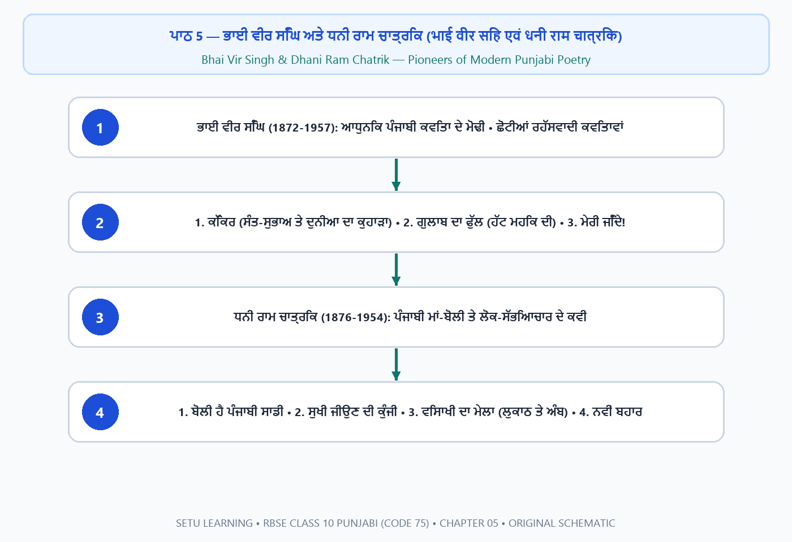

# ਪਾਠ 5 — ਭਾਈ ਵੀਰ ਸਿੰਘ ਅਤੇ ਧਨੀ ਰਾਮ ਚਾਤ੍ਰਿਕ (भाई वीर सिंह एवं धनी राम चात्रिक) (Bhai Vir Singh & Dhani Ram Chatrik — Pioneers of Modern Punjabi Poetry)

## भाग 1: अध्याय प्रवेश एवं पाठ्यक्रम मैपिंग (ਪਾਠ-ਪ੍ਰਵੇਸ਼ ਅਤੇ ਪਾਠਕ੍ਰਮ ਮੈਪਿੰਗ)

> RBSE ਜਮਾਤ 10 ਪੰਜਾਬੀ ਪਾਠ-ਪੁਸਤਕ 'ਸਾਹਿਤ ਸੁਗੰਧੀਆਂ' ਦੇ ਸਾਰੇ ਪ੍ਰਸ਼ਨਾਂ ਦੇ ਹੱਲ ਅਤੇ 2014–2026 ਦਾ ਪੂਰਾ ਇਤਿਹਾਸਕ PYQ ਸੰਗ੍ਰਹਿ ਸਰੋਤ-ਪ੍ਰੀਖਣ ਸਮੇਤ ਸੰਕਲਿਤ ਹਨ।

**ਵਿਸ਼ਾ ਕੋਡ (विषय कोड):** 75 (ਤੀਜੀ ਭਾਸ਼ਾ — ਪੰਜਾਬੀ / तृतीया भाषा — पंजाबी) · **ਲੜੀ ਪੁਸਤਕ (श्रृंखला पुस्तक):** 7

**ਪ੍ਰਮਾਣਿਤ ਆਧਾਰ:** RBSE 2025–26 · **ਪਾਠ ਅੰਕ-ਭਾਰ:** 3 ਅੰਕ। ਇਹ ਭਾਰ ਉਸੇ ਸੰਸਕਰਣ ਦਾ ਹੈ; ਅਸਲ ਪ੍ਰਸ਼ਨ-ਵੰਡ ਦੀ ਭਵਿੱਖਬਾਣੀ ਨਹੀਂ।

**ਸਿੱਖਣ ਦੇ ਉਦੇਸ਼ (सीखने के लक्ष्य):** ਆਧੁਨਿਕ ਪੰਜਾਬੀ ਕਵਿਤਾ ਦੇ ਮੋਢੀ ਭਾਈ ਵੀਰ ਸਿੰਘ ('ਕਿੱਕਰ', 'ਗੁਲਾਬ ਦਾ ਫੁੱਲ ਤੋੜਨ ਵਾਲੇ ਨੂੰ', 'ਮੇਰੀ ਜਿੰਦੇ!') ਅਤੇ ਧਨੀ ਰਾਮ ਚਾਤ੍ਰਿਕ ('ਬੋਲੀ ਹੈ ਪੰਜਾਬੀ ਸਾਡੀ', 'ਸੁਖੀ ਜੀਉਣ ਦੀ ਕੁੰਜੀ', 'ਵਿਸਾਖੀ ਦਾ ਮੇਲਾ', 'ਨਵੀਂ ਬਹਾਰ') ਦੀਆਂ ਕਵਿਤਾਵਾਂ ਦੀ ਵਿਆਖਿਆ ਤੇ ਸਾਰ ਸਮਝਣਾ।

## भाग 2: शब्दावली एवं अवधारणा कैप्सूल (ਸ਼ਬਦਾਵਲੀ ਅਤੇ ਸੰਕਲਪ ਕੈਪਸੂਲ)

| ਸ਼ਬਦ / ਸੰਕਲਪ | ਅਰਥ / ਵਿਆਖਿਆ |
|---|---|
| ਬਿਰਖ (बिरख) | ਰੁੱਖ / ਦਰੱਖ਼ਤ (ਅਸੀਂ ਵਧੇ ਅਸਮਾਨੀਂ ਜਾਏ, ਮੁੰਢੋਂ ਬਿਰਖ ਦੁਨੀ ਦੇ)। |
| ਕੁਹਾੜਾ (कुहाड़ा) | ਲੱਕੜ ਕੱਟਣ ਵਾਲਾ ਕੁਹਾੜਾ — ਸੰਸਾਰ ਦੀ ਨਾਸ਼ੁਕਰੀ ਦਾ ਪ੍ਰਤੀਕ (ਦੁਨੀਆਂ ਫੇਰ ਕੁਹਾੜਾ ਮਾਰੇ)। |
| ਹੱਟ ਮਹਿਕ ਦੀ (हट्ट महिक दी) | ਖ਼ੁਸ਼ਬੂ ਦੀ ਦੁਕਾਨ (ਡਾਲੀ ਨਾਲੋਂ ਤੋੜ ਨਾ ਸਾਨੂੰ, ਅਸਾਂ ਹੱਟ ਮਹਿਕ ਦੀ ਲਾਈ)। |
| ਤ੍ਰਿੰਞਣ (त्रिंञण) | ਕੁੜੀਆਂ ਤੇ ਔਰਤਾਂ ਦੇ ਇਕੱਠੇ ਬੈਠ ਕੇ ਚਰਖਾ ਕੱਤਣ ਦੀ ਥਾਂ (ਤ੍ਰਿੰਞਣਾਂ ਭੰਡਾਰਾਂ ਵਿੱਚ, ਵੰਝਲੀ ਤੇ ਵਾਰਾਂ ਵਿੱਚ)। |
| ਵੰਝਲੀ (वंझली) | ਬੰਸਰੀ / ਮੁਰਲੀ (ਇੱਕ ਲੋਕ-ਸਾਜ਼)। |
| ਲੋਕਾਚਾਰੀ (लोकाचारी) | ਦੁਨੀਆਦਾਰੀ / ਵਿਖਾਵੇ ਦਾ ਵਿਹਾਰ (ਸੁਖੀ ਜੀਉਣ ਦੀ ਕੁੰਜੀ)। |
| ਲੁਕਾਠ (लुकाठ) | ਵਿਸਾਖ ਦੇ ਮਹੀਨੇ ਪੱਕਣ ਵਾਲਾ ਖੱਟਾ-ਮਿੱਠਾ ਪੀਲਾ ਫਲ (ਪੱਕ ਗਈਆਂ ਕਣਕਾਂ, ਲੁਕਾਠ ਰਸਿਆ)। |
| ਵਣਜਾਰੇ (वणजारे) | ਵੰਗਾਂ-ਚੂੜੀਆਂ ਅਤੇ ਹਾਰ-ਸ਼ਿੰਗਾਰ ਵੇਚਣ ਵਾਲੇ ਵਪਾਰੀ। |
| ਮਦਾਰੀ (मदारी) | ਡਮਰੂ ਵਜਾ ਕੇ ਬਾਂਦਰ-ਰਿੱਛ ਦਾ ਤਮਾਸ਼ਾ ਵਿਖਾਉਣ ਵਾਲਾ ਬਾਜ਼ੀਗਰ। |
| ਲਾਰ (लार) | ਝੂਠਾ ਲਾਰਾ / ਤਾਰ (ਮਾਸ਼ੂਕਾਂ ਦੀ ਚਾਲ ਪੁਰਾਣੀ ਗੱਲਾਂ ਨਾਲ ਰਿੜਕਣਾ ਪਾਣੀ... ਲਾਈ ਰੱਖਣੀ ਲਾਰ)। |

## भाग 3: विस्तृत शिक्षण पाठ (ਵਿਸਤ੍ਰਿਤ ਅਧਿਆਪਨ ਪਾਠ)

### 1. ਕਵੀ-ਪਛਾਣ: ਭਾਈ ਵੀਰ ਸਿੰਘ (1872–1957 ਈ.) ਅਤੇ ਧਨੀ ਰਾਮ ਚਾਤ੍ਰਿਕ (1876–1954 ਈ.)
**ਭਾਈ ਵੀਰ ਸਿੰਘ:** ਆਧੁਨਿਕ ਪੰਜਾਬੀ ਸਾਹਿਤ ਦੇ ਪਿਤਾਮਾ ਅਤੇ ਨਿੱਕੀਆਂ ਕਵਿਤਾਵਾਂ ਦੇ ਮੋਢੀ ਭਾਈ ਵੀਰ ਸਿੰਘ ਦਾ ਜਨਮ 5 ਦਸੰਬਰ 1872 ਈ. ਨੂੰ ਅੰਮ੍ਰਿਤਸਰ ਵਿਖੇ ਡਾ. ਚਰਨ ਸਿੰਘ ਦੇ ਘਰ ਹੋਇਆ। ਉਹਨਾਂ ਦੇ ਪ੍ਰਸਿੱਧ ਕਾਵਿ-ਸੰਗ੍ਰਹਿ 'ਮਟਕ ਹੁਲਾਰੇ', 'ਲਹਿਰਾਂ ਦੇ ਹਾਰ', 'ਬਿਜਲੀਆਂ ਦੇ ਹਾਰ', 'ਪ੍ਰੀਤ ਵੀਣਾ' ਅਤੇ ਮਹਾਂਕਾਵਿ 'ਰਾਣਾ ਸੂਰਤ ਸਿੰਘ' ਹਨ। 1955 ਵਿੱਚ 'ਮੇਰੇ ਸਾਈਆਂ ਜੀਓ' ਲਈ ਉਹਨਾਂ ਨੂੰ ਭਾਰਤੀ ਸਾਹਿਤ ਅਕਾਦਮੀ ਪੁਰਸਕਾਰ ਮਿਲਿਆ।
**ਧਨੀ ਰਾਮ ਚਾਤ੍ਰਿਕ:** ਪੰਜਾਬੀ ਸੱਭਿਆਚਾਰ ਅਤੇ ਮਾਂ-ਬੋਲੀ ਦੇ ਅਲੰਬਰਦਾਰ ਕਵੀ ਧਨੀ ਰਾਮ ਚਾਤ੍ਰਿਕ ਦਾ ਜਨਮ 4 ਅਕਤੂਬਰ 1876 ਈ. ਨੂੰ ਪਿੰਡ ਪੱਸੀਆਂਵਾਲਾ (ਜ਼ਿਲ੍ਹਾ ਸਿਆਲਕੋਟ) ਵਿਖੇ ਪਿਤਾ ਲਾਲਾ ਪੋਹੂ ਮੱਲ ਦੇ ਘਰ ਹੋਇਆ। ਉਹਨਾਂ ਦੀਆਂ ਪ੍ਰਮੁੱਖ ਰਚਨਾਵਾਂ 'ਚੰਦਨਵਾੜੀ', 'ਕੇਸਰ ਕਿਆਰੀ', 'ਨਵਾਂ ਜਹਾਨ', 'ਸੂਫ਼ੀਖਾਨਾ' ਅਤੇ 'ਨੂਰਜਹਾਂ ਬਾਦਸ਼ਾਹ ਬੇਗਮ' ਹਨ।

### 2. ਭਾਈ ਵੀਰ ਸਿੰਘ ਦੀਆਂ ਤਿੰਨ ਕਵਿਤਾਵਾਂ
1. **ਕਿੱਕਰ:** ਕਿੱਕਰ ਦਾ ਰੁੱਖ ਅਸਮਾਨ ਵੱਲ ਵਧਦਾ ਹੈ ਭਾਵ ਰੱਬੀ ਪਿਆਰ ਵਿੱਚ ਉੱਪਰ ਉੱਠਦਾ ਹੈ। ਉਹ ਸੰਸਾਰ ਤੋਂ ਨਾ ਕੋਈ ਫੁੱਲ-ਫਲ ਦੀ ਵਡਿਆਈ ਮੰਗਦਾ ਹੈ ਤੇ ਨਾ ਕਿਸੇ ਦੇ ਰਾਹ ਵਿੱਚ ਅੜਦਾ ਹੈ; ਸਗੋਂ ਸੰਸਾਰ ਨੂੰ ਛਾਂ ਤੇ ਲੱਕੜ ਦਿੰਦਾ ਹੈ। ਪਰ ਜਦੋਂ ਉਹ ਉੱਚਾ ਉੱਠਦਾ ਹੈ ਤਾਂ ਦੁਨੀਆ ਉਸ ਉੱਤੇ **ਕੁਹਾੜਾ** ਚਲਾਉਂਦੀ ਹੈ। **ਭਾਵ:** ਰੱਬ ਦੇ ਪਿਆਰੇ ਸੰਤ-ਮਹਾਂਪੁਰਖ ਦੁਨੀਆ ਤੋਂ ਨਿਰਲੇਪ ਰਹਿ ਕੇ ਭਲਾ ਕਰਦੇ ਹਨ, ਪਰ ਸੰਸਾਰ ਉਹਨਾਂ ਨੂੰ ਦੁੱਖ ਦਿੰਦਾ ਹੈ।
2. **ਗੁਲਾਬ ਦਾ ਫੁੱਲ ਤੋੜਨ ਵਾਲੇ ਨੂੰ:**
   - **ਮੁੱਖ ਤੁਕਾਂ:** **'ਡਾਲੀ ਨਾਲੋਂ ਤੋੜ ਨਾ ਸਾਨੂੰ, ਅਸਾਂ ਹੱਟ ਮਹਿਕ ਦੀ ਲਾਈ । ਲੱਖ ਗਾਹਕ ਜੇ ਸੁੰਘੇ ਆ ਕੇ, ਖਾਲੀ ਇੱਕ ਨਾ ਜਾਈ । ਤੂੰ ਜੇ ਇੱਕ ਤੋੜ ਕੇ ਲੈ ਗਿਉਂ, ਇੱਕ ਜੋਗਾ ਰਹਿ ਜਾਸਾਂ...'**
   - **ਭਾਵ:** ਗੁਲਾਬ ਦਾ ਫੁੱਲ ਤੋੜਨ ਵਾਲੇ ਮਨੁੱਖ ਨੂੰ ਬੇਨਤੀ ਕਰਦਾ ਹੈ ਕਿ ਮੈਨੂੰ ਟਾਹਣੀ ਨਾਲੋਂ ਨਾ ਤੋੜ; ਮੈਂ ਟਾਹਣੀ ਉੱਤੇ ਖਿੜ ਕੇ ਖ਼ੁਸ਼ਬੂ ਦੀ ਹੱਟੀ (ਦੁਕਾਨ) ਲਾਈ ਹੋਈ ਹੈ ਜਿੱਥੋਂ ਲੱਖਾਂ ਰਾਹੀ ਮਹਿਕ ਲੈਂਦੇ ਹਨ। ਜੇ ਤੂੰ ਮੈਨੂੰ ਤੋੜ ਕੇ ਲੈ ਗਿਆ ਤਾਂ ਮੈਂ ਕੇਵਲ ਇੱਕ ਜਣੇ ਜੋਗਾ ਰਹਿ ਜਾਵਾਂਗਾ ਤੇ ਪਲ ਵਿੱਚ ਕੁਮਲਾ (ਮੁਰਝਾ) ਜਾਵਾਂਗਾ। ਇਹ ਕਵਿਤਾ **ਸੁਆਰਥ ਤਿਆਗ ਕੇ ਸਰਬੱਤ ਦੇ ਭਲੇ** ਦਾ ਸੰਦੇਸ਼ ਦਿੰਦੀ ਹੈ।
3. **ਮੇਰੀ ਜਿੰਦੇ!:** ਕਵੀ ਆਪਣੀ ਜਿੰਦ (ਆਤਮਾ) ਨੂੰ ਸੰਬੋਧਨ ਕਰਦਾ ਹੈ ਕਿ ਹੇ ਮੇਰੀ ਜਿੰਦੇ! ਸੰਸਾਰ ਦੇ ਦੁੱਖਾਂ-ਝमेलਿਆਂ ਤੋਂ ਘਬਰਾ ਨਾ, ਸਗੋਂ ਪਰਮਾਤਮਾ ਦੇ ਪ੍ਰੇਮ, ਖੇੜੇ ਅਤੇ ਚੜ੍ਹਦੀ ਕਲਾ ਵਿੱਚ ਟਿਕੀ ਰਹਿ।

### 3. ਧਨੀ ਰਾਮ ਚਾਤ੍ਰਿਕ ਦੀਆਂ ਚਾਰ ਕਵਿਤਾਵਾਂ
1. **ਬੋਲੀ ਹੈ ਪੰਜਾਬੀ ਸਾਡੀ:**
   - **ਮੁੱਖ ਤੁਕਾਂ:** **'ਅਸਾਂ ਨਹੀਂ ਭੁਲਾਉਣੀ, ਬੋਲੀ ਹੈ ਪੰਜਾਬੀ ਸਾਡੀ । ਏਹ ਜਿੰਦ ਜਾਨ ਸਾਡੀ, ਮੋਤੀਆਂ ਦੀ ਖ਼ਾਨ ਸਾਡੀ, ਹੱਥੋਂ ਨਹੀਂ ਗੁਆਉਣੀ, ਬੋਲੀ ਹੈ ਪੰਜਾਬੀ ਸਾਡੀ । ਤ੍ਰਿੰਞਣਾਂ ਭੰਡਾਰਾਂ ਵਿੱਚ, ਵੰਝਲੀ ਤੇ ਵਾਰਾਂ ਵਿੱਚ, ਮਿੱਠੀ ਤੇ ਸੁਹਾਉਣੀ, ਬੋਲੀ ਹੈ ਪੰਜਾਬੀ ਸਾਡੀ ।'**
   - **ਭਾਵ:** ਕਵੀ ਪੰਜਾਬੀ ਮਾਂ-ਬੋਲੀ ਨਾਲ ਅਥਾਹ ਪਿਆਰ ਪ੍ਰਗਟ ਕਰਦਾ ਹੋਇਆ ਕਹਿੰਦਾ ਹੈ ਕਿ ਪੰਜਾਬੀ ਸਾਡੀ ਜਿੰਦ-ਜਾਨ ਤੇ ਮੋਤੀਆਂ ਦੀ ਖਾਣ ਹੈ; ਇਹ ਤ੍ਰਿੰਞਣਾਂ, ਭੰਡਾਰਿਆਂ, ਵੰਝਲੀ (ਬੰਸਰੀ) ਦੀਆਂ ਸੁਰਾਂ ਤੇ ਬੀਰ-ਰਸੀ ਵਾਰਾਂ ਵਿੱਚ ਗੂੰਜਦੀ ਹੈ; ਅਸੀਂ ਇਸ ਨੂੰ ਕਦੇ ਨਹੀਂ ਭੁਲਾਵਾਂਗੇ।
2. **ਸੁਖੀ ਜੀਉਣ ਦੀ ਕੁੰਜੀ ('ਸੁੱਖ-ਨੀਂਦੇ ਜੇ ਸੁੱਤਾ ਚਾਹੋਂ, ਵੱਸ ਨਾ ਪਈਂ ਅਮੀਰਾਂ ਦੇ'):**
   - **ਭਾਵ:** ਜੇ ਮਨੁੱਖ ਚੈਨ ਦੀ ਨੀਂਦ ਸੌਣਾ ਚਾਹੁੰਦਾ ਹੈ ਤਾਂ ਹੰਕਾਰੀ ਅਮੀਰਾਂ ਦੇ ਵੱਸ ਨਾ ਪਵੇ, ਗ਼ਰੀਬਾਂ ਤੇ ਮਜ਼ਦੂਰਾਂ ਦਾ ਹੱਕ ਨਾ ਮਾਰੇ, ਸੰਤੋਖ ਤੇ ਹੱਕ-ਹਲਾਲ ਦੀ ਕਮਾਈ ਖਾਵੇ ਅਤੇ ਹੱਸਮੁਖ ਤੇ ਸਾਦਾ ਜੀਵਨ ਬਤੀਤ ਕਰੇ।
3. **ਵਿਸਾਖੀ ਦਾ ਮੇਲਾ ('ਪੱਕ ਗਈਆਂ ਕਣਕਾਂ, ਲੁਕਾਠ ਰਸਿਆ, ਬੂਰ ਪਿਆ ਅੰਬਾਂ ਨੂੰ ਗੁਲਾਬ ਹੱਸਿਆ'):**
   - **ਭਾਵ:** ਵਿਸਾਖ ਦੇ ਮਹੀਨੇ ਕਣਕਾਂ ਪੱਕ ਗਈਆਂ ਹਨ, **ਲੁਕਾਠ** ਰਸ ਗਿਆ ਹੈ ਤੇ **ਅੰਬਾਂ** ਨੂੰ ਬੂਰ ਪੈ ਗਿਆ ਹੈ। ਜੱਟ ਵਾਢੀ ਦੀ ਖ਼ੁਸ਼ੀ ਵਿੱਚ ਭੰਗੜਾ ਪਾਉਂਦੇ ਮੇਲੇ ਚੱਲਦੇ ਹਨ। ਮੇਲੇ ਵਿੱਚ ਹਲਵਾਈਆਂ ਨੇ ਲੱਡੂ-ਜਲੇਬੀਆਂ ਦੀਆਂ ਹੱਟੀਆਂ ਲਾਈਆਂ ਹਨ, ਵਣਜਾਰਿਆਂ ਨੇ ਵੰਗਾਂ ਲਾਈਆਂ ਹਨ, **ਜੋਗੀਆਂ ਤੇ ਮਦਾਰੀਆਂ** ਨੇ ਤਮਾਸ਼ੇ ਲਾਏ ਹਨ, ਪੰਘੂੜੇ ਝੂਟੇ ਜਾ ਰਹੇ ਹਨ ਤੇ ਛਿੰਝ (ਕੁਸ਼ਤੀਆਂ) ਦੇ ਦਮਾਮੇ ਵੱਜ ਰਹੇ ਹਨ।
4. **ਨਵੀਂ ਬਹਾਰ ('ਮਾਸ਼ੂਕਾਂ ਦੀ ਚਾਲ ਪੁਰਾਣੀ ਗੱਲਾਂ ਨਾਲ ਰਿੜਕਣਾ ਪਾਣੀ, ਨਾ ਮਰਨਾ ਨਾ ਮੰਜੀ ਚਾਣੀ, ਲਾਈ ਰੱਖਣੀ ਲਾਰ'):** ਕੁਦਰਤ ਵਿੱਚ ਬਸੰਤ ਦੀ ਨਵੀਂ ਬਹਾਰ ਆਉਣ ਨਾਲ ਬਾਗ਼-ਬਗ਼ੀਚੇ ਖਿੜ ਉੱਠੇ ਹਨ।

ਪਾਠ 5: ਭਾਈ ਵੀਰ ਸਿੰਘ ਅਤੇ ਧਨੀ ਰਾਮ ਚਾਤ੍ਰਿਕ ਦੀਆਂ ਕਵਿਤਾਵਾਂ ਦਾ ਸੰਕਲਪ ਚਿੱਤਰ

## भाग 4: पाठ्यपुस्तक-अवधारणाओं पर मौलिक हल किए उदाहरण (ਹੱਲ ਕੀਤੇ ਮਿਆਰੀ ਉਦਾਹਰਣ)

ਹੇਠਾਂ ਦਿੱਤੇ ਪ੍ਰਸ਼ਨ ਪਾਠ-ਪੁਸਤਕ 'ਸਾਹਿਤ ਸੁਗੰਧੀਆਂ' ਅਤੇ ਵਿਆਕਰਣ ਦੇ ਸੰਕਲਪਾਂ ਉੱਤੇ ਆਧਾਰਿਤ ਮੌਲਿਕ ਆਦਰਸ਼ ਹੱਲ ਹਨ।

**ਹੱਲ ਕੀਤਾ ਉਦਾਹਰਣ 1: 'ਡਾਲੀ ਨਾਲੋਂ ਤੋੜ ਨਾ ਸਾਨੂੰ, ਅਸਾਂ ਹੱਟ ਮਹਿਕ ਦੀ ਲਾਈ...' ਕਾਵਿ-ਬੰਦ ਦੀ ਪ੍ਰਸੰਗ ਸਹਿਤ ਵਿਆਖਿਆ ਕਰੋ।**

ਪ੍ਰਸੰਗ: ਇਹ ਕਾਵਿ-ਬੰਦ 'ਸਾਹਿਤ ਸੁਗੰਧੀਆਂ' ਪੁਸਤਕ ਵਿੱਚ ਦਰਜ ਭਾਈ ਵੀਰ ਸਿੰਘ ਦੀ ਕਵਿਤਾ 'ਗੁਲਾਬ ਦਾ ਫੁੱਲ ਤੋੜਨ ਵਾਲੇ ਨੂੰ' ਵਿੱਚੋਂ ਲਿਆ ਗਿਆ ਹੈ। ਵਿਆਖਿਆ: ਗੁਲਾਬ ਦਾ ਫੁੱਲ ਤੋੜਨ ਵਾਲੇ ਨੂੰ ਕਹਿੰਦਾ ਹੈ ਕਿ ਸਾਨੂੰ ਡਾਲੀ ਨਾਲੋਂ ਨਾ ਤੋੜੋ, ਅਸੀਂ ਤਾਂ ਟਾਹਣੀ ਉੱਤੇ ਖਿੜ ਕੇ ਖ਼ੁਸ਼ਬੂ ਵੰਡਣ ਦੀ ਹੱਟੀ ਲਾਈ ਹੋਈ ਹੈ। ਇੱਥੇ ਲੱਖਾਂ ਗਾਹਕ (ਰਾਹੀ) ਆ ਕੇ ਮਹਿਕ ਸੁੰਘਦੇ ਹਨ ਤੇ ਕੋਈ ਖਾਲੀ ਨਹੀਂ ਜਾਂਦਾ। ਪਰ ਜੇ ਤੂੰ ਮੈਨੂੰ ਤੋੜ ਕੇ ਲੈ ਗਿਆ ਤਾਂ ਮੈਂ ਕੇਵਲ ਇੱਕ ਜਣੇ ਜੋਗਾ ਰਹਿ ਜਾਵਾਂਗਾ ਤੇ ਉਹ ਮਹਿਕ ਵੀ ਪਲ ਵਿੱਚ ਮੁੱਕ ਜਾਵੇਗੀ।

**ਹੱਲ ਕੀਤਾ ਉਦਾਹਰਣ 2: 'ਅਸਾਂ ਨਹੀਂ ਭੁਲਾਉਣੀ, ਬੋਲੀ ਹੈ ਪੰਜਾਬੀ ਸਾਡੀ...' ਕਾਵਿ-ਬੰਦ ਦੀ ਵਿਆਖਿਆ ਅਤੇ 'ਤ੍ਰਿੰਞਣ' ਤੇ 'ਵੰਝਲੀ' ਦੇ ਅਰਥ ਲਿਖੋ।**

ਧਨੀ ਰਾਮ ਚਾਤ੍ਰਿਕ ਕਹਿੰਦੇ ਹਨ ਕਿ ਪੰਜਾਬੀ ਸਾਡੀ ਮਾਂ-ਬੋਲੀ ਹੈ, ਇਹ ਸਾਡੀ ਜਿੰਦ-ਜਾਨ ਅਤੇ ਮੋਤੀਆਂ ਦੀ ਖਾਣ ਹੈ; ਅਸੀਂ ਇਸ ਨੂੰ ਕਦੇ ਹੱਥੋਂ ਨਹੀਂ ਗੁਆਵਾਂਗੇ। ਇਹ ਤ੍ਰਿੰਞਣਾਂ, ਭੰਡਾਰਿਆਂ, ਵੰਝਲੀ ਦੀਆਂ ਸੁਰਾਂ ਅਤੇ ਵਾਰਾਂ ਵਿੱਚ ਗੂੰਜਣ ਵਾਲੀ ਮਿੱਠੀ ਤੇ ਸੁਹਾਉਣੀ ਬੋਲੀ ਹੈ। ਸ਼ਬਦ-ਅਰਥ: 'ਤ੍ਰਿੰਞਣ' = ਕੁੜੀਆਂ ਦੇ ਇਕੱਠੇ ਬੈਠ ਕੇ ਚਰਖਾ ਕੱਤਣ ਦੀ ਥਾਂ; 'ਵੰਝਲੀ' = ਬੰਸਰੀ / ਮੁਰਲੀ।

**ਹੱਲ ਕੀਤਾ ਉਦਾਹਰਣ 3: 'ਵਿਸਾਖੀ ਦਾ ਮੇਲਾ' ਕਵਿਤਾ ਵਿੱਚ ਆਏ ਦੋ ਫਲਾਂ ਦੇ ਨਾਮ ਅਤੇ ਮੇਲੇ ਦਾ ਦ੍ਰਿਸ਼ ਲਿਖੋ।**

'ਵਿਸਾਖੀ ਦਾ ਮੇਲਾ' ਕਵਿਤਾ ਵਿੱਚ **'ਲੁਕਾਠ'** ਅਤੇ **'ਅੰਬ'** ਦੋ ਫਲਾਂ ਦਾ ਜ਼ਿਕਰ ਆਇਆ ਹੈ ('ਪੱਕ ਗਈਆਂ ਕਣਕਾਂ, ਲੁਕਾਠ ਰਸਿਆ, ਬੂਰ ਪਿਆ ਅੰਬਾਂ ਨੂੰ ਗੁਲਾਬ ਹੱਸਿਆ')। ਮੇਲੇ ਵਿੱਚ ਮਠਿਆਈਆਂ ਦੀਆਂ ਦੁਕਾਨਾਂ, ਵੰਗਾਂ ਵੇਚਣ ਵਾਲੇ ਵਣਜਾਰੇ, ਜੋਗੀਆਂ ਤੇ ਮਦਾਰੀਆਂ ਦੇ ਤਮਾਸ਼ੇ, ਪੰਘੂੜੇ ਅਤੇ ਭੰਗੜੇ-ਛਿੰਝਾਂ ਦਾ ਸਜੀਵ ਦ੍ਰਿਸ਼ ਹੈ।

## भाग 5: सत्यापित बोर्ड प्रश्न एवं स्रोत-स्थिति (ਪ੍ਰਮਾਣਿਤ ਬੋਰਡ ਪ੍ਰਸ਼ਨ ਅਤੇ ਸਰੋਤ-ਸਥਿਤੀ)

RBSE 2026 Supp (`S-75`, Q1-III, Q1-V, Q3-III) ਅਤੇ 2025 Supp (Q1-v, Q3-ii) ਵਿੱਚ 'ਗੁਲਾਬ ਦਾ ਫੁੱਲ', 'ਵਿਸਾਖੀ ਦਾ ਮੇਲਾ' ਅਤੇ 'ਮੇਰੀ ਜਿੰਦੇ!' ਸਿੱਧੇ ਪੁੱਛੇ ਗਏ ਹਨ।

[RBSE 2026 ਮੂਲ ਪੇਪਰ (S-75)](https://rajeduboard.rajasthan.gov.in/books/PAPERS-2026/Sec/S-75.pdf)। ਪ੍ਰਸ਼ਨ ਦਾ ਸੰਖੇਪ ਵਿਸ਼ਾ-ਸੰਦਰਭ ਹੈ; ਸ਼ਬਦ-ਬ-ਸ਼ਬਦ ਪੁਨਰ-ਮੁਦਰਣ ਨਹੀਂ।

## भाग 6: खंडवार मौलिक अभ्यास बैंक (ਖੰਡ-ਵਾਰ ਮੌਲਿਕ ਅਭਿਆਸ ਬੈਂਕ)

**ਅਭਿਆਸ-ਅੰਕ:** ਵਿਦਿਆਰਥੀਆਂ ਦੇ ਸਵੈ-ਅਭਿਆਸ ਲਈ ਹਨ; ਉੱਤਰ ਪਹਿਲਾਂ ਆਪ ਲਿਖੋ, ਫਿਰ ਭਾਗ 9 ਵੇਖੋ।

## ੳ: ਬਹੁ-ਵਿਕਲਪੀ ਪ੍ਰਸ਼ਨ (MCQ) — 15 × 1 ਅੰਕ

**MCQ 1. ਕਵੀ ਭਾਈ ਵੀਰ ਸਿੰਘ ਦੀ ਕਵਿਤਾ ਕਿਹੜੀ ਹੈ? (RBSE 2022 Main Q1-ii, 2026 Supp Q1-V)**

ੳ) ਸੁਖੀ ਜੀਉਣ ਦੀ ਕੁੰਜੀ  
ਅ) ਸੁੰਨੇ-ਸੁੰਨੇ ਰਾਹਾਂ ਵਿੱਚ  
ੲ) ਤਮਗ਼ੇ  
ਸ) ਮੇਰੀ ਜਿੰਦੇ!

**MCQ 2. 'ਡਾਲੀ ਨਾਲੋਂ ਤੋੜ ਨਾ ਸਾਨੂੰ, ਅਸਾਂ ਹੱਟ ਮਹਿਕ ਦੀ ਲਾਈ' — ਇਹ ਕਵਿਤਾ ਕਿਹੜੇ ਫੁੱਲ ਵੱਲ ਇਸ਼ਾਰਾ ਕਰਦੀ ਹੈ?**

ੳ) ਚਮੇਲੀ  
ਅ) ਗੁਲਦਾਉਦੀ  
ੲ) ਗੁਲਾਬ  
ਸ) ਗेंदा

**MCQ 3. 'ਵਿਸਾਖੀ ਦਾ ਮੇਲਾ' ਕਵਿਤਾ ਅਨੁਸਾਰ ਮੇਲੇ ਵਿੱਚ ਤਮਾਸ਼ੇ ਕਿੰਨ੍ਹਾਂ ਨੇ ਲਾਏ ਹੋਏ ਸਨ? (RBSE 2026 Supp Q1-III)**

ੳ) ਵਣਜਾਰਿਆਂ ਨੇ  
ਅ) ਜੋਗੀਆਂ ਤੇ ਮਦਾਰੀਆਂ ਨੇ  
ੲ) ਬੱਚੇ ਤੇ ਗੱਭਰੂਆਂ ਨੇ  
ਸ) ਹਲਵਾਈਆਂ ਨੇ

**MCQ 4. 'ਵਿਸਾਖੀ ਦਾ ਮੇਲਾ' ਕਵਿਤਾ ਵਿੱਚ ਆਏ ਦੋ ਫਲਾਂ ਦੇ ਨਾਮ ਕੀ ਹਨ? (RBSE 2025 Supp Q3-ii, 2026 Supp Q3-III)**

ੳ) ਲੁਕਾਠ ਅਤੇ ਅੰਬ  
ਅ) ਸੇਬ ਅਤੇ ਕੇਲਾ  
ੲ) ਅੰਗੂਰ ਅਤੇ ਅਨਾਰ  
ਸ) ਅਮਰੂਦ ਅਤੇ ਬੇਰ

**MCQ 5. 'ਮਾਸ਼ੂਕਾਂ ਦੀ ਚਾਲ ਪੁਰਾਣੀ ਗੱਲਾਂ ਨਾਲ ਰਿੜਕਣਾ ਪਾਣੀ' — ਇਹ ਸਤਰਾਂ ਕਿਸ ਕਵਿਤਾ ਵਿੱਚੋਂ ਹਨ? (RBSE 2022 Main Q1-iv)**

ੳ) ਚਾਨਣ ਦੀ ਫੁਲਕਾਰੀ  
ਅ) ਕਿੱਕਰ  
ੲ) ਨਾ ਤਿਸੁ ਭਾਰੇ ਪਰਬਤਾਂ  
ਸ) ਨਵੀਂ ਬਹਾਰ

**MCQ 6. 'ਬੋਲੀ ਹੈ ਪੰਜਾਬੀ ਸਾਡੀ' ਕਵਿਤਾ ਦਾ ਰਚਨਾਕਾਰ ਕੌਣ ਹੈ?**

ੳ) ਪ੍ਰੋ. ਮੋਹਨ ਸਿੰਘ  
ਅ) ਸੁਰਜੀਤ ਪਾਤਰ  
ੲ) ਧਨੀ ਰਾਮ ਚਾਤ੍ਰਿਕ  
ਸ) ਭਾਈ ਵੀਰ ਸਿੰਘ

**MCQ 7. 'ਤ੍ਰਿੰਞਣਾਂ ਭੰਡਾਰਾਂ ਵਿੱਚ, ਵੰਝਲੀ ਤੇ ਵਾਰਾਂ ਵਿੱਚ' — ਇੱਥੇ 'ਵੰਝਲੀ' ਸ਼ਬਦ ਦਾ ਕੀ ਅਰਥ ਹੈ?**

ੳ) ਤਲਵਾਰ  
ਅ) ਬੰਸਰੀ / ਮੁਰਲੀ  
ੲ) ਚਰਖਾ  
ਸ) ਢੋਲ

**MCQ 8. 'ਕਿੱਕਰ' ਕਵਿਤਾ ਵਿੱਚ ਜਦੋਂ ਕਿੱਕਰ ਦਾ ਰੁੱਖ ਉੱਚਾ ਵਧਦਾ ਹੈ ਤਾਂ ਦੁਨੀਆ ਉਸ ਨਾਲ ਕੀ ਕਰਦੀ ਹੈ?**

ੳ) ਉਸ ਉੱਤੇ ਕੁਹਾੜਾ ਮਾਰਦੀ ਹੈ  
ਅ) ਉਸ ਦੀ ਪੂਜਾ ਕਰਦੀ ਹੈ  
ੲ) ਉਸ ਨੂੰ ਪਾਣੀ ਪਾਉਂਦੀ ਹੈ  
ਸ) ਉਸ ਉੱਤੇ ਫੁੱਲ ਚੜ੍ਹਾਉਂਦੀ ਹੈ

**MCQ 9. 'ਸੁੱਖ-ਨੀਂਦੇ ਜੇ ਸੁੱਤਾ ਚਾਹੋਂ, ਵੱਸ ਨਾ ਪਈਂ ਅਮੀਰਾਂ ਦੇ' ਤੁਕ ਕਿਸ ਕਵਿਤਾ ਵਿੱਚੋਂ ਹੈ?**

ੳ) ਕਿੱਕਰ (ਭਾਈ ਵੀਰ ਸਿੰਘ)  
ਅ) ਮਾਂ (ਪ੍ਰੋ. ਮੋਹਨ ਸਿੰਘ)  
ੲ) ਤਮਗ਼ੇ (ਸੁਰਜੀਤ ਪਾਤਰ)  
ਸ) ਸੁਖੀ ਜੀਉਣ ਦੀ ਕੁੰਜੀ (ਧਨੀ ਰਾਮ ਚਾਤ੍ਰਿਕ)

**MCQ 10. ਆਧੁਨਿਕ ਪੰਜਾਬੀ ਕਵਿਤਾ ਦਾ ਮੋਢੀ (ਪਿਤਾਮਾ) ਕਿਸ ਕਵੀ ਨੂੰ ਮੰਨਿਆ ਜਾਂਦਾ ਹੈ?**

ੳ) ਪ੍ਰੋ. ਮੋਹਨ ਸਿੰਘ ਨੂੰ  
ਅ) ਸ਼ਿਵ ਕੁਮਾਰ ਬਟਾਲਵੀ ਨੂੰ  
ੲ) ਭਾਈ ਵੀਰ ਸਿੰਘ ਨੂੰ  
ਸ) ਧਨੀ ਰਾਮ ਚਾਤ੍ਰਿਕ ਨੂੰ

**MCQ 11. 'ਏਹ ਜਿੰਦ ਜਾਨ ਸਾਡੀ, ਮੋਤੀਆਂ ਦੀ ਖ਼ਾਨ ਸਾਡੀ' — ਕਵੀ ਨੇ 'ਮੋਤੀਆਂ ਦੀ ਖ਼ਾਨ' ਕਿਸ ਨੂੰ ਕਿਹਾ ਹੈ?**

ੳ) ਤਿੰਞਣ ਨੂੰ  
ਅ) ਪੰਜਾਬੀ ਮਾਂ-ਬੋਲੀ ਨੂੰ  
ੲ) ਸਮੁੰਦਰ ਨੂੰ  
ਸ) ਪਹਾੜ ਨੂੰ

**MCQ 12. 'ਵਿਸਾਖੀ ਦਾ ਮੇਲਾ' ਕਵਿਤਾ ਵਿੱਚ ਵੰਗਾਂ (ਚੂੜੀਆਂ) ਕੌਣ ਵੇਚ ਰਹੇ ਹਨ?**

ੳ) ਵਣਜਾਰੇ  
ਅ) ਹਲਵਾਈ  
ੲ) ਮਦਾਰੀ  
ਸ) ਜੱਟ

**MCQ 13. 'ਗੁਲਾਬ ਦਾ ਫੁੱਲ ਤੋੜਨ ਵਾਲੇ ਨੂੰ' ਕਵਿਤਾ ਅਨੁਸਾਰ ਜੇ ਫੁੱਲ ਨੂੰ ਡਾਲੀ ਨਾਲੋਂ ਤੋੜ ਲਿਆ ਜਾਵੇ ਤਾਂ ਉਹ ਕਿੰਨਿਆਂ ਜੋਗਾ ਰਹਿ ਜਾਂਦਾ ਹੈ?**

ੳ) ਲੱਖਾਂ ਲੋਕਾਂ ਜੋਗਾ  
ਅ) ਸਾਰੇ ਬਾਗ਼ ਜੋਗਾ  
ੲ) ਕਿਸੇ ਜੋਗਾ ਨਹੀਂ  
ਸ) ਕੇਵਲ ਇੱਕ ਜਣੇ ਜੋਗਾ ('ਇੱਕ ਜੋਗਾ ਰਹਿ ਜਾਸਾਂ')

**MCQ 14. 'ਤ੍ਰਿੰਞਣ' ਸ਼ਬਦ ਦਾ ਸਹੀ ਅਰਥ ਕੀ ਹੈ?**

ੳ) ਖੇਡ ਦਾ ਮੈਦਾਨ  
ਅ) ਮੇਲੇ ਦੀ ਥਾਂ  
ੲ) ਕੁੜੀਆਂ/ਇਸਤਰੀਆਂ ਦੇ ਇਕੱਠੇ ਬੈਠ ਕੇ ਚਰਖਾ ਕੱਤਣ ਦੀ ਥਾਂ  
ਸ) ਪਿੰਡ ਦੀ ਸੱਥ

**MCQ 15. ਭਾਈ ਵੀਰ ਸਿੰਘ ਨੂੰ 1955 ਵਿੱਚ ਕਿਹੜੀ ਪੁਸਤਕ ਲਈ ਭਾਰਤੀ ਸਾਹਿਤ ਅਕਾਦਮੀ ਪੁਰਸਕਾਰ ਮਿਲਿਆ?**

ੳ) ਸੁਨੇਹੜੇ  
ਅ) ਮੇਰੇ ਸਾਈਆਂ ਜੀਓ  
ੲ) ਚੰਦਨਵਾੜੀ  
ਸ) ਕੇਸਰ ਕਿਆਰੀ

## ੳ: ਖਾਲੀ ਥਾਵਾਂ ਭਰੋ — 6 × 1 ਅੰਕ

1. ਰੁੱਖ / ਦਰੱਖ਼ਤ (ਅਸੀਂ ਵਧੇ ਅਸਮਾਨੀਂ ਜਾਏ, ਮੁੰਢੋਂ ਬਿਰਖ ਦੁਨੀ ਦੇ)। — ਇਸ ਸ਼ਬਦ/ਸੰਕਲਪ ਦਾ ਨਾਂ ਹੈ: ____।  
2. ਲੱਕੜ ਕੱਟਣ ਵਾਲਾ ਕੁਹਾੜਾ — ਸੰਸਾਰ ਦੀ ਨਾਸ਼ੁਕਰੀ ਦਾ ਪ੍ਰਤੀਕ (ਦੁਨੀਆਂ ਫੇਰ ਕੁਹਾੜਾ ਮਾਰੇ)। — ਇਸ ਸ਼ਬਦ/ਸੰਕਲਪ ਦਾ ਨਾਂ ਹੈ: ____।  
3. ਖ਼ੁਸ਼ਬੂ ਦੀ ਦੁਕਾਨ (ਡਾਲੀ ਨਾਲੋਂ ਤੋੜ ਨਾ ਸਾਨੂੰ, ਅਸਾਂ ਹੱਟ ਮਹਿਕ ਦੀ ਲਾਈ)। — ਇਸ ਸ਼ਬਦ/ਸੰਕਲਪ ਦਾ ਨਾਂ ਹੈ: ____।  
4. ਕੁੜੀਆਂ ਤੇ ਔਰਤਾਂ ਦੇ ਇਕੱਠੇ ਬੈਠ ਕੇ ਚਰਖਾ ਕੱਤਣ ਦੀ ਥਾਂ (ਤ੍ਰਿੰਞਣਾਂ ਭੰਡਾਰਾਂ ਵਿੱਚ, ਵੰਝਲੀ ਤੇ ਵਾਰਾਂ ਵਿੱਚ)। — ਇਸ ਸ਼ਬਦ/ਸੰਕਲਪ ਦਾ ਨਾਂ ਹੈ: ____।  
5. ਬੰਸਰੀ / ਮੁਰਲੀ (ਇੱਕ ਲੋਕ-ਸਾਜ਼)। — ਇਸ ਸ਼ਬਦ/ਸੰਕਲਪ ਦਾ ਨਾਂ ਹੈ: ____।  
6. ਦੁਨੀਆਦਾਰੀ / ਵਿਖਾਵੇ ਦਾ ਵਿਹਾਰ (ਸੁਖੀ ਜੀਉਣ ਦੀ ਕੁੰਜੀ)। — ਇਸ ਸ਼ਬਦ/ਸੰਕਲਪ ਦਾ ਨਾਂ ਹੈ: ____।

## ੳ: ਅਤਿ-ਲਘੂ ਉੱਤਰਾਂ ਵਾਲੇ ਪ੍ਰਸ਼ਨ — 8 × 1 ਅੰਕ

1. ਕਵੀ ਭਾਈ ਵੀਰ ਸਿੰਘ ਦੀ ਕਵਿਤਾ ਕਿਹੜੀ ਹੈ? (RBSE 2022 Main Q1-ii, 2026 Supp Q1-V)  
2. 'ਡਾਲੀ ਨਾਲੋਂ ਤੋੜ ਨਾ ਸਾਨੂੰ, ਅਸਾਂ ਹੱਟ ਮਹਿਕ ਦੀ ਲਾਈ' — ਇਹ ਕਵਿਤਾ ਕਿਹੜੇ ਫੁੱਲ ਵੱਲ ਇਸ਼ਾਰਾ ਕਰਦੀ ਹੈ?  
3. 'ਵਿਸਾਖੀ ਦਾ ਮੇਲਾ' ਕਵਿਤਾ ਅਨੁਸਾਰ ਮੇਲੇ ਵਿੱਚ ਤਮਾਸ਼ੇ ਕਿੰਨ੍ਹਾਂ ਨੇ ਲਾਏ ਹੋਏ ਸਨ? (RBSE 2026 Supp Q1-III)  
4. 'ਵਿਸਾਖੀ ਦਾ ਮੇਲਾ' ਕਵਿਤਾ ਵਿੱਚ ਆਏ ਦੋ ਫਲਾਂ ਦੇ ਨਾਮ ਕੀ ਹਨ? (RBSE 2025 Supp Q3-ii, 2026 Supp Q3-III)  
5. 'ਮਾਸ਼ੂਕਾਂ ਦੀ ਚਾਲ ਪੁਰਾਣੀ ਗੱਲਾਂ ਨਾਲ ਰਿੜਕਣਾ ਪਾਣੀ' — ਇਹ ਸਤਰਾਂ ਕਿਸ ਕਵਿਤਾ ਵਿੱਚੋਂ ਹਨ? (RBSE 2022 Main Q1-iv)  
6. 'ਬੋਲੀ ਹੈ ਪੰਜਾਬੀ ਸਾਡੀ' ਕਵਿਤਾ ਦਾ ਰਚਨਾਕਾਰ ਕੌਣ ਹੈ?  
7. 'ਤ੍ਰਿੰਞਣਾਂ ਭੰਡਾਰਾਂ ਵਿੱਚ, ਵੰਝਲੀ ਤੇ ਵਾਰਾਂ ਵਿੱਚ' — ਇੱਥੇ 'ਵੰਝਲੀ' ਸ਼ਬਦ ਦਾ ਕੀ ਅਰਥ ਹੈ?  
8. 'ਕਿੱਕਰ' ਕਵਿਤਾ ਵਿੱਚ ਜਦੋਂ ਕਿੱਕਰ ਦਾ ਰੁੱਖ ਉੱਚਾ ਵਧਦਾ ਹੈ ਤਾਂ ਦੁਨੀਆ ਉਸ ਨਾਲ ਕੀ ਕਰਦੀ ਹੈ?

## ਅ: ਲਘੂ ਉੱਤਰਾਂ ਵਾਲੇ ਪ੍ਰਸ਼ਨ — 6 × 2 ਅੰਕ

**B1.** 'ਡਾਲੀ ਨਾਲੋਂ ਤੋੜ ਨਾ ਸਾਨੂੰ, ਅਸਾਂ ਹੱਟ ਮਹਿਕ ਦੀ ਲਾਈ' — ਇਹ ਸਤਰਾਂ ਕਿਹੜੇ ਫੁੱਲ ਵੱਲ ਇਸ਼ਾਰਾ ਕਰਦੀਆਂ ਹਨ ਅਤੇ ਕਿਸ ਕਵੀ ਦੀਆਂ ਹਨ?

**B2.** 'ਵਿਸਾਖੀ ਦਾ ਮੇਲਾ' ਕਵਿਤਾ ਵਿੱਚ ਕਿਹੜੇ-ਕਿਹੜੇ ਫਲਾਂ ਦਾ ਜ਼ਿਕਰ ਕੀਤਾ ਗਿਆ ਹੈ ਅਤੇ ਤਮਾਸ਼ੇ ਕਿੰਨ੍ਹਾਂ ਨੇ ਲਾਏ ਹੋਏ ਸਨ?

**B3.** 'ਤ੍ਰਿੰਞਣਾਂ ਭੰਡਾਰਾਂ ਵਿੱਚ, ਵੰਝਲੀ ਤੇ ਵਾਰਾਂ ਵਿੱਚ' — ਇੱਥੇ 'ਵੰਝਲੀ' ਸ਼ਬਦ ਦਾ ਅਰਥ ਲਿਖੋ।

**B4.** 'ਸੁਖੀ ਜੀਉਣ ਦੀ ਕੁੰਜੀ' ਕਵਿਤਾ ਕੀ ਸੁਨੇਹਾ ਦਿੰਦੀ ਹੈ?

**B5.** 'ਮੇਰੀ ਜਿੰਦੇ!' ਕਵਿਤਾ ਵਿੱਚ ਕਵੀ ਭਾਈ ਵੀਰ ਸਿੰਘ ਕੀ ਕਹਿਣਾ ਚਾਹੁੰਦਾ ਹੈ?

**B6.** 'ਮਾਸ਼ੂਕਾਂ ਦੀ ਚਾਲ ਪੁਰਾਣੀ ਗੱਲਾਂ ਨਾਲ ਰਿੜਕਣਾ ਪਾਣੀ' — ਇਹ ਸਤਰਾਂ ਕਿਸ ਕਵਿਤਾ ਵਿੱਚੋਂ ਹਨ?

## ੲ: ਦੀਰਘ ਉੱਤਰਾਂ ਵਾਲੇ ਪ੍ਰਸ਼ਨ — 4 × 3 ਅੰਕ

ਅੰਦਰੂਨੀ ਵਿਕਲਪ ਅਭਿਆਸ: ਪਹਿਲਾਂ ਇੱਕ ਵਿਕਲਪ ਹੱਲ ਕਰੋ ਅਤੇ ਦੁਹਰਾਈ ਵੇਲੇ ਬਾਕੀ ਪ੍ਰਸ਼ਨ ਵੀ ਹੱਲ ਕਰੋ।

**C1.** 'ਕਿੱਕਰ' ਕਵਿਤਾ ਵਿੱਚ ਆਏ ਵਿਚਾਰਾਂ ਨੂੰ ਆਪਣੇ ਸ਼ਬਦਾਂ ਵਿੱਚ ਬਿਆਨ ਕਰੋ।

**C2.** 'ਵਿਸਾਖੀ ਦਾ ਮੇਲਾ' ਕਵਿਤਾ ਦਾ ਸਾਰ ਆਪਣੇ ਸ਼ਬਦਾਂ ਵਿੱਚ ਲਿਖੋ।

**C3.** 'ਬੋਲੀ ਹੈ ਪੰਜਾਬੀ ਸਾਡੀ' ਕਵਿਤਾ ਵਿੱਚ ਧਨੀ ਰਾਮ ਚਾਤ੍ਰਿਕ ਨੇ ਪੰਜਾਬੀ ਮਾਂ-ਬੋਲੀ ਦੀ ਮਹਿਮਾ ਕਿਵੇਂ ਗਾਈ ਹੈ?

**C4.** 'ਗੁਲਾਬ ਦਾ ਫੁੱਲ ਤੋੜਨ ਵਾਲੇ ਨੂੰ' ਕਵਿਤਾ ਦਾ ਕੇਂਦਰੀ ਭਾਵ ਅਤੇ ਸਾਰ ਲਿਖੋ।

## ਸ: ਨਿਬੰਧਾਤਮਕ / ਵਿਸਤ੍ਰਿਤ ਉੱਤਰਾਂ ਵਾਲੇ ਪ੍ਰਸ਼ਨ — 2 × 4 ਅੰਕ

ਅੰਦਰੂਨੀ ਵਿਕਲਪ ਅਭਿਆਸ: D1 ਜਾਂ D2 ਚੁਣੋ; ਬਾਅਦ ਵਿੱਚ ਦੂਜਾ ਵੀ ਹੱਲ ਕਰੋ।

**D1.** ਭਾਈ ਵੀਰ ਸਿੰਘ ਅਤੇ ਧਨੀ ਰਾਮ ਚਾਤ੍ਰਿਕ ਨੇ ਆਧੁਨਿਕ ਪੰਜਾਬੀ ਕਵਿਤਾ ਨੂੰ ਨਵੀਂ ਦਿਸ਼ਾ ਕਿਵੇਂ ਪ੍ਰਦਾਨ ਕੀਤੀ? ਪਾਠ-ਪੁਸਤਕ ਦੀਆਂ ਕਵਿਤਾਵਾਂ ਦੇ ਆਧਾਰ 'ਤੇ ਸਪੱਸ਼ਟ ਕਰੋ।

**D2.** 'ਪੱਕ ਗਈਆਂ ਕਣਕਾਂ, ਲੁਕਾਠ ਰਸਿਆ...' ਅਤੇ 'ਅਸਾਂ ਨਹੀਂ ਭੁਲਾਉਣੀ, ਬੋਲੀ ਹੈ ਪੰਜਾਬੀ ਸਾਡੀ...' ਕਾਵਿ-ਬੰਦਾਂ ਦੀ ਪ੍ਰਸੰਗ ਸਹਿਤ ਵਿਆਖਿਆ ਕਰੋ।

## भाग 7: सावधानियाँ एवं परीक्षा-त्रुटियाँ (ਸਾਵਧਾਨੀਆਂ ਅਤੇ ਪ੍ਰੀਖਿਆ-ਗ਼ਲਤੀਆਂ)

- **ਗ਼ਲਤੀ 1:** 'ਵਿਸਾਖੀ ਦਾ ਮੇਲਾ' ਵਿੱਚ ਦੋ ਫਲਾਂ ਦੇ ਨਾਂ ਪੁੱਛੇ ਜਾਣ 'ਤੇ 'ਗੁਲਾਬ' ਲਿਖ ਦੇਣਾ — ਗੁਲਾਬ ਫੁੱਲ ਹੈ! ਦੋ ਫਲ **'ਲੁਕਾਠ'** ਅਤੇ **'ਅੰਬ'** ਹਨ ('ਪੱਕ ਗਈਆਂ ਕਣਕਾਂ, ਲੁਕਾਠ ਰਸਿਆ, ਬੂਰ ਪਿਆ ਅੰਬਾਂ ਨੂੰ ਗੁਲਾਬ ਹੱਸਿਆ')।
- **ਗ਼ਲਤੀ 2:** ਭਾਈ ਵੀਰ ਸਿੰਘ ਅਤੇ ਧਨੀ ਰਾਮ ਚਾਤ੍ਰਿਕ ਦੀਆਂ ਕਵਿਤਾਵਾਂ ਰਲਗੱਡ ਕਰ ਦੇਣਾ — ਯਾਦ ਰੱਖੋ: **ਕਿੱਕਰ, ਗੁਲਾਬ ਦਾ ਫੁੱਲ, ਮੇਰੀ ਜਿੰਦੇ!** = ਭਾਈ ਵੀਰ ਸਿੰਘ; **ਬੋਲੀ ਹੈ ਪੰਜਾਬੀ ਸਾਡੀ, ਸੁਖੀ ਜੀਉਣ ਦੀ ਕੁੰਜੀ, ਵਿਸਾਖੀ ਦਾ ਮੇਲਾ, ਨਵੀਂ ਬਹਾਰ** = ਧਨੀ ਰਾਮ ਚਾਤ੍ਰਿਕ।

## भाग 8: फटाफट पुनरावृत्ति — 25 बिंदु (ਫਟਾਫਟ ਦੁਹਰਾਈ — 25 ਬਿੰਦੂ)

1. ਬਿਰਖ (बिरख): ਰੁੱਖ / ਦਰੱਖ਼ਤ (ਅਸੀਂ ਵਧੇ ਅਸਮਾਨੀਂ ਜਾਏ, ਮੁੰਢੋਂ ਬਿਰਖ ਦੁਨੀ ਦੇ)।  
2. ਕੁਹਾੜਾ (कुहाड़ा): ਲੱਕੜ ਕੱਟਣ ਵਾਲਾ ਕੁਹਾੜਾ — ਸੰਸਾਰ ਦੀ ਨਾਸ਼ੁਕਰੀ ਦਾ ਪ੍ਰਤੀਕ (ਦੁਨੀਆਂ ਫੇਰ ਕੁਹਾੜਾ ਮਾਰੇ)।  
3. ਹੱਟ ਮਹਿਕ ਦੀ (हट्ट महिक दी): ਖ਼ੁਸ਼ਬੂ ਦੀ ਦੁਕਾਨ (ਡਾਲੀ ਨਾਲੋਂ ਤੋੜ ਨਾ ਸਾਨੂੰ, ਅਸਾਂ ਹੱਟ ਮਹਿਕ ਦੀ ਲਾਈ)।  
4. ਤ੍ਰਿੰਞਣ (त्रिंञण): ਕੁੜੀਆਂ ਤੇ ਔਰਤਾਂ ਦੇ ਇਕੱਠੇ ਬੈਠ ਕੇ ਚਰਖਾ ਕੱਤਣ ਦੀ ਥਾਂ (ਤ੍ਰਿੰਞਣਾਂ ਭੰਡਾਰਾਂ ਵਿੱਚ, ਵੰਝਲੀ ਤੇ ਵਾਰਾਂ ਵਿੱਚ)।  
5. ਵੰਝਲੀ (वंझली): ਬੰਸਰੀ / ਮੁਰਲੀ (ਇੱਕ ਲੋਕ-ਸਾਜ਼)।  
6. ਲੋਕਾਚਾਰੀ (लोकाचारी): ਦੁਨੀਆਦਾਰੀ / ਵਿਖਾਵੇ ਦਾ ਵਿਹਾਰ (ਸੁਖੀ ਜੀਉਣ ਦੀ ਕੁੰਜੀ)।  
7. ਲੁਕਾਠ (लुकाठ): ਵਿਸਾਖ ਦੇ ਮਹੀਨੇ ਪੱਕਣ ਵਾਲਾ ਖੱਟਾ-ਮਿੱਠਾ ਪੀਲਾ ਫਲ (ਪੱਕ ਗਈਆਂ ਕਣਕਾਂ, ਲੁਕਾਠ ਰਸਿਆ)।  
8. ਵਣਜਾਰੇ (वणजारे): ਵੰਗਾਂ-ਚੂੜੀਆਂ ਅਤੇ ਹਾਰ-ਸ਼ਿੰਗਾਰ ਵੇਚਣ ਵਾਲੇ ਵਪਾਰੀ।  
9. ਮਦਾਰੀ (मदारी): ਡਮਰੂ ਵਜਾ ਕੇ ਬਾਂਦਰ-ਰਿੱਛ ਦਾ ਤਮਾਸ਼ਾ ਵਿਖਾਉਣ ਵਾਲਾ ਬਾਜ਼ੀਗਰ।  
10. ਲਾਰ (लार): ਝੂਠਾ ਲਾਰਾ / ਤਾਰ (ਮਾਸ਼ੂਕਾਂ ਦੀ ਚਾਲ ਪੁਰਾਣੀ ਗੱਲਾਂ ਨਾਲ ਰਿੜਕਣਾ ਪਾਣੀ... ਲਾਈ ਰੱਖਣੀ ਲਾਰ)।  
11. 'ਮੇਰੀ ਜਿੰਦੇ!', 'ਕਿੱਕਰ' ਅਤੇ 'ਗੁਲਾਬ ਦਾ ਫੁੱਲ ਤੋੜਨ ਵਾਲੇ ਨੂੰ' ਭਾਈ ਵੀਰ ਸਿੰਘ ਦੀਆਂ ਕਵਿਤਾਵਾਂ ਹਨ (RBSE 2022 Main Q1-ii, 2026 Supp Q1-V)।  
12. ਇਹ ਸਤਰਾਂ ਭਾਈ ਵੀਰ ਸਿੰਘ ਦੀ ਕਵਿਤਾ 'ਗੁਲਾਬ ਦਾ ਫੁੱਲ ਤੋੜਨ ਵਾਲੇ ਨੂੰ' ਵਿੱਚੋਂ ਹਨ (RBSE 2025 Supp Q1-v)।  
13. ਕਵਿਤਾ ਦੀ ਤੁਕ ਅਨੁਸਾਰ ਮੇਲੇ ਵਿੱਚ ਤਮਾਸ਼ੇ 'ਜੋਗੀਆਂ ਤੇ ਮਦਾਰੀਆਂ' ਨੇ ਲਾਏ ਹੋਏ ਸਨ (RBSE 2026 Supp Q1-III)।  
14. 'ਪੱਕ ਗਈਆਂ ਕਣਕਾਂ, ਲੁਕਾਠ ਰਸਿਆ, ਬੂਰ ਪਿਆ ਅੰਬਾਂ ਨੂੰ ਗੁਲਾਬ ਹੱਸਿਆ' — ਲੁਕਾਠ ਅਤੇ ਅੰਬ (RBSE 2025 Supp Q3-ii)।  
15. ਇਹ ਸਤਰਾਂ ਧਨੀ ਰਾਮ ਚਾਤ੍ਰਿਕ ਦੀ ਕਵਿਤਾ 'ਨਵੀਂ ਬਹਾਰ' ਵਿੱਚੋਂ ਹਨ (RBSE 2022 Main Q1-iv)।  
16. 'ਬੋਲੀ ਹੈ ਪੰਜਾਬੀ ਸਾਡੀ' ਧਨੀ ਰਾਮ ਚਾਤ੍ਰਿਕ ਦੀ ਪ੍ਰਸਿੱਧ ਕਵਿਤਾ ਹੈ (RBSE 2019 Main Q6-ਅ)।  
17. 'ਵੰਝਲੀ' ਬਾਂਸ ਦੀ ਬਣੀ ਬੰਸਰੀ (ਮੁਰਲੀ) ਨੂੰ ਕਹਿੰਦੇ ਹਨ (RBSE 2022 Main Q3-v)।  
18. 'ਦੁਨੀਆਂ ਫੇਰ ਕੁਹਾੜਾ ਮਾਰੇ' — ਨਾਸ਼ੁਕਰੀ ਦੁਨੀਆ ਉਸ ਉੱਤੇ ਕੁਹਾੜਾ ਚਲਾਉਂਦੀ ਹੈ।  
19. ਇਹ ਤੁਕ ਧਨੀ ਰਾਮ ਚਾਤ੍ਰਿਕ ਦੀ ਕਵਿਤਾ 'ਸੁਖੀ ਜੀਉਣ ਦੀ ਕੁੰਜੀ' ਦੀ ਪਹਿਲੀ ਸਤਰ ਹੈ।  
20. ਭਾਈ ਵੀਰ ਸਿੰਘ (1872–1957) ਨੂੰ ਆਧੁਨਿਕ ਪੰਜਾਬੀ ਕਵਿਤਾ ਤੇ ਸਾਹਿਤ ਦਾ ਮੋਢੀ ਮੰਨਿਆ ਜਾਂਦਾ ਹੈ।  
21. ਧਨੀ ਰਾਮ ਚਾਤ੍ਰਿਕ ਨੇ ਪੰਜਾਬੀ ਬੋਲੀ ਨੂੰ 'ਮੋਤੀਆਂ ਦੀ ਖ਼ਾਨ' ਕਿਹਾ ਹੈ।  
22. ਮੇਲੇ ਵਿੱਚ ਵਣਜਾਰਿਆਂ ਨੇ ਵੰਗਾਂ ਦੀਆਂ ਹੱਟੀਆਂ ਲਾਈਆਂ ਹੋਈਆਂ ਹਨ।  
23. 'ਤੂੰ ਜੇ ਇੱਕ ਤੋੜ ਕੇ ਲੈ ਗਿਉਂ, ਇੱਕ ਜੋਗਾ ਰਹਿ ਜਾਸਾਂ'।  
24. ਪੰਜਾਬੀ ਸੱਭਿਆਚਾਰ ਵਿੱਚ ਕੁੜੀਆਂ ਦੇ ਇਕੱਠੇ ਬੈਠ ਕੇ ਚਰਖਾ ਕੱਤਣ ਤੇ ਗੀਤ ਗਾਉਣ ਦੇ ਇਕੱਠ ਨੂੰ 'ਤ੍ਰਿੰਞਣ' ਕਹਿੰਦੇ ਹਨ।  
25. ਭਾਈ ਵੀਰ ਸਿੰਘ ਨੂੰ 'ਮੇਰੇ ਸਾਈਆਂ ਜੀਓ' ਲਈ ਸਾਹਿਤ ਅਕਾਦਮੀ ਪੁਰਸਕਾਰ ਮਿਲਿਆ।

## भाग 9: संपूर्ण अभ्यास उत्तर-कुंजी (ਸੰਪੂਰਨ ਅਭਿਆਸ ਉੱਤਰ-ਕੁੰਜੀ)

## MCQ: ਸਹੀ ਵਿਕਲਪ ਅਤੇ ਕਾਰਨ

**1. ਸ — ਮੇਰੀ ਜਿੰਦੇ!।** 'ਮੇਰੀ ਜਿੰਦੇ!', 'ਕਿੱਕਰ' ਅਤੇ 'ਗੁਲਾਬ ਦਾ ਫੁੱਲ ਤੋੜਨ ਵਾਲੇ ਨੂੰ' ਭਾਈ ਵੀਰ ਸਿੰਘ ਦੀਆਂ ਕਵਿਤਾਵਾਂ ਹਨ (RBSE 2022 Main Q1-ii, 2026 Supp Q1-V)।

**2. ੲ — ਗੁਲਾਬ।** ਇਹ ਸਤਰਾਂ ਭਾਈ ਵੀਰ ਸਿੰਘ ਦੀ ਕਵਿਤਾ 'ਗੁਲਾਬ ਦਾ ਫੁੱਲ ਤੋੜਨ ਵਾਲੇ ਨੂੰ' ਵਿੱਚੋਂ ਹਨ (RBSE 2025 Supp Q1-v)।

**3. ਅ — ਜੋਗੀਆਂ ਤੇ ਮਦਾਰੀਆਂ ਨੇ।** ਕਵਿਤਾ ਦੀ ਤੁਕ ਅਨੁਸਾਰ ਮੇਲੇ ਵਿੱਚ ਤਮਾਸ਼ੇ 'ਜੋਗੀਆਂ ਤੇ ਮਦਾਰੀਆਂ' ਨੇ ਲਾਏ ਹੋਏ ਸਨ (RBSE 2026 Supp Q1-III)।

**4. ੳ — ਲੁਕਾਠ ਅਤੇ ਅੰਬ।** 'ਪੱਕ ਗਈਆਂ ਕਣਕਾਂ, ਲੁਕਾਠ ਰਸਿਆ, ਬੂਰ ਪਿਆ ਅੰਬਾਂ ਨੂੰ ਗੁਲਾਬ ਹੱਸਿਆ' — ਲੁਕਾਠ ਅਤੇ ਅੰਬ (RBSE 2025 Supp Q3-ii)।

**5. ਸ — ਨਵੀਂ ਬਹਾਰ।** ਇਹ ਸਤਰਾਂ ਧਨੀ ਰਾਮ ਚਾਤ੍ਰਿਕ ਦੀ ਕਵਿਤਾ 'ਨਵੀਂ ਬਹਾਰ' ਵਿੱਚੋਂ ਹਨ (RBSE 2022 Main Q1-iv)।

**6. ੲ — ਧਨੀ ਰਾਮ ਚਾਤ੍ਰਿਕ।** 'ਬੋਲੀ ਹੈ ਪੰਜਾਬੀ ਸਾਡੀ' ਧਨੀ ਰਾਮ ਚਾਤ੍ਰਿਕ ਦੀ ਪ੍ਰਸਿੱਧ ਕਵਿਤਾ ਹੈ (RBSE 2019 Main Q6-ਅ)।

**7. ਅ — ਬੰਸਰੀ / ਮੁਰਲੀ।** 'ਵੰਝਲੀ' ਬਾਂਸ ਦੀ ਬਣੀ ਬੰਸਰੀ (ਮੁਰਲੀ) ਨੂੰ ਕਹਿੰਦੇ ਹਨ (RBSE 2022 Main Q3-v)।

**8. ੳ — ਉਸ ਉੱਤੇ ਕੁਹਾੜਾ ਮਾਰਦੀ ਹੈ।** 'ਦੁਨੀਆਂ ਫੇਰ ਕੁਹਾੜਾ ਮਾਰੇ' — ਨਾਸ਼ੁਕਰੀ ਦੁਨੀਆ ਉਸ ਉੱਤੇ ਕੁਹਾੜਾ ਚਲਾਉਂਦੀ ਹੈ।

**9. ਸ — ਸੁਖੀ ਜੀਉਣ ਦੀ ਕੁੰਜੀ (ਧਨੀ ਰਾਮ ਚਾਤ੍ਰਿਕ)।** ਇਹ ਤੁਕ ਧਨੀ ਰਾਮ ਚਾਤ੍ਰਿਕ ਦੀ ਕਵਿਤਾ 'ਸੁਖੀ ਜੀਉਣ ਦੀ ਕੁੰਜੀ' ਦੀ ਪਹਿਲੀ ਸਤਰ ਹੈ।

**10. ੲ — ਭਾਈ ਵੀਰ ਸਿੰਘ ਨੂੰ।** ਭਾਈ ਵੀਰ ਸਿੰਘ (1872–1957) ਨੂੰ ਆਧੁਨਿਕ ਪੰਜਾਬੀ ਕਵਿਤਾ ਤੇ ਸਾਹਿਤ ਦਾ ਮੋਢੀ ਮੰਨਿਆ ਜਾਂਦਾ ਹੈ।

**11. ਅ — ਪੰਜਾਬੀ ਮਾਂ-ਬੋਲੀ ਨੂੰ।** ਧਨੀ ਰਾਮ ਚਾਤ੍ਰਿਕ ਨੇ ਪੰਜਾਬੀ ਬੋਲੀ ਨੂੰ 'ਮੋਤੀਆਂ ਦੀ ਖ਼ਾਨ' ਕਿਹਾ ਹੈ।

**12. ੳ — ਵਣਜਾਰੇ।** ਮੇਲੇ ਵਿੱਚ ਵਣਜਾਰਿਆਂ ਨੇ ਵੰਗਾਂ ਦੀਆਂ ਹੱਟੀਆਂ ਲਾਈਆਂ ਹੋਈਆਂ ਹਨ।

**13. ਸ — ਕੇਵਲ ਇੱਕ ਜਣੇ ਜੋਗਾ ('ਇੱਕ ਜੋਗਾ ਰਹਿ ਜਾਸਾਂ')।** 'ਤੂੰ ਜੇ ਇੱਕ ਤੋੜ ਕੇ ਲੈ ਗਿਉਂ, ਇੱਕ ਜੋਗਾ ਰਹਿ ਜਾਸਾਂ'।

**14. ੲ — ਕੁੜੀਆਂ/ਇਸਤਰੀਆਂ ਦੇ ਇਕੱਠੇ ਬੈਠ ਕੇ ਚਰਖਾ ਕੱਤਣ ਦੀ ਥਾਂ।** ਪੰਜਾਬੀ ਸੱਭਿਆਚਾਰ ਵਿੱਚ ਕੁੜੀਆਂ ਦੇ ਇਕੱਠੇ ਬੈਠ ਕੇ ਚਰਖਾ ਕੱਤਣ ਤੇ ਗੀਤ ਗਾਉਣ ਦੇ ਇਕੱਠ ਨੂੰ 'ਤ੍ਰਿੰਞਣ' ਕਹਿੰਦੇ ਹਨ।

**15. ਅ — ਮੇਰੇ ਸਾਈਆਂ ਜੀਓ।** ਭਾਈ ਵੀਰ ਸਿੰਘ ਨੂੰ 'ਮੇਰੇ ਸਾਈਆਂ ਜੀਓ' ਲਈ ਸਾਹਿਤ ਅਕਾਦਮੀ ਪੁਰਸਕਾਰ ਮਿਲਿਆ।

**ਖਾਲੀ ਥਾਵਾਂ:** 1. ਬਿਰਖ (बिरख); 2. ਕੁਹਾੜਾ (कुहाड़ा); 3. ਹੱਟ ਮਹਿਕ ਦੀ (हट्ट महिक दी); 4. ਤ੍ਰਿੰਞਣ (त्रिंञण); 5. ਵੰਝਲੀ (वंझली); 6. ਲੋਕਾਚਾਰੀ (लोकाचारी)

**ਅਤਿ-ਲਘੂ ਉੱਤਰ:**

1. ਮੇਰੀ ਜਿੰਦੇ!। 'ਮੇਰੀ ਜਿੰਦੇ!', 'ਕਿੱਕਰ' ਅਤੇ 'ਗੁਲਾਬ ਦਾ ਫੁੱਲ ਤੋੜਨ ਵਾਲੇ ਨੂੰ' ਭਾਈ ਵੀਰ ਸਿੰਘ ਦੀਆਂ ਕਵਿਤਾਵਾਂ ਹਨ (RBSE 2022 Main Q1-ii, 2026 Supp Q1-V)।

2. ਗੁਲਾਬ। ਇਹ ਸਤਰਾਂ ਭਾਈ ਵੀਰ ਸਿੰਘ ਦੀ ਕਵਿਤਾ 'ਗੁਲਾਬ ਦਾ ਫੁੱਲ ਤੋੜਨ ਵਾਲੇ ਨੂੰ' ਵਿੱਚੋਂ ਹਨ (RBSE 2025 Supp Q1-v)।

3. ਜੋਗੀਆਂ ਤੇ ਮਦਾਰੀਆਂ ਨੇ। ਕਵਿਤਾ ਦੀ ਤੁਕ ਅਨੁਸਾਰ ਮੇਲੇ ਵਿੱਚ ਤਮਾਸ਼ੇ 'ਜੋਗੀਆਂ ਤੇ ਮਦਾਰੀਆਂ' ਨੇ ਲਾਏ ਹੋਏ ਸਨ (RBSE 2026 Supp Q1-III)।

4. ਲੁਕਾਠ ਅਤੇ ਅੰਬ। 'ਪੱਕ ਗਈਆਂ ਕਣਕਾਂ, ਲੁਕਾਠ ਰਸਿਆ, ਬੂਰ ਪਿਆ ਅੰਬਾਂ ਨੂੰ ਗੁਲਾਬ ਹੱਸਿਆ' — ਲੁਕਾਠ ਅਤੇ ਅੰਬ (RBSE 2025 Supp Q3-ii)।

5. ਨਵੀਂ ਬਹਾਰ। ਇਹ ਸਤਰਾਂ ਧਨੀ ਰਾਮ ਚਾਤ੍ਰਿਕ ਦੀ ਕਵਿਤਾ 'ਨਵੀਂ ਬਹਾਰ' ਵਿੱਚੋਂ ਹਨ (RBSE 2022 Main Q1-iv)।

6. ਧਨੀ ਰਾਮ ਚਾਤ੍ਰਿਕ। 'ਬੋਲੀ ਹੈ ਪੰਜਾਬੀ ਸਾਡੀ' ਧਨੀ ਰਾਮ ਚਾਤ੍ਰਿਕ ਦੀ ਪ੍ਰਸਿੱਧ ਕਵਿਤਾ ਹੈ (RBSE 2019 Main Q6-ਅ)।

7. ਬੰਸਰੀ / ਮੁਰਲੀ। 'ਵੰਝਲੀ' ਬਾਂਸ ਦੀ ਬਣੀ ਬੰਸਰੀ (ਮੁਰਲੀ) ਨੂੰ ਕਹਿੰਦੇ ਹਨ (RBSE 2022 Main Q3-v)।

8. ਉਸ ਉੱਤੇ ਕੁਹਾੜਾ ਮਾਰਦੀ ਹੈ। 'ਦੁਨੀਆਂ ਫੇਰ ਕੁਹਾੜਾ ਮਾਰੇ' — ਨਾਸ਼ੁਕਰੀ ਦੁਨੀਆ ਉਸ ਉੱਤੇ ਕੁਹਾੜਾ ਚਲਾਉਂਦੀ ਹੈ।

**B1. 'ਡਾਲੀ ਨਾਲੋਂ ਤੋੜ ਨਾ ਸਾਨੂੰ, ਅਸਾਂ ਹੱਟ ਮਹਿਕ ਦੀ ਲਾਈ' — ਇਹ ਸਤਰਾਂ ਕਿਹੜੇ ਫੁੱਲ ਵੱਲ ਇਸ਼ਾਰਾ ਕਰਦੀਆਂ ਹਨ ਅਤੇ ਕਿਸ ਕਵੀ ਦੀਆਂ ਹਨ?**

ਇਹ ਸਤਰਾਂ **'ਗੁਲਾਬ ਦੇ ਫੁੱਲ'** ਵੱਲ ਇਸ਼ਾਰਾ ਕਰਦੀਆਂ ਹਨ ਅਤੇ ਭਾਈ ਵੀਰ ਸਿੰਘ ਦੀ ਕਵਿਤਾ 'ਗੁਲਾਬ ਦਾ ਫੁੱਲ ਤੋੜਨ ਵਾਲੇ ਨੂੰ' ਵਿੱਚੋਂ ਹਨ (RBSE 2025 Supp Q1-v)।

**B2. 'ਵਿਸਾਖੀ ਦਾ ਮੇਲਾ' ਕਵਿਤਾ ਵਿੱਚ ਕਿਹੜੇ-ਕਿਹੜੇ ਫਲਾਂ ਦਾ ਜ਼ਿਕਰ ਕੀਤਾ ਗਿਆ ਹੈ ਅਤੇ ਤਮਾਸ਼ੇ ਕਿੰਨ੍ਹਾਂ ਨੇ ਲਾਏ ਹੋਏ ਸਨ?**

ਇਸ ਕਵਿਤਾ ਵਿੱਚ **'ਲੁਕਾਠ'** ਅਤੇ **'ਅੰਬ'** ਦੋ ਫਲਾਂ ਦਾ ਜ਼ਿਕਰ ਹੈ (RBSE 2025 Supp Q3-ii, 2026 Supp Q3-III) ਅਤੇ ਮੇਲੇ ਵਿੱਚ ਤਮਾਸ਼ੇ **'ਜੋਗੀਆਂ ਤੇ ਮਦਾਰੀਆਂ'** ਨੇ ਲਾਏ ਹੋਏ ਸਨ (RBSE 2026 Supp Q1-III)।

**B3. 'ਤ੍ਰਿੰਞਣਾਂ ਭੰਡਾਰਾਂ ਵਿੱਚ, ਵੰਝਲੀ ਤੇ ਵਾਰਾਂ ਵਿੱਚ' — ਇੱਥੇ 'ਵੰਝਲੀ' ਸ਼ਬਦ ਦਾ ਅਰਥ ਲਿਖੋ।**

'ਵੰਝਲੀ' ਸ਼ਬਦ ਦਾ ਅਰਥ **'ਬੰਸਰੀ / ਮੁਰਲੀ'** (ਫ਼ੂਕ ਮਾਰ ਕੇ ਵਜਾਉਣ ਵਾਲਾ ਲੋਕ-ਸਾਜ਼) ਹੈ (RBSE 2019 Main Q6-ਅ, 2022 Main Q3-v)।

**B4. 'ਸੁਖੀ ਜੀਉਣ ਦੀ ਕੁੰਜੀ' ਕਵਿਤਾ ਕੀ ਸੁਨੇਹਾ ਦਿੰਦੀ ਹੈ?**

'ਸੁਖੀ ਜੀਉਣ ਦੀ ਕੁੰਜੀ' ਕਵਿਤਾ ਸੁਨੇਹਾ ਦਿੰਦੀ ਹੈ ਕਿ ਮਨੁੱਖ ਨੂੰ ਅਮੀਰਾਂ ਦੀ ਚਾਪਲੂਸੀ ਤੇ ਲਾਲਚ ਛੱਡ ਕੇ, ਗ਼ਰੀਬਾਂ ਦਾ ਹੱਕ ਮਾਰੇ ਬਿਨਾਂ, ਹੱਕ-ਹਲਾਲ ਦੀ ਕਮਾਈ ਅਤੇ ਸੰਤੋਖ ਨਾਲ ਸਾਦਾ ਤੇ ਖੁਸ਼ਹਾਲ ਜੀਵਨ ਜਿਊਣਾ ਚਾਹੀਦਾ ਹੈ (RBSE 2022 Main Q14, 2024 Main Q13)।

**B5. 'ਮੇਰੀ ਜਿੰਦੇ!' ਕਵਿਤਾ ਵਿੱਚ ਕਵੀ ਭਾਈ ਵੀਰ ਸਿੰਘ ਕੀ ਕਹਿਣਾ ਚਾਹੁੰਦਾ ਹੈ?**

'ਮੇਰੀ ਜਿੰਦੇ!' ਕਵਿਤਾ ਵਿੱਚ ਕਵੀ ਆਪਣੀ ਆਤਮਾ (ਜਿੰਦ) ਨੂੰ ਸੰਸਾਰਕ ਝਮੇਲਿਆਂ ਤੇ ਉਦਾਸੀ ਤੋਂ ਉੱਪਰ ਉੱਠ ਕੇ ਰੱਬੀ ਪ੍ਰੇਮ, ਆਨੰਦ ਅਤੇ ਚੜ੍ਹਦੀ ਕਲਾ ਵਿੱਚ ਰਹਿਣ ਦੀ ਪ੍ਰੇਰਨਾ ਦਿੰਦਾ ਹੈ (RBSE 2024 Main Q3-iv)।

**B6. 'ਮਾਸ਼ੂਕਾਂ ਦੀ ਚਾਲ ਪੁਰਾਣੀ ਗੱਲਾਂ ਨਾਲ ਰਿੜਕਣਾ ਪਾਣੀ' — ਇਹ ਸਤਰਾਂ ਕਿਸ ਕਵਿਤਾ ਵਿੱਚੋਂ ਹਨ?**

ਇਹ ਸਤਰਾਂ ਧਨੀ ਰਾਮ ਚਾਤ੍ਰਿਕ ਦੀ ਕਵਿਤਾ **'ਨਵੀਂ ਬਹਾਰ'** ਵਿੱਚੋਂ ਹਨ (RBSE 2022 Main Q1-iv)।

**C1. 'ਕਿੱਕਰ' ਕਵਿਤਾ ਵਿੱਚ ਆਏ ਵਿਚਾਰਾਂ ਨੂੰ ਆਪਣੇ ਸ਼ਬਦਾਂ ਵਿੱਚ ਬਿਆਨ ਕਰੋ।**

1. ਭਾਈ ਵੀਰ ਸਿੰਘ ਦੀ ਕਵਿਤਾ 'ਕਿੱਕਰ' ਇੱਕ ਪ੍ਰਤੀਕਾਤਮਕ ਕਵਿਤਾ ਹੈ ਜਿਸ ਵਿੱਚ ਕਿੱਕਰ ਦਾ ਰੁੱਖ ਰੱਬ ਦੇ ਪਿਆਰੇ ਸੰਤ-ਮਹਾਂਪੁਰਖ ਦਾ ਪ੍ਰਤੀਕ ਹੈ। 2. ਕਿੱਕਰ ਕਹਿੰਦਾ ਹੈ ਕਿ ਮੈਂ ਅਸਮਾਨ ਵੱਲ ਵਧਦਾ ਹਾਂ (ਰੱਬ ਨਾਲ ਜੁੜਦਾ ਹਾਂ) ਅਤੇ ਦੁਨੀਆ ਤੋਂ ਨਾ ਛਾਂ, ਨਾ ਫਲ ਤੇ ਨਾ ਵਡਿਆਈ ਮੰਗਦਾ ਹਾਂ। 3. ਮੈਂ ਚੁੱਪ-ਚਾਪ ਜੰਗਲ ਵਿੱਚ ਖੜ੍ਹਾ ਰਾਹੀਆਂ ਨੂੰ ਛਾਂ ਤੇ ਲੱਕੜ ਦਿੰਦਾ ਹਾਂ। 4. ਪਰ ਜਦੋਂ ਮੈਂ ਉੱਚਾ ਉੱਠਦਾ ਹਾਂ ਤਾਂ ਨਾਸ਼ੁਕਰੀ ਦੁਨੀਆ ਮੇਰੇ ਉੱਤੇ ਕੁਹਾੜਾ ਚਲਾਉਂਦੀ ਹੈ।

**C2. 'ਵਿਸਾਖੀ ਦਾ ਮੇਲਾ' ਕਵਿਤਾ ਦਾ ਸਾਰ ਆਪਣੇ ਸ਼ਬਦਾਂ ਵਿੱਚ ਲਿਖੋ।**

1. ਧਨੀ ਰਾਮ ਚਾਤ੍ਰਿਕ ਨੇ 'ਵਿਸਾਖੀ ਦਾ ਮੇਲਾ' ਕਵਿਤਾ ਵਿੱਚ ਪੰਜਾਬ ਦੇ ਸਭ ਤੋਂ ਵੱਡੇ ਮੌਸਮੀ ਤੇ ਸੱਭਿਆਚਾਰਕ ਤਿਉਹਾਰ ਦਾ ਸਜੀਵ ਚਿੱਤਰ ਖਿੱਚਿਆ ਹੈ। 2. ਵਿਸਾਖ ਵਿੱਚ ਕਣਕਾਂ ਪੱਕ ਗਈਆਂ ਹਨ, ਲੁਕਾਠ ਰਸ ਗਿਆ ਹੈ ਤੇ ਅੰਬਾਂ ਨੂੰ ਬੂਰ ਪੈ ਗਿਆ ਹੈ। 3. ਕਿਸਾਨ ਆਪਣੀ ਫ਼ਸਲ ਪੱਕਣ ਦੀ ਖ਼ੁਸ਼ੀ ਵਿੱਚ ਸ਼ਿੰਗਾਰ ਕਰਕੇ ਮੇਲੇ ਜਾਂਦੇ ਹਨ। 4. ਮੇਲੇ ਵਿੱਚ ਲੱਡੂ-ਜਲੇਬੀਆਂ ਦੀਆਂ ਹੱਟੀਆਂ, ਵਣਜਾਰਿਆਂ ਦੀਆਂ ਵੰਗਾਂ, ਜੋਗੀਆਂ ਤੇ ਮਦਾਰੀਆਂ ਦੇ ਤਮਾਸ਼ੇ, ਪੰਘੂੜੇ, ਛਿੰਝ (ਕੁਸ਼ਤੀਆਂ) ਅਤੇ ਢੋਲ ਦੇ ਡੱਗੇ ਉੱਤੇ ਭੰਗੜਾ ਪੈਂਦਾ ਹੈ।

**C3. 'ਬੋਲੀ ਹੈ ਪੰਜਾਬੀ ਸਾਡੀ' ਕਵਿਤਾ ਵਿੱਚ ਧਨੀ ਰਾਮ ਚਾਤ੍ਰਿਕ ਨੇ ਪੰਜਾਬੀ ਮਾਂ-ਬੋਲੀ ਦੀ ਮਹਿਮਾ ਕਿਵੇਂ ਗਾਈ ਹੈ?**

1. ਕਵੀ ਕਹਿੰਦਾ ਹੈ ਕਿ ਪੰਜਾਬੀ ਸਾਡੀ ਮਾਂ-ਬੋਲੀ ਹੈ ਜਿਸ ਨੂੰ ਅਸੀਂ ਕਦੇ ਨਹੀਂ ਭੁਲਾਵਾਂਗੇ। 2. ਇਹ ਸਾਡੀ ਜਿੰਦ-ਜਾਨ ਅਤੇ ਮੋਤੀਆਂ ਤੇ ਲਾਲਾਂ ਦੀ ਖਾਣ ਹੈ। 3. ਇਹ ਤ੍ਰਿੰਞਣਾਂ ਵਿੱਚ ਚਰਖਾ ਕੱਤਦੀਆਂ ਕੁੜੀਆਂ ਦੇ ਗੀਤਾਂ, ਭੰਡਾਰਿਆਂ, ਵੰਝਲੀ ਦੀਆਂ ਮਿੱਠੀਆਂ ਸੁਰਾਂ ਅਤੇ ਬੀਰ-ਰਸੀ ਵਾਰਾਂ ਵਿੱਚ ਵੱਸਦੀ ਹੈ। 4. ਇਹ ਯੁੱਧ ਅਤੇ ਸ਼ਾਂਤੀ ਦੋਹਾਂ ਸਮਿਆਂ ਵਿੱਚ ਸਾਡਾ ਸਾਥ ਨਿਭਾਉਂਦੀ ਹੈ, ਇਸ ਲਈ ਸਾਨੂੰ ਇਸ ਉੱਤੇ ਮਾਣ ਕਰਨਾ ਚਾਹੀਦਾ ਹੈ।

**C4. 'ਗੁਲਾਬ ਦਾ ਫੁੱਲ ਤੋੜਨ ਵਾਲੇ ਨੂੰ' ਕਵਿਤਾ ਦਾ ਕੇਂਦਰੀ ਭਾਵ ਅਤੇ ਸਾਰ ਲਿਖੋ।**

1. ਇਸ ਕਵਿਤਾ ਵਿੱਚ ਭਾਈ ਵੀਰ ਸਿੰਘ ਨੇ ਗੁਲਾਬ ਦੇ ਫੁੱਲ ਰਾਹੀਂ ਪਰਉਪਕਾਰ ਅਤੇ ਸਾਂਝੀਵਾਲਤਾ ਦਾ ਸੰਦੇਸ਼ ਦਿੱਤਾ ਹੈ। 2. ਡਾਲੀ ਉੱਤੇ ਖਿੜਿਆ ਗੁਲਾਬ ਤੋੜਨ ਵਾਲੇ ਨੂੰ ਕਹਿੰਦਾ ਹੈ ਕਿ ਮੈਨੂੰ ਨਾ ਤੋੜ, ਮੈਂ ਇੱਥੇ ਮਹਿਕ ਦੀ ਹੱਟੀ ਲਾਈ ਹੈ ਜਿੱਥੋਂ ਲੱਖਾਂ ਲੋਕ ਸੁਗੰਧ ਲੈਂਦੇ ਹਨ। 3. ਜੇ ਤੂੰ ਆਪਣੇ ਸੁਆਰਥ ਲਈ ਮੈਨੂੰ ਤੋੜ ਲਵੇਂਗਾ ਤਾਂ ਮੈਂ ਕੇਵਲ ਇੱਕ ਜਣੇ ਜੋਗਾ ਰਹਿ ਜਾਵਾਂਗਾ ਤੇ ਛੇਤੀ ਮੁਰਝਾ ਜਾਵਾਂਗਾ। 4. ਸੁੰਦਰਤਾ ਤੇ ਨੇਕੀ ਸਮੂਹ ਦੇ ਭਲੇ ਲਈ ਹੁੰਦੀ ਹੈ, ਨਿੱਜੀ ਕਬਜ਼ੇ ਲਈ ਨਹੀਂ।

**D1. ਭਾਈ ਵੀਰ ਸਿੰਘ ਅਤੇ ਧਨੀ ਰਾਮ ਚਾਤ੍ਰਿਕ ਨੇ ਆਧੁਨਿਕ ਪੰਜਾਬੀ ਕਵਿਤਾ ਨੂੰ ਨਵੀਂ ਦਿਸ਼ਾ ਕਿਵੇਂ ਪ੍ਰਦਾਨ ਕੀਤੀ? ਪਾਠ-ਪੁਸਤਕ ਦੀਆਂ ਕਵਿਤਾਵਾਂ ਦੇ ਆਧਾਰ 'ਤੇ ਸਪੱਸ਼ਟ ਕਰੋ।**

1. ਭਾਈ ਵੀਰ ਸਿੰਘ ਨੇ ਆਧੁਨਿਕ ਪੰਜਾਬੀ ਕਵਿਤਾ ਨੂੰ ਛੋਟੀਆਂ ਪ੍ਰਤੀਕਾਤਮਕ ਤੇ ਰਹੱਸਵਾਦੀ ਕਵਿਤਾਵਾਂ ਦਿੱਤੀਆਂ। 'ਕਿੱਕਰ' ਵਿੱਚ ਸੰਤ-ਸੁਭਾਅ ਦੀ ਉੱਚਤਾ, 'ਗੁਲਾਬ ਦਾ ਫੁੱਲ ਤੋੜਨ ਵਾਲੇ ਨੂੰ' ਵਿੱਚ ਸਰਬੱਤ ਦੇ ਭਲੇ ਅਤੇ 'ਮੇਰੀ ਜਿੰਦੇ!' ਵਿੱਚ ਆਤਮਿਕ ਖੇੜੇ ਦਾ ਸੰਦੇਸ਼ ਹੈ। 2. ਦੂਜੇ ਪਾਸੇ ਧਨੀ ਰਾਮ ਚਾਤ੍ਰਿਕ ਨੇ ਕਵਿਤਾ ਨੂੰ ਪੰਜਾਬ ਦੀ ਮਿੱਟੀ, ਮਾਂ-ਬੋਲੀ ਤੇ ਲੋਕ-ਸੱਭਿਆਚਾਰ ਨਾਲ ਜੋੜਿਆ। 3. 'ਬੋਲੀ ਹੈ ਪੰਜਾਬੀ ਸਾਡੀ' ਮਾਂ-ਬੋਲੀ ਦਾ ਗੌਰਵ-ਗਾਨ ਹੈ ਅਤੇ 'ਵਿਸਾਖੀ ਦਾ ਮੇਲਾ' ਪੰਜਾਬ ਦੇ ਪੇਂਡੂ ਜੀਵਨ ਤੇ ਮੇਲਿਆਂ ਦੀ ਮੂੰਹ-ਬੋਲਦੀ ਤਸਵੀਰ ਹੈ। 4. 'ਸੁਖੀ ਜੀਉਣ ਦੀ ਕੁੰਜੀ' ਵਿਹਾਰਕ ਨੈਤਿਕਤਾ ਸਿਖਾਉਂਦੀ ਹੈ।

**D2. 'ਪੱਕ ਗਈਆਂ ਕਣਕਾਂ, ਲੁਕਾਠ ਰਸਿਆ...' ਅਤੇ 'ਅਸਾਂ ਨਹੀਂ ਭੁਲਾਉਣੀ, ਬੋਲੀ ਹੈ ਪੰਜਾਬੀ ਸਾਡੀ...' ਕਾਵਿ-ਬੰਦਾਂ ਦੀ ਪ੍ਰਸੰਗ ਸਹਿਤ ਵਿਆਖਿਆ ਕਰੋ।**

1. ਪ੍ਰਸੰਗ: ਇਹ ਦੋਵੇਂ ਕਾਵਿ-ਬੰਦ 'ਸਾਹਿਤ ਸੁਗੰਧੀਆਂ' ਪੁਸਤਕ ਵਿੱਚ ਦਰਜ ਧਨੀ ਰਾਮ ਚਾਤ੍ਰਿਕ ਦੀਆਂ ਕਵਿਤਾਵਾਂ 'ਵਿਸਾਖੀ ਦਾ ਮੇਲਾ' ਅਤੇ 'ਬੋਲੀ ਹੈ ਪੰਜਾਬੀ ਸਾਡੀ' ਵਿੱਚੋਂ ਹਨ। 2. ਪਹਿਲੇ ਕਾਵਿ-ਬੰਦ ਦੀ ਵਿਆਖਿਆ: ਵਿਸਾਖ ਦੀ ਰੁੱਤ ਆਉਣ ਨਾਲ ਕਣਕਾਂ ਪੱਕ ਗਈਆਂ ਹਨ, ਲੁਕਾਠ ਰਸਾਂ ਨਾਲ ਭਰ ਗਿਆ ਹੈ, ਅੰਬਾਂ ਨੂੰ ਬੂਰ ਪੈ ਗਿਆ ਹੈ ਤੇ ਗੁਲਾਬ ਖਿੜ ਉੱਠੇ ਹਨ। ਕਿਸਾਨ ਮੁਟਿਆਰ ਨੂੰ ਵਿਸਾਖੀ ਦੇ ਮੇਲੇ ਚੱਲਣ ਲਈ ਕਹਿੰਦਾ ਹੈ। 3. ਦੂਜੇ ਕਾਵਿ-ਬੰਦ ਦੀ ਵਿਆਖਿਆ: ਪੰਜਾਬੀ ਬੋਲੀ ਸਾਡੀ ਜਿੰਦ-ਜਾਨ ਤੇ ਮੋਤੀਆਂ ਦੀ ਖਾਣ ਹੈ, ਅਸੀਂ ਇਸ ਨੂੰ ਕਦੇ ਨਹੀਂ ਭੁਲਾਵਾਂਗੇ; ਇਹ ਤ੍ਰਿੰਞਣਾਂ, ਭੰਡਾਰਿਆਂ, ਵੰਝਲੀ ਤੇ ਵਾਰਾਂ ਵਿੱਚ ਗੂੰਜਣ ਵਾਲੀ ਮਿੱਠੀ ਬੋਲੀ ਹੈ।

## भाग 10: 10 मिनट / 10 अंक आत्म-मूल्यांकन एवं संदर्भ (10 ਮਿੰਟ / 10 ਅੰਕ ਸਵੈ-ਮੁਲਾਂਕਣ)

ਸਮਾਂ: 10 ਮਿੰਟ। ਪਹਿਲਾਂ ਪੁਸਤਕ ਬੰਦ ਕਰੋ।

1. MCQ 3 ਅਤੇ 11 ਹੱਲ ਕਰੋ। (1 + 1)
2. B1 ਅਤੇ B3 ਦੇ ਉੱਤਰ ਲਿਖੋ। (2 + 2)
3. D1 ਹੱਲ ਕਰੋ। (4)

**ਉੱਤਰ-ਕੁੰਜੀ:** ਭਾਗ 9 ਵਿੱਚ ਸੰਬੰਧਿਤ ਕ੍ਰਮਾਂਕ ਵੇਖੋ। **ਸਵੈ-ਮੁਲਾਂਕਣ:** 8–10: ਅੱਗੇ ਵਧੋ; 5–7: ਛੁੱਟੇ ਵਿਸ਼ੇ ਦੀ ਦੁਹਰਾਈ; 0–4: ਭਾਗ 2–4 ਦੁਬਾਰਾ ਪੜ੍ਹੋ।

[ਪ੍ਰਮਾਣਿਤ RBSE 2025–26 ਪਾਠਕ੍ਰਮ](https://rajeduboard.rajasthan.gov.in/anudeshika-etc/10_2026.pdf) · [RBSE ਸਾਹਿਤ ਸੁਗੰਧੀਆਂ ਪਾਠ-ਪੁਸਤਕ PDF](../../artifacts/rbse10_punjabi/reference/textbook_cls10_punjabi.pdf)

**ਅੱਗੇ ਦੀ ਕੜੀ:** ਆਗੇ ਕੀ ਕੜੀ: ਭਾਈ ਵੀਰ ਸਿੰਘ ਅਤੇ ਧਨੀ ਰਾਮ ਚਾਤ੍ਰਿਕ ਤੋਂ ਬਾਅਦ ਪਾਠ 6 ਵਿੱਚ ਅਸੀਂ ਪ੍ਰੋ. ਮੋਹਨ ਸਿੰਘ ਅਤੇ ਅੰਮ੍ਰਿਤਾ ਪ੍ਰੀਤਮ ਦੀਆਂ ਕਵਿਤਾਵਾਂ ਪੜ੍ਹਾਂਗੇ।
