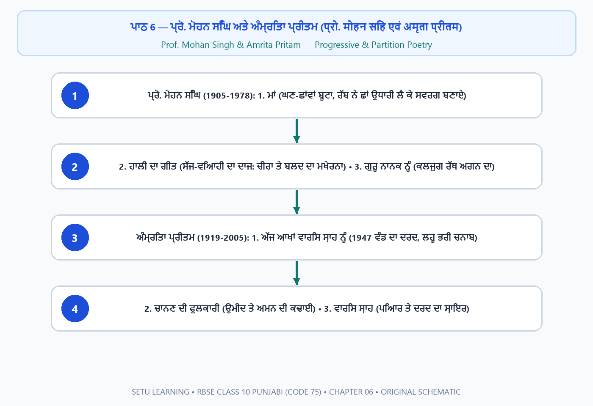

# ਪਾਠ 6 — ਪ੍ਰੋ. ਮੋਹਨ ਸਿੰਘ ਅਤੇ ਅੰਮ੍ਰਿਤਾ ਪ੍ਰੀਤਮ (प्रो. मोहन सिंह एवं अमृता प्रीतम) (Prof. Mohan Singh & Amrita Pritam — Progressive & Partition Poetry)

## भाग 1: अध्याय प्रवेश एवं पाठ्यक्रम मैपिंग (ਪਾਠ-ਪ੍ਰਵੇਸ਼ ਅਤੇ ਪਾਠਕ੍ਰਮ ਮੈਪਿੰਗ)

> RBSE ਜਮਾਤ 10 ਪੰਜਾਬੀ ਪਾਠ-ਪੁਸਤਕ 'ਸਾਹਿਤ ਸੁਗੰਧੀਆਂ' ਦੇ ਸਾਰੇ ਪ੍ਰਸ਼ਨਾਂ ਦੇ ਹੱਲ ਅਤੇ 2014–2026 ਦਾ ਪੂਰਾ ਇਤਿਹਾਸਕ PYQ ਸੰਗ੍ਰਹਿ ਸਰੋਤ-ਪ੍ਰੀਖਣ ਸਮੇਤ ਸੰਕਲਿਤ ਹਨ।

**ਵਿਸ਼ਾ ਕੋਡ (विषय कोड):** 75 (ਤੀਜੀ ਭਾਸ਼ਾ — ਪੰਜਾਬੀ / तृतीया भाषा — पंजाबी) · **ਲੜੀ ਪੁਸਤਕ (श्रृंखला पुस्तक):** 7

**ਪ੍ਰਮਾਣਿਤ ਆਧਾਰ:** RBSE 2025–26 · **ਪਾਠ ਅੰਕ-ਭਾਰ:** 3 ਅੰਕ। ਇਹ ਭਾਰ ਉਸੇ ਸੰਸਕਰਣ ਦਾ ਹੈ; ਅਸਲ ਪ੍ਰਸ਼ਨ-ਵੰਡ ਦੀ ਭਵਿੱਖਬਾਣੀ ਨਹੀਂ।

**ਸਿੱਖਣ ਦੇ ਉਦੇਸ਼ (सीखने के लक्ष्य):** ਪ੍ਰੋ. ਮੋਹਨ ਸਿੰਘ ('ਮਾਂ', 'ਹਾਲੀ ਦਾ ਗੀਤ', 'ਗੁਰੂ ਨਾਨਕ ਨੂੰ') ਅਤੇ ਅੰਮ੍ਰਿਤਾ ਪ੍ਰੀਤਮ ('ਅੱਜ ਆਖਾਂ ਵਾਰਿਸ ਸ਼ਾਹ ਨੂੰ', 'ਚਾਨਣ ਦੀ ਫੁਲਕਾਰੀ', 'ਵਾਰਿਸ ਸ਼ਾਹ') ਦੀਆਂ ਕਵਿਤਾਵਾਂ ਦੀ ਪ੍ਰਸੰਗ ਸਹਿਤ ਵਿਆਖਿਆ, 1947 ਦੀ ਵੰਡ ਦਾ ਦਰਦ ਅਤੇ ਕੇਂਦਰੀ ਭਾਵ ਸਮਝਣਾ।

## भाग 2: शब्दावली एवं अवधारणा कैप्सूल (ਸ਼ਬਦਾਵਲੀ ਅਤੇ ਸੰਕਲਪ ਕੈਪਸੂਲ)

| ਸ਼ਬਦ / ਸੰਕਲਪ | ਅਰਥ / ਵਿਆਖਿਆ |
|---|---|
| ਘਣ-ਛਾਂਵਾਂ ਬੂਟਾ (घण-छांवां बूटा) | ਸੰਘਣੀ ਛਾਂ ਵਾਲਾ ਰੁੱਖ — ਮਾਂ ਦੇ ਨਿਰਸੁਆਰਥ ਪਿਆਰ ਦਾ ਪ੍ਰਤੀਕ (ਮਾਂ ਵਰਗਾ ਘਣ-ਛਾਂਵਾਂ ਬੂਟਾ ਮੈਨੂੰ ਨਜ਼ਰ ਨਾ ਆਏ)। |
| ਮਖੇਰਨਾ (मखेरना) | ਬਲਦਾਂ ਦੇ ਮੱਥੇ ਉੱਤੇ ਮੱਖੀਆਂ ਤੋਂ ਬਚਾਅ ਲਈ ਬੰਨ੍ਹੀ ਜਾਣ ਵਾਲੀ ਝਾਲਰ (ਮੱਥੇ ਤੇਰੇ ਮਖੇਰਨਾ ਪਾ ਕੇ)। |
| ਚੀਰਾ (चीरा) | ਲਾੜੇ ਦੀ ਧਾਰੀਦਾਰ ਸੋਹਣੀ ਪੱਗ (ਵਹੁਟੀ ਮੇਰੀ ਸੱਜ ਵਿਆਹੀ... ਵਿੱਚ ਲਿਆਈ ਚੀਰਾ ਮੇਰਾ, ਨਾਲੇ ਇੱਕ ਮਖੇਰਨਾ ਤੇਰਾ)। |
| ਕਲਜੁਗ ਹੈ ਰੱਥ ਅਗਨ ਦਾ (कलजुग है रत्थ अगन दा) | ਗੁਰੂ ਨਾਨਕ ਦੇਵ ਜੀ ਦਾ ਵਾਕ ਕਿ ਕਲਯੁਗ ਅੱਗ ਦਾ ਰੱਥ ਹੈ (ਪ੍ਰੋ. ਮੋਹਨ ਸਿੰਘ ਦੀ ਕਵਿਤਾ 'ਗੁਰੂ ਨਾਨਕ ਨੂੰ')। |
| ਵਰਕਾ (वरका) | ਕਿਤਾਬ ਦਾ ਪੰਨਾ (ਅੱਜ ਕਿਤਾਬੇ ਇਸ਼ਕ ਦਾ ਕੋਈ ਅਗਲਾ ਵਰਕਾ ਫੋਲ)। |
| ਵੈਣ (वैण) | ਦੁੱਖ ਤੇ ਸੋਗ ਵਿੱਚ ਉੱਚੀ-ਉੱਚੀ ਰੋ ਕੇ ਪਾਏ ਜਾਣ ਵਾਲੇ ਕੀਰਨੇ (ਇੱਕ ਰੋਈ ਸੀ ਧੀ ਪੰਜਾਬ ਦੀ ਤੂੰ ਲਿਖ-ਲਿਖ ਮਾਰੇ ਵੈਣ)। |
| ਬੇਲੇ (बेले) | ਦਰਿਆ ਦੇ ਕੰਢੇ ਦਾ ਸੰਘਣਾ ਘਾਹ-ਝਾੜੀਆਂ ਵਾਲਾ ਜੰਗਲ (ਅੱਜ ਬੇਲੇ ਲਾਸ਼ਾਂ ਵਿਛੀਆਂ ਤੇ ਲਹੂ ਦੀ ਭਰੀ ਚਨਾਬ)। |
| ਵੰਝਲੀ (वंझली) | ਬੰਸਰੀ — ਇੱਥੇ ਪੰਜਾਬ ਦੇ ਪਿਆਰ ਤੇ ਸਾਂਝ ਦਾ ਪ੍ਰਤੀਕ (ਅੱਜ ਸਭੇ ਕੈਦੋ ਬਣ ਗਏ, ਹੁਸਨ ਇਸ਼ਕ ਦੇ ਚੋਰ)। |
| ਫੁਲਕਾਰੀ (फुलकारी) | ਖੱਦਰ ਉੱਤੇ ਰੇਸ਼ਮੀ ਧਾਗਿਆਂ ਨਾਲ ਕੱਢਿਆ ਪੰਜਾਬੀ ਲੋਕ-ਕਢਾਈ ਵਾਲਾ ਕੱਪੜਾ (ਚਾਨਣ ਦੀ ਫੁਲਕਾਰੀ)। |
| ਤੰਦ (तंद) | ਸੂਤ ਜਾਂ ਰੇਸ਼ਮ ਦਾ ਧਾਗਾ। |

## भाग 3: विस्तृत शिक्षण पाठ (ਵਿਸਤ੍ਰਿਤ ਅਧਿਆਪਨ ਪਾਠ)

### 1. ਕਵੀ-ਪਛਾਣ: ਪ੍ਰੋ. ਮੋਹਨ ਸਿੰਘ (1905–1978 ਈ.) ਅਤੇ ਅੰਮ੍ਰਿਤਾ ਪ੍ਰੀਤਮ (1919–2005 ਈ.)
**ਪ੍ਰੋ. ਮੋਹਨ ਸਿੰਘ:** ਆਧੁਨਿਕ ਪੰਜਾਬੀ ਕਵਿਤਾ ਵਿੱਚ ਰੁਮਾਂਟਿਕ ਤੇ ਪ੍ਰਗਤੀਵਾਦੀ ਧਾਰਾ ਦੇ ਮੋਢੀ ਪ੍ਰੋ. ਮੋਹਨ ਸਿੰਘ ਦਾ ਜਨਮ 20 ਅਕਤੂਬਰ 1905 ਈ. ਨੂੰ ਹੋਇਆ। ਉਹਨਾਂ ਦੇ ਪ੍ਰਸਿੱਧ ਕਾਵਿ-ਸੰਗ੍ਰਹਿ 'ਸਾਵੇ ਪੱਤਰ', 'ਕੁਸੁੰਭੜਾ', 'ਅੱਧਵਾਟੇ', 'ਕੱਚ-ਸੱਚ', 'ਆਵਾਜ਼ਾਂ', 'ਵੱਡਾ ਵੇਲਾ' (ਸਾਹਿਤ ਅਕਾਦਮੀ ਪੁਰਸਕਾਰ) ਅਤੇ ਮਹਾਂਕਾਵਿ 'ਨਾਨਕਇਣ' ਹਨ।
**ਅੰਮ੍ਰਿਤਾ ਪ੍ਰੀਤਮ:** ਪੰਜਾਬੀ ਦੀ ਸਿਰਮੌਰ ਕਵਿੱਤਰੀ ਅੰਮ੍ਰਿਤਾ ਪ੍ਰੀਤਮ ਦਾ ਜਨਮ 31 ਅਗਸਤ 1919 ਈ. ਨੂੰ ਗੁਜਰਾਂਵਾਲਾ ਵਿਖੇ ਪਿਤਾ ਕਰਤਾਰ ਸਿੰਘ ਹਿਤਕਾਰੀ ਦੇ ਘਰ ਹੋਇਆ। ਉਹਨਾਂ ਨੂੰ 'ਸੁਨੇਹੜੇ' ਲਈ ਭਾਰਤੀ ਸਾਹਿਤ ਅਕਾਦਮੀ ਪੁਰਸਕਾਰ (1956) ਅਤੇ 'ਕਾਗ਼ਜ਼ ਤੇ ਕੈਨਵਸ' ਲਈ ਭਾਰਤੀ ਗਿਆਨਪੀਠ ਪੁਰਸਕਾਰ (1981) ਮਿਲਿਆ।

### 2. ਪ੍ਰੋ. ਮੋਹਨ ਸਿੰਘ ਦੀਆਂ ਤਿੰਨ ਕਵਿਤਾਵਾਂ
1. **ਮਾਂ ('ਮਾਂ ਵਰਗਾ ਘਣ-ਛਾਂਵਾਂ ਬੂਟਾ, ਮੈਨੂੰ ਨਜ਼ਰ ਨਾ ਆਏ'):**
   - **ਮੁੱਖ ਤੁਕਾਂ:** **'ਮਾਂ ਵਰਗਾ ਘਣ-ਛਾਂਵਾਂ ਬੂਟਾ, ਮੈਨੂੰ ਨਜ਼ਰ ਨਾ ਆਏ । ਲੈ ਕੇ ਜਿਸ ਤੋਂ ਛਾਂ ਉਧਾਰੀ, ਰੱਬ ਨੇ ਸੁਰਗ ਬਣਾਏ । ਬਾਕੀ ਕੁੱਲ ਦੁਨੀਆਂ ਦੇ ਬੂਟੇ, ਜੜ੍ਹ ਸੁੱਕਿਆਂ ਮੁਰਝਾਂਦੇ । ਐਪਰ ਫੁੱਲਾਂ ਦੇ ਮੁਰਝਾਇਆਂ, ਇਹ ਬੂਟਾ ਸੁੱਕ ਜਾਏ ।' (RBSE 2018 Main, 2020 Main, 2025 Supp Q18, 2026 Supp Q3-IV)**
   - **ਵਿਆਖਿਆ:** ਕਵੀ ਕਹਿੰਦਾ ਹੈ ਕਿ ਸੰਸਾਰ ਵਿੱਚ ਮਾਂ ਵਰਗਾ ਸੰਘਣੀ ਛਾਂ ਦੇਣ ਵਾਲਾ ਕੋਈ ਹੋਰ ਬੂਟਾ ਨਹੀਂ ਹੈ। ਰੱਬ ਨੇ ਵੀ ਸਵਰਗ ਬਣਾਉਣ ਵੇਲੇ ਮਾਂ ਦੇ ਪਿਆਰ ਦੀ ਛਾਂ ਉਧਾਰੀ ਲਈ ਸੀ। ਦੁਨੀਆ ਦੇ ਬਾਕੀ ਸਾਰੇ ਬੂਟੇ ਜੜ੍ਹ ਸੁੱਕਣ ਨਾਲ ਸੁੱਕਦੇ ਹਨ, ਪਰ ਮਾਂ ਰੂਪੀ ਬੂਟਾ ਆਪਣੇ ਫੁੱਲਾਂ (ਬੱਚਿਆਂ) ਦੇ ਮੁਰਝਾਉਣ (ਦੁਖੀ ਹੋਣ) ਨਾਲ ਹੀ ਸੁੱਕ ਜਾਂਦਾ ਹੈ।
2. **ਹਾਲੀ ਦਾ ਗੀਤ ('ਵਹੁਟੀ ਮੇਰੀ ਸੱਜ ਵਿਆਹੀ, ਕਿੰਨਾ ਸਾਰਾ ਦਾਜ ਲਿਆਈ'):**
   - **ਮੁੱਖ ਤੁਕਾਂ:** **'ਵਹੁਟੀ ਮੇਰੀ ਸੱਜ ਵਿਆਹੀ, ਕਿੰਨਾ ਸਾਰਾ ਦਾਜ ਲਿਆਈ । ਵਿੱਚ ਲਿਆਈ ਚੀਰਾ ਮੇਰਾ, ਨਾਲੇ ਇੱਕ ਮਖੇਰਨਾ ਤੇਰਾ । ਇਹ ਮਖੇਰਨਾ ਭਾਗਾਂ ਭਰਿਆ, ਮੇਰੀ ਸੱਜ ਵਿਆਹੀ ਜੜਿਆ । ਫੁੰਮਣਾਂ ਅਤੇ ਜ਼ੰਜੀਰਾਂ ਨਾਲ, ਘੋਗਿਆਂ ਤੇ ਤਸਵੀਰਾਂ ਨਾਲ ।' (RBSE 2026 Supp Q18)**
   - **ਵਿਆਖਿਆ:** ਕਿਸਾਨ (ਹਾਲੀ) ਆਪਣੇ ਬਲਦ ਨੂੰ ਪਿਆਰ ਨਾਲ ਸੰਬੋਧਨ ਕਰਦਾ ਹੈ ਕਿ ਮੇਰੀ ਨਵੀਂ ਵਿਆਹੀ ਵਹੁਟੀ ਦਾਜ ਵਿੱਚ ਮੇਰੇ ਲਈ ਚੀਰਾ (ਪੱਗ) ਅਤੇ ਤੇਰੇ ਮੱਥੇ ਲਈ ਫੁੰਮਣਾਂ, ਜ਼ੰਜੀਰਾਂ ਤੇ ਘੋਗਿਆਂ ਨਾਲ ਜੜਿਆ ਸੋਹਣਾ ਮਖੇਰਨਾ ਲਿਆਈ ਹੈ। ਆਪਾਂ ਖੇਤ ਵਾਹ ਕੇ ਤੇ ਕਣਕਾਂ ਬੀਜ ਕੇ ਖੁਸ਼ੀ ਨਾਲ ਮੇਲੇ ਚੱਲਾਂਗੇ।
3. **ਗੁਰੂ ਨਾਨਕ ਨੂੰ ('ਕਲਜੁਗ ਹੈ ਰੱਥ ਅਗਨ ਦਾ, ਤੂੰ ਆਪ ਆਖਿਆ' / 'ਆ ਬਾਬਾ ਤੇਰਾ ਵਤਨ ਹੈ ਵੀਰਾਨ ਹੋ ਗਿਆ'):**
   - **ਭਾਵ:** 1947 ਦੀ ਦੇਸ਼-ਵੰਡ ਸਮੇਂ ਹੋਏ ਫ਼ਿਰਕੂ ਦੰਗਿਆਂ ਤੇ ਕਤਲੇਆਮ ਤੋਂ ਦੁਖੀ ਹੋ ਕੇ ਕਵੀ ਸ੍ਰੀ ਗੁਰੂ ਨਾਨਕ ਦੇਵ ਜੀ ਨੂੰ ਪੁਕਾਰਦਾ ਹੈ ਕਿ ਹੇ ਬਾਬਾ! ਤੂੰ ਆਪ ਕਿਹਾ ਸੀ ਕਿ ਕਲਯੁਗ ਅੱਗ ਦਾ ਰੱਥ ਹੈ; ਅੱਜ ਤੇਰਾ ਵਤਨ ਵੀਰਾਨ ਹੋ ਗਿਆ ਹੈ, ਤੂੰ ਮੁੜ ਆ ਕੇ ਨਫ਼ਰਤ ਦੀ ਅੱਗ ਬੁਝਾ।

### 3. ਅੰਮ੍ਰਿਤਾ ਪ੍ਰੀਤਮ ਦੀਆਂ ਤਿੰਨ ਕਵਿਤਾਵਾਂ
1. **ਅੱਜ ਆਖਾਂ ਵਾਰਿਸ ਸ਼ਾਹ ਨੂੰ:**
   - **ਮੁੱਖ ਤੁਕਾਂ:** **'ਅੱਜ ਆਖਾਂ ਵਾਰਿਸ ਸ਼ਾਹ ਨੂੰ, ਕਿਤੋਂ ਕਬਰਾਂ ਵਿੱਚੋਂ ਬੋਲ ! ਤੇ ਅੱਜ ਕਿਤਾਬੇ ਇਸ਼ਕ ਦਾ, ਕੋਈ ਅਗਲਾ ਵਰਕਾ ਫੋਲ ! ਇੱਕ ਰੋਈ ਸੀ ਧੀ ਪੰਜਾਬ ਦੀ, ਤੂੰ ਲਿਖ-ਲਿਖ ਮਾਰੇ ਵੈਣ, ਅੱਜ ਲੱਖਾਂ ਧੀਆਂ ਰੋਂਦੀਆਂ, ਤੈਨੂੰ ਵਾਰਿਸ ਸ਼ਾਹ ਨੂੰ ਕਹਿਣ : ਉੱਠ ਦਰਦਮੰਦਾਂ ਦਿਆ ਦਰਦੀਆ! ਉੱਠ ਤੱਕ ਆਪਣਾ ਪੰਜਾਬ, ਅੱਜ ਬੇਲੇ ਲਾਸ਼ਾਂ ਵਿਛੀਆਂ, ਤੇ ਲਹੂ ਦੀ ਭਰੀ ਚਨਾਬ ।'**
   - **ਕੇਂਦਰੀ ਭਾਵ:** 1947 ਦੀ ਪੰਜਾਬ ਵੰਡ ਦੇ ਭਿਆਨਕ ਦੁਖਾਂਤ ਸਮੇਂ ਅੰਮ੍ਰਿਤਾ ਪ੍ਰੀਤਮ ਨੇ 'ਹੀਰ' ਦੇ ਅਮਰ ਕਵੀ **ਵਾਰਿਸ ਸ਼ਾਹ** ਨੂੰ ਸੰਬੋਧਨ ਕੀਤਾ ਕਿ ਜਦੋਂ ਪੰਜਾਬ ਦੀ ਇੱਕ ਧੀ (ਹੀਰ) ਰੋਈ ਸੀ ਤਾਂ ਤੂੰ ਪੂਰਾ ਕਿੱਸਾ ਲਿਖ ਕੇ ਵੈਣ ਪਾਏ ਸਨ; ਅੱਜ ਪੰਜਾਬ ਦੀਆਂ ਲੱਖਾਂ ਧੀਆਂ ਰੋਂਦੀਆਂ ਹਨ, ਕਿਸੇ ਨੇ ਪੰਜਾਂ ਪਾਣੀਆਂ ਵਿੱਚ ਨਫ਼ਰਤ ਦਾ ਜ਼ਹਿਰ ਘੋਲ ਦਿੱਤਾ ਹੈ ਤੇ ਸਾਰੇ 'ਕੈਦੋ' ਬਣ ਗਏ ਹਨ।
2. **ਚਾਨਣ ਦੀ ਫੁਲਕਾਰੀ ('ਚਾਨਣ ਦੀ ਫੁਲਕਾਰੀ ਤੋਪਾ ਕੌਣ ਭਰੇ'):** ਕਵਿੱਤਰੀ ਹਨੇਰੇ ਤੇ ਦੁੱਖਾਂ ਨਾਲ ਭਰੇ ਸੰਸਾਰ ਵਿੱਚ ਚਾਨਣ, ਉਮੀਦ ਤੇ ਅਮਨ ਦੀ ਫੁਲਕਾਰੀ ਕੱਢਣ ਦੀ ਤਾਂਘ ਪ੍ਰਗਟ ਕਰਦੀ ਹੈ।
3. **ਵਾਰਿਸ ਸ਼ਾਹ:** ਵਾਰਿਸ ਸ਼ਾਹ ਨੂੰ ਪੰਜਾਬ ਦੇ ਸੱਭਿਆਚਾਰਕ ਪਿਆਰ, ਦਰਦ ਤੇ ਇਸ਼ਕ ਦੀ ਅਮਰ ਆਵਾਜ਼ ਵਜੋਂ ਯਾਦ ਕੀਤਾ ਗਿਆ ਹੈ।

ਪਾਠ 6: ਪ੍ਰੋ. ਮੋਹਨ ਸਿੰਘ ਅਤੇ ਅੰਮ੍ਰਿਤਾ ਪ੍ਰੀਤਮ ਦੀਆਂ ਕਵਿਤਾਵਾਂ ਦਾ ਸੰਕਲਪ ਚਿੱਤਰ

## भाग 4: पाठ्यपुस्तक-अवधारणाओं पर मौलिक हल किए उदाहरण (ਹੱਲ ਕੀਤੇ ਮਿਆਰੀ ਉਦਾਹਰਣ)

ਹੇਠਾਂ ਦਿੱਤੇ ਪ੍ਰਸ਼ਨ ਪਾਠ-ਪੁਸਤਕ 'ਸਾਹਿਤ ਸੁਗੰਧੀਆਂ' ਅਤੇ ਵਿਆਕਰਣ ਦੇ ਸੰਕਲਪਾਂ ਉੱਤੇ ਆਧਾਰਿਤ ਮੌਲਿਕ ਆਦਰਸ਼ ਹੱਲ ਹਨ।

**ਹੱਲ ਕੀਤਾ ਉਦਾਹਰਣ 1: 'ਮਾਂ ਵਰਗਾ ਘਣ-ਛਾਂਵਾਂ ਬੂਟਾ, ਮੈਨੂੰ ਨਜ਼ਰ ਨਾ ਆਏ...' ਕਾਵਿ-ਬੰਦ ਦੀ ਪ੍ਰਸੰਗ ਸਹਿਤ ਵਿਆਖਿਆ ਕਰੋ।**

ਪ੍ਰਸੰਗ: ਇਹ ਕਾਵਿ-ਬੰਦ 'ਸਾਹਿਤ ਸੁਗੰਧੀਆਂ' ਪੁਸਤਕ ਵਿੱਚ ਦਰਜ ਪ੍ਰੋ. ਮੋਹਨ ਸਿੰਘ ਦੀ ਕਵਿਤਾ 'ਮਾਂ' ਵਿੱਚੋਂ ਲਿਆ ਗਿਆ ਹੈ। ਵਿਆਖਿਆ: ਕਵੀ ਕਹਿੰਦਾ ਹੈ ਕਿ ਮੈਨੂੰ ਇਸ ਸੰਸਾਰ ਵਿੱਚ ਮਾਂ ਵਰਗਾ ਸੰਘਣੀ ਛਾਂ ਦੇਣ ਵਾਲਾ ਕੋਈ ਹੋਰ ਬੂਟਾ ਨਜ਼ਰ ਨਹੀਂ ਆਉਂਦਾ। ਰੱਬ ਨੇ ਵੀ ਜਦੋਂ ਸਵਰਗ ਬਣਾਏ ਤਾਂ ਉਸ ਨੇ ਮਾਂ ਕੋਲੋਂ ਹੀ ਪਿਆਰ ਤੇ ਮਮਤਾ ਦੀ ਛਾਂ ਉਧਾਰੀ ਲਈ। ਦੁਨੀਆ ਦੇ ਬਾਕੀ ਸਾਰੇ ਰੁੱਖ-ਬੂਟੇ ਆਪਣੀ ਜੜ੍ਹ ਸੁੱਕਣ ਨਾਲ ਮੁਰਝਾਉਂਦੇ ਹਨ, ਪਰ ਮਾਂ ਇੱਕ ਅਜਿਹਾ ਬੂਟਾ ਹੈ ਜੋ ਆਪਣੇ ਫੁੱਲਾਂ (ਔਲਾਦ/ਬੱਚਿਆਂ) ਦੇ ਮੁਰਝਾਉਣ (ਦੁਖੀ ਹੋਣ) ਨਾਲ ਹੀ ਸੁੱਕ ਜਾਂਦਾ ਹੈ।

**ਹੱਲ ਕੀਤਾ ਉਦਾਹਰਣ 2: 'ਅੱਜ ਆਖਾਂ ਵਾਰਿਸ ਸ਼ਾਹ ਨੂੰ, ਕਿਤੋਂ ਕਬਰਾਂ ਵਿੱਚੋਂ ਬੋਲ...' ਕਾਵਿ-ਬੰਦ ਦੀ ਪ੍ਰਸੰਗ ਸਹਿਤ ਵਿਆਖਿਆ ਕਰੋ।**

ਪ੍ਰਸੰਗ: ਇਹ ਕਾਵਿ-ਬੰਦ 'ਸਾਹਿਤ ਸੁਗੰਧੀਆਂ' ਵਿੱਚ ਦਰਜ ਅੰਮ੍ਰਿਤਾ ਪ੍ਰੀਤਮ ਦੀ ਵਿਸ਼ਵ-ਪ੍ਰਸਿੱਧ ਕਵਿਤਾ 'ਅੱਜ ਆਖਾਂ ਵਾਰਿਸ ਸ਼ਾਹ ਨੂੰ' ਵਿੱਚੋਂ ਹੈ। ਵਿਆਖਿਆ: 1947 ਦੀ ਪੰਜਾਬ ਵੰਡ ਦੇ ਦੁਖਾਂਤ ਸਮੇਂ ਕਵਿੱਤਰੀ ਕਿੱਸਾਕਾਰ ਵਾਰਿਸ ਸ਼ਾਹ ਨੂੰ ਪੁਕਾਰਦੀ ਹੈ ਕਿ ਅੱਜ ਕਬਰਾਂ ਵਿੱਚੋਂ ਬੋਲ ਅਤੇ ਇਸ਼ਕ ਦੀ ਕਿਤਾਬ ਦਾ ਅਗਲਾ ਪੰਨਾ (ਵਰਕਾ) ਖੋਲ੍ਹ। ਜਦੋਂ ਪੰਜਾਬ ਦੀ ਇੱਕ ਧੀ (ਹੀਰ) ਰੋਈ ਸੀ ਤਾਂ ਤੂੰ ਲਿਖ-ਲਿਖ ਕੇ ਵੈਣ ਪਾਏ ਸਨ; ਅੱਜ ਪੰਜਾਬ ਦੀਆਂ ਲੱਖਾਂ ਧੀਆਂ ਰੋਂਦੀਆਂ ਤੈਨੂੰ ਪੁਕਾਰ ਰਹੀਆਂ ਹਨ ਕਿ ਹੇ ਦਰਦਮੰਦਾਂ ਦੇ ਦਰਦੀ! ਉੱਠ ਕੇ ਆਪਣਾ ਪੰਜਾਬ ਵੇਖ, ਜਿੱਥੇ ਬੇਲਿਆਂ ਵਿੱਚ ਲਾਸ਼ਾਂ ਵਿਛੀਆਂ ਹਨ ਤੇ ਚਨਾਬ ਨਦੀ ਲਹੂ ਨਾਲ ਭਰੀ ਵਗ ਰਹੀ ਹੈ।

**ਹੱਲ ਕੀਤਾ ਉਦਾਹਰਣ 3: 'ਵਹੁਟੀ ਮੇਰੀ ਸੱਜ ਵਿਆਹੀ, ਕਿੰਨਾ ਸਾਰਾ ਦਾਜ ਲਿਆਈ...' ਕਾਵਿ-ਬੰਦ ਵਿੱਚ ਕਵੀ ਕਿਸ ਦੀ ਉਪਮਾ ਕਰ ਰਿਹਾ ਹੈ?**

ਇਹ ਕਾਵਿ-ਬੰਦ ਪ੍ਰੋ. ਮੋਹਨ ਸਿੰਘ ਦੀ ਕਵਿਤਾ 'ਹਾਲੀ ਦਾ ਗੀਤ' ਵਿੱਚੋਂ ਹੈ। ਇਸ ਵਿੱਚ ਕਿਸਾਨ (ਹਾਲੀ) ਆਪਣੀ ਨਵੀਂ ਵਿਆਹੀ ਵਹੁਟੀ ਦੇ ਹੁਨਰ ਅਤੇ ਆਪਣੇ ਪਿਆਰੇ **ਬਲਦ** ਦੀ ਉਪਮਾ ਕਰ ਰਿਹਾ ਹੈ, ਜਿਸ ਦੇ ਮੱਥੇ ਲਈ ਵਹੁਟੀ ਦਾਜ ਵਿੱਚ ਫੁੰਮਣਾਂ, ਜ਼ੰਜੀਰਾਂ ਤੇ ਘੋਗਿਆਂ ਨਾਲ ਜੜਿਆ ਭਾਗਾਂ ਭਰਿਆ 'ਮਖੇਰਨਾ' ਲਿਆਈ ਹੈ (RBSE 2026 Supp Q18)।

## भाग 5: सत्यापित बोर्ड प्रश्न एवं स्रोत-स्थिति (ਪ੍ਰਮਾਣਿਤ ਬੋਰਡ ਪ੍ਰਸ਼ਨ ਅਤੇ ਸਰੋਤ-ਸਥਿਤੀ)

RBSE 2026 Supp (`S-75`, Q1-IV, Q2-IV, Q3-IV, Q18), 2025 Supp (Q2-iii, Q3-iii, Q18) ਅਤੇ 2024 Main (Q1-ii, Q1-iii, Q2-iii) ਵਿੱਚ ਇਸ ਪਾਠ ਦੀਆਂ ਕਵਿਤਾਵਾਂ ਲਗਾਤਾਰ ਪੁੱਛੀਆਂ ਗਈਆਂ ਹਨ।

[RBSE 2026 ਮੂਲ ਪੇਪਰ (S-75)](https://rajeduboard.rajasthan.gov.in/books/PAPERS-2026/Sec/S-75.pdf)। ਪ੍ਰਸ਼ਨ ਦਾ ਸੰਖੇਪ ਵਿਸ਼ਾ-ਸੰਦਰਭ ਹੈ; ਸ਼ਬਦ-ਬ-ਸ਼ਬਦ ਪੁਨਰ-ਮੁਦਰਣ ਨਹੀਂ।

## भाग 6: खंडवार मौलिक अभ्यास बैंक (ਖੰਡ-ਵਾਰ ਮੌਲਿਕ ਅਭਿਆਸ ਬੈਂਕ)

**ਅਭਿਆਸ-ਅੰਕ:** ਵਿਦਿਆਰਥੀਆਂ ਦੇ ਸਵੈ-ਅਭਿਆਸ ਲਈ ਹਨ; ਉੱਤਰ ਪਹਿਲਾਂ ਆਪ ਲਿਖੋ, ਫਿਰ ਭਾਗ 9 ਵੇਖੋ।

## ੳ: ਬਹੁ-ਵਿਕਲਪੀ ਪ੍ਰਸ਼ਨ (MCQ) — 15 × 1 ਅੰਕ

**MCQ 1. 'ਗੁਰੂ ਨਾਨਕ ਨੂੰ' ਕਵਿਤਾ ਦਾ ਕਵੀ ਕੌਣ ਹੈ? (RBSE 2024 Main Q1-ii)**

ੳ) ਅੰਮ੍ਰਿਤਾ ਪ੍ਰੀਤਮ  
ਅ) ਧਨੀ ਰਾਮ ਚਾਤ੍ਰਿਕ  
ੲ) ਪ੍ਰੋ. ਮੋਹਨ ਸਿੰਘ  
ਸ) ਭਾਈ ਵੀਰ ਸਿੰਘ

**MCQ 2. 'ਕਲਜੁਗ ਹੈ ਰੱਥ ਅਗਨ ਦਾ, ਤੂੰ ਆਪ ਆਖਿਆ' — ਇਹ ਸਤਰ ਕਿਹੜੀ ਕਵਿਤਾ ਵਿੱਚੋਂ ਲਈ ਗਈ ਹੈ? (RBSE 2026 Supp Q1-IV)**

ੳ) ਧ੍ਰੂ ਹਸਦਾ ਘਰਿ ਆਇਆ  
ਅ) ਗੁਰੂ ਨਾਨਕ ਨੂੰ  
ੲ) ਦੁਰਜੋਧਨ ਵੱਡਾ ਹੰਕਾਰੀ  
ਸ) ਰਾਵਣ ਵੱਡਾ ਹੰਕਾਰੀ

**MCQ 3. 'ਅੰਮ੍ਰਿਤਾ ਪ੍ਰੀਤਮ' ਰਚਿਤ ਕਵਿਤਾ ਕਿਹੜੀ ਹੈ? (RBSE 2024 Main Q1-iii)**

ੳ) ਚਾਨਣ ਦੀ ਫੁਲਕਾਰੀ  
ਅ) ਹਾਲੀ ਦਾ ਗੀਤ  
ੲ) ਰੁੱਖ  
ਸ) ਮਾਂ

**MCQ 4. ਪ੍ਰੋ. ਮੋਹਨ ਸਿੰਘ ਅਨੁਸਾਰ ਸਵਰਗ ਬਣਾਉਣ ਵੇਲੇ ਰੱਬ ਨੂੰ ਛਾਂ ਕਿਸ ਕੋਲੋਂ ਉਧਾਰੀ ਲੈਣੀ ਪਈ?**

ੳ) ਬੱਦਲਾਂ ਕੋਲੋਂ  
ਅ) ਪਿੱਪਲ ਦੇ ਰੁੱਖ ਕੋਲੋਂ  
ੲ) ਚੰਦਰਮਾ ਕੋਲੋਂ  
ਸ) ਮਾਂ ਕੋਲੋਂ

**MCQ 5. 'ਐਪਰ ਫੁੱਲਾਂ ਦੇ ਮੁਰਝਾਇਆਂ, ਇਹ ਬੂਟਾ ਸੁੱਕ ਜਾਏ' — ਇੱਥੇ 'ਫੁੱਲਾਂ' ਤੋਂ ਕੀ ਭਾਵ ਹੈ?**

ੳ) ਟਾਹਣੀਆਂ ਦੇ ਪੱਤੇ  
ਅ) ਖੇਤ ਦੀਆਂ ਫ਼ਸਲਾਂ  
ੲ) ਮਾਂ ਦੇ ਬੱਚੇ (ਔਲਾਦ)  
ਸ) ਬਾਗ਼ ਦੇ ਗੁਲਾਬ

**MCQ 6. 'ਅੱਜ ਆਖਾਂ ਵਾਰਿਸ ਸ਼ਾਹ ਨੂੰ' ਕਵਿਤਾ ਕਿਹੜੇ ਦੁਖਾਂਤ ਦਾ ਜ਼ਿਕਰ ਕਰਦੀ ਹੈ? (RBSE 2025 Supp Q3-iii)**

ੳ) ਕੱਛ ਦੇ ਭੂਚਾਲ ਦਾ  
ਅ) 1947 ਦੀ ਪੰਜਾਬ ਵੰਡ ਦੇ ਦੁਖਾਂਤ ਦਾ  
ੲ) 1919 ਦੇ ਜਲ੍ਹਿਆਂਵਾਲਾ ਬਾਗ਼ ਦਾ  
ਸ) 1857 ਦੇ ਗ਼ਦਰ ਦਾ

**MCQ 7. ਖਾਲੀ ਥਾਂ ਭਰੋ: 'ਇੱਕ ਰੋਈ ਸੀ ................ ਤੂੰ ਲਿਖ ਲਿਖ ਮਾਰੇ ਵੈਣ' (RBSE 2022 Main Q2-iii)**

ੳ) ਧੀ ਪੰਜਾਬ ਦੀ  
ਅ) ਮਾਂ ਪੰਜਾਬ ਦੀ  
ੲ) ਭੈਣ ਪੰਜਾਬ ਦੀ  
ਸ) ਰਾਣੀ ਪੰਜਾਬ ਦੀ

**MCQ 8. ਖਾਲੀ ਥਾਂ ਭਰੋ: 'ਆ ਬਾਬਾ ਤੇਰਾ ਵਤਨ ਹੈ ................' (RBSE 2025 Supp Q2-iii)**

ੳ) ਆਬਾਦ ਹੋ ਗਿਆ  
ਅ) ਖੁਸ਼ਹਾਲ ਹੋ ਗਿਆ  
ੲ) ਆਜ਼ਾਦ ਹੋ ਗਿਆ  
ਸ) ਵੀਰਾਨ ਹੋ ਗਿਆ

**MCQ 9. 'ਹਾਲੀ ਦਾ ਗੀਤ' ਕਵਿਤਾ ਵਿੱਚ ਨਵੀਂ ਵਿਆਹੀ ਵਹੁਟੀ ਦਾਜ ਵਿੱਚ ਬਲਦ ਦੇ ਮੱਥੇ ਲਈ ਕੀ ਲਿਆਈ ਹੈ?**

ੳ) ਪੰਜਾਲੀ  
ਅ) ਚਾਬਕ  
ੲ) ਮਖੇਰਨਾ  
ਸ) ਘੁੰਗਰੂ

**MCQ 10. 'ਹਾਲੀ ਦਾ ਗੀਤ' ਵਿੱਚ ਆਏ ਸ਼ਬਦ 'ਚੀਰਾ' ਦਾ ਕੀ ਅਰਥ ਹੈ?**

ੳ) ਬਲਦ ਦੀ ਰੱਸੀ  
ਅ) ਲਾੜੇ ਦੀ ਧਾਰੀਦਾਰ ਰੰਗਲੀ ਪੱਗ  
ੲ) ਹਲ ਦਾ ਫਾਲਾ  
ਸ) ਖੇਤ ਦੀ ਵੱਟ

**MCQ 11. 'ਅੱਜ ਬੇਲੇ ਲਾਸ਼ਾਂ ਵਿਛੀਆਂ ਤੇ ਲਹੂ ਦੀ ਭਰੀ ਚਨਾਬ' — ਇੱਥੇ 'ਬੇਲੇ' ਸ਼ਬਦ ਦਾ ਕੀ ਅਰਥ ਹੈ?**

ੳ) ਦਰਿਆ ਦੇ ਕੰਢੇ ਦਾ ਘਾਹ-ਝਾੜੀਆਂ ਵਾਲਾ ਜੰਗਲ  
ਅ) ਸ਼ਹਿਰ ਦੇ ਬਾਜ਼ਾਰ  
ੲ) ਪਿੰਡ ਦੀਆਂ ਗਲੀਆਂ  
ਸ) ਉੱਚੇ ਪਹਾੜ

**MCQ 12. 'ਇੱਕ ਰੋਈ ਸੀ ਧੀ ਪੰਜਾਬ ਦੀ' ਵਿੱਚ ਪੰਜਾਬ ਦੀ ਉਸ ਇੱਕ ਧੀ ਤੋਂ ਕਿਸ ਵੱਲ ਸੰਕੇਤ ਹੈ?**

ੳ) ਸੋਹਣੀ ਵੱਲ  
ਅ) ਸਾਹਿਬਾਂ ਵੱਲ  
ੲ) ਸੱਸੀ ਵੱਲ  
ਸ) ਸਲੇਟੀ 'ਹੀਰ' ਵੱਲ

**MCQ 13. 'ਅੱਜ ਸਭੇ ਕੈਦੋ ਬਣ ਗਏ, ਹੁਸਨ ਇਸ਼ਕ ਦੇ ਚੋਰ' ਵਿੱਚ 'ਕੈਦੋ' ਕੌਣ ਸੀ?**

ੳ) ਤਖ਼ਤ ਹਜ਼ਾਰੇ ਦਾ ਕਾਜ਼ੀ  
ਅ) ਰੰਗਪੁਰ ਦਾ ਰਾਜਾ  
ੲ) ਹੀਰ ਦਾ ਲੰਗੜਾ ਚਾਚਾ ਜੋ ਪਿਆਰ ਦਾ ਦੁਸ਼ਮਣ ਸੀ  
ਸ) ਰਾਂਝੇ ਦਾ ਭਰਾ

**MCQ 14. ਖਾਲੀ ਥਾਂ ਭਰੋ: 'ਅੱਜ ਆਖਾਂ ਵਾਰਿਸ ਸ਼ਾਹ ਨੂੰ, ਕਿਤੋਂ ................' (RBSE 2026 Supp Q2-IV)**

ੳ) ਦਰਿਆਵਾਂ ਵਿੱਚੋਂ ਬੋਲ  
ਅ) ਕਬਰਾਂ ਵਿੱਚੋਂ ਬੋਲ  
ੲ) ਮਹੱਲਾਂ ਵਿੱਚੋਂ ਬੋਲ  
ਸ) ਅਸਮਾਨਾਂ ਵਿੱਚੋਂ ਬੋਲ

**MCQ 15. ਅੰਮ੍ਰਿਤਾ ਪ੍ਰੀਤਮ ਨੂੰ ਕਿਹੜੀ ਰਚਨਾ ਲਈ ਭਾਰਤੀ ਗਿਆਨਪੀਠ ਪੁਰਸਕਾਰ ਮਿਲਿਆ?**

ੳ) ਕਾਗ਼ਜ਼ ਤੇ ਕੈਨਵਸ  
ਅ) ਸੁਨੇਹੜੇ  
ੲ) ਚਾਨਣ ਦੀ ਫੁਲਕਾਰੀ  
ਸ) ਪਿੰਜਰ

## ੳ: ਖਾਲੀ ਥਾਵਾਂ ਭਰੋ — 6 × 1 ਅੰਕ

1. ਸੰਘਣੀ ਛਾਂ ਵਾਲਾ ਰੁੱਖ — ਮਾਂ ਦੇ ਨਿਰਸੁਆਰਥ ਪਿਆਰ ਦਾ ਪ੍ਰਤੀਕ (ਮਾਂ ਵਰਗਾ ਘਣ-ਛਾਂਵਾਂ ਬੂਟਾ ਮੈਨੂੰ ਨਜ਼ਰ ਨਾ ਆਏ)। — ਇਸ ਸ਼ਬਦ/ਸੰਕਲਪ ਦਾ ਨਾਂ ਹੈ: ____।  
2. ਬਲਦਾਂ ਦੇ ਮੱਥੇ ਉੱਤੇ ਮੱਖੀਆਂ ਤੋਂ ਬਚਾਅ ਲਈ ਬੰਨ੍ਹੀ ਜਾਣ ਵਾਲੀ ਝਾਲਰ (ਮੱਥੇ ਤੇਰੇ ਮਖੇਰਨਾ ਪਾ ਕੇ)। — ਇਸ ਸ਼ਬਦ/ਸੰਕਲਪ ਦਾ ਨਾਂ ਹੈ: ____।  
3. ਲਾੜੇ ਦੀ ਧਾਰੀਦਾਰ ਸੋਹਣੀ ਪੱਗ (ਵਹੁਟੀ ਮੇਰੀ ਸੱਜ ਵਿਆਹੀ... ਵਿੱਚ ਲਿਆਈ ਚੀਰਾ ਮੇਰਾ, ਨਾਲੇ ਇੱਕ ਮਖੇਰਨਾ ਤੇਰਾ)। — ਇਸ ਸ਼ਬਦ/ਸੰਕਲਪ ਦਾ ਨਾਂ ਹੈ: ____।  
4. ਗੁਰੂ ਨਾਨਕ ਦੇਵ ਜੀ ਦਾ ਵਾਕ ਕਿ ਕਲਯੁਗ ਅੱਗ ਦਾ ਰੱਥ ਹੈ (ਪ੍ਰੋ. ਮੋਹਨ ਸਿੰਘ ਦੀ ਕਵਿਤਾ 'ਗੁਰੂ ਨਾਨਕ ਨੂੰ')। — ਇਸ ਸ਼ਬਦ/ਸੰਕਲਪ ਦਾ ਨਾਂ ਹੈ: ____।  
5. ਕਿਤਾਬ ਦਾ ਪੰਨਾ (ਅੱਜ ਕਿਤਾਬੇ ਇਸ਼ਕ ਦਾ ਕੋਈ ਅਗਲਾ ਵਰਕਾ ਫੋਲ)। — ਇਸ ਸ਼ਬਦ/ਸੰਕਲਪ ਦਾ ਨਾਂ ਹੈ: ____।  
6. ਦੁੱਖ ਤੇ ਸੋਗ ਵਿੱਚ ਉੱਚੀ-ਉੱਚੀ ਰੋ ਕੇ ਪਾਏ ਜਾਣ ਵਾਲੇ ਕੀਰਨੇ (ਇੱਕ ਰੋਈ ਸੀ ਧੀ ਪੰਜਾਬ ਦੀ ਤੂੰ ਲਿਖ-ਲਿਖ ਮਾਰੇ ਵੈਣ)। — ਇਸ ਸ਼ਬਦ/ਸੰਕਲਪ ਦਾ ਨਾਂ ਹੈ: ____।

## ੳ: ਅਤਿ-ਲਘੂ ਉੱਤਰਾਂ ਵਾਲੇ ਪ੍ਰਸ਼ਨ — 8 × 1 ਅੰਕ

1. 'ਗੁਰੂ ਨਾਨਕ ਨੂੰ' ਕਵਿਤਾ ਦਾ ਕਵੀ ਕੌਣ ਹੈ? (RBSE 2024 Main Q1-ii)  
2. 'ਕਲਜੁਗ ਹੈ ਰੱਥ ਅਗਨ ਦਾ, ਤੂੰ ਆਪ ਆਖਿਆ' — ਇਹ ਸਤਰ ਕਿਹੜੀ ਕਵਿਤਾ ਵਿੱਚੋਂ ਲਈ ਗਈ ਹੈ? (RBSE 2026 Supp Q1-IV)  
3. 'ਅੰਮ੍ਰਿਤਾ ਪ੍ਰੀਤਮ' ਰਚਿਤ ਕਵਿਤਾ ਕਿਹੜੀ ਹੈ? (RBSE 2024 Main Q1-iii)  
4. ਪ੍ਰੋ. ਮੋਹਨ ਸਿੰਘ ਅਨੁਸਾਰ ਸਵਰਗ ਬਣਾਉਣ ਵੇਲੇ ਰੱਬ ਨੂੰ ਛਾਂ ਕਿਸ ਕੋਲੋਂ ਉਧਾਰੀ ਲੈਣੀ ਪਈ?  
5. 'ਐਪਰ ਫੁੱਲਾਂ ਦੇ ਮੁਰਝਾਇਆਂ, ਇਹ ਬੂਟਾ ਸੁੱਕ ਜਾਏ' — ਇੱਥੇ 'ਫੁੱਲਾਂ' ਤੋਂ ਕੀ ਭਾਵ ਹੈ?  
6. 'ਅੱਜ ਆਖਾਂ ਵਾਰਿਸ ਸ਼ਾਹ ਨੂੰ' ਕਵਿਤਾ ਕਿਹੜੇ ਦੁਖਾਂਤ ਦਾ ਜ਼ਿਕਰ ਕਰਦੀ ਹੈ? (RBSE 2025 Supp Q3-iii)  
7. ਖਾਲੀ ਥਾਂ ਭਰੋ: 'ਇੱਕ ਰੋਈ ਸੀ ................ ਤੂੰ ਲਿਖ ਲਿਖ ਮਾਰੇ ਵੈਣ' (RBSE 2022 Main Q2-iii)  
8. ਖਾਲੀ ਥਾਂ ਭਰੋ: 'ਆ ਬਾਬਾ ਤੇਰਾ ਵਤਨ ਹੈ ................' (RBSE 2025 Supp Q2-iii)

## ਅ: ਲਘੂ ਉੱਤਰਾਂ ਵਾਲੇ ਪ੍ਰਸ਼ਨ — 6 × 2 ਅੰਕ

**B1.** ਪ੍ਰੋ. ਮੋਹਨ ਸਿੰਘ ਅਨੁਸਾਰ ਰੱਬ ਨੇ ਸਵਰਗ ਕਿਵੇਂ ਬਣਾਇਆ ਹੈ?

**B2.** 'ਐਪਰ ਫੁੱਲਾਂ ਦੇ ਮੁਰਝਾਇਆਂ, ਇਹ ਬੂਟਾ ਸੁੱਕ ਜਾਏ' — ਇਸ ਕਾਵਿ-ਸਤਰ ਤੋਂ ਕੀ ਭਾਵ ਹੈ?

**B3.** 'ਅੱਜ ਆਖਾਂ ਵਾਰਿਸ ਸ਼ਾਹ ਨੂੰ' ਕਵਿਤਾ ਕਿਹੜੇ ਦੁਖਾਂਤ ਦਾ ਜ਼ਿਕਰ ਕਰਦੀ ਹੈ ਅਤੇ ਕਵਿੱਤਰੀ ਵਾਰਿਸ ਸ਼ਾਹ ਨੂੰ ਕਿਉਂ ਯਾਦ ਕਰਦੀ ਹੈ?

**B4.** ਖਾਲੀ ਥਾਵਾਂ ਭਰੋ: (i) ਇੱਕ ਰੋਈ ਸੀ ................ ਤੂੰ ਲਿਖ ਲਿਖ ਮਾਰੇ ਵੈਣ। (ii) ਆ ਬਾਬਾ ਤੇਰਾ ਵਤਨ ਹੈ ................।

**B5.** 'ਕਲਜੁਗ ਹੈ ਰੱਥ ਅਗਨ ਦਾ, ਤੂੰ ਆਪ ਆਖਿਆ' — ਇਹ ਸਤਰ ਕਿਹੜੀ ਕਵਿਤਾ ਵਿੱਚੋਂ ਲਈ ਗਈ ਹੈ ਅਤੇ ਇਸ ਦਾ ਕਵੀ ਕੌਣ ਹੈ?

**B6.** ਅੰਮ੍ਰਿਤਾ ਪ੍ਰੀਤਮ ਦੀਆਂ ਪਾਠ-ਪੁਸਤਕ ਵਿੱਚ ਦਰਜ ਤਿੰਨ ਕਵਿਤਾਵਾਂ ਦੇ ਨਾਂ ਲਿਖੋ।

## ੲ: ਦੀਰਘ ਉੱਤਰਾਂ ਵਾਲੇ ਪ੍ਰਸ਼ਨ — 4 × 3 ਅੰਕ

ਅੰਦਰੂਨੀ ਵਿਕਲਪ ਅਭਿਆਸ: ਪਹਿਲਾਂ ਇੱਕ ਵਿਕਲਪ ਹੱਲ ਕਰੋ ਅਤੇ ਦੁਹਰਾਈ ਵੇਲੇ ਬਾਕੀ ਪ੍ਰਸ਼ਨ ਵੀ ਹੱਲ ਕਰੋ।

**C1.** 'ਅੱਜ ਆਖਾਂ ਵਾਰਿਸ ਸ਼ਾਹ ਨੂੰ' ਕਵਿਤਾ ਦਾ ਸੰਖੇਪ ਸਾਰ ਆਪਣੇ ਸ਼ਬਦਾਂ ਵਿੱਚ ਲਿਖੋ।

**C2.** 'ਮਾਂ' ਕਵਿਤਾ ਦਾ ਕੇਂਦਰੀ ਭਾਵ ਅਤੇ ਸਾਰ ਆਪਣੇ ਸ਼ਬਦਾਂ ਵਿੱਚ ਲਿਖੋ।

**C3.** 'ਹਾਲੀ ਦਾ ਗੀਤ' ਕਵਿਤਾ ਵਿੱਚ ਕਿਸਾਨ ਦੇ ਜੀਵਨ ਅਤੇ ਬਲਦ ਨਾਲ ਉਸ ਦੇ ਪਿਆਰ ਦਾ ਚਿੱਤਰਣ ਕਿਵੇਂ ਹੋਇਆ ਹੈ?

**C4.** 'ਗੁਰੂ ਨਾਨਕ ਨੂੰ' ਕਵਿਤਾ ਵਿੱਚ ਪ੍ਰੋ. ਮੋਹਨ ਸਿੰਘ ਨੇ ਕਿਹੜੇ ਭਾਵ ਪ੍ਰਗਟ ਕੀਤੇ ਹਨ?

## ਸ: ਨਿਬੰਧਾਤਮਕ / ਵਿਸਤ੍ਰਿਤ ਉੱਤਰਾਂ ਵਾਲੇ ਪ੍ਰਸ਼ਨ — 2 × 4 ਅੰਕ

ਅੰਦਰੂਨੀ ਵਿਕਲਪ ਅਭਿਆਸ: D1 ਜਾਂ D2 ਚੁਣੋ; ਬਾਅਦ ਵਿੱਚ ਦੂਜਾ ਵੀ ਹੱਲ ਕਰੋ।

**D1.** 1947 ਦੀ ਪੰਜਾਬ ਵੰਡ ਦੇ ਦੁਖਾਂਤ ਨੂੰ ਪ੍ਰੋ. ਮੋਹਨ ਸਿੰਘ ('ਗੁਰੂ ਨਾਨਕ ਨੂੰ') ਅਤੇ ਅੰਮ੍ਰਿਤਾ ਪ੍ਰੀਤਮ ('ਅੱਜ ਆਖਾਂ ਵਾਰਿਸ ਸ਼ਾਹ ਨੂੰ') ਨੇ ਕਿਵੇਂ ਚਿੱਤਰਿਆ ਹੈ? ਵਿਸਤਾਰ ਨਾਲ ਲਿਖੋ।

**D2.** 'ਵਹੁਟੀ ਮੇਰੀ ਸੱਜ ਵਿਆਹੀ...' ਅਤੇ 'ਮਾਂ ਵਰਗਾ ਘਣ-ਛਾਂਵਾਂ ਬੂਟਾ...' ਕਾਵਿ-ਬੰਦਾਂ ਦੀ ਪ੍ਰਸੰਗ ਸਹਿਤ ਵਿਆਖਿਆ ਕਰੋ।

## भाग 7: सावधानियाँ एवं परीक्षा-त्रुटियाँ (ਸਾਵਧਾਨੀਆਂ ਅਤੇ ਪ੍ਰੀਖਿਆ-ਗ਼ਲਤੀਆਂ)

- **ਗ਼ਲਤੀ 1:** 'ਮਾਂ ਵਰਗਾ ਘਣ-ਛਾਂਵਾਂ ਬੂਟਾ' ਅਤੇ 'ਕੁਝ ਰੁੱਖ ਮੈਨੂੰ ਪੁੱਤ ਲਗਦੇ ਨੇ, ਕੁਝ ਰੁੱਖ ਲਗਦੇ ਮਾਵਾਂ' ਵਿੱਚ ਭੁਲੇਖਾ — ਯਾਦ ਰੱਖੋ: **'ਮਾਂ ਵਰਗਾ ਘਣ-ਛਾਂਵਾਂ ਬੂਟਾ'** ਪ੍ਰੋ. ਮੋਹਨ ਸਿੰਘ ਦੀ ਕਵਿਤਾ 'ਮਾਂ' ਹੈ, ਜਦੋਂਕਿ **'ਕੁਝ ਰੁੱਖ ਮੈਨੂੰ ਪੁੱਤ ਲਗਦੇ ਨੇ'** ਸ਼ਿਵ ਕੁਮਾਰ ਬਟਾਲਵੀ ਦੀ ਕਵਿਤਾ 'ਰੁੱਖ' ਹੈ।
- **ਗ਼ਲਤੀ 2:** 'ਮਖੇਰਨਾ' ਦਾ ਅਰਥ ਗ਼ਲਤ ਲਿਖਣਾ — 'ਮਖੇਰਨਾ' ਬਲਦਾਂ ਦੇ ਮੱਥੇ ਉੱਤੇ ਮੱਖੀਆਂ ਤੋਂ ਬਚਾਅ ਅਤੇ ਸ਼ਿੰਗਾਰ ਲਈ ਬੰਨ੍ਹੀ ਜਾਣ ਵਾਲੀ ਫੁੰਮਣਾਂ-ਘੋਗਿਆਂ ਵਾਲੀ ਝਾਲਰ ਹੁੰਦੀ ਹੈ।

## भाग 8: फटाफट पुनरावृत्ति — 25 बिंदु (ਫਟਾਫਟ ਦੁਹਰਾਈ — 25 ਬਿੰਦੂ)

1. ਘਣ-ਛਾਂਵਾਂ ਬੂਟਾ (घण-छांवां बूटा): ਸੰਘਣੀ ਛਾਂ ਵਾਲਾ ਰੁੱਖ — ਮਾਂ ਦੇ ਨਿਰਸੁਆਰਥ ਪਿਆਰ ਦਾ ਪ੍ਰਤੀਕ (ਮਾਂ ਵਰਗਾ ਘਣ-ਛਾਂਵਾਂ ਬੂਟਾ ਮੈਨੂੰ ਨਜ਼ਰ ਨਾ ਆਏ)।  
2. ਮਖੇਰਨਾ (मखेरना): ਬਲਦਾਂ ਦੇ ਮੱਥੇ ਉੱਤੇ ਮੱਖੀਆਂ ਤੋਂ ਬਚਾਅ ਲਈ ਬੰਨ੍ਹੀ ਜਾਣ ਵਾਲੀ ਝਾਲਰ (ਮੱਥੇ ਤੇਰੇ ਮਖੇਰਨਾ ਪਾ ਕੇ)।  
3. ਚੀਰਾ (चीरा): ਲਾੜੇ ਦੀ ਧਾਰੀਦਾਰ ਸੋਹਣੀ ਪੱਗ (ਵਹੁਟੀ ਮੇਰੀ ਸੱਜ ਵਿਆਹੀ... ਵਿੱਚ ਲਿਆਈ ਚੀਰਾ ਮੇਰਾ, ਨਾਲੇ ਇੱਕ ਮਖੇਰਨਾ ਤੇਰਾ)।  
4. ਕਲਜੁਗ ਹੈ ਰੱਥ ਅਗਨ ਦਾ (कलजुग है रत्थ अगन दा): ਗੁਰੂ ਨਾਨਕ ਦੇਵ ਜੀ ਦਾ ਵਾਕ ਕਿ ਕਲਯੁਗ ਅੱਗ ਦਾ ਰੱਥ ਹੈ (ਪ੍ਰੋ. ਮੋਹਨ ਸਿੰਘ ਦੀ ਕਵਿਤਾ 'ਗੁਰੂ ਨਾਨਕ ਨੂੰ')।  
5. ਵਰਕਾ (वरका): ਕਿਤਾਬ ਦਾ ਪੰਨਾ (ਅੱਜ ਕਿਤਾਬੇ ਇਸ਼ਕ ਦਾ ਕੋਈ ਅਗਲਾ ਵਰਕਾ ਫੋਲ)।  
6. ਵੈਣ (वैण): ਦੁੱਖ ਤੇ ਸੋਗ ਵਿੱਚ ਉੱਚੀ-ਉੱਚੀ ਰੋ ਕੇ ਪਾਏ ਜਾਣ ਵਾਲੇ ਕੀਰਨੇ (ਇੱਕ ਰੋਈ ਸੀ ਧੀ ਪੰਜਾਬ ਦੀ ਤੂੰ ਲਿਖ-ਲਿਖ ਮਾਰੇ ਵੈਣ)।  
7. ਬੇਲੇ (बेले): ਦਰਿਆ ਦੇ ਕੰਢੇ ਦਾ ਸੰਘਣਾ ਘਾਹ-ਝਾੜੀਆਂ ਵਾਲਾ ਜੰਗਲ (ਅੱਜ ਬੇਲੇ ਲਾਸ਼ਾਂ ਵਿਛੀਆਂ ਤੇ ਲਹੂ ਦੀ ਭਰੀ ਚਨਾਬ)।  
8. ਵੰਝਲੀ (वंझली): ਬੰਸਰੀ — ਇੱਥੇ ਪੰਜਾਬ ਦੇ ਪਿਆਰ ਤੇ ਸਾਂਝ ਦਾ ਪ੍ਰਤੀਕ (ਅੱਜ ਸਭੇ ਕੈਦੋ ਬਣ ਗਏ, ਹੁਸਨ ਇਸ਼ਕ ਦੇ ਚੋਰ)।  
9. ਫੁਲਕਾਰੀ (फुलकारी): ਖੱਦਰ ਉੱਤੇ ਰੇਸ਼ਮੀ ਧਾਗਿਆਂ ਨਾਲ ਕੱਢਿਆ ਪੰਜਾਬੀ ਲੋਕ-ਕਢਾਈ ਵਾਲਾ ਕੱਪੜਾ (ਚਾਨਣ ਦੀ ਫੁਲਕਾਰੀ)।  
10. ਤੰਦ (तंद): ਸੂਤ ਜਾਂ ਰੇਸ਼ਮ ਦਾ ਧਾਗਾ।  
11. 'ਗੁਰੂ ਨਾਨਕ ਨੂੰ', 'ਮਾਂ' ਅਤੇ 'ਹਾਲੀ ਦਾ ਗੀਤ' ਪ੍ਰੋ. ਮੋਹਨ ਸਿੰਘ ਦੀਆਂ ਕਵਿਤਾਵਾਂ ਹਨ (RBSE 2024 Main Q1-ii)।  
12. ਇਹ ਸਤਰ ਪ੍ਰੋ. ਮੋਹਨ ਸਿੰਘ ਦੀ ਕਵਿਤਾ 'ਗੁਰੂ ਨਾਨਕ ਨੂੰ' ਵਿੱਚੋਂ ਲਈ ਗਈ ਹੈ (RBSE 2026 Supp Q1-IV)।  
13. 'ਚਾਨਣ ਦੀ ਫੁਲਕਾਰੀ', 'ਅੱਜ ਆਖਾਂ ਵਾਰਿਸ ਸ਼ਾਹ ਨੂੰ' ਅਤੇ 'ਵਾਰਿਸ ਸ਼ਾਹ' ਅੰਮ੍ਰਿਤਾ ਪ੍ਰੀਤਮ ਦੀਆਂ ਰਚਨਾਵਾਂ ਹਨ (RBSE 2024 Main Q1-iii)।  
14. 'ਲੈ ਕੇ ਜਿਸ ਤੋਂ ਛਾਂ ਉਧਾਰੀ, ਰੱਬ ਨੇ ਸੁਰਗ ਬਣਾਏ' — ਮਾਂ ਕੋਲੋਂ (RBSE 2020 Main Q6-ਅ, 2026 Supp Q3-IV)।  
15. 'ਮਾਂ' ਕਵਿਤਾ ਵਿੱਚ ਮਾਂ ਨੂੰ ਬੂਟਾ ਅਤੇ ਬੱਚਿਆਂ ਨੂੰ 'ਫੁੱਲ' ਕਿਹਾ ਗਿਆ ਹੈ (RBSE 2025 Supp Q18)।  
16. ਇਹ ਕਵਿਤਾ 1947 ਦੀ ਦੇਸ਼-ਵੰਡ ਸਮੇਂ ਪੰਜਾਬ ਦੇ ਦੁਖਾਂਤ ਦਾ ਵਰਣਨ ਕਰਦੀ ਹੈ (RBSE 2025 Supp Q3-iii)।  
17. ਪੂਰੀ ਤੁਕ ਹੈ — 'ਇੱਕ ਰੋਈ ਸੀ ਧੀ ਪੰਜਾਬ ਦੀ, ਤੂੰ ਲਿਖ-ਲਿਖ ਮਾਰੇ ਵੈਣ' (RBSE 2022 Main Q2-iii)।  
18. ਪੂਰੀ ਤੁਕ ਹੈ — 'ਆ ਬਾਬਾ ਤੇਰਾ ਵਤਨ ਹੈ ਵੀਰਾਨ ਹੋ ਗਿਆ' (RBSE 2025 Supp Q2-iii)।  
19. 'ਵਿੱਚ ਲਿਆਈ ਚੀਰਾ ਮੇਰਾ, ਨਾਲੇ ਇੱਕ ਮਖੇਰਨਾ ਤੇਰਾ' (RBSE 2026 Supp Q18)।  
20. 'ਚੀਰਾ' ਲਾੜੇ ਵੱਲੋਂ ਬੰਨ੍ਹੀ ਜਾਣ ਵਾਲੀ ਸੁੰਦਰ ਧਾਰੀਦਾਰ ਪੱਗ ਨੂੰ ਕਹਿੰਦੇ ਹਨ (RBSE 2026 Supp Q18-IV)।  
21. ਦਰਿਆ ਦੇ ਕੰਢੇ ਦੇ ਜੰਗਲ/ਝੱਲ ਨੂੰ 'ਬੇਲਾ' ਕਿਹਾ ਜਾਂਦਾ ਹੈ (RBSE 2018 Supp Q6-ਅ)।  
22. ਵਾਰਿਸ ਸ਼ਾਹ ਨੇ ਪੰਜਾਬ ਦੀ ਧੀ 'ਹੀਰ' ਦੇ ਦੁੱਖ ਉੱਤੇ ਕਿੱਸਾ ਹੀਰ ਰਚਿਆ ਸੀ।  
23. ਕੈਦੋ ਹੀਰ ਦਾ ਚਾਚਾ ਸੀ ਜਿਸ ਨੇ ਹੀਰ-ਰਾਂਝੇ ਦੇ ਪਿਆਰ ਵਿੱਚ ਜ਼ਹਿਰ ਘੋਲਿਆ ਸੀ।  
24. ਪੂਰੀ ਤੁਕ ਹੈ — 'ਅੱਜ ਆਖਾਂ ਵਾਰਿਸ ਸ਼ਾਹ ਨੂੰ, ਕਿਤੋਂ ਕਬਰਾਂ ਵਿੱਚੋਂ ਬੋਲ !' (RBSE 2026 Supp Q2-IV)।  
25. ਅੰਮ੍ਰਿਤਾ ਪ੍ਰੀਤਮ ਨੂੰ 1981 ਵਿੱਚ 'ਕਾਗ਼ਜ਼ ਤੇ ਕੈਨਵਸ' ਲਈ ਗਿਆਨਪੀਠ ਪੁਰਸਕਾਰ ਮਿਲਿਆ।

## भाग 9: संपूर्ण अभ्यास उत्तर-कुंजी (ਸੰਪੂਰਨ ਅਭਿਆਸ ਉੱਤਰ-ਕੁੰਜੀ)

## MCQ: ਸਹੀ ਵਿਕਲਪ ਅਤੇ ਕਾਰਨ

**1. ੲ — ਪ੍ਰੋ. ਮੋਹਨ ਸਿੰਘ।** 'ਗੁਰੂ ਨਾਨਕ ਨੂੰ', 'ਮਾਂ' ਅਤੇ 'ਹਾਲੀ ਦਾ ਗੀਤ' ਪ੍ਰੋ. ਮੋਹਨ ਸਿੰਘ ਦੀਆਂ ਕਵਿਤਾਵਾਂ ਹਨ (RBSE 2024 Main Q1-ii)।

**2. ਅ — ਗੁਰੂ ਨਾਨਕ ਨੂੰ।** ਇਹ ਸਤਰ ਪ੍ਰੋ. ਮੋਹਨ ਸਿੰਘ ਦੀ ਕਵਿਤਾ 'ਗੁਰੂ ਨਾਨਕ ਨੂੰ' ਵਿੱਚੋਂ ਲਈ ਗਈ ਹੈ (RBSE 2026 Supp Q1-IV)।

**3. ੳ — ਚਾਨਣ ਦੀ ਫੁਲਕਾਰੀ।** 'ਚਾਨਣ ਦੀ ਫੁਲਕਾਰੀ', 'ਅੱਜ ਆਖਾਂ ਵਾਰਿਸ ਸ਼ਾਹ ਨੂੰ' ਅਤੇ 'ਵਾਰਿਸ ਸ਼ਾਹ' ਅੰਮ੍ਰਿਤਾ ਪ੍ਰੀਤਮ ਦੀਆਂ ਰਚਨਾਵਾਂ ਹਨ (RBSE 2024 Main Q1-iii)।

**4. ਸ — ਮਾਂ ਕੋਲੋਂ।** 'ਲੈ ਕੇ ਜਿਸ ਤੋਂ ਛਾਂ ਉਧਾਰੀ, ਰੱਬ ਨੇ ਸੁਰਗ ਬਣਾਏ' — ਮਾਂ ਕੋਲੋਂ (RBSE 2020 Main Q6-ਅ, 2026 Supp Q3-IV)।

**5. ੲ — ਮਾਂ ਦੇ ਬੱਚੇ (ਔਲਾਦ)।** 'ਮਾਂ' ਕਵਿਤਾ ਵਿੱਚ ਮਾਂ ਨੂੰ ਬੂਟਾ ਅਤੇ ਬੱਚਿਆਂ ਨੂੰ 'ਫੁੱਲ' ਕਿਹਾ ਗਿਆ ਹੈ (RBSE 2025 Supp Q18)।

**6. ਅ — 1947 ਦੀ ਪੰਜਾਬ ਵੰਡ ਦੇ ਦੁਖਾਂਤ ਦਾ।** ਇਹ ਕਵਿਤਾ 1947 ਦੀ ਦੇਸ਼-ਵੰਡ ਸਮੇਂ ਪੰਜਾਬ ਦੇ ਦੁਖਾਂਤ ਦਾ ਵਰਣਨ ਕਰਦੀ ਹੈ (RBSE 2025 Supp Q3-iii)।

**7. ੳ — ਧੀ ਪੰਜਾਬ ਦੀ।** ਪੂਰੀ ਤੁਕ ਹੈ — 'ਇੱਕ ਰੋਈ ਸੀ ਧੀ ਪੰਜਾਬ ਦੀ, ਤੂੰ ਲਿਖ-ਲਿਖ ਮਾਰੇ ਵੈਣ' (RBSE 2022 Main Q2-iii)।

**8. ਸ — ਵੀਰਾਨ ਹੋ ਗਿਆ।** ਪੂਰੀ ਤੁਕ ਹੈ — 'ਆ ਬਾਬਾ ਤੇਰਾ ਵਤਨ ਹੈ ਵੀਰਾਨ ਹੋ ਗਿਆ' (RBSE 2025 Supp Q2-iii)।

**9. ੲ — ਮਖੇਰਨਾ।** 'ਵਿੱਚ ਲਿਆਈ ਚੀਰਾ ਮੇਰਾ, ਨਾਲੇ ਇੱਕ ਮਖੇਰਨਾ ਤੇਰਾ' (RBSE 2026 Supp Q18)।

**10. ਅ — ਲਾੜੇ ਦੀ ਧਾਰੀਦਾਰ ਰੰਗਲੀ ਪੱਗ।** 'ਚੀਰਾ' ਲਾੜੇ ਵੱਲੋਂ ਬੰਨ੍ਹੀ ਜਾਣ ਵਾਲੀ ਸੁੰਦਰ ਧਾਰੀਦਾਰ ਪੱਗ ਨੂੰ ਕਹਿੰਦੇ ਹਨ (RBSE 2026 Supp Q18-IV)।

**11. ੳ — ਦਰਿਆ ਦੇ ਕੰਢੇ ਦਾ ਘਾਹ-ਝਾੜੀਆਂ ਵਾਲਾ ਜੰਗਲ।** ਦਰਿਆ ਦੇ ਕੰਢੇ ਦੇ ਜੰਗਲ/ਝੱਲ ਨੂੰ 'ਬੇਲਾ' ਕਿਹਾ ਜਾਂਦਾ ਹੈ (RBSE 2018 Supp Q6-ਅ)।

**12. ਸ — ਸਲੇਟੀ 'ਹੀਰ' ਵੱਲ।** ਵਾਰਿਸ ਸ਼ਾਹ ਨੇ ਪੰਜਾਬ ਦੀ ਧੀ 'ਹੀਰ' ਦੇ ਦੁੱਖ ਉੱਤੇ ਕਿੱਸਾ ਹੀਰ ਰਚਿਆ ਸੀ।

**13. ੲ — ਹੀਰ ਦਾ ਲੰਗੜਾ ਚਾਚਾ ਜੋ ਪਿਆਰ ਦਾ ਦੁਸ਼ਮਣ ਸੀ।** ਕੈਦੋ ਹੀਰ ਦਾ ਚਾਚਾ ਸੀ ਜਿਸ ਨੇ ਹੀਰ-ਰਾਂਝੇ ਦੇ ਪਿਆਰ ਵਿੱਚ ਜ਼ਹਿਰ ਘੋਲਿਆ ਸੀ।

**14. ਅ — ਕਬਰਾਂ ਵਿੱਚੋਂ ਬੋਲ।** ਪੂਰੀ ਤੁਕ ਹੈ — 'ਅੱਜ ਆਖਾਂ ਵਾਰਿਸ ਸ਼ਾਹ ਨੂੰ, ਕਿਤੋਂ ਕਬਰਾਂ ਵਿੱਚੋਂ ਬੋਲ !' (RBSE 2026 Supp Q2-IV)।

**15. ੳ — ਕਾਗ਼ਜ਼ ਤੇ ਕੈਨਵਸ।** ਅੰਮ੍ਰਿਤਾ ਪ੍ਰੀਤਮ ਨੂੰ 1981 ਵਿੱਚ 'ਕਾਗ਼ਜ਼ ਤੇ ਕੈਨਵਸ' ਲਈ ਗਿਆਨਪੀਠ ਪੁਰਸਕਾਰ ਮਿਲਿਆ।

**ਖਾਲੀ ਥਾਵਾਂ:** 1. ਘਣ-ਛਾਂਵਾਂ ਬੂਟਾ (घण-छांवां बूटा); 2. ਮਖੇਰਨਾ (मखेरना); 3. ਚੀਰਾ (चीरा); 4. ਕਲਜੁਗ ਹੈ ਰੱਥ ਅਗਨ ਦਾ (कलजुग है रत्थ अगन दा); 5. ਵਰਕਾ (वरका); 6. ਵੈਣ (वैण)

**ਅਤਿ-ਲਘੂ ਉੱਤਰ:**

1. ਪ੍ਰੋ. ਮੋਹਨ ਸਿੰਘ। 'ਗੁਰੂ ਨਾਨਕ ਨੂੰ', 'ਮਾਂ' ਅਤੇ 'ਹਾਲੀ ਦਾ ਗੀਤ' ਪ੍ਰੋ. ਮੋਹਨ ਸਿੰਘ ਦੀਆਂ ਕਵਿਤਾਵਾਂ ਹਨ (RBSE 2024 Main Q1-ii)।

2. ਗੁਰੂ ਨਾਨਕ ਨੂੰ। ਇਹ ਸਤਰ ਪ੍ਰੋ. ਮੋਹਨ ਸਿੰਘ ਦੀ ਕਵਿਤਾ 'ਗੁਰੂ ਨਾਨਕ ਨੂੰ' ਵਿੱਚੋਂ ਲਈ ਗਈ ਹੈ (RBSE 2026 Supp Q1-IV)।

3. ਚਾਨਣ ਦੀ ਫੁਲਕਾਰੀ। 'ਚਾਨਣ ਦੀ ਫੁਲਕਾਰੀ', 'ਅੱਜ ਆਖਾਂ ਵਾਰਿਸ ਸ਼ਾਹ ਨੂੰ' ਅਤੇ 'ਵਾਰਿਸ ਸ਼ਾਹ' ਅੰਮ੍ਰਿਤਾ ਪ੍ਰੀਤਮ ਦੀਆਂ ਰਚਨਾਵਾਂ ਹਨ (RBSE 2024 Main Q1-iii)।

4. ਮਾਂ ਕੋਲੋਂ। 'ਲੈ ਕੇ ਜਿਸ ਤੋਂ ਛਾਂ ਉਧਾਰੀ, ਰੱਬ ਨੇ ਸੁਰਗ ਬਣਾਏ' — ਮਾਂ ਕੋਲੋਂ (RBSE 2020 Main Q6-ਅ, 2026 Supp Q3-IV)।

5. ਮਾਂ ਦੇ ਬੱਚੇ (ਔਲਾਦ)। 'ਮਾਂ' ਕਵਿਤਾ ਵਿੱਚ ਮਾਂ ਨੂੰ ਬੂਟਾ ਅਤੇ ਬੱਚਿਆਂ ਨੂੰ 'ਫੁੱਲ' ਕਿਹਾ ਗਿਆ ਹੈ (RBSE 2025 Supp Q18)।

6. 1947 ਦੀ ਪੰਜਾਬ ਵੰਡ ਦੇ ਦੁਖਾਂਤ ਦਾ। ਇਹ ਕਵਿਤਾ 1947 ਦੀ ਦੇਸ਼-ਵੰਡ ਸਮੇਂ ਪੰਜਾਬ ਦੇ ਦੁਖਾਂਤ ਦਾ ਵਰਣਨ ਕਰਦੀ ਹੈ (RBSE 2025 Supp Q3-iii)।

7. ਧੀ ਪੰਜਾਬ ਦੀ। ਪੂਰੀ ਤੁਕ ਹੈ — 'ਇੱਕ ਰੋਈ ਸੀ ਧੀ ਪੰਜਾਬ ਦੀ, ਤੂੰ ਲਿਖ-ਲਿਖ ਮਾਰੇ ਵੈਣ' (RBSE 2022 Main Q2-iii)।

8. ਵੀਰਾਨ ਹੋ ਗਿਆ। ਪੂਰੀ ਤੁਕ ਹੈ — 'ਆ ਬਾਬਾ ਤੇਰਾ ਵਤਨ ਹੈ ਵੀਰਾਨ ਹੋ ਗਿਆ' (RBSE 2025 Supp Q2-iii)।

**B1. ਪ੍ਰੋ. ਮੋਹਨ ਸਿੰਘ ਅਨੁਸਾਰ ਰੱਬ ਨੇ ਸਵਰਗ ਕਿਵੇਂ ਬਣਾਇਆ ਹੈ?**

ਪ੍ਰੋ. ਮੋਹਨ ਸਿੰਘ ਅਨੁਸਾਰ ਰੱਬ ਨੇ ਮਾਂ ਰੂਪੀ ਘਣ-ਛਾਂਵੇਂ ਬੂਟੇ ਤੋਂ ਛਾਂ ਉਧਾਰੀ ਲੈ ਕੇ ਸਵਰਗ ਬਣਾਇਆ ਹੈ (RBSE 2018 Main, 2020 Main, 2026 Supp Q3-IV)।

**B2. 'ਐਪਰ ਫੁੱਲਾਂ ਦੇ ਮੁਰਝਾਇਆਂ, ਇਹ ਬੂਟਾ ਸੁੱਕ ਜਾਏ' — ਇਸ ਕਾਵਿ-ਸਤਰ ਤੋਂ ਕੀ ਭਾਵ ਹੈ?**

ਇੱਥੇ 'ਫੁੱਲਾਂ' ਤੋਂ ਭਾਵ ਮਾਂ ਦੇ ਬੱਚੇ (ਔਲਾਦ) ਹਨ ਅਤੇ 'ਬੂਟਾ' ਮਾਂ ਹੈ। ਭਾਵ ਇਹ ਹੈ ਕਿ ਬੱਚਿਆਂ ਉੱਤੇ ਕੋਈ ਦੁੱਖ ਜਾਂ ਮੁਸੀਬਤ ਆਉਣ ਨਾਲ ਮਾਂ ਅੰਦਰੋਂ ਤੜਪ ਕੇ ਸੁੱਕ ਜਾਂਦੀ ਹੈ (RBSE 2025 Supp Q18)।

**B3. 'ਅੱਜ ਆਖਾਂ ਵਾਰਿਸ ਸ਼ਾਹ ਨੂੰ' ਕਵਿਤਾ ਕਿਹੜੇ ਦੁਖਾਂਤ ਦਾ ਜ਼ਿਕਰ ਕਰਦੀ ਹੈ ਅਤੇ ਕਵਿੱਤਰੀ ਵਾਰਿਸ ਸ਼ਾਹ ਨੂੰ ਕਿਉਂ ਯਾਦ ਕਰਦੀ ਹੈ?**

ਇਹ ਕਵਿਤਾ **ਸੰਨ 1947 ਦੀ ਪੰਜਾਬ ਵੰਡ ਦੇ ਦੁਖਾਂਤ** ਦਾ ਜ਼ਿਕਰ ਕਰਦੀ ਹੈ। ਕਵਿੱਤਰੀ ਵਾਰਿਸ ਸ਼ਾਹ ਨੂੰ ਇਸ ਲਈ ਯਾਦ ਕਰਦੀ ਹੈ ਕਿਉਂਕਿ ਉਸ ਨੇ ਪੰਜਾਬ ਦੀ ਇੱਕ ਧੀ (ਹੀਰ) ਦੇ ਦੁੱਖ ਉੱਤੇ ਕਿੱਸਾ ਲਿਖਿਆ ਸੀ, ਪਰ 1947 ਵਿੱਚ ਪੰਜਾਬ ਦੀਆਂ ਲੱਖਾਂ ਧੀਆਂ ਰੋ ਰਹੀਆਂ ਸਨ (RBSE 2018 Main, 2022 Main Q3-iv, 2025 Supp Q3-iii)।

**B4. ਖਾਲੀ ਥਾਵਾਂ ਭਰੋ: (i) ਇੱਕ ਰੋਈ ਸੀ ................ ਤੂੰ ਲਿਖ ਲਿਖ ਮਾਰੇ ਵੈਣ। (ii) ਆ ਬਾਬਾ ਤੇਰਾ ਵਤਨ ਹੈ ................।**

(i) ਇੱਕ ਰੋਈ ਸੀ **ਧੀ ਪੰਜਾਬ ਦੀ** ਤੂੰ ਲਿਖ ਲਿਖ ਮਾਰੇ ਵੈਣ (RBSE 2022 Main Q2-iii)। (ii) ਆ ਬਾਬਾ ਤੇਰਾ ਵਤਨ ਹੈ **ਵੀਰਾਨ ਹੋ ਗਿਆ** (RBSE 2025 Supp Q2-iii)।

**B5. 'ਕਲਜੁਗ ਹੈ ਰੱਥ ਅਗਨ ਦਾ, ਤੂੰ ਆਪ ਆਖਿਆ' — ਇਹ ਸਤਰ ਕਿਹੜੀ ਕਵਿਤਾ ਵਿੱਚੋਂ ਲਈ ਗਈ ਹੈ ਅਤੇ ਇਸ ਦਾ ਕਵੀ ਕੌਣ ਹੈ?**

ਇਹ ਸਤਰ ਪ੍ਰੋ. ਮੋਹਨ ਸਿੰਘ ਦੀ ਕਵਿਤਾ **'ਗੁਰੂ ਨਾਨਕ ਨੂੰ'** ਵਿੱਚੋਂ ਲਈ ਗਈ ਹੈ (RBSE 2024 Main Q1-ii, 2026 Supp Q1-IV)।

**B6. ਅੰਮ੍ਰਿਤਾ ਪ੍ਰੀਤਮ ਦੀਆਂ ਪਾਠ-ਪੁਸਤਕ ਵਿੱਚ ਦਰਜ ਤਿੰਨ ਕਵਿਤਾਵਾਂ ਦੇ ਨਾਂ ਲਿਖੋ।**

ਅੰਮ੍ਰਿਤਾ ਪ੍ਰੀਤਮ ਦੀਆਂ ਤਿੰਨ ਕਵਿਤਾਵਾਂ ਹਨ — **1. ਅੱਜ ਆਖਾਂ ਵਾਰਿਸ ਸ਼ਾਹ ਨੂੰ, 2. ਚਾਨਣ ਦੀ ਫੁਲਕਾਰੀ, 3. ਵਾਰਿਸ ਸ਼ਾਹ** (RBSE 2024 Main Q1-iii)।

**C1. 'ਅੱਜ ਆਖਾਂ ਵਾਰਿਸ ਸ਼ਾਹ ਨੂੰ' ਕਵਿਤਾ ਦਾ ਸੰਖੇਪ ਸਾਰ ਆਪਣੇ ਸ਼ਬਦਾਂ ਵਿੱਚ ਲਿਖੋ।**

1. ਅੰਮ੍ਰਿਤਾ ਪ੍ਰੀਤਮ ਨੇ ਇਹ ਕਵਿਤਾ 1947 ਦੀ ਦੇਸ਼-ਵੰਡ ਸਮੇਂ ਪੰਜਾਬ ਵਿੱਚ ਹੋਏ ਭਿਆਨਕ ਕਤਲੇਆਮ ਅਤੇ ਔਰਤਾਂ ਦੀ ਬੇਪੱਤੀ ਦੇ ਦਰਦ ਵਿੱਚ ਲਿਖੀ। 2. ਕਵਿੱਤਰੀ 'ਹੀਰ' ਦੇ ਰਚੈਤਾ ਵਾਰਿਸ ਸ਼ਾਹ ਨੂੰ ਕਬਰ ਵਿੱਚੋਂ ਉੱਠ ਕੇ ਬੋਲਣ ਲਈ ਕਹਿੰਦੀ ਹੈ ਕਿ ਜਦੋਂ ਇੱਕ ਧੀ ਰੋਈ ਸੀ ਤਾਂ ਤੂੰ ਵੈਣ ਪਾਏ ਸਨ, ਅੱਜ ਲੱਖਾਂ ਧੀਆਂ ਰੋ ਰਹੀਆਂ ਹਨ। 3. ਬੇਲਿਆਂ ਵਿੱਚ ਲਾਸ਼ਾਂ ਵਿਛੀਆਂ ਹਨ, ਚਨਾਬ ਲਹੂ ਨਾਲ ਭਰ ਗਿਆ ਹੈ ਤੇ ਪੰਜਾਂ ਦਰਿਆਵਾਂ ਦੇ ਪਾਣੀ ਵਿੱਚ ਕਿਸੇ ਨੇ ਨਫ਼ਰਤ ਦਾ ਜ਼ਹਿਰ ਘੋਲ ਦਿੱਤਾ ਹੈ। 4. ਪਿਆਰ ਦੀ ਵੰਝਲੀ ਗੁਆਚ ਗਈ ਹੈ ਤੇ ਸਾਰੇ ਕੈਦੋ ਬਣ ਗਏ ਹਨ।

**C2. 'ਮਾਂ' ਕਵਿਤਾ ਦਾ ਕੇਂਦਰੀ ਭਾਵ ਅਤੇ ਸਾਰ ਆਪਣੇ ਸ਼ਬਦਾਂ ਵਿੱਚ ਲਿਖੋ।**

1. ਪ੍ਰੋ. ਮੋਹਨ ਸਿੰਘ ਦੀ ਕਵਿਤਾ 'ਮਾਂ' ਵਿੱਚ ਮਾਂ ਦੇ ਨਿਰਸੁਆਰਥ ਪਿਆਰ ਅਤੇ ਮਮਤਾ ਦੀ ਮਹਿਮਾ ਗਾਈ ਗਈ ਹੈ। 2. ਕਵੀ ਮਾਂ ਦੀ ਤੁਲਨਾ ਸੰਘਣੀ ਛਾਂ ਵਾਲੇ ਬੂਟੇ ('ਘਣ-ਛਾਂਵਾਂ ਬੂਟਾ') ਨਾਲ ਕਰਦਾ ਹੈ ਜਿਸ ਤੋਂ ਛਾਂ ਉਧਾਰੀ ਲੈ ਕੇ ਰੱਬ ਨੇ ਸਵਰਗ ਬਣਾਇਆ। 3. ਸੰਸਾਰ ਦੇ ਸਾਰੇ ਰੁੱਖ ਜੜ੍ਹ ਸੁੱਕਣ ਨਾਲ ਸੁੱਕਦੇ ਹਨ, ਪਰ ਮਾਂ ਆਪਣੇ ਬੱਚਿਆਂ (ਫੁੱਲਾਂ) ਦੇ ਦੁਖੀ ਹੋਣ ਨਾਲ ਹੀ ਸੁੱਕ ਜਾਂਦੀ ਹੈ। 4. ਮਾਂ ਦੀ ਮਮਤਾ ਦਾ ਦੇਣ ਸਾਰੀ ਉਮਰ ਨਹੀਂ ਦਿੱਤਾ ਜਾ ਸਕਦਾ।

**C3. 'ਹਾਲੀ ਦਾ ਗੀਤ' ਕਵਿਤਾ ਵਿੱਚ ਕਿਸਾਨ ਦੇ ਜੀਵਨ ਅਤੇ ਬਲਦ ਨਾਲ ਉਸ ਦੇ ਪਿਆਰ ਦਾ ਚਿੱਤਰਣ ਕਿਵੇਂ ਹੋਇਆ ਹੈ?**

1. 'ਹਾਲੀ ਦਾ ਗੀਤ' ਵਿੱਚ ਪ੍ਰੋ. ਮੋਹਨ ਸਿੰਘ ਨੇ ਪੰਜਾਬੀ ਕਿਸਾਨ (ਹਾਲੀ) ਦੇ ਮਿਹਨਤੀ ਤੇ ਖੁਸ਼ਹਾਲ ਜੀਵਨ ਨੂੰ ਪੇਸ਼ ਕੀਤਾ ਹੈ। 2. ਕਿਸਾਨ ਆਪਣੇ ਬਲਦ ਨੂੰ ਆਪਣੇ ਪਰਿਵਾਰ ਦਾ ਜੀਅ ਸਮਝਦਾ ਹੈ। 3. ਉਹ ਦੱਸਦਾ ਹੈ ਕਿ ਉਸ ਦੀ ਨਵੀਂ ਵਿਆਹੀ ਵਹੁਟੀ ਦਾਜ ਵਿੱਚ ਉਸ ਲਈ ਚੀਰਾ ਅਤੇ ਬਲਦ ਦੇ ਮੱਥੇ ਲਈ ਫੁੰਮਣਾਂ ਤੇ ਘੋਗਿਆਂ ਨਾਲ ਸਜਿਆ ਮਖੇਰਨਾ ਲਿਆਈ ਹੈ। 4. ਕਿਸਾਨ ਬਲਦ ਨੂੰ ਹੌਸਲਾ ਦਿੰਦਾ ਹੈ ਕਿ ਹਲ ਵਾਹ ਕੇ ਤੇ ਕਣਕਾਂ ਬੀਜ ਕੇ ਆਪਾਂ ਸ਼ਿੰਗਾਰ ਕਰਕੇ ਮੇਲੇ ਚੱਲਾਂਗੇ।

**C4. 'ਗੁਰੂ ਨਾਨਕ ਨੂੰ' ਕਵਿਤਾ ਵਿੱਚ ਪ੍ਰੋ. ਮੋਹਨ ਸਿੰਘ ਨੇ ਕਿਹੜੇ ਭਾਵ ਪ੍ਰਗਟ ਕੀਤੇ ਹਨ?**

1. 1947 ਦੀ ਵੰਡ ਸਮੇਂ ਹੋਏ ਫ਼ਿਰਕੂ ਦੰਗਿਆਂ ਨੂੰ ਵੇਖ ਕੇ ਪ੍ਰੋ. ਮੋਹਨ ਸਿੰਘ ਸ੍ਰੀ ਗੁਰੂ ਨਾਨਕ ਦੇਵ ਜੀ ਨੂੰ ਪੁਕਾਰਦੇ ਹਨ। 2. ਕਵੀ ਕਹਿੰਦਾ ਹੈ ਕਿ ਹੇ ਬਾਬਾ! ਤੂੰ ਕਿਹਾ ਸੀ ਕਿ ਕਲਯੁਗ ਅੱਗ ਦਾ ਰੱਥ ਹੈ ਅਤੇ ਕੂੜ (ਝੂਠ) ਇਸ ਦਾ ਰਥਵਾਨ ਹੈ। 3. ਅੱਜ ਤੇਰਾ ਵਤਨ ਪੰਜਾਬ ਨਫ਼ਰਤ ਦੀ ਅੱਗ ਵਿੱਚ ਸੜ ਕੇ ਵੀਰਾਨ ਹੋ ਗਿਆ ਹੈ ਤੇ ਭਰਾ ਹੀ ਭਰਾ ਦਾ ਲਹੂ ਵਹਾ ਰਿਹਾ ਹੈ। 4. ਕਵੀ ਗੁਰੂ ਜੀ ਨੂੰ ਮੁੜ ਆ ਕੇ ਪ੍ਰੇਮ ਤੇ ਸ਼ਾਂਤੀ ਦਾ ਉਪਦੇਸ਼ ਦੇਣ ਦੀ ਅਰਜ਼ੋਈ ਕਰਦਾ ਹੈ।

**D1. 1947 ਦੀ ਪੰਜਾਬ ਵੰਡ ਦੇ ਦੁਖਾਂਤ ਨੂੰ ਪ੍ਰੋ. ਮੋਹਨ ਸਿੰਘ ('ਗੁਰੂ ਨਾਨਕ ਨੂੰ') ਅਤੇ ਅੰਮ੍ਰਿਤਾ ਪ੍ਰੀਤਮ ('ਅੱਜ ਆਖਾਂ ਵਾਰਿਸ ਸ਼ਾਹ ਨੂੰ') ਨੇ ਕਿਵੇਂ ਚਿੱਤਰਿਆ ਹੈ? ਵਿਸਤਾਰ ਨਾਲ ਲਿਖੋ।**

1. 1947 ਦੀ ਵੰਡ ਪੰਜਾਬੀ ਇਤਿਹਾਸ ਦਾ ਸਭ ਤੋਂ ਵੱਡਾ ਦੁਖਾਂਤ ਸੀ ਜਿਸ ਨੇ ਲੱਖਾਂ ਲੋਕਾਂ ਦੀ ਜਾਨ ਲਈ ਤੇ ਕਰੋੜਾਂ ਨੂੰ ਬੇਘਰ ਕੀਤਾ। 2. ਅੰਮ੍ਰਿਤਾ ਪ੍ਰੀਤਮ ਨੇ 'ਅੱਜ ਆਖਾਂ ਵਾਰਿਸ ਸ਼ਾਹ ਨੂੰ' ਵਿੱਚ ਪੰਜਾਬ ਦੀ ਸਾਂਝੀ ਸੱਭਿਆਚਾਰਕ ਵਿਰਾਸਤ ਦੇ ਪ੍ਰਤੀਕ ਵਾਰਿਸ ਸ਼ਾਹ ਨੂੰ ਆਵਾਜ਼ ਮਾਰੀ ਅਤੇ ਲੱਖਾਂ ਧੀਆਂ ਦੇ ਦਰਦ, ਲਹੂ ਨਾਲ ਭਰੀ ਚਨਾਬ ਤੇ ਕੈਦੋ ਬਣੇ ਸਮਾਜ ਦਾ ਮਰਸੀਆ ਲਿਖਿਆ। 3. ਦੂਜੇ ਪਾਸੇ ਪ੍ਰੋ. ਮੋਹਨ ਸਿੰਘ ਨੇ 'ਗੁਰੂ ਨਾਨਕ ਨੂੰ' ਕਵਿਤਾ ਵਿੱਚ ਮਨੁੱਖੀ ਭਾਈਚਾਰੇ ਦੇ ਮੋਢੀ ਸ੍ਰੀ ਗੁਰੂ ਨਾਨਕ ਦੇਵ ਜੀ ਨੂੰ ਪੁਕਾਰਿਆ ਕਿ ਉਹਨਾਂ ਦਾ ਵਤਨ ਫ਼ਿਰਕੂ ਅੱਗ ਵਿੱਚ ਵੀਰਾਨ ਹੋ ਗਿਆ ਹੈ। 4. ਦੋਵੇਂ ਕਵਿਤਾਵਾਂ ਨਫ਼ਰਤ ਵਿਰੁੱਧ ਮਨੁੱਖਤਾ, ਅਮਨ ਅਤੇ ਸਾਂਝੀਵਾਲਤਾ ਦਾ ਅਮਰ ਹੋਕਾ ਦਿੰਦੀਆਂ ਹਨ।

**D2. 'ਵਹੁਟੀ ਮੇਰੀ ਸੱਜ ਵਿਆਹੀ...' ਅਤੇ 'ਮਾਂ ਵਰਗਾ ਘਣ-ਛਾਂਵਾਂ ਬੂਟਾ...' ਕਾਵਿ-ਬੰਦਾਂ ਦੀ ਪ੍ਰਸੰਗ ਸਹਿਤ ਵਿਆਖਿਆ ਕਰੋ।**

1. ਪ੍ਰਸੰਗ: ਇਹ ਦੋਵੇਂ ਕਾਵਿ-ਬੰਦ 'ਸਾਹਿਤ ਸੁਗੰਧੀਆਂ' ਪੁਸਤਕ ਵਿੱਚ ਦਰਜ ਪ੍ਰੋ. ਮੋਹਨ ਸਿੰਘ ਦੀਆਂ ਕਵਿਤਾਵਾਂ 'ਹਾਲੀ ਦਾ ਗੀਤ' ਅਤੇ 'ਮਾਂ' ਵਿੱਚੋਂ ਹਨ। 2. ਪਹਿਲੇ ਕਾਵਿ-ਬੰਦ ਦੀ ਵਿਆਖਿਆ: ਹਾਲੀ ਆਪਣੇ ਬਲਦ ਨੂੰ ਕਹਿੰਦਾ ਹੈ ਕਿ ਮੇਰੀ ਨਵੀਂ ਵਿਆਹੀ ਵਹੁਟੀ ਦਾਜ ਵਿੱਚ ਮੇਰਾ ਚੀਰਾ (ਪੱਗ) ਅਤੇ ਤੇਰਾ ਭਾਗਾਂ ਭਰਿਆ ਮਖੇਰਨਾ ਲਿਆਈ ਹੈ, ਜੋ ਫੁੰਮਣਾਂ, ਜ਼ੰਜੀਰਾਂ, ਘੋਗਿਆਂ ਤੇ ਤਸਵੀਰਾਂ ਨਾਲ ਜੜਿਆ ਹੋਇਆ ਹੈ। 3. ਦੂਜੇ ਕਾਵਿ-ਬੰਦ ਦੀ ਵਿਆਖਿਆ: ਮਾਂ ਵਰਗਾ ਸੰਘਣੀ ਛਾਂ ਵਾਲਾ ਬੂਟਾ ਹੋਰ ਕੋਈ ਨਹੀਂ; ਰੱਬ ਨੇ ਉਸ ਤੋਂ ਛਾਂ ਉਧਾਰੀ ਲੈ ਕੇ ਸਵਰਗ ਬਣਾਏ। ਬਾਕੀ ਬੂਟੇ ਜੜ੍ਹ ਸੁੱਕਣ ਨਾਲ ਸੁੱਕਦੇ ਹਨ ਪਰ ਮਾਂ ਰੂਪੀ ਬੂਟਾ ਬੱਚਿਆਂ (ਫੁੱਲਾਂ) ਦੇ ਮੁਰਝਾਉਣ ਨਾਲ ਹੀ ਸੁੱਕ ਜਾਂਦਾ ਹੈ।

## भाग 10: 10 मिनट / 10 अंक आत्म-मूल्यांकन एवं संदर्भ (10 ਮਿੰਟ / 10 ਅੰਕ ਸਵੈ-ਮੁਲਾਂਕਣ)

ਸਮਾਂ: 10 ਮਿੰਟ। ਪਹਿਲਾਂ ਪੁਸਤਕ ਬੰਦ ਕਰੋ।

1. MCQ 3 ਅਤੇ 11 ਹੱਲ ਕਰੋ। (1 + 1)
2. B1 ਅਤੇ B3 ਦੇ ਉੱਤਰ ਲਿਖੋ। (2 + 2)
3. D1 ਹੱਲ ਕਰੋ। (4)

**ਉੱਤਰ-ਕੁੰਜੀ:** ਭਾਗ 9 ਵਿੱਚ ਸੰਬੰਧਿਤ ਕ੍ਰਮਾਂਕ ਵੇਖੋ। **ਸਵੈ-ਮੁਲਾਂਕਣ:** 8–10: ਅੱਗੇ ਵਧੋ; 5–7: ਛੁੱਟੇ ਵਿਸ਼ੇ ਦੀ ਦੁਹਰਾਈ; 0–4: ਭਾਗ 2–4 ਦੁਬਾਰਾ ਪੜ੍ਹੋ।

[ਪ੍ਰਮਾਣਿਤ RBSE 2025–26 ਪਾਠਕ੍ਰਮ](https://rajeduboard.rajasthan.gov.in/anudeshika-etc/10_2026.pdf) · [RBSE ਸਾਹਿਤ ਸੁਗੰਧੀਆਂ ਪਾਠ-ਪੁਸਤਕ PDF](../../artifacts/rbse10_punjabi/reference/textbook_cls10_punjabi.pdf)

**ਅੱਗੇ ਦੀ ਕੜੀ:** ਆਗੇ ਕੀ ਕੜੀ: ਪ੍ਰੋ. ਮੋਹਨ ਸਿੰਘ ਅਤੇ ਅੰਮ੍ਰਿਤਾ ਪ੍ਰੀਤਮ ਤੋਂ ਬਾਅਦ ਪਾਠ 7 ਵਿੱਚ ਅਸੀਂ ਕਾਵਿ-ਭਾਗ ਦੇ ਅੰਤਿਮ ਦੋ ਮਹਾਨ ਕਵੀਆਂ — ਸ਼ਿਵ ਕੁਮਾਰ ਬਟਾਲਵੀ ਅਤੇ ਸੁਰਜੀਤ ਪਾਤਰ ਦੀਆਂ ਰਚਨਾਵਾਂ ਪੜ੍ਹਾਂਗੇ।
