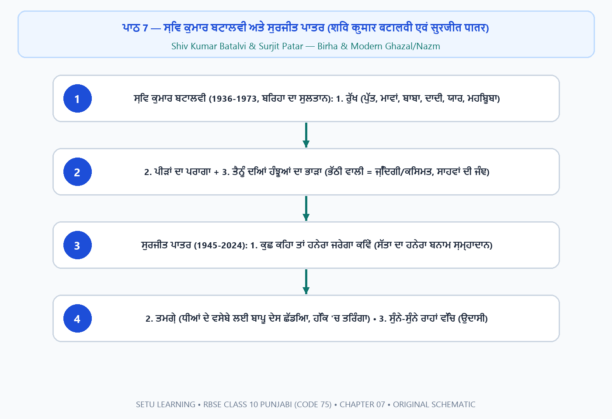

# ਪਾਠ 7 — ਸ਼ਿਵ ਕੁਮਾਰ ਬਟਾਲਵੀ ਅਤੇ ਸੁਰਜੀਤ ਪਾਤਰ (शिव कुमार बटालवी एवं सुरजीत पातर) (Shiv Kumar Batalvi & Surjit Patar — Birha & Modern Ghazal/Nazm)

## भाग 1: अध्याय प्रवेश एवं पाठ्यक्रम मैपिंग (ਪਾਠ-ਪ੍ਰਵੇਸ਼ ਅਤੇ ਪਾਠਕ੍ਰਮ ਮੈਪਿੰਗ)

> ਪਹਿਲਾ ਸੰਪਾਦਕੀ ਪ੍ਰਾਰੂਪ (प्रथम संपादकीय प्रारूप)। RBSE ਜਮਾਤ 10 ਪੰਜਾਬੀ ਪਾਠ-ਪੁਸਤਕ 'ਸਾਹਿਤ ਸੁਗੰਧੀਆਂ' ਦੇ ਸਾਰੇ ਪ੍ਰਸ਼ਨਾਂ ਦੇ ਹੱਲ ਅਤੇ 2014–2026 ਦਾ ਪੂਰਾ ਇਤਿਹਾਸਕ PYQ ਸੰਗ੍ਰਹਿ ਸਰੋਤ-ਪ੍ਰੀਖਣ ਸਮੇਤ ਸੰਕਲਿਤ ਹਨ।

**ਵਿਸ਼ਾ ਕੋਡ (विषय कोड):** 75 (ਤੀਜੀ ਭਾਸ਼ਾ — ਪੰਜਾਬੀ / तृतीया भाषा — पंजाबी) · **ਲੜੀ ਪੁਸਤਕ (श्रृंखला पुस्तक):** 7

**ਪ੍ਰਮਾਣਿਤ ਆਧਾਰ:** RBSE 2025–26 · **ਪਾਠ ਅੰਕ-ਭਾਰ:** 2 ਅੰਕ। ਇਹ ਭਾਰ ਉਸੇ ਸੰਸਕਰਣ ਦਾ ਹੈ; ਅਸਲ ਪ੍ਰਸ਼ਨ-ਵੰਡ ਦੀ ਭਵਿੱਖਬਾਣੀ ਨਹੀਂ।

**ਸਿੱਖਣ ਦੇ ਉਦੇਸ਼ (सीखने के लक्ष्य):** ਬਿਰਹਾ ਦੇ ਸੁਲਤਾਨ ਸ਼ਿਵ ਕੁਮਾਰ ਬਟਾਲਵੀ ('ਰੁੱਖ', 'ਪੀੜਾਂ ਦਾ ਪਰਾਗਾ', 'ਤੈਨੂੰ ਦਿਆਂ ਹੰਝੂਆਂ ਦਾ ਭਾੜਾ') ਅਤੇ ਸੁਰਜੀਤ ਪਾਤਰ ('ਕੁਛ ਕਿਹਾ ਤਾਂ ਹਨੇਰਾ ਜਰੇਗਾ ਕਿਵੇਂ', 'ਤਮਗ਼ੇ', 'ਸੁੰਨੇ-ਸੁੰਨੇ ਰਾਹਾਂ ਵਿੱਚ') ਦੀਆਂ ਰਚਨਾਵਾਂ ਦੀ ਵਿਆਖਿਆ ਤੇ ਕੇਂਦਰੀ ਭਾਵ ਸਮਝਣਾ।

## भाग 2: शब्दावली एवं अवधारणा कैप्सूल (ਸ਼ਬਦਾਵਲੀ ਅਤੇ ਸੰਕਲਪ ਕੈਪਸੂਲ)

| ਸ਼ਬਦ / ਸੰਕਲਪ | ਅਰਥ / ਵਿਆਖਿਆ |
|---|---|
| ਝੁੰਡ (झुंड) | ਰੁੱਖਾਂ ਦਾ ਸੰਘਣਾ ਸਮੂਹ (ਕੁਝ ਰੁੱਖ ਮੇਰੇ ਦਾਦੇ ਵਰਗੇ ਪੱਤਰ ਟਾਵੇਂ-ਟਾਵੇਂ)। |
| ਪਰਾਗਾ (परागा) | ਭੱਠੀ ਵਿੱਚ ਇੱਕੋ ਵਾਰ ਭੁੰਨਣ ਲਈ ਪਾਏ ਜਾਣ ਵਾਲੇ ਦਾਣਿਆਂ ਦੀ ਮੁੱਠ (ਨੀ ਪੀੜਾਂ ਦਾ ਪਰਾਗਾ ਭੁੰਨ ਦੇ ਭੱਠੀ ਵਾਲੀਏ)। |
| ਮੱਠਾ-ਮੱਠਾ ਤਾਪ (मट्ठा-मट्ठा ताप) | ਹਲਕਾ-ਹਲਕਾ ਬੁਖ਼ਾਰ (ਤਾਰਿਆਂ ਨੂੰ ਚੜ੍ਹ ਗਿਆ ਮੱਠਾ-ਮੱਠਾ ਤਾਪ ਨੀ)। |
| ਜੰਞ ਸਾਹਵਾਂ ਦੀ (जंञ साहवां दी) | ਸਾਹਾਂ ਦੀ ਬਰਾਤ ਜਿਸ ਦਾ ਲਾੜਾ (ਪ੍ਰੀਤਮ/ਜਿੰਦ) ਰੁੱਸ ਗਿਆ ਹੈ। |
| ਭਾੜਾ (भाड़ा) | ਕਿਰਾਇਆ / ਮਜ਼ਦੂਰੀ (ਤੈਨੂੰ ਦਿਆਂ ਹੰਝੂਆਂ ਦਾ ਭਾੜਾ, ਨੀ ਪੀੜਾਂ ਦਾ ਪਰਾਗਾ ਭੁੰਨ ਦੇ ਭੱਠੀ ਵਾਲੀਏ)। |
| ਹਉਮੈ ਦੇ ਪੁੱਤ (हउमै दे पुत्त) | ਸੱਤਾ ਦੇ ਹੰਕਾਰੀ ਹਾਕਮ (ਕੀ ਇਹ ਇਨਸਾਫ਼ ਹਉਮੈ ਦੇ ਪੁੱਤ ਕਰਨਗੇ, ਕੀ ਇਹ ਖ਼ਾਮੋਸ਼ ਪੱਥਰ ਦੇ ਬੁੱਤ ਕਰਨਗੇ)। |
| ਸਲੀਬਾਂ (सलीबां) | ਸੂਲੀਆਂ — ਸੱਚ ਬੋਲਣ ਵਾਲਿਆਂ ਨੂੰ ਮਿਲਣ ਵਾਲੀ ਸਜ਼ਾ (ਜੋ ਸਲੀਬਾਂ 'ਤੇ ਟੰਗੇ ਨੇ ਲੱਥਣੇ ਨਹੀਂ)। |
| ਚੋਗਾ (चोगा) | ਪੰਛੀਆਂ ਦਾ ਦਾਣਾ / ਰੋਜ਼ੀ-ਰੋਟੀ (ਕਿੱਥੋਂ ਦਿਆਂ ਪੰਛੀਆਂ ਨੂੰ ਕਿੱਥੋਂ ਚੋਗਾ ਲੱਭਿਆ, ਧੀਆਂ ਦੇ ਵਸੇਬੇ ਲਈ ਬਾਪੂ ਦੇਸ ਛੱਡਿਆ)। |
| ਤਮਗ਼ੇ (तमग़े) | ਮੈਡਲ / ਸਨਮਾਨ-ਚਿੰਨ੍ਹ — ਇੱਥੇ ਪਰਵਾਸੀ ਮਜ਼ਦੂਰ ਦੇ ਸੀਨੇ ਵਿੱਚ ਗੱਡੇ ਤਿਰੰਗੇ ਤੇ ਦੇਸ਼-ਪਿਆਰ ਦਾ ਵਿਅੰਗ। |
| ਪੈੜ (पैड़) | ਪੈਰਾਂ ਦੇ ਨਿਸ਼ਾਨ (ਸੁੰਨੇ-ਸੁੰਨੇ ਰਾਹਾਂ ਵਿੱਚ ਕੋਈ-ਕੋਈ ਪੈੜ ਏ, ਦਿਲ ਹੀ ਉਦਾਸ ਏ ਜੀ ਬਾਕੀ ਸਭ ਖ਼ੈਰ ਏ)। |

## भाग 3: विस्तृत शिक्षण पाठ (ਵਿਸਤ੍ਰਿਤ ਅਧਿਆਪਨ ਪਾਠ)

### 1. ਕਵੀ-ਪਛਾਣ: ਸ਼ਿਵ ਕੁਮਾਰ ਬਟਾਲਵੀ (1936–1973 ਈ.) ਅਤੇ ਸੁਰਜੀਤ ਪਾਤਰ (1945–2024 ਈ.)
**ਸ਼ਿਵ ਕੁਮਾਰ ਬਟਾਲਵੀ ('ਬਿਰਹਾ ਦਾ ਸੁਲਤਾਨ'):** ਸ਼ਿਵ ਕੁਮਾਰ ਬਟਾਲਵੀ ਦਾ ਜਨਮ 23 ਜੁਲਾਈ 1936 ਈ. ਨੂੰ ਪਿੰਡ ਬੜਾ ਪਿੰਡ ਲੋਹਟੀਆਂ (ਤਹਿਸੀਲ ਸ਼ਕਰਗੜ੍ਹ) ਵਿਖੇ ਪਿਤਾ ਪੰਡਿਤ ਕ੍ਰਿਸ਼ਨ ਗੋਪਾਲ ਦੇ ਘਰ ਹੋਇਆ ਅਤੇ ਵੰਡ ਮਗਰੋਂ ਪਰਿਵਾਰ ਬਟਾਲਾ (ਗੁਰਦਾਸਪੁਰ) ਆ ਵੱਸਿਆ। ਉਹਨਾਂ ਦੀਆਂ ਪ੍ਰਮੁੱਖ ਰਚਨਾਵਾਂ 'ਪੀੜਾਂ ਦਾ ਪਰਾਗਾ', 'ਲਾਜਵੰਤੀ', 'ਆਟੇ ਦੀਆਂ ਚਿੜੀਆਂ', 'ਮੈਨੂੰ ਵਿਦਾ ਕਰੋ', 'ਬਿਰਹਾ ਤੂੰ ਸੁਲਤਾਨ' ਅਤੇ ਕਾਵਿ-ਨਾਟਕ **'ਲੂਣਾ'** (ਜਿਸ ਲਈ 1967 ਵਿੱਚ ਸਭ ਤੋਂ ਛੋਟੀ ਉਮਰ ਵਿੱਚ ਭਾਰਤੀ ਸਾਹਿਤ ਅਕਾਦਮੀ ਪੁਰਸਕਾਰ ਮਿਲਿਆ) ਹਨ।
**ਸੁਰਜੀਤ ਪਾਤਰ:** ਸਮਕਾਲੀ ਪੰਜਾਬੀ ਕਵਿਤਾ ਅਤੇ ਗ਼ਜ਼ਲ ਦੇ ਮਹਾਨ ਹਸਤਾਖਰ ਸੁਰਜੀਤ ਪਾਤਰ ਦਾ ਜਨਮ 14 ਜਨਵਰੀ 1945 ਈ. ਨੂੰ ਪਿੰਡ ਪੱਤੜ ਕਲਾਂ (ਜ਼ਿਲ੍ਹਾ ਜਲੰਧਰ) ਵਿਖੇ ਹੋਇਆ। ਉਹਨਾਂ ਦੇ ਪ੍ਰਸਿੱਧ ਕਾਵਿ-ਸੰਗ੍ਰਹਿ 'ਹਵਾ ਵਿੱਚ ਲਿਖੇ ਹਰਫ਼', 'ਬਿਰਖ ਅਰਜ਼ ਕਰੇ', 'ਹਨੇਰੇ ਵਿੱਚ ਸੁਲਗਦੀ ਵਰਣਮਾਲਾ' (ਸਾਹਿਤ ਅਕਾਦਮੀ ਪੁਰਸਕਾਰ), 'ਲਫ਼ਜ਼ਾਂ ਦੀ ਦਰਗਾਹ' ਅਤੇ 'ਪਤਝੜ ਦੀ ਪਾਜ਼ੇਬ' ਹਨ।

### 2. ਸ਼ਿਵ ਕੁਮਾਰ ਬਟਾਲਵੀ ਦੀਆਂ ਤਿੰਨ ਕਵਿਤਾਵਾਂ
1. **ਰੁੱਖ ('ਕੁਝ ਰੁੱਖ ਮੈਨੂੰ ਪੁੱਤ ਲਗਦੇ ਨੇ, ਕੁਝ ਰੁੱਖ ਲਗਦੇ ਮਾਵਾਂ'):**
   - **ਮੁੱਖ ਤੁਕਾਂ:** *'ਕੁਝ ਰੁੱਖ ਮੈਨੂੰ ਪੁੱਤ ਲਗਦੇ ਨੇ, ਕੁਝ ਰੁੱਖ ਲਗਦੇ ਮਾਵਾਂ, ਕੁਝ ਰੁੱਖ ਨੂੰਹਾਂ-ਧੀਆਂ ਵਰਗੇ, ਕੁਝ ਰੁੱਖ ਵਾਂਗ ਭਰਾਵਾਂ । ਕੁਝ ਰੁੱਖ ਮੇਰੇ ਬਾਬੇ ਵਰਗੇ, ਪੱਤਰ ਟਾਵੇਂ-ਟਾਵੇਂ, ਕੁਝ ਰੁੱਖ ਮੇਰੀ ਦਾਦੀ ਵਰਗੇ, ਚੂਰੀ ਪਾਵਣ ਕਾਵਾਂ । ਕੁਝ ਰੁੱਖ ਯਾਰਾਂ ਵਰਗੇ ਲਗਦੇ, ਚੁੰਮਾਂ ਤੇ ਗਲ ਲਾਵਾਂ, ਇੱਕ ਮੇਰੀ ਮਹਿਬੂਬਾ ਵਰਗਾ, ਮਿੱਠਾ ਅਤੇ ਦੁਖਾਵਾਂ ।... ਜੇ ਤੁਸੀਂ ਮੇਰਾ ਗੀਤ ਹੈ ਸੁਣਨਾ, ਮੈਂ ਰੁੱਖਾਂ ਵਿੱਚ ਗਾਵਾਂ, ਰੁੱਖ ਤਾਂ ਮੇਰੀ ਮਾਂ ਵਰਗੇ ਨੇ, ਜਿਉਂ ਰੁੱਖਾਂ ਦੀਆਂ ਛਾਵਾਂ ।'*
   - **ਵਿਆਖਿਆ:** ਕਵੀ ਨੇ ਕੁਦਰਤ ਦੇ ਰੁੱਖਾਂ ਨਾਲ ਮਨੁੱਖੀ ਰਿਸ਼ਤਿਆਂ (**ਪੁੱਤ, ਮਾਵਾਂ, ਨੂੰਹਾਂ, ਧੀਆਂ, ਭਰਾ, ਬਾਬਾ, ਦਾਦੀ, ਯਾਰ ਅਤੇ ਮਹਿਬੂਬਾ**) ਦੀ ਡੂੰਘੀ ਸਾਂਝ ਜੋੜੀ ਹੈ। ਕਵੀ ਦੀ ਇੱਛਾ ਹੈ ਕਿ ਉਹ ਮਰਨ ਮਗਰੋਂ ਰੁੱਖ ਦੀ ਜੂਨ ਆਵੇ ਅਤੇ ਉਸ ਦੇ ਅੰਗਾਂ ਦੀ ਲੱਕੜ ਤੋਂ ਵੰਝਲੀ ਬਣੇ।
2. **ਪੀੜਾਂ ਦਾ ਪਰਾਗਾ** ਅਤੇ **3. ਤੈਨੂੰ ਦਿਆਂ ਹੰਝੂਆਂ ਦਾ ਭਾੜਾ:**
   - **ਮੁੱਖ ਤੁਕਾਂ:** **'ਤੈਨੂੰ ਦਿਆਂ ਹੰਝੂਆਂ ਦਾ ਭਾੜਾ, ਨੀ ਪੀੜਾਂ ਦਾ ਪਰਾਗਾ ਭੁੰਨ ਦੇ, ਭੱਠੀ ਵਾਲੀਏ ਚੰਬੇ ਦੀਏ ਡਾਲੀਏ... ਸੌਂ ਗਈਆਂ ਹਵਾਵਾਂ ਰੋ-ਰੋ ਕਰ ਵਿਰਲਾਪ ਨੀ । ਤਾਰਿਆਂ ਨੂੰ ਚੜ੍ਹ ਗਿਆ ਮੱਠਾ-ਮੱਠਾ ਤਾਪ ਨੀ । ਜੰਞ ਸਾਹਵਾਂ ਦੀ ਦਾ ਰੁੱਸ ਗਿਆ ਲਾੜਾ, ਨੀ ਪੀੜਾਂ ਦਾ ਪਰਾਗਾ ਭੁੰਨ ਦੇ ਭੱਠੀ ਵਾਲੀਏ !' (RBSE 2024 Main Q21, 2026 Supp Q3-V)**
   - **ਵਿਆਖਿਆ:** ਕਵੀ ਆਪਣੀ ਜ਼ਿੰਦਗੀ ਜਾਂ ਕਿਸਮਤ ਰੂਪੀ 'ਭੱਠੀ ਵਾਲੀ' ਨੂੰ ਕਹਿੰਦਾ ਹੈ ਕਿ ਮੈਂ ਤੈਨੂੰ ਆਪਣੇ ਹੰਝੂਆਂ ਦੀ ਮਜ਼ਦੂਰੀ (ਭਾੜਾ) ਦਿਆਂਗਾ, ਤੂੰ ਮੇਰੇ ਦੁੱਖਾਂ ਤੇ ਵਿਛੋੜੇ ਦੀਆਂ ਪੀੜਾਂ ਦੇ ਦਾਣਿਆਂ ਦਾ ਪਰਾਗਾ ਭੁੰਨ ਕੇ ਮੁਕਾ ਦੇ। ਉਸ ਦੇ ਬਿਰਹਾ ਵਿੱਚ ਹਵਾਵਾਂ ਵੀ ਰੋ-ਰੋ ਕੇ ਸੌਂ ਗਈਆਂ ਹਨ, ਤਾਰਿਆਂ ਨੂੰ ਹਲਕਾ ਬੁਖ਼ਾਰ ਚੜ੍ਹ ਗਿਆ ਹੈ ਤੇ ਸਾਹਾਂ ਦੀ ਬਰਾਤ ਦਾ ਲਾੜਾ (ਪ੍ਰੀਤਮ) ਰੁੱਸ ਗਿਆ ਹੈ।

### 3. ਸੁਰਜੀਤ ਪਾਤਰ ਦੀਆਂ ਤਿੰਨ ਕਵਿਤਾਵਾਂ
1. **ਕੁਛ ਕਿਹਾ ਤਾਂ ਹਨੇਰਾ ਜਰੇਗਾ ਕਿਵੇਂ, ਚੁੱਪ ਰਿਹਾ ਤਾਂ ਸ਼ਮ੍ਹਾਦਾਨ ਕੀ ਕਹਿਣਗੇ (ਗ਼ਜ਼ਲ):**
   - **ਮੁੱਖ ਤੁਕਾਂ:** **'ਕੁਛ ਕਿਹਾ ਤਾਂ ਹਨੇਰਾ ਜਰੇਗਾ ਕਿਵੇਂ, ਚੁੱਪ ਰਿਹਾ ਤਾਂ ਸ਼ਮ੍ਹਾਦਾਨ ਕੀ ਕਹਿਣਗੇ । ਗੀਤ ਦੀ ਮੌਤ ਇਸ ਰਾਤ ਜੇ ਹੋ ਗਈ, ਮੇਰਾ ਜੀਣਾ ਮੇਰੇ ਯਾਰ ਕੀ ਕਹਿਣਗੇ ।... ਕੀ ਇਹ ਇਨਸਾਫ਼ ਹਉਮੈ ਦੇ ਪੁੱਤ ਕਰਨਗੇ, ਕੀ ਇਹ ਖ਼ਾਮੋਸ਼ ਪੱਥਰ ਦੇ ਬੁੱਤ ਕਰਨਗੇ, ਜੋ ਸਲੀਬਾਂ 'ਤੇ ਟੰਗੇ ਨੇ ਲੱਥਣੇ ਨਹੀਂ, ਰਾਜ ਬਦਲਣਗੇ ਸੂਰਜ ਚੜ੍ਹਨ ਲਹਿਣਗੇ ।' (RBSE 2022 Main Q1-i, Q20, 2024 Main Q3-v)**
   - **ਕੇਂਦਰੀ ਭਾਵ:** ਕਵੀ ਸੱਤਾ ਦੇ ਹਨੇਰੇ (ਅਨਿਆਂ ਤੇ ਜਬਰ) ਅਤੇ ਆਪਣੀ ਜ਼ਮੀਰ ਦੇ ਚਾਨਣ (ਸ਼ਮ੍ਹਾਦਾਨ) ਵਿਚਕਾਰ ਖੜ੍ਹਾ ਹੈ। ਜੇ ਉਹ ਸੱਚ ਬੋਲਦਾ ਹੈ ਤਾਂ ਹਾਕਮ ਸਹਿਣ ਨਹੀਂ ਕਰਦੇ, ਤੇ ਜੇ ਚੁੱਪ ਰਹਿੰਦਾ ਹੈ ਤਾਂ ਚਾਨਣ ਦੇ ਮੁਦੱਈ ਦੋਸਤ ਕੀ ਕਹਿਣਗੇ? ਹੰਕਾਰੀ ਹਾਕਮ ('ਹਉਮੈ ਦੇ ਪੁੱਤ') ਅਤੇ ਪੱਥਰ ਦੇ ਬੁੱਤ ਕਦੇ ਇਨਸਾਫ਼ ਨਹੀਂ ਕਰਦੇ; ਰਾਜ ਬਦਲਣ ਨਾਲ ਵੀ ਆਮ ਮਨੁੱਖ ਦੀਆਂ ਸਲੀਬਾਂ (ਦੁੱਖ) ਖ਼ਤਮ ਨਹੀਂ ਹੁੰਦੀਆਂ।
2. **ਤਮਗ਼ੇ ('ਕਿੱਥੋਂ ਦਿਆਂ ਪੰਛੀਆਂ ਨੂੰ ਕਿੱਥੋਂ ਚੋਗਾ ਲੱਭਿਆ, ਧੀਆਂ ਦੇ ਵਸੇਬੇ ਲਈ ਬਾਪੂ ਦੇਸ ਛੱਡਿਆ'):**
   - **ਮੁੱਖ ਤੁਕਾਂ:** **'ਕਿੱਥੋਂ ਦਿਆਂ ਪੰਛੀਆਂ ਨੂੰ ਕਿੱਥੋਂ ਚੋਗਾ ਲੱਭਿਆ । ਧੀਆਂ ਦੇ ਵਸੇਬੇ ਲਈ ਬਾਪੂ ਦੇਸ ਛੱਡਿਆ । ਕਿੰਨਾ ਹੈ ਮਹਾਨ ਦੇਸ ਉਦੋਂ ਪਤਾ ਲੱਗਿਆ, ਡੂੰਘਾ ਮੇਰੀ ਹਿੱਕ 'ਚ ਤਿਰੰਗਾ ਗਿਆ ਗੱਡਿਆ । ਝੁੱਲ ਓ ਤਿਰੰਗਿਆ ਤੂੰ ਝੁੱਲ ਸਾਡੀ ਖ਼ੈਰ ਏ ।' (RBSE 2018 Main Q7-ਸ, 2020 Supp Q6-ਅ, 2025 Supp Q1-iv)**
   - **ਭਾਵ:** ਦੇਸ਼ ਵਿੱਚ ਬੇਰੁਜ਼ਗਾਰੀ ਤੇ ਗ਼ਰੀਬੀ ਕਾਰਨ ਪਿਤਾ ਨੂੰ ਧੀਆਂ ਦੇ ਵਿਆਹ ਤੇ ਰੋਜ਼ੀ-ਰੋਟੀ (ਚੋਗਾ) ਲਈ ਵਿਦੇਸ਼ ਜਾ ਕੇ ਰੁਲਣਾ ਪੈਂਦਾ ਹੈ; ਪਰਦੇਸ ਦੀ ਪੀੜ ਹੀ ਉਸ ਦੇ ਸੀਨੇ ਵਿੱਚ ਦੇਸ਼-ਪਿਆਰ ਦਾ ਤਿਰੰਗਾ ਗੱਡ ਦਿੰਦੀ ਹੈ।
3. **ਸੁੰਨੇ-ਸੁੰਨੇ ਰਾਹਾਂ ਵਿੱਚ ਕੋਈ-ਕੋਈ ਪੈੜ ਏ ('ਦਿਲ ਹੀ ਉਦਾਸ ਏ ਜੀ ਬਾਕੀ ਸਭ ਖ਼ੈਰ ਏ'):** ਆਧੁਨਿਕ ਮਨੁੱਖ ਦੀ ਇਕੱਲਤਾ, ਸੰਵੇਦਨਸ਼ੀਲ ਦਿਲ ਦੀ ਉਦਾਸੀ ਅਤੇ ਸਮਾਜਿਕ ਬੇਗਾਨਗੀ ਦਾ ਚਿੱਤਰਣ ਹੈ।

ਪਾਠ 7: ਸ਼ਿਵ ਕੁਮਾਰ ਬਟਾਲਵੀ ਅਤੇ ਸੁਰਜੀਤ ਪਾਤਰ ਦੀਆਂ ਕਵਿਤਾਵਾਂ ਦਾ ਸੰਕਲਪ ਚਿੱਤਰ

## भाग 4: पाठ्यपुस्तक-अवधारणाओं पर मौलिक हल किए उदाहरण (ਹੱਲ ਕੀਤੇ ਮਿਆਰੀ ਉਦਾਹਰਣ)

ਹੇਠਾਂ ਦਿੱਤੇ ਪ੍ਰਸ਼ਨ ਪਾਠ-ਪੁਸਤਕ 'ਸਾਹਿਤ ਸੁਗੰਧੀਆਂ' ਅਤੇ ਵਿਆਕਰਣ ਦੇ ਸੰਕਲਪਾਂ ਉੱਤੇ ਆਧਾਰਿਤ ਮੌਲਿਕ ਆਦਰਸ਼ ਹੱਲ ਹਨ।

**ਹੱਲ ਕੀਤਾ ਉਦਾਹਰਣ 1: 'ਸੌਂ ਗਈਆਂ ਹਵਾਵਾਂ ਰੋ-ਰੋ ਕਰ ਵਿਰਲਾਪ ਨੀ...' ਕਾਵਿ-ਬੰਦ ਦੀ ਪ੍ਰਸੰਗ ਸਹਿਤ ਵਿਆਖਿਆ ਕਰੋ।**

ਪ੍ਰਸੰਗ: ਇਹ ਕਾਵਿ-ਬੰਦ 'ਸਾਹਿਤ ਸੁਗੰਧੀਆਂ' ਪੁਸਤਕ ਵਿੱਚ ਦਰਜ ਸ਼ਿਵ ਕੁਮਾਰ ਬਟਾਲਵੀ ਦੀ ਕਵਿਤਾ 'ਪੀੜਾਂ ਦਾ ਪਰਾਗਾ / ਤੈਨੂੰ ਦਿਆਂ ਹੰਝੂਆਂ ਦਾ ਭਾੜਾ' ਵਿੱਚੋਂ ਲਿਆ ਗਿਆ ਹੈ। ਵਿਆਖਿਆ: ਬਿਰਹਾ ਦਾ ਕਵੀ ਆਪਣੀ ਕਿਸਮਤ ਰੂਪੀ ਭੱਠੀ ਵਾਲੀ ਨੂੰ ਕਹਿੰਦਾ ਹੈ ਕਿ ਮੇਰੇ ਵਿਛੋੜੇ ਦੇ ਦੁੱਖ ਨੂੰ ਵੇਖ ਕੇ ਹਵਾਵਾਂ ਵੀ ਰੋ-ਰੋ ਕੇ ਤੇ ਵਿਰਲਾਪ ਕਰਕੇ ਸੌਂ ਗਈਆਂ ਹਨ। ਅਸਮਾਨ ਦੇ ਤਾਰਿਆਂ ਨੂੰ ਵੀ ਹਲਕਾ-ਹਲਕਾ ਬੁਖ਼ਾਰ (ਮੱਠਾ-ਮੱਠਾ ਤਾਪ) ਚੜ੍ਹ ਗਿਆ ਹੈ। ਮੇਰੇ ਸਾਹਾਂ ਦੀ ਬਰਾਤ (ਜੰਞ) ਦਾ ਲਾੜਾ (ਪ੍ਰੀਤਮ) ਰੁੱਸ ਕੇ ਚਲਾ ਗਿਆ ਹੈ; ਨੀ ਭੱਠੀ ਵਾਲੀਏ! ਤੂੰ ਮੇਰੇ ਦੁੱਖਾਂ ਤੇ ਪੀੜਾਂ ਦੇ ਦਾਣਿਆਂ ਦਾ ਪਰਾਗਾ ਭੁੰਨ ਕੇ ਮੁਕਾ ਦੇ (RBSE 2024 Main Q21)।

**ਹੱਲ ਕੀਤਾ ਉਦਾਹਰਣ 2: 'ਕਿੱਥੋਂ ਦਿਆਂ ਪੰਛੀਆਂ ਨੂੰ ਕਿੱਥੋਂ ਚੋਗਾ ਲੱਭਿਆ...' ਕਾਵਿ-ਬੰਦ ਦੀ ਪ੍ਰਸੰਗ ਸਹਿਤ ਵਿਆਖਿਆ ਕਰੋ।**

ਪ੍ਰਸੰਗ: ਇਹ ਕਾਵਿ-ਬੰਦ 'ਸਾਹਿਤ ਸੁਗੰਧੀਆਂ' ਵਿੱਚ ਦਰਜ ਸੁਰਜੀਤ ਪਾਤਰ ਦੀ ਕਵਿਤਾ 'ਤਮਗ਼ੇ' ਵਿੱਚੋਂ ਹੈ। ਵਿਆਖਿਆ: ਕਵੀ ਰੋਜ਼ੀ-ਰੋਟੀ ਲਈ ਵਿਦੇਸ਼ ਗਏ ਪਰਵਾਸੀ ਪੰਜਾਬੀ ਦੇ ਦਰਦ ਨੂੰ ਬਿਆਨ ਕਰਦਾ ਹੈ ਕਿ ਰੱਬ ਜਾਣੇ ਕਿੱਥੋਂ ਦੇ ਪੰਛੀਆਂ (ਮਨੁੱਖਾਂ) ਨੂੰ ਕਿੱਥੇ ਜਾ ਕੇ ਰੋਜ਼ੀ-ਰੋਟੀ (ਚੋਗਾ) ਲੱਭਣੀ ਪਈ। ਆਪਣੀਆਂ ਧੀਆਂ ਦੇ ਵਿਆਹ ਤੇ ਵਸੇਬੇ ਲਈ ਬਾਪੂ ਨੂੰ ਆਪਣਾ ਪਿਆਰਾ ਦੇਸ ਛੱਡਣਾ ਪਿਆ। ਪਰਦੇਸ ਵਿੱਚ ਧੱਕੇ ਖਾਂਦਿਆਂ ਉਸ ਦੀ ਹਿੱਕ ਵਿੱਚ ਦੇਸ-ਪਿਆਰ ਦਾ ਤਿਰੰਗਾ ਡੂੰਘਾ ਗੱਡਿਆ ਗਿਆ ਤੇ ਉਹ ਕਹਿੰਦਾ ਹੈ ਕਿ ਹੇ ਤਿਰੰਗਿਆ! ਤੂੰ ਸਦਾ ਝੁੱਲਦਾ ਰਹਿ, ਸਾਡੀ ਖ਼ੈਰ ਹੈ (RBSE 2020 Supp Q6-ਅ)।

**ਹੱਲ ਕੀਤਾ ਉਦਾਹਰਣ 3: 'ਕੀ ਇਹ ਇਨਸਾਫ਼ ਹਉਮੈ ਦੇ ਪੁੱਤ ਕਰਨਗੇ...' ਕਾਵਿ-ਬੰਦ ਦੀ ਵਿਆਖਿਆ ਅਤੇ 'ਰਾਜ ਬਦਲਣਗੇ ਸੂਰਜ ਚੜ੍ਹਨ ਲਹਿਣਗੇ' ਤੁਕ ਦਾ ਭਾਵ ਲਿਖੋ।**

ਇਹ ਕਾਵਿ-ਬੰਦ ਸੁਰਜੀਤ ਪਾਤਰ ਦੀ ਗ਼ਜ਼ਲ 'ਕੁਛ ਕਿਹਾ ਤਾਂ ਹਨੇਰਾ ਜਰੇਗਾ ਕਿਵੇਂ' ਵਿੱਚੋਂ ਹੈ। ਕਵੀ ਕਹਿੰਦਾ ਹੈ ਕਿ ਹੰਕਾਰੀ ਹਾਕਮ ('ਹਉਮੈ ਦੇ ਪੁੱਤ') ਅਤੇ ਸੰਵੇਦਨਾ-ਹੀਣ ਪੱਥਰ ਦੇ ਬੁੱਤ ਕਦੇ ਗ਼ਰੀਬਾਂ ਨਾਲ ਇਨਸਾਫ਼ ਨਹੀਂ ਕਰਨਗੇ। 'ਰਾਜ ਬਦਲਣਗੇ ਸੂਰਜ ਚੜ੍ਹਨ ਲਹਿਣਗੇ' ਤੋਂ ਭਾਵ ਹੈ ਕਿ ਸਮੇਂ ਨਾਲ ਹਕੂਮਤਾਂ ਬਦਲਦੀਆਂ ਰਹਿਣਗੀਆਂ ਪਰ ਸੂਲੀਆਂ (ਸਲੀਬਾਂ) ਉੱਤੇ ਟੰਗੇ ਆਮ ਮਿਹਨਤਕਸ਼ ਲੋਕਾਂ ਦੇ ਦੁੱਖ ਉਵੇਂ ਹੀ ਬਣੇ ਰਹਿਣਗੇ (RBSE 2022 Main Q20)।

## भाग 5: सत्यापित बोर्ड प्रश्न एवं स्रोत-स्थिति (ਪ੍ਰਮਾਣਿਤ ਬੋਰਡ ਪ੍ਰਸ਼ਨ ਅਤੇ ਸਰੋਤ-ਸਥਿਤੀ)

RBSE 2026 Supp (`S-75`, Q3-V), 2025 Supp (Q1-iv, Q3-iv, Q14) ਅਤੇ 2024 Main (Q3-v, Q21) ਵਿੱਚ ਸ਼ਿਵ ਕੁਮਾਰ ਬਟਾਲਵੀ ਅਤੇ ਸੁਰਜੀਤ ਪਾਤਰ ਦੀਆਂ ਕਵਿਤਾਵਾਂ ਪੁੱਛੀਆਂ ਗਈਆਂ ਹਨ।

[RBSE 2026 ਮੂਲ ਪੇਪਰ (S-75)](https://rajeduboard.rajasthan.gov.in/books/PAPERS-2026/Sec/S-75.pdf)। ਪ੍ਰਸ਼ਨ ਦਾ ਸੰਖੇਪ ਵਿਸ਼ਾ-ਸੰਦਰਭ ਹੈ; ਸ਼ਬਦ-ਬ-ਸ਼ਬਦ ਪੁਨਰ-ਮੁਦਰਣ ਨਹੀਂ।

## भाग 6: खंडवार मौलिक अभ्यास बैंक (ਖੰਡ-ਵਾਰ ਮੌਲਿਕ ਅਭਿਆਸ ਬੈਂਕ)

**ਅਭਿਆਸ-ਅੰਕ:** ਵਿਦਿਆਰਥੀਆਂ ਦੇ ਸਵੈ-ਅਭਿਆਸ ਲਈ ਹਨ; ਉੱਤਰ ਪਹਿਲਾਂ ਆਪ ਲਿਖੋ, ਫਿਰ ਭਾਗ 9 ਵੇਖੋ।

## ੳ: ਬਹੁ-ਵਿਕਲਪੀ ਪ੍ਰਸ਼ਨ (MCQ) — 15 × 1 ਅੰਕ

**MCQ 1. 'ਕੁਛ ਕਿਹਾ ਤਾਂ ਹਨੇਰਾ ਜਰੇਗਾ ਕਿਵੇਂ (ਗ਼ਜ਼ਲ)' ਦਾ ਕਵੀ ਕੌਣ ਹੈ? (RBSE 2022 Main Q1-i, 2024 Main Q3-v)**

ੳ) ਅੰਮ੍ਰਿਤਾ ਪ੍ਰੀਤਮ  
ਅ) ਸੁਰਜੀਤ ਪਾਤਰ  
ੲ) ਭਾਈ ਵੀਰ ਸਿੰਘ  
ਸ) ਧਨੀ ਰਾਮ ਚਾਤ੍ਰਿਕ

**MCQ 2. 'ਕਿੱਥੋਂ ਦਿਆਂ ਪੰਛੀਆਂ ਨੂੰ ਕਿੱਥੋਂ ਚੋਗਾ ਲੱਭਿਆ' — ਇਹ ਸਤਰ ਕਿਸ ਕਵੀ ਦੀ ਹੈ? (RBSE 2025 Supp Q1-iv)**

ੳ) ਸੁਰਜੀਤ ਪਾਤਰ  
ਅ) ਪ੍ਰੋ. ਮੋਹਨ ਸਿੰਘ  
ੲ) ਅੰਮ੍ਰਿਤਾ ਪ੍ਰੀਤਮ  
ਸ) ਧਨੀ ਰਾਮ ਚਾਤ੍ਰਿਕ

**MCQ 3. 'ਤੈਨੂੰ ਦਿਆਂ ਹੰਝੂਆਂ ਦਾ ਭਾੜਾ' ਕਵਿਤਾ ਵਿੱਚ ਸ਼ਿਵ ਕੁਮਾਰ ਬਟਾਲਵੀ ਭੱਠੀ ਵਾਲੀ ਨੂੰ ਕੀ ਭੁੰਨਣ ਲਈ ਕਹਿ ਰਿਹਾ ਹੈ? (RBSE 2026 Supp Q3-V)**

ੳ) ਮੱਕੀ ਦੇ ਦਾਣੇ  
ਅ) ਛੋਲਿਆਂ ਦਾ ਪਰਾਗਾ  
ੲ) ਕਣਕ ਦੀਆਂ ਬੱਲੀਆਂ  
ਸ) ਪੀੜਾਂ ਦਾ ਪਰਾਗਾ

**MCQ 4. 'ਰੁੱਖ' ਕਵਿਤਾ ਕਿਸ ਕਵੀ ਦੀ ਰਚਨਾ ਹੈ?**

ੳ) ਪ੍ਰੋ. ਮੋਹਨ ਸਿੰਘ  
ਅ) ਸੁਰਜੀਤ ਪਾਤਰ  
ੲ) ਸ਼ਿਵ ਕੁਮਾਰ ਬਟਾਲਵੀ  
ਸ) ਭਾਈ ਵੀਰ ਸਿੰਘ

**MCQ 5. 'ਰੁੱਖ' ਕਵਿਤਾ ਅਨੁਸਾਰ ਕਾਵਾਂ ਨੂੰ ਚੂਰੀ ਪਾਉਣ ਵਾਲੇ ਰੁੱਖ ਕਵੀ ਨੂੰ ਕਿਸ ਵਰਗੇ ਲੱਗਦੇ ਹਨ?**

ੳ) ਭਰਾਵਾਂ ਵਰਗੇ  
ਅ) ਦਾਦੀ ਵਰਗੇ  
ੲ) ਬਾਬੇ ਵਰਗੇ  
ਸ) ਯਾਰਾਂ ਵਰਗੇ

**MCQ 6. 'ਰੁੱਖ' ਕਵਿਤਾ ਅਨੁਸਾਰ ਟਾਵੇਂ-ਟਾਵੇਂ ਪੱਤਿਆਂ ਵਾਲੇ ਰੁੱਖ ਕਵੀ ਨੂੰ ਕਿਸ ਵਰਗੇ ਲੱਗਦੇ ਹਨ?**

ੳ) ਬਾਬੇ (ਦਾਦੇ) ਵਰਗੇ  
ਅ) ਪੁੱਤਾਂ ਵਰਗੇ  
ੲ) ਨੂੰਹਾਂ ਵਰਗੇ  
ਸ) ਮਹਿਬੂਬਾ ਵਰਗੇ

**MCQ 7. 'ਜੰਞ ਸਾਹਵਾਂ ਦੀ ਦਾ ਰੁੱਸ ਗਿਆ ਲਾੜਾ, ਨੀ ਪੀੜਾਂ ਦਾ ਪਰਾਗਾ ਭੁੰਨ ਦੇ ਭੱਠੀ ਵਾਲੀਏ' ਵਿੱਚ 'ਭੱਠੀ ਵਾਲੀਏ' ਤੋਂ ਕੀ ਭਾਵ ਹੈ? (RBSE 2024 Main Q21-ੲ)**

ੳ) ਪਿੰਡ ਦੀ ਤੰਦੂਰ ਵਾਲੀ  
ਅ) ਗੁਆਂਢਣ  
ੲ) ਸਹੇਲੀ  
ਸ) ਜ਼ਿੰਦਗੀ / ਕਿਸਮਤ (ਹੋਣੀ)

**MCQ 8. 'ਧੀਆਂ ਦੇ ਵਸੇਬੇ ਲਈ ਬਾਪੂ ਦੇਸ ਛੱਡਿਆ' — ਬਾਪੂ ਨੇ ਆਪਣਾ ਦੇਸ ਕਿਉਂ ਛੱਡਿਆ?**

ੳ) ਉੱਚੀ ਪੜ੍ਹਾਈ ਲਈ  
ਅ) ਰਾਜਨੀਤੀ ਕਰਨ ਲਈ  
ੲ) ਧੀਆਂ ਦੇ ਵਿਆਹ-ਵਸੇਬੇ ਅਤੇ ਰੋਜ਼ੀ-ਰੋਟੀ (ਚੋਗਾ) ਕਮਾਉਣ ਲਈ  
ਸ) ਸੈਰ-ਸਪਾਟੇ ਲਈ

**MCQ 9. 'ਕੀ ਇਹ ਇਨਸਾਫ਼ ਹਉਮੈ ਦੇ ਪੁੱਤ ਕਰਨਗੇ, ਕੀ ਇਹ ਖ਼ਾਮੋਸ਼ ਪੱਥਰ ਦੇ ਬੁੱਤ ਕਰਨਗੇ' ਸਤਰਾਂ ਕਿਸ ਕਵਿਤਾ ਵਿੱਚੋਂ ਹਨ? (RBSE 2022 Main Q20)**

ੳ) ਅੱਜ ਆਖਾਂ ਵਾਰਿਸ ਸ਼ਾਹ ਨੂੰ (ਅੰਮ੍ਰਿਤਾ ਪ੍ਰੀਤਮ)  
ਅ) ਕੁਛ ਕਿਹਾ ਤਾਂ ਹਨੇਰਾ ਜਰੇਗਾ ਕਿਵੇਂ (ਸੁਰਜੀਤ ਪਾਤਰ)  
ੲ) ਤਮਗ਼ੇ (ਸੁਰਜੀਤ ਪਾਤਰ)  
ਸ) ਪੀੜਾਂ ਦਾ ਪਰਾਗਾ (ਸ਼ਿਵ ਕੁਮਾਰ)

**MCQ 10. 'ਸੁੰਨੇ-ਸੁੰਨੇ ਰਾਹਾਂ ਵਿੱਚ ਕੋਈ-ਕੋਈ ਪੈੜ ਏ, ਦਿਲ ਹੀ ਉਦਾਸ ਏ ਜੀ ਬਾਕੀ ਸਭ ਖ਼ੈਰ ਏ' ਕਿਸ ਕਵੀ ਦੀਆਂ ਸਤਰਾਂ ਹਨ?**

ੳ) ਸੁਰਜੀਤ ਪਾਤਰ  
ਅ) ਸ਼ਿਵ ਕੁਮਾਰ ਬਟਾਲਵੀ  
ੲ) ਪ੍ਰੋ. ਮੋਹਨ ਸਿੰਘ  
ਸ) ਧਨੀ ਰਾਮ ਚਾਤ੍ਰਿਕ

**MCQ 11. ਸ਼ਿਵ ਕੁਮਾਰ ਬਟਾਲਵੀ ਨੂੰ ਪੰਜਾਬੀ ਸਾਹਿਤ ਵਿੱਚ ਕਿਸ ਵਿਸ਼ੇਸ਼ ਨਾਂ ਨਾਲ ਜਾਣਿਆ ਜਾਂਦਾ ਹੈ?**

ੳ) ਪੰਜਾਬੀ ਕਵਿਤਾ ਦਾ ਪਿਤਾਮਾ  
ਅ) ਹਾਸ-ਰਸ ਦਾ ਬਾਦਸ਼ਾਹ  
ੲ) ਕੁਦਰਤ ਦਾ ਕਵੀ  
ਸ) ਬਿਰਹਾ ਦਾ ਸੁਲਤਾਨ

**MCQ 12. 'ਪੀੜਾਂ ਦਾ ਪਰਾਗਾ' ਵਿੱਚ 'ਪਰਾਗਾ' ਸ਼ਬਦ ਦਾ ਕੀ ਅਰਥ ਹੈ?**

ੳ) ਕੱਪੜਿਆਂ ਦੀ ਪੰਡ  
ਅ) ਫੁੱਲਾਂ ਦੀ ਟੋਕਰੀ  
ੲ) ਭੱਠੀ ਵਿੱਚ ਇੱਕੋ ਵਾਰ ਭੁੰਨਣ ਲਈ ਪਾਏ ਜਾਣ ਵਾਲੇ ਦਾਣਿਆਂ ਦੀ ਮੁੱਠ  
ਸ) ਪਾਣੀ ਦਾ ਘੜਾ

**MCQ 13. 'ਡੂੰਘਾ ਮੇਰੀ ਹਿੱਕ 'ਚ ਤਿਰੰਗਾ ਗਿਆ ਗੱਡਿਆ' ਤੁਕ ਕਵੀ ਦੀ ਕਿਸ ਮਨੋ-ਭਾਵਨਾ ਨੂੰ ਪ੍ਰਗਟ ਕਰਦੀ ਹੈ? (RBSE 2020 Supp Q6-ਅ)**

ੳ) ਗਣਤੰਤਰ ਦਿਵਸ ਦੀ ਪਰੇਡ ਨੂੰ  
ਅ) ਪਰਦੇਸ ਵਿੱਚ ਧੱਕੇ ਖਾਂਦਿਆਂ ਦੇਸ਼-ਪਿਆਰ ਅਤੇ ਵਤਨ ਦੀ ਕਦਰ ਦੀ ਡੂੰਘੀ ਪੀੜ ਨੂੰ  
ੲ) ਖੇਡ ਦੇ ਮੈਦਾਨ ਵਿੱਚ ਜਿੱਤ ਨੂੰ  
ਸ) ਫ਼ੌਜ ਦੀ ਭਰਤੀ ਨੂੰ

**MCQ 14. ਸ਼ਿਵ ਕੁਮਾਰ ਬਟਾਲਵੀ ਨੂੰ 1967 ਵਿੱਚ ਕਿਹੜੀ ਰਚਨਾ ਲਈ ਭਾਰਤੀ ਸਾਹਿਤ ਅਕਾਦਮੀ ਪੁਰਸਕਾਰ ਮਿਲਿਆ?**

ੳ) ਲੂਣਾ (ਕਾਵਿ-ਨਾਟਕ)  
ਅ) ਪੀੜਾਂ ਦਾ ਪਰਾਗਾ  
ੲ) ਆਟੇ ਦੀਆਂ ਚਿੜੀਆਂ  
ਸ) ਲਾਜਵੰਤੀ

**MCQ 15. 'ਤਾਰਿਆਂ ਨੂੰ ਚੜ੍ਹ ਗਿਆ ਮੱਠਾ-ਮੱਠਾ ਤਾਪ ਨੀ' ਵਿੱਚ 'ਮੱਠਾ-ਮੱਠਾ' ਸ਼ਬਦ ਦਾ ਕੀ ਅਰਥ ਹੈ? (RBSE 2024 Main Q21-ਸ)**

ੳ) ਬਹੁਤ ਤੇਜ਼  
ਅ) ਠੰਢਾ  
ੲ) ਕੌੜਾ  
ਸ) ਮੱਧਮ / ਹਲਕਾ-ਹਲਕਾ

## ੳ: ਖਾਲੀ ਥਾਵਾਂ ਭਰੋ — 6 × 1 ਅੰਕ

1. ਰੁੱਖਾਂ ਦਾ ਸੰਘਣਾ ਸਮੂਹ (ਕੁਝ ਰੁੱਖ ਮੇਰੇ ਦਾਦੇ ਵਰਗੇ ਪੱਤਰ ਟਾਵੇਂ-ਟਾਵੇਂ)। — ਇਸ ਸ਼ਬਦ/ਸੰਕਲਪ ਦਾ ਨਾਂ ਹੈ: ____।  
2. ਭੱਠੀ ਵਿੱਚ ਇੱਕੋ ਵਾਰ ਭੁੰਨਣ ਲਈ ਪਾਏ ਜਾਣ ਵਾਲੇ ਦਾਣਿਆਂ ਦੀ ਮੁੱਠ (ਨੀ ਪੀੜਾਂ ਦਾ ਪਰਾਗਾ ਭੁੰਨ ਦੇ ਭੱਠੀ ਵਾਲੀਏ)। — ਇਸ ਸ਼ਬਦ/ਸੰਕਲਪ ਦਾ ਨਾਂ ਹੈ: ____।  
3. ਹਲਕਾ-ਹਲਕਾ ਬੁਖ਼ਾਰ (ਤਾਰਿਆਂ ਨੂੰ ਚੜ੍ਹ ਗਿਆ ਮੱਠਾ-ਮੱਠਾ ਤਾਪ ਨੀ)। — ਇਸ ਸ਼ਬਦ/ਸੰਕਲਪ ਦਾ ਨਾਂ ਹੈ: ____।  
4. ਸਾਹਾਂ ਦੀ ਬਰਾਤ ਜਿਸ ਦਾ ਲਾੜਾ (ਪ੍ਰੀਤਮ/ਜਿੰਦ) ਰੁੱਸ ਗਿਆ ਹੈ। — ਇਸ ਸ਼ਬਦ/ਸੰਕਲਪ ਦਾ ਨਾਂ ਹੈ: ____।  
5. ਕਿਰਾਇਆ / ਮਜ਼ਦੂਰੀ (ਤੈਨੂੰ ਦਿਆਂ ਹੰਝੂਆਂ ਦਾ ਭਾੜਾ, ਨੀ ਪੀੜਾਂ ਦਾ ਪਰਾਗਾ ਭੁੰਨ ਦੇ ਭੱਠੀ ਵਾਲੀਏ)। — ਇਸ ਸ਼ਬਦ/ਸੰਕਲਪ ਦਾ ਨਾਂ ਹੈ: ____।  
6. ਸੱਤਾ ਦੇ ਹੰਕਾਰੀ ਹਾਕਮ (ਕੀ ਇਹ ਇਨਸਾਫ਼ ਹਉਮੈ ਦੇ ਪੁੱਤ ਕਰਨਗੇ, ਕੀ ਇਹ ਖ਼ਾਮੋਸ਼ ਪੱਥਰ ਦੇ ਬੁੱਤ ਕਰਨਗੇ)। — ਇਸ ਸ਼ਬਦ/ਸੰਕਲਪ ਦਾ ਨਾਂ ਹੈ: ____।

## ੳ: ਅਤਿ-ਲਘੂ ਉੱਤਰਾਂ ਵਾਲੇ ਪ੍ਰਸ਼ਨ — 8 × 1 ਅੰਕ

1. 'ਕੁਛ ਕਿਹਾ ਤਾਂ ਹਨੇਰਾ ਜਰੇਗਾ ਕਿਵੇਂ (ਗ਼ਜ਼ਲ)' ਦਾ ਕਵੀ ਕੌਣ ਹੈ? (RBSE 2022 Main Q1-i, 2024 Main Q3-v)  
2. 'ਕਿੱਥੋਂ ਦਿਆਂ ਪੰਛੀਆਂ ਨੂੰ ਕਿੱਥੋਂ ਚੋਗਾ ਲੱਭਿਆ' — ਇਹ ਸਤਰ ਕਿਸ ਕਵੀ ਦੀ ਹੈ? (RBSE 2025 Supp Q1-iv)  
3. 'ਤੈਨੂੰ ਦਿਆਂ ਹੰਝੂਆਂ ਦਾ ਭਾੜਾ' ਕਵਿਤਾ ਵਿੱਚ ਸ਼ਿਵ ਕੁਮਾਰ ਬਟਾਲਵੀ ਭੱਠੀ ਵਾਲੀ ਨੂੰ ਕੀ ਭੁੰਨਣ ਲਈ ਕਹਿ ਰਿਹਾ ਹੈ? (RBSE 2026 Supp Q3-V)  
4. 'ਰੁੱਖ' ਕਵਿਤਾ ਕਿਸ ਕਵੀ ਦੀ ਰਚਨਾ ਹੈ?  
5. 'ਰੁੱਖ' ਕਵਿਤਾ ਅਨੁਸਾਰ ਕਾਵਾਂ ਨੂੰ ਚੂਰੀ ਪਾਉਣ ਵਾਲੇ ਰੁੱਖ ਕਵੀ ਨੂੰ ਕਿਸ ਵਰਗੇ ਲੱਗਦੇ ਹਨ?  
6. 'ਰੁੱਖ' ਕਵਿਤਾ ਅਨੁਸਾਰ ਟਾਵੇਂ-ਟਾਵੇਂ ਪੱਤਿਆਂ ਵਾਲੇ ਰੁੱਖ ਕਵੀ ਨੂੰ ਕਿਸ ਵਰਗੇ ਲੱਗਦੇ ਹਨ?  
7. 'ਜੰਞ ਸਾਹਵਾਂ ਦੀ ਦਾ ਰੁੱਸ ਗਿਆ ਲਾੜਾ, ਨੀ ਪੀੜਾਂ ਦਾ ਪਰਾਗਾ ਭੁੰਨ ਦੇ ਭੱਠੀ ਵਾਲੀਏ' ਵਿੱਚ 'ਭੱਠੀ ਵਾਲੀਏ' ਤੋਂ ਕੀ ਭਾਵ ਹੈ? (RBSE 2024 Main Q21-ੲ)  
8. 'ਧੀਆਂ ਦੇ ਵਸੇਬੇ ਲਈ ਬਾਪੂ ਦੇਸ ਛੱਡਿਆ' — ਬਾਪੂ ਨੇ ਆਪਣਾ ਦੇਸ ਕਿਉਂ ਛੱਡਿਆ?

## ਅ: ਲਘੂ ਉੱਤਰਾਂ ਵਾਲੇ ਪ੍ਰਸ਼ਨ — 6 × 2 ਅੰਕ

**B1.** 'ਰੁੱਖ' ਕਵਿਤਾ ਵਿੱਚ ਸ਼ਿਵ ਕੁਮਾਰ ਨੇ ਜਿੰਨ੍ਹਾਂ ਰਿਸ਼ਤਿਆਂ ਦੀ ਗੱਲ ਕੀਤੀ ਹੈ, ਉਹਨਾਂ ਵਿੱਚੋਂ ਚਾਰ ਦੇ ਨਾਮ ਲਿਖੋ।

**B2.** 'ਤੈਨੂੰ ਦਿਆਂ ਹੰਝੂਆਂ ਦਾ ਭਾੜਾ' ਕਵਿਤਾ ਵਿੱਚ ਸ਼ਿਵ ਕੁਮਾਰ ਬਟਾਲਵੀ ਭੱਠੀ ਵਾਲੀ ਨੂੰ ਕੀ ਭੁੰਨਣ ਲਈ ਕਹਿ ਰਿਹਾ ਹੈ?

**B3.** 'ਕੁਛ ਕਿਹਾ ਤਾਂ ਹਨੇਰਾ ਜਰੇਗਾ ਕਿਵੇਂ (ਗ਼ਜ਼ਲ)' ਦਾ ਕਵੀ ਕੌਣ ਹੈ?

**B4.** 'ਕਿੱਥੋਂ ਦਿਆਂ ਪੰਛੀਆਂ ਨੂੰ ਕਿੱਥੋਂ ਚੋਗਾ ਲੱਭਿਆ' — ਇਹ ਸਤਰ ਕਿਸ ਕਵੀ ਦੀ ਅਤੇ ਕਿਹੜੀ ਕਵਿਤਾ ਵਿੱਚੋਂ ਹੈ?

**B5.** 'ਭੱਠੀ ਵਾਲੀਏ' ਤੋਂ ਕਵੀ ਸ਼ਿਵ ਕੁਮਾਰ ਬਟਾਲਵੀ ਦਾ ਕੀ ਭਾਵ ਹੈ?

**B6.** 'ਸੁੰਨੇ-ਸੁੰਨੇ ਰਾਹਾਂ ਵਿੱਚ ਕੋਈ-ਕੋਈ ਪੈੜ ਏ' ਕਵਿਤਾ ਦੇ ਰਚਨਾਕਾਰ ਕੌਣ ਹਨ?

## ੲ: ਦੀਰਘ ਉੱਤਰਾਂ ਵਾਲੇ ਪ੍ਰਸ਼ਨ — 4 × 3 ਅੰਕ

ਅੰਦਰੂਨੀ ਵਿਕਲਪ ਅਭਿਆਸ: ਪਹਿਲਾਂ ਇੱਕ ਵਿਕਲਪ ਹੱਲ ਕਰੋ ਅਤੇ ਦੁਹਰਾਈ ਵੇਲੇ ਬਾਕੀ ਪ੍ਰਸ਼ਨ ਵੀ ਹੱਲ ਕਰੋ।

**C1.** 'ਰੁੱਖ' ਕਵਿਤਾ ਵਿੱਚ ਕਵੀ ਨੇ ਕਿਹੜੇ-ਕਿਹੜੇ ਰਿਸ਼ਤਿਆਂ ਦੀ ਗੱਲ ਕੀਤੀ ਹੈ ਅਤੇ ਉਹਨਾਂ ਬਾਰੇ ਕੀ ਵਿਚਾਰ ਪੇਸ਼ ਕੀਤੇ ਹਨ?

**C2.** 'ਤੈਨੂੰ ਦਿਆਂ ਹੰਝੂਆਂ ਦਾ ਭਾੜਾ' / 'ਪੀੜਾਂ ਦਾ ਪਰਾਗਾ' ਕਵਿਤਾ ਦਾ ਸਾਰ ਆਪਣੇ ਸ਼ਬਦਾਂ ਵਿੱਚ ਲਿਖੋ।

**C3.** 'ਕੁਛ ਕਿਹਾ ਤਾਂ ਹਨੇਰਾ ਜਰੇਗਾ ਕਿਵੇਂ' ਗ਼ਜ਼ਲ ਵਿੱਚ ਪ੍ਰਗਟ ਕੀਤੇ ਗਏ ਵਿਚਾਰਾਂ ਦਾ ਸਾਰ ਲਿਖੋ।

**C4.** 'ਸੁੰਨੇ-ਸੁੰਨੇ ਰਾਹਾਂ ਵਿੱਚ' ਅਤੇ 'ਤਮਗ਼ੇ' ਕਵਿਤਾਵਾਂ ਦੇ ਮੁੱਖ ਵਿਚਾਰਾਂ ਨੂੰ ਸਪੱਸ਼ਟ ਕਰੋ।

## ਸ: ਨਿਬੰਧਾਤਮਕ / ਵਿਸਤ੍ਰਿਤ ਉੱਤਰਾਂ ਵਾਲੇ ਪ੍ਰਸ਼ਨ — 2 × 4 ਅੰਕ

ਅੰਦਰੂਨੀ ਵਿਕਲਪ ਅਭਿਆਸ: D1 ਜਾਂ D2 ਚੁਣੋ; ਬਾਅਦ ਵਿੱਚ ਦੂਜਾ ਵੀ ਹੱਲ ਕਰੋ।

**D1.** ਸ਼ਿਵ ਕੁਮਾਰ ਬਟਾਲਵੀ ਨੂੰ 'ਬਿਰਹਾ ਦਾ ਸੁਲਤਾਨ' ਕਿਉਂ ਕਿਹਾ ਜਾਂਦਾ ਹੈ? ਪਾਠ-ਪੁਸਤਕ ਦੀਆਂ ਕਵਿਤਾਵਾਂ ਦੇ ਆਧਾਰ 'ਤੇ ਸਿੱਧ ਕਰੋ।

**D2.** ਸੁਰਜੀਤ ਪਾਤਰ ਦੀਆਂ ਤਿੰਨਾਂ ਰਚਨਾਵਾਂ ('ਕੁਛ ਕਿਹਾ ਤਾਂ ਹਨੇਰਾ ਜਰੇਗਾ ਕਿਵੇਂ', 'ਤਮਗ਼ੇ' ਅਤੇ 'ਸੁੰਨੇ-ਸੁੰਨੇ ਰਾਹਾਂ ਵਿੱਚ') ਦੀ ਸਮਾਜਿਕ ਪ੍ਰਾਸੰਗਿਕਤਾ ਉੱਤੇ ਚਾਨਣਾ ਪਾਓ।

## भाग 7: सावधानियाँ एवं परीक्षा-त्रुटियाँ (ਸਾਵਧਾਨੀਆਂ ਅਤੇ ਪ੍ਰੀਖਿਆ-ਗ਼ਲਤੀਆਂ)

- **ਗ਼ਲਤੀ 1:** 'ਤਮਗ਼ੇ' ਅਤੇ 'ਸੁੰਨੇ-ਸੁੰਨੇ ਰਾਹਾਂ ਵਿੱਚ' ਦਾ ਕਵੀ ਸ਼ਿਵ ਕੁਮਾਰ ਬਟਾਲਵੀ ਲਿਖ ਦੇਣਾ — ਯਾਦ ਰੱਖੋ: **'ਕੁਛ ਕਿਹਾ ਤਾਂ ਹਨੇਰਾ ਜਰੇਗਾ ਕਿਵੇਂ', 'ਤਮਗ਼ੇ' ਅਤੇ 'ਸੁੰਨੇ-ਸੁੰਨੇ ਰਾਹਾਂ ਵਿੱਚ'** ਤਿੰਨੇ ਰਚਨਾਵਾਂ **ਸੁਰਜੀਤ ਪਾਤਰ** ਦੀਆਂ ਹਨ; ਜਦੋਂਕਿ **'ਰੁੱਖ', 'ਪੀੜਾਂ ਦਾ ਪਰਾਗਾ' ਅਤੇ 'ਤੈਨੂੰ ਦਿਆਂ ਹੰਝੂਆਂ ਦਾ ਭਾੜਾ'** ਸ਼ਿਵ ਕੁਮਾਰ ਬਟਾਲਵੀ ਦੀਆਂ ਹਨ।
- **ਗ਼ਲਤੀ 2:** 'ਪਰਾਗਾ' ਦਾ ਅਰਥ 'ਪਰਾਉਂਠਾ' ਜਾਂ 'ਪੱਗ' ਲਿਖ ਦੇਣਾ — 'ਪਰਾਗਾ' ਭੱਠੀ ਵਿੱਚ ਇੱਕੋ ਵਾਰ ਭੁੰਨਣ ਲਈ ਪਾਏ ਜਾਣ ਵਾਲੇ ਦਾਣਿਆਂ ਦੀ ਮੁੱਠ ਨੂੰ ਕਹਿੰਦੇ ਹਨ।

## भाग 8: फटाफट पुनरावृत्ति — 25 बिंदु (ਫਟਾਫਟ ਦੁਹਰਾਈ — 25 ਬਿੰਦੂ)

1. ਝੁੰਡ (झुंड): ਰੁੱਖਾਂ ਦਾ ਸੰਘਣਾ ਸਮੂਹ (ਕੁਝ ਰੁੱਖ ਮੇਰੇ ਦਾਦੇ ਵਰਗੇ ਪੱਤਰ ਟਾਵੇਂ-ਟਾਵੇਂ)।  
2. ਪਰਾਗਾ (परागा): ਭੱਠੀ ਵਿੱਚ ਇੱਕੋ ਵਾਰ ਭੁੰਨਣ ਲਈ ਪਾਏ ਜਾਣ ਵਾਲੇ ਦਾਣਿਆਂ ਦੀ ਮੁੱਠ (ਨੀ ਪੀੜਾਂ ਦਾ ਪਰਾਗਾ ਭੁੰਨ ਦੇ ਭੱਠੀ ਵਾਲੀਏ)।  
3. ਮੱਠਾ-ਮੱਠਾ ਤਾਪ (मट्ठा-मट्ठा ताप): ਹਲਕਾ-ਹਲਕਾ ਬੁਖ਼ਾਰ (ਤਾਰਿਆਂ ਨੂੰ ਚੜ੍ਹ ਗਿਆ ਮੱਠਾ-ਮੱਠਾ ਤਾਪ ਨੀ)।  
4. ਜੰਞ ਸਾਹਵਾਂ ਦੀ (जंञ साहवां दी): ਸਾਹਾਂ ਦੀ ਬਰਾਤ ਜਿਸ ਦਾ ਲਾੜਾ (ਪ੍ਰੀਤਮ/ਜਿੰਦ) ਰੁੱਸ ਗਿਆ ਹੈ।  
5. ਭਾੜਾ (भाड़ा): ਕਿਰਾਇਆ / ਮਜ਼ਦੂਰੀ (ਤੈਨੂੰ ਦਿਆਂ ਹੰਝੂਆਂ ਦਾ ਭਾੜਾ, ਨੀ ਪੀੜਾਂ ਦਾ ਪਰਾਗਾ ਭੁੰਨ ਦੇ ਭੱਠੀ ਵਾਲੀਏ)।  
6. ਹਉਮੈ ਦੇ ਪੁੱਤ (हउमै दे पुत्त): ਸੱਤਾ ਦੇ ਹੰਕਾਰੀ ਹਾਕਮ (ਕੀ ਇਹ ਇਨਸਾਫ਼ ਹਉਮੈ ਦੇ ਪੁੱਤ ਕਰਨਗੇ, ਕੀ ਇਹ ਖ਼ਾਮੋਸ਼ ਪੱਥਰ ਦੇ ਬੁੱਤ ਕਰਨਗੇ)।  
7. ਸਲੀਬਾਂ (सलीबां): ਸੂਲੀਆਂ — ਸੱਚ ਬੋਲਣ ਵਾਲਿਆਂ ਨੂੰ ਮਿਲਣ ਵਾਲੀ ਸਜ਼ਾ (ਜੋ ਸਲੀਬਾਂ 'ਤੇ ਟੰਗੇ ਨੇ ਲੱਥਣੇ ਨਹੀਂ)।  
8. ਚੋਗਾ (चोगा): ਪੰਛੀਆਂ ਦਾ ਦਾਣਾ / ਰੋਜ਼ੀ-ਰੋਟੀ (ਕਿੱਥੋਂ ਦਿਆਂ ਪੰਛੀਆਂ ਨੂੰ ਕਿੱਥੋਂ ਚੋਗਾ ਲੱਭਿਆ, ਧੀਆਂ ਦੇ ਵਸੇਬੇ ਲਈ ਬਾਪੂ ਦੇਸ ਛੱਡਿਆ)।  
9. ਤਮਗ਼ੇ (तमग़े): ਮੈਡਲ / ਸਨਮਾਨ-ਚਿੰਨ੍ਹ — ਇੱਥੇ ਪਰਵਾਸੀ ਮਜ਼ਦੂਰ ਦੇ ਸੀਨੇ ਵਿੱਚ ਗੱਡੇ ਤਿਰੰਗੇ ਤੇ ਦੇਸ਼-ਪਿਆਰ ਦਾ ਵਿਅੰਗ।  
10. ਪੈੜ (पैड़): ਪੈਰਾਂ ਦੇ ਨਿਸ਼ਾਨ (ਸੁੰਨੇ-ਸੁੰਨੇ ਰਾਹਾਂ ਵਿੱਚ ਕੋਈ-ਕੋਈ ਪੈੜ ਏ, ਦਿਲ ਹੀ ਉਦਾਸ ਏ ਜੀ ਬਾਕੀ ਸਭ ਖ਼ੈਰ ਏ)।  
11. ਇਹ ਪ੍ਰਸਿੱਧ ਗ਼ਜ਼ਲ ਸੁਰਜੀਤ ਪਾਤਰ ਦੀ ਰਚਨਾ ਹੈ (RBSE 2022 Main Q1-i, 2024 Main Q3-v)।  
12. ਇਹ ਸਤਰ ਸੁਰਜੀਤ ਪਾਤਰ ਦੀ ਕਵਿਤਾ 'ਤਮਗ਼ੇ' ਵਿੱਚੋਂ ਹੈ (RBSE 2025 Supp Q1-iv)।  
13. 'ਨੀ ਪੀੜਾਂ ਦਾ ਪਰਾਗਾ ਭੁੰਨ ਦੇ ਭੱਠੀ ਵਾਲੀਏ' — ਪੀੜਾਂ ਦਾ ਪਰਾਗਾ ਭੁੰਨਣ ਲਈ ਕਹਿ ਰਿਹਾ ਹੈ (RBSE 2026 Supp Q3-V)।  
14. 'ਕੁਝ ਰੁੱਖ ਮੈਨੂੰ ਪੁੱਤ ਲਗਦੇ ਨੇ, ਕੁਝ ਰੁੱਖ ਲਗਦੇ ਮਾਵਾਂ' — 'ਰੁੱਖ' ਸ਼ਿਵ ਕੁਮਾਰ ਬਟਾਲਵੀ ਦੀ ਕਵਿਤਾ ਹੈ।  
15. 'ਕੁਝ ਰੁੱਖ ਮੇਰੀ ਦਾਦੀ ਵਰਗੇ, ਚੂਰੀ ਪਾਵਣ ਕਾਵਾਂ'।  
16. 'ਕੁਝ ਰੁੱਖ ਮੇਰੇ ਬਾਬੇ ਵਰਗੇ, ਪੱਤਰ ਟਾਵੇਂ-ਟਾਵੇਂ'।  
17. ਕਵੀ ਨੇ ਜ਼ਿੰਦਗੀ/ਹੋਣੀ ਨੂੰ 'ਭੱਠੀ ਵਾਲੀ' ਦੇ ਰੂਪਕ ਵਜੋਂ ਚਿੱਤਰਿਆ ਹੈ (RBSE 2024 Main Q21-ੲ)।  
18. ਆਰਥਿਕ ਮਜਬੂਰੀ ਅਤੇ ਧੀਆਂ ਦੇ ਵਸੇਬੇ ਲਈ ਬਾਪੂ ਨੂੰ ਪਰਦੇਸ ਜਾਣਾ ਪਿਆ (RBSE 2020 Supp Q6-ਅ)।  
19. ਇਹ ਸਤਰਾਂ ਸੁਰਜੀਤ ਪਾਤਰ ਦੀ ਗ਼ਜ਼ਲ 'ਕੁਛ ਕਿਹਾ ਤਾਂ ਹਨੇਰਾ ਜਰੇਗਾ ਕਿਵੇਂ' ਵਿੱਚੋਂ ਹਨ (RBSE 2022 Main Q20)।  
20. ਇਹ ਸੁਰਜੀਤ ਪਾਤਰ ਦੀ ਪ੍ਰਸਿੱਧ ਗ਼ਜ਼ਲ/ਕਵਿਤਾ ਦੀਆਂ ਸਤਰਾਂ ਹਨ (RBSE 2020 Main Q7-ਸ)।  
21. ਸ਼ਿਵ ਕੁਮਾਰ ਬਟਾਲਵੀ ਨੂੰ 'ਬਿਰਹਾ ਦਾ ਸੁਲਤਾਨ' ਕਿਹਾ ਜਾਂਦਾ ਹੈ।  
22. ਭੱਠੀ ਵਿੱਚ ਇੱਕ ਪੂਰ ਵਜੋਂ ਭੁੰਨਣ ਲਈ ਪਾਏ ਜਾਣ ਵਾਲੇ ਦਾਣਿਆਂ ਨੂੰ 'ਪਰਾਗਾ' ਕਹਿੰਦੇ ਹਨ (RBSE 2024 Main Q21-ਸ)।  
23. ਪਰਦੇਸ ਦੇ ਦੁੱਖਾਂ ਵਿੱਚ ਮਨੁੱਖ ਦੇ ਸੀਨੇ ਅੰਦਰ ਵਤਨ ਦਾ ਪਿਆਰ ਡੂੰਘਾ ਖੁੱਭ ਜਾਂਦਾ ਹੈ (RBSE 2020 Supp Q6-ਅ)।  
24. 'ਲੂਣਾ' ਲਈ ਸ਼ਿਵ ਕੁਮਾਰ ਨੂੰ ਸਭ ਤੋਂ ਘੱਟ ਉਮਰ ਵਿੱਚ ਸਾਹਿਤ ਅਕਾਦਮੀ ਪੁਰਸਕਾਰ ਮਿਲਿਆ।  
25. 'ਮੱਠਾ-ਮੱਠਾ ਤਾਪ' ਦਾ ਅਰਥ ਮੱਧਮ ਜਾਂ ਹਲਕਾ-ਹਲਕਾ ਬੁਖ਼ਾਰ ਹੈ (RBSE 2024 Main Q21-ਸ)।

## भाग 9: संपूर्ण अभ्यास उत्तर-कुंजी (ਸੰਪੂਰਨ ਅਭਿਆਸ ਉੱਤਰ-ਕੁੰਜੀ)

## MCQ: ਸਹੀ ਵਿਕਲਪ ਅਤੇ ਕਾਰਨ

**1. ਅ — ਸੁਰਜੀਤ ਪਾਤਰ।** ਇਹ ਪ੍ਰਸਿੱਧ ਗ਼ਜ਼ਲ ਸੁਰਜੀਤ ਪਾਤਰ ਦੀ ਰਚਨਾ ਹੈ (RBSE 2022 Main Q1-i, 2024 Main Q3-v)।

**2. ੳ — ਸੁਰਜੀਤ ਪਾਤਰ।** ਇਹ ਸਤਰ ਸੁਰਜੀਤ ਪਾਤਰ ਦੀ ਕਵਿਤਾ 'ਤਮਗ਼ੇ' ਵਿੱਚੋਂ ਹੈ (RBSE 2025 Supp Q1-iv)।

**3. ਸ — ਪੀੜਾਂ ਦਾ ਪਰਾਗਾ।** 'ਨੀ ਪੀੜਾਂ ਦਾ ਪਰਾਗਾ ਭੁੰਨ ਦੇ ਭੱਠੀ ਵਾਲੀਏ' — ਪੀੜਾਂ ਦਾ ਪਰਾਗਾ ਭੁੰਨਣ ਲਈ ਕਹਿ ਰਿਹਾ ਹੈ (RBSE 2026 Supp Q3-V)।

**4. ੲ — ਸ਼ਿਵ ਕੁਮਾਰ ਬਟਾਲਵੀ।** 'ਕੁਝ ਰੁੱਖ ਮੈਨੂੰ ਪੁੱਤ ਲਗਦੇ ਨੇ, ਕੁਝ ਰੁੱਖ ਲਗਦੇ ਮਾਵਾਂ' — 'ਰੁੱਖ' ਸ਼ਿਵ ਕੁਮਾਰ ਬਟਾਲਵੀ ਦੀ ਕਵਿਤਾ ਹੈ।

**5. ਅ — ਦਾਦੀ ਵਰਗੇ।** 'ਕੁਝ ਰੁੱਖ ਮੇਰੀ ਦਾਦੀ ਵਰਗੇ, ਚੂਰੀ ਪਾਵਣ ਕਾਵਾਂ'।

**6. ੳ — ਬਾਬੇ (ਦਾਦੇ) ਵਰਗੇ।** 'ਕੁਝ ਰੁੱਖ ਮੇਰੇ ਬਾਬੇ ਵਰਗੇ, ਪੱਤਰ ਟਾਵੇਂ-ਟਾਵੇਂ'।

**7. ਸ — ਜ਼ਿੰਦਗੀ / ਕਿਸਮਤ (ਹੋਣੀ)।** ਕਵੀ ਨੇ ਜ਼ਿੰਦਗੀ/ਹੋਣੀ ਨੂੰ 'ਭੱਠੀ ਵਾਲੀ' ਦੇ ਰੂਪਕ ਵਜੋਂ ਚਿੱਤਰਿਆ ਹੈ (RBSE 2024 Main Q21-ੲ)।

**8. ੲ — ਧੀਆਂ ਦੇ ਵਿਆਹ-ਵਸੇਬੇ ਅਤੇ ਰੋਜ਼ੀ-ਰੋਟੀ (ਚੋਗਾ) ਕਮਾਉਣ ਲਈ।** ਆਰਥਿਕ ਮਜਬੂਰੀ ਅਤੇ ਧੀਆਂ ਦੇ ਵਸੇਬੇ ਲਈ ਬਾਪੂ ਨੂੰ ਪਰਦੇਸ ਜਾਣਾ ਪਿਆ (RBSE 2020 Supp Q6-ਅ)।

**9. ਅ — ਕੁਛ ਕਿਹਾ ਤਾਂ ਹਨੇਰਾ ਜਰੇਗਾ ਕਿਵੇਂ (ਸੁਰਜੀਤ ਪਾਤਰ)।** ਇਹ ਸਤਰਾਂ ਸੁਰਜੀਤ ਪਾਤਰ ਦੀ ਗ਼ਜ਼ਲ 'ਕੁਛ ਕਿਹਾ ਤਾਂ ਹਨੇਰਾ ਜਰੇਗਾ ਕਿਵੇਂ' ਵਿੱਚੋਂ ਹਨ (RBSE 2022 Main Q20)।

**10. ੳ — ਸੁਰਜੀਤ ਪਾਤਰ।** ਇਹ ਸੁਰਜੀਤ ਪਾਤਰ ਦੀ ਪ੍ਰਸਿੱਧ ਗ਼ਜ਼ਲ/ਕਵਿਤਾ ਦੀਆਂ ਸਤਰਾਂ ਹਨ (RBSE 2020 Main Q7-ਸ)।

**11. ਸ — ਬਿਰਹਾ ਦਾ ਸੁਲਤਾਨ।** ਸ਼ਿਵ ਕੁਮਾਰ ਬਟਾਲਵੀ ਨੂੰ 'ਬਿਰਹਾ ਦਾ ਸੁਲਤਾਨ' ਕਿਹਾ ਜਾਂਦਾ ਹੈ।

**12. ੲ — ਭੱਠੀ ਵਿੱਚ ਇੱਕੋ ਵਾਰ ਭੁੰਨਣ ਲਈ ਪਾਏ ਜਾਣ ਵਾਲੇ ਦਾਣਿਆਂ ਦੀ ਮੁੱਠ।** ਭੱਠੀ ਵਿੱਚ ਇੱਕ ਪੂਰ ਵਜੋਂ ਭੁੰਨਣ ਲਈ ਪਾਏ ਜਾਣ ਵਾਲੇ ਦਾਣਿਆਂ ਨੂੰ 'ਪਰਾਗਾ' ਕਹਿੰਦੇ ਹਨ (RBSE 2024 Main Q21-ਸ)।

**13. ਅ — ਪਰਦੇਸ ਵਿੱਚ ਧੱਕੇ ਖਾਂਦਿਆਂ ਦੇਸ਼-ਪਿਆਰ ਅਤੇ ਵਤਨ ਦੀ ਕਦਰ ਦੀ ਡੂੰਘੀ ਪੀੜ ਨੂੰ।** ਪਰਦੇਸ ਦੇ ਦੁੱਖਾਂ ਵਿੱਚ ਮਨੁੱਖ ਦੇ ਸੀਨੇ ਅੰਦਰ ਵਤਨ ਦਾ ਪਿਆਰ ਡੂੰਘਾ ਖੁੱਭ ਜਾਂਦਾ ਹੈ (RBSE 2020 Supp Q6-ਅ)।

**14. ੳ — ਲੂਣਾ (ਕਾਵਿ-ਨਾਟਕ)।** 'ਲੂਣਾ' ਲਈ ਸ਼ਿਵ ਕੁਮਾਰ ਨੂੰ ਸਭ ਤੋਂ ਘੱਟ ਉਮਰ ਵਿੱਚ ਸਾਹਿਤ ਅਕਾਦਮੀ ਪੁਰਸਕਾਰ ਮਿਲਿਆ।

**15. ਸ — ਮੱਧਮ / ਹਲਕਾ-ਹਲਕਾ।** 'ਮੱਠਾ-ਮੱਠਾ ਤਾਪ' ਦਾ ਅਰਥ ਮੱਧਮ ਜਾਂ ਹਲਕਾ-ਹਲਕਾ ਬੁਖ਼ਾਰ ਹੈ (RBSE 2024 Main Q21-ਸ)।

**ਖਾਲੀ ਥਾਵਾਂ:** 1. ਝੁੰਡ (झुंड); 2. ਪਰਾਗਾ (परागा); 3. ਮੱਠਾ-ਮੱਠਾ ਤਾਪ (मट्ठा-मट्ठा ताप); 4. ਜੰਞ ਸਾਹਵਾਂ ਦੀ (जंञ साहवां दी); 5. ਭਾੜਾ (भाड़ा); 6. ਹਉਮੈ ਦੇ ਪੁੱਤ (हउमै दे पुत्त)

**ਅਤਿ-ਲਘੂ ਉੱਤਰ:**

1. ਸੁਰਜੀਤ ਪਾਤਰ। ਇਹ ਪ੍ਰਸਿੱਧ ਗ਼ਜ਼ਲ ਸੁਰਜੀਤ ਪਾਤਰ ਦੀ ਰਚਨਾ ਹੈ (RBSE 2022 Main Q1-i, 2024 Main Q3-v)।

2. ਸੁਰਜੀਤ ਪਾਤਰ। ਇਹ ਸਤਰ ਸੁਰਜੀਤ ਪਾਤਰ ਦੀ ਕਵਿਤਾ 'ਤਮਗ਼ੇ' ਵਿੱਚੋਂ ਹੈ (RBSE 2025 Supp Q1-iv)।

3. ਪੀੜਾਂ ਦਾ ਪਰਾਗਾ। 'ਨੀ ਪੀੜਾਂ ਦਾ ਪਰਾਗਾ ਭੁੰਨ ਦੇ ਭੱਠੀ ਵਾਲੀਏ' — ਪੀੜਾਂ ਦਾ ਪਰਾਗਾ ਭੁੰਨਣ ਲਈ ਕਹਿ ਰਿਹਾ ਹੈ (RBSE 2026 Supp Q3-V)।

4. ਸ਼ਿਵ ਕੁਮਾਰ ਬਟਾਲਵੀ। 'ਕੁਝ ਰੁੱਖ ਮੈਨੂੰ ਪੁੱਤ ਲਗਦੇ ਨੇ, ਕੁਝ ਰੁੱਖ ਲਗਦੇ ਮਾਵਾਂ' — 'ਰੁੱਖ' ਸ਼ਿਵ ਕੁਮਾਰ ਬਟਾਲਵੀ ਦੀ ਕਵਿਤਾ ਹੈ।

5. ਦਾਦੀ ਵਰਗੇ। 'ਕੁਝ ਰੁੱਖ ਮੇਰੀ ਦਾਦੀ ਵਰਗੇ, ਚੂਰੀ ਪਾਵਣ ਕਾਵਾਂ'।

6. ਬਾਬੇ (ਦਾਦੇ) ਵਰਗੇ। 'ਕੁਝ ਰੁੱਖ ਮੇਰੇ ਬਾਬੇ ਵਰਗੇ, ਪੱਤਰ ਟਾਵੇਂ-ਟਾਵੇਂ'।

7. ਜ਼ਿੰਦਗੀ / ਕਿਸਮਤ (ਹੋਣੀ)। ਕਵੀ ਨੇ ਜ਼ਿੰਦਗੀ/ਹੋਣੀ ਨੂੰ 'ਭੱਠੀ ਵਾਲੀ' ਦੇ ਰੂਪਕ ਵਜੋਂ ਚਿੱਤਰਿਆ ਹੈ (RBSE 2024 Main Q21-ੲ)।

8. ਧੀਆਂ ਦੇ ਵਿਆਹ-ਵਸੇਬੇ ਅਤੇ ਰੋਜ਼ੀ-ਰੋਟੀ (ਚੋਗਾ) ਕਮਾਉਣ ਲਈ। ਆਰਥਿਕ ਮਜਬੂਰੀ ਅਤੇ ਧੀਆਂ ਦੇ ਵਸੇਬੇ ਲਈ ਬਾਪੂ ਨੂੰ ਪਰਦੇਸ ਜਾਣਾ ਪਿਆ (RBSE 2020 Supp Q6-ਅ)।

**B1. 'ਰੁੱਖ' ਕਵਿਤਾ ਵਿੱਚ ਸ਼ਿਵ ਕੁਮਾਰ ਨੇ ਜਿੰਨ੍ਹਾਂ ਰਿਸ਼ਤਿਆਂ ਦੀ ਗੱਲ ਕੀਤੀ ਹੈ, ਉਹਨਾਂ ਵਿੱਚੋਂ ਚਾਰ ਦੇ ਨਾਮ ਲਿਖੋ।**

'ਰੁੱਖ' ਕਵਿਤਾ ਵਿੱਚ ਸ਼ਿਵ ਕੁਮਾਰ ਬਟਾਲਵੀ ਨੇ ਰੁੱਖਾਂ ਨੂੰ **ਪੁੱਤ, ਮਾਵਾਂ, ਨੂੰਹਾਂ-ਧੀਆਂ, ਭਰਾਵਾਂ, ਬਾਬੇ, ਦਾਦੀ, ਯਾਰਾਂ ਅਤੇ ਮਹਿਬੂਬਾ** ਦੇ ਰਿਸ਼ਤਿਆਂ ਵਜੋਂ ਚਿੱਤਰਿਆ ਹੈ (RBSE 2020 Supp Q7-ੲ, 2025 Supp Q3-iv)।

**B2. 'ਤੈਨੂੰ ਦਿਆਂ ਹੰਝੂਆਂ ਦਾ ਭਾੜਾ' ਕਵਿਤਾ ਵਿੱਚ ਸ਼ਿਵ ਕੁਮਾਰ ਬਟਾਲਵੀ ਭੱਠੀ ਵਾਲੀ ਨੂੰ ਕੀ ਭੁੰਨਣ ਲਈ ਕਹਿ ਰਿਹਾ ਹੈ?**

ਸ਼ਿਵ ਕੁਮਾਰ ਬਟਾਲਵੀ ਭੱਠੀ ਵਾਲੀ ਨੂੰ ਆਪਣੀਆਂ **'ਪੀੜਾਂ ਦਾ ਪਰਾਗਾ'** (ਦੁੱਖਾਂ ਤੇ ਬਿਰਹਾ ਦੇ ਦਾਣਿਆਂ ਦੀ ਮੁੱਠ) ਭੁੰਨਣ ਲਈ ਕਹਿ ਰਿਹਾ ਹੈ (RBSE 2026 Supp Q3-V)।

**B3. 'ਕੁਛ ਕਿਹਾ ਤਾਂ ਹਨੇਰਾ ਜਰੇਗਾ ਕਿਵੇਂ (ਗ਼ਜ਼ਲ)' ਦਾ ਕਵੀ ਕੌਣ ਹੈ?**

ਇਸ ਪ੍ਰਸਿੱਧ ਗ਼ਜ਼ਲ ਦਾ ਕਵੀ **ਸੁਰਜੀਤ ਪਾਤਰ** ਹੈ (RBSE 2022 Main Q1-i, 2024 Main Q3-v)।

**B4. 'ਕਿੱਥੋਂ ਦਿਆਂ ਪੰਛੀਆਂ ਨੂੰ ਕਿੱਥੋਂ ਚੋਗਾ ਲੱਭਿਆ' — ਇਹ ਸਤਰ ਕਿਸ ਕਵੀ ਦੀ ਅਤੇ ਕਿਹੜੀ ਕਵਿਤਾ ਵਿੱਚੋਂ ਹੈ?**

ਇਹ ਸਤਰ **ਸੁਰਜੀਤ ਪਾਤਰ** ਦੀ ਕਵਿਤਾ **'ਤਮਗ਼ੇ'** ਵਿੱਚੋਂ ਹੈ (RBSE 2025 Supp Q1-iv)।

**B5. 'ਭੱਠੀ ਵਾਲੀਏ' ਤੋਂ ਕਵੀ ਸ਼ਿਵ ਕੁਮਾਰ ਬਟਾਲਵੀ ਦਾ ਕੀ ਭਾਵ ਹੈ?**

'ਭੱਠੀ ਵਾਲੀਏ' ਤੋਂ ਕਵੀ ਦਾ ਭਾਵ **ਜ਼ਿੰਦਗੀ / ਕਿਸਮਤ (ਹੋਣੀ)** ਹੈ ਜੋ ਮਨੁੱਖ ਦੀਆਂ ਸੱਧਰਾਂ ਤੇ ਪੀੜਾਂ ਨੂੰ ਬਿਰਹਾ ਦੀ ਅੱਗ ਵਿੱਚ ਭੁੰਨਦੀ ਹੈ (RBSE 2024 Main Q21-ੲ)।

**B6. 'ਸੁੰਨੇ-ਸੁੰਨੇ ਰਾਹਾਂ ਵਿੱਚ ਕੋਈ-ਕੋਈ ਪੈੜ ਏ' ਕਵਿਤਾ ਦੇ ਰਚਨਾਕਾਰ ਕੌਣ ਹਨ?**

ਇਸ ਕਵਿਤਾ ਦੇ ਰਚਨਾਕਾਰ **ਸੁਰਜੀਤ ਪਾਤਰ** ਹਨ।

**C1. 'ਰੁੱਖ' ਕਵਿਤਾ ਵਿੱਚ ਕਵੀ ਨੇ ਕਿਹੜੇ-ਕਿਹੜੇ ਰਿਸ਼ਤਿਆਂ ਦੀ ਗੱਲ ਕੀਤੀ ਹੈ ਅਤੇ ਉਹਨਾਂ ਬਾਰੇ ਕੀ ਵਿਚਾਰ ਪੇਸ਼ ਕੀਤੇ ਹਨ?**

1. ਸ਼ਿਵ ਕੁਮਾਰ ਬਟਾਲਵੀ ਨੂੰ ਕੁਦਰਤ ਦੇ ਰੁੱਖ ਆਪਣੇ ਪਰਿਵਾਰਕ ਰਿਸ਼ਤਿਆਂ ਵਰਗੇ ਲੱਗਦੇ ਹਨ — ਕੁਝ ਰੁੱਖ ਪੁੱਤਾਂ ਵਰਗੇ, ਕੁਝ ਮਾਵਾਂ ਵਰਗੇ, ਕੁਝ ਨੂੰਹਾਂ-ਧੀਆਂ ਤੇ ਕੁਝ ਭਰਾਵਾਂ ਵਰਗੇ। 2. ਟਾਵੇਂ-ਟਾਵੇਂ ਪੱਤਿਆਂ ਵਾਲੇ ਪੁਰਾਣੇ ਰੁੱਖ ਬਾਬੇ ਵਰਗੇ ਅਤੇ ਕਾਵਾਂ ਨੂੰ ਚੂਰੀ ਪਾਉਣ ਵਾਲੀ ਦਾਦੀ ਵਰਗੇ ਲੱਗਦੇ ਹਨ। 3. ਕੁਝ ਰੁੱਖ ਜਿਗਰੀ ਯਾਰਾਂ ਵਰਗੇ ਤੇ ਇੱਕ ਰੁੱਖ ਮਿੱਠੀ-ਦੁਖਾਵੀਂ ਮਹਿਬੂਬਾ ਵਰਗਾ ਲੱਗਦਾ ਹੈ। 4. ਕਵੀ ਰੁੱਖਾਂ ਦੀ ਭਾਸ਼ਾ ਸਮਝਦਾ ਹੈ ਤੇ ਅਗਲੇ ਜਨਮ ਵਿੱਚ ਰੁੱਖ ਬਣਨ ਦੀ ਇੱਛਾ ਰੱਖਦਾ ਹੈ।

**C2. 'ਤੈਨੂੰ ਦਿਆਂ ਹੰਝੂਆਂ ਦਾ ਭਾੜਾ' / 'ਪੀੜਾਂ ਦਾ ਪਰਾਗਾ' ਕਵਿਤਾ ਦਾ ਸਾਰ ਆਪਣੇ ਸ਼ਬਦਾਂ ਵਿੱਚ ਲਿਖੋ।**

1. ਇਹ ਕਵਿਤਾ ਬਿਰਹਾ ਦੇ ਸੁਲਤਾਨ ਸ਼ਿਵ ਕੁਮਾਰ ਬਟਾਲਵੀ ਦੀ ਸ਼ਾਹਕਾਰ ਰਚਨਾ ਹੈ। 2. ਕਵੀ ਨੇ ਆਪਣੀ ਕਿਸਮਤ ਨੂੰ 'ਭੱਠੀ ਵਾਲੀ' ਅਤੇ ਆਪਣੇ ਵਿਛੋੜੇ ਦੇ ਦੁੱਖਾਂ ਨੂੰ ਭੁੰਨਣ ਵਾਲੇ ਦਾਣਿਆਂ ਦੇ 'ਪਰਾਗੇ' ਦੇ ਰੂਪਕ ਰਾਹੀਂ ਪੇਸ਼ ਕੀਤਾ ਹੈ। 3. ਕਵੀ ਕਹਿੰਦਾ ਹੈ ਕਿ ਮੈਂ ਤੈਨੂੰ ਆਪਣੇ ਹੰਝੂਆਂ ਦਾ ਭਾੜਾ (ਮਜ਼ਦੂਰੀ) ਦਿਆਂਗਾ, ਤੂੰ ਮੇਰੀਆਂ ਪੀੜਾਂ ਨੂੰ ਛੇਤੀ ਭੁੰਨ ਕੇ ਮੁਕਾ ਦੇ। 4. ਪ੍ਰੀਤਮ ਦੇ ਵਿਛੋੜੇ ਵਿੱਚ ਹਵਾਵਾਂ ਰੋ ਕੇ ਸੌਂ ਗਈਆਂ ਹਨ, ਤਾਰਿਆਂ ਨੂੰ ਮੱਠਾ-ਮੱਠਾ ਤਾਪ ਚੜ੍ਹ ਗਿਆ ਹੈ ਤੇ ਸਾਹਾਂ ਦੀ ਜੰਞ ਦਾ ਲਾੜਾ ਰੁੱਸ ਗਿਆ ਹੈ।

**C3. 'ਕੁਛ ਕਿਹਾ ਤਾਂ ਹਨੇਰਾ ਜਰੇਗਾ ਕਿਵੇਂ' ਗ਼ਜ਼ਲ ਵਿੱਚ ਪ੍ਰਗਟ ਕੀਤੇ ਗਏ ਵਿਚਾਰਾਂ ਦਾ ਸਾਰ ਲਿਖੋ।**

1. ਸੁਰਜੀਤ ਪਾਤਰ ਦੀ ਇਹ ਗ਼ਜ਼ਲ ਸਮਕਾਲੀ ਸਮਾਜਿਕ-ਰਾਜਸੀ ਜਬਰ ਅਤੇ ਸੱਚ ਬੋਲਣ ਵਾਲੇ ਕਵੀ ਦੀ ਜ਼ਮੀਰ ਦੇ ਸੰਘਰਸ਼ ਨੂੰ ਪੇਸ਼ ਕਰਦੀ ਹੈ। 2. ਕਵੀ ਕਹਿੰਦਾ ਹੈ ਕਿ ਜੇ ਮੈਂ ਸੱਚ ਬੋਲਾਂ ਤਾਂ ਹਨੇਰੇ ਦੇ ਹਾਕਮ ਜਰ ਨਹੀਂ ਸਕਦੇ, ਤੇ ਜੇ ਚੁੱਪ ਰਹਾਂ ਤਾਂ ਸ਼ਮ੍ਹਾਦਾਨ (ਚਾਨਣ ਦੇ ਸਾਥੀ) ਕੀ ਕਹਿਣਗੇ? 3. ਹਉਮੈ ਦੇ ਪੁੱਤ (ਹੰਕਾਰੀ ਸ਼ਾਸਕ) ਤੇ ਪੱਥਰ ਦੇ ਬੁੱਤ ਕਦੇ ਇਨਸਾਫ਼ ਨਹੀਂ ਕਰਦੇ। 4. ਰਾਜ ਬਦਲਦੇ ਰਹਿੰਦੇ ਹਨ ਪਰ ਸਲੀਬਾਂ 'ਤੇ ਟੰਗੇ ਆਮ ਲੋਕਾਂ ਦੇ ਦੁੱਖ ਨਹੀਂ ਮੁੱਕਦੇ।

**C4. 'ਸੁੰਨੇ-ਸੁੰਨੇ ਰਾਹਾਂ ਵਿੱਚ' ਅਤੇ 'ਤਮਗ਼ੇ' ਕਵਿਤਾਵਾਂ ਦੇ ਮੁੱਖ ਵਿਚਾਰਾਂ ਨੂੰ ਸਪੱਸ਼ਟ ਕਰੋ।**

1. 'ਤਮਗ਼ੇ' ਕਵਿਤਾ ਵਿੱਚ ਸੁਰਜੀਤ ਪਾਤਰ ਨੇ ਰੋਜ਼ੀ-ਰੋਟੀ ਤੇ ਧੀਆਂ ਦੇ ਵਸੇਬੇ ਲਈ ਵਿਦੇਸ਼ਾਂ ਵਿੱਚ ਰੁਲਦੇ ਪਰਵਾਸੀ ਮਜ਼ਦੂਰਾਂ ਦੇ ਦਰਦ ਅਤੇ ਉਹਨਾਂ ਦੀ ਹਿੱਕ ਵਿੱਚ ਗੱਡੇ ਦੇਸ਼-ਪਿਆਰ ਦੇ ਤਿਰੰਗੇ ਦਾ ਵਰਣਨ ਕੀਤਾ ਹੈ। 2. 'ਸੁੰਨੇ-ਸੁੰਨੇ ਰਾਹਾਂ ਵਿੱਚ ਕੋਈ-ਕੋਈ ਪੈੜ ਏ, ਦਿਲ ਹੀ ਉਦਾਸ ਏ ਜੀ ਬਾਕੀ ਸਭ ਖ਼ੈਰ ਏ' ਵਿੱਚ ਆਧੁਨਿਕ ਸ਼ਹਿਰੀ ਜੀਵਨ ਦੀ ਇਕੱਲਤਾ, ਟੁੱਟਦੇ ਰਿਸ਼ਤਿਆਂ ਅਤੇ ਮਨੁੱਖੀ ਮਨ ਦੀ ਅੰਦਰੂਨੀ ਉਦਾਸੀ ਨੂੰ ਪੇਸ਼ ਕੀਤਾ ਗਿਆ ਹੈ।

**D1. ਸ਼ਿਵ ਕੁਮਾਰ ਬਟਾਲਵੀ ਨੂੰ 'ਬਿਰਹਾ ਦਾ ਸੁਲਤਾਨ' ਕਿਉਂ ਕਿਹਾ ਜਾਂਦਾ ਹੈ? ਪਾਠ-ਪੁਸਤਕ ਦੀਆਂ ਕਵਿਤਾਵਾਂ ਦੇ ਆਧਾਰ 'ਤੇ ਸਿੱਧ ਕਰੋ।**

1. ਸ਼ਿਵ ਕੁਮਾਰ ਬਟਾਲਵੀ ਨੇ ਪੰਜਾਬੀ ਕਵਿਤਾ ਵਿੱਚ ਬਿਰਹਾ (ਵਿਛੋੜੇ ਦੀ ਪੀੜ) ਨੂੰ ਸਭ ਤੋਂ ਉੱਚਾ ਦਰਜਾ ਦਿੱਤਾ। 2. 'ਪੀੜਾਂ ਦਾ ਪਰਾਗਾ' ਅਤੇ 'ਤੈਨੂੰ ਦਿਆਂ ਹੰਝੂਆਂ ਦਾ ਭਾੜਾ' ਵਿੱਚ ਉਹਨਾਂ ਨੇ ਪੇਂਡੂ ਪੰਜਾਬ ਦੇ ਲੋਕ-ਬਿੰਬਾਂ — ਭੱਠੀ ਵਾਲੀ, ਪਰਾਗਾ, ਭਾੜਾ, ਚੰਬੇ ਦੀ ਡਾਲੀ, ਸਾਹਵਾਂ ਦੀ ਜੰਞ ਤੇ ਰੁੱਸਿਆ ਲਾੜਾ — ਰਾਹੀਂ ਬਿਰਹਾ ਨੂੰ ਅਮਰ ਸੰਗੀਤ ਬਣਾ ਦਿੱਤਾ। 3. ਉਹਨਾਂ ਦੇ ਦਰਦ ਵਿੱਚ ਸਾਰੀ ਕੁਦਰਤ (ਰੋਂਦੀਆਂ ਹਵਾਵਾਂ ਤੇ ਤਾਪ ਚੜ੍ਹੇ ਤਾਰੇ) ਸ਼ਾਮਲ ਹੋ ਜਾਂਦੀ ਹੈ। 4. 'ਰੁੱਖ' ਕਵਿਤਾ ਵਿੱਚ ਵੀ ਉਹ ਰੁੱਖਾਂ ਨਾਲ ਮਾਂ, ਪੁੱਤ, ਦਾਦੀ, ਬਾਬੇ ਤੇ ਮਹਿਬੂਬਾ ਦਾ ਰਿਸ਼ਤਾ ਜੋੜ ਕੇ ਮਰਨ ਮਗਰੋਂ ਰੁੱਖ ਤੇ ਵੰਝਲੀ ਬਣਨ ਦੀ ਤਾਂਘ ਪ੍ਰਗਟ ਕਰਦੇ ਹਨ।

**D2. ਸੁਰਜੀਤ ਪਾਤਰ ਦੀਆਂ ਤਿੰਨਾਂ ਰਚਨਾਵਾਂ ('ਕੁਛ ਕਿਹਾ ਤਾਂ ਹਨੇਰਾ ਜਰੇਗਾ ਕਿਵੇਂ', 'ਤਮਗ਼ੇ' ਅਤੇ 'ਸੁੰਨੇ-ਸੁੰਨੇ ਰਾਹਾਂ ਵਿੱਚ') ਦੀ ਸਮਾਜਿਕ ਪ੍ਰਾਸੰਗਿਕਤਾ ਉੱਤੇ ਚਾਨਣਾ ਪਾਓ।**

1. ਸੁਰਜੀਤ ਪਾਤਰ ਆਧੁਨਿਕ ਮਨੁੱਖ ਦੇ ਸੰਵੇਦਨਸ਼ੀਲ ਦਿਲ ਅਤੇ ਸਮਾਜਿਕ ਯਥਾਰਥ ਦੇ ਕਵੀ ਹਨ। 2. 'ਕੁਛ ਕਿਹਾ ਤਾਂ ਹਨੇਰਾ ਜਰੇਗਾ ਕਿਵੇਂ' ਗ਼ਜ਼ਲ ਵਿੱਚ ਉਹਨਾਂ ਨੇ ਸੱਤਾ ਦੇ ਹਨੇਰੇ ਵਿਰੁੱਧ ਕਲਮ ਦੀ ਜ਼ਿੰਮੇਵਾਰੀ ਅਤੇ ਝੂਠੇ ਇਨਸਾਫ਼ ਦੇ ਪਰਦੇ ਪਿੱਛੇ ਪਿਸਦੇ ਆਮ ਆਦਮੀ ਦੀ ਆਵਾਜ਼ ਬੁਲੰਦ ਕੀਤੀ ਹੈ। 3. 'ਤਮਗ਼ੇ' ਕਵਿਤਾ ਪੰਜਾਬ ਦੇ ਸਭ ਤੋਂ ਵੱਡੇ ਸਮਕਾਲੀ ਮਸਲੇ — ਆਰਥਿਕ ਮਜਬੂਰੀ ਕਾਰਨ ਵਿਦੇਸ਼ ਪਰਵਾਸ ('ਧੀਆਂ ਦੇ ਵਸੇਬੇ ਲਈ ਬਾਪੂ ਦੇਸ ਛੱਡਿਆ') — ਦੇ ਦਰਦ ਨੂੰ ਬਿਆਨ ਕਰਦੀ ਹੈ। 4. 'ਸੁੰਨੇ-ਸੁੰਨੇ ਰਾਹਾਂ ਵਿੱਚ' ਬਾਹਰੋਂ ਖੁਸ਼ਹਾਲ ਦਿਸਦੇ ਪਰ ਅੰਦਰੋਂ ਇਕੱਲੇ ਤੇ ਉਦਾਸ ਮਨੁੱਖ ਦੀ ਮਨੋ-ਦਸ਼ਾ ਪੇਸ਼ ਕਰਦੀ ਹੈ।

## भाग 10: 10 मिनट / 10 अंक आत्म-मूल्यांकन एवं संदर्भ (10 ਮਿੰਟ / 10 ਅੰਕ ਸਵੈ-ਮੁਲਾਂਕਣ)

ਸਮਾਂ: 10 ਮਿੰਟ। ਪਹਿਲਾਂ ਪੁਸਤਕ ਬੰਦ ਕਰੋ।

1. MCQ 3 ਅਤੇ 11 ਹੱਲ ਕਰੋ। (1 + 1)
2. B1 ਅਤੇ B3 ਦੇ ਉੱਤਰ ਲਿਖੋ। (2 + 2)
3. D1 ਹੱਲ ਕਰੋ। (4)

**ਉੱਤਰ-ਕੁੰਜੀ:** ਭਾਗ 9 ਵਿੱਚ ਸੰਬੰਧਿਤ ਕ੍ਰਮਾਂਕ ਵੇਖੋ। **ਸਵੈ-ਮੁਲਾਂਕਣ:** 8–10: ਅੱਗੇ ਵਧੋ; 5–7: ਛੁੱਟੇ ਵਿਸ਼ੇ ਦੀ ਦੁਹਰਾਈ; 0–4: ਭਾਗ 2–4 ਦੁਬਾਰਾ ਪੜ੍ਹੋ।

[ਪ੍ਰਮਾਣਿਤ RBSE 2025–26 ਪਾਠਕ੍ਰਮ](https://rajeduboard.rajasthan.gov.in/anudeshika-etc/10_2026.pdf) · [RBSE ਸਾਹਿਤ ਸੁਗੰਧੀਆਂ ਪਾਠ-ਪੁਸਤਕ PDF](../../artifacts/rbse10_punjabi/reference/textbook_cls10_punjabi.pdf)

**ਅੱਗੇ ਦੀ ਕੜੀ:** ਆਗੇ ਕੀ ਕੜੀ: 'ਸਾਹਿਤ ਸੁਗੰਧੀਆਂ' ਦੇ ਕਾਵਿ-ਭਾਗ ਦੇ ਸਾਰੇ 13 ਕਵੀਆਂ (ਪਾਠ 1 ਤੋਂ 7) ਨੂੰ ਪੂਰਾ ਕਰਨ ਤੋਂ ਬਾਅਦ, ਪਾਠ 8 ਤੋਂ ਅਸੀਂ ਦੂਜੇ ਭਾਗ — ਨਿਬੰਧ ਭਾਗ ਦੀ ਸ਼ੁਰੂਆਤ ਪ੍ਰੋ. ਪੂਰਨ ਸਿੰਘ ਦੇ ਨਿਬੰਧ 'ਕਿਰਤ' ਨਾਲ ਕਰਾਂਗੇ।
