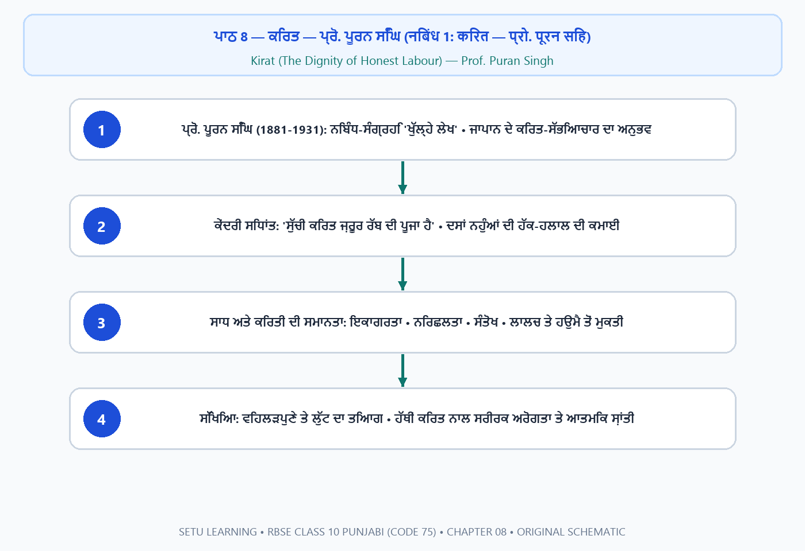

# ਪਾਠ 8 — ਕਿਰਤ — ਪ੍ਰੋ. ਪੂਰਨ ਸਿੰਘ (निबंध 1: किरत — प्रो. पूरन सिंह) (Kirat (The Dignity of Honest Labour) — Prof. Puran Singh)

## भाग 1: अध्याय प्रवेश एवं पाठ्यक्रम मैपिंग (ਪਾਠ-ਪ੍ਰਵੇਸ਼ ਅਤੇ ਪਾਠਕ੍ਰਮ ਮੈਪਿੰਗ)

> ਪਹਿਲਾ ਸੰਪਾਦਕੀ ਪ੍ਰਾਰੂਪ (प्रथम संपादकीय प्रारूप)। RBSE ਜਮਾਤ 10 ਪੰਜਾਬੀ ਪਾਠ-ਪੁਸਤਕ 'ਸਾਹਿਤ ਸੁਗੰਧੀਆਂ' ਦੇ ਸਾਰੇ ਪ੍ਰਸ਼ਨਾਂ ਦੇ ਹੱਲ ਅਤੇ 2014–2026 ਦਾ ਪੂਰਾ ਇਤਿਹਾਸਕ PYQ ਸੰਗ੍ਰਹਿ ਸਰੋਤ-ਪ੍ਰੀਖਣ ਸਮੇਤ ਸੰਕਲਿਤ ਹਨ।

**ਵਿਸ਼ਾ ਕੋਡ (विषय कोड):** 75 (ਤੀਜੀ ਭਾਸ਼ਾ — ਪੰਜਾਬੀ / तृतीया भाषा — पंजाबी) · **ਲੜੀ ਪੁਸਤਕ (श्रृंखला पुस्तक):** 7

**ਪ੍ਰਮਾਣਿਤ ਆਧਾਰ:** RBSE 2025–26 · **ਪਾਠ ਅੰਕ-ਭਾਰ:** 2 ਅੰਕ। ਇਹ ਭਾਰ ਉਸੇ ਸੰਸਕਰਣ ਦਾ ਹੈ; ਅਸਲ ਪ੍ਰਸ਼ਨ-ਵੰਡ ਦੀ ਭਵਿੱਖਬਾਣੀ ਨਹੀਂ।

**ਸਿੱਖਣ ਦੇ ਉਦੇਸ਼ (सीखने के लक्ष्य):** ਪ੍ਰੋ. ਪੂਰਨ ਸਿੰਘ ਦੇ ਨਿਬੰਧ 'ਕਿਰਤ' ਦਾ ਸਾਰ, ਹੱਥੀਂ ਕਿਰਤ ਦੀ ਮਹਾਨਤਾ ('ਸੁੱਚੀ ਕਿਰਤ ਜ਼ਰੂਰ ਰੱਬ ਦੀ ਪੂਜਾ ਹੈ'), ਸਾਧ ਤੇ ਕਿਰਤੀ ਦੇ ਲੱਛਣਾਂ ਦੀ ਸਮਾਨਤਾ ਅਤੇ ਜਾਪਾਨ ਦੇ ਮਿਹਨਤੀ ਸੱਭਿਆਚਾਰ ਦੇ ਹਵਾਲੇ ਸਮਝਣਾ।

## भाग 2: शब्दावली एवं अवधारणा कैप्सूल (ਸ਼ਬਦਾਵਲੀ ਅਤੇ ਸੰਕਲਪ ਕੈਪਸੂਲ)

| ਸ਼ਬਦ / ਸੰਕਲਪ | ਅਰਥ / ਵਿਆਖਿਆ |
|---|---|
| ਕਿਰਤ (किरत) | ਹੱਥੀਂ ਕੀਤੀ ਸੱਚੀ ਤੇ ਇਮਾਨਦਾਰ ਮਿਹਨਤ (ਸੁੱਚੀ ਕਿਰਤ ਜ਼ਰੂਰ ਰੱਬ ਦੀ ਪੂਜਾ ਹੈ)। |
| ਕਿਰਤੀ (किरती) | ਹੱਥੀਂ ਮਿਹਨਤ ਕਰਨ ਵਾਲਾ ਮਜ਼ਦੂਰ / ਕਿਸਾਨ / ਕਾਰੀਗਰ। |
| ਸਾਧ (साध) | ਤਿਆਗੀ ਤੇ ਨਿਰਲੇਪ ਸੰਤ-ਮਹਾਂਪੁਰਖ (ਸਾਧ ਤੇ ਕਿਰਤੀ ਦੇ ਲੱਛਣ ਮਿਲਦੇ ਹਨ)। |
| ਦਸਾਂ ਨਹੁੰਆਂ ਦੀ ਕਿਰਤ (दसां नहुंआं दी किरत) | ਆਪਣੇ ਹੱਥਾਂ ਨਾਲ ਕੀਤੀ ਹੱਕ-ਹਲਾਲ ਦੀ ਕਮਾਈ। |
| ਕੁਦਰਤ (कुदरत) | ਪ੍ਰਕਿਰਤੀ — ਜਿੱਥੇ ਹਵਾ, ਪਾਣੀ, ਸੂਰਜ ਤੇ ਰੁੱਖ ਨਿਰੰਤਰ ਕਿਰਤ ਵਿੱਚ ਲੱਗੇ ਹਨ। |
| ਬੁੱਤ-ਤਰਾਸ਼ (बुत्त-तराश) | ਪੱਥਰ ਘੜ ਕੇ ਮੂਰਤੀ ਬਣਾਉਣ ਵਾਲਾ ਕਲਾਕਾਰ। |
| ਨਿਸ਼ਕਾਮ (निष्काम) | ਬਿਨਾਂ ਕਿਸੇ ਲਾਲਚ ਜਾਂ ਫਲ ਦੀ ਇੱਛਾ ਦੇ ਕੀਤਾ ਗਿਆ ਕੰਮ। |
| ਵਿਹਲੜ (विहलड़) | ਬਿਨਾਂ ਕੰਮ ਕੀਤੇ ਖਾਣ ਵਾਲਾ ਆਲਸੀ ਮਨੁੱਖ। |
| ਰੂਹਾਨੀਅਤ (रूहानीयत) | ਆਤਮਿਕ ਪਵਿੱਤਰਤਾ ਅਤੇ ਰੱਬੀ ਨੇੜਤਾ। |
| ਸਦਾਚਾਰ (सदाचार) | ਉੱਚਾ ਨੈਤਿਕ ਆਚਰਣ ਜੋ ਸੱਚੀ ਕਿਰਤ ਵਿੱਚੋਂ ਪੈਦਾ ਹੁੰਦਾ ਹੈ। |

## भाग 3: विस्तृत शिक्षण पाठ (ਵਿਸਤ੍ਰਿਤ ਅਧਿਆਪਨ ਪਾਠ)

### 1. ਨਿਬੰਧਕਾਰ-ਪਛਾਣ: ਪ੍ਰੋ. ਪੂਰਨ ਸਿੰਘ (1881–1931 ਈ.)
ਪੰਜਾਬੀ ਖੁੱਲ੍ਹੀ ਕਵਿਤਾ ਅਤੇ ਭਾਵੁਕ-ਦਾਰਸ਼ਨਿਕ ਵਾਰਤਕ ਦੇ ਮੋਢੀ **ਪ੍ਰੋ. ਪੂਰਨ ਸਿੰਘ** ਦਾ ਜਨਮ 17 ਫਰਵਰੀ 1881 ਈ. ਨੂੰ ਐਬਟਾਬਾਦ ਦੇ ਨੇੜੇ ਪਿੰਡ ਸਲਹੱਡ ਵਿਖੇ ਪਿਤਾ ਕਰਤਾਰ ਸਿੰਘ ਅਤੇ ਮਾਤਾ ਪਰਮਾ ਦੇਵੀ ਦੇ ਘਰ ਹੋਇਆ। ਉਹ ਉੱਚ ਵਿੱਦਿਆ (ਫਾਰਮਾਸਿਊਟੀਕਲ ਕੈਮਿਸਟਰੀ) ਲਈ **ਜਾਪਾਨ (ਟੋਕੀਓ ਯੂਨੀਵਰਸਿਟੀ)** ਗਏ ਜਿੱਥੇ ਉਹਨਾਂ ਉੱਤੇ ਸਵਾਮੀ ਰਾਮ ਤੀਰਥ ਅਤੇ ਭਾਈ ਵੀਰ ਸਿੰਘ ਦਾ ਡੂੰਘਾ ਪ੍ਰਭਾਵ ਪਿਆ। ਉਹਨਾਂ ਦਾ ਪ੍ਰਸਿੱਧ ਪੰਜਾਬੀ ਨਿਬੰਧ-ਸੰਗ੍ਰਹਿ **'ਖੁੱਲ੍ਹੇ ਲੇਖ'** ਹੈ, ਜਿਸ ਵਿੱਚੋਂ **'ਕਿਰਤ'** ਨਿਬੰਧ ਸਾਡੀ ਪਾਠ-ਪੁਸਤਕ 'ਸਾਹਿਤ ਸੁਗੰਧੀਆਂ' ਵਿੱਚ ਸ਼ਾਮਲ ਕੀਤਾ ਗਿਆ ਹੈ।

### 2. 'ਕਿਰਤ' ਨਿਬੰਧ ਦੇ ਪ੍ਰਮੁੱਖ ਵਿਚਾਰ ਅਤੇ ਸਾਰ
1. **ਹੱਥੀਂ ਕਿਰਤ ਦੀ ਮਹਾਨਤਾ ('ਸੁੱਚੀ ਕਿਰਤ ਜ਼ਰੂਰ ਰੱਬ ਦੀ ਪੂਜਾ ਹੈ'):**
   - ਪ੍ਰੋ. ਪੂਰਨ ਸਿੰਘ ਦੱਸਦੇ ਹਨ ਕਿ ਹੱਥੀਂ ਕੀਤੀ ਸੱਚੀ ਤੇ ਪਵਿੱਤਰ ਮਿਹਨਤ (ਕਿਰਤ) ਹੀ ਅਸਲ ਧਰਮ ਅਤੇ ਰੱਬ ਦੀ ਪੂਜਾ ਹੈ। ਜਿਹੜਾ ਮਨੁੱਖ ਆਪਣੇ ਹੱਥਾਂ ਨਾਲ ਮਿਹਨਤ ਕਰਕੇ ਅੰਨ ਉਗਾਉਂਦਾ ਹੈ, ਕੱਪੜਾ ਬੁਣਦਾ ਹੈ, ਲੱਕੜ ਜਾਂ ਲੋਹਾ ਘੜਦਾ ਹੈ, ਉਹ ਕੁਦਰਤ ਦੇ ਸਿਰਜਣਹਾਰ ਨਾਲ ਸਿੱਧਾ ਜੁੜਿਆ ਹੁੰਦਾ ਹੈ।
2. **ਸਾਧ (ਸੰਤ) ਅਤੇ ਕਿਰਤੀ ਦੇ ਲੱਛਣ ਕਿਵੇਂ ਮਿਲਦੇ ਹਨ? (RBSE 2020 Supp Q8-ਸ, 2025 Supp Q15, 2026 Supp Q3-VI):**
   - ਲੇਖਕ ਨੇ **'ਸਾਧ' (ਸੰਤ)** ਅਤੇ **'ਕਿਰਤੀ' (ਮਿਹਨਤਕਸ਼)** ਦੇ ਲੱਛਣਾਂ ਨੂੰ ਇੱਕੋ ਜਿਹੇ ਦੱਸਿਆ ਹੈ:
   - ਜਿਵੇਂ ਸੱਚਾ ਸਾਧ ਮਾਇਆ ਦੇ ਲਾਲਚ, ਛਲ-ਕਪਟ ਅਤੇ ਹੰਕਾਰ ਤੋਂ ਮੁਕਤ ਹੋ ਕੇ ਪ੍ਰਭੂ-ਭਗਤੀ ਵਿੱਚ ਲੀਨ ਰਹਿੰਦਾ ਹੈ, ਤਿਵੇਂ ਹੀ ਸੱਚਾ ਕਿਰਤੀ ਆਪਣੀ ਕਿਰਤ ਵਿੱਚ ਮਗਨ ਰਹਿੰਦਾ ਹੈ।
   - ਕਿਰਤੀ ਦੇ ਮਨ ਵਿੱਚ ਕਿਸੇ ਨਾਲ ਠੱਗੀ ਮਾਰਨ ਦਾ ਖਿਆਲ ਨਹੀਂ ਆਉਂਦਾ, ਉਸ ਨੂੰ ਰਾਤ ਨੂੰ ਗੂੜ੍ਹੀ ਤੇ ਮਿੱਠੀ ਨੀਂਦ ਆਉਂਦੀ ਹੈ ਅਤੇ ਉਸ ਦਾ ਹਿਰਦਾ ਸਾਧ ਵਾਂਗ ਹੀ ਨਿਰਮਲ, ਤਿਆਗੀ ਤੇ ਸੰਤੋਖੀ ਹੁੰਦਾ ਹੈ।
3. **ਜਾਪਾਨ ਦੇ ਲੋਕਾਂ ਦੀ ਕਿਰਤ-ਪ੍ਰੇਮ ਦੀ ਉਦਾਹਰਣ:**
   - ਪ੍ਰੋ. ਪੂਰਨ ਸਿੰਘ ਜਾਪਾਨ ਦੇ ਆਪਣੇ ਤਜਰਬੇ ਦੇ ਆਧਾਰ 'ਤੇ ਦੱਸਦੇ ਹਨ ਕਿ ਜਾਪਾਨ ਵਿੱਚ ਕੋਈ ਵੀ ਮਨੁੱਖ ਵਿਹਲਾ ਰਹਿਣਾ ਪਸੰਦ ਨਹੀਂ ਕਰਦਾ। ਉੱਥੇ ਮਜ਼ਦੂਰ, ਕਿਸਾਨ, ਚਿੱਤਰਕਾਰ ਅਤੇ ਕਾਰੀਗਰ ਆਪਣੇ ਹੱਥੀਂ ਕੀਤੇ ਕੰਮ ਨੂੰ ਕਲਾ ਤੇ ਭਗਤੀ ਵਾਂਗ ਪਿਆਰ ਕਰਦੇ ਹਨ।
4. **ਮਸ਼ੀਨੀਕਰਨ ਤੇ ਸਰਮਾਏਦਾਰੀ ਉੱਤੇ ਚਿੰਤਾ:**
   - ਲੇਖਕ ਚੇਤਾਵਨੀ ਦਿੰਦਾ ਹੈ ਕਿ ਜਦੋਂ ਮਨੁੱਖ ਹੱਥੀਂ ਕਿਰਤ ਛੱਡ ਕੇ ਕੇਵਲ ਪੈਸੇ ਦਾ ਪੁਜਾਰੀ ਬਣ ਜਾਂਦਾ ਹੈ ਜਾਂ ਦੂਜਿਆਂ ਦੀ ਮਿਹਨਤ ਦੀ ਲੁੱਟ ਉੱਤੇ ਪਲਦਾ ਹੈ, ਤਾਂ ਸਮਾਜ ਵਿੱਚੋਂ ਰੂਹਾਨੀਅਤ, ਪਿਆਰ ਤੇ ਸਦਾਚਾਰ ਖ਼ਤਮ ਹੋ ਜਾਂਦੇ ਹਨ। ਸ੍ਰੀ ਗੁਰੂ ਨਾਨਕ ਦੇਵ ਜੀ ਨੇ ਵੀ ਮਲਿਕ ਭਾਗੋ ਦੇ ਪਕਵਾਨ ਛੱਡ ਕੇ ਭਾਈ ਲਾਲੋ ਦੀ ਸੱਚੀ ਕਿਰਤ ਦੀ ਕੋਧਰੇ ਦੀ ਰੋਟੀ ਵਿੱਚੋਂ ਦੁੱਧ ਵਿਖਾਇਆ ਸੀ।

ਪਾਠ 8: ਪ੍ਰੋ. ਪੂਰਨ ਸਿੰਘ ਦੇ ਨਿਬੰਧ 'ਕਿਰਤ' ਦਾ ਸੰਕਲਪ ਚਿੱਤਰ

## भाग 4: पाठ्यपुस्तक-अवधारणाओं पर मौलिक हल किए उदाहरण (ਹੱਲ ਕੀਤੇ ਮਿਆਰੀ ਉਦਾਹਰਣ)

ਹੇਠਾਂ ਦਿੱਤੇ ਪ੍ਰਸ਼ਨ ਪਾਠ-ਪੁਸਤਕ 'ਸਾਹਿਤ ਸੁਗੰਧੀਆਂ' ਅਤੇ ਵਿਆਕਰਣ ਦੇ ਸੰਕਲਪਾਂ ਉੱਤੇ ਆਧਾਰਿਤ ਮੌਲਿਕ ਆਦਰਸ਼ ਹੱਲ ਹਨ।

**ਹੱਲ ਕੀਤਾ ਉਦਾਹਰਣ 1: 'ਸੁੱਚੀ ਕਿਰਤ ਜ਼ਰੂਰ ਰੱਬ ਦੀ ਪੂਜਾ ਹੈ' — ਪ੍ਰੋ. ਪੂਰਨ ਸਿੰਘ ਦੇ ਨਿਬੰਧ 'ਕਿਰਤ' ਦੇ ਆਧਾਰ 'ਤੇ ਸਪੱਸ਼ਟ ਕਰੋ।**

ਪ੍ਰੋ. ਪੂਰਨ ਸਿੰਘ ਅਨੁਸਾਰ ਕੇਵਲ ਮੰਦਰਾਂ-ਮਸੀਤਾਂ ਵਿੱਚ ਬੈਠ ਕੇ ਮਾਲਾ ਫੇਰਨੀ ਹੀ ਰੱਬ ਦੀ ਪੂਜਾ ਨਹੀਂ ਹੈ, ਸਗੋਂ ਦਸਾਂ ਨਹੁੰਆਂ ਦੀ ਸੁੱਚੀ ਤੇ ਇਮਾਨਦਾਰ ਕਿਰਤ ਹੀ ਰੱਬ ਦੀ ਸਭ ਤੋਂ ਵੱਡੀ ਪੂਜਾ ਹੈ। ਜਦੋਂ ਕਿਸਾਨ ਹਲ ਵਾਹੁੰਦਾ ਹੈ, ਤਰਖਾਣ ਲੱਕੜ ਘੜਦਾ ਹੈ ਜਾਂ ਮਜ਼ਦੂਰ ਪਸੀਨਾ ਵਹਾਉਂਦਾ ਹੈ, ਤਾਂ ਉਸ ਦੇ ਮਨ ਵਿੱਚੋਂ ਵਿਕਾਰ ਧੁਲ ਜਾਂਦੇ ਹਨ, ਉਸ ਦੀ ਆਤਮਾ ਪਵਿੱਤਰ ਹੋ ਜਾਂਦੀ ਹੈ ਅਤੇ ਰੱਬ ਆਪ ਉਸ ਦੀ ਕਿਰਤ ਵਿੱਚ ਵੱਸਦਾ ਹੈ (RBSE 2018 Supp Q8-ੳ, 2019 Main Q8-ੳ, 2020 Main Q9)।

**ਹੱਲ ਕੀਤਾ ਉਦਾਹਰਣ 2: ਸਾਧ ਤੇ ਕਿਰਤੀ ਦੇ ਲੱਛਣ ਕਿਵੇਂ ਮਿਲਦੇ ਹਨ? ਸਪੱਸ਼ਟ ਕਰੋ।**

'ਕਿਰਤ' ਨਿਬੰਧ ਵਿੱਚ ਪ੍ਰੋ. ਪੂਰਨ ਸਿੰਘ ਦੱਸਦੇ ਹਨ ਕਿ ਇੱਕ ਸੱਚੇ ਸਾਧ (ਸੰਤ) ਅਤੇ ਇੱਕ ਸੱਚੇ ਕਿਰਤੀ (ਮਿਹਨਤਕਸ਼) ਦੇ ਲੱਛਣ ਆਪਸ ਵਿੱਚ ਪੂਰੀ ਤਰ੍ਹਾਂ ਮਿਲਦੇ ਹਨ। ਜਿਵੇਂ ਸਾਧ ਦੁਨਿਆਵੀ ਲਾਲਚ, ਹਉਮੈ ਤੇ ਠੱਗੀ ਤੋਂ ਦੂਰ ਰਹਿ ਕੇ ਰੱਬੀ ਧਿਆਨ ਵਿੱਚ ਮਗਨ ਰਹਿੰਦਾ ਹੈ, ਉਸੇ ਤਰ੍ਹਾਂ ਕਿਰਤੀ ਆਪਣੇ ਕੰਮ ਵਿੱਚ ਇਕਾਗਰ-ਚਿੱਤ ਹੋ ਕੇ ਲੀਨ ਰਹਿੰਦਾ ਹੈ। ਦੋਵੇਂ ਸੰਤੋਖੀ, ਨਿਰਛਲ, ਪਰਉਪਕਾਰੀ ਅਤੇ ਸ਼ਾਂਤ-ਚਿੱਤ ਹੁੰਦੇ ਹਨ (RBSE 2020 Supp Q8-ਸ, 2025 Supp Q15, 2026 Supp Q3-VI)।

**ਹੱਲ ਕੀਤਾ ਉਦਾਹਰਣ 3: 'ਕਿਰਤ' ਨਿਬੰਧ ਵਿੱਚ ਪ੍ਰੋ. ਪੂਰਨ ਸਿੰਘ ਨੇ ਕਿਰਤ ਤੋਂ ਬਿਨਾਂ ਵਿਹਲੇ ਰਹਿਣ ਦੇ ਕੀ ਨੁਕਸਾਨ ਦੱਸੇ ਹਨ?**

ਲੇਖਕ ਅਨੁਸਾਰ ਹੱਥੀਂ ਕਿਰਤ ਛੱਡਣ ਨਾਲ ਮਨੁੱਖ ਆਲਸੀ, ਸੁਆਰਥੀ ਅਤੇ ਵਿਕਾਰੀ ਬਣ ਜਾਂਦਾ ਹੈ। ਵਿਹਲਾ ਮਨ ਸ਼ੈਤਾਨ ਦਾ ਘਰ ਬਣਦਾ ਹੈ, ਸਮਾਜ ਵਿੱਚ ਲੁੱਟ-ਖਸੁੱਟ ਤੇ ਬੇਇਨਸਾਫ਼ੀ ਵਧਦੀ ਹੈ ਅਤੇ ਮਨੁੱਖ ਕੁਦਰਤ ਦੇ ਸਹਿਜ ਆਨੰਦ ਤੋਂ ਵਾਂਝਾ ਹੋ ਜਾਂਦਾ ਹੈ।

## भाग 5: सत्यापित बोर्ड प्रश्न एवं स्रोत-स्थिति (ਪ੍ਰਮਾਣਿਤ ਬੋਰਡ ਪ੍ਰਸ਼ਨ ਅਤੇ ਸਰੋਤ-ਸਥਿਤੀ)

RBSE 2026 Supp (`S-75`, Q3-VI), 2025 Supp (Q1-vii, Q15), 2024 Main (Q18) ਅਤੇ 2022 Main (Q1-v, Q17) ਵਿੱਚ 'ਕਿਰਤ' ਨਿਬੰਧ ਦੇ ਪ੍ਰਸ਼ਨ ਲਗਾਤਾਰ ਪੁੱਛੇ ਗਏ ਹਨ।

[RBSE 2026 ਮੂਲ ਪੇਪਰ (S-75)](https://rajeduboard.rajasthan.gov.in/books/PAPERS-2026/Sec/S-75.pdf)। ਪ੍ਰਸ਼ਨ ਦਾ ਸੰਖੇਪ ਵਿਸ਼ਾ-ਸੰਦਰਭ ਹੈ; ਸ਼ਬਦ-ਬ-ਸ਼ਬਦ ਪੁਨਰ-ਮੁਦਰਣ ਨਹੀਂ।

## भाग 6: खंडवार मौलिक अभ्यास बैंक (ਖੰਡ-ਵਾਰ ਮੌਲਿਕ ਅਭਿਆਸ ਬੈਂਕ)

**ਅਭਿਆਸ-ਅੰਕ:** ਵਿਦਿਆਰਥੀਆਂ ਦੇ ਸਵੈ-ਅਭਿਆਸ ਲਈ ਹਨ; ਉੱਤਰ ਪਹਿਲਾਂ ਆਪ ਲਿਖੋ, ਫਿਰ ਭਾਗ 9 ਵੇਖੋ।

## ੳ: ਬਹੁ-ਵਿਕਲਪੀ ਪ੍ਰਸ਼ਨ (MCQ) — 15 × 1 ਅੰਕ

**MCQ 1. 'ਕਿਰਤ' ਨਿਬੰਧ ਦੇ ਨਿਬੰਧਕਾਰ ਕੌਣ ਹਨ? (RBSE 2022 Main Q1-v, 2025 Supp Q1-vii)**

ੳ) ਪ੍ਰੋ. ਪੂਰਨ ਸਿੰਘ  
ਅ) ਪ੍ਰਿੰ. ਤੇਜਾ ਸਿੰਘ  
ੲ) ਪ੍ਰਿੰ. ਸਰਵਣ ਸਿੰਘ  
ਸ) ਹਰਪਾਲ ਸਿੰਘ ਲੱਖੀਆਂ

**MCQ 2. 'ਕਿਰਤ' ਨਿਬੰਧ ਦਾ ਲੇਖਕ ਕਿੰਨ੍ਹਾਂ-ਕਿੰਨ੍ਹਾਂ ਦੇ ਲੱਛਣ ਮਿਲਣ (ਇੱਕੋ ਜਿਹੇ ਹੋਣ) ਬਾਰੇ ਦੱਸਦਾ ਹੈ? (RBSE 2026 Supp Q3-VI)**

ੳ) ਰਾਜੇ ਅਤੇ ਵਜ਼ੀਰ ਦੇ  
ਅ) ਅਮੀਰ ਅਤੇ ਗ਼ਰੀਬ ਦੇ  
ੲ) ਵਪਾਰੀ ਅਤੇ ਗਾਹਕ ਦੇ  
ਸ) ਸਾਧ ਅਤੇ ਕਿਰਤੀ ਦੇ

**MCQ 3. 'ਸੁੱਚੀ ਕਿਰਤ ਜ਼ਰੂਰ ਰੱਬ ਦੀ ਪੂਜਾ ਹੈ' — ਇਹ ਕਥਨ ਕਿਸ ਨਿਬੰਧ ਵਿੱਚੋਂ ਹੈ?**

ੳ) ਭਾਈ ਮਰਦਾਨਾ ਜੀ  
ਅ) ਮਹਾਰਾਜਾ ਗੰਗਾ ਸਿੰਘ  
ੲ) ਕਿਰਤ  
ਸ) ਗੰਗਾ ਦੀਨ

**MCQ 4. ਪ੍ਰੋ. ਪੂਰਨ ਸਿੰਘ ਦਾ ਪ੍ਰਸਿੱਧ ਪੰਜਾਬੀ ਨਿਬੰਧ-ਸੰਗ੍ਰਹਿ ਕਿਹੜਾ ਹੈ?**

ੳ) ਅੱਖੀਂ ਡਿੱਠਾ  
ਅ) ਖੁੱਲ੍ਹੇ ਲੇਖ  
ੲ) ਸাহਿਤ ਦਰਸ਼ਨ  
ਸ) ਨਵੀਆਂ ਸੋਚਾਂ

**MCQ 5. ਪ੍ਰੋ. ਪੂਰਨ ਸਿੰਘ ਉੱਚ ਵਿੱਦਿਆ ਪ੍ਰਾਪਤ ਕਰਨ ਲਈ ਕਿਹੜੇ ਦੇਸ਼ ਗਏ ਸਨ ਜਿੱਥੋਂ ਦੇ ਕਿਰਤ-ਸੱਭਿਆਚਾਰ ਨੇ ਉਹਨਾਂ ਨੂੰ ਪ੍ਰਭਾਵਿਤ ਕੀਤਾ?**

ੳ) ਜਾਪਾਨ  
ਅ) ਅਮਰੀਕਾ  
ੲ) ਰੂਸ  
ਸ) ਫ਼ਰਾਂਸ

**MCQ 6. 'ਕਿਰਤ' ਸ਼ਬਦ ਦਾ ਸਹੀ ਅਰਥ ਕੀ ਹੈ?**

ੳ) ਮੁਫ਼ਤ ਮਿਲਿਆ ਧਨ  
ਅ) ਵਿਆਜ ਦੀ ਕਮਾਈ  
ੲ) ਰਾਜਸੀ ਤਾਕਤ  
ਸ) ਹੱਥੀਂ ਕੀਤੀ ਸੱਚੀ ਤੇ ਇਮਾਨਦਾਰ ਮਿਹਨਤ

**MCQ 7. 'ਦਸਾਂ ਨਹੁੰਆਂ ਦੀ ਕਿਰਤ' ਮੁਹਾਵਰੇ ਤੋਂ ਕੀ ਭਾਵ ਹੈ?**

ੳ) ਬਿਨਾਂ ਮਿਹਨਤ ਦੇ ਮਿਲਿਆ ਧਨ  
ਅ) ਦੂਜਿਆਂ ਤੋਂ ਕਰਵਾਇਆ ਕੰਮ  
ੲ) ਆਪਣੇ ਹੱਥਾਂ ਨਾਲ ਕੀਤੀ ਇਮਾਨਦਾਰੀ ਦੀ ਕਮਾਈ  
ਸ) ਦਸ ਦਿਨਾਂ ਦੀ ਮਜ਼ਦੂਰੀ

**MCQ 8. ਪ੍ਰੋ. ਪੂਰਨ ਸਿੰਘ ਅਨੁਸਾਰ ਕਿਰਤੀ ਨੂੰ ਰਾਤ ਵੇਲੇ ਕਿਹੋ ਜਿਹੀ ਨੀਂਦ ਆਉਂਦੀ ਹੈ?**

ੳ) ਉੱਕਾ ਨੀਂਦ ਨਹੀਂ ਆਉਂਦੀ  
ਅ) ਗੂੜ੍ਹੀ, ਮਿੱਠੀ ਅਤੇ ਬੇਫ਼ਿਕਰ ਨੀਂਦ  
ੲ) ਚਿੰਤਾ ਭਰੀ ਨੀਂਦ  
ਸ) ਡਰਾਉਣੇ ਸੁਪਨਿਆਂ ਵਾਲੀ ਨੀਂਦ

**MCQ 9. ਲੇਖਕ ਅਨੁਸਾਰ ਜਦੋਂ ਸਮਾਜ ਵਿੱਚ ਹੱਥੀਂ ਕਿਰਤ ਦਾ ਸਤਿਕਾਰ ਘਟ ਜਾਂਦਾ ਹੈ ਤਾਂ ਕੀ ਹੁੰਦਾ ਹੈ?**

ੳ) ਰੂਹਾਨੀਅਤ, ਪਿਆਰ ਤੇ ਸਦਾਚਾਰ ਘਟ ਜਾਂਦੇ ਹਨ ਤੇ ਲੁੱਟ-ਖਸੁੱਟ ਵਧਦੀ ਹੈ  
ਅ) ਲੋਕ ਵਧੇਰੇ ਧਾਰਮਿਕ ਹੋ ਜਾਂਦੇ ਹਨ  
ੲ) ਸਾਰੇ ਲੋਕ ਅਮੀਰ ਹੋ ਜਾਂਦੇ ਹਨ  
ਸ) ਕਲਾ ਦਾ ਵਿਕਾਸ ਹੁੰਦਾ ਹੈ

**MCQ 10. ਪ੍ਰੋ. ਪੂਰਨ ਸਿੰਘ ਦਾ ਜਨਮ ਕਦੋਂ ਅਤੇ ਕਿੱਥੇ ਹੋਇਆ?**

ੳ) 1872 ਈ. ਵਿੱਚ ਅੰਮ੍ਰਿਤਸਰ ਵਿਖੇ  
ਅ) 1905 ਈ. ਵਿੱਚ ਲਾਹੌਰ ਵਿਖੇ  
ੲ) 1894 ਈ. ਵਿੱਚ ਰਾਵਲਪਿੰਡੀ ਵਿਖੇ  
ਸ) 1881 ਈ. ਵਿੱਚ ਸਲਹੱਡ (ਐਬਟਾਬਾਦ) ਵਿਖੇ

**MCQ 11. ਜਾਪਾਨ ਵਿੱਚ ਪ੍ਰੋ. ਪੂਰਨ ਸਿੰਘ ਦੀ ਮੁਲਾਕਾਤ ਕਿਸ ਮਹਾਨ ਸੰਨਿਆਸੀ ਨਾਲ ਹੋਈ ਸੀ?**

ੳ) ਮਹਾਤਮਾ ਗਾਂਧੀ ਨਾਲ  
ਅ) ਰਬਿੰਦਰਨਾਥ ਟੈਗੋਰ ਨਾਲ  
ੲ) ਸਵਾਮੀ ਰਾਮ ਤੀਰਥ ਨਾਲ  
ਸ) ਸਵਾਮੀ ਵਿਵੇਕਾਨੰਦ ਨਾਲ

**MCQ 12. 'ਕਿਰਤ' ਨਿਬੰਧ ਅਨੁਸਾਰ ਕੁਦਰਤ ਦੇ ਕਿਹੜੇ ਤੱਤ ਨਿਰੰਤਰ ਕਿਰਤ ਵਿੱਚ ਲੱਗੇ ਹੋਏ ਹਨ?**

ੳ) ਕੋਈ ਵੀ ਨਹੀਂ  
ਅ) ਸੂਰਜ, ਹਵਾ, ਪਾਣੀ, ਧਰਤੀ ਅਤੇ ਰੁੱਖ-ਬੂਟੇ  
ੲ) ਕੇਵਲ ਪਹਾੜ  
ਸ) ਕੇਵਲ ਪੱਥਰ

**MCQ 13. ਕਿਰਤੀ ਆਪਣੇ ਕੰਮ ਵਿੱਚ ਕਿਵੇਂ ਜੁੜਿਆ ਹੁੰਦਾ ਹੈ?**

ੳ) ਜਿਵੇਂ ਸਾਧ ਆਪਣੀ ਭਗਤੀ ਤੇ ਸਮਾਧੀ ਵਿੱਚ ਜੁੜਿਆ ਹੁੰਦਾ ਹੈ  
ਅ) ਜਿਵੇਂ ਵਪਾਰੀ ਮੁਨਾਫ਼ੇ ਵਿੱਚ  
ੲ) ਜਿਵੇਂ ਚੋਰ ਚੋਰੀ ਵਿੱਚ  
ਸ) ਜਿਵੇਂ ਆਲਸੀ ਨੀਂਦ ਵਿੱਚ

**MCQ 14. ਪ੍ਰੋ. ਪੂਰਨ ਸਿੰਘ ਕਿਸ ਕਾਵਿ-ਧਾਰਾ ਦੇ ਵੀ ਮੋਢੀ ਮੰਨੇ ਜਾਂਦੇ ਹਨ?**

ੳ) ਸੂਫ਼ੀ ਕਾਫ਼ੀ ਦੇ  
ਅ) ਕਿੱਸਾ ਕਾਵਿ ਦੇ  
ੲ) ਗ਼ਜ਼ਲ ਕਾਵਿ ਦੇ  
ਸ) ਪੰਜਾਬੀ ਖੁੱਲ੍ਹੀ ਕਵਿਤਾ (ਛੰਦ-ਮੁਕਤ ਕਵਿਤਾ) ਦੇ

**MCQ 15. 'ਕਿਰਤ' ਨਿਬੰਧ ਮਨੁੱਖ ਨੂੰ ਕਿਹੋ ਜਿਹਾ ਜੀਵਨ ਜਿਊਣ ਦੀ ਪ੍ਰੇਰਨਾ ਦਿੰਦਾ ਹੈ?**

ੳ) ਦੂਜਿਆਂ ਉੱਤੇ ਨਿਰਭਰ ਰਹਿਣ ਵਾਲਾ  
ਅ) ਕੇਵਲ ਪੈਸਾ ਜੋੜਨ ਵਾਲਾ  
ੲ) ਹੱਥੀਂ ਮਿਹਨਤ, ਇਮਾਨਦਾਰੀ, ਸੰਤੋਖ ਅਤੇ ਕੁਦਰਤ-ਪਿਆਰ ਵਾਲਾ  
ਸ) ਵਿਹਲੜ ਅਤੇ ਐਸ਼ੋ-ਆਰਾਮ ਵਾਲਾ

## ੳ: ਖਾਲੀ ਥਾਵਾਂ ਭਰੋ — 6 × 1 ਅੰਕ

1. ਹੱਥੀਂ ਕੀਤੀ ਸੱਚੀ ਤੇ ਇਮਾਨਦਾਰ ਮਿਹਨਤ (ਸੁੱਚੀ ਕਿਰਤ ਜ਼ਰੂਰ ਰੱਬ ਦੀ ਪੂਜਾ ਹੈ)। — ਇਸ ਸ਼ਬਦ/ਸੰਕਲਪ ਦਾ ਨਾਂ ਹੈ: ____।  
2. ਹੱਥੀਂ ਮਿਹਨਤ ਕਰਨ ਵਾਲਾ ਮਜ਼ਦੂਰ / ਕਿਸਾਨ / ਕਾਰੀਗਰ। — ਇਸ ਸ਼ਬਦ/ਸੰਕਲਪ ਦਾ ਨਾਂ ਹੈ: ____।  
3. ਤਿਆਗੀ ਤੇ ਨਿਰਲੇਪ ਸੰਤ-ਮਹਾਂਪੁਰਖ (ਸਾਧ ਤੇ ਕਿਰਤੀ ਦੇ ਲੱਛਣ ਮਿਲਦੇ ਹਨ)। — ਇਸ ਸ਼ਬਦ/ਸੰਕਲਪ ਦਾ ਨਾਂ ਹੈ: ____।  
4. ਆਪਣੇ ਹੱਥਾਂ ਨਾਲ ਕੀਤੀ ਹੱਕ-ਹਲਾਲ ਦੀ ਕਮਾਈ। — ਇਸ ਸ਼ਬਦ/ਸੰਕਲਪ ਦਾ ਨਾਂ ਹੈ: ____।  
5. ਪ੍ਰਕਿਰਤੀ — ਜਿੱਥੇ ਹਵਾ, ਪਾਣੀ, ਸੂਰਜ ਤੇ ਰੁੱਖ ਨਿਰੰਤਰ ਕਿਰਤ ਵਿੱਚ ਲੱਗੇ ਹਨ। — ਇਸ ਸ਼ਬਦ/ਸੰਕਲਪ ਦਾ ਨਾਂ ਹੈ: ____।  
6. ਪੱਥਰ ਘੜ ਕੇ ਮੂਰਤੀ ਬਣਾਉਣ ਵਾਲਾ ਕਲਾਕਾਰ। — ਇਸ ਸ਼ਬਦ/ਸੰਕਲਪ ਦਾ ਨਾਂ ਹੈ: ____।

## ੳ: ਅਤਿ-ਲਘੂ ਉੱਤਰਾਂ ਵਾਲੇ ਪ੍ਰਸ਼ਨ — 8 × 1 ਅੰਕ

1. 'ਕਿਰਤ' ਨਿਬੰਧ ਦੇ ਨਿਬੰਧਕਾਰ ਕੌਣ ਹਨ? (RBSE 2022 Main Q1-v, 2025 Supp Q1-vii)  
2. 'ਕਿਰਤ' ਨਿਬੰਧ ਦਾ ਲੇਖਕ ਕਿੰਨ੍ਹਾਂ-ਕਿੰਨ੍ਹਾਂ ਦੇ ਲੱਛਣ ਮਿਲਣ (ਇੱਕੋ ਜਿਹੇ ਹੋਣ) ਬਾਰੇ ਦੱਸਦਾ ਹੈ? (RBSE 2026 Supp Q3-VI)  
3. 'ਸੁੱਚੀ ਕਿਰਤ ਜ਼ਰੂਰ ਰੱਬ ਦੀ ਪੂਜਾ ਹੈ' — ਇਹ ਕਥਨ ਕਿਸ ਨਿਬੰਧ ਵਿੱਚੋਂ ਹੈ?  
4. ਪ੍ਰੋ. ਪੂਰਨ ਸਿੰਘ ਦਾ ਪ੍ਰਸਿੱਧ ਪੰਜਾਬੀ ਨਿਬੰਧ-ਸੰਗ੍ਰਹਿ ਕਿਹੜਾ ਹੈ?  
5. ਪ੍ਰੋ. ਪੂਰਨ ਸਿੰਘ ਉੱਚ ਵਿੱਦਿਆ ਪ੍ਰਾਪਤ ਕਰਨ ਲਈ ਕਿਹੜੇ ਦੇਸ਼ ਗਏ ਸਨ ਜਿੱਥੋਂ ਦੇ ਕਿਰਤ-ਸੱਭਿਆਚਾਰ ਨੇ ਉਹਨਾਂ ਨੂੰ ਪ੍ਰਭਾਵਿਤ ਕੀਤਾ?  
6. 'ਕਿਰਤ' ਸ਼ਬਦ ਦਾ ਸਹੀ ਅਰਥ ਕੀ ਹੈ?  
7. 'ਦਸਾਂ ਨਹੁੰਆਂ ਦੀ ਕਿਰਤ' ਮੁਹਾਵਰੇ ਤੋਂ ਕੀ ਭਾਵ ਹੈ?  
8. ਪ੍ਰੋ. ਪੂਰਨ ਸਿੰਘ ਅਨੁਸਾਰ ਕਿਰਤੀ ਨੂੰ ਰਾਤ ਵੇਲੇ ਕਿਹੋ ਜਿਹੀ ਨੀਂਦ ਆਉਂਦੀ ਹੈ?

## ਅ: ਲਘੂ ਉੱਤਰਾਂ ਵਾਲੇ ਪ੍ਰਸ਼ਨ — 6 × 2 ਅੰਕ

**B1.** 'ਕਿਰਤ' ਨਿਬੰਧ ਦੇ ਨਿਬੰਧਕਾਰ ਕੌਣ ਹਨ?

**B2.** 'ਕਿਰਤ' ਨਿਬੰਧ ਦਾ ਲੇਖਕ ਕਿੰਨ੍ਹਾਂ-ਕਿੰਨ੍ਹਾਂ ਦੇ ਲੱਛਣ ਮਿਲਣ (ਇੱਕੋ ਜਿਹੇ ਹੋਣ) ਬਾਰੇ ਦੱਸਦਾ ਹੈ?

**B3.** ਪ੍ਰੋ. ਪੂਰਨ ਸਿੰਘ ਨੇ 'ਕਿਰਤ' ਨਿਬੰਧ ਵਿੱਚ ਕਿਹੜੇ ਦੇਸ਼ ਦੇ ਲੋਕਾਂ ਦੀ ਮਿਹਨਤ ਤੇ ਕਲਾ-ਪ੍ਰੇਮ ਦੀ ਪ੍ਰਸ਼ੰਸਾ ਕੀਤੀ ਹੈ?

**B4.** ਪ੍ਰੋ. ਪੂਰਨ ਸਿੰਘ ਦਾ ਪ੍ਰਸਿੱਧ ਪੰਜਾਬੀ ਨਿਬੰਧ-ਸੰਗ੍ਰਹਿ ਕਿਹੜਾ ਹੈ ਜਿਸ ਵਿੱਚ 'ਕਿਰਤ' ਲੇਖ ਦਰਜ ਹੈ?

**B5.** ਲੇਖਕ ਅਨੁਸਾਰ ਅਸਲ ਧਰਮ ਅਤੇ ਰੱਬ ਦੀ ਪੂਜਾ ਕੀ ਹੈ?

**B6.** ਗੁਰੂ ਨਾਨਕ ਦੇਵ ਜੀ ਨੇ ਕਿਸ ਕਿਰਤੀ ਦੀ ਕੋਧਰੇ ਦੀ ਰੋਟੀ ਨੂੰ ਸਤਿਕਾਰ ਦਿੱਤਾ ਸੀ?

## ੲ: ਦੀਰਘ ਉੱਤਰਾਂ ਵਾਲੇ ਪ੍ਰਸ਼ਨ — 4 × 3 ਅੰਕ

ਅੰਦਰੂਨੀ ਵਿਕਲਪ ਅਭਿਆਸ: ਪਹਿਲਾਂ ਇੱਕ ਵਿਕਲਪ ਹੱਲ ਕਰੋ ਅਤੇ ਦੁਹਰਾਈ ਵੇਲੇ ਬਾਕੀ ਪ੍ਰਸ਼ਨ ਵੀ ਹੱਲ ਕਰੋ।

**C1.** 'ਕਿਰਤ' ਨਿਬੰਧ ਦਾ ਸਾਰ ਆਪਣੇ ਸ਼ਬਦਾਂ ਵਿੱਚ ਲਿਖੋ। (RBSE 2018 Main Q9, 2022 Main Q17, 2024 Main Q18)

**C2.** 'ਸਾਧ ਤੇ ਕਿਰਤੀ ਦੇ ਲੱਛਣ ਕਿਵੇਂ ਮਿਲਦੇ ਹਨ?' — 'ਕਿਰਤ' ਨਿਬੰਧ ਦੇ ਆਧਾਰ 'ਤੇ ਸਪੱਸ਼ਟ ਕਰੋ। (RBSE 2020 Supp Q8-ਸ, 2025 Supp Q15)

**C3.** 'ਸੁੱਚੀ ਕਿਰਤ ਜ਼ਰੂਰ ਰੱਬ ਦੀ ਪੂਜਾ ਹੈ' — ਇਸ ਕਥਨ ਦੀ ਵਿਆਖਿਆ ਕਰੋ। (RBSE 2019 Main Q8-ੳ, 2020 Main Q9)

**C4.** ਪ੍ਰੋ. ਪੂਰਨ ਸਿੰਘ ਦੀ ਵਾਰਤਕ-ਸ਼ੈਲੀ ਦੀਆਂ ਪ੍ਰਮੁੱਖ ਵਿਸ਼ੇਸ਼ਤਾਵਾਂ 'ਕਿਰਤ' ਨਿਬੰਧ ਦੇ ਆਧਾਰ 'ਤੇ ਲਿਖੋ।

## ਸ: ਨਿਬੰਧਾਤਮਕ / ਵਿਸਤ੍ਰਿਤ ਉੱਤਰਾਂ ਵਾਲੇ ਪ੍ਰਸ਼ਨ — 2 × 4 ਅੰਕ

ਅੰਦਰੂਨੀ ਵਿਕਲਪ ਅਭਿਆਸ: D1 ਜਾਂ D2 ਚੁਣੋ; ਬਾਅਦ ਵਿੱਚ ਦੂਜਾ ਵੀ ਹੱਲ ਕਰੋ।

**D1.** 'ਕਿਰਤ' ਨਿਬੰਧ ਵਿੱਚ ਆਏ ਮੁੱਖ ਵਿਚਾਰਾਂ ਨੂੰ ਆਪਣੇ ਸ਼ਬਦਾਂ ਵਿੱਚ ਵਿਸਤਾਰ ਨਾਲ ਲਿਖੋ ਅਤੇ ਦੱਸੋ ਕਿ ਅੱਜ ਦੇ ਯੁੱਗ ਵਿੱਚ ਇਸ ਨਿਬੰਧ ਦੀ ਕੀ ਮਹੱਤਤਾ ਹੈ?

**D2.** 'ਕਿਰਤ' ਨਿਬੰਧ ਦੇ ਆਧਾਰ 'ਤੇ ਸਾਧ ਤੇ ਕਿਰਤੀ ਦੀ ਤੁਲਨਾ ਅਤੇ ਹੱਥੀਂ ਕਿਰਤ ਦੇ ਸਦਾਚਾਰਕ ਲਾਭਾਂ ਉੱਤੇ ਚਾਨਣਾ ਪਾਓ।

## भाग 7: सावधानियाँ एवं परीक्षा-त्रुटियाँ (ਸਾਵਧਾਨੀਆਂ ਅਤੇ ਪ੍ਰੀਖਿਆ-ਗ਼ਲਤੀਆਂ)

- **ਗ਼ਲਤੀ 1:** 'ਕਿਰਤ' ਨਿਬੰਧ ਦਾ ਲੇਖਕ 'ਪ੍ਰਿੰ. ਤੇਜਾ ਸਿੰਘ' ਲਿਖ ਦੇਣਾ — ਯਾਦ ਰੱਖੋ: **'ਕਿਰਤ' = ਪ੍ਰੋ. ਪੂਰਨ ਸਿੰਘ** ਅਤੇ **'ਗੰਗਾ ਦੀਨ' = ਪ੍ਰਿੰ. ਤੇਜਾ ਸਿੰਘ**।
- **ਗ਼ਲਤੀ 2:** 'ਸਾਧ ਤੇ ਕਿਰਤੀ ਦੇ ਲੱਛਣ ਕਿਵੇਂ ਮਿਲਦੇ ਹਨ' ਪ੍ਰਸ਼ਨ ਵਿੱਚ ਕੇਵਲ ਇੱਕ ਸਤਰ ਲਿਖਣੀ — ਇੱਥੇ ਦੋਹਾਂ ਦੀ ਇਕਾਗਰਤਾ, ਨਿਰਛਲਤਾ, ਸੰਤੋਖ ਅਤੇ ਹਉਮੈ-ਰਹਿਤ ਸੁਭਾਅ ਦੀ ਤੁਲਨਾ ਜ਼ਰੂਰ ਲਿਖੋ।

## भाग 8: फटाफट पुनरावृत्ति — 25 बिंदु (ਫਟਾਫਟ ਦੁਹਰਾਈ — 25 ਬਿੰਦੂ)

1. ਕਿਰਤ (किरत): ਹੱਥੀਂ ਕੀਤੀ ਸੱਚੀ ਤੇ ਇਮਾਨਦਾਰ ਮਿਹਨਤ (ਸੁੱਚੀ ਕਿਰਤ ਜ਼ਰੂਰ ਰੱਬ ਦੀ ਪੂਜਾ ਹੈ)।  
2. ਕਿਰਤੀ (किरती): ਹੱਥੀਂ ਮਿਹਨਤ ਕਰਨ ਵਾਲਾ ਮਜ਼ਦੂਰ / ਕਿਸਾਨ / ਕਾਰੀਗਰ।  
3. ਸਾਧ (साध): ਤਿਆਗੀ ਤੇ ਨਿਰਲੇਪ ਸੰਤ-ਮਹਾਂਪੁਰਖ (ਸਾਧ ਤੇ ਕਿਰਤੀ ਦੇ ਲੱਛਣ ਮਿਲਦੇ ਹਨ)।  
4. ਦਸਾਂ ਨਹੁੰਆਂ ਦੀ ਕਿਰਤ (दसां नहुंआं दी किरत): ਆਪਣੇ ਹੱਥਾਂ ਨਾਲ ਕੀਤੀ ਹੱਕ-ਹਲਾਲ ਦੀ ਕਮਾਈ।  
5. ਕੁਦਰਤ (कुदरत): ਪ੍ਰਕਿਰਤੀ — ਜਿੱਥੇ ਹਵਾ, ਪਾਣੀ, ਸੂਰਜ ਤੇ ਰੁੱਖ ਨਿਰੰਤਰ ਕਿਰਤ ਵਿੱਚ ਲੱਗੇ ਹਨ।  
6. ਬੁੱਤ-ਤਰਾਸ਼ (बुत्त-तराश): ਪੱਥਰ ਘੜ ਕੇ ਮੂਰਤੀ ਬਣਾਉਣ ਵਾਲਾ ਕਲਾਕਾਰ।  
7. ਨਿਸ਼ਕਾਮ (निष्काम): ਬਿਨਾਂ ਕਿਸੇ ਲਾਲਚ ਜਾਂ ਫਲ ਦੀ ਇੱਛਾ ਦੇ ਕੀਤਾ ਗਿਆ ਕੰਮ।  
8. ਵਿਹਲੜ (विहलड़): ਬਿਨਾਂ ਕੰਮ ਕੀਤੇ ਖਾਣ ਵਾਲਾ ਆਲਸੀ ਮਨੁੱਖ।  
9. ਰੂਹਾਨੀਅਤ (रूहानीयत): ਆਤਮਿਕ ਪਵਿੱਤਰਤਾ ਅਤੇ ਰੱਬੀ ਨੇੜਤਾ।  
10. ਸਦਾਚਾਰ (सदाचार): ਉੱਚਾ ਨੈਤਿਕ ਆਚਰਣ ਜੋ ਸੱਚੀ ਕਿਰਤ ਵਿੱਚੋਂ ਪੈਦਾ ਹੁੰਦਾ ਹੈ।  
11. 'ਕਿਰਤ' ਨਿਬੰਧ ਪ੍ਰੋ. ਪੂਰਨ ਸਿੰਘ ਦੀ ਰਚਨਾ ਹੈ (RBSE 2022 Main Q1-v, 2025 Supp Q1-vii)।  
12. ਲੇਖਕ ਦੱਸਦਾ ਹੈ ਕਿ ਸੱਚੇ ਸਾਧ (ਸੰਤ) ਅਤੇ ਸੱਚੇ ਕਿਰਤੀ ਦੇ ਲੱਛਣ ਆਪਸ ਵਿੱਚ ਮਿਲਦੇ ਹਨ (RBSE 2020 Supp Q8-ਸ, 2025 Supp Q15, 2026 Supp Q3-VI)।  
13. ਇਹ ਪ੍ਰਸਿੱਧ ਕਥਨ ਪ੍ਰੋ. ਪੂਰਨ ਸਿੰਘ ਦੇ ਨਿਬੰਧ 'ਕਿਰਤ' ਦਾ ਕੇਂਦਰੀ ਵਿਚਾਰ ਹੈ (RBSE 2019 Main Q8-ੳ, 2020 Main Q9)।  
14. ਪ੍ਰੋ. ਪੂਰਨ ਸਿੰਘ ਦੇ ਪੰਜਾਬੀ ਨਿਬੰਧਾਂ ਦੀ ਪੁਸਤਕ ਦਾ ਨਾਂ 'ਖੁੱਲ੍ਹੇ ਲੇਖ' ਹੈ।  
15. ਪ੍ਰੋ. ਪੂਰਨ ਸਿੰਘ ਟੋਕੀਓ (ਜਾਪਾਨ) ਗਏ ਸਨ ਜਿੱਥੇ ਉਹਨਾਂ ਨੇ ਜਾਪਾਨੀ ਲੋਕਾਂ ਦਾ ਕਿਰਤ-ਪ੍ਰੇਮ ਵੇਖਿਆ।  
16. 'ਕਿਰਤ' ਦਾ ਅਰਥ ਆਪਣੇ ਹੱਥਾਂ ਨਾਲ ਕੀਤੀ ਹੱਕ-ਹਲਾਲ ਦੀ ਮਿਹਨਤ ਹੈ।  
17. 'ਦਸਾਂ ਨਹੁੰਆਂ ਦੀ ਕਿਰਤ' ਤੋਂ ਭਾਵ ਹੱਥੀਂ ਕੀਤੀ ਹੱਕ-ਹਲਾਲ ਦੀ ਕਮਾਈ ਹੈ।  
18. ਸੱਚੀ ਕਿਰਤ ਕਰਨ ਵਾਲੇ ਦਾ ਮਨ ਸ਼ਾਂਤ ਹੁੰਦਾ ਹੈ, ਇਸ ਲਈ ਉਸ ਨੂੰ ਮਿੱਠੀ ਤੇ ਬੇਫ਼ਿਕਰ ਨੀਂਦ ਆਉਂਦੀ ਹੈ।  
19. ਕਿਰਤ ਤੋਂ ਟੁੱਟਣ ਨਾਲ ਸਮਾਜ ਵਿੱਚ ਆਲਸ, ਸੁਆਰਥ ਤੇ ਬੇਇਮਾਨੀ ਫੈਲਦੀ ਹੈ।  
20. ਪ੍ਰੋ. ਪੂਰਨ ਸਿੰਘ ਦਾ ਜਨਮ 17 ਫਰਵਰੀ 1881 ਈ. ਨੂੰ ਪਿੰਡ ਸਲਹੱਡ (ਐਬਟਾਬਾਦ) ਵਿਖੇ ਹੋਇਆ।  
21. ਜਾਪਾਨ ਵਿੱਚ 1902 ਈ. ਵਿੱਚ ਉਹਨਾਂ ਦੀ ਮੁਲਾਕਾਤ ਸਵਾਮੀ ਰਾਮ ਤੀਰਥ ਨਾਲ ਹੋਈ ਸੀ।  
22. ਕੁਦਰਤ ਦਾ ਹਰ ਅੰਗ ਬਿਨਾਂ ਰੁਕੇ ਨਿਸ਼ਕਾਮ ਸੇਵਾ ਤੇ ਕਿਰਤ ਕਰ ਰਿਹਾ ਹੈ।  
23. ਕਿਰਤੀ ਦੀ ਆਪਣੇ ਕੰਮ ਵਿੱਚ ਲਗਨ ਸਾਧ ਦੀ ਸਮਾਧੀ ਵਰਗੀ ਹੁੰਦੀ ਹੈ।  
24. ਪ੍ਰੋ. ਪੂਰਨ ਸਿੰਘ ਨੇ 'ਖੁੱਲ੍ਹੇ ਮੈਦਾਨ' ਅਤੇ 'ਖੁੱਲ੍ਹੇ ਘੁੰਡ' ਰਾਹੀਂ ਪੰਜਾਬੀ ਵਿੱਚ ਖੁੱਲ੍ਹੀ ਕਵਿਤਾ ਦੀ ਸ਼ੁਰੂਆਤ ਕੀਤੀ।  
25. ਇਹ ਨਿਬੰਧ ਹੱਥੀਂ ਕਿਰਤ ਤੇ ਇਮਾਨਦਾਰੀ ਦਾ ਜੀਵਨ ਜਿਊਣ ਦੀ ਪ੍ਰੇਰਨਾ ਦਿੰਦਾ ਹੈ।

## भाग 9: संपूर्ण अभ्यास उत्तर-कुंजी (ਸੰਪੂਰਨ ਅਭਿਆਸ ਉੱਤਰ-ਕੁੰਜੀ)

## MCQ: ਸਹੀ ਵਿਕਲਪ ਅਤੇ ਕਾਰਨ

**1. ੳ — ਪ੍ਰੋ. ਪੂਰਨ ਸਿੰਘ।** 'ਕਿਰਤ' ਨਿਬੰਧ ਪ੍ਰੋ. ਪੂਰਨ ਸਿੰਘ ਦੀ ਰਚਨਾ ਹੈ (RBSE 2022 Main Q1-v, 2025 Supp Q1-vii)।

**2. ਸ — ਸਾਧ ਅਤੇ ਕਿਰਤੀ ਦੇ।** ਲੇਖਕ ਦੱਸਦਾ ਹੈ ਕਿ ਸੱਚੇ ਸਾਧ (ਸੰਤ) ਅਤੇ ਸੱਚੇ ਕਿਰਤੀ ਦੇ ਲੱਛਣ ਆਪਸ ਵਿੱਚ ਮਿਲਦੇ ਹਨ (RBSE 2020 Supp Q8-ਸ, 2025 Supp Q15, 2026 Supp Q3-VI)।

**3. ੲ — ਕਿਰਤ।** ਇਹ ਪ੍ਰਸਿੱਧ ਕਥਨ ਪ੍ਰੋ. ਪੂਰਨ ਸਿੰਘ ਦੇ ਨਿਬੰਧ 'ਕਿਰਤ' ਦਾ ਕੇਂਦਰੀ ਵਿਚਾਰ ਹੈ (RBSE 2019 Main Q8-ੳ, 2020 Main Q9)।

**4. ਅ — ਖੁੱਲ੍ਹੇ ਲੇਖ।** ਪ੍ਰੋ. ਪੂਰਨ ਸਿੰਘ ਦੇ ਪੰਜਾਬੀ ਨਿਬੰਧਾਂ ਦੀ ਪੁਸਤਕ ਦਾ ਨਾਂ 'ਖੁੱਲ੍ਹੇ ਲੇਖ' ਹੈ।

**5. ੳ — ਜਾਪਾਨ।** ਪ੍ਰੋ. ਪੂਰਨ ਸਿੰਘ ਟੋਕੀਓ (ਜਾਪਾਨ) ਗਏ ਸਨ ਜਿੱਥੇ ਉਹਨਾਂ ਨੇ ਜਾਪਾਨੀ ਲੋਕਾਂ ਦਾ ਕਿਰਤ-ਪ੍ਰੇਮ ਵੇਖਿਆ।

**6. ਸ — ਹੱਥੀਂ ਕੀਤੀ ਸੱਚੀ ਤੇ ਇਮਾਨਦਾਰ ਮਿਹਨਤ।** 'ਕਿਰਤ' ਦਾ ਅਰਥ ਆਪਣੇ ਹੱਥਾਂ ਨਾਲ ਕੀਤੀ ਹੱਕ-ਹਲਾਲ ਦੀ ਮਿਹਨਤ ਹੈ।

**7. ੲ — ਆਪਣੇ ਹੱਥਾਂ ਨਾਲ ਕੀਤੀ ਇਮਾਨਦਾਰੀ ਦੀ ਕਮਾਈ।** 'ਦਸਾਂ ਨਹੁੰਆਂ ਦੀ ਕਿਰਤ' ਤੋਂ ਭਾਵ ਹੱਥੀਂ ਕੀਤੀ ਹੱਕ-ਹਲਾਲ ਦੀ ਕਮਾਈ ਹੈ।

**8. ਅ — ਗੂੜ੍ਹੀ, ਮਿੱਠੀ ਅਤੇ ਬੇਫ਼ਿਕਰ ਨੀਂਦ।** ਸੱਚੀ ਕਿਰਤ ਕਰਨ ਵਾਲੇ ਦਾ ਮਨ ਸ਼ਾਂਤ ਹੁੰਦਾ ਹੈ, ਇਸ ਲਈ ਉਸ ਨੂੰ ਮਿੱਠੀ ਤੇ ਬੇਫ਼ਿਕਰ ਨੀਂਦ ਆਉਂਦੀ ਹੈ।

**9. ੳ — ਰੂਹਾਨੀਅਤ, ਪਿਆਰ ਤੇ ਸਦਾਚਾਰ ਘਟ ਜਾਂਦੇ ਹਨ ਤੇ ਲੁੱਟ-ਖਸੁੱਟ ਵਧਦੀ ਹੈ।** ਕਿਰਤ ਤੋਂ ਟੁੱਟਣ ਨਾਲ ਸਮਾਜ ਵਿੱਚ ਆਲਸ, ਸੁਆਰਥ ਤੇ ਬੇਇਮਾਨੀ ਫੈਲਦੀ ਹੈ।

**10. ਸ — 1881 ਈ. ਵਿੱਚ ਸਲਹੱਡ (ਐਬਟਾਬਾਦ) ਵਿਖੇ।** ਪ੍ਰੋ. ਪੂਰਨ ਸਿੰਘ ਦਾ ਜਨਮ 17 ਫਰਵਰੀ 1881 ਈ. ਨੂੰ ਪਿੰਡ ਸਲਹੱਡ (ਐਬਟਾਬਾਦ) ਵਿਖੇ ਹੋਇਆ।

**11. ੲ — ਸਵਾਮੀ ਰਾਮ ਤੀਰਥ ਨਾਲ।** ਜਾਪਾਨ ਵਿੱਚ 1902 ਈ. ਵਿੱਚ ਉਹਨਾਂ ਦੀ ਮੁਲਾਕਾਤ ਸਵਾਮੀ ਰਾਮ ਤੀਰਥ ਨਾਲ ਹੋਈ ਸੀ।

**12. ਅ — ਸੂਰਜ, ਹਵਾ, ਪਾਣੀ, ਧਰਤੀ ਅਤੇ ਰੁੱਖ-ਬੂਟੇ।** ਕੁਦਰਤ ਦਾ ਹਰ ਅੰਗ ਬਿਨਾਂ ਰੁਕੇ ਨਿਸ਼ਕਾਮ ਸੇਵਾ ਤੇ ਕਿਰਤ ਕਰ ਰਿਹਾ ਹੈ।

**13. ੳ — ਜਿਵੇਂ ਸਾਧ ਆਪਣੀ ਭਗਤੀ ਤੇ ਸਮਾਧੀ ਵਿੱਚ ਜੁੜਿਆ ਹੁੰਦਾ ਹੈ।** ਕਿਰਤੀ ਦੀ ਆਪਣੇ ਕੰਮ ਵਿੱਚ ਲਗਨ ਸਾਧ ਦੀ ਸਮਾਧੀ ਵਰਗੀ ਹੁੰਦੀ ਹੈ।

**14. ਸ — ਪੰਜਾਬੀ ਖੁੱਲ੍ਹੀ ਕਵਿਤਾ (ਛੰਦ-ਮੁਕਤ ਕਵਿਤਾ) ਦੇ।** ਪ੍ਰੋ. ਪੂਰਨ ਸਿੰਘ ਨੇ 'ਖੁੱਲ੍ਹੇ ਮੈਦਾਨ' ਅਤੇ 'ਖੁੱਲ੍ਹੇ ਘੁੰਡ' ਰਾਹੀਂ ਪੰਜਾਬੀ ਵਿੱਚ ਖੁੱਲ੍ਹੀ ਕਵਿਤਾ ਦੀ ਸ਼ੁਰੂਆਤ ਕੀਤੀ।

**15. ੲ — ਹੱਥੀਂ ਮਿਹਨਤ, ਇਮਾਨਦਾਰੀ, ਸੰਤੋਖ ਅਤੇ ਕੁਦਰਤ-ਪਿਆਰ ਵਾਲਾ।** ਇਹ ਨਿਬੰਧ ਹੱਥੀਂ ਕਿਰਤ ਤੇ ਇਮਾਨਦਾਰੀ ਦਾ ਜੀਵਨ ਜਿਊਣ ਦੀ ਪ੍ਰੇਰਨਾ ਦਿੰਦਾ ਹੈ।

**ਖਾਲੀ ਥਾਵਾਂ:** 1. ਕਿਰਤ (किरत); 2. ਕਿਰਤੀ (किरती); 3. ਸਾਧ (साध); 4. ਦਸਾਂ ਨਹੁੰਆਂ ਦੀ ਕਿਰਤ (दसां नहुंआं दी किरत); 5. ਕੁਦਰਤ (कुदरत); 6. ਬੁੱਤ-ਤਰਾਸ਼ (बुत्त-तराश)

**ਅਤਿ-ਲਘੂ ਉੱਤਰ:**

1. ਪ੍ਰੋ. ਪੂਰਨ ਸਿੰਘ। 'ਕਿਰਤ' ਨਿਬੰਧ ਪ੍ਰੋ. ਪੂਰਨ ਸਿੰਘ ਦੀ ਰਚਨਾ ਹੈ (RBSE 2022 Main Q1-v, 2025 Supp Q1-vii)।

2. ਸਾਧ ਅਤੇ ਕਿਰਤੀ ਦੇ। ਲੇਖਕ ਦੱਸਦਾ ਹੈ ਕਿ ਸੱਚੇ ਸਾਧ (ਸੰਤ) ਅਤੇ ਸੱਚੇ ਕਿਰਤੀ ਦੇ ਲੱਛਣ ਆਪਸ ਵਿੱਚ ਮਿਲਦੇ ਹਨ (RBSE 2020 Supp Q8-ਸ, 2025 Supp Q15, 2026 Supp Q3-VI)।

3. ਕਿਰਤ। ਇਹ ਪ੍ਰਸਿੱਧ ਕਥਨ ਪ੍ਰੋ. ਪੂਰਨ ਸਿੰਘ ਦੇ ਨਿਬੰਧ 'ਕਿਰਤ' ਦਾ ਕੇਂਦਰੀ ਵਿਚਾਰ ਹੈ (RBSE 2019 Main Q8-ੳ, 2020 Main Q9)।

4. ਖੁੱਲ੍ਹੇ ਲੇਖ। ਪ੍ਰੋ. ਪੂਰਨ ਸਿੰਘ ਦੇ ਪੰਜਾਬੀ ਨਿਬੰਧਾਂ ਦੀ ਪੁਸਤਕ ਦਾ ਨਾਂ 'ਖੁੱਲ੍ਹੇ ਲੇਖ' ਹੈ।

5. ਜਾਪਾਨ। ਪ੍ਰੋ. ਪੂਰਨ ਸਿੰਘ ਟੋਕੀਓ (ਜਾਪਾਨ) ਗਏ ਸਨ ਜਿੱਥੇ ਉਹਨਾਂ ਨੇ ਜਾਪਾਨੀ ਲੋਕਾਂ ਦਾ ਕਿਰਤ-ਪ੍ਰੇਮ ਵੇਖਿਆ।

6. ਹੱਥੀਂ ਕੀਤੀ ਸੱਚੀ ਤੇ ਇਮਾਨਦਾਰ ਮਿਹਨਤ। 'ਕਿਰਤ' ਦਾ ਅਰਥ ਆਪਣੇ ਹੱਥਾਂ ਨਾਲ ਕੀਤੀ ਹੱਕ-ਹਲਾਲ ਦੀ ਮਿਹਨਤ ਹੈ।

7. ਆਪਣੇ ਹੱਥਾਂ ਨਾਲ ਕੀਤੀ ਇਮਾਨਦਾਰੀ ਦੀ ਕਮਾਈ। 'ਦਸਾਂ ਨਹੁੰਆਂ ਦੀ ਕਿਰਤ' ਤੋਂ ਭਾਵ ਹੱਥੀਂ ਕੀਤੀ ਹੱਕ-ਹਲਾਲ ਦੀ ਕਮਾਈ ਹੈ।

8. ਗੂੜ੍ਹੀ, ਮਿੱਠੀ ਅਤੇ ਬੇਫ਼ਿਕਰ ਨੀਂਦ। ਸੱਚੀ ਕਿਰਤ ਕਰਨ ਵਾਲੇ ਦਾ ਮਨ ਸ਼ਾਂਤ ਹੁੰਦਾ ਹੈ, ਇਸ ਲਈ ਉਸ ਨੂੰ ਮਿੱਠੀ ਤੇ ਬੇਫ਼ਿਕਰ ਨੀਂਦ ਆਉਂਦੀ ਹੈ।

**B1. 'ਕਿਰਤ' ਨਿਬੰਧ ਦੇ ਨਿਬੰਧਕਾਰ ਕੌਣ ਹਨ?**

'ਕਿਰਤ' ਨਿਬੰਧ ਦੇ ਨਿਬੰਧਕਾਰ **ਪ੍ਰੋ. ਪੂਰਨ ਸਿੰਘ** ਹਨ (RBSE 2022 Main Q1-v, 2025 Supp Q1-vii)।

**B2. 'ਕਿਰਤ' ਨਿਬੰਧ ਦਾ ਲੇਖਕ ਕਿੰਨ੍ਹਾਂ-ਕਿੰਨ੍ਹਾਂ ਦੇ ਲੱਛਣ ਮਿਲਣ (ਇੱਕੋ ਜਿਹੇ ਹੋਣ) ਬਾਰੇ ਦੱਸਦਾ ਹੈ?**

ਲੇਖਕ **'ਸਾਧ (ਸੰਤ)' ਅਤੇ 'ਕਿਰਤੀ (ਮਿਹਨਤਕਸ਼)'** ਦੇ ਲੱਛਣ ਇੱਕੋ ਜਿਹੇ ਹੋਣ ਬਾਰੇ ਦੱਸਦਾ ਹੈ (RBSE 2026 Supp Q3-VI)।

**B3. ਪ੍ਰੋ. ਪੂਰਨ ਸਿੰਘ ਨੇ 'ਕਿਰਤ' ਨਿਬੰਧ ਵਿੱਚ ਕਿਹੜੇ ਦੇਸ਼ ਦੇ ਲੋਕਾਂ ਦੀ ਮਿਹਨਤ ਤੇ ਕਲਾ-ਪ੍ਰੇਮ ਦੀ ਪ੍ਰਸ਼ੰਸਾ ਕੀਤੀ ਹੈ?**

ਪ੍ਰੋ. ਪੂਰਨ ਸਿੰਘ ਨੇ **ਜਾਪਾਨ** ਦੇ ਲੋਕਾਂ ਦੀ ਹੱਥੀਂ ਕਿਰਤ ਅਤੇ ਕਲਾ-ਪ੍ਰੇਮ ਦੀ ਪ੍ਰਸ਼ੰਸਾ ਕੀਤੀ ਹੈ।

**B4. ਪ੍ਰੋ. ਪੂਰਨ ਸਿੰਘ ਦਾ ਪ੍ਰਸਿੱਧ ਪੰਜਾਬੀ ਨਿਬੰਧ-ਸੰਗ੍ਰਹਿ ਕਿਹੜਾ ਹੈ ਜਿਸ ਵਿੱਚ 'ਕਿਰਤ' ਲੇਖ ਦਰਜ ਹੈ?**

ਉਹਨਾਂ ਦਾ ਪ੍ਰਸਿੱਧ ਪੰਜਾਬੀ ਨਿਬੰਧ-ਸੰਗ੍ਰਹਿ **'ਖੁੱਲ੍ਹੇ ਲੇਖ'** ਹੈ।

**B5. ਲੇਖਕ ਅਨੁਸਾਰ ਅਸਲ ਧਰਮ ਅਤੇ ਰੱਬ ਦੀ ਪੂਜਾ ਕੀ ਹੈ?**

ਲੇਖਕ ਅਨੁਸਾਰ ਹੱਥੀਂ ਕੀਤੀ **ਸੁੱਚੀ ਅਤੇ ਨਿਸ਼ਕਾਮ ਕਿਰਤ** ਹੀ ਅਸਲ ਧਰਮ ਅਤੇ ਰੱਬ ਦੀ ਪੂਜਾ ਹੈ।

**B6. ਗੁਰੂ ਨਾਨਕ ਦੇਵ ਜੀ ਨੇ ਕਿਸ ਕਿਰਤੀ ਦੀ ਕੋਧਰੇ ਦੀ ਰੋਟੀ ਨੂੰ ਸਤਿਕਾਰ ਦਿੱਤਾ ਸੀ?**

ਸ੍ਰੀ ਗੁਰੂ ਨਾਨਕ ਦੇਵ ਜੀ ਨੇ ਮਲਿਕ ਭਾਗੋ ਦੇ ਪਕਵਾਨ ਛੱਡ ਕੇ ਸੱਚੇ ਕਿਰਤੀ **ਭਾਈ ਲਾਲੋ** ਦੀ ਕੋਧਰੇ ਦੀ ਰੋਟੀ ਨੂੰ ਸਤਿਕਾਰ ਦਿੱਤਾ ਸੀ।

**C1. 'ਕਿਰਤ' ਨਿਬੰਧ ਦਾ ਸਾਰ ਆਪਣੇ ਸ਼ਬਦਾਂ ਵਿੱਚ ਲਿਖੋ। (RBSE 2018 Main Q9, 2022 Main Q17, 2024 Main Q18)**

1. 'ਕਿਰਤ' ਪ੍ਰੋ. ਪੂਰਨ ਸਿੰਘ ਦਾ ਇੱਕ ਵਿਚਾਰ-ਪ੍ਰਧਾਨ ਨਿਬੰਧ ਹੈ ਜਿਸ ਵਿੱਚ ਹੱਥੀਂ ਕੀਤੀ ਸੱਚੀ ਮਿਹਨਤ ਦੀ ਮਹਾਨਤਾ ਦੱਸੀ ਗਈ ਹੈ। 2. ਲੇਖਕ ਅਨੁਸਾਰ ਸੁੱਚੀ ਕਿਰਤ ਹੀ ਰੱਬ ਦੀ ਸੱਚੀ ਪੂਜਾ ਹੈ ਅਤੇ ਕੁਦਰਤ ਦਾ ਹਰ ਕਣ ਨਿਰੰਤਰ ਕਿਰਤ ਵਿੱਚ ਲੱਗਾ ਹੋਇਆ ਹੈ। 3. ਸੱਚੇ ਸਾਧ (ਸੰਤ) ਅਤੇ ਸੱਚੇ ਕਿਰਤੀ ਦੇ ਲੱਛਣ ਇੱਕੋ ਜਿਹੇ ਹੁੰਦੇ ਹਨ ਕਿਉਂਕਿ ਦੋਵੇਂ ਲਾਲਚ, ਛਲ-ਕਪਟ ਤੇ ਹੰਕਾਰ ਤੋਂ ਦੂਰ ਰਹਿ ਕੇ ਆਪਣੀ ਸਾਧਨਾ ਵਿੱਚ ਲੀਨ ਰਹਿੰਦੇ ਹਨ। 4. ਲੇਖਕ ਜਾਪਾਨ ਦੇ ਲੋਕਾਂ ਦੀ ਉਦਾਹਰਣ ਦਿੰਦੇ ਹੋਏ ਮਨੁੱਖ ਨੂੰ ਵਿਹਲੜਪੁਣਾ ਛੱਡ ਕੇ ਹੱਥੀਂ ਕਿਰਤ ਕਰਨ ਦਾ ਸੰਦੇਸ਼ ਦਿੰਦਾ ਹੈ।

**C2. 'ਸਾਧ ਤੇ ਕਿਰਤੀ ਦੇ ਲੱਛਣ ਕਿਵੇਂ ਮਿਲਦੇ ਹਨ?' — 'ਕਿਰਤ' ਨਿਬੰਧ ਦੇ ਆਧਾਰ 'ਤੇ ਸਪੱਸ਼ਟ ਕਰੋ। (RBSE 2020 Supp Q8-ਸ, 2025 Supp Q15)**

1. ਪ੍ਰੋ. ਪੂਰਨ ਸਿੰਘ ਨੇ ਹੱਥੀਂ ਮਿਹਨਤ ਕਰਨ ਵਾਲੇ ਕਿਰਤੀ ਨੂੰ ਸਾਧ (ਸੰਤ) ਦੇ ਬਰਾਬਰ ਦਰਜਾ ਦਿੱਤਾ ਹੈ। 2. ਜਿਵੇਂ ਸਾਧ ਸਮਾਧੀ ਵਿੱਚ ਜੁੜ ਕੇ ਪਰਮਾਤਮਾ ਨਾਲ ਇੱਕ-ਮਿੱਕ ਹੁੰਦਾ ਹੈ, ਤਿਵੇਂ ਕਿਰਤੀ ਆਪਣੇ ਕੰਮ (ਹਲ ਵਾਹੁਣ, ਲੱਕੜ ਘੜਨ, ਕੱਪੜਾ ਬੁਣਨ) ਵਿੱਚ ਇਕਾਗਰ ਹੋ ਕੇ ਰੱਬ ਨਾਲ ਜੁੜਦਾ ਹੈ। 3. ਸਾਧ ਵਾਂਗ ਕਿਰਤੀ ਦੇ ਮਨ ਵਿੱਚ ਵੀ ਕਿਸੇ ਦਾ ਹੱਕ ਮਾਰਨ ਜਾਂ ਠੱਗੀ ਕਰਨ ਦਾ ਵਿਚਾਰ ਨਹੀਂ ਆਉਂਦਾ। 4. ਦੋਹਾਂ ਦੇ ਚਿਹਰੇ ਉੱਤੇ ਸੰਤੋਖ, ਸ਼ਾਂਤੀ ਅਤੇ ਰੂਹਾਨੀ ਨੂਰ ਚਮਕਦਾ ਹੈ।

**C3. 'ਸੁੱਚੀ ਕਿਰਤ ਜ਼ਰੂਰ ਰੱਬ ਦੀ ਪੂਜਾ ਹੈ' — ਇਸ ਕਥਨ ਦੀ ਵਿਆਖਿਆ ਕਰੋ। (RBSE 2019 Main Q8-ੳ, 2020 Main Q9)**

1. ਪ੍ਰੋ. ਪੂਰਨ ਸਿੰਘ ਅਨੁਸਾਰ ਰੱਬ ਕੇਵਲ ਤੀਰਥਾਂ ਜਾਂ ਮੰਦਰਾਂ ਵਿੱਚ ਨਹੀਂ ਸਗੋਂ ਕਿਰਤੀ ਦੇ ਮੁੜ੍ਹਕੇ ਵਿੱਚ ਵੱਸਦਾ ਹੈ। 2. ਜਦੋਂ ਮਨੁੱਖ ਇਮਾਨਦਾਰੀ ਨਾਲ ਆਪਣੇ ਹੱਥਾਂ ਨਾਲ ਕੋਈ ਸੁੰਦਰ ਤੇ ਉਪਯੋਗੀ ਚੀਜ਼ ਬਣਾਉਂਦਾ ਹੈ, ਤਾਂ ਉਹ ਸਿਰਜਣਹਾਰ ਰੱਬ ਦੀ ਸਿਰਜਣਾ ਵਿੱਚ ਹਿੱਸਾ ਪਾਉਂਦਾ ਹੈ। 3. ਸੁੱਚੀ ਕਿਰਤ ਮਨੁੱਖੀ ਮਨ ਨੂੰ ਵਿਕਾਰਾਂ ਤੋਂ ਪਵਿੱਤਰ ਕਰਦੀ ਹੈ ਤੇ ਸੱਚਾ ਆਨੰਦ ਦਿੰਦੀ ਹੈ। 4. ਇਸੇ ਲਈ ਗੁਰੂ ਨਾਨਕ ਦੇਵ ਜੀ ਨੇ 'ਕਿਰਤ ਕਰੋ, ਨਾਮ ਜਪੋ ਤੇ ਵੰਡ ਛਕੋ' ਦਾ ਬੁਨਿਆਦੀ ਸਿਧਾਂਤ ਦਿੱਤਾ।

**C4. ਪ੍ਰੋ. ਪੂਰਨ ਸਿੰਘ ਦੀ ਵਾਰਤਕ-ਸ਼ੈਲੀ ਦੀਆਂ ਪ੍ਰਮੁੱਖ ਵਿਸ਼ੇਸ਼ਤਾਵਾਂ 'ਕਿਰਤ' ਨਿਬੰਧ ਦੇ ਆਧਾਰ 'ਤੇ ਲਿਖੋ।**

1. ਪ੍ਰੋ. ਪੂਰਨ ਸਿੰਘ ਦੀ ਵਾਰਤਕ-ਸ਼ੈਲੀ ਵਿੱਚ ਕਾਵਿਕ ਉਡਾਰੀ, ਭਾਵੁਕਤਾ ਅਤੇ ਡੂੰਘੀ ਦਾਰਸ਼ਨਿਕਤਾ ਦਾ ਸੁਮੇਲ ਹੈ। 2. ਉਹਨਾਂ ਦੇ ਵਾਕ ਜੋਸ਼ੀਲੇ, ਪ੍ਰੇਰਨਾਦਾਇਕ ਅਤੇ ਰੂਹਾਨੀ ਰੰਗਤ ਵਾਲੇ ਹਨ। 3. ਉਹਨਾਂ ਨੇ ਪੂਰਬੀ (ਗੁਰਮਤਿ ਤੇ ਵੇਦਾਂਤ) ਅਤੇ ਪੱਛਮੀ/ਜਾਪਾਨੀ ਚਿੰਤਨ ਦੀਆਂ ਉਦਾਹਰਣਾਂ ਦੇ ਕੇ ਵਿਸ਼ੇ ਨੂੰ ਸਪੱਸ਼ਟ ਕੀਤਾ ਹੈ। 4. ਠੇਠ ਪੰਜਾਬੀ ਸ਼ਬਦਾਵਲੀ ਦੇ ਨਾਲ-ਨਾਲ ਕੁਦਰਤ ਦੇ ਸੁੰਦਰ ਬਿੰਬ ਵਰਤੇ ਗਏ ਹਨ।

**D1. 'ਕਿਰਤ' ਨਿਬੰਧ ਵਿੱਚ ਆਏ ਮੁੱਖ ਵਿਚਾਰਾਂ ਨੂੰ ਆਪਣੇ ਸ਼ਬਦਾਂ ਵਿੱਚ ਵਿਸਤਾਰ ਨਾਲ ਲਿਖੋ ਅਤੇ ਦੱਸੋ ਕਿ ਅੱਜ ਦੇ ਯੁੱਗ ਵਿੱਚ ਇਸ ਨਿਬੰਧ ਦੀ ਕੀ ਮਹੱਤਤਾ ਹੈ?**

1. ਪ੍ਰੋ. ਪੂਰਨ ਸਿੰਘ ਰਚਿਤ ਨਿਬੰਧ 'ਕਿਰਤ' ਹੱਥੀਂ ਮਿਹਨਤ ਦੇ ਗੌਰਵ ਦਾ ਮਹਾਨ ਘੋਸ਼ਣਾ-ਪੱਤਰ ਹੈ। 2. ਲੇਖਕ ਸਪੱਸ਼ਟ ਕਰਦਾ ਹੈ ਕਿ ਸਾਰੀ ਸ੍ਰਿਸ਼ਟੀ ਕਿਰਤ ਦੇ ਨਿਯਮ ਉੱਤੇ ਚੱਲ ਰਹੀ ਹੈ; ਸੂਰਜ, ਹਵਾ, ਪਾਣੀ ਤੇ ਰੁੱਖ ਸਾਰੇ ਨਿਰੰਤਰ ਸੇਵਾ ਵਿੱਚ ਲੱਗੇ ਹਨ। 3. ਮਨੁੱਖ ਜਦੋਂ ਹੱਥੀਂ ਕਿਰਤ ਕਰਦਾ ਹੈ ਤਾਂ ਉਸ ਦੇ ਲੱਛਣ ਸੱਚੇ ਸਾਧ (ਸੰਤ) ਵਰਗੇ ਹੋ ਜਾਂਦੇ ਹਨ — ਉਹ ਨਿਰਛਲ, ਸੰਤੋਖੀ ਤੇ ਸ਼ਾਂਤ ਹੋ ਜਾਂਦਾ ਹੈ। 4. ਅੱਜ ਦੇ ਪਦਾਰਥਵਾਦੀ ਯੁੱਗ ਵਿੱਚ ਜਿੱਥੇ ਲੋਕ ਹੱਥੀਂ ਕੰਮ ਕਰਨ ਤੋਂ ਸ਼ਰਮਾਉਂਦੇ ਹਨ ਤੇ ਰਾਤੋ-ਰਾਤ ਅਮੀਰ ਬਣਨ ਲਈ ਭ੍ਰਿਸ਼ਟਾਚਾਰ ਕਰਦੇ ਹਨ, ਇਹ ਨਿਬੰਧ ਨੌਜਵਾਨਾਂ ਨੂੰ ਦਸਾਂ ਨਹੁੰਆਂ ਦੀ ਸੁੱਚੀ ਕਿਰਤ ਨਾਲ ਜੁੜਨ ਦੀ ਪ੍ਰੇਰਨਾ ਦਿੰਦਾ ਹੈ।

**D2. 'ਕਿਰਤ' ਨਿਬੰਧ ਦੇ ਆਧਾਰ 'ਤੇ ਸਾਧ ਤੇ ਕਿਰਤੀ ਦੀ ਤੁਲਨਾ ਅਤੇ ਹੱਥੀਂ ਕਿਰਤ ਦੇ ਸਦਾਚਾਰਕ ਲਾਭਾਂ ਉੱਤੇ ਚਾਨਣਾ ਪਾਓ।**

1. ਲੇਖਕ ਨੇ ਧਾਰਮਿਕ ਪਾਖੰਡ ਨਾਲੋਂ ਹੱਥੀਂ ਕੀਤੀ ਸੱਚੀ ਕਿਰਤ ਨੂੰ ਉੱਚਾ ਮੰਨਿਆ ਹੈ। 2. ਸਾਧ ਅਤੇ ਕਿਰਤੀ ਦੋਵੇਂ ਤਿਆਗੀ ਹੁੰਦੇ ਹਨ; ਸਾਧ ਭਗਤੀ ਰਾਹੀਂ ਤੇ ਕਿਰਤੀ ਆਪਣੀ ਮਿਹਨਤ ਰਾਹੀਂ ਹਉਮੈ ਨੂੰ ਮਿਟਾਉਂਦਾ ਹੈ। 3. ਹੱਥੀਂ ਕਿਰਤ ਕਰਨ ਨਾਲ ਸਰੀਰ ਅਰੋਗ ਰਹਿੰਦਾ ਹੈ, ਮਨ ਵਿੱਚ ਬੁਰੇ ਖਿਆਲ ਨਹੀਂ ਆਉਂਦੇ ਅਤੇ ਮਨੁੱਖ ਦੂਜਿਆਂ ਦੇ ਹੱਕਾਂ ਦਾ ਸਤਿਕਾਰ ਕਰਦਾ ਹੈ। 4. ਕਿਰਤ ਨਾਲ ਕਮਾਈ ਸੁੱਕੀ ਰੋਟੀ ਵੀ ਅੰਮ੍ਰਿਤ ਸਮਾਨ ਸੁਆਦ ਤੇ ਆਤਮਿਕ ਸ਼ਾਂਤੀ ਦਿੰਦੀ ਹੈ।

## भाग 10: 10 मिनट / 10 अंक आत्म-मूल्यांकन एवं संदर्भ (10 ਮਿੰਟ / 10 ਅੰਕ ਸਵੈ-ਮੁਲਾਂਕਣ)

ਸਮਾਂ: 10 ਮਿੰਟ। ਪਹਿਲਾਂ ਪੁਸਤਕ ਬੰਦ ਕਰੋ।

1. MCQ 3 ਅਤੇ 11 ਹੱਲ ਕਰੋ। (1 + 1)
2. B1 ਅਤੇ B3 ਦੇ ਉੱਤਰ ਲਿਖੋ। (2 + 2)
3. D1 ਹੱਲ ਕਰੋ। (4)

**ਉੱਤਰ-ਕੁੰਜੀ:** ਭਾਗ 9 ਵਿੱਚ ਸੰਬੰਧਿਤ ਕ੍ਰਮਾਂਕ ਵੇਖੋ। **ਸਵੈ-ਮੁਲਾਂਕਣ:** 8–10: ਅੱਗੇ ਵਧੋ; 5–7: ਛੁੱਟੇ ਵਿਸ਼ੇ ਦੀ ਦੁਹਰਾਈ; 0–4: ਭਾਗ 2–4 ਦੁਬਾਰਾ ਪੜ੍ਹੋ।

[ਪ੍ਰਮਾਣਿਤ RBSE 2025–26 ਪਾਠਕ੍ਰਮ](https://rajeduboard.rajasthan.gov.in/anudeshika-etc/10_2026.pdf) · [RBSE ਸਾਹਿਤ ਸੁਗੰਧੀਆਂ ਪਾਠ-ਪੁਸਤਕ PDF](../../artifacts/rbse10_punjabi/reference/textbook_cls10_punjabi.pdf)

**ਅੱਗੇ ਦੀ ਕੜੀ:** ਆਗੇ ਕੀ ਕੜੀ: ਪ੍ਰੋ. ਪੂਰਨ ਸਿੰਘ ਦੇ ਨਿਬੰਧ 'ਕਿਰਤ' ਤੋਂ ਬਾਅਦ ਪਾਠ 9 ਵਿੱਚ ਅਸੀਂ ਇੱਕ ਸੱਚੇ ਹੱਥ-ਕਾਰੀਗਰ ਦੇ ਜੀਵਨ ਤੇ ਦੁਖਾਂਤ ਉੱਤੇ ਆਧਾਰਿਤ ਪ੍ਰਿੰ. ਤੇਜਾ ਸਿੰਘ ਦਾ ਨਿਬੰਧ 'ਗੰਗਾ ਦੀਨ' ਪੜ੍ਹਾਂਗੇ।
