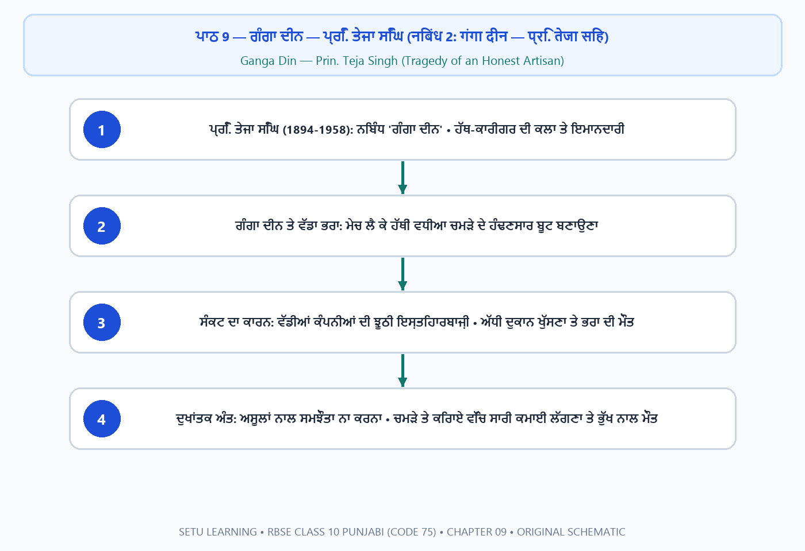

# ਪਾਠ 9 — ਗੰਗਾ ਦੀਨ — ਪ੍ਰਿੰ. ਤੇਜਾ ਸਿੰਘ (निबंध 2: गंगा दीन — प्रिं. तेजा सिंह) (Ganga Din — Prin. Teja Singh (Tragedy of an Honest Artisan))

## भाग 1: अध्याय प्रवेश एवं पाठ्यक्रम मैपिंग (ਪਾਠ-ਪ੍ਰਵੇਸ਼ ਅਤੇ ਪਾਠਕ੍ਰਮ ਮੈਪਿੰਗ)

> RBSE ਜਮਾਤ 10 ਪੰਜਾਬੀ ਪਾਠ-ਪੁਸਤਕ 'ਸਾਹਿਤ ਸੁਗੰਧੀਆਂ' ਦੇ ਸਾਰੇ ਪ੍ਰਸ਼ਨਾਂ ਦੇ ਹੱਲ ਅਤੇ 2014–2026 ਦਾ ਪੂਰਾ ਇਤਿਹਾਸਕ PYQ ਸੰਗ੍ਰਹਿ ਸਰੋਤ-ਪ੍ਰੀਖਣ ਸਮੇਤ ਸੰਕਲਿਤ ਹਨ।

**ਵਿਸ਼ਾ ਕੋਡ (विषय कोड):** 75 (ਤੀਜੀ ਭਾਸ਼ਾ — ਪੰਜਾਬੀ / तृतीया भाषा — पंजाबी) · **ਲੜੀ ਪੁਸਤਕ (श्रृंखला पुस्तक):** 7

**ਪ੍ਰਮਾਣਿਤ ਆਧਾਰ:** RBSE 2025–26 · **ਪਾਠ ਅੰਕ-ਭਾਰ:** 2 ਅੰਕ। ਇਹ ਭਾਰ ਉਸੇ ਸੰਸਕਰਣ ਦਾ ਹੈ; ਅਸਲ ਪ੍ਰਸ਼ਨ-ਵੰਡ ਦੀ ਭਵਿੱਖਬਾਣੀ ਨਹੀਂ।

**ਸਿੱਖਣ ਦੇ ਉਦੇਸ਼ (सीखने के लक्ष्य):** ਪ੍ਰਿੰ. ਤੇਜਾ ਸਿੰਘ ਦੇ ਨਿਬੰਧ 'ਗੰਗਾ ਦੀਨ' ਦਾ ਸਾਰ, ਬੂਟ ਬਣਾਉਣ ਵਾਲੇ ਇਮਾਨਦਾਰ ਕਾਰੀਗਰ ਗੰਗਾ ਦੀਨ ਦਾ ਸੁਭਾਅ, ਕਲਾ-ਪ੍ਰੇਮ ਅਤੇ ਵੱਡੀਆਂ ਇਸ਼ਤਿਹਾਰਬਾਜ਼ ਕੰਪਨੀਆਂ ਦੇ ਮੁਕਾਬਲੇ ਵਿੱਚ ਉਸ ਦੀ ਮੰਦੀ ਮਾਲੀ ਹਾਲਤ ਤੇ ਮੌਤ ਦੇ ਕਾਰਨ ਸਮਝਣਾ।

## भाग 2: शब्दावली एवं अवधारणा कैप्सूल (ਸ਼ਬਦਾਵਲੀ ਅਤੇ ਸੰਕਲਪ ਕੈਪਸੂਲ)

| ਸ਼ਬਦ / ਸੰਕਲਪ | ਅਰਥ / ਵਿਆਖਿਆ |
|---|---|
| ਬੂਟ-ਮੇਕਰ (बूट-मेकर) | ਜੁੱਤੀਆਂ / ਬੂਟ ਬਣਾਉਣ ਵਾਲਾ ਕਾਰੀਗਰ (ਗੰਗਾ ਦੀਨ ਬੂਟ ਬਣਾਉਣ ਦਾ ਕੰਮ ਕਰਦਾ ਸੀ)। |
| ਹੰਢਣਸਾਰ (हंढणसार) | ਲੰਮਾ ਸਮਾਂ ਚੱਲਣ ਵਾਲਾ ਮਜ਼ਬੂਤ (ਗੰਗਾ ਦੀਨ ਦੇ ਬੂਟ ਬਹੁਤ ਹੰਢਣਸਾਰ ਹੁੰਦੇ ਸਨ)। |
| ਨਮੂਨਾ (नमूना) | ਮਾਡਲ / ਡਿਜ਼ਾਈਨ। |
| ਇਸ਼ਤਿਹਾਰਬਾਜ਼ੀ (इश्तिहारबाज़ी) | ਵਿਗਿਆਪਨ ਤੇ ਦਿਖਾਵਾ — ਜੋ ਗੰਗਾ ਦੀਨ ਕਦੇ ਨਹੀਂ ਸੀ ਕਰਦਾ। |
| ਚਰਚਾ (चर्चा) | ਪ੍ਰਸਿੱਧੀ / ਗੱਲਬਾਤ। |
| ਕالب (कालब) | ਲੱਕੜ ਦਾ ਫ਼ਰਮਾ ਜਿਸ ਉੱਤੇ ਚਮੜਾ ਚੜ੍ਹਾ ਕੇ ਪੈਰ ਦੇ ਮੇਚ ਦਾ ਬੂਟ ਬਣਾਇਆ ਜਾਂਦਾ ਹੈ। |
| ਅੱਟਾ (अट्टा) | ਪੈਰ ਦੇ ਅੰਗੂਠੇ ਜਾਂ ਅੱਡੀ ਉੱਤੇ ਤੰਗ ਜੁੱਤੀ ਨਾਲ ਪੈਣ ਵਾਲਾ ਛਾਲਾ/ਗੰਢ। |
| ਮਾਲੀ ਹਾਲਤ (माली हालत) | ਆਰਥਿਕ ਸਥਿਤੀ / ਗ਼ਰੀਬੀ (ਗੰਗਾ ਦੀਨ ਦੀ ਮਾੜੀ ਮਾਲੀ ਹਾਲਤ)। |
| ਲਾਗੀ (लागी) | ਵਿਆਹ-ਸ਼ਾਦੀ ਵਿੱਚ ਲਾਗ ਲੈਣ ਵਾਲਾ (ਲਾਗੀਆਂ ਲਾਗ ਲੈਣਾ ਏ, ਪਰਾਈ ਧੀ ਭਾਵੇਂ ਘਰ ਜਾਂਦਿਆਂ ਹੀ ਰੰਡੀ ਬਹਿ ਜਾਏ)। |
| ਸਿਦਕ (सिदक) | ਆਪਣੇ ਕਿੱਤੇ ਅਤੇ ਇਮਾਨਦਾਰੀ ਪ੍ਰਤੀ ਅਟੱਲ ਵਿਸ਼ਵਾਸ। |

## भाग 3: विस्तृत शिक्षण पाठ (ਵਿਸਤ੍ਰਿਤ ਅਧਿਆਪਨ ਪਾਠ)

### 1. ਨਿਬੰਧਕਾਰ-ਪਛਾਣ: ਪ੍ਰਿੰ. ਤੇਜਾ ਸਿੰਘ (1894–1958 ਈ.)
ਪੰਜਾਬੀ ਦੇ ਉੱਘੇ ਨਿਬੰਧਕਾਰ **ਪ੍ਰਿੰ. ਤੇਜਾ ਸਿੰਘ** ਦਾ ਜਨਮ 2 ਜੂਨ 1894 ਈ. ਨੂੰ ਪਿੰਡ ਅਡਿਆਲਾ (ਜ਼ਿਲ੍ਹਾ ਰਾਵਲਪਿੰਡੀ) ਵਿਖੇ ਪਿਤਾ ਭਾਈ ਭਲਾਕਰ ਸਿੰਘ ਦੇ ਘਰ ਹੋਇਆ। ਉਹਨਾਂ ਨੇ ਖ਼ਾਲਸਾ ਕਾਲਜ ਅੰਮ੍ਰਿਤਸਰ ਅਤੇ ਮਹਿੰਦਰਾ ਕਾਲਜ ਪਟਿਆਲਾ ਵਿਖੇ ਸੇਵਾ ਨਿਭਾਈ। ਉਹਨਾਂ ਦੇ ਪ੍ਰਸਿੱਧ ਨਿਬੰਧ-ਸੰਗ੍ਰਹਿ 'ਨਵੀਆਂ ਸੋਚਾਂ', 'ਸਹਿਜ ਸੁਭਾਅ', 'ਸਾਹਿਤ ਦਰਸ਼ਨ' ਅਤੇ ਸਵੈ-ਜੀਵਨੀ 'ਆਰਸੀ' ਹਨ। **'ਗੰਗਾ ਦੀਨ'** ਨਿਬੰਧ ਅੰਗਰੇਜ਼ੀ ਲੇਖਕ ਜੌਨ ਗਾਲਜ਼ਵਰਦੀ (John Galsworthy) ਦੀ ਰਚਨਾ *Quality* ਦੇ ਆਧਾਰ 'ਤੇ ਪੰਜਾਬੀ ਮਾਹੌਲ ਵਿੱਚ ਢਾਲਿਆ ਗਿਆ ਇੱਕ ਸ਼ਾਹਕਾਰ ਨਿਬੰਧ ਹੈ।

### 2. 'ਗੰਗਾ ਦੀਨ' ਨਿਬੰਧ ਦਾ ਵਿਸਤ੍ਰਿਤ ਸਾਰ ਅਤੇ ਪਾਤਰ-ਉਸਾਰੀ
1. **ਗੰਗਾ ਦੀਨ ਅਤੇ ਉਸ ਦਾ ਵੱਡਾ ਭਰਾ (ਦੁਕਾਨ ਅਤੇ ਕਾਰੀਗਰੀ):**
   - ਗੰਗਾ ਦੀਨ ਆਪਣੇ ਵੱਡੇ ਭਰਾ ਨਾਲ ਸ਼ਹਿਰ ਦੇ ਇੱਕ ਫ਼ੈਸ਼ਨੇਬਲ ਬਾਜ਼ਾਰ ਵਿੱਚ **ਬੂਟ ਬਣਾਉਣ (Shoe-making)** ਦੀ ਛੋਟੀ ਜਿਹੀ ਦੁਕਾਨ ਕਰਦਾ ਸੀ।
   - ਉਹ ਬਜ਼ਾਰੂ ਰੈਡੀਮੇਡ ਬੂਟ ਨਹੀਂ ਵੇਚਦਾ ਸੀ, ਸਗੋਂ ਗਾਹਕ ਦੇ ਪੈਰ ਦਾ ਮੇਚ (ਨਾਪ) ਲੈ ਕੇ ਆਪਣੇ ਹੱਥੀਂ ਅਸਲੀ ਤੇ ਵਧੀਆ ਚਮੜੇ ਦੇ ਬੂਟ ਬਣਾਉਂਦਾ ਸੀ।
2. **ਗੰਗਾ ਦੀਨ ਦਾ ਸੁਭਾਅ ਅਤੇ ਕਲਾ-ਪ੍ਰੇਮ (RBSE 2019 Main Q9, 2022 Main Q18, 2025 Supp Q15):**
   - ਗੰਗਾ ਦੀਨ ਬੂਟ ਬਣਾਉਣ ਨੂੰ ਨਿਰਾ ਵਪਾਰ ਨਹੀਂ ਸਗੋਂ **ਇੱਕ ਪਵਿੱਤਰ ਕਲਾ (ਹੁਨਰ)** ਸਮਝਦਾ ਸੀ।
   - ਉਹ ਚਮੜੇ ਨੂੰ ਹੱਥ ਲਾ ਕੇ ਇੰਞ ਪਰਖਦਾ ਸੀ ਜਿਵੇਂ ਕੋਈ ਜੌਹਰੀ ਹੀਰੇ ਨੂੰ ਪਰਖਦਾ ਹੈ।
   - ਉਸ ਦੇ ਬਣਾਏ ਬੂਟ ਇੰਨੇ ਸੋਹਣੇ, ਮੇਚ ਦੇ ਅਤੇ **ਹੰਢਣਸਾਰ (ਟਿਕਾਊ)** ਹੁੰਦੇ ਸਨ ਕਿ ਸਾਲਾਂ-ਬੱਧੀ ਫਟਦੇ ਨਹੀਂ ਸਨ।
   - ਇੱਕ ਵਾਰ ਜਦੋਂ ਲੇਖਕ ਨੇ ਸ਼ਿਕਾਇਤ ਕੀਤੀ ਕਿ ਪਿਛਲਾ ਬੂਟ ਚੀਕਦਾ ਸੀ, ਤਾਂ ਗੰਗਾ ਦੀਨ ਨੇ ਬੜੇ ਦੁੱਖ ਨਾਲ ਕਿਹਾ ਕਿ ਜੇ ਉਹ ਬੂਟ ਖ਼ਰਾਬ ਹੈ ਤਾਂ ਮੈਂ ਉਸ ਦੇ ਪੈਸੇ ਹੀ ਨਹੀਂ ਲਵਾਂਗਾ।
   - ਜਦੋਂ ਲੇਖਕ ਕਿਸੇ ਵੱਡੀ ਕੰਪਨੀ ਦਾ ਬਣਿਆ ਬੂਟ ਪਾ ਕੇ ਉਸ ਦੀ ਦੁਕਾਨ 'ਤੇ ਗਿਆ, ਤਾਂ ਗੰਗਾ ਦੀਨ ਨੇ ਬਿਨਾਂ ਦੇਖੇ ਹੀ ਉਸ ਬੂਟ ਦੀ ਉਸਾਰੀ ਦਾ ਨੁਕਸ ਫੜ ਲਿਆ ਅਤੇ ਕਿਹਾ — **'ਲਾਗੀਆਂ ਲਾਗ ਲੈਣਾ ਏ, ਪਰਾਈ ਧੀ ਭਾਵੇਂ ਘਰ ਜਾਂਦਿਆਂ ਹੀ ਰੰਡੀ ਬਹਿ ਜਾਏ'** — ਭਾਵ ਵੱਡੀਆਂ ਕੰਪਨੀਆਂ ਨੇ ਕੇਵਲ ਇਸ਼ਤਿਹਾਰਬਾਜ਼ੀ ਨਾਲ ਪੈਸੇ ਬਟੋਰਨੇ ਹਨ, ਗਾਹਕ ਦੇ ਪੈਰਾਂ ਵਿੱਚ ਭਾਵੇਂ ਛਾਲੇ/ਅੱਟੇ ਪੈ ਜਾਣ।
3. **ਗੰਗਾ ਦੀਨ ਦੀ ਮਾੜੀ ਮਾਲੀ ਹਾਲਤ ਲਈ ਕੌਣ ਜ਼ਿੰਮੇਵਾਰ ਸੀ? (RBSE 2018 Main Q9, 2020 Main Q8-ੳ, 2022 Main Q3-vii):**
   - ਗੰਗਾ ਦੀਨ ਦੀ ਮਾੜੀ ਮਾਲੀ ਹਾਲਤ ਲਈ **ਵੱਡੀਆਂ ਪੂੰਜੀਵਾਦੀ ਕੰਪਨੀਆਂ ਦੀ ਝੂਠੀ ਇਸ਼ਤਿਹਾਰਬਾਜ਼ੀ, ਮਸ਼ੀਨੀ ਮੁਕਾਬਲਾ ਅਤੇ ਗੰਗਾ ਦੀਨ ਦਾ ਆਪਣਾ ਹੱਦੋਂ ਵੱਧ ਇਮਾਨਦਾਰ ਤੇ ਕਲਾ-ਪ੍ਰੇਮੀ ਸੁਭਾਅ** ਜ਼ਿੰਮੇਵਾਰ ਸੀ।
   - ਉਹ ਇਸ਼ਤਿਹਾਰਾਂ ਉੱਤੇ ਇੱਕ ਪੈਸਾ ਵੀ ਖ਼ਰਚ ਨਹੀਂ ਕਰਦਾ ਸੀ, ਸਾਰਾ ਪੈਸਾ ਵਧੀਆ ਚਮੜਾ ਖ਼ਰੀਦਣ ਤੇ ਦੁਕਾਨ ਦੇ ਕਿਰਾਏ ਵਿੱਚ ਲੱਗ ਜਾਂਦਾ ਸੀ, ਅਤੇ ਉਹ ਬੂਟ ਬਣਾਉਣ ਵਿੱਚ ਕਾਫ਼ੀ ਸਮਾਂ ਲਾਉਂਦਾ ਸੀ।
4. **ਦੁਖਾਂਤਕ ਅੰਤ (ਭੁੱਖ-ਨੰਗ ਅਤੇ ਮੌਤ):**
   - ਪਹਿਲਾਂ ਦੁਕਾਨ ਦਾ ਅੱਧਾ ਹਿੱਸਾ ਖੁੱਸ ਗਿਆ ਅਤੇ ਇਸ ਸਦਮੇ ਨਾਲ ਵੱਡੇ ਭਰਾ ਦੀ ਮੌਤ ਹੋ ਗਈ।
   - ਗੰਗਾ ਦੀਨ ਦਿਨ-ਰਾਤ ਭੁੱਖਾ-ਪਿਆਸਾ ਰਹਿ ਕੇ ਬੂਟ ਸਿਉਂਦਾ ਰਿਹਾ; ਜੋ ਪੈਸਾ ਆਉਂਦਾ ਉਹ ਚਮੜੇ ਤੇ ਕਿਰਾਏ ਵਿੱਚ ਚਲਾ ਜਾਂਦਾ। ਅੰਤ ਉਹ ਭੁੱਖ-ਨੰਗ ਅਤੇ ਥਕਾਵਟ ਕਾਰਨ ਜਵਾਨੀ ਵਿੱਚ ਹੀ ਬੁੱਢਾ ਹੋ ਕੇ ਮਰ ਗਿਆ ਅਤੇ ਉਸ ਦੀ ਦੁਕਾਨ ਉੱਤੇ ਕਿਸੇ ਅੰਗਰੇਜ਼ੀ ਕੰਪਨੀ ਦਾ ਬੋਰਡ ਲੱਗ ਗਿਆ।

ਪਾਠ 9: ਪ੍ਰਿੰ. ਤੇਜਾ ਸਿੰਘ ਦੇ ਨਿਬੰਧ 'ਗੰਗਾ ਦੀਨ' ਦਾ ਸੰਕਲਪ ਚਿੱਤਰ

## भाग 4: पाठ्यपुस्तक-अवधारणाओं पर मौलिक हल किए उदाहरण (ਹੱਲ ਕੀਤੇ ਮਿਆਰੀ ਉਦਾਹਰਣ)

ਹੇਠਾਂ ਦਿੱਤੇ ਪ੍ਰਸ਼ਨ ਪਾਠ-ਪੁਸਤਕ 'ਸਾਹਿਤ ਸੁਗੰਧੀਆਂ' ਅਤੇ ਵਿਆਕਰਣ ਦੇ ਸੰਕਲਪਾਂ ਉੱਤੇ ਆਧਾਰਿਤ ਮੌਲਿਕ ਆਦਰਸ਼ ਹੱਲ ਹਨ।

**ਹੱਲ ਕੀਤਾ ਉਦਾਹਰਣ 1: ਗੰਗਾ ਦੀਨ ਦੀ ਮਾੜੀ ਮਾਲੀ ਹਾਲਤ ਲਈ ਕੌਣ ਸਭ ਤੋਂ ਵੱਧ ਜ਼ਿੰਮੇਵਾਰ ਸੀ ਅਤੇ ਕਿਉਂ?**

ਗੰਗਾ ਦੀਨ ਦੀ ਮਾੜੀ ਮਾਲੀ ਹਾਲਤ ਲਈ ਦੋ ਕਾਰਨ ਜ਼ਿੰਮੇਵਾਰ ਸਨ: (1) ਬਾਜ਼ਾਰ ਦੀਆਂ ਵੱਡੀਆਂ ਕੰਪਨੀਆਂ ਜੋ ਘਟੀਆ ਮਾਲ ਨੂੰ ਚਮਕੀਲੀ ਇਸ਼ਤਿਹਾਰਬਾਜ਼ੀ ਰਾਹੀਂ ਵੇਚ ਕੇ ਗਾਹਕਾਂ ਨੂੰ ਖਿੱਚ ਲੈਂਦੀਆਂ ਸਨ, ਅਤੇ (2) ਗੰਗਾ ਦੀਨ ਦਾ ਆਪਣਾ ਕਲਾ-ਪ੍ਰੇਮੀ ਤੇ ਇਮਾਨਦਾਰ ਸੁਭਾਅ — ਉਹ ਇਸ਼ਤਿਹਾਰਬਾਜ਼ੀ ਨਹੀਂ ਕਰਦਾ ਸੀ, ਸਾਰੀ ਕਮਾਈ ਵਧੀਆ ਚਮੜਾ ਖ਼ਰੀਦਣ ਤੇ ਕਿਰਾਏ ਵਿੱਚ ਲਾ ਦਿੰਦਾ ਸੀ ਅਤੇ ਇੱਕ-ਇੱਕ ਬੂਟ ਉੱਤੇ ਕਈ ਦਿਨ ਮਿਹਨਤ ਕਰਦਾ ਸੀ (RBSE 2018 Main Q9, 2020 Main Q8-ੳ, 2022 Main Q3-vii)।

**ਹੱਲ ਕੀਤਾ ਉਦਾਹਰਣ 2: ਗੰਗਾ ਦੀਨ ਦੇ ਸੁਭਾਅ ਉੱਤੇ ਸੰਖੇਪ ਟਿੱਪਣੀ ਕਰੋ।**

ਗੰਗਾ ਦੀਨ ਇੱਕ ਸੱਚਾ, ਇਮਾਨਦਾਰ, ਮਿਹਨਤੀ ਅਤੇ ਆਪਣੇ ਹੁਨਰ ਨੂੰ ਸਮਰਪਿਤ ਕਾਰੀਗਰ ਸੀ। ਉਹ ਬੂਟ ਬਣਾਉਣ ਨੂੰ ਵਪਾਰ ਨਹੀਂ ਸਗੋਂ ਕਲਾ ਤੇ ਭਗਤੀ ਸਮਝਦਾ ਸੀ। ਉਹ ਘੱਟ ਬੋਲਦਾ ਸੀ, ਚਮੜੇ ਦੀ ਪੂਰੀ ਪਰਖ ਰੱਖਦਾ ਸੀ ਅਤੇ ਗਾਹਕ ਦੀ ਸੰਤੁਸ਼ਟੀ ਨੂੰ ਪੈਸੇ ਤੋਂ ਉੱਪਰ ਰੱਖਦਾ ਸੀ। ਭੁੱਖੇ ਮਰ ਜਾਣ ਦੀ ਨੌਬਤ ਆਉਣ 'ਤੇ ਵੀ ਉਸ ਨੇ ਕਦੇ ਘਟੀਆ ਚਮੜਾ ਨਹੀਂ ਵਰਤਿਆ (RBSE 2019 Main Q9, 2022 Main Q18, 2025 Supp Q15)।

**ਹੱਲ ਕੀਤਾ ਉਦਾਹਰਣ 3: 'ਲਾਗੀਆਂ ਲਾਗ ਲੈਣਾ ਏ, ਪਰਾਈ ਧੀ ਭਾਵੇਂ ਘਰ ਜਾਂਦਿਆਂ ਹੀ ਰੰਡੀ ਬਹਿ ਜਾਏ' — ਗੰਗਾ ਦੀਨ ਨੇ ਇਹ ਅਖੌਤ ਕਿਸ ਪ੍ਰਸੰਗ ਵਿੱਚ ਕਹੀ?**

ਜਦੋਂ ਲੇਖਕ ਕਿਸੇ ਵੱਡੀ ਇਸ਼ਤਿਹਾਰਬਾਜ਼ ਦੁਕਾਨ ਤੋਂ ਖ਼ਰੀਦਿਆ ਬੂਟ ਪਾ ਕੇ ਗੰਗਾ ਦੀਨ ਕੋਲ ਗਿਆ ਜੋ ਪੈਰ ਨੂੰ ਕੱਟਦਾ ਸੀ, ਤਾਂ ਗੰਗਾ ਦੀਨ ਨੇ ਵੱਡੀਆਂ ਕੰਪਨੀਆਂ ਦੀ ਬੇਇਮਾਨੀ ਉੱਤੇ ਚੋਟ ਕਰਦਿਆਂ ਇਹ ਅਖੌਤ ਕਹੀ ਕਿ ਉਹਨਾਂ ਨੂੰ ਕੇਵਲ ਪੈਸੇ ਲੈਣ ਨਾਲ ਮਤਲਬ ਹੈ, ਗਾਹਕ ਨੂੰ ਭਾਵੇਂ ਕਿੰਨੀ ਵੀ ਤਕਲੀਫ਼ ਹੋਵੇ।

## भाग 5: सत्यापित बोर्ड प्रश्न एवं स्रोत-स्थिति (ਪ੍ਰਮਾਣਿਤ ਬੋਰਡ ਪ੍ਰਸ਼ਨ ਅਤੇ ਸਰੋਤ-ਸਥਿਤੀ)

RBSE 2026 Supp (`S-75`, Q16), 2025 Supp (Q15), 2024 Main (Q1-v, Q3-vii) ਅਤੇ 2022 Main (Q2-iv, Q3-vii, Q18) ਵਿੱਚ 'ਗੰਗਾ ਦੀਨ' ਨਿਬੰਧ ਦੇ ਪ੍ਰਸ਼ਨ ਪੁੱਛੇ ਗਏ ਹਨ।

[RBSE 2026 ਮੂਲ ਪੇਪਰ (S-75)](https://rajeduboard.rajasthan.gov.in/books/PAPERS-2026/Sec/S-75.pdf)। ਪ੍ਰਸ਼ਨ ਦਾ ਸੰਖੇਪ ਵਿਸ਼ਾ-ਸੰਦਰਭ ਹੈ; ਸ਼ਬਦ-ਬ-ਸ਼ਬਦ ਪੁਨਰ-ਮੁਦਰਣ ਨਹੀਂ।

## भाग 6: खंडवार मौलिक अभ्यास बैंक (ਖੰਡ-ਵਾਰ ਮੌਲਿਕ ਅਭਿਆਸ ਬੈਂਕ)

**ਅਭਿਆਸ-ਅੰਕ:** ਵਿਦਿਆਰਥੀਆਂ ਦੇ ਸਵੈ-ਅਭਿਆਸ ਲਈ ਹਨ; ਉੱਤਰ ਪਹਿਲਾਂ ਆਪ ਲਿਖੋ, ਫਿਰ ਭਾਗ 9 ਵੇਖੋ।

## ੳ: ਬਹੁ-ਵਿਕਲਪੀ ਪ੍ਰਸ਼ਨ (MCQ) — 15 × 1 ਅੰਕ

**MCQ 1. ਗੰਗਾ ਦੀਨ ਕੀ ਬਣਾਉਣ ਦਾ ਕੰਮ ਕਰਦਾ ਸੀ? (RBSE 2022 Main Q2-iv, 2024 Main Q1-v)**

ੳ) ਖਿਡੌਣੇ  
ਅ) ਇਮਾਰਤਾਂ  
ੲ) ਸੂਟ  
ਸ) ਬੂਟ (ਜੁੱਤੀਆਂ)

**MCQ 2. 'ਗੰਗਾ ਦੀਨ' ਨਿਬੰਧ ਦੇ ਨਿਬੰਧਕਾਰ ਕੌਣ ਹਨ?**

ੳ) ਪ੍ਰਿੰ. ਸਰਵਣ ਸਿੰਘ  
ਅ) ਹਰਪਾਲ ਸਿੰਘ ਲੱਖੀਆਂ  
ੲ) ਪ੍ਰਿੰ. ਤੇਜਾ ਸਿੰਘ  
ਸ) ਪ੍ਰੋ. ਪੂਰਨ ਸਿੰਘ

**MCQ 3. ਗੰਗਾ ਦੀਨ ਦੀ ਮਾੜੀ ਮਾਲੀ ਹਾਲਤ ਲਈ ਕੌਣ ਸਭ ਤੋਂ ਵੱਧ ਜ਼ਿੰਮੇਵਾਰ ਸੀ? (RBSE 2022 Main Q3-vii)**

ੳ) ਉਸ ਦੇ ਪੁੱਤਰਾਂ ਦੀ ਫ਼ਜ਼ੂਲਖ਼ਰਚੀ  
ਅ) ਵੱਡੀਆਂ ਕੰਪਨੀਆਂ ਦੀ ਇਸ਼ਤਿਹਾਰਬਾਜ਼ੀ ਅਤੇ ਉਸ ਦਾ ਆਪਣਾ ਇਮਾਨਦਾਰ ਸੁਭਾਅ  
ੲ) ਉਸ ਦੀ ਆਲਸ  
ਸ) ਉਸ ਦੀ ਜੂਏ ਦੀ ਆਦਤ

**MCQ 4. ਗੰਗਾ ਦੀਨ ਆਪਣੀ ਦੁਕਾਨ ਵਿੱਚ ਕਿਸ ਦੇ ਨਾਲ ਕੰਮ ਕਰਦਾ ਸੀ?**

ੳ) ਆਪਣੇ ਵੱਡੇ ਭਰਾ ਨਾਲ  
ਅ) ਆਪਣੇ ਪੁੱਤਰ ਨਾਲ  
ੲ) ਆਪਣੇ ਚਾਚੇ ਨਾਲ  
ਸ) ਆਪਣੇ ਮਿੱਤਰ ਨਾਲ

**MCQ 5. ਗੰਗਾ ਦੀਨ ਬੂਟ ਬਣਾਉਣ ਦੇ ਕੰਮ ਨੂੰ ਕੀ ਸਮਝਦਾ ਸੀ?**

ੳ) ਕੇਵਲ ਪੈਸੇ ਕਮਾਉਣ ਦਾ ਧੰਦਾ  
ਅ) ਮਜਬੂਰੀ ਦਾ ਕੰਮ  
ੲ) ਸਮਾਂ ਪਾਸ ਕਰਨ ਦਾ ਸਾਧਨ  
ਸ) ਇੱਕ ਪਵਿੱਤਰ ਕਲਾ (ਹੁਨਰ)

**MCQ 6. 'ਲਾਗੀਆਂ ਲਾਗ ਲੈਣਾ ਏ, ਪਰਾਈ ਧੀ ਭਾਵੇਂ ਘਰ ਜਾਂਦਿਆਂ ਹੀ ਰੰਡੀ ਬਹਿ ਜਾਏ' — ਇਹ ਸ਼ਬਦ ਕਿਸ ਨੇ ਕਹੇ?**

ੳ) ਵੱਡੇ ਭਰਾ ਨੇ  
ਅ) ਅੰਗਰੇਜ਼ ਕਾਰੀਗਰ ਨੇ  
ੲ) ਗੰਗਾ ਦੀਨ ਨੇ (ਵੱਡੀਆਂ ਬੂਟ ਕੰਪਨੀਆਂ ਬਾਰੇ)  
ਸ) ਲੇਖਕ ਨੇ

**MCQ 7. ਗੰਗਾ ਦੀਨ ਦੇ ਵੱਡੇ ਭਰਾ ਦੀ ਮੌਤ ਕਿਸ ਕਾਰਨ ਹੋਈ?**

ੳ) ਵਿਦੇਸ਼ ਜਾਣ ਕਾਰਨ  
ਅ) ਅੱਧੀ ਦੁਕਾਨ ਖੁੱਸ ਜਾਣ ਦੇ ਗ਼ਮ ਅਤੇ ਸਦਮੇ ਕਾਰਨ  
ੲ) ਐਕਸੀਡੈਂਟ ਕਾਰਨ  
ਸ) ਹੜ੍ਹ ਆਉਣ ਕਾਰਨ

**MCQ 8. ਗੰਗਾ ਦੀਨ ਆਪਣੀ ਸਾਰੀ ਕਮਾਈ ਕਿੱਥੇ ਖਰਚ ਕਰ ਦਿੰਦਾ ਸੀ?**

ੳ) ਦੁਕਾਨ ਦੇ ਕਿਰਾਏ ਅਤੇ ਵਧੀਆ ਚਮੜਾ ਖ਼ਰੀਦਣ ਵਿੱਚ  
ਅ) ਇਸ਼ਤਿਹਾਰਬਾਜ਼ੀ ਵਿੱਚ  
ੲ) ਸ਼ਾਨਦਾਰ ਕੱਪੜਿਆਂ ਵਿੱਚ  
ਸ) ਸੈਰ-ਸਪਾਟੇ ਵਿੱਚ

**MCQ 9. ਅੰਤ ਵਿੱਚ ਗੰਗਾ ਦੀਨ ਦੀ ਮੌਤ ਕਿਵੇਂ ਹੋਈ?**

ੳ) ਬੁਢਾਪੇ ਕਾਰਨ  
ਅ) ਦੰਗਿਆਂ ਵਿੱਚ  
ੲ) ਰੇਲ ਹਾਦਸੇ ਵਿੱਚ  
ਸ) ਭੁੱਖ-ਨੰਗ, ਕਮਜ਼ੋਰੀ ਅਤੇ ਅਣਥੱਕ ਮਿਹਨਤ ਕਾਰਨ

**MCQ 10. ਗੰਗਾ ਦੀਨ ਦੀ ਮੌਤ ਤੋਂ ਬਾਅਦ ਉਸ ਦੀ ਦੁਕਾਨ ਉੱਤੇ ਕਿਸ ਦਾ ਕਬਜ਼ਾ ਹੋ ਗਿਆ?**

ੳ) ਗੰਗਾ ਦੀਨ ਦੇ ਭਤੀਜੇ ਦਾ  
ਅ) ਹਲਵਾਈ ਦਾ  
ੲ) ਇੱਕ ਵੱਡੀ ਅੰਗਰੇਜ਼ੀ ਬੂਟ ਕੰਪਨੀ ਦਾ  
ਸ) ਲੇਖਕ ਦਾ

**MCQ 11. ਪ੍ਰਿੰ. ਤੇਜਾ ਸਿੰਘ ਦੀ ਸਵੈ-ਜੀਵਨੀ ਦਾ ਕੀ ਨਾਂ ਹੈ?**

ੳ) ਸਹਿਜ ਸੁਭਾਅ  
ਅ) ਆਰਸੀ  
ੲ) ਮੇਰੀ ਜੀਵਨ ਕਥਾ  
ਸ) ਨਵੀਆਂ ਸੋਚਾਂ

**MCQ 12. ਜਦੋਂ ਲੇਖਕ ਨੇ ਕਿਹਾ ਕਿ ਪਿਛਲਾ ਬੂਟ ਚੀਕਦਾ ਸੀ, ਤਾਂ ਗੰਗਾ ਦੀਨ ਨੇ ਕੀ ਉੱਤਰ ਦਿੱਤਾ?**

ੳ) ਕਿ ਉਹ ਬੂਟ ਵਾਪਸ ਭੇਜ ਦਿਓ, ਜੇ ਖ਼ਰਾਬ ਹੋਇਆ ਤਾਂ ਮੈਂ ਪੈਸੇ ਨਹੀਂ ਲਵਾਂਗਾ  
ਅ) ਕਿ ਮੈਂ ਕੋਈ ਜ਼ਿੰਮੇਵਾਰ ਨਹੀਂ  
ੲ) ਕਿ ਨਵਾਂ ਬੂਟ ਖ਼ਰੀਦ ਲਓ  
ਸ) ਕਿ ਬੂਟ ਨੂੰ ਤੇਲ ਲਾ ਲਓ

**MCQ 13. ਗੰਗਾ ਦੀਨ ਚਮੜੇ ਦੀ ਪਰਖ ਕਿਵੇਂ ਕਰਦਾ ਸੀ?**

ੳ) ਮਸ਼ੀਨ ਨਾਲ  
ਅ) ਪਾਣੀ ਵਿੱਚ ਭਿਉਂ ਕੇ  
ੲ) ਅੱਗ ਉੱਤੇ ਰੱਖ ਕੇ  
ਸ) ਜਿਵੇਂ ਕੋਈ ਜੌਹਰੀ ਹੀਰੇ ਦੀ ਪਰਖ ਕਰਦਾ ਹੈ

**MCQ 14. ਲੇਖਕ ਵਿਦੇਸ਼ ਤੋਂ ਕਿੰਨੇ ਸਮੇਂ ਬਾਅਦ ਵਾਪਸ ਪਰਤਿਆ ਜਦੋਂ ਗੰਗਾ ਦੀਨ ਮਰ ਚੁੱਕਾ ਸੀ?**

ੳ) ਵੀਹ ਸਾਲ ਬਾਅਦ  
ਅ) ਇੱਕ ਮਹੀਨੇ ਬਾਅਦ  
ੲ) ਲਗਭਗ ਇੱਕ-ਡੇਢ ਸਾਲ ਬਾਅਦ  
ਸ) ਦਸ ਦਿਨ ਬਾਅਦ

**MCQ 15. 'ਹੰਢਣਸਾਰ' ਸ਼ਬਦ ਦਾ ਸਹੀ ਅਰਥ ਕੀ ਹੈ?**

ੳ) ਬਹੁਤ ਸਸਤਾ  
ਅ) ਲੰਮਾ ਸਮਾਂ ਚੱਲਣ ਵਾਲਾ / ਮਜ਼ਬੂਤ  
ੲ) ਛੇਤੀ ਟੁੱਟਣ ਵਾਲਾ  
ਸ) ਬਹੁਤ ਮਹਿੰਗਾ

## ੳ: ਖਾਲੀ ਥਾਵਾਂ ਭਰੋ — 6 × 1 ਅੰਕ

1. ਜੁੱਤੀਆਂ / ਬੂਟ ਬਣਾਉਣ ਵਾਲਾ ਕਾਰੀਗਰ (ਗੰਗਾ ਦੀਨ ਬੂਟ ਬਣਾਉਣ ਦਾ ਕੰਮ ਕਰਦਾ ਸੀ)। — ਇਸ ਸ਼ਬਦ/ਸੰਕਲਪ ਦਾ ਨਾਂ ਹੈ: ____।  
2. ਲੰਮਾ ਸਮਾਂ ਚੱਲਣ ਵਾਲਾ ਮਜ਼ਬੂਤ (ਗੰਗਾ ਦੀਨ ਦੇ ਬੂਟ ਬਹੁਤ ਹੰਢਣਸਾਰ ਹੁੰਦੇ ਸਨ)। — ਇਸ ਸ਼ਬਦ/ਸੰਕਲਪ ਦਾ ਨਾਂ ਹੈ: ____।  
3. ਮਾਡਲ / ਡਿਜ਼ਾਈਨ। — ਇਸ ਸ਼ਬਦ/ਸੰਕਲਪ ਦਾ ਨਾਂ ਹੈ: ____।  
4. ਵਿਗਿਆਪਨ ਤੇ ਦਿਖਾਵਾ — ਜੋ ਗੰਗਾ ਦੀਨ ਕਦੇ ਨਹੀਂ ਸੀ ਕਰਦਾ। — ਇਸ ਸ਼ਬਦ/ਸੰਕਲਪ ਦਾ ਨਾਂ ਹੈ: ____।  
5. ਪ੍ਰਸਿੱਧੀ / ਗੱਲਬਾਤ। — ਇਸ ਸ਼ਬਦ/ਸੰਕਲਪ ਦਾ ਨਾਂ ਹੈ: ____।  
6. ਲੱਕੜ ਦਾ ਫ਼ਰਮਾ ਜਿਸ ਉੱਤੇ ਚਮੜਾ ਚੜ੍ਹਾ ਕੇ ਪੈਰ ਦੇ ਮੇਚ ਦਾ ਬੂਟ ਬਣਾਇਆ ਜਾਂਦਾ ਹੈ। — ਇਸ ਸ਼ਬਦ/ਸੰਕਲਪ ਦਾ ਨਾਂ ਹੈ: ____।

## ੳ: ਅਤਿ-ਲਘੂ ਉੱਤਰਾਂ ਵਾਲੇ ਪ੍ਰਸ਼ਨ — 8 × 1 ਅੰਕ

1. ਗੰਗਾ ਦੀਨ ਕੀ ਬਣਾਉਣ ਦਾ ਕੰਮ ਕਰਦਾ ਸੀ? (RBSE 2022 Main Q2-iv, 2024 Main Q1-v)  
2. 'ਗੰਗਾ ਦੀਨ' ਨਿਬੰਧ ਦੇ ਨਿਬੰਧਕਾਰ ਕੌਣ ਹਨ?  
3. ਗੰਗਾ ਦੀਨ ਦੀ ਮਾੜੀ ਮਾਲੀ ਹਾਲਤ ਲਈ ਕੌਣ ਸਭ ਤੋਂ ਵੱਧ ਜ਼ਿੰਮੇਵਾਰ ਸੀ? (RBSE 2022 Main Q3-vii)  
4. ਗੰਗਾ ਦੀਨ ਆਪਣੀ ਦੁਕਾਨ ਵਿੱਚ ਕਿਸ ਦੇ ਨਾਲ ਕੰਮ ਕਰਦਾ ਸੀ?  
5. ਗੰਗਾ ਦੀਨ ਬੂਟ ਬਣਾਉਣ ਦੇ ਕੰਮ ਨੂੰ ਕੀ ਸਮਝਦਾ ਸੀ?  
6. 'ਲਾਗੀਆਂ ਲਾਗ ਲੈਣਾ ਏ, ਪਰਾਈ ਧੀ ਭਾਵੇਂ ਘਰ ਜਾਂਦਿਆਂ ਹੀ ਰੰਡੀ ਬਹਿ ਜਾਏ' — ਇਹ ਸ਼ਬਦ ਕਿਸ ਨੇ ਕਹੇ?  
7. ਗੰਗਾ ਦੀਨ ਦੇ ਵੱਡੇ ਭਰਾ ਦੀ ਮੌਤ ਕਿਸ ਕਾਰਨ ਹੋਈ?  
8. ਗੰਗਾ ਦੀਨ ਆਪਣੀ ਸਾਰੀ ਕਮਾਈ ਕਿੱਥੇ ਖਰਚ ਕਰ ਦਿੰਦਾ ਸੀ?

## ਅ: ਲਘੂ ਉੱਤਰਾਂ ਵਾਲੇ ਪ੍ਰਸ਼ਨ — 6 × 2 ਅੰਕ

**B1.** ਗੰਗਾ ਦੀਨ ਕੌਣ ਸੀ ਅਤੇ ਉਹ ਕੀ ਬਣਾਉਣ ਦਾ ਕੰਮ ਕਰਦਾ ਸੀ?

**B2.** 'ਗੰਗਾ ਦੀਨ' ਨਿਬੰਧ ਦੇ ਲੇਖਕ ਦਾ ਨਾਂ ਦੱਸੋ।

**B3.** ਗੰਗਾ ਦੀਨ ਵੱਡੀਆਂ ਕੰਪਨੀਆਂ ਬਾਰੇ ਕੀ ਵਿਚਾਰ ਰੱਖਦਾ ਸੀ?

**B4.** ਗੰਗਾ ਦੀਨ ਦੇ ਵੱਡੇ ਭਰਾ ਦੀ ਮੌਤ ਕਿਸ ਸਦਮੇ ਕਾਰਨ ਹੋਈ?

**B5.** ਗੰਗਾ ਦੀਨ ਦੀ ਮੌਤ ਕਿਵੇਂ ਹੋਈ?

**B6.** ਗੰਗਾ ਦੀਨ ਦੇ ਬਣਾਏ ਬੂਟਾਂ ਦੀ ਕੀ ਵਿਸ਼ੇਸ਼ਤਾ ਸੀ?

## ੲ: ਦੀਰਘ ਉੱਤਰਾਂ ਵਾਲੇ ਪ੍ਰਸ਼ਨ — 4 × 3 ਅੰਕ

ਅੰਦਰੂਨੀ ਵਿਕਲਪ ਅਭਿਆਸ: ਪਹਿਲਾਂ ਇੱਕ ਵਿਕਲਪ ਹੱਲ ਕਰੋ ਅਤੇ ਦੁਹਰਾਈ ਵੇਲੇ ਬਾਕੀ ਪ੍ਰਸ਼ਨ ਵੀ ਹੱਲ ਕਰੋ।

**C1.** 'ਗੰਗਾ ਦੀਨ' ਨਿਬੰਧ ਦਾ ਸੰਖੇਪ ਸਾਰ ਆਪਣੇ ਸ਼ਬਦਾਂ ਵਿੱਚ ਲਿਖੋ। (RBSE 2020 Supp Q9, 2026 Supp Q16)

**C2.** ਗੰਗਾ ਦੀਨ ਦੇ ਸੁਭਾਅ ਉੱਤੇ ਵਿਸਥਾਰ ਨਾਲ ਟਿੱਪਣੀ ਕਰੋ। (RBSE 2019 Main Q9, 2022 Main Q18, 2025 Supp Q15)

**C3.** ਗੰਗਾ ਦੀਨ ਦੀ ਮਾੜੀ ਮਾਲੀ ਹਾਲਤ ਦੇ ਕਾਰਨਾਂ ਦਾ ਵਿਸ਼ਲੇਸ਼ਣ ਕਰੋ। (RBSE 2018 Main Q9, 2020 Main Q8-ੳ)

**C4.** ਲੇਖਕ ਦੇ ਮਨ ਵਿੱਚ ਗੰਗਾ ਦੀਨ ਪ੍ਰਤੀ ਕਿਹੋ ਜਿਹੇ ਭਾਵ ਸਨ? ਨਿਬੰਧ ਦੇ ਆਧਾਰ 'ਤੇ ਲਿਖੋ।

## ਸ: ਨਿਬੰਧਾਤਮਕ / ਵਿਸਤ੍ਰਿਤ ਉੱਤਰਾਂ ਵਾਲੇ ਪ੍ਰਸ਼ਨ — 2 × 4 ਅੰਕ

ਅੰਦਰੂਨੀ ਵਿਕਲਪ ਅਭਿਆਸ: D1 ਜਾਂ D2 ਚੁਣੋ; ਬਾਅਦ ਵਿੱਚ ਦੂਜਾ ਵੀ ਹੱਲ ਕਰੋ।

**D1.** 'ਗੰਗਾ ਦੀਨ' ਨਿਬੰਧ ਰਾਹੀਂ ਪ੍ਰਿੰ. ਤੇਜਾ ਸਿੰਘ ਨੇ ਪੂੰਜੀਵਾਦੀ ਅਤੇ ਇਸ਼ਤਿਹਾਰੀ ਯੁੱਗ ਵਿੱਚ ਹੱਥ-ਕਾਰੀਗਰਾਂ ਦੇ ਦੁਖਾਂਤ ਨੂੰ ਕਿਵੇਂ ਪੇਸ਼ ਕੀਤਾ ਹੈ?

**D2.** ਗੰਗਾ ਦੀਨ ਦੇ ਜੀਵਨ-ਸੰਘਰਸ਼, ਉਸ ਦੇ ਵੱਡੇ ਭਰਾ ਨਾਲ ਸਾਂਝ ਅਤੇ ਉਸ ਦੇ ਅੰਤਿਮ ਦਿਨਾਂ ਦਾ ਕਰੁਣਾਮਈ ਚਿੱਤਰਣ ਕਰੋ।

## भाग 7: सावधानियाँ एवं परीक्षा-त्रुटियाँ (ਸਾਵਧਾਨੀਆਂ ਅਤੇ ਪ੍ਰੀਖਿਆ-ਗ਼ਲਤੀਆਂ)

- **ਗ਼ਲਤੀ 1:** 'ਗੰਗਾ ਦੀਨ' ਅਤੇ 'ਮਹਾਰਾਜਾ ਗੰਗਾ ਸਿੰਘ' ਦੇ ਨਾਵਾਂ ਵਿੱਚ ਉਲਝਣਾ — **ਗੰਗਾ ਦੀਨ** ਪ੍ਰਿੰ. ਤੇਜਾ ਸਿੰਘ ਦੇ ਨਿਬੰਧ ਦਾ ਇਮਾਨਦਾਰ ਬੂਟ-ਕਾਰੀਗਰ ਹੈ, ਜਦੋਂਕਿ **ਮਹਾਰਾਜਾ ਗੰਗਾ ਸਿੰਘ** ਹਰਪਾਲ ਸਿੰਘ ਲੱਖੀਆਂ ਦੇ ਨਿਬੰਧ ਵਿੱਚ ਬੀਕਾਨੇਰ ਰਿਆਸਤ ਦੇ ਮਹਾਰਾਜਾ ਹਨ।

## भाग 8: फटाफट पुनरावृत्ति — 25 बिंदु (ਫਟਾਫਟ ਦੁਹਰਾਈ — 25 ਬਿੰਦੂ)

1. ਬੂਟ-ਮੇਕਰ (बूट-मेकर): ਜੁੱਤੀਆਂ / ਬੂਟ ਬਣਾਉਣ ਵਾਲਾ ਕਾਰੀਗਰ (ਗੰਗਾ ਦੀਨ ਬੂਟ ਬਣਾਉਣ ਦਾ ਕੰਮ ਕਰਦਾ ਸੀ)।  
2. ਹੰਢਣਸਾਰ (हंढणसार): ਲੰਮਾ ਸਮਾਂ ਚੱਲਣ ਵਾਲਾ ਮਜ਼ਬੂਤ (ਗੰਗਾ ਦੀਨ ਦੇ ਬੂਟ ਬਹੁਤ ਹੰਢਣਸਾਰ ਹੁੰਦੇ ਸਨ)।  
3. ਨਮੂਨਾ (नमूना): ਮਾਡਲ / ਡਿਜ਼ਾਈਨ।  
4. ਇਸ਼ਤਿਹਾਰਬਾਜ਼ੀ (इश्तिहारबाज़ी): ਵਿਗਿਆਪਨ ਤੇ ਦਿਖਾਵਾ — ਜੋ ਗੰਗਾ ਦੀਨ ਕਦੇ ਨਹੀਂ ਸੀ ਕਰਦਾ।  
5. ਚਰਚਾ (चर्चा): ਪ੍ਰਸਿੱਧੀ / ਗੱਲਬਾਤ।  
6. ਕالب (कालब): ਲੱਕੜ ਦਾ ਫ਼ਰਮਾ ਜਿਸ ਉੱਤੇ ਚਮੜਾ ਚੜ੍ਹਾ ਕੇ ਪੈਰ ਦੇ ਮੇਚ ਦਾ ਬੂਟ ਬਣਾਇਆ ਜਾਂਦਾ ਹੈ।  
7. ਅੱਟਾ (अट्टा): ਪੈਰ ਦੇ ਅੰਗੂਠੇ ਜਾਂ ਅੱਡੀ ਉੱਤੇ ਤੰਗ ਜੁੱਤੀ ਨਾਲ ਪੈਣ ਵਾਲਾ ਛਾਲਾ/ਗੰਢ।  
8. ਮਾਲੀ ਹਾਲਤ (माली हालत): ਆਰਥਿਕ ਸਥਿਤੀ / ਗ਼ਰੀਬੀ (ਗੰਗਾ ਦੀਨ ਦੀ ਮਾੜੀ ਮਾਲੀ ਹਾਲਤ)।  
9. ਲਾਗੀ (लागी): ਵਿਆਹ-ਸ਼ਾਦੀ ਵਿੱਚ ਲਾਗ ਲੈਣ ਵਾਲਾ (ਲਾਗੀਆਂ ਲਾਗ ਲੈਣਾ ਏ, ਪਰਾਈ ਧੀ ਭਾਵੇਂ ਘਰ ਜਾਂਦਿਆਂ ਹੀ ਰੰਡੀ ਬਹਿ ਜਾਏ)।  
10. ਸਿਦਕ (सिदक): ਆਪਣੇ ਕਿੱਤੇ ਅਤੇ ਇਮਾਨਦਾਰੀ ਪ੍ਰਤੀ ਅਟੱਲ ਵਿਸ਼ਵਾਸ।  
11. ਗੰਗਾ ਦੀਨ ਆਪਣੇ ਹੱਥੀਂ ਬੂਟ ਬਣਾਉਣ ਦਾ ਕੰਮ ਕਰਦਾ ਸੀ (RBSE 2022 Main Q2-iv, 2024 Main Q1-v)।  
12. 'ਗੰਗਾ ਦੀਨ' ਨਿਬੰਧ ਪ੍ਰਿੰ. ਤੇਜਾ ਸਿੰਘ ਦੀ ਰਚਨਾ ਹੈ।  
13. ਵੱਡੀਆਂ ਕੰਪਨੀਆਂ ਦਾ ਮੁਕਾਬਲਾ ਅਤੇ ਇਸ਼ਤਿਹਾਰਬਾਜ਼ੀ ਨਾ ਕਰਨਾ ਉਸ ਦੀ ਗ਼ਰੀਬੀ ਦਾ ਕਾਰਨ ਬਣਿਆ (RBSE 2022 Main Q3-vii)।  
14. ਗੰਗਾ ਦੀਨ ਆਪਣੇ ਵੱਡੇ ਭਰਾ ਨਾਲ ਮਿਲ ਕੇ ਬੂਟ ਬਣਾਉਂਦਾ ਸੀ।  
15. ਉਹ ਬੂਟ ਬਣਾਉਣ ਨੂੰ ਇੱਕ ਉੱਚੀ ਕਲਾ ਤੇ ਸਾਧਨਾ ਸਮਝਦਾ ਸੀ।  
16. ਗੰਗਾ ਦੀਨ ਨੇ ਵੱਡੀਆਂ ਇਸ਼ਤਿਹਾਰਬਾਜ਼ ਕੰਪਨੀਆਂ ਦੀ ਬੇਇਮਾਨੀ ਬਾਰੇ ਇਹ ਅਖੌਤ ਕਹੀ।  
17. ਦੁਕਾਨ ਦਾ ਅੱਧਾ ਹਿੱਸਾ ਖੁੱਸ ਜਾਣ ਦਾ ਸਦਮਾ ਵੱਡਾ ਭਰਾ ਸਹਾਰ ਨਾ ਸਕਿਆ।  
18. ਉਹ ਸਾਰਾ ਪੈਸਾ ਦੁਕਾਨ ਦੇ ਕਿਰਾਏ ਤੇ ਵਧੀਆ ਚਮੜੇ ਉੱਤੇ ਲਾ ਦਿੰਦਾ ਸੀ।  
19. ਉਹ ਖਾਣ-ਪੀਣ ਦੀ ਪਰਵਾਹ ਕੀਤੇ ਬਿਨਾਂ ਕੰਮ ਕਰਦਾ ਰਿਹਾ ਤੇ ਭੁੱਖ-ਨੰਗ ਨਾਲ ਮਰ ਗਿਆ।  
20. ਉਸ ਦੀ ਦੁਕਾਨ ਵਿੱਚ ਇੱਕ ਅੰਗਰੇਜ਼ੀ ਕੰਪਨੀ ਖੁੱਲ੍ਹ ਗਈ।  
21. ਪ੍ਰਿੰ. ਤੇਜਾ ਸਿੰਘ ਦੀ ਪ੍ਰਸਿੱਧ ਸਵੈ-ਜੀਵਨੀ ਦਾ ਨਾਂ 'ਆਰਸੀ' ਹੈ।  
22. ਗੰਗਾ ਦੀਨ ਨੇ ਪੂਰੀ ਇਮਾਨਦਾਰੀ ਨਾਲ ਕਿਹਾ ਕਿ ਜੇ ਬੂਟ ਵਿੱਚ ਨੁਕਸ ਹੈ ਤਾਂ ਮੈਂ ਬਿੱਲ ਵਿੱਚੋਂ ਪੈਸੇ ਕੱਟ ਦਿਆਂਗਾ।  
23. ਉਹ ਚਮੜੇ ਨੂੰ ਹੱਥ ਫੇਰ ਕੇ ਤੇ ਸੁੰਘ ਕੇ ਜੌਹਰੀ ਵਾਂਗ ਪਰਖਦਾ ਸੀ।  
24. ਲੇਖਕ ਜਦੋਂ ਇੱਕ ਸਾਲ ਤੋਂ ਵੱਧ ਸਮੇਂ ਮਗਰੋਂ ਵਾਪਸ ਆਇਆ ਤਾਂ ਗੰਗਾ ਦੀਨ ਚੱਲ ਵੱਸਿਆ ਸੀ।  
25. 'ਹੰਢਣਸਾਰ' ਦਾ ਅਰਥ ਲੰਮਾ ਸਮਾਂ ਟਿਕਣ ਵਾਲਾ (Durable) ਹੁੰਦਾ ਹੈ।

## भाग 9: संपूर्ण अभ्यास उत्तर-कुंजी (ਸੰਪੂਰਨ ਅਭਿਆਸ ਉੱਤਰ-ਕੁੰਜੀ)

## MCQ: ਸਹੀ ਵਿਕਲਪ ਅਤੇ ਕਾਰਨ

**1. ਸ — ਬੂਟ (ਜੁੱਤੀਆਂ)।** ਗੰਗਾ ਦੀਨ ਆਪਣੇ ਹੱਥੀਂ ਬੂਟ ਬਣਾਉਣ ਦਾ ਕੰਮ ਕਰਦਾ ਸੀ (RBSE 2022 Main Q2-iv, 2024 Main Q1-v)।

**2. ੲ — ਪ੍ਰਿੰ. ਤੇਜਾ ਸਿੰਘ।** 'ਗੰਗਾ ਦੀਨ' ਨਿਬੰਧ ਪ੍ਰਿੰ. ਤੇਜਾ ਸਿੰਘ ਦੀ ਰਚਨਾ ਹੈ।

**3. ਅ — ਵੱਡੀਆਂ ਕੰਪਨੀਆਂ ਦੀ ਇਸ਼ਤਿਹਾਰਬਾਜ਼ੀ ਅਤੇ ਉਸ ਦਾ ਆਪਣਾ ਇਮਾਨਦਾਰ ਸੁਭਾਅ।** ਵੱਡੀਆਂ ਕੰਪਨੀਆਂ ਦਾ ਮੁਕਾਬਲਾ ਅਤੇ ਇਸ਼ਤਿਹਾਰਬਾਜ਼ੀ ਨਾ ਕਰਨਾ ਉਸ ਦੀ ਗ਼ਰੀਬੀ ਦਾ ਕਾਰਨ ਬਣਿਆ (RBSE 2022 Main Q3-vii)।

**4. ੳ — ਆਪਣੇ ਵੱਡੇ ਭਰਾ ਨਾਲ।** ਗੰਗਾ ਦੀਨ ਆਪਣੇ ਵੱਡੇ ਭਰਾ ਨਾਲ ਮਿਲ ਕੇ ਬੂਟ ਬਣਾਉਂਦਾ ਸੀ।

**5. ਸ — ਇੱਕ ਪਵਿੱਤਰ ਕਲਾ (ਹੁਨਰ)।** ਉਹ ਬੂਟ ਬਣਾਉਣ ਨੂੰ ਇੱਕ ਉੱਚੀ ਕਲਾ ਤੇ ਸਾਧਨਾ ਸਮਝਦਾ ਸੀ।

**6. ੲ — ਗੰਗਾ ਦੀਨ ਨੇ (ਵੱਡੀਆਂ ਬੂਟ ਕੰਪਨੀਆਂ ਬਾਰੇ)।** ਗੰਗਾ ਦੀਨ ਨੇ ਵੱਡੀਆਂ ਇਸ਼ਤਿਹਾਰਬਾਜ਼ ਕੰਪਨੀਆਂ ਦੀ ਬੇਇਮਾਨੀ ਬਾਰੇ ਇਹ ਅਖੌਤ ਕਹੀ।

**7. ਅ — ਅੱਧੀ ਦੁਕਾਨ ਖੁੱਸ ਜਾਣ ਦੇ ਗ਼ਮ ਅਤੇ ਸਦਮੇ ਕਾਰਨ।** ਦੁਕਾਨ ਦਾ ਅੱਧਾ ਹਿੱਸਾ ਖੁੱਸ ਜਾਣ ਦਾ ਸਦਮਾ ਵੱਡਾ ਭਰਾ ਸਹਾਰ ਨਾ ਸਕਿਆ।

**8. ੳ — ਦੁਕਾਨ ਦੇ ਕਿਰਾਏ ਅਤੇ ਵਧੀਆ ਚਮੜਾ ਖ਼ਰੀਦਣ ਵਿੱਚ।** ਉਹ ਸਾਰਾ ਪੈਸਾ ਦੁਕਾਨ ਦੇ ਕਿਰਾਏ ਤੇ ਵਧੀਆ ਚਮੜੇ ਉੱਤੇ ਲਾ ਦਿੰਦਾ ਸੀ।

**9. ਸ — ਭੁੱਖ-ਨੰਗ, ਕਮਜ਼ੋਰੀ ਅਤੇ ਅਣਥੱਕ ਮਿਹਨਤ ਕਾਰਨ।** ਉਹ ਖਾਣ-ਪੀਣ ਦੀ ਪਰਵਾਹ ਕੀਤੇ ਬਿਨਾਂ ਕੰਮ ਕਰਦਾ ਰਿਹਾ ਤੇ ਭੁੱਖ-ਨੰਗ ਨਾਲ ਮਰ ਗਿਆ।

**10. ੲ — ਇੱਕ ਵੱਡੀ ਅੰਗਰੇਜ਼ੀ ਬੂਟ ਕੰਪਨੀ ਦਾ।** ਉਸ ਦੀ ਦੁਕਾਨ ਵਿੱਚ ਇੱਕ ਅੰਗਰੇਜ਼ੀ ਕੰਪਨੀ ਖੁੱਲ੍ਹ ਗਈ।

**11. ਅ — ਆਰਸੀ।** ਪ੍ਰਿੰ. ਤੇਜਾ ਸਿੰਘ ਦੀ ਪ੍ਰਸਿੱਧ ਸਵੈ-ਜੀਵਨੀ ਦਾ ਨਾਂ 'ਆਰਸੀ' ਹੈ।

**12. ੳ — ਕਿ ਉਹ ਬੂਟ ਵਾਪਸ ਭੇਜ ਦਿਓ, ਜੇ ਖ਼ਰਾਬ ਹੋਇਆ ਤਾਂ ਮੈਂ ਪੈਸੇ ਨਹੀਂ ਲਵਾਂਗਾ।** ਗੰਗਾ ਦੀਨ ਨੇ ਪੂਰੀ ਇਮਾਨਦਾਰੀ ਨਾਲ ਕਿਹਾ ਕਿ ਜੇ ਬੂਟ ਵਿੱਚ ਨੁਕਸ ਹੈ ਤਾਂ ਮੈਂ ਬਿੱਲ ਵਿੱਚੋਂ ਪੈਸੇ ਕੱਟ ਦਿਆਂਗਾ।

**13. ਸ — ਜਿਵੇਂ ਕੋਈ ਜੌਹਰੀ ਹੀਰੇ ਦੀ ਪਰਖ ਕਰਦਾ ਹੈ।** ਉਹ ਚਮੜੇ ਨੂੰ ਹੱਥ ਫੇਰ ਕੇ ਤੇ ਸੁੰਘ ਕੇ ਜੌਹਰੀ ਵਾਂਗ ਪਰਖਦਾ ਸੀ।

**14. ੲ — ਲਗਭਗ ਇੱਕ-ਡੇਢ ਸਾਲ ਬਾਅਦ।** ਲੇਖਕ ਜਦੋਂ ਇੱਕ ਸਾਲ ਤੋਂ ਵੱਧ ਸਮੇਂ ਮਗਰੋਂ ਵਾਪਸ ਆਇਆ ਤਾਂ ਗੰਗਾ ਦੀਨ ਚੱਲ ਵੱਸਿਆ ਸੀ।

**15. ਅ — ਲੰਮਾ ਸਮਾਂ ਚੱਲਣ ਵਾਲਾ / ਮਜ਼ਬੂਤ।** 'ਹੰਢਣਸਾਰ' ਦਾ ਅਰਥ ਲੰਮਾ ਸਮਾਂ ਟਿਕਣ ਵਾਲਾ (Durable) ਹੁੰਦਾ ਹੈ।

**ਖਾਲੀ ਥਾਵਾਂ:** 1. ਬੂਟ-ਮੇਕਰ (बूट-मेकर); 2. ਹੰਢਣਸਾਰ (हंढणसार); 3. ਨਮੂਨਾ (नमूना); 4. ਇਸ਼ਤਿਹਾਰਬਾਜ਼ੀ (इश्तिहारबाज़ी); 5. ਚਰਚਾ (चर्चा); 6. ਕالب (कालब)

**ਅਤਿ-ਲਘੂ ਉੱਤਰ:**

1. ਬੂਟ (ਜੁੱਤੀਆਂ)। ਗੰਗਾ ਦੀਨ ਆਪਣੇ ਹੱਥੀਂ ਬੂਟ ਬਣਾਉਣ ਦਾ ਕੰਮ ਕਰਦਾ ਸੀ (RBSE 2022 Main Q2-iv, 2024 Main Q1-v)।

2. ਪ੍ਰਿੰ. ਤੇਜਾ ਸਿੰਘ। 'ਗੰਗਾ ਦੀਨ' ਨਿਬੰਧ ਪ੍ਰਿੰ. ਤੇਜਾ ਸਿੰਘ ਦੀ ਰਚਨਾ ਹੈ।

3. ਵੱਡੀਆਂ ਕੰਪਨੀਆਂ ਦੀ ਇਸ਼ਤਿਹਾਰਬਾਜ਼ੀ ਅਤੇ ਉਸ ਦਾ ਆਪਣਾ ਇਮਾਨਦਾਰ ਸੁਭਾਅ। ਵੱਡੀਆਂ ਕੰਪਨੀਆਂ ਦਾ ਮੁਕਾਬਲਾ ਅਤੇ ਇਸ਼ਤਿਹਾਰਬਾਜ਼ੀ ਨਾ ਕਰਨਾ ਉਸ ਦੀ ਗ਼ਰੀਬੀ ਦਾ ਕਾਰਨ ਬਣਿਆ (RBSE 2022 Main Q3-vii)।

4. ਆਪਣੇ ਵੱਡੇ ਭਰਾ ਨਾਲ। ਗੰਗਾ ਦੀਨ ਆਪਣੇ ਵੱਡੇ ਭਰਾ ਨਾਲ ਮਿਲ ਕੇ ਬੂਟ ਬਣਾਉਂਦਾ ਸੀ।

5. ਇੱਕ ਪਵਿੱਤਰ ਕਲਾ (ਹੁਨਰ)। ਉਹ ਬੂਟ ਬਣਾਉਣ ਨੂੰ ਇੱਕ ਉੱਚੀ ਕਲਾ ਤੇ ਸਾਧਨਾ ਸਮਝਦਾ ਸੀ।

6. ਗੰਗਾ ਦੀਨ ਨੇ (ਵੱਡੀਆਂ ਬੂਟ ਕੰਪਨੀਆਂ ਬਾਰੇ)। ਗੰਗਾ ਦੀਨ ਨੇ ਵੱਡੀਆਂ ਇਸ਼ਤਿਹਾਰਬਾਜ਼ ਕੰਪਨੀਆਂ ਦੀ ਬੇਇਮਾਨੀ ਬਾਰੇ ਇਹ ਅਖੌਤ ਕਹੀ।

7. ਅੱਧੀ ਦੁਕਾਨ ਖੁੱਸ ਜਾਣ ਦੇ ਗ਼ਮ ਅਤੇ ਸਦਮੇ ਕਾਰਨ। ਦੁਕਾਨ ਦਾ ਅੱਧਾ ਹਿੱਸਾ ਖੁੱਸ ਜਾਣ ਦਾ ਸਦਮਾ ਵੱਡਾ ਭਰਾ ਸਹਾਰ ਨਾ ਸਕਿਆ।

8. ਦੁਕਾਨ ਦੇ ਕਿਰਾਏ ਅਤੇ ਵਧੀਆ ਚਮੜਾ ਖ਼ਰੀਦਣ ਵਿੱਚ। ਉਹ ਸਾਰਾ ਪੈਸਾ ਦੁਕਾਨ ਦੇ ਕਿਰਾਏ ਤੇ ਵਧੀਆ ਚਮੜੇ ਉੱਤੇ ਲਾ ਦਿੰਦਾ ਸੀ।

**B1. ਗੰਗਾ ਦੀਨ ਕੌਣ ਸੀ ਅਤੇ ਉਹ ਕੀ ਬਣਾਉਣ ਦਾ ਕੰਮ ਕਰਦਾ ਸੀ?**

ਗੰਗਾ ਦੀਨ ਇੱਕ ਇਮਾਨਦਾਰ ਤੇ ਮਾਹਿਰ ਕਾਰੀਗਰ ਸੀ ਜੋ ਆਪਣੇ ਵੱਡੇ ਭਰਾ ਨਾਲ ਹੱਥੀਂ **ਬੂਟ (ਜੁੱਤੀਆਂ)** ਬਣਾਉਣ ਦਾ ਕੰਮ ਕਰਦਾ ਸੀ (RBSE 2018 Supp Q8-ਅ, 2022 Main Q2-iv, 2024 Main Q1-v, Q3-vii)।

**B2. 'ਗੰਗਾ ਦੀਨ' ਨਿਬੰਧ ਦੇ ਲੇਖਕ ਦਾ ਨਾਂ ਦੱਸੋ।**

'ਗੰਗਾ ਦੀਨ' ਨਿਬੰਧ ਦੇ ਲੇਖਕ **ਪ੍ਰਿੰ. ਤੇਜਾ ਸਿੰਘ** ਹਨ।

**B3. ਗੰਗਾ ਦੀਨ ਵੱਡੀਆਂ ਕੰਪਨੀਆਂ ਬਾਰੇ ਕੀ ਵਿਚਾਰ ਰੱਖਦਾ ਸੀ?**

ਗੰਗਾ ਦੀਨ ਦਾ ਵਿਚਾਰ ਸੀ ਕਿ ਵੱਡੀਆਂ ਕੰਪਨੀਆਂ ਨੂੰ ਕੰਮ ਦੇ ਹੁਨਰ ਨਾਲ ਨਹੀਂ ਸਗੋਂ ਕੇਵਲ ਝੂਠੀ ਇਸ਼ਤਿਹਾਰਬਾਜ਼ੀ ਰਾਹੀਂ ਗਾਹਕ ਫਸਾਉਣ ਅਤੇ ਪੈਸਾ ਕਮਾਉਣ ਨਾਲ ਮਤਲਬ ਹੈ।

**B4. ਗੰਗਾ ਦੀਨ ਦੇ ਵੱਡੇ ਭਰਾ ਦੀ ਮੌਤ ਕਿਸ ਸਦਮੇ ਕਾਰਨ ਹੋਈ?**

ਜਦੋਂ ਗ਼ਰੀਬੀ ਕਾਰਨ ਉਹਨਾਂ ਦੀ ਦੁਕਾਨ ਦਾ ਅੱਧਾ ਹਿੱਸਾ ਖੁੱਸ ਗਿਆ ਅਤੇ ਕਿਸੇ ਹੋਰ ਦੇ ਹੱਥ ਚਲਾ ਗਿਆ, ਤਾਂ ਇਹ ਸਦਮਾ ਨਾ ਸਹਾਰਦਿਆਂ ਵੱਡੇ ਭਰਾ ਦੀ ਮੌਤ ਹੋ ਗਈ।

**B5. ਗੰਗਾ ਦੀਨ ਦੀ ਮੌਤ ਕਿਵੇਂ ਹੋਈ?**

ਗੰਗਾ ਦੀਨ ਆਪਣੀ ਸਾਰੀ ਕਮਾਈ ਦੁਕਾਨ ਦੇ ਕਿਰਾਏ ਅਤੇ ਵਧੀਆ ਚਮੜੇ ਉੱਤੇ ਲਾ ਦਿੰਦਾ ਸੀ; ਅੰਤ ਲਗਾਤਾਰ ਭੁੱਖ-ਨੰਗ, ਕਮਜ਼ੋਰੀ ਤੇ ਦਿਨ-ਰਾਤ ਦੀ ਮਿਹਨਤ ਕਾਰਨ ਉਸ ਦੀ ਮੌਤ ਹੋ ਗਈ।

**B6. ਗੰਗਾ ਦੀਨ ਦੇ ਬਣਾਏ ਬੂਟਾਂ ਦੀ ਕੀ ਵਿਸ਼ੇਸ਼ਤਾ ਸੀ?**

ਉਸ ਦੇ ਬਣਾਏ ਬੂਟ ਵਧੀਆ ਚਮੜੇ ਦੇ, ਪੈਰ ਦੇ ਪੂਰੇ ਮੇਚ ਦੇ, ਆਰਾਮਦਾਇਕ ਅਤੇ ਬਹੁਤ ਲੰਮਾ ਸਮਾਂ ਚੱਲਣ ਵਾਲੇ (ਹੰਢਣਸਾਰ) ਹੁੰਦੇ ਸਨ।

**C1. 'ਗੰਗਾ ਦੀਨ' ਨਿਬੰਧ ਦਾ ਸੰਖੇਪ ਸਾਰ ਆਪਣੇ ਸ਼ਬਦਾਂ ਵਿੱਚ ਲਿਖੋ। (RBSE 2020 Supp Q9, 2026 Supp Q16)**

1. ਪ੍ਰਿੰ. ਤੇਜਾ ਸਿੰਘ ਰਚਿਤ ਨਿਬੰਧ 'ਗੰਗਾ ਦੀਨ' ਇੱਕ ਇਮਾਨਦਾਰ ਹੱਥ-ਕਾਰੀਗਰ ਦੇ ਕਲਾ-ਪ੍ਰੇਮ ਅਤੇ ਮਸ਼ੀਨੀ ਯੁੱਗ ਹੱਥੋਂ ਉਸ ਦੀ ਤਬਾਹੀ ਦੀ ਦਰਦਨਾਕ ਕਹਾਣੀ ਹੈ। 2. ਗੰਗਾ ਦੀਨ ਤੇ ਉਸ ਦਾ ਵੱਡਾ ਭਰਾ ਮੇਚ ਲੈ ਕੇ ਹੱਥੀਂ ਬਹੁਤ ਹੰਢਣਸਾਰ ਬੂਟ ਬਣਾਉਂਦੇ ਸਨ। 3. ਪਰ ਵੱਡੀਆਂ ਕੰਪਨੀਆਂ ਦੀ ਇਸ਼ਤਿਹਾਰਬਾਜ਼ੀ ਕਾਰਨ ਉਹਨਾਂ ਦੇ ਗਾਹਕ ਘਟ ਗਏ, ਦੁਕਾਨ ਦਾ ਅੱਧਾ ਹਿੱਸਾ ਖੁੱਸ ਗਿਆ ਤੇ ਵੱਡੇ ਭਰਾ ਦੀ ਮੌਤ ਹੋ ਗਈ। 4. ਗੰਗਾ ਦੀਨ ਨੇ ਅੰਤ ਤੱਕ ਆਪਣੇ ਹੁਨਰ ਨਾਲ ਸਮਝੌਤਾ ਨਾ ਕੀਤਾ ਅਤੇ ਭੁੱਖ-ਨੰਗ ਨਾਲ ਲੜਦਿਆਂ ਜਾਨ ਦੇ ਦਿੱਤੀ।

**C2. ਗੰਗਾ ਦੀਨ ਦੇ ਸੁਭਾਅ ਉੱਤੇ ਵਿਸਥਾਰ ਨਾਲ ਟਿੱਪਣੀ ਕਰੋ। (RBSE 2019 Main Q9, 2022 Main Q18, 2025 Supp Q15)**

1. ਕਲਾ ਦਾ ਪੁਜਾਰੀ: ਗੰਗਾ ਦੀਨ ਬੂਟ ਬਣਾਉਣ ਨੂੰ ਨਿਰਾ ਧੰਦਾ ਨਹੀਂ ਸਗੋਂ ਇੱਕ ਉੱਚੀ ਕਲਾ ਸਮਝਦਾ ਸੀ। 2. ਇਮਾਨਦਾਰ ਤੇ ਸਿਦਕੀ: ਉਹ ਹਮੇਸ਼ਾ ਸਭ ਤੋਂ ਵਧੀਆ ਚਮੜਾ ਵਰਤਦਾ ਸੀ ਅਤੇ ਜੇ ਕਿਸੇ ਬੂਟ ਵਿੱਚ ਨੁਕਸ ਨਿਕਲ ਆਵੇ ਤਾਂ ਪੈਸੇ ਵਾਪਸ ਕਰਨ ਲਈ ਤਿਆਰ ਰਹਿੰਦਾ ਸੀ। 3. ਦਿਖਾਵੇ ਤੋਂ ਦੂਰ: ਉਹ ਇਸ਼ਤਿਹਾਰਬਾਜ਼ੀ ਨੂੰ ਧੋਖਾ ਸਮਝਦਾ ਸੀ। 4. ਸਵੈ-ਮਾਣੀ ਤੇ ਮਿਹਨਤੀ: ਭੁੱਖੇ ਰਹਿ ਕੇ ਵੀ ਉਸ ਨੇ ਕਦੇ ਕਿਸੇ ਅੱਗੇ ਹੱਥ ਨਹੀਂ ਅੱਡਿਆ ਤੇ ਨਾ ਹੀ ਘਟੀਆ ਬੂਟ ਬਣਾਏ।

**C3. ਗੰਗਾ ਦੀਨ ਦੀ ਮਾੜੀ ਮਾਲੀ ਹਾਲਤ ਦੇ ਕਾਰਨਾਂ ਦਾ ਵਿਸ਼ਲੇਸ਼ਣ ਕਰੋ। (RBSE 2018 Main Q9, 2020 Main Q8-ੳ)**

1. ਮਸ਼ੀਨੀ ਤੇ ਇਸ਼ਤਿਹਾਰੀ ਯੁੱਗ: ਬਾਜ਼ਾਰ ਵਿੱਚ ਵੱਡੀਆਂ ਕੰਪਨੀਆਂ ਆ ਗਈਆਂ ਸਨ ਜੋ ਇਸ਼ਤਿਹਾਰਾਂ ਦੇ ਜ਼ੋਰ 'ਤੇ ਚਮਕੀਲੇ ਪਰ ਕੱਚੇ ਬੂਟ ਵੇਚਦੀਆਂ ਸਨ। 2. ਬੂਟਾਂ ਦਾ ਹੰਢਣਸਾਰ ਹੋਣਾ: ਗੰਗਾ ਦੀਨ ਦੇ ਬੂਟ ਇੰਨੇ ਮਜ਼ਬੂਤ ਹੁੰਦੇ ਸਨ ਕਿ ਗਾਹਕ ਨੂੰ ਦੋ-ਦੋ ਸਾਲ ਨਵੇਂ ਬੂਟ ਦੀ ਲੋੜ ਹੀ ਨਹੀਂ ਪੈਂਦੀ ਸੀ। 3. ਮਹਿੰਗਾ ਚਮੜਾ ਤੇ ਕਿਰਾਇਆ: ਉਹ ਆਪਣੀ ਸਾਰੀ ਕਮਾਈ ਦੁਕਾਨ ਦੇ ਭਾਰੀ ਕਿਰਾਏ ਅਤੇ ਉੱਤਮ ਚਮੜਾ ਖ਼ਰੀਦਣ ਵਿੱਚ ਖਰਚ ਕਰ ਦਿੰਦਾ ਸੀ। 4. ਦੇਰੀ ਨਾਲ ਤਿਆਰੀ: ਉਹ ਹਰ ਬੂਟ ਆਪਣੇ ਹੱਥੀਂ ਬਣਾਉਂਦਾ ਸੀ ਜਿਸ ਕਾਰਨ ਸਮਾਂ ਵੱਧ ਲੱਗਦਾ ਸੀ।

**C4. ਲੇਖਕ ਦੇ ਮਨ ਵਿੱਚ ਗੰਗਾ ਦੀਨ ਪ੍ਰਤੀ ਕਿਹੋ ਜਿਹੇ ਭਾਵ ਸਨ? ਨਿਬੰਧ ਦੇ ਆਧਾਰ 'ਤੇ ਲਿਖੋ।**

1. ਲੇਖਕ ਬਚਪਨ ਤੋਂ ਹੀ ਗੰਗਾ ਦੀਨ ਦੀ ਕਾਰੀਗਰੀ ਅਤੇ ਇਮਾਨਦਾਰੀ ਦਾ ਡੂੰਘਾ ਸਤਿਕਾਰ ਕਰਦਾ ਸੀ। 2. ਜਦੋਂ ਲੇਖਕ ਬਾਜ਼ਾਰੂ ਬੂਟ ਪਾ ਕੇ ਗੰਗਾ ਦੀਨ ਕੋਲ ਗਿਆ ਤਾਂ ਗੰਗਾ ਦੀਨ ਦੀ ਤਿੱਖੀ ਪਰ ਸੱਚੀ ਟਿੱਪਣੀ ਸੁਣ ਕੇ ਲੇਖਕ ਸ਼ਰਮਿੰਦਾ ਹੋਇਆ ਤੇ ਉਸ ਨੂੰ ਚਾਰ ਜੋੜੇ ਬੂਟਾਂ ਦਾ ਆਰਡਰ ਦਿੱਤਾ। 3. ਵਿਦੇਸ਼ ਤੋਂ ਪਰਤ ਕੇ ਜਦੋਂ ਲੇਖਕ ਨੂੰ ਗੰਗਾ ਦੀਨ ਦੀ ਭੁੱਖ ਨਾਲ ਹੋਈ ਮੌਤ ਦਾ ਪਤਾ ਲੱਗਾ ਤਾਂ ਉਸ ਦੀਆਂ ਅੱਖਾਂ ਭਰ ਆਈਆਂ।

**D1. 'ਗੰਗਾ ਦੀਨ' ਨਿਬੰਧ ਰਾਹੀਂ ਪ੍ਰਿੰ. ਤੇਜਾ ਸਿੰਘ ਨੇ ਪੂੰਜੀਵਾਦੀ ਅਤੇ ਇਸ਼ਤਿਹਾਰੀ ਯੁੱਗ ਵਿੱਚ ਹੱਥ-ਕਾਰੀਗਰਾਂ ਦੇ ਦੁਖਾਂਤ ਨੂੰ ਕਿਵੇਂ ਪੇਸ਼ ਕੀਤਾ ਹੈ?**

1. 'ਗੰਗਾ ਦੀਨ' ਕੇਵਲ ਇੱਕ ਮੋਚੀ ਜਾਂ ਬੂਟ-ਮੇਕਰ ਦੀ ਕਹਾਣੀ ਨਹੀਂ, ਸਗੋਂ ਆਧੁਨਿਕ ਉਦਯੋਗਿਕ ਤੇ ਇਸ਼ਤਿਹਾਰੀ ਪ੍ਰਣਾਲੀ ਹੱਥੋਂ ਕਲਾ ਅਤੇ ਇਮਾਨਦਾਰੀ ਦੇ ਕੁਚਲੇ ਜਾਣ ਦਾ ਪ੍ਰਤੀਕ ਹੈ। 2. ਪੁਰਾਣੇ ਸਮੇਂ ਵਿੱਚ ਕਾਰੀਗਰ ਦੀ ਪਛਾਣ ਉਸ ਦੇ ਕੰਮ ਦੀ ਮਜ਼ਬੂਤੀ ਤੇ ਸਫ਼ਾਈ ਨਾਲ ਹੁੰਦੀ ਸੀ, ਪਰ ਨਵੇਂ ਯੁੱਗ ਵਿੱਚ ਚਮਕ-ਦਮਕ ਤੇ ਇਸ਼ਤਿਹਾਰਬਾਜ਼ੀ ਪ੍ਰਧਾਨ ਹੋ ਗਈ। 3. ਵੱਡੀਆਂ ਕੰਪਨੀਆਂ ਨੇ ਗੰਗਾ ਦੀਨ ਵਰਗੇ ਸੱਚੇ ਕਲਾਕਾਰਾਂ ਦੇ ਗਾਹਕ ਖੋਹ ਲਏ। 4. ਅੰਤ ਗੰਗਾ ਦੀਨ ਤਾਂ ਭੁੱਖ ਨਾਲ ਮਰ ਗਿਆ ਪਰ ਉਸ ਦੇ ਬਣਾਏ ਬੂਟ ਸਦੀਵੀ ਕਲਾ-ਕ੍ਰਿਤ ਵਾਂਗ ਕਾਇਮ ਰਹੇ।

**D2. ਗੰਗਾ ਦੀਨ ਦੇ ਜੀਵਨ-ਸੰਘਰਸ਼, ਉਸ ਦੇ ਵੱਡੇ ਭਰਾ ਨਾਲ ਸਾਂਝ ਅਤੇ ਉਸ ਦੇ ਅੰਤਿਮ ਦਿਨਾਂ ਦਾ ਕਰੁਣਾਮਈ ਚਿੱਤਰਣ ਕਰੋ।**

1. ਗੰਗਾ ਦੀਨ ਅਤੇ ਉਸ ਦਾ ਵੱਡਾ ਭਰਾ ਇੱਕੋ ਰੂਹ ਦੇ ਦੋ ਸਰੀਰ ਸਨ ਜੋ ਦਿਨ-ਰਾਤ ਚਮੜਾ ਕੁੱਟਦੇ ਤੇ ਬੂਟ ਸਿਉਂਦੇ ਰਹਿੰਦੇ ਸਨ। 2. ਗਾਹਕ ਘਟਣ ਕਾਰਨ ਜਦੋਂ ਅੱਧੀ ਦੁਕਾਨ ਛੱਡਣੀ ਪਈ ਤਾਂ ਵੱਡਾ ਭਰਾ ਇਹ ਸਦਮਾ ਸਹਾਰ ਨਾ ਸਕਿਆ ਤੇ ਚੱਲ ਵੱਸਿਆ। 3. ਭਰਾ ਦੀ ਮੌਤ ਮਗਰੋਂ ਗੰਗਾ ਦੀਨ ਇਕੱਲਾ ਰਹਿ ਗਿਆ ਤੇ ਜਵਾਨੀ ਵਿੱਚ ਹੀ ਬੁੱਢਾ ਤੇ ਝੁਰੜੀਆਂ ਵਾਲਾ ਹੋ ਗਿਆ। 4. ਉਹ ਖਾਣ-ਪੀਣ ਭੁੱਲ ਕੇ ਅੰਤਿਮ ਸਾਹ ਤੱਕ ਬੂਟ ਬਣਾਉਂਦਾ ਰਿਹਾ ਅਤੇ ਆਪਣੇ ਹੁਨਰ ਦੀ ਲਾਜ ਰੱਖਦਿਆਂ ਸ਼ਹੀਦ ਹੋ ਗਿਆ।

## भाग 10: 10 मिनट / 10 अंक आत्म-मूल्यांकन एवं संदर्भ (10 ਮਿੰਟ / 10 ਅੰਕ ਸਵੈ-ਮੁਲਾਂਕਣ)

ਸਮਾਂ: 10 ਮਿੰਟ। ਪਹਿਲਾਂ ਪੁਸਤਕ ਬੰਦ ਕਰੋ।

1. MCQ 3 ਅਤੇ 11 ਹੱਲ ਕਰੋ। (1 + 1)
2. B1 ਅਤੇ B3 ਦੇ ਉੱਤਰ ਲਿਖੋ। (2 + 2)
3. D1 ਹੱਲ ਕਰੋ। (4)

**ਉੱਤਰ-ਕੁੰਜੀ:** ਭਾਗ 9 ਵਿੱਚ ਸੰਬੰਧਿਤ ਕ੍ਰਮਾਂਕ ਵੇਖੋ। **ਸਵੈ-ਮੁਲਾਂਕਣ:** 8–10: ਅੱਗੇ ਵਧੋ; 5–7: ਛੁੱਟੇ ਵਿਸ਼ੇ ਦੀ ਦੁਹਰਾਈ; 0–4: ਭਾਗ 2–4 ਦੁਬਾਰਾ ਪੜ੍ਹੋ।

[ਪ੍ਰਮਾਣਿਤ RBSE 2025–26 ਪਾਠਕ੍ਰਮ](https://rajeduboard.rajasthan.gov.in/anudeshika-etc/10_2026.pdf) · [RBSE ਸਾਹਿਤ ਸੁਗੰਧੀਆਂ ਪਾਠ-ਪੁਸਤਕ PDF](../../artifacts/rbse10_punjabi/reference/textbook_cls10_punjabi.pdf)

**ਅੱਗੇ ਦੀ ਕੜੀ:** ਆਗੇ ਕੀ ਕੜੀ: ਗੰਗਾ ਦੀਨ ਦੀ ਕਲਾ-ਸਾਧਨਾ ਤੋਂ ਬਾਅਦ ਪਾਠ 10 ਵਿੱਚ ਅਸੀਂ ਖੇਡ-ਜਗਤ ਦੇ ਮਹਾਨ ਨਾਇਕ ਉੱਤੇ ਪ੍ਰਿੰ. ਸਰਵਣ ਸਿੰਘ ਦਾ ਨਿਬੰਧ 'ਫ਼ਲਾਇੰਗ ਸਿੱਖ — ਮਿਲਖਾ ਸਿੰਘ' ਪੜ੍ਹਾਂਗੇ।
