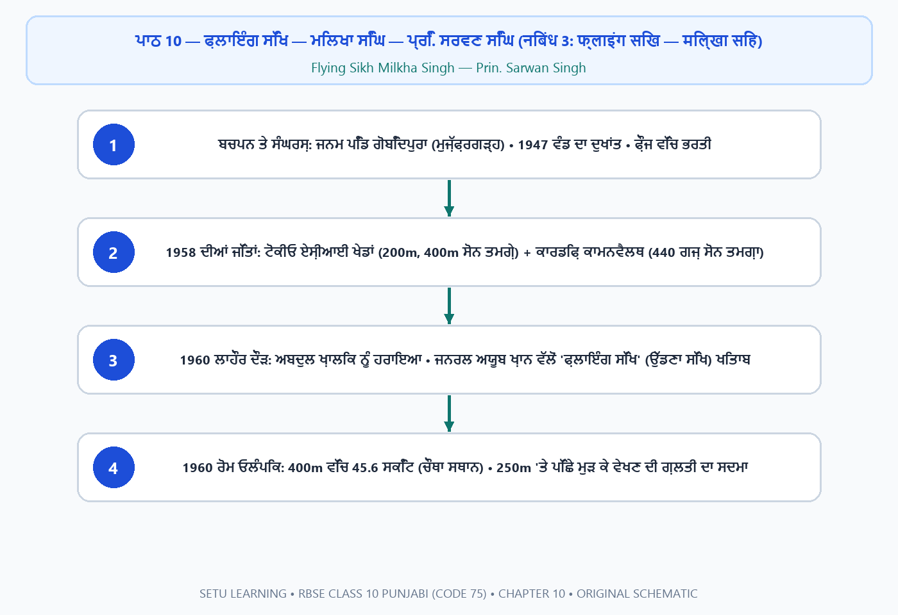

# ਪਾਠ 10 — ਫ਼ਲਾਇੰਗ ਸਿੱਖ — ਮਿਲਖਾ ਸਿੰਘ — ਪ੍ਰਿੰ. ਸਰਵਣ ਸਿੰਘ (निबंध 3: फ़्लाइंग सिख — मिल्खा सिंह) (Flying Sikh Milkha Singh — Prin. Sarwan Singh)

## भाग 1: अध्याय प्रवेश एवं पाठ्यक्रम मैपिंग (ਪਾਠ-ਪ੍ਰਵੇਸ਼ ਅਤੇ ਪਾਠਕ੍ਰਮ ਮੈਪਿੰਗ)

> RBSE ਜਮਾਤ 10 ਪੰਜਾਬੀ ਪਾਠ-ਪੁਸਤਕ 'ਸਾਹਿਤ ਸੁਗੰਧੀਆਂ' ਦੇ ਸਾਰੇ ਪ੍ਰਸ਼ਨਾਂ ਦੇ ਹੱਲ ਅਤੇ 2014–2026 ਦਾ ਪੂਰਾ ਇਤਿਹਾਸਕ PYQ ਸੰਗ੍ਰਹਿ ਸਰੋਤ-ਪ੍ਰੀਖਣ ਸਮੇਤ ਸੰਕਲਿਤ ਹਨ।

**ਵਿਸ਼ਾ ਕੋਡ (विषय कोड):** 75 (ਤੀਜੀ ਭਾਸ਼ਾ — ਪੰਜਾਬੀ / तृतीया भाषा — पंजाबी) · **ਲੜੀ ਪੁਸਤਕ (श्रृंखला पुस्तक):** 7

**ਪ੍ਰਮਾਣਿਤ ਆਧਾਰ:** RBSE 2025–26 · **ਪਾਠ ਅੰਕ-ਭਾਰ:** 2 ਅੰਕ। ਇਹ ਭਾਰ ਉਸੇ ਸੰਸਕਰਣ ਦਾ ਹੈ; ਅਸਲ ਪ੍ਰਸ਼ਨ-ਵੰਡ ਦੀ ਭਵਿੱਖਬਾਣੀ ਨਹੀਂ।

**ਸਿੱਖਣ ਦੇ ਉਦੇਸ਼ (सीखने के लक्ष्य):** ਪ੍ਰਿੰ. ਸਰਵਣ ਸਿੰਘ ਦੇ ਨਿਬੰਧ 'ਫ਼ਲਾਇੰਗ ਸਿੱਖ — ਮਿਲਖਾ ਸਿੰਘ' ਦਾ ਸਾਰ, ਮਿਲਖਾ ਸਿੰਘ ਦਾ ਬਚਪਨ, 1958 ਟੋਕੀਓ ਏਸ਼ੀਆਈ ਖੇਡਾਂ ਤੇ ਕਾਰਡਿਫ਼ ਕਾਮਨਵੈਲਥ ਜਿੱਤਾਂ, 1960 ਲਾਹੌਰ ਵਿੱਚ 'ਫ਼ਲਾਇੰਗ ਸਿੱਖ' ਖਿਤਾਬ ਅਤੇ 1960 ਰੋਮ ਓਲੰਪਿਕ ਦੀ ਇਤਿਹਾਸਕ ਦੌੜ ਸਮਝਣਾ।

## भाग 2: शब्दावली एवं अवधारणा कैप्सूल (ਸ਼ਬਦਾਵਲੀ ਅਤੇ ਸੰਕਲਪ ਕੈਪਸੂਲ)

| ਸ਼ਬਦ / ਸੰਕਲਪ | ਅਰਥ / ਵਿਆਖਿਆ |
|---|---|
| ਫ਼ਲਾਇੰਗ ਸਿੱਖ (फ़्लाइंग सिख) | ਉੱਡਣਾ ਸਿੱਖ — 1960 ਵਿੱਚ ਲਾਹੌਰ ਵਿਖੇ ਜਨਰਲ ਅਯੂਬ ਖ਼ਾਨ ਵੱਲੋਂ ਮਿਲਖਾ ਸਿੰਘ ਨੂੰ ਦਿੱਤਾ ਖਿਤਾਬ। |
| ਗੋਬਿੰਦਪੁਰਾ (गोबिंदपुरा) | ਜ਼ਿਲ੍ਹਾ ਮੁਜ਼ੱਫ਼ਰਗੜ੍ਹ (ਪਾਕਿਸਤਾਨ) ਦਾ ਪਿੰਡ ਜਿੱਥੇ ਮਿਲਖਾ ਸਿੰਘ ਦਾ ਜਨਮ ਤੇ ਬਚਪਨ ਬੀਤਿਆ। |
| ਕਾਮਨਵੈਲਥ ਖੇਡਾਂ (कामनवेल्थ खेडां) | ਰਾਸ਼ਟਰਮੰਡਲ ਖੇਡਾਂ — 1958 ਕਾਰਡਿਫ਼ ਵਿਖੇ ਮਿਲਖਾ ਸਿੰਘ ਨੇ 440 ਗਜ਼ ਦੌੜ ਵਿੱਚ ਸੋਨ ਤਮਗ਼ਾ ਜਿੱਤਿਆ। |
| ਅਬਦੁਲ ਖ਼ਾਲਿਕ (अबदुल ख़ालिक) | ਪਾਕਿਸਤਾਨ ਦਾ ਤੇਜ਼ ਦੌੜਾਕ ਜਿਸ ਨੂੰ ਮਿਲਖਾ ਸਿੰਘ ਨੇ ਟੋਕੀਓ (1958) ਤੇ ਲਾਹੌਰ (1960) ਵਿੱਚ ਹਰਾਇਆ। |
| ਰੋਮ ਓਲੰਪਿਕ 1960 (रोम ओलंपिक 1960) | 400 ਮੀਟਰ ਦੌੜ ਜਿੱਥੇ ਮਿਲਖਾ ਸਿੰਘ ਨੇ 45.6 ਸਕਿੰਟ ਵਿੱਚ ਚੌਥਾ ਸਥਾਨ ਪ੍ਰਾਪਤ ਕੀਤਾ। |
| ਸਦਮਾ (सदमा) | ਗਹਿਰਾ ਦੁੱਖ ('ਇਸ ਗ਼ਲਤੀ ਦਾ ਸਦਮਾ ਮੈਨੂੰ ਉਮਰ ਭਰ ਰਹੇਗਾ')। |
| ਅਥਲੀਟ (अथलीट) | ਦੌੜਾਂ ਅਤੇ ਮੈਦਾਨੀ ਖੇਡਾਂ ਦਾ ਖਿਡਾਰੀ। |
| ਸੰਘਰਸ਼ (संघर्ष) | ਕਠਿਨ ਮਿਹਨਤ ਅਤੇ ਮੁਸੀਬਤਾਂ ਨਾਲ ਟਾਕਰਾ। |
| ਪਦਮ ਸ੍ਰੀ (पदम श्री) | ਭਾਰਤ ਸਰਕਾਰ ਵੱਲੋਂ 1959 ਵਿੱਚ ਮਿਲਖਾ ਸਿੰਘ ਨੂੰ ਦਿੱਤਾ ਗਿਆ ਉੱਚ ਨਾਗਰਿਕ ਸਨਮਾਨ। |
| ਹੈਲਮਟ ਕੇਰਨਜ਼ (हेलमेट केरनज़) | ਜਰਮਨੀ ਦਾ ਦੌੜਾਕ ਜੋ ਰੋਮ ਓਲੰਪਿਕ ਵਿੱਚ ਤੀਜੇ ਨੰਬਰ 'ਤੇ ਰਿਹਾ। |

## भाग 3: विस्तृत शिक्षण पाठ (ਵਿਸਤ੍ਰਿਤ ਅਧਿਆਪਨ ਪਾਠ)

### 1. ਨਿਬੰਧਕਾਰ-ਪਛਾਣ: ਪ੍ਰਿੰ. ਸਰਵਣ ਸਿੰਘ (ਜਨਮ 1940 ਈ.)
ਪੰਜਾਬੀ ਖੇਡ-ਸਾਹਿਤ ਦੇ ਸਿਰਮੌਰ ਲੇਖਕ **ਪ੍ਰਿੰ. ਸਰਵਣ ਸਿੰਘ** ਦਾ ਜਨਮ 8 ਜੁਲਾਈ 1940 ਈ. ਨੂੰ ਪਿੰਡ ਚਕਰ (ਜ਼ਿਲ੍ਹਾ ਲੁਧਿਆਣਾ) ਵਿਖੇ ਹੋਇਆ। ਉਹਨਾਂ ਨੇ ਪੰਜਾਬ ਦੇ ਖਿਡਾਰੀਆਂ ਅਤੇ ਖੇਡ-ਸੱਭਿਆਚਾਰ ਉੱਤੇ 'ਭਾਰਤ ਵਿੱਚ ਹਾਕੀ', 'ਪੰਜਾਬ ਦੇ ਉੱਘੇ ਖਿਡਾਰੀ', 'ਖੇਡ ਸੰਸਾਰ', 'ਪੰਜਾਬ ਦੀਆਂ ਦੇਸੀ ਖੇਡਾਂ' ਆਦਿ ਤਿੰਨ ਦਰਜਨ ਤੋਂ ਵੱਧ ਪੁਸਤਕਾਂ ਲਿਖੀਆਂ ਹਨ।

### 2. 'ਫ਼ਲਾਇੰਗ ਸਿੱਖ — ਮਿਲਖਾ ਸਿੰਘ' ਨਿਬੰਧ ਦੇ ਪ੍ਰਮੁੱਖ ਤੱਥ ਅਤੇ ਸਾਰ
1. **ਜਨਮ, ਬਚਪਨ ਅਤੇ 1947 ਦੀ ਵੰਡ ਦਾ ਦੁਖਾਂਤ (RBSE 2026 Supp Q11):**
   - ਮਿਲਖਾ ਸਿੰਘ ਦਾ ਜਨਮ ਅਤੇ ਬਚਪਨ ਪੱਛਮੀ ਪੰਜਾਬ (ਹੁਣ ਪਾਕਿਸਤਾਨ) ਦੇ **ਜ਼ਿਲ੍ਹਾ ਮੁਜ਼ੱਫ਼ਰਗੜ੍ਹ ਦੇ ਪਿੰਡ ਗੋਬਿੰਦਪੁਰਾ** ਵਿਖੇ ਬੀਤਿਆ।
   - ਬਚਪਨ ਵਿੱਚ ਉਹ ਆਪਣੇ ਪਿੰਡ ਤੋਂ ਤਪਦੀ ਰੇਤ ਉੱਤੇ ਨੰਗੇ ਪੈਰੀਂ 10 ਮੀਲ ਦੂਰ ਸਕੂਲ ਦੌੜ ਕੇ ਜਾਂਦਾ ਸੀ।
   - 1947 ਦੀ ਦੇਸ਼-ਵੰਡ ਸਮੇਂ ਫ਼ਿਰਕੂ ਦੰਗਿਆਂ ਵਿੱਚ ਉਸ ਦੀਆਂ ਅੱਖਾਂ ਸਾਹਮਣੇ ਉਸ ਦੇ ਮਾਤਾ-ਪਿਤਾ ਕਤਲ ਹੋ ਗਏ ਅਤੇ ਉਹ ਅਨਾਥ ਹੋ ਕੇ ਸ਼ਰਨਾਰਥੀ ਕੈਂਪਾਂ ਵਿੱਚ ਦਿੱਲੀ ਪਹੁੰਚਿਆ।
2. **ਫ਼ੌਜ ਵਿੱਚ ਭਰਤੀ ਅਤੇ ਅਣਥੱਕ ਮਿਹਨਤ:**
   - ਕਈ ਕੋਸ਼ਿਸ਼ਾਂ ਮਗਰੋਂ ਉਹ ਭਾਰਤੀ ਫ਼ੌਜ ਵਿੱਚ ਭਰਤੀ ਹੋਇਆ ਜਿੱਥੇ ਉਸਤਾਦ ਹਵਾਲਦਾਰ ਗੁਰਦੇਵ ਸਿੰਘ ਨੇ ਉਸ ਦੀ ਦੌੜਨ ਦੀ ਪ੍ਰਤਿਭਾ ਨੂੰ ਪਛਾਣਿਆ।
   - ਮਿਲਖਾ ਸਿੰਘ ਨੇ ਇੰਨੀ ਸਖ਼ਤ ਮਿਹਨਤ ਕੀਤੀ ਕਿ ਕਈ ਵਾਰ ਦੌੜਦਿਆਂ ਬੇਹੋਸ਼ ਹੋ ਜਾਂਦਾ ਅਤੇ ਖ਼ੂਨ ਦੀ ਉਲਟੀ ਆ ਜਾਂਦੀ। 1956 ਮੈਲਬੌਰਨ ਓਲੰਪਿਕ ਤੋਂ ਬਾਅਦ ਉਸ ਨੇ 400 ਮੀਟਰ ਦੌੜ ਵਿੱਚ ਵਿਸ਼ਵ-ਪੱਧਰੀ ਮੁਹਾਰਤ ਹਾਸਲ ਕੀਤੀ।
3. **1958 ਟੋਕੀਓ ਏਸ਼ੀਆਈ ਖੇਡਾਂ ਅਤੇ ਕਾਰਡਿਫ਼ ਕਾਮਨਵੈਲਥ ਖੇਡਾਂ (RBSE 2018 Supp Q8-ੲ):**
   - **1958 ਦੀਆਂ ਟੋਕੀਓ ਏਸ਼ੀਆਈ ਖੇਡਾਂ** ਵਿੱਚ ਮਿਲਖਾ ਸਿੰਘ ਨੇ 200 ਮੀਟਰ ਅਤੇ 400 ਮੀਟਰ ਦੋਹਾਂ ਦੌੜਾਂ ਵਿੱਚ ਨਵੇਂ ਰਿਕਾਰਡ ਬਣਾ ਕੇ ਸੋਨ ਤਮਗ਼ੇ ਜਿੱਤੇ (200 ਮੀਟਰ ਵਿੱਚ ਪਾਕਿਸਤਾਨ ਦੇ ਅਬਦੁਲ ਖ਼ਾਲਿਕ ਨੂੰ ਹਰਾਇਆ) ਅਤੇ **ਏਸ਼ੀਆ ਦਾ ਬੈਸਟ ਅਥਲੀਟ** ਬਣਿਆ।
   - ਇਸੇ ਸਾਲ **1958 ਦੀਆਂ ਕਾਰਡਿਫ਼ (ਵੇਲਜ਼) ਕਾਮਨਵੈਲਥ ਖੇਡਾਂ** ਵਿੱਚ 440 ਗਜ਼ ਦੌੜ ਜਿੱਤ ਕੇ ਉਹ ਆਜ਼ਾਦ ਭਾਰਤ ਲਈ ਕਾਮਨਵੈਲਥ ਸੋਨ ਤਮਗ਼ਾ ਜਿੱਤਣ ਵਾਲਾ ਪਹਿਲਾ ਭਾਰਤੀ ਅਥਲੀਟ ਬਣਿਆ।
4. **'ਫ਼ਲਾਇੰਗ ਸਿੱਖ' (ਉੱਡਣਾ ਸਿੱਖ) ਦੀ ਉਪਾਧੀ ਕਦੋਂ ਤੇ ਕਿਵੇਂ ਮਿਲੀ? (RBSE 2018 Main Q8-ੳ, 2020 Main Q8-ਅ, 2024 Main Q3-vi):**
   - **ਸੰਨ 1960 ਵਿੱਚ ਪਾਕਿਸਤਾਨ (ਲਾਹੌਰ)** ਵਿਖੇ ਹੋਈ ਇੰਡੋ-ਪਾਕਿ ਅਥਲੈਟਿਕ ਮੀਟ ਵਿੱਚ ਮਿਲਖਾ ਸਿੰਘ ਨੇ ਪਾਕਿਸਤਾਨ ਦੇ ਸਭ ਤੋਂ ਤੇਜ਼ ਦੌੜਾਕ **ਅਬਦੁਲ ਖ਼ਾਲਿਕ** ਨੂੰ 200 ਮੀਟਰ ਦੌੜ ਵਿੱਚ ਹਰਾਇਆ।
   - ਉਸ ਦੀ ਤੂਫ਼ਾਨੀ ਦੌੜ ਵੇਖ ਕੇ ਪਾਕਿਸਤਾਨ ਦੇ ਰਾਸ਼ਟਰਪਤੀ **ਜਨਰਲ ਅਯੂਬ ਖ਼ਾਨ** ਨੇ ਇਨਾਮ ਦਿੰਦਿਆਂ ਕਿਹਾ — *"ਮਿਲਖਾ ਸਿੰਘ, ਤੂੰ ਪਾਕਿਸਤਾਨ ਵਿੱਚ ਦੌੜਿਆ ਨਹੀਂ ਸਗੋਂ ਉੱਡਿਆ ਹੈਂ! ਅੱਜ ਤੋਂ ਦੁਨੀਆ ਤੈਨੂੰ 'ਫ਼ਲਾਇੰਗ ਸਿੱਖ' (ਉੱਡਣਾ ਸਿੱਖ) ਦੇ ਨਾਂ ਨਾਲ ਜਾਣੇਗੀ।"*
5. **1960 ਰੋਮ ਓਲੰਪਿਕ ਅਤੇ ਉਮਰ ਭਰ ਦਾ ਸਦਮਾ (RBSE 2019 Main Q8-ਅ, 2022 Main Q1-vi):**
   - **1960 ਦੀਆਂ ਰੋਮ ਓਲੰਪਿਕ ਖੇਡਾਂ** ਦੀ 400 ਮੀਟਰ ਫਾਈਨਲ ਦੌੜ ਵਿੱਚ ਮਿਲਖਾ ਸਿੰਘ 250 ਮੀਟਰ ਤੱਕ ਸਭ ਤੋਂ ਅੱਗੇ ਦੌੜ ਰਿਹਾ ਸੀ।
   - ਪਰ 250 ਮੀਟਰ ਉੱਤੇ ਉਸ ਨੇ ਆਪਣੀ ਰਫ਼ਤਾਰ ਹੌਲੀ ਕਰਕੇ **ਪਿੱਛੇ ਮੁੜ ਕੇ ਦੂਜੇ ਦੌੜਾਕਾਂ ਵੱਲ ਵੇਖਣ ਦੀ ਗ਼ਲਤੀ** ਕਰ ਦਿੱਤੀ।
   - ਇਸ ਪਲ ਭਰ ਦੀ ਗ਼ਲਤੀ ਕਾਰਨ ਅਮਰੀਕਾ ਦਾ ਓਟਿਸ ਡੇਵਿਸ (ਪਹਿਲਾ), ਜਰਮਨੀ ਦਾ ਕਾਰਲ ਕੌਫ਼ਮੈਨ (ਦੂਜਾ) ਅਤੇ ਦੱਖਣੀ ਅਫ਼ਰੀਕਾ ਦਾ ਮੈਲਕਮ ਸਪੈਂਸ (ਤੀਜਾ) ਅੱਗੇ ਨਿਕਲ ਗਏ। ਮਿਲਖਾ ਸਿੰਘ ਨੇ **45.6 ਸਕਿੰਟ** ਵਿੱਚ ਪੁਰਾਣਾ ਓਲੰਪਿਕ ਰਿਕਾਰਡ ਤੋੜਦਿਆਂ **ਚੌਥਾ ਸਥਾਨ** ਪ੍ਰਾਪਤ ਕੀਤਾ।
   - ਇਸ ਇਤਿਹਾਸਕ ਚूक ਬਾਰੇ ਮਿਲਖਾ ਸਿੰਘ ਨੇ ਕਿਹਾ ਸੀ — **'ਇਸ ਗ਼ਲਤੀ ਦਾ ਸਦਮਾ ਮੈਨੂੰ ਉਮਰ ਭਰ ਰਹੇਗਾ।'**

ਪਾਠ 10: ਪ੍ਰਿੰ. ਸਰਵਣ ਸਿੰਘ ਦੇ ਨਿਬੰਧ 'ਫ਼ਲਾਇੰਗ ਸਿੱਖ — ਮਿਲਖਾ ਸਿੰਘ' ਦਾ ਸੰਕਲਪ ਚਿੱਤਰ

## भाग 4: पाठ्यपुस्तक-अवधारणाओं पर मौलिक हल किए उदाहरण (ਹੱਲ ਕੀਤੇ ਮਿਆਰੀ ਉਦਾਹਰਣ)

ਹੇਠਾਂ ਦਿੱਤੇ ਪ੍ਰਸ਼ਨ ਪਾਠ-ਪੁਸਤਕ 'ਸਾਹਿਤ ਸੁਗੰਧੀਆਂ' ਅਤੇ ਵਿਆਕਰਣ ਦੇ ਸੰਕਲਪਾਂ ਉੱਤੇ ਆਧਾਰਿਤ ਮੌਲਿਕ ਆਦਰਸ਼ ਹੱਲ ਹਨ।

**ਹੱਲ ਕੀਤਾ ਉਦਾਹਰਣ 1: ਮਿਲਖਾ ਸਿੰਘ ਨੂੰ 'ਫ਼ਲਾਇੰਗ ਸਿੱਖ' ਦੀ ਉਪਾਧੀ ਕਦੋਂ ਤੇ ਕਿਵੇਂ ਪ੍ਰਾਪਤ ਹੋਈ ਸੀ?**

ਸੰਨ 1960 ਵਿੱਚ ਲਾਹੌਰ (ਪਾਕਿਸਤਾਨ) ਵਿਖੇ ਹੋਈ ਭਾਰਤ-ਪਾਕਿ ਖੇਡ ਪ੍ਰਤੀਯੋਗਤਾ ਵਿੱਚ ਮਿਲਖਾ ਸਿੰਘ ਨੇ ਪਾਕਿਸਤਾਨ ਦੇ ਤੇਜ਼ ਦੌੜਾਕ ਅਬਦੁਲ ਖ਼ਾਲਿਕ ਨੂੰ 200 ਮੀਟਰ ਦੌੜ ਵਿੱਚ ਪਛਾੜ ਕੇ ਸ਼ਾਨਦਾਰ ਜਿੱਤ ਪ੍ਰਾਪਤ ਕੀਤੀ। ਉਸ ਦੀ ਤੇਜ਼ ਰਫ਼ਤਾਰ ਤੋਂ ਪ੍ਰਭਾਵਿਤ ਹੋ ਕੇ ਪਾਕਿਸਤਾਨ ਦੇ ਰਾਸ਼ਟਰਪਤੀ ਜਨਰਲ ਅਯੂਬ ਖ਼ਾਨ ਨੇ ਉਸ ਨੂੰ 'ਫ਼ਲਾਇੰਗ ਸਿੱਖ' (ਉੱਡਣਾ ਸਿੱਖ) ਦੀ ਉਪਾਧੀ ਪ੍ਰਦਾਨ ਕੀਤੀ (RBSE 2018 Main Q8-ੳ, 2020 Main Q8-ਅ, 2024 Main Q3-vi)।

**ਹੱਲ ਕੀਤਾ ਉਦਾਹਰਣ 2: 'ਇਸ ਗ਼ਲਤੀ ਦਾ ਸਦਮਾ ਮੈਨੂੰ ਉਮਰ ਭਰ ਰਹੇਗਾ' — ਇਹ ਸ਼ਬਦ ਮਿਲਖਾ ਸਿੰਘ ਨੇ ਕਿਸ ਪ੍ਰਸੰਗ ਵਿੱਚ ਕਹੇ ਹਨ?**

ਇਹ ਸ਼ਬਦ ਮਿਲਖਾ ਸਿੰਘ ਨੇ 1960 ਦੀਆਂ ਰੋਮ ਓਲੰਪਿਕ ਖੇਡਾਂ ਦੀ 400 ਮੀਟਰ ਫਾਈਨਲ ਦੌੜ ਦੇ ਪ੍ਰਸੰਗ ਵਿੱਚ ਕਹੇ ਹਨ। ਉਸ ਦੌੜ ਵਿੱਚ ਮਿਲਖਾ ਸਿੰਘ 250 ਮੀਟਰ ਤੱਕ ਸਭ ਤੋਂ ਅੱਗੇ ਸੀ, ਪਰ ਉਸ ਨੇ ਰਫ਼ਤਾਰ ਘਟਾ ਕੇ ਪਿੱਛੇ ਮੁੜ ਕੇ ਵੇਖਣ ਦੀ ਗ਼ਲਤੀ ਕਰ ਦਿੱਤੀ, ਜਿਸ ਕਾਰਨ ਤਿੰਨ ਦੌੜਾਕ ਉਸ ਤੋਂ ਅੱਗੇ ਨਿਕਲ ਗਏ ਅਤੇ ਉਹ 45.6 ਸਕਿੰਟ ਦਾ ਸਮਾਂ ਕੱਢ ਕੇ ਵੀ ਚੌਥੇ ਸਥਾਨ 'ਤੇ ਰਹਿ ਗਿਆ ਤੇ ਕਾਂਸੀ ਦਾ ਤਮਗ਼ਾ ਹੱਥੋਂ ਗੁਆ ਬੈਠਾ (RBSE 2019 Main Q8-ਅ, 2022 Main Q1-vi)।

**ਹੱਲ ਕੀਤਾ ਉਦਾਹਰਣ 3: ਮਿਲਖਾ ਸਿੰਘ ਦਾ ਬਚਪਨ ਕਿੱਥੇ ਅਤੇ ਕਿਵੇਂ ਬੀਤਿਆ?**

ਮਿਲਖਾ ਸਿੰਘ ਦਾ ਬਚਪਨ ਪੱਛਮੀ ਪੰਜਾਬ ਦੇ ਜ਼ਿਲ੍ਹਾ ਮੁਜ਼ੱਫ਼ਰਗੜ੍ਹ ਦੇ ਪਿੰਡ ਗੋਬਿੰਦਪੁਰਾ ਵਿਖੇ ਬੀਤਿਆ। ਉਹ ਗ਼ਰੀਬ ਪਰਿਵਾਰ ਵਿੱਚੋਂ ਸੀ ਅਤੇ ਪਿੰਡ ਤੋਂ 10 ਮੀਲ ਦੂਰ ਸਕੂਲ ਤੱਕ ਤਪਦੀ ਰੇਤ ਉੱਤੇ ਨੰਗੇ ਪੈਰੀਂ ਦੌੜ ਕੇ ਜਾਂਦਾ ਸੀ। 1947 ਦੀ ਵੰਡ ਵਿੱਚ ਉਸ ਦੇ ਮਾਤਾ-ਪਿਤਾ ਮਾਰੇ ਗਏ (RBSE 2026 Supp Q11)।

## भाग 5: सत्यापित बोर्ड प्रश्न एवं स्रोत-स्थिति (ਪ੍ਰਮਾਣਿਤ ਬੋਰਡ ਪ੍ਰਸ਼ਨ ਅਤੇ ਸਰੋਤ-ਸਥਿਤੀ)

RBSE 2026 Supp (`S-75`, Q11), 2025 Supp (Q3-vi), 2024 Main (Q3-vi) ਅਤੇ 2022 Main (Q1-vi, Q3-vi, Q17) ਵਿੱਚ ਇਸ ਪਾਠ ਦੇ ਪ੍ਰਸ਼ਨ ਪੁੱਛੇ ਗਏ ਹਨ।

[RBSE 2026 ਮੂਲ ਪੇਪਰ (S-75)](https://rajeduboard.rajasthan.gov.in/books/PAPERS-2026/Sec/S-75.pdf)। ਪ੍ਰਸ਼ਨ ਦਾ ਸੰਖੇਪ ਵਿਸ਼ਾ-ਸੰਦਰਭ ਹੈ; ਸ਼ਬਦ-ਬ-ਸ਼ਬਦ ਪੁਨਰ-ਮੁਦਰਣ ਨਹੀਂ।

## भाग 6: खंडवार मौलिक अभ्यास बैंक (ਖੰਡ-ਵਾਰ ਮੌਲਿਕ ਅਭਿਆਸ ਬੈਂਕ)

**ਅਭਿਆਸ-ਅੰਕ:** ਵਿਦਿਆਰਥੀਆਂ ਦੇ ਸਵੈ-ਅਭਿਆਸ ਲਈ ਹਨ; ਉੱਤਰ ਪਹਿਲਾਂ ਆਪ ਲਿਖੋ, ਫਿਰ ਭਾਗ 9 ਵੇਖੋ।

## ੳ: ਬਹੁ-ਵਿਕਲਪੀ ਪ੍ਰਸ਼ਨ (MCQ) — 15 × 1 ਅੰਕ

**MCQ 1. 'ਇਸ ਗ਼ਲਤੀ ਦਾ ਸਦਮਾ ਉਮਰ ਭਰ ਰਹੇਗਾ' — ਇਹ ਸ਼ਬਦ ਕਿਸ ਨਿਬੰਧ ਵਿੱਚ ਵਰਤੇ ਗਏ ਹਨ? (RBSE 2022 Main Q1-vi)**

ੳ) ਗੰਗਾ ਦੀਨ  
ਅ) ਰਾਜਸਥਾਨ ਦੇ ਪ੍ਰਸਿੱਧ ਕਿਲ੍ਹੇ  
ੲ) ਫ਼ਲਾਇੰਗ ਸਿੱਖ — ਮਿਲਖਾ ਸਿੰਘ  
ਸ) ਭਾਈ ਮਰਦਾਨਾ ਜੀ

**MCQ 2. ਮਿਲਖਾ ਸਿੰਘ ਨੂੰ ਕਿਹੜੇ ਨਾਂ ਨਾਲ ਉਪਮਾ ਦਿੱਤੀ ਜਾਂਦੀ ਹੈ? (RBSE 2022 Main Q3-vi, 2025 Supp Q3-vi)**

ੳ) ਰੁਸਤਮੇ-ਹਿੰਦ  
ਅ) ਫ਼ਲਾਇੰਗ ਸਿੱਖ (ਉੱਡਣਾ ਸਿੱਖ)  
ੲ) ਹਾਕੀ ਦਾ ਜਾਦੂਗਰ  
ਸ) ਲੋਹ-ਪੁਰਸ਼

**MCQ 3. ਮਿਲਖਾ ਸਿੰਘ ਨੂੰ 'ਫ਼ਲਾਇੰਗ ਸਿੱਖ' ਦੀ ਉਪਾਧੀ ਕਦੋਂ ਅਤੇ ਕਿਸ ਨੇ ਦਿੱਤੀ? (RBSE 2024 Main Q3-vi)**

ੳ) 1960 ਵਿੱਚ ਲਾਹੌਰ ਵਿਖੇ ਪਾਕਿਸਤਾਨ ਦੇ ਰਾਸ਼ਟਰਪਤੀ ਜਨਰਲ ਅਯੂਬ ਖ਼ਾਨ ਨੇ  
ਅ) 1958 ਵਿੱਚ ਟੋਕੀਓ ਦੇ ਬਾਦਸ਼ਾਹ ਨੇ  
ੲ) 1960 ਵਿੱਚ ਰੋਮ ਵਿਖੇ  
ਸ) 1958 ਵਿੱਚ ਕਾਰਡਿਫ਼ ਵਿਖੇ

**MCQ 4. 'ਫ਼ਲਾਇੰਗ ਸਿੱਖ — ਮਿਲਖਾ ਸਿੰਘ' ਨਿਬੰਧ ਦੇ ਲੇਖਕ ਕੌਣ ਹਨ?**

ੳ) ਪ੍ਰੋ. ਪੂਰਨ ਸਿੰਘ  
ਅ) ਪ੍ਰਿੰ. ਤੇਜਾ ਸਿੰਘ  
ੲ) ਹਰਪਾਲ ਸਿੰਘ ਲੱਖੀਆਂ  
ਸ) ਪ੍ਰਿੰ. ਸਰਵਣ ਸਿੰਘ

**MCQ 5. ਮਿਲਖਾ ਸਿੰਘ ਦਾ ਜਨਮ ਅਤੇ ਬਚਪਨ ਕਿਹੜੇ ਪਿੰਡ ਵਿੱਚ ਬੀਤਿਆ? (RBSE 2026 Supp Q11)**

ੳ) ਪਿੰਡ ਬਾਸਰਕੇ (ਅੰਮ੍ਰਿਤਸਰ)  
ਅ) ਪਿੰਡ ਪੱਤੜ ਕਲਾਂ (ਜਲੰਧਰ)  
ੲ) ਪਿੰਡ ਗੋਬਿੰਦਪੁਰਾ (ਜ਼ਿਲ੍ਹਾ ਮੁਜ਼ੱਫ਼ਰਗੜ੍ਹ)  
ਸ) ਪਿੰਡ ਚਕਰ (ਜ਼ਿਲ੍ਹਾ ਲੁਧਿਆਣਾ)

**MCQ 6. 1960 ਦੀਆਂ ਰੋਮ ਓਲੰਪਿਕ ਖੇਡਾਂ ਦੀ 400 ਮੀਟਰ ਦੌੜ ਵਿੱਚ ਮਿਲਖਾ ਸਿੰਘ ਦਾ ਕਿੰਨਵਾਂ ਸਥਾਨ ਰਿਹਾ?**

ੳ) ਤੀਜਾ ਸਥਾਨ  
ਅ) ਚੌਥਾ ਸਥਾਨ (45.6 ਸਕਿੰਟ)  
ੲ) ਪਹਿਲਾ ਸਥਾਨ  
ਸ) ਦੂਜਾ ਸਥਾਨ

**MCQ 7. 1960 ਰੋਮ ਓਲੰਪਿਕ ਦੀ 400 ਮੀਟਰ ਦੌੜ ਵਿੱਚ ਮਿਲਖਾ ਸਿੰਘ ਕੋਲੋਂ ਕਿੰਨੇ ਮੀਟਰ ਉੱਤੇ ਪਿੱਛੇ ਮੁੜ ਕੇ ਵੇਖਣ ਦੀ ਗ਼ਲਤੀ ਹੋਈ?**

ੳ) 250 ਮੀਟਰ ਉੱਤੇ  
ਅ) 100 ਮੀਟਰ ਉੱਤੇ  
ੲ) 50 ਮੀਟਰ ਉੱਤੇ  
ਸ) 390 ਮੀਟਰ ਉੱਤੇ

**MCQ 8. 1958 ਵਿੱਚ ਮਿਲਖਾ ਸਿੰਘ ਨੇ ਕਿਹੜੀਆਂ ਰਾਸ਼ਟਰਮੰਡਲ (ਕਾਮਨਵੈਲਥ) ਖੇਡਾਂ ਵਿੱਚ 440 ਗਜ਼ ਦੌੜ ਦਾ ਸੋਨ ਤਮਗ਼ਾ ਜਿੱਤਿਆ?**

ੳ) ਲੰਡਨ ਕਾਮਨਵੈਲਥ ਖੇਡਾਂ ਵਿੱਚ  
ਅ) ਸਿਡਨੀ ਕਾਮਨਵੈਲਥ ਖੇਡਾਂ ਵਿੱਚ  
ੲ) ਦਿੱਲੀ ਕਾਮਨਵੈਲਥ ਖੇਡਾਂ ਵਿੱਚ  
ਸ) ਕਾਰਡਿਫ਼ (ਵੇਲਜ਼) ਕਾਮਨਵੈਲਥ ਖੇਡਾਂ ਵਿੱਚ

**MCQ 9. ਪਾਕਿਸਤਾਨ ਦੇ ਕਿਹੜੇ ਪ੍ਰਸਿੱਧ ਦੌੜਾਕ ਨੂੰ ਮਿਲਖਾ ਸਿੰਘ ਨੇ 1958 ਟੋਕੀਓ ਅਤੇ 1960 ਲਾਹੌਰ ਵਿੱਚ ਹਰਾਇਆ?**

ੳ) ਅਸਲਮ ਖ਼ਾਨ ਨੂੰ  
ਅ) ਅਕਰਮ ਬੱਟ ਨੂੰ  
ੲ) ਅਬਦੁਲ ਖ਼ਾਲਿਕ ਨੂੰ  
ਸ) ਗ਼ੁਲਾਮ ਰਜ਼ਾ ਨੂੰ

**MCQ 10. 1958 ਦੀਆਂ ਏਸ਼ੀਆਈ ਖੇਡਾਂ ਕਿੱਥੇ ਹੋਈਆਂ ਸਨ ਜਿੱਥੇ ਮਿਲਖਾ ਸਿੰਘ ਨੇ ਦੋ ਸੋਨ ਤਮਗ਼ੇ ਜਿੱਤੇ?**

ੳ) ਮੈਲਬੌਰਨ ਵਿਖੇ  
ਅ) ਟੋਕੀਓ (ਜਾਪਾਨ) ਵਿਖੇ  
ੲ) ਰੋਮ (ਇਟਲੀ) ਵਿਖੇ  
ਸ) ਲਾਹੌਰ ਵਿਖੇ

**MCQ 11. ਬਚਪਨ ਵਿੱਚ ਮਿਲਖਾ ਸਿੰਘ ਪਿੰਡ ਤੋਂ ਕਿੰਨੀ ਦੂਰ ਸਕੂਲ ਪੜ੍ਹਨ ਲਈ ਨੰਗੇ ਪੈਰੀਂ ਦੌੜ ਕੇ ਜਾਂਦਾ ਸੀ?**

ੳ) 10 ਮੀਲ (ਆਉਣ-ਜਾਣ)  
ਅ) 1 ਮੀਲ  
ੲ) 25 ਮੀਲ  
ਸ) 50 ਮੀਲ

**MCQ 12. ਮਿਲਖਾ ਸਿੰਘ ਦੀ ਦੌੜਨ ਦੀ ਪ੍ਰਤਿਭਾ ਕਿਸ ਸੰਸਥਾ ਵਿੱਚ ਭਰਤੀ ਹੋਣ ਤੋਂ ਬਾਅਦ ਨਿਖਰੀ?**

ੳ) ਰੇਲਵੇ ਵਿੱਚ  
ਅ) ਪੁਲਿਸ ਵਿੱਚ  
ੲ) ਕਾਲਜ ਵਿੱਚ  
ਸ) ਭਾਰਤੀ ਫ਼ੌਜ ਵਿੱਚ

**MCQ 13. ਮਿਲਖਾ ਸਿੰਘ ਨੇ ਸਭ ਤੋਂ ਪਹਿਲਾਂ 1956 ਵਿੱਚ ਕਿਹੜੀਆਂ ਓਲੰਪਿਕ ਖੇਡਾਂ ਵਿੱਚ ਭਾਗ ਲਿਆ ਸੀ?**

ੳ) ਟੋਕੀਓ ਓਲੰਪਿਕ ਖੇਡਾਂ ਵਿੱਚ  
ਅ) ਲੰਡਨ ਓਲੰਪਿਕ ਖੇਡਾਂ ਵਿੱਚ  
ੲ) ਮੈਲਬੌਰਨ (ਆਸਟ੍ਰੇਲੀਆ) ਓਲੰਪਿਕ ਖੇਡਾਂ ਵਿੱਚ  
ਸ) ਰੋਮ ਓਲੰਪਿਕ ਖੇਡਾਂ ਵਿੱਚ

**MCQ 14. ਭਾਰਤ ਸਰਕਾਰ ਨੇ ਮਿਲਖਾ ਸਿੰਘ ਨੂੰ 1959 ਵਿੱਚ ਕਿਹੜੇ ਸਨਮਾਨ ਨਾਲ ਨਿਵਾਜਿਆ?**

ੳ) ਸਾਹਿਤ ਅਕਾਦਮੀ  
ਅ) ਪਦਮ ਸ੍ਰੀ  
ੲ) ਭਾਰਤ ਰਤਨ  
ਸ) ਪਰਮਵੀਰ ਚੱਕਰ

**MCQ 15. 1960 ਰੋਮ ਓਲੰਪਿਕ ਦੀ 400 ਮੀਟਰ ਦੌੜ ਵਿੱਚ ਮਿਲਖਾ ਸਿੰਘ ਕਿੰਨਵੀਂ ਲੇਨ (ਗਲੀ) ਵਿੱਚ ਦੌੜਿਆ ਸੀ?**

ੳ) ਅੱਠਵੀਂ ਲੇਨ ਵਿੱਚ  
ਅ) ਪਹਿਲੀ ਲੇਨ ਵਿੱਚ  
ੲ) ਦੂਜੀ ਲੇਨ ਵਿੱਚ  
ਸ) ਤੀਜੀ ਲੇਨ ਵਿੱਚ

## ੳ: ਖਾਲੀ ਥਾਵਾਂ ਭਰੋ — 6 × 1 ਅੰਕ

1. ਉੱਡਣਾ ਸਿੱਖ — 1960 ਵਿੱਚ ਲਾਹੌਰ ਵਿਖੇ ਜਨਰਲ ਅਯੂਬ ਖ਼ਾਨ ਵੱਲੋਂ ਮਿਲਖਾ ਸਿੰਘ ਨੂੰ ਦਿੱਤਾ ਖਿਤਾਬ। — ਇਸ ਸ਼ਬਦ/ਸੰਕਲਪ ਦਾ ਨਾਂ ਹੈ: ____।  
2. ਜ਼ਿਲ੍ਹਾ ਮੁਜ਼ੱਫ਼ਰਗੜ੍ਹ (ਪਾਕਿਸਤਾਨ) ਦਾ ਪਿੰਡ ਜਿੱਥੇ ਮਿਲਖਾ ਸਿੰਘ ਦਾ ਜਨਮ ਤੇ ਬਚਪਨ ਬੀਤਿਆ। — ਇਸ ਸ਼ਬਦ/ਸੰਕਲਪ ਦਾ ਨਾਂ ਹੈ: ____।  
3. ਰਾਸ਼ਟਰਮੰਡਲ ਖੇਡਾਂ — 1958 ਕਾਰਡਿਫ਼ ਵਿਖੇ ਮਿਲਖਾ ਸਿੰਘ ਨੇ 440 ਗਜ਼ ਦੌੜ ਵਿੱਚ ਸੋਨ ਤਮਗ਼ਾ ਜਿੱਤਿਆ। — ਇਸ ਸ਼ਬਦ/ਸੰਕਲਪ ਦਾ ਨਾਂ ਹੈ: ____।  
4. ਪਾਕਿਸਤਾਨ ਦਾ ਤੇਜ਼ ਦੌੜਾਕ ਜਿਸ ਨੂੰ ਮਿਲਖਾ ਸਿੰਘ ਨੇ ਟੋਕੀਓ (1958) ਤੇ ਲਾਹੌਰ (1960) ਵਿੱਚ ਹਰਾਇਆ। — ਇਸ ਸ਼ਬਦ/ਸੰਕਲਪ ਦਾ ਨਾਂ ਹੈ: ____।  
5. 400 ਮੀਟਰ ਦੌੜ ਜਿੱਥੇ ਮਿਲਖਾ ਸਿੰਘ ਨੇ 45.6 ਸਕਿੰਟ ਵਿੱਚ ਚੌਥਾ ਸਥਾਨ ਪ੍ਰਾਪਤ ਕੀਤਾ। — ਇਸ ਸ਼ਬਦ/ਸੰਕਲਪ ਦਾ ਨਾਂ ਹੈ: ____।  
6. ਗਹਿਰਾ ਦੁੱਖ ('ਇਸ ਗ਼ਲਤੀ ਦਾ ਸਦਮਾ ਮੈਨੂੰ ਉਮਰ ਭਰ ਰਹੇਗਾ')। — ਇਸ ਸ਼ਬਦ/ਸੰਕਲਪ ਦਾ ਨਾਂ ਹੈ: ____।

## ੳ: ਅਤਿ-ਲਘੂ ਉੱਤਰਾਂ ਵਾਲੇ ਪ੍ਰਸ਼ਨ — 8 × 1 ਅੰਕ

1. 'ਇਸ ਗ਼ਲਤੀ ਦਾ ਸਦਮਾ ਉਮਰ ਭਰ ਰਹੇਗਾ' — ਇਹ ਸ਼ਬਦ ਕਿਸ ਨਿਬੰਧ ਵਿੱਚ ਵਰਤੇ ਗਏ ਹਨ? (RBSE 2022 Main Q1-vi)  
2. ਮਿਲਖਾ ਸਿੰਘ ਨੂੰ ਕਿਹੜੇ ਨਾਂ ਨਾਲ ਉਪਮਾ ਦਿੱਤੀ ਜਾਂਦੀ ਹੈ? (RBSE 2022 Main Q3-vi, 2025 Supp Q3-vi)  
3. ਮਿਲਖਾ ਸਿੰਘ ਨੂੰ 'ਫ਼ਲਾਇੰਗ ਸਿੱਖ' ਦੀ ਉਪਾਧੀ ਕਦੋਂ ਅਤੇ ਕਿਸ ਨੇ ਦਿੱਤੀ? (RBSE 2024 Main Q3-vi)  
4. 'ਫ਼ਲਾਇੰਗ ਸਿੱਖ — ਮਿਲਖਾ ਸਿੰਘ' ਨਿਬੰਧ ਦੇ ਲੇਖਕ ਕੌਣ ਹਨ?  
5. ਮਿਲਖਾ ਸਿੰਘ ਦਾ ਜਨਮ ਅਤੇ ਬਚਪਨ ਕਿਹੜੇ ਪਿੰਡ ਵਿੱਚ ਬੀਤਿਆ? (RBSE 2026 Supp Q11)  
6. 1960 ਦੀਆਂ ਰੋਮ ਓਲੰਪਿਕ ਖੇਡਾਂ ਦੀ 400 ਮੀਟਰ ਦੌੜ ਵਿੱਚ ਮਿਲਖਾ ਸਿੰਘ ਦਾ ਕਿੰਨਵਾਂ ਸਥਾਨ ਰਿਹਾ?  
7. 1960 ਰੋਮ ਓਲੰਪਿਕ ਦੀ 400 ਮੀਟਰ ਦੌੜ ਵਿੱਚ ਮਿਲਖਾ ਸਿੰਘ ਕੋਲੋਂ ਕਿੰਨੇ ਮੀਟਰ ਉੱਤੇ ਪਿੱਛੇ ਮੁੜ ਕੇ ਵੇਖਣ ਦੀ ਗ਼ਲਤੀ ਹੋਈ?  
8. 1958 ਵਿੱਚ ਮਿਲਖਾ ਸਿੰਘ ਨੇ ਕਿਹੜੀਆਂ ਰਾਸ਼ਟਰਮੰਡਲ (ਕਾਮਨਵੈਲਥ) ਖੇਡਾਂ ਵਿੱਚ 440 ਗਜ਼ ਦੌੜ ਦਾ ਸੋਨ ਤਮਗ਼ਾ ਜਿੱਤਿਆ?

## ਅ: ਲਘੂ ਉੱਤਰਾਂ ਵਾਲੇ ਪ੍ਰਸ਼ਨ — 6 × 2 ਅੰਕ

**B1.** ਮਿਲਖਾ ਸਿੰਘ ਨੂੰ ਕਿਹੜੇ-ਕਿਹੜੇ ਨਾਂ ਨਾਲ ਉਪਮਾ ਦਿੱਤੀ ਜਾਂਦੀ ਹੈ?

**B2.** 'ਫ਼ਲਾਇੰਗ ਸਿੱਖ — ਮਿਲਖਾ ਸਿੰਘ' ਨਿਬੰਧ ਦਾ ਲੇਖਕ ਕੌਣ ਹੈ?

**B3.** ਮਿਲਖਾ ਸਿੰਘ ਦਾ ਜਨਮ ਕਿਹੜੇ ਪਿੰਡ ਅਤੇ ਜ਼ਿਲ੍ਹੇ ਵਿੱਚ ਹੋਇਆ ਸੀ?

**B4.** 1960 ਦੀਆਂ ਰੋਮ ਓਲੰਪਿਕ ਖੇਡਾਂ ਵਿੱਚ ਮਿਲਖਾ ਸਿੰਘ ਨੇ 400 ਮੀਟਰ ਦੌੜ ਕਿੰਨੇ ਸਮੇਂ ਵਿੱਚ ਪੂਰੀ ਕੀਤੀ ਅਤੇ ਕਿੰਨਵਾਂ ਸਥਾਨ ਪ੍ਰਾਪਤ ਕੀਤਾ?

**B5.** 1958 ਦੀਆਂ ਟੋਕੀਓ ਏਸ਼ੀਆਈ ਖੇਡਾਂ ਵਿੱਚ ਮਿਲਖਾ ਸਿੰਘ ਨੇ ਕਿਹੜੀਆਂ ਦੌੜਾਂ ਵਿੱਚ ਸੋਨ ਤਮਗ਼ੇ ਜਿੱਤੇ?

**B6.** ਪਾਕਿਸਤਾਨ ਦੇ ਕਿਹੜੇ ਮਸ਼ਹੂਰ ਦੌੜਾਕ ਨੂੰ ਮਿਲਖਾ ਸਿੰਘ ਨੇ ਟੋਕੀਓ ਅਤੇ ਲਾਹੌਰ ਵਿੱਚ ਹਰਾਇਆ ਸੀ?

## ੲ: ਦੀਰਘ ਉੱਤਰਾਂ ਵਾਲੇ ਪ੍ਰਸ਼ਨ — 4 × 3 ਅੰਕ

ਅੰਦਰੂਨੀ ਵਿਕਲਪ ਅਭਿਆਸ: ਪਹਿਲਾਂ ਇੱਕ ਵਿਕਲਪ ਹੱਲ ਕਰੋ ਅਤੇ ਦੁਹਰਾਈ ਵੇਲੇ ਬਾਕੀ ਪ੍ਰਸ਼ਨ ਵੀ ਹੱਲ ਕਰੋ।

**C1.** 'ਫ਼ਲਾਇੰਗ ਸਿੱਖ — ਮਿਲਖਾ ਸਿੰਘ' ਨਿਬੰਧ ਦਾ ਸਾਰ ਸੰਖੇਪ ਕਰਕੇ ਲਿਖੋ। (RBSE 2022 Main Q17)

**C2.** ਮਿਲਖਾ ਸਿੰਘ ਏਸ਼ੀਆ ਦਾ ਬੈਸਟ ਅਥਲੀਟ ਕਿਵੇਂ ਤੇ ਕਦੋਂ ਬਣਿਆ? (RBSE 2018 Supp Q8-ੲ)

**C3.** 1960 ਦੀਆਂ ਰੋਮ ਓਲੰਪਿਕ ਖੇਡਾਂ ਦੀ 400 ਮੀਟਰ ਦੌੜ ਦਾ ਵਰਣਨ ਆਪਣੇ ਸ਼ਬਦਾਂ ਵਿੱਚ ਕਰੋ।

**C4.** 1960 ਦੀ ਲਾਹੌਰ ਦੌੜ ਦਾ ਦ੍ਰਿਸ਼ ਅਤੇ ਜਨਰਲ ਅਯੂਬ ਖ਼ਾਨ ਵੱਲੋਂ ਮਿਲਖਾ ਸਿੰਘ ਦੇ ਸਨਮਾਨ ਦਾ ਵਰਣਨ ਕਰੋ।

## ਸ: ਨਿਬੰਧਾਤਮਕ / ਵਿਸਤ੍ਰਿਤ ਉੱਤਰਾਂ ਵਾਲੇ ਪ੍ਰਸ਼ਨ — 2 × 4 ਅੰਕ

ਅੰਦਰੂਨੀ ਵਿਕਲਪ ਅਭਿਆਸ: D1 ਜਾਂ D2 ਚੁਣੋ; ਬਾਅਦ ਵਿੱਚ ਦੂਜਾ ਵੀ ਹੱਲ ਕਰੋ।

**D1.** ਮਿਲਖਾ ਸਿੰਘ ਦੇ ਜੀਵਨ-ਸੰਘਰਸ਼ ਤੋਂ ਵਿਦਿਆਰਥੀਆਂ ਅਤੇ ਨੌਜਵਾਨਾਂ ਨੂੰ ਕੀ ਪ੍ਰੇਰਨਾ ਮਿਲਦੀ ਹੈ? ਨਿਬੰਧ ਦੇ ਆਧਾਰ 'ਤੇ ਵਿਸਤਾਰ ਨਾਲ ਲਿਖੋ।

**D2.** ਮਿਲਖਾ ਸਿੰਘ ਦੀਆਂ ਰਾਸ਼ਟਰੀ ਅਤੇ ਅੰਤਰਰਾਸ਼ਟਰੀ ਖੇਡ-ਪ੍ਰਾਪਤੀਆਂ ਉੱਤੇ ਵਿਸਤਾਰਪੂਰਵਕ ਚਾਨਣਾ ਪਾਓ।

## भाग 7: सावधानियाँ एवं परीक्षा-त्रुटियाँ (ਸਾਵਧਾਨੀਆਂ ਅਤੇ ਪ੍ਰੀਖਿਆ-ਗ਼ਲਤੀਆਂ)

- **ਗ਼ਲਤੀ 1:** 'ਫ਼ਲਾਇੰਗ ਸਿੱਖ' ਖਿਤਾਬ ਦਾ ਸਾਲ ਤੇ ਸਥਾਨ ਗ਼ਲਤ ਲਿਖਣਾ — ਇਹ ਖਿਤਾਬ ਰੋਮ ਓਲੰਪਿਕ ਵਿੱਚ ਨਹੀਂ, ਸਗੋਂ **1960 ਵਿੱਚ ਲਾਹੌਰ (ਪਾਕਿਸਤਾਨ)** ਵਿਖੇ ਅਬਦੁਲ ਖ਼ਾਲਿਕ ਨੂੰ ਹਰਾਉਣ 'ਤੇ ਰਾਸ਼ਟਰਪਤੀ **ਜਨਰਲ ਅਯੂਬ ਖ਼ਾਨ** ਨੇ ਦਿੱਤਾ ਸੀ।
- **ਗ਼ਲਤੀ 2:** ਰੋਮ ਓਲੰਪਿਕ ਦਾ ਸਮਾਂ ਤੇ ਸਥਾਨ — ਮਿਲਖਾ ਸਿੰਘ ਨੇ **1960 ਰੋਮ ਓਲੰਪਿਕ** ਦੀ 400 ਮੀਟਰ ਦੌੜ **45.6 ਸਕਿੰਟ** ਵਿੱਚ ਪੂਰੀ ਕੀਤੀ ਅਤੇ **ਚੌਥਾ ਸਥਾਨ** ਪ੍ਰਾਪਤ ਕੀਤਾ।

## भाग 8: फटाफट पुनरावृत्ति — 25 बिंदु (ਫਟਾਫਟ ਦੁਹਰਾਈ — 25 ਬਿੰਦੂ)

1. ਫ਼ਲਾਇੰਗ ਸਿੱਖ (फ़्लाइंग सिख): ਉੱਡਣਾ ਸਿੱਖ — 1960 ਵਿੱਚ ਲਾਹੌਰ ਵਿਖੇ ਜਨਰਲ ਅਯੂਬ ਖ਼ਾਨ ਵੱਲੋਂ ਮਿਲਖਾ ਸਿੰਘ ਨੂੰ ਦਿੱਤਾ ਖਿਤਾਬ।  
2. ਗੋਬਿੰਦਪੁਰਾ (गोबिंदपुरा): ਜ਼ਿਲ੍ਹਾ ਮੁਜ਼ੱਫ਼ਰਗੜ੍ਹ (ਪਾਕਿਸਤਾਨ) ਦਾ ਪਿੰਡ ਜਿੱਥੇ ਮਿਲਖਾ ਸਿੰਘ ਦਾ ਜਨਮ ਤੇ ਬਚਪਨ ਬੀਤਿਆ।  
3. ਕਾਮਨਵੈਲਥ ਖੇਡਾਂ (कामनवेल्थ खेडां): ਰਾਸ਼ਟਰਮੰਡਲ ਖੇਡਾਂ — 1958 ਕਾਰਡਿਫ਼ ਵਿਖੇ ਮਿਲਖਾ ਸਿੰਘ ਨੇ 440 ਗਜ਼ ਦੌੜ ਵਿੱਚ ਸੋਨ ਤਮਗ਼ਾ ਜਿੱਤਿਆ।  
4. ਅਬਦੁਲ ਖ਼ਾਲਿਕ (अबदुल ख़ालिक): ਪਾਕਿਸਤਾਨ ਦਾ ਤੇਜ਼ ਦੌੜਾਕ ਜਿਸ ਨੂੰ ਮਿਲਖਾ ਸਿੰਘ ਨੇ ਟੋਕੀਓ (1958) ਤੇ ਲਾਹੌਰ (1960) ਵਿੱਚ ਹਰਾਇਆ।  
5. ਰੋਮ ਓਲੰਪਿਕ 1960 (रोम ओलंपिक 1960): 400 ਮੀਟਰ ਦੌੜ ਜਿੱਥੇ ਮਿਲਖਾ ਸਿੰਘ ਨੇ 45.6 ਸਕਿੰਟ ਵਿੱਚ ਚੌਥਾ ਸਥਾਨ ਪ੍ਰਾਪਤ ਕੀਤਾ।  
6. ਸਦਮਾ (सदमा): ਗਹਿਰਾ ਦੁੱਖ ('ਇਸ ਗ਼ਲਤੀ ਦਾ ਸਦਮਾ ਮੈਨੂੰ ਉਮਰ ਭਰ ਰਹੇਗਾ')।  
7. ਅਥਲੀਟ (अथलीट): ਦੌੜਾਂ ਅਤੇ ਮੈਦਾਨੀ ਖੇਡਾਂ ਦਾ ਖਿਡਾਰੀ।  
8. ਸੰਘਰਸ਼ (संघर्ष): ਕਠਿਨ ਮਿਹਨਤ ਅਤੇ ਮੁਸੀਬਤਾਂ ਨਾਲ ਟਾਕਰਾ।  
9. ਪਦਮ ਸ੍ਰੀ (पदम श्री): ਭਾਰਤ ਸਰਕਾਰ ਵੱਲੋਂ 1959 ਵਿੱਚ ਮਿਲਖਾ ਸਿੰਘ ਨੂੰ ਦਿੱਤਾ ਗਿਆ ਉੱਚ ਨਾਗਰਿਕ ਸਨਮਾਨ।  
10. ਹੈਲਮਟ ਕੇਰਨਜ਼ (हेलमेट केरनज़): ਜਰਮਨੀ ਦਾ ਦੌੜਾਕ ਜੋ ਰੋਮ ਓਲੰਪਿਕ ਵਿੱਚ ਤੀਜੇ ਨੰਬਰ 'ਤੇ ਰਿਹਾ।  
11. ਇਹ ਸ਼ਬਦ ਮਿਲਖਾ ਸਿੰਘ ਨੇ 1960 ਰੋਮ ਓਲੰਪਿਕ ਦੀ 400 ਮੀਟਰ ਦੌੜ ਵਿੱਚ ਪਿੱਛੇ ਮੁੜ ਕੇ ਵੇਖਣ ਦੀ ਗ਼ਲਤੀ ਬਾਰੇ ਕਹੇ ਸਨ (RBSE 2022 Main Q1-vi)।  
12. ਮਿਲਖਾ ਸਿੰਘ ਨੂੰ 'ਫ਼ਲਾਇੰਗ ਸਿੱਖ' (ਉੱਡਣਾ ਸਿੱਖ) ਦੇ ਨਾਂ ਨਾਲ ਜਾਣਿਆ ਜਾਂਦਾ ਹੈ (RBSE 2022 Main Q3-vi, 2025 Supp Q3-vi)।  
13. 1960 ਵਿੱਚ ਲਾਹੌਰ ਵਿਖੇ ਅਬਦੁਲ ਖ਼ਾਲਿਕ ਨੂੰ ਹਰਾਉਣ 'ਤੇ ਜਨਰਲ ਅਯੂਬ ਖ਼ਾਨ ਨੇ ਇਹ ਉਪਾਧੀ ਦਿੱਤੀ (RBSE 2024 Main Q3-vi)।  
14. ਇਸ ਨਿਬੰਧ ਦੇ ਲੇਖਕ ਪ੍ਰਸਿੱਧ ਖੇਡ-ਲੇਖਕ ਪ੍ਰਿੰ. ਸਰਵਣ ਸਿੰਘ ਹਨ।  
15. ਮਿਲਖਾ ਸਿੰਘ ਦਾ ਬਚਪਨ ਜ਼ਿਲ੍ਹਾ ਮੁਜ਼ੱਫ਼ਰਗੜ੍ਹ ਦੇ ਪਿੰਡ ਗੋਬਿੰਦਪੁਰਾ ਵਿਖੇ ਬੀਤਿਆ (RBSE 2026 Supp Q11)।  
16. ਮਿਲਖਾ ਸਿੰਘ ਨੇ 45.6 ਸਕਿੰਟ ਦਾ ਸਮਾਂ ਕੱਢ ਕੇ ਚੌਥਾ ਸਥਾਨ ਪ੍ਰਾਪਤ ਕੀਤਾ।  
17. 250 ਮੀਟਰ ਦੀ ਦੂਰੀ 'ਤੇ ਉਸ ਨੇ ਰਫ਼ਤਾਰ ਢਿੱਲੀ ਕਰਕੇ ਪਿੱਛੇ ਮੁੜ ਕੇ ਵੇਖਣ ਦੀ ਗ਼ਲਤੀ ਕੀਤੀ।  
18. 1958 ਦੀਆਂ ਕਾਰਡਿਫ਼ ਕਾਮਨਵੈਲਥ ਖੇਡਾਂ ਵਿੱਚ ਉਸ ਨੇ ਸੋਨ ਤਮਗ਼ਾ ਜਿੱਤਿਆ।  
19. ਉਸ ਨੇ ਪਾਕਿਸਤਾਨ ਦੇ ਸਭ ਤੋਂ ਤੇਜ਼ ਦੌੜਾਕ ਅਬਦੁਲ ਖ਼ਾਲਿਕ ਨੂੰ ਹਰਾਇਆ।  
20. 1958 ਦੀਆਂ ਏਸ਼ੀਆਈ ਖੇਡਾਂ ਟੋਕੀਓ (ਜਾਪਾਨ) ਵਿਖੇ ਹੋਈਆਂ ਸਨ।  
21. ਉਸ ਦਾ ਸਕੂਲ ਪਿੰਡ ਤੋਂ 5 ਮੀਲ ਦੂਰ ਸੀ ਤੇ ਉਹ ਰੋਜ਼ 10 ਮੀਲ ਤਪਦੀ ਰੇਤ ਉੱਤੇ ਦੌੜ ਕੇ ਆਉਂਦਾ-ਜਾਂਦਾ ਸੀ।  
22. ਭਾਰਤੀ ਫ਼ੌਜ ਵਿੱਚ ਭਰਤੀ ਹੋਣ ਮਗਰੋਂ ਉਸ ਦੀ ਪ੍ਰਤਿਭਾ ਨਿਖਰੀ।  
23. ਉਸ ਨੇ ਪਹਿਲੀ ਵਾਰ 1956 ਦੀਆਂ ਮੈਲਬੌਰਨ ਓਲੰਪਿਕ ਖੇਡਾਂ ਵਿੱਚ ਹਿੱਸਾ ਲਿਆ ਸੀ।  
24. 1959 ਵਿੱਚ ਭਾਰਤ ਸਰਕਾਰ ਨੇ ਉਸ ਨੂੰ 'ਪਦਮ ਸ੍ਰੀ' ਨਾਲ ਸਨਮਾਨਿਤ ਕੀਤਾ।  
25. ਫਾਈਨਲ ਵਿੱਚ ਮਿਲਖਾ ਸਿੰਘ ਨੂੰ ਅੱਠਵੀਂ (ਸਭ ਤੋਂ ਬਾਹਰਲੀ) ਲੇਨ ਮਿਲੀ ਸੀ।

## भाग 9: संपूर्ण अभ्यास उत्तर-कुंजी (ਸੰਪੂਰਨ ਅਭਿਆਸ ਉੱਤਰ-ਕੁੰਜੀ)

## MCQ: ਸਹੀ ਵਿਕਲਪ ਅਤੇ ਕਾਰਨ

**1. ੲ — ਫ਼ਲਾਇੰਗ ਸਿੱਖ — ਮਿਲਖਾ ਸਿੰਘ।** ਇਹ ਸ਼ਬਦ ਮਿਲਖਾ ਸਿੰਘ ਨੇ 1960 ਰੋਮ ਓਲੰਪਿਕ ਦੀ 400 ਮੀਟਰ ਦੌੜ ਵਿੱਚ ਪਿੱਛੇ ਮੁੜ ਕੇ ਵੇਖਣ ਦੀ ਗ਼ਲਤੀ ਬਾਰੇ ਕਹੇ ਸਨ (RBSE 2022 Main Q1-vi)।

**2. ਅ — ਫ਼ਲਾਇੰਗ ਸਿੱਖ (ਉੱਡਣਾ ਸਿੱਖ)।** ਮਿਲਖਾ ਸਿੰਘ ਨੂੰ 'ਫ਼ਲਾਇੰਗ ਸਿੱਖ' (ਉੱਡਣਾ ਸਿੱਖ) ਦੇ ਨਾਂ ਨਾਲ ਜਾਣਿਆ ਜਾਂਦਾ ਹੈ (RBSE 2022 Main Q3-vi, 2025 Supp Q3-vi)।

**3. ੳ — 1960 ਵਿੱਚ ਲਾਹੌਰ ਵਿਖੇ ਪਾਕਿਸਤਾਨ ਦੇ ਰਾਸ਼ਟਰਪਤੀ ਜਨਰਲ ਅਯੂਬ ਖ਼ਾਨ ਨੇ।** 1960 ਵਿੱਚ ਲਾਹੌਰ ਵਿਖੇ ਅਬਦੁਲ ਖ਼ਾਲਿਕ ਨੂੰ ਹਰਾਉਣ 'ਤੇ ਜਨਰਲ ਅਯੂਬ ਖ਼ਾਨ ਨੇ ਇਹ ਉਪਾਧੀ ਦਿੱਤੀ (RBSE 2024 Main Q3-vi)।

**4. ਸ — ਪ੍ਰਿੰ. ਸਰਵਣ ਸਿੰਘ।** ਇਸ ਨਿਬੰਧ ਦੇ ਲੇਖਕ ਪ੍ਰਸਿੱਧ ਖੇਡ-ਲੇਖਕ ਪ੍ਰਿੰ. ਸਰਵਣ ਸਿੰਘ ਹਨ।

**5. ੲ — ਪਿੰਡ ਗੋਬਿੰਦਪੁਰਾ (ਜ਼ਿਲ੍ਹਾ ਮੁਜ਼ੱਫ਼ਰਗੜ੍ਹ)।** ਮਿਲਖਾ ਸਿੰਘ ਦਾ ਬਚਪਨ ਜ਼ਿਲ੍ਹਾ ਮੁਜ਼ੱਫ਼ਰਗੜ੍ਹ ਦੇ ਪਿੰਡ ਗੋਬਿੰਦਪੁਰਾ ਵਿਖੇ ਬੀਤਿਆ (RBSE 2026 Supp Q11)।

**6. ਅ — ਚੌਥਾ ਸਥਾਨ (45.6 ਸਕਿੰਟ)।** ਮਿਲਖਾ ਸਿੰਘ ਨੇ 45.6 ਸਕਿੰਟ ਦਾ ਸਮਾਂ ਕੱਢ ਕੇ ਚੌਥਾ ਸਥਾਨ ਪ੍ਰਾਪਤ ਕੀਤਾ।

**7. ੳ — 250 ਮੀਟਰ ਉੱਤੇ।** 250 ਮੀਟਰ ਦੀ ਦੂਰੀ 'ਤੇ ਉਸ ਨੇ ਰਫ਼ਤਾਰ ਢਿੱਲੀ ਕਰਕੇ ਪਿੱਛੇ ਮੁੜ ਕੇ ਵੇਖਣ ਦੀ ਗ਼ਲਤੀ ਕੀਤੀ।

**8. ਸ — ਕਾਰਡਿਫ਼ (ਵੇਲਜ਼) ਕਾਮਨਵੈਲਥ ਖੇਡਾਂ ਵਿੱਚ।** 1958 ਦੀਆਂ ਕਾਰਡਿਫ਼ ਕਾਮਨਵੈਲਥ ਖੇਡਾਂ ਵਿੱਚ ਉਸ ਨੇ ਸੋਨ ਤਮਗ਼ਾ ਜਿੱਤਿਆ।

**9. ੲ — ਅਬਦੁਲ ਖ਼ਾਲਿਕ ਨੂੰ।** ਉਸ ਨੇ ਪਾਕਿਸਤਾਨ ਦੇ ਸਭ ਤੋਂ ਤੇਜ਼ ਦੌੜਾਕ ਅਬਦੁਲ ਖ਼ਾਲਿਕ ਨੂੰ ਹਰਾਇਆ।

**10. ਅ — ਟੋਕੀਓ (ਜਾਪਾਨ) ਵਿਖੇ।** 1958 ਦੀਆਂ ਏਸ਼ੀਆਈ ਖੇਡਾਂ ਟੋਕੀਓ (ਜਾਪਾਨ) ਵਿਖੇ ਹੋਈਆਂ ਸਨ।

**11. ੳ — 10 ਮੀਲ (ਆਉਣ-ਜਾਣ)।** ਉਸ ਦਾ ਸਕੂਲ ਪਿੰਡ ਤੋਂ 5 ਮੀਲ ਦੂਰ ਸੀ ਤੇ ਉਹ ਰੋਜ਼ 10 ਮੀਲ ਤਪਦੀ ਰੇਤ ਉੱਤੇ ਦੌੜ ਕੇ ਆਉਂਦਾ-ਜਾਂਦਾ ਸੀ।

**12. ਸ — ਭਾਰਤੀ ਫ਼ੌਜ ਵਿੱਚ।** ਭਾਰਤੀ ਫ਼ੌਜ ਵਿੱਚ ਭਰਤੀ ਹੋਣ ਮਗਰੋਂ ਉਸ ਦੀ ਪ੍ਰਤਿਭਾ ਨਿਖਰੀ।

**13. ੲ — ਮੈਲਬੌਰਨ (ਆਸਟ੍ਰੇਲੀਆ) ਓਲੰਪਿਕ ਖੇਡਾਂ ਵਿੱਚ।** ਉਸ ਨੇ ਪਹਿਲੀ ਵਾਰ 1956 ਦੀਆਂ ਮੈਲਬੌਰਨ ਓਲੰਪਿਕ ਖੇਡਾਂ ਵਿੱਚ ਹਿੱਸਾ ਲਿਆ ਸੀ।

**14. ਅ — ਪਦਮ ਸ੍ਰੀ।** 1959 ਵਿੱਚ ਭਾਰਤ ਸਰਕਾਰ ਨੇ ਉਸ ਨੂੰ 'ਪਦਮ ਸ੍ਰੀ' ਨਾਲ ਸਨਮਾਨਿਤ ਕੀਤਾ।

**15. ੳ — ਅੱਠਵੀਂ ਲੇਨ ਵਿੱਚ।** ਫਾਈਨਲ ਵਿੱਚ ਮਿਲਖਾ ਸਿੰਘ ਨੂੰ ਅੱਠਵੀਂ (ਸਭ ਤੋਂ ਬਾਹਰਲੀ) ਲੇਨ ਮਿਲੀ ਸੀ।

**ਖਾਲੀ ਥਾਵਾਂ:** 1. ਫ਼ਲਾਇੰਗ ਸਿੱਖ (फ़्लाइंग सिख); 2. ਗੋਬਿੰਦਪੁਰਾ (गोबिंदपुरा); 3. ਕਾਮਨਵੈਲਥ ਖੇਡਾਂ (कामनवेल्थ खेडां); 4. ਅਬਦੁਲ ਖ਼ਾਲਿਕ (अबदुल ख़ालिक); 5. ਰੋਮ ਓਲੰਪਿਕ 1960 (रोम ओलंपिक 1960); 6. ਸਦਮਾ (सदमा)

**ਅਤਿ-ਲਘੂ ਉੱਤਰ:**

1. ਫ਼ਲਾਇੰਗ ਸਿੱਖ — ਮਿਲਖਾ ਸਿੰਘ। ਇਹ ਸ਼ਬਦ ਮਿਲਖਾ ਸਿੰਘ ਨੇ 1960 ਰੋਮ ਓਲੰਪਿਕ ਦੀ 400 ਮੀਟਰ ਦੌੜ ਵਿੱਚ ਪਿੱਛੇ ਮੁੜ ਕੇ ਵੇਖਣ ਦੀ ਗ਼ਲਤੀ ਬਾਰੇ ਕਹੇ ਸਨ (RBSE 2022 Main Q1-vi)।

2. ਫ਼ਲਾਇੰਗ ਸਿੱਖ (ਉੱਡਣਾ ਸਿੱਖ)। ਮਿਲਖਾ ਸਿੰਘ ਨੂੰ 'ਫ਼ਲਾਇੰਗ ਸਿੱਖ' (ਉੱਡਣਾ ਸਿੱਖ) ਦੇ ਨਾਂ ਨਾਲ ਜਾਣਿਆ ਜਾਂਦਾ ਹੈ (RBSE 2022 Main Q3-vi, 2025 Supp Q3-vi)।

3. 1960 ਵਿੱਚ ਲਾਹੌਰ ਵਿਖੇ ਪਾਕਿਸਤਾਨ ਦੇ ਰਾਸ਼ਟਰਪਤੀ ਜਨਰਲ ਅਯੂਬ ਖ਼ਾਨ ਨੇ। 1960 ਵਿੱਚ ਲਾਹੌਰ ਵਿਖੇ ਅਬਦੁਲ ਖ਼ਾਲਿਕ ਨੂੰ ਹਰਾਉਣ 'ਤੇ ਜਨਰਲ ਅਯੂਬ ਖ਼ਾਨ ਨੇ ਇਹ ਉਪਾਧੀ ਦਿੱਤੀ (RBSE 2024 Main Q3-vi)।

4. ਪ੍ਰਿੰ. ਸਰਵਣ ਸਿੰਘ। ਇਸ ਨਿਬੰਧ ਦੇ ਲੇਖਕ ਪ੍ਰਸਿੱਧ ਖੇਡ-ਲੇਖਕ ਪ੍ਰਿੰ. ਸਰਵਣ ਸਿੰਘ ਹਨ।

5. ਪਿੰਡ ਗੋਬਿੰਦਪੁਰਾ (ਜ਼ਿਲ੍ਹਾ ਮੁਜ਼ੱਫ਼ਰਗੜ੍ਹ)। ਮਿਲਖਾ ਸਿੰਘ ਦਾ ਬਚਪਨ ਜ਼ਿਲ੍ਹਾ ਮੁਜ਼ੱਫ਼ਰਗੜ੍ਹ ਦੇ ਪਿੰਡ ਗੋਬਿੰਦਪੁਰਾ ਵਿਖੇ ਬੀਤਿਆ (RBSE 2026 Supp Q11)।

6. ਚੌਥਾ ਸਥਾਨ (45.6 ਸਕਿੰਟ)। ਮਿਲਖਾ ਸਿੰਘ ਨੇ 45.6 ਸਕਿੰਟ ਦਾ ਸਮਾਂ ਕੱਢ ਕੇ ਚੌਥਾ ਸਥਾਨ ਪ੍ਰਾਪਤ ਕੀਤਾ।

7. 250 ਮੀਟਰ ਉੱਤੇ। 250 ਮੀਟਰ ਦੀ ਦੂਰੀ 'ਤੇ ਉਸ ਨੇ ਰਫ਼ਤਾਰ ਢਿੱਲੀ ਕਰਕੇ ਪਿੱਛੇ ਮੁੜ ਕੇ ਵੇਖਣ ਦੀ ਗ਼ਲਤੀ ਕੀਤੀ।

8. ਕਾਰਡਿਫ਼ (ਵੇਲਜ਼) ਕਾਮਨਵੈਲਥ ਖੇਡਾਂ ਵਿੱਚ। 1958 ਦੀਆਂ ਕਾਰਡਿਫ਼ ਕਾਮਨਵੈਲਥ ਖੇਡਾਂ ਵਿੱਚ ਉਸ ਨੇ ਸੋਨ ਤਮਗ਼ਾ ਜਿੱਤਿਆ।

**B1. ਮਿਲਖਾ ਸਿੰਘ ਨੂੰ ਕਿਹੜੇ-ਕਿਹੜੇ ਨਾਂ ਨਾਲ ਉਪਮਾ ਦਿੱਤੀ ਜਾਂਦੀ ਹੈ?**

ਮਿਲਖਾ ਸਿੰਘ ਨੂੰ **'ਫ਼ਲਾਇੰਗ ਸਿੱਖ' (ਉੱਡਣਾ ਸਿੱਖ)** ਅਤੇ **'ਏਸ਼ੀਆ ਦਾ ਬੈਸਟ ਅਥਲੀਟ'** ਦੇ ਨਾਂ ਨਾਲ ਉਪਮਾ ਦਿੱਤੀ ਜਾਂਦੀ ਹੈ (RBSE 2020 Supp Q8-ੳ, 2022 Main Q3-vi, 2025 Supp Q3-vi)।

**B2. 'ਫ਼ਲਾਇੰਗ ਸਿੱਖ — ਮਿਲਖਾ ਸਿੰਘ' ਨਿਬੰਧ ਦਾ ਲੇਖਕ ਕੌਣ ਹੈ?**

ਇਸ ਨਿਬੰਧ ਦੇ ਲੇਖਕ ਪ੍ਰਸਿੱਧ ਖੇਡ-ਲੇਖਕ **ਪ੍ਰਿੰ. ਸਰਵਣ ਸਿੰਘ** ਹਨ।

**B3. ਮਿਲਖਾ ਸਿੰਘ ਦਾ ਜਨਮ ਕਿਹੜੇ ਪਿੰਡ ਅਤੇ ਜ਼ਿਲ੍ਹੇ ਵਿੱਚ ਹੋਇਆ ਸੀ?**

ਮਿਲਖਾ ਸਿੰਘ ਦਾ ਜਨਮ ਪਿੰਡ **ਗੋਬਿੰਦਪੁਰਾ, ਜ਼ਿਲ੍ਹਾ ਮੁਜ਼ੱਫ਼ਰਗੜ੍ਹ** (ਪੱਛਮੀ ਪੰਜਾਬ, ਪਾਕਿਸਤਾਨ) ਵਿਖੇ ਹੋਇਆ ਸੀ।

**B4. 1960 ਦੀਆਂ ਰੋਮ ਓਲੰਪਿਕ ਖੇਡਾਂ ਵਿੱਚ ਮਿਲਖਾ ਸਿੰਘ ਨੇ 400 ਮੀਟਰ ਦੌੜ ਕਿੰਨੇ ਸਮੇਂ ਵਿੱਚ ਪੂਰੀ ਕੀਤੀ ਅਤੇ ਕਿੰਨਵਾਂ ਸਥਾਨ ਪ੍ਰਾਪਤ ਕੀਤਾ?**

ਮਿਲਖਾ ਸਿੰਘ ਨੇ 400 ਮੀਟਰ ਦੌੜ **45.6 ਸਕਿੰਟ** ਵਿੱਚ ਪੂਰੀ ਕੀਤੀ ਅਤੇ **ਚੌਥਾ ਸਥਾਨ** ਪ੍ਰਾਪਤ ਕੀਤਾ।

**B5. 1958 ਦੀਆਂ ਟੋਕੀਓ ਏਸ਼ੀਆਈ ਖੇਡਾਂ ਵਿੱਚ ਮਿਲਖਾ ਸਿੰਘ ਨੇ ਕਿਹੜੀਆਂ ਦੌੜਾਂ ਵਿੱਚ ਸੋਨ ਤਮਗ਼ੇ ਜਿੱਤੇ?**

1958 ਟੋਕੀਓ ਏਸ਼ੀਆਈ ਖੇਡਾਂ ਵਿੱਚ ਮਿਲਖਾ ਸਿੰਘ ਨੇ **200 ਮੀਟਰ ਅਤੇ 400 ਮੀਟਰ** ਦੋਹਾਂ ਦੌੜਾਂ ਵਿੱਚ ਸੋਨ ਤਮਗ਼ੇ ਜਿੱਤੇ।

**B6. ਪਾਕਿਸਤਾਨ ਦੇ ਕਿਹੜੇ ਮਸ਼ਹੂਰ ਦੌੜਾਕ ਨੂੰ ਮਿਲਖਾ ਸਿੰਘ ਨੇ ਟੋਕੀਓ ਅਤੇ ਲਾਹੌਰ ਵਿੱਚ ਹਰਾਇਆ ਸੀ?**

ਪਾਕਿਸਤਾਨ ਦੇ ਮਸ਼ਹੂਰ ਦੌੜਾਕ **ਅਬਦੁਲ ਖ਼ਾਲਿਕ** ਨੂੰ।

**C1. 'ਫ਼ਲਾਇੰਗ ਸਿੱਖ — ਮਿਲਖਾ ਸਿੰਘ' ਨਿਬੰਧ ਦਾ ਸਾਰ ਸੰਖੇਪ ਕਰਕੇ ਲਿਖੋ। (RBSE 2022 Main Q17)**

1. ਪ੍ਰਿੰ. ਸਰਵਣ ਸਿੰਘ ਰਚਿਤ ਨਿਬੰਧ 'ਫ਼ਲਾਇੰਗ ਸਿੱਖ — ਮਿਲਖਾ ਸਿੰਘ' ਭਾਰਤ ਦੇ ਮਹਾਨ ਦੌੜਾਕ ਮਿਲਖਾ ਸਿੰਘ ਦੇ ਸੰਘਰਸ਼ ਅਤੇ ਪ੍ਰਾਪਤੀਆਂ ਦੀ ਜੀਵਨੀ-ਮੂਲਕ ਰਚਨਾ ਹੈ। 2. ਮੁਜ਼ੱਫ਼ਰਗੜ੍ਹ ਦੇ ਪਿੰਡ ਗੋਬਿੰਦਪੁਰਾ ਵਿੱਚ ਜਨਮੇ ਮਿਲਖਾ ਸਿੰਘ ਨੇ 1947 ਦੀ ਵੰਡ ਵਿੱਚ ਆਪਣੇ ਮਾਪੇ ਗੁਆ ਲਏ ਤੇ ਬਾਅਦ ਵਿੱਚ ਫ਼ੌਜ ਵਿੱਚ ਭਰਤੀ ਹੋ ਕੇ ਦੌੜਨ ਦਾ ਅਭਿਆਸ ਸ਼ੁਰੂ ਕੀਤਾ। 3. 1958 ਵਿੱਚ ਉਸ ਨੇ ਟੋਕੀਓ ਏਸ਼ੀਆਈ ਖੇਡਾਂ ਅਤੇ ਕਾਰਡਿਫ਼ ਕਾਮਨਵੈਲਥ ਖੇਡਾਂ ਵਿੱਚ ਸੋਨ ਤਮਗ਼ੇ ਜਿੱਤੇ। 4. 1960 ਵਿੱਚ ਲਾਹੌਰ ਵਿਖੇ ਅਬਦੁਲ ਖ਼ਾਲਿਕ ਨੂੰ ਹਰਾਉਣ 'ਤੇ ਜਨਰਲ ਅਯੂਬ ਖ਼ਾਨ ਨੇ ਉਸ ਨੂੰ 'ਫ਼ਲਾਇੰਗ ਸਿੱਖ' ਖਿਤਾਬ ਦਿੱਤਾ ਅਤੇ 1960 ਰੋਮ ਓਲੰਪਿਕ ਵਿੱਚ ਉਹ 45.6 ਸਕਿੰਟ ਨਾਲ ਚੌਥੇ ਸਥਾਨ 'ਤੇ ਰਿਹਾ।

**C2. ਮਿਲਖਾ ਸਿੰਘ ਏਸ਼ੀਆ ਦਾ ਬੈਸਟ ਅਥਲੀਟ ਕਿਵੇਂ ਤੇ ਕਦੋਂ ਬਣਿਆ? (RBSE 2018 Supp Q8-ੲ)**

1. ਮਿਲਖਾ ਸਿੰਘ ਨੇ ਫ਼ੌਜ ਵਿੱਚ ਰਹਿੰਦਿਆਂ ਦਿਨ-ਰਾਤ ਕਠਿਨ ਅਭਿਆਸ ਕਰਕੇ 200 ਮੀਟਰ ਅਤੇ 400 ਮੀਟਰ ਦੌੜ ਵਿੱਚ ਮੁਹਾਰਤ ਹਾਸਲ ਕੀਤੀ। 2. ਸੰਨ 1958 ਵਿੱਚ ਟੋਕੀਓ (ਜਾਪਾਨ) ਵਿਖੇ ਹੋਈਆਂ ਏਸ਼ੀਆਈ ਖੇਡਾਂ ਵਿੱਚ ਉਸ ਨੇ 400 ਮੀਟਰ ਦੌੜ ਨਵੇਂ ਏਸ਼ੀਆਈ ਰਿਕਾਰਡ ਨਾਲ ਜਿੱਤੀ। 3. ਫਿਰ 200 ਮੀਟਰ ਦੌੜ ਵਿੱਚ ਉਸ ਨੇ ਪਾਕਿਸਤਾਨ ਦੇ ਸਭ ਤੋਂ ਤੇਜ਼ ਦੌੜਾਕ ਅਬਦੁਲ ਖ਼ਾਲਿਕ ਨੂੰ ਫਸਵੇਂ ਮੁਕਾਬਲੇ ਵਿੱਚ ਹਰਾ ਕੇ ਦੂਜਾ ਸੋਨ ਤਮਗ਼ਾ ਜਿੱਤਿਆ। 4. ਇਹਨਾਂ ਸ਼ਾਨਦਾਰ ਜਿੱਤਾਂ ਕਾਰਨ 1958 ਵਿੱਚ ਉਸ ਨੂੰ 'ਏਸ਼ੀਆ ਦਾ ਬੈਸਟ ਅਥਲੀਟ' ਐਲਾਨਿਆ ਗਿਆ।

**C3. 1960 ਦੀਆਂ ਰੋਮ ਓਲੰਪਿਕ ਖੇਡਾਂ ਦੀ 400 ਮੀਟਰ ਦੌੜ ਦਾ ਵਰਣਨ ਆਪਣੇ ਸ਼ਬਦਾਂ ਵਿੱਚ ਕਰੋ।**

1. 1960 ਦੀਆਂ ਰੋਮ ਓਲੰਪਿਕ ਖੇਡਾਂ ਵਿੱਚ ਮਿਲਖਾ ਸਿੰਘ 400 ਮੀਟਰ ਦੌੜ ਵਿੱਚ ਸੋਨ ਤਮਗ਼ੇ ਦਾ ਪ੍ਰਮੁੱਖ ਦਾਅਵੇਦਾਰ ਸੀ। 2. ਫਾਈਨਲ ਦੌੜ ਵਿੱਚ ਉਹ ਅੱਠਵੀਂ ਲੇਨ ਵਿੱਚ ਦੌੜਿਆ ਅਤੇ 250 ਮੀਟਰ ਤੱਕ ਸਾਰੇ ਦੌੜਾਕਾਂ ਤੋਂ ਅੱਗੇ ਸੀ। 3. ਉੱਥੇ ਉਸ ਨੂੰ ਲੱਗਾ ਕਿ ਉਹ ਬਹੁਤ ਤੇਜ਼ ਦੌੜ ਰਿਹਾ ਹੈ, ਜਿਸ ਕਾਰਨ ਉਸ ਨੇ ਰਫ਼ਤਾਰ ਕੁਝ ਢਿੱਲੀ ਕੀਤੀ ਤੇ ਪਿੱਛੇ ਮੁੜ ਕੇ ਵੇਖਿਆ। 4. ਇਸੇ ਪਲ ਤਿੰਨ ਦੌੜਾਕ ਉਸ ਤੋਂ ਅੱਗੇ ਨਿਕਲ ਗਏ ਤੇ ਉਹ 45.6 ਸਕਿੰਟ ਵਿੱਚ ਚੌਥੇ ਨੰਬਰ 'ਤੇ ਰਿਹਾ, ਜਿਸ ਦਾ ਸਦਮਾ ਉਸ ਨੂੰ ਉਮਰ ਭਰ ਰਿਹਾ।

**C4. 1960 ਦੀ ਲਾਹੌਰ ਦੌੜ ਦਾ ਦ੍ਰਿਸ਼ ਅਤੇ ਜਨਰਲ ਅਯੂਬ ਖ਼ਾਨ ਵੱਲੋਂ ਮਿਲਖਾ ਸਿੰਘ ਦੇ ਸਨਮਾਨ ਦਾ ਵਰਣਨ ਕਰੋ।**

1. 1960 ਵਿੱਚ ਲਾਹੌਰ ਸਟੇਡੀਅਮ ਵਿਖੇ ਮਿਲਖਾ ਸਿੰਘ ਅਤੇ ਪਾਕਿਸਤਾਨ ਦੇ ਅਬਦੁਲ ਖ਼ਾਲਿਕ ਵਿਚਕਾਰ 200 ਮੀਟਰ ਦੌੜ ਵੇਖਣ ਲਈ ਹਜ਼ਾਰਾਂ ਦਰਸ਼ਕ ਜੁੜੇ ਸਨ। 2. ਸ਼ੁਰੂ ਵਿੱਚ ਅਬਦੁਲ ਖ਼ਾਲਿਕ ਅੱਗੇ ਸੀ ਪਰ ਆਖ਼ਰੀ 50 ਮੀਟਰ ਵਿੱਚ ਮਿਲਖਾ ਸਿੰਘ ਨੇ ਹਵਾ ਵਾਂਗ ਉੱਡਦਿਆਂ ਖ਼ਾਲਿਕ ਨੂੰ ਪਛਾੜ ਕੇ ਫੀਤਾ ਛੂਹ ਲਿਆ। 3. ਪਾਕਿਸਤਾਨ ਦੇ ਰਾਸ਼ਟਰਪਤੀ ਜਨਰਲ ਅਯੂਬ ਖ਼ਾਨ ਨੇ ਉਸ ਨੂੰ ਗਲੇ ਲਾਇਆ ਤੇ 'ਫ਼ਲਾਇੰਗ ਸਿੱਖ' (ਉੱਡਣਾ ਸਿੱਖ) ਦਾ ਖਿਤਾਬ ਦਿੱਤਾ।

**D1. ਮਿਲਖਾ ਸਿੰਘ ਦੇ ਜੀਵਨ-ਸੰਘਰਸ਼ ਤੋਂ ਵਿਦਿਆਰਥੀਆਂ ਅਤੇ ਨੌਜਵਾਨਾਂ ਨੂੰ ਕੀ ਪ੍ਰੇਰਨਾ ਮਿਲਦੀ ਹੈ? ਨਿਬੰਧ ਦੇ ਆਧਾਰ 'ਤੇ ਵਿਸਤਾਰ ਨਾਲ ਲਿਖੋ।**

1. ਮਿਲਖਾ ਸਿੰਘ ਦਾ ਜੀਵਨ ਦ੍ਰਿੜ੍ਹ ਇਰਾਦੇ, ਅਣਥੱਕ ਮਿਹਨਤ ਅਤੇ ਅਨੁਸ਼ਾਸਨ ਦੀ ਜਿਉਂਦੀ-ਜਾਗਦੀ ਮਿਸਾਲ ਹੈ। 2. ਬਚਪਨ ਦੀ ਗ਼ਰੀਬੀ, ਤਪਦੀ ਰੇਤ ਉੱਤੇ 10 ਮੀਲ ਨੰਗੇ ਪੈਰੀਂ ਸਕੂਲ ਜਾਣ ਅਤੇ 1947 ਦੀ ਵੰਡ ਵਿੱਚ ਅਨਾਥ ਹੋ ਜਾਣ ਦੇ ਬਾਵਜੂਦ ਉਸ ਨੇ ਹਿੰਮਤ ਨਹੀਂ ਹਾਰੀ। 3. ਫ਼ੌਜ ਵਿੱਚ ਭਰਤੀ ਹੋ ਕੇ ਉਸ ਨੇ ਇੰਨਾ ਪਸੀਨਾ ਵਹਾਇਆ ਕਿ ਵਿਸ਼ਵ ਦੇ ਚੋਟੀ ਦੇ ਦੌੜਾਕਾਂ ਵਿੱਚ ਸ਼ਾਮਲ ਹੋ ਗਿਆ। 4. ਉਸ ਦਾ ਜੀਵਨ ਸਿਖਾਉਂਦਾ ਹੈ ਕਿ ਜੇ ਮਨੁੱਖ ਵਿੱਚ ਸੱਚੀ ਲਗਨ ਹੋਵੇ ਤਾਂ ਕੋਈ ਵੀ ਗ਼ਰੀਬੀ ਜਾਂ ਮੁਸੀਬਤ ਉਸ ਦਾ ਰਾਹ ਨਹੀਂ ਰੋਕ ਸਕਦੀ।

**D2. ਮਿਲਖਾ ਸਿੰਘ ਦੀਆਂ ਰਾਸ਼ਟਰੀ ਅਤੇ ਅੰਤਰਰਾਸ਼ਟਰੀ ਖੇਡ-ਪ੍ਰਾਪਤੀਆਂ ਉੱਤੇ ਵਿਸਤਾਰਪੂਰਵਕ ਚਾਨਣਾ ਪਾਓ।**

1. 1958 ਕਟਕ ਨੈਸ਼ਨਲ ਖੇਡਾਂ ਵਿੱਚ 200 ਮੀ. ਤੇ 400 ਮੀ. ਦੇ ਨਵੇਂ ਕੌਮੀ ਰਿਕਾਰਡ। 2. 1958 ਟੋਕੀਓ ਏਸ਼ੀਆਈ ਖੇਡਾਂ ਵਿੱਚ 200 ਮੀ. ਤੇ 400 ਮੀ. ਵਿੱਚ ਦੋ ਸੋਨ ਤਮਗ਼ੇ। 3. 1958 ਕਾਰਡਿਫ਼ ਕਾਮਨਵੈਲਥ ਖੇਡਾਂ ਵਿੱਚ 440 ਗਜ਼ ਦੌੜ ਵਿੱਚ ਸੋਨ ਤਮਗ਼ਾ (ਆਜ਼ਾਦ ਭਾਰਤ ਦਾ ਪਹਿਲਾ ਸੋਨ ਤਮਗ਼ਾ)। 4. 1960 ਲਾਹੌਰ ਵਿੱਚ ਅਬਦੁਲ ਖ਼ਾਲਿਕ ਨੂੰ ਹਰਾ ਕੇ 'ਫ਼ਲਾਇੰਗ ਸਿੱਖ' ਖਿਤਾਬ, 1960 ਰੋਮ ਓਲੰਪਿਕ ਵਿੱਚ 45.6 ਸਕਿੰਟ ਨਾਲ ਚੌਥਾ ਸਥਾਨ ਅਤੇ 1962 ਜਕਾਰਤਾ ਏਸ਼ੀਆਈ ਖੇਡਾਂ ਵਿੱਚ ਮੁੜ ਸੋਨ ਤਮਗ਼ੇ।

## भाग 10: 10 मिनट / 10 अंक आत्म-मूल्यांकन एवं संदर्भ (10 ਮਿੰਟ / 10 ਅੰਕ ਸਵੈ-ਮੁਲਾਂਕਣ)

ਸਮਾਂ: 10 ਮਿੰਟ। ਪਹਿਲਾਂ ਪੁਸਤਕ ਬੰਦ ਕਰੋ।

1. MCQ 3 ਅਤੇ 11 ਹੱਲ ਕਰੋ। (1 + 1)
2. B1 ਅਤੇ B3 ਦੇ ਉੱਤਰ ਲਿਖੋ। (2 + 2)
3. D1 ਹੱਲ ਕਰੋ। (4)

**ਉੱਤਰ-ਕੁੰਜੀ:** ਭਾਗ 9 ਵਿੱਚ ਸੰਬੰਧਿਤ ਕ੍ਰਮਾਂਕ ਵੇਖੋ। **ਸਵੈ-ਮੁਲਾਂਕਣ:** 8–10: ਅੱਗੇ ਵਧੋ; 5–7: ਛੁੱਟੇ ਵਿਸ਼ੇ ਦੀ ਦੁਹਰਾਈ; 0–4: ਭਾਗ 2–4 ਦੁਬਾਰਾ ਪੜ੍ਹੋ।

[ਪ੍ਰਮਾਣਿਤ RBSE 2025–26 ਪਾਠਕ੍ਰਮ](https://rajeduboard.rajasthan.gov.in/anudeshika-etc/10_2026.pdf) · [RBSE ਸਾਹਿਤ ਸੁਗੰਧੀਆਂ ਪਾਠ-ਪੁਸਤਕ PDF](../../artifacts/rbse10_punjabi/reference/textbook_cls10_punjabi.pdf)

**ਅੱਗੇ ਦੀ ਕੜੀ:** ਆਗੇ ਕੀ ਕੜੀ: ਮਿਲਖਾ ਸਿੰਘ ਦੀ ਜੀਵਨ-ਗਾਥਾ ਤੋਂ ਬਾਅਦ ਪਾਠ 11 ਵਿੱਚ ਅਸੀਂ ਰਾਜਸਥਾਨ ਦੇ ਆਧੁਨਿਕ ਭਾਗੀਰਥ ਅਤੇ ਬੀਕਾਨੇਰ ਰਿਆਸਤ ਦੇ ਨਿਰਮਾਤਾ ਉੱਤੇ ਹਰਪਾਲ ਸਿੰਘ ਲੱਖੀਆਂ ਦਾ ਨਿਬੰਧ 'ਮਹਾਰਾਜਾ ਗੰਗਾ ਸਿੰਘ' ਪੜ੍ਹਾਂਗੇ।
