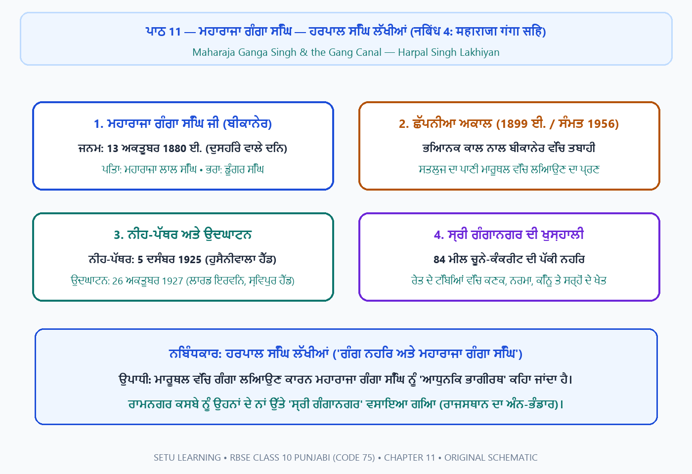

# ਪਾਠ 11 — ਮਹਾਰਾਜਾ ਗੰਗਾ ਸਿੰਘ — ਹਰਪਾਲ ਸਿੰਘ ਲੱਖੀਆਂ (निबंध 4: महाराजा गंगा सिंह) (Maharaja Ganga Singh & the Gang Canal — Harpal Singh Lakhiyan)

## भाग 1: अध्याय प्रवेश एवं पाठ्यक्रम मैपिंग (ਪਾਠ-ਪ੍ਰਵੇਸ਼ ਅਤੇ ਪਾਠਕ੍ਰਮ ਮੈਪਿੰਗ)

> RBSE ਜਮਾਤ 10 ਪੰਜਾਬੀ ਪਾਠ-ਪੁਸਤਕ 'ਸਾਹਿਤ ਸੁਗੰਧੀਆਂ' ਦੇ ਸਾਰੇ ਪ੍ਰਸ਼ਨਾਂ ਦੇ ਹੱਲ ਅਤੇ 2014–2026 ਦਾ ਪੂਰਾ ਇਤਿਹਾਸਕ PYQ ਸੰਗ੍ਰਹਿ ਸਰੋਤ-ਪ੍ਰੀਖਣ ਸਮੇਤ ਸੰਕਲਿਤ ਹਨ।

**ਵਿਸ਼ਾ ਕੋਡ (विषय कोड):** 75 (ਤੀਜੀ ਭਾਸ਼ਾ — ਪੰਜਾਬੀ / तृतीया भाषा — पंजाबी) · **ਲੜੀ ਪੁਸਤਕ (श्रृंखला पुस्तक):** 7

**ਪ੍ਰਮਾਣਿਤ ਆਧਾਰ:** RBSE 2025–26 · **ਪਾਠ ਅੰਕ-ਭਾਰ:** 3 ਅੰਕ। ਇਹ ਭਾਰ ਉਸੇ ਸੰਸਕਰਣ ਦਾ ਹੈ; ਅਸਲ ਪ੍ਰਸ਼ਨ-ਵੰਡ ਦੀ ਭਵਿੱਖਬਾਣੀ ਨਹੀਂ।

**ਸਿੱਖਣ ਦੇ ਉਦੇਸ਼ (सीखने के लक्ष्य):** ਹਰਪਾਲ ਸਿੰਘ ਲੱਖੀਆਂ ਦੇ ਨਿਬੰਧ 'ਮਹਾਰਾਜਾ ਗੰਗਾ ਸਿੰਘ' ਦਾ ਸਾਰ, ਬੀਕਾਨੇਰ ਰਿਆਸਤ ਦਾ ਇਤਿਹਾਸ, ਮਹਾਰਾਜਾ ਗੰਗਾ ਸਿੰਘ ਦਾ ਜਨਮ ਤੇ ਬਚਪਨ, ਲੋਕ-ਭਲਾਈ ਦੇ ਕਾਰਜ, ਗੰਗ ਨਹਿਰ ਦਾ ਨਿਰਮਾਣ (1920–1927), ਗੋਲਮੇਜ਼ ਸੰਮੇਲਨ ਅਤੇ ਪੰਜ ਉਪਾਧੀਆਂ ਸਮਝਣਾ।

## भाग 2: शब्दावली एवं अवधारणा कैप्सूल (ਸ਼ਬਦਾਵਲੀ ਅਤੇ ਸੰਕਲਪ ਕੈਪਸੂਲ)

| ਸ਼ਬਦ / ਸੰਕਲਪ | ਅਰਥ / ਵਿਆਖਿਆ |
|---|---|
| ਰਾਵ ਬੀਕਾ ਜੀ (राव बीका जी) | ਜੋਧਪੁਰ ਦੇ ਰਾਵ ਜੋਧਾ ਜੀ ਦੇ ਪੁੱਤਰ ਜਿਨ੍ਹਾਂ ਨੇ 1472 ਈ. ਵਿੱਚ ਬੀਕਾਨੇਰ ਰਿਆਸਤ ਦੀ ਨੀਂਹ ਰੱਖੀ। |
| ਰੀਜੈਂਸੀ ਕੌਂਸਲ (रीजेंसी कौंसल) | ਨਾਬਾਲਗ ਮਹਾਰਾਜਾ ਗੰਗਾ ਸਿੰਘ ਦੇ ਸਮੇਂ ਰਾਜ-ਪ੍ਰਬੰਧ ਚਲਾਉਣ ਵਾਲੀ ਕੌਂਸਲ (ਪ੍ਰਧਾਨ: ਕਰਨਲ ਥਾਰਨਟਨ)। |
| ਛੱਪਨੀਆ ਅਕਾਲ (छप्पनीआ अकाल) | ਸੰਨ 1899 ਈ. (ਬਿਕਰਮੀ ਸੰਮਤ 1956) ਦਾ ਭਿਆਨਕ ਅਕਾਲ ਜਿਸ ਸਮੇਂ ਮਹਾਰਾਜਾ ਨੇ ਪਰਜਾ ਦੀ ਸੇਵਾ ਕੀਤੀ। |
| ਪਰਜਾ ਪ੍ਰਤਿਨਿਧੀ ਸਭਾ (परजा प्रतिनिधि सभा) | 10 ਨਵੰਬਰ 1913 ਈ. ਨੂੰ ਮਹਾਰਾਜਾ ਗੰਗਾ ਸਿੰਘ ਵੱਲੋਂ ਸਥਾਪਿਤ ਲੋਕ-ਪ੍ਰਤਿਨਿਧੀ ਸਭਾ। |
| ਗੰਗ ਨਹਿਰ (गंग नहिर) | ਸਤਲੁਜ ਦਰਿਆ (ਹੁਸੈਨੀਵਾਲਾ, ਫ਼ਿਰੋਜ਼ਪੁਰ) ਤੋਂ ਬੀਕਾਨੇਰ ਰਿਆਸਤ (ਸ੍ਰੀਗੰਗਾਨਗਰ) ਤੱਕ ਲਿਆਂਦੀ ਪੱਕੀ ਨਹਿਰ। |
| ਲਾਰਡ ਇਰਵਿਨ (लार्ड इरविन) | ਭਾਰਤ ਦਾ ਵਾਇਸਰਾਏ ਜਿਸ ਨੇ 26 ਅਕਤੂਬਰ 1927 ਈ. ਨੂੰ ਗੰਗ ਨਹਿਰ ਦਾ ਉਦਘਾਟਨ ਕੀਤਾ। |
| ਕੈਸਰ-ਏ-ਹਿੰਦ (कैसर-ए-हिंद) | 1900 ਈ. ਵਿੱਚ ਅਕਾਲ-ਪ੍ਰਬੰਧ ਲਈ ਮਹਾਰਾਜਾ ਗੰਗਾ ਸਿੰਘ ਨੂੰ ਮਿਲੀ ਉਪਾਧੀ। |
| ਗੋਲਮੇਜ਼ ਕਾਨਫ਼ਰੰਸ (गोलमेज़ कानफ़रंस) | ਲੰਡਨ ਵਿਖੇ 1930–1931 ਵਿੱਚ ਹੋਏ ਸੰਮੇਲਨ ਜਿੱਥੇ ਮਹਾਰਾਜਾ ਗੰਗਾ ਸਿੰਘ ਨੇ ਦੇਸੀ ਰਿਆਸਤਾਂ ਦੀ ਪ੍ਰਤਿਨਿਧਤਾ ਕੀਤੀ। |
| ਊਠ ਰਸਾਲਾ / ਗੰਗਾ ਰਸਾਲਾ (गंगा रसाला) | ਬੀਕਾਨੇਰ ਦੀ ਵਿਸ਼ਵ-ਪ੍ਰਸਿੱਧ ਊਠ ਸੈਨਾ (Camel Corps) ਜਿਸ ਨੇ ਚੀਨ ਤੇ ਵਿਸ਼ਵ ਯੁੱਧਾਂ ਵਿੱਚ ਜौहर ਵਿਖਾਏ। |
| ਆਧੁਨਿਕ ਭਾਗੀਰਥ (आधुनिक भागीरथ) | ਮਾਰੂਥਲ ਵਿੱਚ ਸਤਲੁਜ ਦਾ ਪਾਣੀ ਲਿਆਉਣ ਕਾਰਨ ਮਹਾਰਾਜਾ ਗੰਗਾ ਸਿੰਘ ਨੂੰ ਦਿੱਤਾ ਗਿਆ ਵਿਸ਼ੇਸ਼ਣ। |

## भाग 3: विस्तृत शिक्षण पाठ (ਵਿਸਤ੍ਰਿਤ ਅਧਿਆਪਨ ਪਾਠ)

### 1. ਨਿਬੰਧਕਾਰ ਅਤੇ ਬੀਕਾਨੇਰ ਰਿਆਸਤ ਦਾ ਪਿਛੋਕੜ
**ਹਰਪਾਲ ਸਿੰਘ ਲੱਖੀਆਂ** ਰਚਿਤ ਨਿਬੰਧ **'ਮਹਾਰਾਜਾ ਗੰਗਾ ਸਿੰਘ'** ਰਾਜਸਥਾਨ ਦੇ ਇਤਿਹਾਸ ਅਤੇ ਵਿਸ਼ੇਸ਼ ਕਰਕੇ ਸ੍ਰੀਗੰਗਾਨਗਰ-ਬੀਕਾਨੇਰ ਇਲਾਕੇ ਦੀ ਖੁਸ਼ਹਾਲੀ ਦੇ ਨਿਰਮਾਤਾ ਮਹਾਰਾਜਾ ਗੰਗਾ ਸਿੰਘ ਦੇ ਜੀਵਨ ਤੇ ਕਾਰਜਾਂ ਉੱਤੇ ਆਧਾਰਿਤ ਹੈ।
- **ਬੀਕਾਨੇਰ ਰਿਆਸਤ ਦੀ ਸਥਾਪਨਾ:** ਜੋਧਪੁਰ ਦੇ ਰਾਠੌੜ ਸ਼ਾਸਕ ਰਾਵ ਜੋਧਾ ਜੀ ਦੇ ਪੁੱਤਰ **ਰਾਵ ਬੀਕਾ ਜੀ ਨੇ ਸੰਨ 1472 ਈ.** ਵਿੱਚ ਜੰਗਲ-ਦੇਸ਼ ਵਿੱਚ ਬੀਕਾਨੇਰ ਰਿਆਸਤ ਦੀ ਸਥਾਪਨਾ ਕੀਤੀ।

### 2. ਮਹਾਰਾਜਾ ਗੰਗਾ ਸਿੰਘ ਦਾ ਜਨਮ, ਬਚਪਨ ਅਤੇ ਰਾਜਗੱਦੀ (RBSE 2022 Main Q18)
- **ਜਨਮ ਅਤੇ ਮਾਤਾ-ਪਿਤਾ:** ਮਹਾਰਾਜਾ ਗੰਗਾ ਸਿੰਘ ਦਾ ਜਨਮ **13 ਅਕਤੂਬਰ 1880 ਈ.** ਨੂੰ ਬੀਕਾਨੇਰ ਵਿਖੇ ਪਿਤਾ **ਮਹਾਰਾਜ ਲਾਲ ਸਿੰਘ** ਅਤੇ ਮਾਤਾ **ਚੰਦਰਾਵਤ ਜੀ** ਦੇ ਘਰ ਹੋਇਆ।
- **ਰਾਜਗੱਦੀ:** ਉਹਨਾਂ ਦੇ ਵੱਡੇ ਭਰਾ ਮਹਾਰਾਜਾ ਡੂੰਗਰ ਸਿੰਘ ਜੀ ਦੇ ਕੋਈ ਸੰਤਾਨ ਨਹੀਂ ਸੀ। ਡੂੰਗਰ ਸਿੰਘ ਜੀ ਦੀ ਮੌਤ ਤੋਂ ਬਾਅਦ **31 ਅਗਸਤ 1887 ਈ.** ਨੂੰ ਕੇਵਲ 7 ਸਾਲ ਦੀ ਉਮਰ ਵਿੱਚ ਗੰਗਾ ਸਿੰਘ ਜੀ ਰਾਜਗੱਦੀ ਉੱਤੇ ਬੈਠੇ।
- **ਰੀਜੈਂਸੀ ਕੌਂਸਲ ਅਤੇ ਸਿੱਖਿਆ:** ਉਹਨਾਂ ਦੇ ਨਾਬਾਲਗ ਹੋਣ ਕਾਰਨ ਰਾਜ-ਪ੍ਰਬੰਧ ਪੋਲੀਟੀਕਲ ਏਜੰਟ **ਕਰਨਲ ਥਾਰਨਟਨ** ਦੀ ਪ੍ਰਧਾਨਗੀ ਹੇਠ 'ਰੀਜੈਂਸੀ ਕੌਂਸਲ' ਨੇ ਚਲਾਇਆ। ਗੰਗਾ ਸਿੰਘ ਜੀ ਨੇ ਮੇਓ ਕਾਲਜ, ਅਜਮੇਰ ਤੋਂ ਉੱਚ ਵਿੱਦਿਆ ਤੇ ਫ਼ੌਜੀ ਸਿਖਲਾਈ ਪ੍ਰਾਪਤ ਕੀਤੀ ਅਤੇ **16 ਦਸੰਬਰ 1898 ਈ.** ਨੂੰ 18 ਸਾਲ ਦੀ ਉਮਰ ਵਿੱਚ ਰਾਜ ਦੇ ਪੂਰੇ ਅਧਿਕਾਰ ਸੰਭਾਲੇ।

### 3. ਲੋਕ-ਭਲਾਈ ਦੇ ਕਾਰਜ ਅਤੇ ਪ੍ਰਸ਼ਾਸਨਿਕ ਸੁਧਾਰ
1. **1899 ਦਾ ਛੱਪਨੀਆ ਅਕਾਲ:** ਗੱਦੀ ਸੰਭਾਲਦਿਆਂ ਹੀ 1899 ਈ. (ਸੰਮਤ 1956) ਵਿੱਚ ਭਿਆਨਕ ਅਕਾਲ ਪਿਆ। ਮਹਾਰਾਜਾ ਨੇ ਆਪ ਊਠ ਉੱਤੇ ਪਿੰਡ-ਪਿੰਡ ਘੁੰਮ ਕੇ ਰਾਹਤ ਕੈਂਪ ਖੋਲ੍ਹੇ ਤੇ ਭੁੱਖੇ ਲੋਕਾਂ ਦੀ ਜਾਨ ਬਚਾਈ, ਜਿਸ ਬਦਲੇ ਅੰਗਰੇਜ਼ ਸਰਕਾਰ ਨੇ 1900 ਈ. ਵਿੱਚ ਉਹਨਾਂ ਨੂੰ **'ਕੈਸਰ-ਏ-ਹਿੰਦ'** ਦੀ ਉਪਾਧੀ ਦਿੱਤੀ।
2. **ਨਿਆਂ ਅਤੇ ਲੋਕਤੰਤਰੀ ਸੁਧਾਰ:** **10 ਨਵੰਬਰ 1913 ਈ.** ਨੂੰ ਉਹਨਾਂ ਨੇ ਰਿਆਸਤ ਵਿੱਚ **'ਪਰਜਾ ਪ੍ਰਤਿਨਿਧੀ ਸਭਾ'** ਦੀ ਸਥਾਪਨਾ ਕੀਤੀ, ਹਾਈ ਕੋਰਟ ਬਣਾਈ, ਬਾਲ-ਵਿਆਹ ਰੋਕਣ ਦਾ ਕਾਨੂੰਨ ਬਣਾਇਆ ਅਤੇ ਮੁਫ਼ਤ ਸਿੱਖਿਆ ਤੇ ਹਸਪਤਾਲ ਖੋਲ੍ਹੇ।
3. **ਰੇਲਵੇ ਅਤੇ ਬੁਨਿਆਦੀ ਢਾਂਚਾ:** ਉਹਨਾਂ ਨੇ ਰਿਆਸਤ ਵਿੱਚ ਲਗਭਗ **800 ਕਿਲੋਮੀਟਰ ਰੇਲਵੇ ਲਾਈਨਾਂ** ਵਿਛਵਾਈਆਂ ਅਤੇ ਪਿੰਡਾਂ-ਸ਼ਹਿਰਾਂ ਨੂੰ ਸੜਕਾਂ ਤੇ ਬਿਜਲੀ ਨਾਲ ਜੋੜਿਆ।

### 4. ਗੰਗ ਨਹਿਰ ਦਾ ਨਿਰਮਾਣ (1920–1927 ਈ.) — ਸਭ ਤੋਂ ਮਹਾਨ ਦੇਣ (RBSE 2022 Main Q18, 2024 Main Q19, 2025 Supp Q1-viii, Q16, 2026 Supp Q15)
- ਬੀਕਾਨੇਰ ਰਿਆਸਤ ਨੂੰ ਸਦਾ ਲਈ ਸੋਕੇ ਅਤੇ ਅਕਾਲ ਤੋਂ ਬਚਾਉਣ ਲਈ ਮਹਾਰਾਜਾ ਗੰਗਾ ਸਿੰਘ ਨੇ ਪੰਜਾਬ ਦੇ **ਸਤਲੁਜ ਦਰਿਆ** ਦਾ ਪਾਣੀ ਮਾਰੂਥਲ ਵਿੱਚ ਲਿਆਉਣ ਦਾ ਦ੍ਰਿੜ੍ਹ ਸੰਕਲਪ ਲਿਆ।
- **ਸਮਝੌਤਾ (4 ਸਤੰਬਰ 1920):** ਬਹਾਵਲਪੁਰ ਰਿਆਸਤ ਦੇ ਵਿਰੋਧ ਦੇ ਬਾਵਜੂਦ **4 ਸਤੰਬਰ 1920 ਈ.** ਨੂੰ ਸਤਲੁਜ ਵੈਲੀ ਪ੍ਰੋਜੈਕਟ ਉੱਤੇ ਸਮਝੌਤਾ ਹੋਇਆ।
- **ਨੀਂਹ ਪੱਥਰ (5 ਦਸੰਬਰ 1925):** **5 ਦਸੰਬਰ 1925 ਈ.** ਨੂੰ ਫ਼ਿਰੋਜ਼ਪੁਰ ਦੇ ਨੇੜੇ **ਹੁਸੈਨੀਵਾਲਾ** ਵਿਖੇ ਗੰਗ ਨਹਿਰ ਦਾ ਨੀਂਹ ਪੱਥਰ ਰੱਖਿਆ ਗਿਆ। ਪਾਣੀ ਰੇਤ ਵਿੱਚ ਨਾ ਸੁੱਕੇ, ਇਸ ਲਈ 89 ਮੀਲ ਲੰਮੀ ਮੁੱਖ ਨਹਿਰ ਚੂਨੇ-ਕੰਕਰੀਟ ਨਾਲ **ਪੱਕੀ** ਬਣਵਾਈ ਗਈ।
- **ਉਦਘਾਟਨ (26 ਅਕਤੂਬਰ 1927):** **26 ਅਕਤੂਬਰ 1927 ਈ.** ਨੂੰ ਭਾਰਤ ਦੇ ਵਾਇਸਰਾਏ **ਲਾਰਡ ਇਰਵਿਨ** ਨੇ ਸ਼ਿਵਪੁਰ ਹੈੱਡ (ਸ੍ਰੀਗੰਗਾਨਗਰ) ਵਿਖੇ ਗੰਗ ਨਹਿਰ ਦਾ ਉਦਘਾਟਨ ਕੀਤਾ। ਇਸ ਨਹਿਰ ਨੇ ਰੇਗਿਸਤਾਨ ਨੂੰ ਹਰੇ-ਭਰੇ ਅੰਨ-ਭੰਡਾਰ (ਸ੍ਰੀਗੰਗਾਨਗਰ ਜ਼ਿਲ੍ਹੇ) ਵਿੱਚ ਬਦਲ ਦਿੱਤਾ।

### 5. ਗੋਲਮੇਜ਼ ਸੰਮੇਲਨ, ਪੰਜ ਉਪਾਧੀਆਂ ਅਤੇ ਦਿਹਾਂਤ
- **ਗੋਲਮੇਜ਼ ਸੰਮੇਲਨ (RBSE 2019 Main Q8-ਸ):** ਮਹਾਰਾਜਾ ਗੰਗਾ ਸਿੰਘ ਨੇ ਪਹਿਲੇ ਵਿਸ਼ਵ ਯੁੱਧ ਤੋਂ ਬਾਅਦ 1919 ਦੇ ਪੈਰਿਸ ਸ਼ਾਂਤੀ ਸੰਮੇਲਨ (ਵਰਸਾਏ ਦੀ ਸੰਧੀ) ਉੱਤੇ ਭਾਰਤ ਵੱਲੋਂ ਦਸਤਖ਼ਤ ਕੀਤੇ, 'ਚੈਂਬਰ ਆਫ਼ ਪ੍ਰਿੰਸਿਜ਼' (ਨਰਿੰਦਰ ਮੰਡਲ) ਦੇ ਪਹਿਲੇ ਚਾਂਸਲਰ ਬਣੇ ਅਤੇ **12 ਨਵੰਬਰ 1930 ਤੋਂ 20 ਜਨਵਰੀ 1931** ਤੱਕ ਲੰਡਨ ਵਿਖੇ ਹੋਈ **ਪਹਿਲੀ ਤੇ ਦੂਜੀ ਗੋਲਮੇਜ਼ ਕਾਨਫ਼ਰੰਸ** ਵਿੱਚ ਭਾਰਤੀ ਰਿਆਸਤਾਂ ਦੀ ਪ੍ਰਭਾਵਸ਼ਾਲੀ ਪ੍ਰਤਿਨਿਧਤਾ ਕੀਤੀ।
- **ਪੰਜ ਪ੍ਰਮੁੱਖ ਉਪਾਧੀਆਂ (RBSE 2018 Main Q8-ਅ, 2020 Supp Q8-ਅ):** 1. **ਕੈਸਰ-ਏ-ਹਿੰਦ** (1900 ਈ.), 2. **ਕੇ.ਸੀ.ਆਈ.ਈ. (K.C.I.E.)** (1901 ਈ.), 3. **ਜੀ.ਸੀ.ਆਈ.ਈ. (G.C.I.E.)** (1907 ਈ.), 4. **ਜੀ.ਸੀ.ਐੱਸ.ਆਈ. (G.C.S.I.)** (1911 ਈ.), 5. **ਜੀ.ਸੀ.ਬੀ. (G.C.B.)** ਅਤੇ ਕਾਨੂੰਨ ਦੀ ਆਨਰੇਰੀ ਡਾਕਟਰੇਟ **ਐੱਲ.ਐੱਲ.ਡੀ. (LL.D.)** (ਕੈਂਬਰਿਜ, ਐਡਿਨਬਰਾ ਤੇ ਬਨਾਰਸ ਹਿੰਦੂ ਯੂਨੀਵਰਸਿਟੀ ਵੱਲੋਂ)।
- **ਦਿਹਾਂਤ (RBSE 2025 Supp Q2-iv):** **2 ਅਕਤੂਬਰ 1943 ਈ.** ਨੂੰ ਬੰਬਈ (ਮੁੰਬਈ) ਵਿਖੇ ਉਹਨਾਂ ਦਾ ਦਿਹਾਂਤ ਹੋ ਗਿਆ।

ਪਾਠ 11: ਹਰਪਾਲ ਸਿੰਘ ਲੱਖੀਆਂ ਦੇ ਨਿਬੰਧ 'ਮਹਾਰਾਜਾ ਗੰਗਾ ਸਿੰਘ' ਦਾ ਸੰਕਲਪ ਚਿੱਤਰ

## भाग 4: पाठ्यपुस्तक-अवधारणाओं पर मौलिक हल किए उदाहरण (ਹੱਲ ਕੀਤੇ ਮਿਆਰੀ ਉਦਾਹਰਣ)

ਹੇਠਾਂ ਦਿੱਤੇ ਪ੍ਰਸ਼ਨ ਪਾਠ-ਪੁਸਤਕ 'ਸਾਹਿਤ ਸੁਗੰਧੀਆਂ' ਅਤੇ ਵਿਆਕਰਣ ਦੇ ਸੰਕਲਪਾਂ ਉੱਤੇ ਆਧਾਰਿਤ ਮੌਲਿਕ ਆਦਰਸ਼ ਹੱਲ ਹਨ।

**ਹੱਲ ਕੀਤਾ ਉਦਾਹਰਣ 1: ਮਹਾਰਾਜਾ ਗੰਗਾ ਸਿੰਘ ਦੇ ਜਨਮ ਅਤੇ ਬਚਪਨ ਦੀ ਜਾਣਕਾਰੀ ਦਿੰਦੇ ਹੋਏ, ਗੰਗ ਨਹਿਰ ਉੱਪਰ ਸੰਖੇਪ ਟਿੱਪਣੀ ਦਿਓ।**

ਜਨਮ ਤੇ ਬਚਪਨ: ਮਹਾਰਾਜਾ ਗੰਗਾ ਸਿੰਘ ਦਾ ਜਨਮ 13 ਅਕਤੂਬਰ 1880 ਈ. ਨੂੰ ਬੀਕਾਨੇਰ ਵਿਖੇ ਪਿਤਾ ਲਾਲ ਸਿੰਘ ਅਤੇ ਮਾਤਾ ਚੰਦਰਾਵਤ ਜੀ ਦੇ ਘਰ ਹੋਇਆ। ਵੱਡੇ ਭਰਾ ਡੂੰਗਰ ਸਿੰਘ ਦੀ ਮੌਤ ਮਗਰੋਂ 31 ਅਗਸਤ 1887 ਨੂੰ ਉਹ 7 ਸਾਲ ਦੀ ਉਮਰ ਵਿੱਚ ਗੱਦੀ 'ਤੇ ਬੈਠੇ ਤੇ ਮੇਓ ਕਾਲਜ ਅਜਮੇਰ ਤੋਂ ਸਿੱਖਿਆ ਪ੍ਰਾਪਤ ਕੀਤੀ। ਗੰਗ ਨਹਿਰ: ਬੀਕਾਨੇਰ ਦੇ ਮਾਰੂਥਲ ਨੂੰ ਅਕਾਲ ਤੋਂ ਬਚਾਉਣ ਲਈ ਉਹਨਾਂ ਨੇ 4 ਸਤੰਬਰ 1920 ਨੂੰ ਸਤਲੁਜ ਦਰਿਆ ਦਾ ਪਾਣੀ ਲਿਆਉਣ ਦੀ ਮਨਜ਼ੂਰੀ ਲਈ, 5 ਦਸੰਬਰ 1925 ਨੂੰ ਹੁਸੈਨੀਵਾਲਾ ਵਿਖੇ ਨੀਂਹ ਪੱਥਰ ਰੱਖਿਆ ਗਿਆ ਅਤੇ 26 ਅਕਤੂਬਰ 1927 ਨੂੰ ਵਾਇਸਰਾਏ ਲਾਰਡ ਇਰਵਿਨ ਨੇ ਗੰਗ ਨਹਿਰ ਦਾ ਉਦਘਾਟਨ ਕੀਤਾ। ਇਸ ਪੱਕੀ ਨਹਿਰ ਨੇ ਸ੍ਰੀਗੰਗਾਨਗਰ ਦੇ ਮਾਰੂਥਲ ਨੂੰ ਸੋਨਾ ਉਗਲਣ ਵਾਲੀ ਧਰਤੀ ਬਣਾ ਦਿੱਤਾ (RBSE 2022 Main Q18, 2024 Main Q19, 2025 Supp Q16, 2026 Supp Q15)।

**ਹੱਲ ਕੀਤਾ ਉਦਾਹਰਣ 2: ਮਹਾਰਾਜਾ ਗੰਗਾ ਸਿੰਘ ਨੂੰ ਮਿਲੀਆਂ ਪੰਜ ਉਪਾਧੀਆਂ ਦੇ ਨਾਂ ਲਿਖੋ।**

ਮਹਾਰਾਜਾ ਗੰਗਾ ਸਿੰਘ ਨੂੰ ਉਹਨਾਂ ਦੀਆਂ ਸੇਵਾਵਾਂ ਤੇ ਯੋਗਤਾ ਬਦਲੇ ਮਿਲੀਆਂ ਪੰਜ ਪ੍ਰਮੁੱਖ ਉਪਾਧੀਆਂ ਹਨ: (1) ਕੈਸਰ-ਏ-ਹਿੰਦ (1900 ਈ.), (2) ਕੇ.ਸੀ.ਆਈ.ਈ. (K.C.I.E.), (3) ਜੀ.ਸੀ.ਆਈ.ਈ. (G.C.I.E.), (4) ਜੀ.ਸੀ.ਐੱਸ.ਆਈ. (G.C.S.I.), ਅਤੇ (5) ਜੀ.ਸੀ.ਬੀ. (G.C.B.) / ਐੱਲ.ਐੱਲ.ਡੀ. (LL.D. — ਕੈਂਬਰਿਜ ਤੇ ਐਡਿਨਬਰਾ ਯੂਨੀਵਰਸਿਟੀ ਵੱਲੋਂ) (RBSE 2018 Main Q8-ਅ, 2020 Supp Q8-ਅ)।

**ਹੱਲ ਕੀਤਾ ਉਦਾਹਰਣ 3: ਗੋਲਮੇਜ਼ ਸੰਮੇਲਨ ਵਿੱਚ ਮਹਾਰਾਜਾ ਗੰਗਾ ਸਿੰਘ ਦੀ ਕੀ ਭੂਮਿਕਾ ਰਹੀ?**

ਮਹਾਰਾਜਾ ਗੰਗਾ ਸਿੰਘ ਨੇ 12 ਨਵੰਬਰ 1930 ਤੋਂ 20 ਜਨਵਰੀ 1931 ਤੱਕ ਲੰਡਨ ਵਿਖੇ ਹੋਈ ਗੋਲਮੇਜ਼ ਕਾਨਫ਼ਰੰਸ (Round Table Conference) ਵਿੱਚ ਭਾਰਤੀ ਦੇਸੀ ਰਿਆਸਤਾਂ ਦੀ ਪ੍ਰਤਿਨਿਧਤਾ ਕੀਤੀ ਅਤੇ ਭਾਰਤ ਦੇ ਸੰਘੀ ਢਾਂਚੇ ਤੇ ਸਵੈ-ਸ਼ਾਸਨ ਦੇ ਪੱਖ ਵਿੱਚ ਪ੍ਰਭਾਵਸ਼ਾਲੀ ਵਿਚਾਰ ਰੱਖੇ (RBSE 2019 Main Q8-ਸ)।

## भाग 5: सत्यापित बोर्ड प्रश्न एवं स्रोत-स्थिति (ਪ੍ਰਮਾਣਿਤ ਬੋਰਡ ਪ੍ਰਸ਼ਨ ਅਤੇ ਸਰੋਤ-ਸਥਿਤੀ)

RBSE 2026 Supp (`S-75`, Q1-VI, Q15), 2025 Supp (Q1-viii, Q2-iv, Q16), 2024 Main (Q19) ਅਤੇ 2022 Main (Q18) ਵਿੱਚ ਮਹਾਰਾਜਾ ਗੰਗਾ ਸਿੰਘ ਅਤੇ ਗੰਗ ਨਹਿਰ ਦੇ ਪ੍ਰਸ਼ਨ ਪੁੱਛੇ ਗਏ ਹਨ।

[RBSE 2026 ਮੂਲ ਪੇਪਰ (S-75)](https://rajeduboard.rajasthan.gov.in/books/PAPERS-2026/Sec/S-75.pdf)। ਪ੍ਰਸ਼ਨ ਦਾ ਸੰਖੇਪ ਵਿਸ਼ਾ-ਸੰਦਰਭ ਹੈ; ਸ਼ਬਦ-ਬ-ਸ਼ਬਦ ਪੁਨਰ-ਮੁਦਰਣ ਨਹੀਂ।

## भाग 6: खंडवार मौलिक अभ्यास बैंक (ਖੰਡ-ਵਾਰ ਮੌਲਿਕ ਅਭਿਆਸ ਬੈਂਕ)

**ਅਭਿਆਸ-ਅੰਕ:** ਵਿਦਿਆਰਥੀਆਂ ਦੇ ਸਵੈ-ਅਭਿਆਸ ਲਈ ਹਨ; ਉੱਤਰ ਪਹਿਲਾਂ ਆਪ ਲਿਖੋ, ਫਿਰ ਭਾਗ 9 ਵੇਖੋ।

## ੳ: ਬਹੁ-ਵਿਕਲਪੀ ਪ੍ਰਸ਼ਨ (MCQ) — 15 × 1 ਅੰਕ

**MCQ 1. 'ਮਹਾਰਾਜਾ ਗੰਗਾ ਸਿੰਘ' ਨਿਬੰਧ ਦੇ ਨਿਬੰਧਕਾਰ ਕੌਣ ਹਨ? (RBSE 2026 Supp Q1-VI)**

ੳ) ਬਲਜਿੰਦਰ ਸਿੰਘ ਭੁੱਲਰ  
ਅ) ਹਰਪਾਲ ਸਿੰਘ ਲੱਖੀਆਂ  
ੲ) ਹਰਪ੍ਰੀਤ ਕੌਰ  
ਸ) ਪ੍ਰਿੰ. ਸਰਵਣ ਸਿੰਘ

**MCQ 2. ਗੰਗ ਨਹਿਰ ਦਾ ਨੀਂਹ ਪੱਥਰ ਕਦੋਂ ਰੱਖਿਆ ਗਿਆ? (RBSE 2025 Supp Q1-viii)**

ੳ) 5 ਦਸੰਬਰ 1925  
ਅ) 5 ਦਸੰਬਰ 1924  
ੲ) 5 ਦਸੰਬਰ 1927  
ਸ) 5 ਦਸੰਬਰ 1920

**MCQ 3. ਗੰਗ ਨਹਿਰ ਦਾ ਉਦਘਾਟਨ ਕਦੋਂ ਅਤੇ ਕਿਸ ਨੇ ਕੀਤਾ?**

ੳ) 5 ਦਸੰਬਰ 1925 ਨੂੰ ਲਾਰਡ ਕਰਜ਼ਨ ਨੇ  
ਅ) 15 ਅਗਸਤ 1947 ਨੂੰ ਲਾਰਡ ਮਾਊਂਟਬੈਟਨ ਨੇ  
ੲ) 4 ਸਤੰਬਰ 1920 ਨੂੰ ਕਰਨਲ ਥਾਰਨਟਨ ਨੇ  
ਸ) 26 ਅਕਤੂਬਰ 1927 ਈ. ਨੂੰ ਵਾਇਸਰਾਏ ਲਾਰਡ ਇਰਵਿਨ ਨੇ

**MCQ 4. ਖਾਲੀ ਥਾਂ ਭਰੋ: 'ਮਹਾਰਾਜਾ ਗੰਗਾ ਸਿੰਘ ਦੀ ਮੌਤ ................ ਨੂੰ ਬੰਬਈ ਵਿਖੇ ਹੋਈ।' (RBSE 2025 Supp Q2-iv)**

ੳ) 31 ਅਗਸਤ 1887 ਈ.  
ਅ) 26 ਅਕਤੂਬਰ 1927 ਈ.  
ੲ) 2 ਅਕਤੂਬਰ 1943 ਈ.  
ਸ) 13 ਅਕਤੂਬਰ 1880 ਈ.

**MCQ 5. ਮਹਾਰਾਜਾ ਗੰਗਾ ਸਿੰਘ ਦਾ ਜਨਮ ਕਦੋਂ ਹੋਇਆ?**

ੳ) 10 ਨਵੰਬਰ 1913 ਈ. ਨੂੰ  
ਅ) 13 ਅਕਤੂਬਰ 1880 ਈ. ਨੂੰ  
ੲ) 31 ਅਗਸਤ 1887 ਈ. ਨੂੰ  
ਸ) 16 ਦਸੰਬਰ 1898 ਈ. ਨੂੰ

**MCQ 6. ਮਹਾਰਾਜਾ ਗੰਗਾ ਸਿੰਘ ਦੇ ਮਾਤਾ-ਪਿਤਾ ਦਾ ਕੀ ਨਾਂ ਸੀ?**

ੳ) ਪਿਤਾ ਮਹਾਰਾਜ ਲਾਲ ਸਿੰਘ ਅਤੇ ਮਾਤਾ ਚੰਦਰਾਵਤ ਜੀ  
ਅ) ਪਿਤਾ ਰਾਵ ਬੀਕਾ ਜੀ ਅਤੇ ਮਾਤਾ ਕਰਨਾਵਤੀ  
ੲ) ਪਿਤਾ ਡੂੰਗਰ ਸਿੰਘ ਅਤੇ ਮਾਤਾ ਪਦਮਾਵਤੀ  
ਸ) ਪਿਤਾ ਰਾਏ ਸਿੰਘ ਅਤੇ ਮਾਤਾ ਲੱਛਮੀ

**MCQ 7. ਬੀਕਾਨੇਰ ਰਿਆਸਤ ਦੀ ਸਥਾਪਨਾ ਸੰਨ 1472 ਈ. ਵਿੱਚ ਕਿਸ ਨੇ ਕੀਤੀ ਸੀ?**

ੳ) ਰਾਵ ਜੋਧਾ ਜੀ ਨੇ  
ਅ) ਰਾਜਾ ਰਾਏ ਸਿੰਘ ਨੇ  
ੲ) ਮਹਾਰਾਜਾ ਡੂੰਗਰ ਸਿੰਘ ਨੇ  
ਸ) ਰਾਵ ਬੀਕਾ ਜੀ ਨੇ

**MCQ 8. ਵੱਡੇ ਭਰਾ ਮਹਾਰਾਜਾ ਡੂੰਗਰ ਸਿੰਘ ਦੀ ਮੌਤ ਮਗਰੋਂ ਗੰਗਾ ਸਿੰਘ ਜੀ ਕਿਸ ਮਿਤੀ ਨੂੰ ਰਾਜਗੱਦੀ ਉੱਤੇ ਬੈਠੇ?**

ੳ) 13 ਅਕਤੂਬਰ 1880 ਈ. ਨੂੰ  
ਅ) 4 ਸਤੰਬਰ 1920 ਈ. ਨੂੰ  
ੲ) 31 ਅਗਸਤ 1887 ਈ. ਨੂੰ (7 ਸਾਲ ਦੀ ਉਮਰ ਵਿੱਚ)  
ਸ) 16 ਦਸੰਬਰ 1898 ਈ. ਨੂੰ

**MCQ 9. ਮਹਾਰਾਜਾ ਗੰਗਾ ਸਿੰਘ ਦੇ ਨਾਬਾਲਗ ਸਮੇਂ ਰੀਜੈਂਸੀ ਕੌਂਸਲ ਦਾ ਪ੍ਰਧਾਨ ਕੌਣ ਸੀ?**

ੳ) ਲਾਰਡ ਡਲਹੌਜ਼ੀ  
ਅ) ਕਰਨਲ ਥਾਰਨਟਨ  
ੲ) ਲਾਰਡ ਇਰਵਿਨ  
ਸ) ਜਨਰਲ ਅਯੂਬ ਖ਼ਾਨ

**MCQ 10. ਗੰਗ ਨਹਿਰ ਕਿਸ ਦਰਿਆ ਵਿੱਚੋਂ ਕੱਢੀ ਗਈ ਹੈ?**

ੳ) ਸਤਲੁਜ ਦਰਿਆ ਵਿੱਚੋਂ (ਹੁਸੈਨੀਵਾਲਾ ਤੋਂ)  
ਅ) ਰਾਵੀ ਦਰਿਆ ਵਿੱਚੋਂ  
ੲ) ਚਨਾਬ ਦਰਿਆ ਵਿੱਚੋਂ  
ਸ) ਯਮੁਨਾ ਦਰਿਆ ਵਿੱਚੋਂ

**MCQ 11. ਮਹਾਰਾਜਾ ਗੰਗਾ ਸਿੰਘ ਨੇ ਬੀਕਾਨੇਰ ਰਿਆਸਤ ਵਿੱਚ 'ਪਰਜਾ ਪ੍ਰਤਿਨਿਧੀ ਸਭਾ' ਦੀ ਸਥਾਪਨਾ ਕਦੋਂ ਕੀਤੀ?**

ੳ) 4 ਸਤੰਬਰ 1920 ਈ. ਨੂੰ  
ਅ) 5 ਦਸੰਬਰ 1925 ਈ. ਨੂੰ  
ੲ) 12 ਨਵੰਬਰ 1930 ਈ. ਨੂੰ  
ਸ) 10 ਨਵੰਬਰ 1913 ਈ. ਨੂੰ

**MCQ 12. ਮਹਾਰਾਜਾ ਗੰਗਾ ਸਿੰਘ ਨੇ ਰਿਆਸਤ ਵਿੱਚ ਲਗਭਗ ਕਿੰਨੇ ਕਿਲੋਮੀਟਰ ਰੇਲਵੇ ਲਾਈਨ ਵਿਛਵਾਈ?**

ੳ) 50 ਕਿਲੋਮੀਟਰ  
ਅ) 2000 ਕਿਲੋਮੀਟਰ  
ੲ) 800 ਕਿਲੋਮੀਟਰ  
ਸ) 100 ਕਿਲੋਮੀਟਰ

**MCQ 13. 1899 ਈ. ਦੇ ਭਿਆਨਕ ਅਕਾਲ ਦੌਰਾਨ ਸ਼ਾਨਦਾਰ ਪ੍ਰਬੰਧ ਲਈ ਅੰਗਰੇਜ਼ ਸਰਕਾਰ ਨੇ ਸੰਨ 1900 ਵਿੱਚ ਮਹਾਰਾਜਾ ਗੰਗਾ ਸਿੰਘ ਨੂੰ ਕਿਹੜੀ ਉਪਾਧੀ ਦਿੱਤੀ?**

ੳ) ਰਾਏ ਬਹਾਦਰ  
ਅ) ਕੈਸਰ-ਏ-ਹਿੰਦ  
ੲ) ਫ਼ਲਾਇੰਗ ਸਿੱਖ  
ਸ) ਸਰਦਾਰ-ਏ-ਆਜ਼ਮ

**MCQ 14. ਮਹਾਰਾਜਾ ਗੰਗਾ ਸਿੰਘ ਨੇ ਲੰਡਨ ਵਿਖੇ ਹੋਈ ਗੋਲਮੇਜ਼ ਕਾਨਫ਼ਰੰਸ ਵਿੱਚ ਕਦੋਂ ਭਾਗ ਲਿਆ?**

ੳ) 12 ਨਵੰਬਰ 1930 ਤੋਂ 20 ਜਨਵਰੀ 1931 ਤੱਕ  
ਅ) 5 ਦਸੰਬਰ 1925 ਨੂੰ  
ੲ) 2 ਅਕਤੂਬਰ 1943 ਨੂੰ  
ਸ) 31 ਅਗਸਤ 1887 ਨੂੰ

**MCQ 15. ਮਹਾਰਾਜਾ ਗੰਗਾ ਸਿੰਘ ਦੀ ਪ੍ਰਸਿੱਧ ਊਠ ਸੈਨਾ ਕਿਸ ਨਾਂ ਨਾਲ ਜਾਣੀ ਜਾਂਦੀ ਸੀ?**

ੳ) ਸ਼ੇਰ ਦਲ  
ਅ) ਮਾਰੂਥਲ ਫ਼ੌਜ  
ੲ) ਰਾਠੌੜ ਬ੍ਰਿਗੇਡ  
ਸ) ਗੰਗਾ ਰਸਾਲਾ (Bikaner Camel Corps)

## ੳ: ਖਾਲੀ ਥਾਵਾਂ ਭਰੋ — 6 × 1 ਅੰਕ

1. ਜੋਧਪੁਰ ਦੇ ਰਾਵ ਜੋਧਾ ਜੀ ਦੇ ਪੁੱਤਰ ਜਿਨ੍ਹਾਂ ਨੇ 1472 ਈ. ਵਿੱਚ ਬੀਕਾਨੇਰ ਰਿਆਸਤ ਦੀ ਨੀਂਹ ਰੱਖੀ। — ਇਸ ਸ਼ਬਦ/ਸੰਕਲਪ ਦਾ ਨਾਂ ਹੈ: ____।  
2. ਨਾਬਾਲਗ ਮਹਾਰਾਜਾ ਗੰਗਾ ਸਿੰਘ ਦੇ ਸਮੇਂ ਰਾਜ-ਪ੍ਰਬੰਧ ਚਲਾਉਣ ਵਾਲੀ ਕੌਂਸਲ (ਪ੍ਰਧਾਨ: ਕਰਨਲ ਥਾਰਨਟਨ)। — ਇਸ ਸ਼ਬਦ/ਸੰਕਲਪ ਦਾ ਨਾਂ ਹੈ: ____।  
3. ਸੰਨ 1899 ਈ. (ਬਿਕਰਮੀ ਸੰਮਤ 1956) ਦਾ ਭਿਆਨਕ ਅਕਾਲ ਜਿਸ ਸਮੇਂ ਮਹਾਰਾਜਾ ਨੇ ਪਰਜਾ ਦੀ ਸੇਵਾ ਕੀਤੀ। — ਇਸ ਸ਼ਬਦ/ਸੰਕਲਪ ਦਾ ਨਾਂ ਹੈ: ____।  
4. 10 ਨਵੰਬਰ 1913 ਈ. ਨੂੰ ਮਹਾਰਾਜਾ ਗੰਗਾ ਸਿੰਘ ਵੱਲੋਂ ਸਥਾਪਿਤ ਲੋਕ-ਪ੍ਰਤਿਨਿਧੀ ਸਭਾ। — ਇਸ ਸ਼ਬਦ/ਸੰਕਲਪ ਦਾ ਨਾਂ ਹੈ: ____।  
5. ਸਤਲੁਜ ਦਰਿਆ (ਹੁਸੈਨੀਵਾਲਾ, ਫ਼ਿਰੋਜ਼ਪੁਰ) ਤੋਂ ਬੀਕਾਨੇਰ ਰਿਆਸਤ (ਸ੍ਰੀਗੰਗਾਨਗਰ) ਤੱਕ ਲਿਆਂਦੀ ਪੱਕੀ ਨਹਿਰ। — ਇਸ ਸ਼ਬਦ/ਸੰਕਲਪ ਦਾ ਨਾਂ ਹੈ: ____।  
6. ਭਾਰਤ ਦਾ ਵਾਇਸਰਾਏ ਜਿਸ ਨੇ 26 ਅਕਤੂਬਰ 1927 ਈ. ਨੂੰ ਗੰਗ ਨਹਿਰ ਦਾ ਉਦਘਾਟਨ ਕੀਤਾ। — ਇਸ ਸ਼ਬਦ/ਸੰਕਲਪ ਦਾ ਨਾਂ ਹੈ: ____।

## ੳ: ਅਤਿ-ਲਘੂ ਉੱਤਰਾਂ ਵਾਲੇ ਪ੍ਰਸ਼ਨ — 8 × 1 ਅੰਕ

1. 'ਮਹਾਰਾਜਾ ਗੰਗਾ ਸਿੰਘ' ਨਿਬੰਧ ਦੇ ਨਿਬੰਧਕਾਰ ਕੌਣ ਹਨ? (RBSE 2026 Supp Q1-VI)  
2. ਗੰਗ ਨਹਿਰ ਦਾ ਨੀਂਹ ਪੱਥਰ ਕਦੋਂ ਰੱਖਿਆ ਗਿਆ? (RBSE 2025 Supp Q1-viii)  
3. ਗੰਗ ਨਹਿਰ ਦਾ ਉਦਘਾਟਨ ਕਦੋਂ ਅਤੇ ਕਿਸ ਨੇ ਕੀਤਾ?  
4. ਖਾਲੀ ਥਾਂ ਭਰੋ: 'ਮਹਾਰਾਜਾ ਗੰਗਾ ਸਿੰਘ ਦੀ ਮੌਤ ................ ਨੂੰ ਬੰਬਈ ਵਿਖੇ ਹੋਈ।' (RBSE 2025 Supp Q2-iv)  
5. ਮਹਾਰਾਜਾ ਗੰਗਾ ਸਿੰਘ ਦਾ ਜਨਮ ਕਦੋਂ ਹੋਇਆ?  
6. ਮਹਾਰਾਜਾ ਗੰਗਾ ਸਿੰਘ ਦੇ ਮਾਤਾ-ਪਿਤਾ ਦਾ ਕੀ ਨਾਂ ਸੀ?  
7. ਬੀਕਾਨੇਰ ਰਿਆਸਤ ਦੀ ਸਥਾਪਨਾ ਸੰਨ 1472 ਈ. ਵਿੱਚ ਕਿਸ ਨੇ ਕੀਤੀ ਸੀ?  
8. ਵੱਡੇ ਭਰਾ ਮਹਾਰਾਜਾ ਡੂੰਗਰ ਸਿੰਘ ਦੀ ਮੌਤ ਮਗਰੋਂ ਗੰਗਾ ਸਿੰਘ ਜੀ ਕਿਸ ਮਿਤੀ ਨੂੰ ਰਾਜਗੱਦੀ ਉੱਤੇ ਬੈਠੇ?

## ਅ: ਲਘੂ ਉੱਤਰਾਂ ਵਾਲੇ ਪ੍ਰਸ਼ਨ — 6 × 2 ਅੰਕ

**B1.** 'ਮਹਾਰਾਜਾ ਗੰਗਾ ਸਿੰਘ' ਨਿਬੰਧ ਦੇ ਨਿਬੰਧਕਾਰ ਕੌਣ ਹਨ?

**B2.** ਗੰਗ ਨਹਿਰ ਦਾ ਨੀਂਹ ਪੱਥਰ ਕਦੋਂ ਰੱਖਿਆ ਗਿਆ ਅਤੇ ਉਦਘਾਟਨ ਕਦੋਂ ਤੇ ਕਿਸ ਨੇ ਕੀਤਾ?

**B3.** ਖਾਲੀ ਥਾਂ ਭਰੋ: 'ਮਹਾਰਾਜਾ ਗੰਗਾ ਸਿੰਘ ਦੀ ਮੌਤ ................ ਨੂੰ ਬੰਬਈ ਵਿਖੇ ਹੋਈ।' (RBSE 2025 Supp Q2-iv)

**B4.** ਬੀਕਾਨੇਰ ਰਿਆਸਤ ਦੀ ਸਥਾਪਨਾ ਕਦੋਂ ਅਤੇ ਕਿਸ ਨੇ ਕੀਤੀ ਸੀ?

**B5.** ਮਹਾਰਾਜਾ ਗੰਗਾ ਸਿੰਘ ਨੇ ਰਿਆਸਤ ਵਿੱਚ 'ਪਰਜਾ ਪ੍ਰਤਿਨਿਧੀ ਸਭਾ' ਦੀ ਸਥਾਪਨਾ ਕਦੋਂ ਕੀਤੀ?

**B6.** ਮਹਾਰਾਜਾ ਗੰਗਾ ਸਿੰਘ ਦੇ ਨਾਬਾਲਗ ਸਮੇਂ ਰਾਜ-ਪ੍ਰਬੰਧ ਚਲਾਉਣ ਵਾਲੀ ਰੀਜੈਂਸੀ ਕੌਂਸਲ ਦਾ ਪ੍ਰਧਾਨ ਕੌਣ ਸੀ?

## ੲ: ਦੀਰਘ ਉੱਤਰਾਂ ਵਾਲੇ ਪ੍ਰਸ਼ਨ — 4 × 3 ਅੰਕ

ਅੰਦਰੂਨੀ ਵਿਕਲਪ ਅਭਿਆਸ: ਪਹਿਲਾਂ ਇੱਕ ਵਿਕਲਪ ਹੱਲ ਕਰੋ ਅਤੇ ਦੁਹਰਾਈ ਵੇਲੇ ਬਾਕੀ ਪ੍ਰਸ਼ਨ ਵੀ ਹੱਲ ਕਰੋ।

**C1.** 'ਮਹਾਰਾਜਾ ਗੰਗਾ ਸਿੰਘ' ਨਿਬੰਧ ਦਾ ਸਾਰ ਆਪਣੇ ਸ਼ਬਦਾਂ ਵਿੱਚ ਲਿਖੋ। (RBSE 2018 Supp Q9, 2020 Main Q9)

**C2.** ਗੰਗ ਨਹਿਰ ਉੱਪਰ ਸੰਖੇਪ ਟਿੱਪਣੀ ਲਿਖੋ। (RBSE 2024 Main Q19, 2025 Supp Q16, 2026 Supp Q15)

**C3.** ਮਹਾਰਾਜਾ ਗੰਗਾ ਸਿੰਘ ਵੱਲੋਂ ਰਿਆਸਤ ਵਿੱਚ ਕੀਤੇ ਗਏ ਪ੍ਰਸ਼ਾਸਨਿਕ ਅਤੇ ਸਮਾਜਿਕ ਸੁਧਾਰਾਂ ਦਾ ਵਰਣਨ ਕਰੋ।

**C4.** ਅੰਤਰਰਾਸ਼ਟਰੀ ਪੱਧਰ ਅਤੇ ਵਿਸ਼ਵ ਯੁੱਧਾਂ ਵਿੱਚ ਮਹਾਰਾਜਾ ਗੰਗਾ ਸਿੰਘ ਦੇ ਯੋਗਦਾਨ ਉੱਤੇ ਚਾਨਣਾ ਪਾਓ।

## ਸ: ਨਿਬੰਧਾਤਮਕ / ਵਿਸਤ੍ਰਿਤ ਉੱਤਰਾਂ ਵਾਲੇ ਪ੍ਰਸ਼ਨ — 2 × 4 ਅੰਕ

ਅੰਦਰੂਨੀ ਵਿਕਲਪ ਅਭਿਆਸ: D1 ਜਾਂ D2 ਚੁਣੋ; ਬਾਅਦ ਵਿੱਚ ਦੂਜਾ ਵੀ ਹੱਲ ਕਰੋ।

**D1.** ਮਹਾਰਾਜਾ ਗੰਗਾ ਸਿੰਘ ਨੂੰ 'ਆਧੁਨਿਕ ਭਾਗੀਰਥ' ਕਿਉਂ ਕਿਹਾ ਜਾਂਦਾ ਹੈ? ਉਹਨਾਂ ਦੇ ਜੀਵਨ ਅਤੇ ਗੰਗ ਨਹਿਰ ਦੇ ਨਿਰਮਾਣ ਉੱਤੇ ਵਿਸਤਾਰਪੂਰਵਕ ਲੇਖ ਲਿਖੋ।

**D2.** ਮਹਾਰਾਜਾ ਗੰਗਾ ਸਿੰਘ ਦੇ ਬਚਪਨ, ਸਿੱਖਿਆ, ਰਾਜ-ਪ੍ਰਬੰਧ, ਉਪਾਧੀਆਂ ਅਤੇ ਅੰਤਰਰਾਸ਼ਟਰੀ ਪ੍ਰਸਿੱਧੀ ਦਾ ਸਮੁੱਚਾ ਮੁਲਾਂਕਣ ਕਰੋ।

## भाग 7: सावधानियाँ एवं परीक्षा-त्रुटियाँ (ਸਾਵਧਾਨੀਆਂ ਅਤੇ ਪ੍ਰੀਖਿਆ-ਗ਼ਲਤੀਆਂ)

- **ਗ਼ਲਤੀ 1:** ਗੰਗ ਨਹਿਰ ਦੀਆਂ ਤਿੰਨ ਤਾਰੀਖ਼ਾਂ ਵਿੱਚ ਉਲਝਣਾ — ਤਿੰਨੇ ਤਾਰੀਖ਼ਾਂ ਵੱਖ-ਵੱਖ ਯਾਦ ਰੱਖੋ:
  1. ਸਮਝੌਤਾ / ਮਨਜ਼ੂਰੀ: **4 ਸਤੰਬਰ 1920 ਈ.**
  2. ਨੀਂਹ ਪੱਥਰ (ਹੁਸੈਨੀਵਾਲਾ): **5 ਦਸੰਬਰ 1925 ਈ.** (RBSE 2025 Supp Q1-viii)
  3. ਉਦਘਾਟਨ (ਲਾਰਡ ਇਰਵਿਨ ਵੱਲੋਂ): **26 ਅਕਤੂਬਰ 1927 ਈ.**
- **ਗ਼ਲਤੀ 2:** ਰਾਜਗੱਦੀ ਅਤੇ ਪੂਰੇ ਅਧਿਕਾਰ ਦੀ ਤਾਰੀਖ਼ — ਰਾਜਗੱਦੀ **31 ਅਗਸਤ 1887** (7 ਸਾਲ ਦੀ ਉਮਰ) ਅਤੇ ਪੂਰੇ ਰਾਜ-ਅਧਿਕਾਰ **16 ਦਸੰਬਰ 1898** (18 ਸਾਲ ਦੀ ਉਮਰ)।

## भाग 8: फटाफट पुनरावृत्ति — 25 बिंदु (ਫਟਾਫਟ ਦੁਹਰਾਈ — 25 ਬਿੰਦੂ)

1. ਰਾਵ ਬੀਕਾ ਜੀ (राव बीका जी): ਜੋਧਪੁਰ ਦੇ ਰਾਵ ਜੋਧਾ ਜੀ ਦੇ ਪੁੱਤਰ ਜਿਨ੍ਹਾਂ ਨੇ 1472 ਈ. ਵਿੱਚ ਬੀਕਾਨੇਰ ਰਿਆਸਤ ਦੀ ਨੀਂਹ ਰੱਖੀ।  
2. ਰੀਜੈਂਸੀ ਕੌਂਸਲ (रीजेंसी कौंसल): ਨਾਬਾਲਗ ਮਹਾਰਾਜਾ ਗੰਗਾ ਸਿੰਘ ਦੇ ਸਮੇਂ ਰਾਜ-ਪ੍ਰਬੰਧ ਚਲਾਉਣ ਵਾਲੀ ਕੌਂਸਲ (ਪ੍ਰਧਾਨ: ਕਰਨਲ ਥਾਰਨਟਨ)।  
3. ਛੱਪਨੀਆ ਅਕਾਲ (छप्पनीआ अकाल): ਸੰਨ 1899 ਈ. (ਬਿਕਰਮੀ ਸੰਮਤ 1956) ਦਾ ਭਿਆਨਕ ਅਕਾਲ ਜਿਸ ਸਮੇਂ ਮਹਾਰਾਜਾ ਨੇ ਪਰਜਾ ਦੀ ਸੇਵਾ ਕੀਤੀ।  
4. ਪਰਜਾ ਪ੍ਰਤਿਨਿਧੀ ਸਭਾ (परजा प्रतिनिधि सभा): 10 ਨਵੰਬਰ 1913 ਈ. ਨੂੰ ਮਹਾਰਾਜਾ ਗੰਗਾ ਸਿੰਘ ਵੱਲੋਂ ਸਥਾਪਿਤ ਲੋਕ-ਪ੍ਰਤਿਨਿਧੀ ਸਭਾ।  
5. ਗੰਗ ਨਹਿਰ (गंग नहिर): ਸਤਲੁਜ ਦਰਿਆ (ਹੁਸੈਨੀਵਾਲਾ, ਫ਼ਿਰੋਜ਼ਪੁਰ) ਤੋਂ ਬੀਕਾਨੇਰ ਰਿਆਸਤ (ਸ੍ਰੀਗੰਗਾਨਗਰ) ਤੱਕ ਲਿਆਂਦੀ ਪੱਕੀ ਨਹਿਰ।  
6. ਲਾਰਡ ਇਰਵਿਨ (लार्ड इरविन): ਭਾਰਤ ਦਾ ਵਾਇਸਰਾਏ ਜਿਸ ਨੇ 26 ਅਕਤੂਬਰ 1927 ਈ. ਨੂੰ ਗੰਗ ਨਹਿਰ ਦਾ ਉਦਘਾਟਨ ਕੀਤਾ।  
7. ਕੈਸਰ-ਏ-ਹਿੰਦ (कैसर-ए-हिंद): 1900 ਈ. ਵਿੱਚ ਅਕਾਲ-ਪ੍ਰਬੰਧ ਲਈ ਮਹਾਰਾਜਾ ਗੰਗਾ ਸਿੰਘ ਨੂੰ ਮਿਲੀ ਉਪਾਧੀ।  
8. ਗੋਲਮੇਜ਼ ਕਾਨਫ਼ਰੰਸ (गोलमेज़ कानफ़रंस): ਲੰਡਨ ਵਿਖੇ 1930–1931 ਵਿੱਚ ਹੋਏ ਸੰਮੇਲਨ ਜਿੱਥੇ ਮਹਾਰਾਜਾ ਗੰਗਾ ਸਿੰਘ ਨੇ ਦੇਸੀ ਰਿਆਸਤਾਂ ਦੀ ਪ੍ਰਤਿਨਿਧਤਾ ਕੀਤੀ।  
9. ਊਠ ਰਸਾਲਾ / ਗੰਗਾ ਰਸਾਲਾ (गंगा रसाला): ਬੀਕਾਨੇਰ ਦੀ ਵਿਸ਼ਵ-ਪ੍ਰਸਿੱਧ ਊਠ ਸੈਨਾ (Camel Corps) ਜਿਸ ਨੇ ਚੀਨ ਤੇ ਵਿਸ਼ਵ ਯੁੱਧਾਂ ਵਿੱਚ ਜौहर ਵਿਖਾਏ।  
10. ਆਧੁਨਿਕ ਭਾਗੀਰਥ (आधुनिक भागीरथ): ਮਾਰੂਥਲ ਵਿੱਚ ਸਤਲੁਜ ਦਾ ਪਾਣੀ ਲਿਆਉਣ ਕਾਰਨ ਮਹਾਰਾਜਾ ਗੰਗਾ ਸਿੰਘ ਨੂੰ ਦਿੱਤਾ ਗਿਆ ਵਿਸ਼ੇਸ਼ਣ।  
11. 'ਮਹਾਰਾਜਾ ਗੰਗਾ ਸਿੰਘ' ਨਿਬੰਧ ਹਰਪਾਲ ਸਿੰਘ ਲੱਖੀਆਂ ਦੀ ਰਚਨਾ ਹੈ (RBSE 2026 Supp Q1-VI)।  
12. ਗੰਗ ਨਹਿਰ ਦਾ ਨੀਂਹ ਪੱਥਰ 5 ਦਸੰਬਰ 1925 ਈ. ਨੂੰ ਹੁਸੈਨੀਵਾਲਾ (ਫ਼ਿਰੋਜ਼ਪੁਰ) ਵਿਖੇ ਰੱਖਿਆ ਗਿਆ (RBSE 2025 Supp Q1-viii)।  
13. 26 ਅਕਤੂਬਰ 1927 ਈ. ਨੂੰ ਭਾਰਤ ਦੇ ਵਾਇਸਰਾਏ ਲਾਰਡ ਇਰਵਿਨ ਨੇ ਗੰਗ ਨਹਿਰ ਦਾ ਉਦਘਾਟਨ ਕੀਤਾ।  
14. ਮਹਾਰਾਜਾ ਗੰਗਾ ਸਿੰਘ ਦਾ ਦਿਹਾਂਤ 2 ਅਕਤੂਬਰ 1943 ਈ. ਨੂੰ ਮੁੰਬਈ ਵਿਖੇ ਹੋਇਆ (RBSE 2025 Supp Q2-iv)।  
15. ਮਹਾਰਾਜਾ ਗੰਗਾ ਸਿੰਘ ਦਾ ਜਨਮ 13 ਅਕਤੂਬਰ 1880 ਈ. ਨੂੰ ਬੀਕਾਨੇਰ ਵਿਖੇ ਹੋਇਆ।  
16. ਉਹਨਾਂ ਦੇ ਪਿਤਾ ਮਹਾਰਾਜ ਲਾਲ ਸਿੰਘ ਅਤੇ ਮਾਤਾ ਚੰਦਰਾਵਤ ਜੀ ਸਨ।  
17. ਰਾਵ ਜੋਧਾ ਜੀ ਦੇ ਪੁੱਤਰ ਰਾਵ ਬੀਕਾ ਜੀ ਨੇ 1472 ਈ. ਵਿੱਚ ਬੀਕਾਨੇਰ ਰਿਆਸਤ ਦੀ ਸਥਾਪਨਾ ਕੀਤੀ।  
18. 31 ਅਗਸਤ 1887 ਈ. ਨੂੰ ਉਹ ਰਾਜਗੱਦੀ ਉੱਤੇ ਬੈਠੇ ਅਤੇ 16 ਦਸੰਬਰ 1898 ਨੂੰ ਪੂਰੇ ਅਧਿਕਾਰ ਮਿਲੇ।  
19. ਪੋਲੀਟੀਕਲ ਏਜੰਟ ਕਰਨਲ ਥਾਰਨਟਨ ਰੀਜੈਂਸੀ ਕੌਂਸਲ ਦਾ ਪ੍ਰਧਾਨ ਸੀ।  
20. ਗੰਗ ਨਹਿਰ ਫ਼ਿਰੋਜ਼ਪੁਰ ਦੇ ਨੇੜੇ ਹੁਸੈਨੀਵਾਲਾ ਵਿਖੇ ਸਤਲੁਜ ਦਰਿਆ ਵਿੱਚੋਂ ਕੱਢੀ ਗਈ ਹੈ।  
21. 10 ਨਵੰਬਰ 1913 ਈ. ਨੂੰ ਪਰਜਾ ਪ੍ਰਤਿਨਿਧੀ ਸਭਾ ਦੀ ਸਥਾਪਨਾ ਕੀਤੀ ਗਈ।  
22. ਉਹਨਾਂ ਦੇ ਸ਼ਾਸਨ ਕਾਲ ਵਿੱਚ ਰਿਆਸਤ ਵਿੱਚ ਲਗਭਗ 800 ਕਿਲੋਮੀਟਰ ਰੇਲਵੇ ਲਾਈਨ ਬਣਵਾਈ ਗਈ।  
23. ਸੰਨ 1900 ਵਿੱਚ ਉਹਨਾਂ ਨੂੰ 'ਕੈਸਰ-ਏ-ਹਿੰਦ' ਦੀ ਉਪਾਧੀ ਮਿਲੀ।  
24. ਉਹਨਾਂ ਨੇ 1930–31 ਵਿੱਚ ਲੰਡਨ ਦੀਆਂ ਗੋਲਮੇਜ਼ ਕਾਨਫ਼ਰੰਸਾਂ ਵਿੱਚ ਭਾਗ ਲਿਆ (RBSE 2019 Main Q8-ਸ)।  
25. ਉਹਨਾਂ ਦੀ ਊਠ ਸੈਨਾ 'ਗੰਗਾ ਰਸਾਲਾ' ਦੇ ਨਾਂ ਨਾਲ ਵਿਸ਼ਵ-ਪ੍ਰਸਿੱਧ ਹੋਈ।

## भाग 9: संपूर्ण अभ्यास उत्तर-कुंजी (ਸੰਪੂਰਨ ਅਭਿਆਸ ਉੱਤਰ-ਕੁੰਜੀ)

## MCQ: ਸਹੀ ਵਿਕਲਪ ਅਤੇ ਕਾਰਨ

**1. ਅ — ਹਰਪਾਲ ਸਿੰਘ ਲੱਖੀਆਂ।** 'ਮਹਾਰਾਜਾ ਗੰਗਾ ਸਿੰਘ' ਨਿਬੰਧ ਹਰਪਾਲ ਸਿੰਘ ਲੱਖੀਆਂ ਦੀ ਰਚਨਾ ਹੈ (RBSE 2026 Supp Q1-VI)।

**2. ੳ — 5 ਦਸੰਬਰ 1925।** ਗੰਗ ਨਹਿਰ ਦਾ ਨੀਂਹ ਪੱਥਰ 5 ਦਸੰਬਰ 1925 ਈ. ਨੂੰ ਹੁਸੈਨੀਵਾਲਾ (ਫ਼ਿਰੋਜ਼ਪੁਰ) ਵਿਖੇ ਰੱਖਿਆ ਗਿਆ (RBSE 2025 Supp Q1-viii)।

**3. ਸ — 26 ਅਕਤੂਬਰ 1927 ਈ. ਨੂੰ ਵਾਇਸਰਾਏ ਲਾਰਡ ਇਰਵਿਨ ਨੇ।** 26 ਅਕਤੂਬਰ 1927 ਈ. ਨੂੰ ਭਾਰਤ ਦੇ ਵਾਇਸਰਾਏ ਲਾਰਡ ਇਰਵਿਨ ਨੇ ਗੰਗ ਨਹਿਰ ਦਾ ਉਦਘਾਟਨ ਕੀਤਾ।

**4. ੲ — 2 ਅਕਤੂਬਰ 1943 ਈ.।** ਮਹਾਰਾਜਾ ਗੰਗਾ ਸਿੰਘ ਦਾ ਦਿਹਾਂਤ 2 ਅਕਤੂਬਰ 1943 ਈ. ਨੂੰ ਮੁੰਬਈ ਵਿਖੇ ਹੋਇਆ (RBSE 2025 Supp Q2-iv)।

**5. ਅ — 13 ਅਕਤੂਬਰ 1880 ਈ. ਨੂੰ।** ਮਹਾਰਾਜਾ ਗੰਗਾ ਸਿੰਘ ਦਾ ਜਨਮ 13 ਅਕਤੂਬਰ 1880 ਈ. ਨੂੰ ਬੀਕਾਨੇਰ ਵਿਖੇ ਹੋਇਆ।

**6. ੳ — ਪਿਤਾ ਮਹਾਰਾਜ ਲਾਲ ਸਿੰਘ ਅਤੇ ਮਾਤਾ ਚੰਦਰਾਵਤ ਜੀ।** ਉਹਨਾਂ ਦੇ ਪਿਤਾ ਮਹਾਰਾਜ ਲਾਲ ਸਿੰਘ ਅਤੇ ਮਾਤਾ ਚੰਦਰਾਵਤ ਜੀ ਸਨ।

**7. ਸ — ਰਾਵ ਬੀਕਾ ਜੀ ਨੇ।** ਰਾਵ ਜੋਧਾ ਜੀ ਦੇ ਪੁੱਤਰ ਰਾਵ ਬੀਕਾ ਜੀ ਨੇ 1472 ਈ. ਵਿੱਚ ਬੀਕਾਨੇਰ ਰਿਆਸਤ ਦੀ ਸਥਾਪਨਾ ਕੀਤੀ।

**8. ੲ — 31 ਅਗਸਤ 1887 ਈ. ਨੂੰ (7 ਸਾਲ ਦੀ ਉਮਰ ਵਿੱਚ)।** 31 ਅਗਸਤ 1887 ਈ. ਨੂੰ ਉਹ ਰਾਜਗੱਦੀ ਉੱਤੇ ਬੈਠੇ ਅਤੇ 16 ਦਸੰਬਰ 1898 ਨੂੰ ਪੂਰੇ ਅਧਿਕਾਰ ਮਿਲੇ।

**9. ਅ — ਕਰਨਲ ਥਾਰਨਟਨ।** ਪੋਲੀਟੀਕਲ ਏਜੰਟ ਕਰਨਲ ਥਾਰਨਟਨ ਰੀਜੈਂਸੀ ਕੌਂਸਲ ਦਾ ਪ੍ਰਧਾਨ ਸੀ।

**10. ੳ — ਸਤਲੁਜ ਦਰਿਆ ਵਿੱਚੋਂ (ਹੁਸੈਨੀਵਾਲਾ ਤੋਂ)।** ਗੰਗ ਨਹਿਰ ਫ਼ਿਰੋਜ਼ਪੁਰ ਦੇ ਨੇੜੇ ਹੁਸੈਨੀਵਾਲਾ ਵਿਖੇ ਸਤਲੁਜ ਦਰਿਆ ਵਿੱਚੋਂ ਕੱਢੀ ਗਈ ਹੈ।

**11. ਸ — 10 ਨਵੰਬਰ 1913 ਈ. ਨੂੰ।** 10 ਨਵੰਬਰ 1913 ਈ. ਨੂੰ ਪਰਜਾ ਪ੍ਰਤਿਨਿਧੀ ਸਭਾ ਦੀ ਸਥਾਪਨਾ ਕੀਤੀ ਗਈ।

**12. ੲ — 800 ਕਿਲੋਮੀਟਰ।** ਉਹਨਾਂ ਦੇ ਸ਼ਾਸਨ ਕਾਲ ਵਿੱਚ ਰਿਆਸਤ ਵਿੱਚ ਲਗਭਗ 800 ਕਿਲੋਮੀਟਰ ਰੇਲਵੇ ਲਾਈਨ ਬਣਵਾਈ ਗਈ।

**13. ਅ — ਕੈਸਰ-ਏ-ਹਿੰਦ।** ਸੰਨ 1900 ਵਿੱਚ ਉਹਨਾਂ ਨੂੰ 'ਕੈਸਰ-ਏ-ਹਿੰਦ' ਦੀ ਉਪਾਧੀ ਮਿਲੀ।

**14. ੳ — 12 ਨਵੰਬਰ 1930 ਤੋਂ 20 ਜਨਵਰੀ 1931 ਤੱਕ।** ਉਹਨਾਂ ਨੇ 1930–31 ਵਿੱਚ ਲੰਡਨ ਦੀਆਂ ਗੋਲਮੇਜ਼ ਕਾਨਫ਼ਰੰਸਾਂ ਵਿੱਚ ਭਾਗ ਲਿਆ (RBSE 2019 Main Q8-ਸ)।

**15. ਸ — ਗੰਗਾ ਰਸਾਲਾ (Bikaner Camel Corps)।** ਉਹਨਾਂ ਦੀ ਊਠ ਸੈਨਾ 'ਗੰਗਾ ਰਸਾਲਾ' ਦੇ ਨਾਂ ਨਾਲ ਵਿਸ਼ਵ-ਪ੍ਰਸਿੱਧ ਹੋਈ।

**ਖਾਲੀ ਥਾਵਾਂ:** 1. ਰਾਵ ਬੀਕਾ ਜੀ (राव बीका जी); 2. ਰੀਜੈਂਸੀ ਕੌਂਸਲ (रीजेंसी कौंसल); 3. ਛੱਪਨੀਆ ਅਕਾਲ (छप्पनीआ अकाल); 4. ਪਰਜਾ ਪ੍ਰਤਿਨਿਧੀ ਸਭਾ (परजा प्रतिनिधि सभा); 5. ਗੰਗ ਨਹਿਰ (गंग नहिर); 6. ਲਾਰਡ ਇਰਵਿਨ (लार्ड इरविन)

**ਅਤਿ-ਲਘੂ ਉੱਤਰ:**

1. ਹਰਪਾਲ ਸਿੰਘ ਲੱਖੀਆਂ। 'ਮਹਾਰਾਜਾ ਗੰਗਾ ਸਿੰਘ' ਨਿਬੰਧ ਹਰਪਾਲ ਸਿੰਘ ਲੱਖੀਆਂ ਦੀ ਰਚਨਾ ਹੈ (RBSE 2026 Supp Q1-VI)।

2. 5 ਦਸੰਬਰ 1925। ਗੰਗ ਨਹਿਰ ਦਾ ਨੀਂਹ ਪੱਥਰ 5 ਦਸੰਬਰ 1925 ਈ. ਨੂੰ ਹੁਸੈਨੀਵਾਲਾ (ਫ਼ਿਰੋਜ਼ਪੁਰ) ਵਿਖੇ ਰੱਖਿਆ ਗਿਆ (RBSE 2025 Supp Q1-viii)।

3. 26 ਅਕਤੂਬਰ 1927 ਈ. ਨੂੰ ਵਾਇਸਰਾਏ ਲਾਰਡ ਇਰਵਿਨ ਨੇ। 26 ਅਕਤੂਬਰ 1927 ਈ. ਨੂੰ ਭਾਰਤ ਦੇ ਵਾਇਸਰਾਏ ਲਾਰਡ ਇਰਵਿਨ ਨੇ ਗੰਗ ਨਹਿਰ ਦਾ ਉਦਘਾਟਨ ਕੀਤਾ।

4. 2 ਅਕਤੂਬਰ 1943 ਈ.। ਮਹਾਰਾਜਾ ਗੰਗਾ ਸਿੰਘ ਦਾ ਦਿਹਾਂਤ 2 ਅਕਤੂਬਰ 1943 ਈ. ਨੂੰ ਮੁੰਬਈ ਵਿਖੇ ਹੋਇਆ (RBSE 2025 Supp Q2-iv)।

5. 13 ਅਕਤੂਬਰ 1880 ਈ. ਨੂੰ। ਮਹਾਰਾਜਾ ਗੰਗਾ ਸਿੰਘ ਦਾ ਜਨਮ 13 ਅਕਤੂਬਰ 1880 ਈ. ਨੂੰ ਬੀਕਾਨੇਰ ਵਿਖੇ ਹੋਇਆ।

6. ਪਿਤਾ ਮਹਾਰਾਜ ਲਾਲ ਸਿੰਘ ਅਤੇ ਮਾਤਾ ਚੰਦਰਾਵਤ ਜੀ। ਉਹਨਾਂ ਦੇ ਪਿਤਾ ਮਹਾਰਾਜ ਲਾਲ ਸਿੰਘ ਅਤੇ ਮਾਤਾ ਚੰਦਰਾਵਤ ਜੀ ਸਨ।

7. ਰਾਵ ਬੀਕਾ ਜੀ ਨੇ। ਰਾਵ ਜੋਧਾ ਜੀ ਦੇ ਪੁੱਤਰ ਰਾਵ ਬੀਕਾ ਜੀ ਨੇ 1472 ਈ. ਵਿੱਚ ਬੀਕਾਨੇਰ ਰਿਆਸਤ ਦੀ ਸਥਾਪਨਾ ਕੀਤੀ।

8. 31 ਅਗਸਤ 1887 ਈ. ਨੂੰ (7 ਸਾਲ ਦੀ ਉਮਰ ਵਿੱਚ)। 31 ਅਗਸਤ 1887 ਈ. ਨੂੰ ਉਹ ਰਾਜਗੱਦੀ ਉੱਤੇ ਬੈਠੇ ਅਤੇ 16 ਦਸੰਬਰ 1898 ਨੂੰ ਪੂਰੇ ਅਧਿਕਾਰ ਮਿਲੇ।

**B1. 'ਮਹਾਰਾਜਾ ਗੰਗਾ ਸਿੰਘ' ਨਿਬੰਧ ਦੇ ਨਿਬੰਧਕਾਰ ਕੌਣ ਹਨ?**

'ਮਹਾਰਾਜਾ ਗੰਗਾ ਸਿੰਘ' ਨਿਬੰਧ ਦੇ ਨਿਬੰਧਕਾਰ **ਹਰਪਾਲ ਸਿੰਘ ਲੱਖੀਆਂ** ਹਨ (RBSE 2026 Supp Q1-VI)।

**B2. ਗੰਗ ਨਹਿਰ ਦਾ ਨੀਂਹ ਪੱਥਰ ਕਦੋਂ ਰੱਖਿਆ ਗਿਆ ਅਤੇ ਉਦਘਾਟਨ ਕਦੋਂ ਤੇ ਕਿਸ ਨੇ ਕੀਤਾ?**

ਗੰਗ ਨਹਿਰ ਦਾ ਨੀਂਹ ਪੱਥਰ **5 ਦਸੰਬਰ 1925 ਈ.** ਨੂੰ ਰੱਖਿਆ ਗਿਆ (RBSE 2025 Supp Q1-viii) ਅਤੇ ਉਦਘਾਟਨ **26 ਅਕਤੂਬਰ 1927 ਈ.** ਨੂੰ ਵਾਇਸਰਾਏ **ਲਾਰਡ ਇਰਵਿਨ** ਨੇ ਕੀਤਾ।

**B3. ਖਾਲੀ ਥਾਂ ਭਰੋ: 'ਮਹਾਰਾਜਾ ਗੰਗਾ ਸਿੰਘ ਦੀ ਮੌਤ ................ ਨੂੰ ਬੰਬਈ ਵਿਖੇ ਹੋਈ।' (RBSE 2025 Supp Q2-iv)**

ਮਹਾਰਾਜਾ ਗੰਗਾ ਸਿੰਘ ਦੀ ਮੌਤ **2 ਅਕਤੂਬਰ 1943 ਈ.** ਨੂੰ ਬੰਬਈ (ਮੁੰਬਈ) ਵਿਖੇ ਹੋਈ (RBSE 2025 Supp Q2-iv)।

**B4. ਬੀਕਾਨੇਰ ਰਿਆਸਤ ਦੀ ਸਥਾਪਨਾ ਕਦੋਂ ਅਤੇ ਕਿਸ ਨੇ ਕੀਤੀ ਸੀ?**

ਬੀਕਾਨੇਰ ਰਿਆਸਤ ਦੀ ਸਥਾਪਨਾ **ਸੰਨ 1472 ਈ. ਵਿੱਚ ਰਾਵ ਬੀਕਾ ਜੀ** ਨੇ ਕੀਤੀ ਸੀ।

**B5. ਮਹਾਰਾਜਾ ਗੰਗਾ ਸਿੰਘ ਨੇ ਰਿਆਸਤ ਵਿੱਚ 'ਪਰਜਾ ਪ੍ਰਤਿਨਿਧੀ ਸਭਾ' ਦੀ ਸਥਾਪਨਾ ਕਦੋਂ ਕੀਤੀ?**

ਮਹਾਰਾਜਾ ਗੰਗਾ ਸਿੰਘ ਨੇ **10 ਨਵੰਬਰ 1913 ਈ.** ਨੂੰ 'ਪਰਜਾ ਪ੍ਰਤਿਨਿਧੀ ਸਭਾ' ਦੀ ਸਥਾਪਨਾ ਕੀਤੀ।

**B6. ਮਹਾਰਾਜਾ ਗੰਗਾ ਸਿੰਘ ਦੇ ਨਾਬਾਲਗ ਸਮੇਂ ਰਾਜ-ਪ੍ਰਬੰਧ ਚਲਾਉਣ ਵਾਲੀ ਰੀਜੈਂਸੀ ਕੌਂਸਲ ਦਾ ਪ੍ਰਧਾਨ ਕੌਣ ਸੀ?**

ਰੀਜੈਂਸੀ ਕੌਂਸਲ ਦਾ ਪ੍ਰਧਾਨ ਪੋਲੀਟੀਕਲ ਏਜੰਟ **ਕਰਨਲ ਥਾਰਨਟਨ** ਸੀ।

**C1. 'ਮਹਾਰਾਜਾ ਗੰਗਾ ਸਿੰਘ' ਨਿਬੰਧ ਦਾ ਸਾਰ ਆਪਣੇ ਸ਼ਬਦਾਂ ਵਿੱਚ ਲਿਖੋ। (RBSE 2018 Supp Q9, 2020 Main Q9)**

1. ਹਰਪਾਲ ਸਿੰਘ ਲੱਖੀਆਂ ਰਚਿਤ ਨਿਬੰਧ 'ਮਹਾਰਾਜਾ ਗੰਗਾ ਸਿੰਘ' ਵਿੱਚ ਬੀਕਾਨੇਰ ਦੇ ਦੂਰਅੰਦੇਸ਼ ਸ਼ਾਸਕ ਮਹਾਰਾਜਾ ਗੰਗਾ ਸਿੰਘ (1880–1943 ਈ.) ਦੇ ਜੀਵਨ ਤੇ ਲੋਕ-ਭਲਾਈ ਕਾਰਜਾਂ ਦਾ ਵਰਣਨ ਹੈ। 2. 1887 ਵਿੱਚ 7 ਸਾਲ ਦੀ ਉਮਰ ਵਿੱਚ ਗੱਦੀ 'ਤੇ ਬੈਠਣ ਮਗਰੋਂ ਉਹਨਾਂ ਨੇ 1898 ਵਿੱਚ ਰਾਜ-ਅਧਿਕਾਰ ਸੰਭਾਲੇ ਅਤੇ 1899 ਦੇ ਛੱਪਨੀਆ ਅਕਾਲ ਵਿੱਚ ਪਰਜਾ ਦੀ ਸੇਵਾ ਕੀਤੀ। 3. ਉਹਨਾਂ ਨੇ ਪਰਜਾ ਪ੍ਰਤਿਨਿਧੀ ਸਭਾ (1913), ਹਾਈ ਕੋਰਟ, ਸਕੂਲ, ਹਸਪਤਾਲ ਅਤੇ 800 ਕਿ.ਮੀ. ਰੇਲਵੇ ਲਾਈਨ ਬਣਵਾਈ। 4. ਉਹਨਾਂ ਦੀ ਸਭ ਤੋਂ ਮਹਾਨ ਦੇਣ 1927 ਵਿੱਚ ਸਤਲੁਜ ਦਰਿਆ ਤੋਂ ਲਿਆਂਦੀ 'ਗੰਗ ਨਹਿਰ' ਹੈ ਜਿਸ ਨੇ ਮਾਰੂਥਲ ਨੂੰ ਹਰਾ-ਭਰਾ ਕਰ ਦਿੱਤਾ।

**C2. ਗੰਗ ਨਹਿਰ ਉੱਪਰ ਸੰਖੇਪ ਟਿੱਪਣੀ ਲਿਖੋ। (RBSE 2024 Main Q19, 2025 Supp Q16, 2026 Supp Q15)**

1. ਬੀਕਾਨੇਰ ਰਿਆਸਤ ਵਿੱਚ ਵਾਰ-ਵਾਰ ਪੈਣ ਵਾਲੇ ਅਕਾਲ ਨੂੰ ਖ਼ਤਮ ਕਰਨ ਲਈ ਮਹਾਰਾਜਾ ਗੰਗਾ ਸਿੰਘ ਨੇ ਸਤਲੁਜ ਦਰਿਆ ਦਾ ਪਾਣੀ ਲਿਆਉਣ ਦੀ ਯੋਜਨਾ ਬਣਾਈ। 2. 4 ਸਤੰਬਰ 1920 ਨੂੰ ਪ੍ਰੋਜੈਕਟ ਨੂੰ ਮਨਜ਼ੂਰੀ ਮਿਲੀ ਅਤੇ 5 ਦਸੰਬਰ 1925 ਨੂੰ ਹੁਸੈਨੀਵਾਲਾ (ਫ਼ਿਰੋਜ਼ਪੁਰ) ਵਿਖੇ ਨੀਂਹ ਪੱਥਰ ਰੱਖਿਆ ਗਿਆ। 3. ਰੇਤ ਵਿੱਚ ਪਾਣੀ ਜ਼ੀਰਨ ਤੋਂ ਬਚਾਉਣ ਲਈ 89 ਮੀਲ ਲੰਮੀ ਪੱਕੀ ਚੂਨੇ-ਕੰਕਰੀਟ ਦੀ ਨਹਿਰ ਬਣਾਈ ਗਈ। 4. 26 ਅਕਤੂਬਰ 1927 ਨੂੰ ਵਾਇਸਰਾਏ ਲਾਰਡ ਇਰਵਿਨ ਨੇ ਇਸ ਦਾ ਉਦਘਾਟਨ ਕੀਤਾ, ਜਿਸ ਨਾਲ ਸ੍ਰੀਗੰਗਾਨਗਰ ਇਲਾਕਾ ਰਾਜਸਥਾਨ ਦਾ ਅੰਨ-ਭੰਡਾਰ ਬਣ ਗਿਆ।

**C3. ਮਹਾਰਾਜਾ ਗੰਗਾ ਸਿੰਘ ਵੱਲੋਂ ਰਿਆਸਤ ਵਿੱਚ ਕੀਤੇ ਗਏ ਪ੍ਰਸ਼ਾਸਨਿਕ ਅਤੇ ਸਮਾਜਿਕ ਸੁਧਾਰਾਂ ਦਾ ਵਰਣਨ ਕਰੋ।**

1. ਲੋਕਤੰਤਰੀ ਪਹਿਲ: 10 ਨਵੰਬਰ 1913 ਨੂੰ 'ਪਰਜਾ ਪ੍ਰਤਿਨਿਧੀ ਸਭਾ' ਅਤੇ ਨਗਰਪਾਲਿਕਾਵਾਂ ਦੀ ਸਥਾਪਨਾ ਕੀਤੀ। 2. ਨਿਆਂ ਪ੍ਰਣਾਲੀ: 1922 ਵਿੱਚ ਬੀਕਾਨੇਰ ਵਿੱਚ ਸੁਤੰਤਰ ਹਾਈ ਕੋਰਟ ਸਥਾਪਿਤ ਕੀਤੀ। 3. ਸਮਾਜ ਸੁਧਾਰ: ਸ਼ਾਰਦਾ ਐਕਟ ਦੀ ਤਰਜ਼ 'ਤੇ ਬਾਲ-ਵਿਆਹ ਰੋਕਣ ਦਾ ਕਾਨੂੰਨ ਅਤੇ ਮൃਤੂ-ਭੋਜ (ਨੁੱਕਤਾ) ਉੱਤੇ ਰੋਕ ਲਾਈ। 4. ਸਿੱਖਿਆ ਤੇ ਸਿਹਤ: ਡੂੰਗਰ ਕਾਲਜ, ਲੜਕੀਆਂ ਦੇ ਸਕੂਲ, ਹਸਪਤਾਲ ਅਤੇ 800 ਕਿ.ਮੀ. ਰੇਲਵੇ ਜਾਲ ਵਿਛਾਇਆ।

**C4. ਅੰਤਰਰਾਸ਼ਟਰੀ ਪੱਧਰ ਅਤੇ ਵਿਸ਼ਵ ਯੁੱਧਾਂ ਵਿੱਚ ਮਹਾਰਾਜਾ ਗੰਗਾ ਸਿੰਘ ਦੇ ਯੋਗਦਾਨ ਉੱਤੇ ਚਾਨਣਾ ਪਾਓ।**

1. 1900 ਈ. ਦੇ ਚੀਨ ਯੁੱਧ (Boxer Rebellion) ਅਤੇ ਪਹਿਲੇ ਵਿਸ਼ਵ ਯੁੱਧ (1914–1918) ਵਿੱਚ ਮਹਾਰਾਜਾ ਗੰਗਾ ਸਿੰਘ ਆਪਣੀ ਪ੍ਰਸਿੱਧ ਊਠ ਸੈਨਾ ('ਗੰਗਾ ਰਸਾਲਾ') ਲੈ ਕੇ ਮੈਦਾਨ ਵਿੱਚ ਉਤਰੇ। 2. 1919 ਦੇ ਪੈਰਿਸ ਸ਼ਾਂਤੀ ਸੰਮੇਲਨ (ਵਰਸਾਏ ਦੀ ਸੰਧੀ) ਉੱਤੇ ਭਾਰਤ ਵੱਲੋਂ ਹਸਤਾਖਰ ਕਰਨ ਵਾਲੇ ਉਹ ਇਕੱਲੇ ਭਾਰਤੀ ਸ਼ਾਸਕ ਸਨ। 3. 1921 ਵਿੱਚ ਉਹ 'ਨਰਿੰਦਰ ਮੰਡਲ' (Chamber of Princes) ਦੇ ਪਹਿਲੇ ਚਾਂਸਲਰ ਬਣੇ। 4. 1930–31 ਦੀਆਂ ਲੰਡਨ ਗੋਲਮੇਜ਼ ਕਾਨਫ਼ਰੰਸਾਂ ਵਿੱਚ ਉਹਨਾਂ ਨੇ ਭਾਰਤ ਦੀ ਆਵਾਜ਼ ਬੁਲੰਦ ਕੀਤੀ।

**D1. ਮਹਾਰਾਜਾ ਗੰਗਾ ਸਿੰਘ ਨੂੰ 'ਆਧੁਨਿਕ ਭਾਗੀਰਥ' ਕਿਉਂ ਕਿਹਾ ਜਾਂਦਾ ਹੈ? ਉਹਨਾਂ ਦੇ ਜੀਵਨ ਅਤੇ ਗੰਗ ਨਹਿਰ ਦੇ ਨਿਰਮਾਣ ਉੱਤੇ ਵਿਸਤਾਰਪੂਰਵਕ ਲੇਖ ਲਿਖੋ।**

1. ਜਿਵੇਂ ਪੌਰਾਣਿਕ ਕਥਾ ਅਨੁਸਾਰ ਰਾਜਾ ਭਾਗੀਰਥ ਸਵਰਗ ਤੋਂ ਗੰਗਾ ਨੂੰ ਧਰਤੀ ਉੱਤੇ ਲਿਆਏ ਸਨ, ਤਿਵੇਂ ਮਹਾਰਾਜਾ ਗੰਗਾ ਸਿੰਘ ਪੰਜਾਬ ਦੇ ਸਤਲੁਜ ਦਰਿਆ ਦਾ ਪਾਣੀ ਬੀਕਾਨੇਰ ਦੇ ਤਪਦੇ ਮਾਰੂਥਲ ਵਿੱਚ ਲਿਆਏ। 2. 1899 ਦੇ ਛੱਪਨੀਆ ਅਕਾਲ ਨੇ ਉਹਨਾਂ ਦੇ ਹਿਰਦੇ ਨੂੰ ਹਿਲਾ ਦਿੱਤਾ ਸੀ। 3. ਅਨੇਕਾਂ ਰੁਕਾਵਟਾਂ ਤੇ ਭਾਰੀ ਖਰਚੇ ਦੇ ਬਾਵਜੂਦ ਉਹਨਾਂ ਨੇ 1925 ਤੋਂ 1927 ਦੇ ਰਿਕਾਰਡ ਸਮੇਂ ਵਿੱਚ ਵਿਸ਼ਵ ਦੀ ਸਭ ਤੋਂ ਲੰਮੀ ਪੱਕੀ ਨਹਿਰ 'ਗੰਗ ਨਹਿਰ' ਬਣਵਾਈ। 4. ਇਸ ਨਹਿਰ ਕਾਰਨ ਰੇਤ ਦੇ ਟਿੱਬਿਆਂ ਵਾਲਾ ਇਲਾਕਾ (ਅੱਜ ਦਾ ਸ੍ਰੀਗੰਗਾਨਗਰ ਤੇ ਹਨੂੰਮਾਨਗੜ੍ਹ/ਅਨੂਪਗੜ੍ਹ) ਕਣਕ, ਨਰਮੇ, ਕਿੰਨੂ ਤੇ ਸਰ੍ਹੋਂ ਦੇ ਬਾਗ਼ਾਂ ਵਿੱਚ ਬਦਲ ਗਿਆ।

**D2. ਮਹਾਰਾਜਾ ਗੰਗਾ ਸਿੰਘ ਦੇ ਬਚਪਨ, ਸਿੱਖਿਆ, ਰਾਜ-ਪ੍ਰਬੰਧ, ਉਪਾਧੀਆਂ ਅਤੇ ਅੰਤਰਰਾਸ਼ਟਰੀ ਪ੍ਰਸਿੱਧੀ ਦਾ ਸਮੁੱਚਾ ਮੁਲਾਂਕਣ ਕਰੋ।**

1. ਜਨਮ ਤੇ ਰਾਜਗੱਦੀ: 13 ਅਕਤੂਬਰ 1880 ਨੂੰ ਜਨਮ, 31 ਅਗਸਤ 1887 ਨੂੰ ਰਾਜਗੱਦੀ ਤੇ 16 ਦਸੰਬਰ 1898 ਨੂੰ ਪੂਰੇ ਅਧਿਕਾਰ। 2. ਲੋਕ-ਪੱਖੀ ਸ਼ਾਸਕ: ਪਰਜਾ ਪ੍ਰਤਿਨਿਧੀ ਸਭਾ (1913), ਹਾਈ ਕੋਰਟ, ਰੇਲਵੇ (800 ਕਿ.ਮੀ.), ਬਿਜਲੀ ਤੇ ਸਿੱਖਿਆ ਦਾ ਪਸਾਰ। 3. ਗੰਗ ਨਹਿਰ (26 ਅਕਤੂਬਰ 1927) ਰਾਹੀਂ ਖੇਤੀ ਕ੍ਰਾਂਤੀ। 4. ਕੈਸਰ-ਏ-ਹਿੰਦ, K.C.I.E., G.C.I.E., G.C.S.I., G.C.B. ਅਤੇ LL.D. ਵਰਗੀਆਂ ਉਪਾਧੀਆਂ ਤੇ ਗੋਲਮੇਜ਼ ਸੰਮੇਲਨਾਂ ਵਿੱਚ ਭਾਰਤ ਦੀ ਸ਼ਾਨਦਾਰ ਪ੍ਰਤਿਨਿਧਤਾ।

## भाग 10: 10 मिनट / 10 अंक आत्म-मूल्यांकन एवं संदर्भ (10 ਮਿੰਟ / 10 ਅੰਕ ਸਵੈ-ਮੁਲਾਂਕਣ)

ਸਮਾਂ: 10 ਮਿੰਟ। ਪਹਿਲਾਂ ਪੁਸਤਕ ਬੰਦ ਕਰੋ।

1. MCQ 3 ਅਤੇ 11 ਹੱਲ ਕਰੋ। (1 + 1)
2. B1 ਅਤੇ B3 ਦੇ ਉੱਤਰ ਲਿਖੋ। (2 + 2)
3. D1 ਹੱਲ ਕਰੋ। (4)

**ਉੱਤਰ-ਕੁੰਜੀ:** ਭਾਗ 9 ਵਿੱਚ ਸੰਬੰਧਿਤ ਕ੍ਰਮਾਂਕ ਵੇਖੋ। **ਸਵੈ-ਮੁਲਾਂਕਣ:** 8–10: ਅੱਗੇ ਵਧੋ; 5–7: ਛੁੱਟੇ ਵਿਸ਼ੇ ਦੀ ਦੁਹਰਾਈ; 0–4: ਭਾਗ 2–4 ਦੁਬਾਰਾ ਪੜ੍ਹੋ।

[ਪ੍ਰਮਾਣਿਤ RBSE 2025–26 ਪਾਠਕ੍ਰਮ](https://rajeduboard.rajasthan.gov.in/anudeshika-etc/10_2026.pdf) · [RBSE ਸਾਹਿਤ ਸੁਗੰਧੀਆਂ ਪਾਠ-ਪੁਸਤਕ PDF](../../artifacts/rbse10_punjabi/reference/textbook_cls10_punjabi.pdf)

**ਅੱਗੇ ਦੀ ਕੜੀ:** ਆਗੇ ਕੀ ਕੜੀ: ਮਹਾਰਾਜਾ ਗੰਗਾ ਸਿੰਘ ਅਤੇ ਗੰਗ ਨਹਿਰ ਦੇ ਇਤਿਹਾਸ ਤੋਂ ਬਾਅਦ ਪਾਠ 12 ਵਿੱਚ ਅਸੀਂ ਰਾਜਸਥਾਨ ਦੀ ਵੀਰ-ਭੂਮੀ ਦੇ 10 ਇਤਿਹਾਸਕ ਦੁਰਗਾਂ ਉੱਤੇ ਬਲਜਿੰਦਰ ਸਿੰਘ ਭੁੱਲਰ ਦਾ ਨਿਬੰਧ 'ਰਾਜਸਥਾਨ ਦੇ ਪ੍ਰਸਿੱਧ ਕਿਲ੍ਹੇ' ਪੜ੍ਹਾਂਗੇ।
