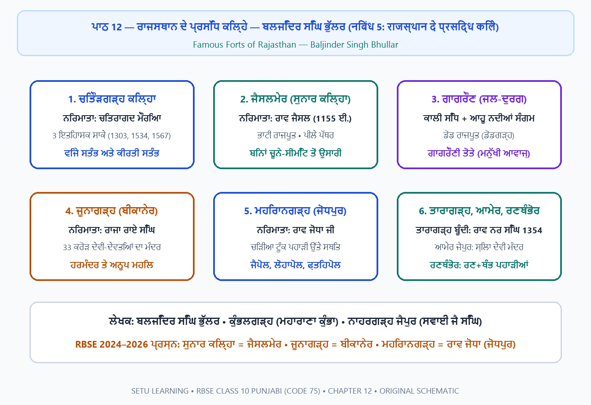

# ਪਾਠ 12 — ਰਾਜਸਥਾਨ ਦੇ ਪ੍ਰਸਿੱਧ ਕਿਲ੍ਹੇ — ਬਲਜਿੰਦਰ ਸਿੰਘ ਭੁੱਲਰ (निबंध 5: राजस्थान दे प्रसिद्ध किले) (Famous Forts of Rajasthan — Baljinder Singh Bhullar)

## भाग 1: अध्याय प्रवेश एवं पाठ्यक्रम मैपिंग (ਪਾਠ-ਪ੍ਰਵੇਸ਼ ਅਤੇ ਪਾਠਕ੍ਰਮ ਮੈਪਿੰਗ)

> RBSE ਜਮਾਤ 10 ਪੰਜਾਬੀ ਪਾਠ-ਪੁਸਤਕ 'ਸਾਹਿਤ ਸੁਗੰਧੀਆਂ' ਦੇ ਸਾਰੇ ਪ੍ਰਸ਼ਨਾਂ ਦੇ ਹੱਲ ਅਤੇ 2014–2026 ਦਾ ਪੂਰਾ ਇਤਿਹਾਸਕ PYQ ਸੰਗ੍ਰਹਿ ਸਰੋਤ-ਪ੍ਰੀਖਣ ਸਮੇਤ ਸੰਕਲਿਤ ਹਨ।

**ਵਿਸ਼ਾ ਕੋਡ (विषय कोड):** 75 (ਤੀਜੀ ਭਾਸ਼ਾ — ਪੰਜਾਬੀ / तृतीया भाषा — पंजाबी) · **ਲੜੀ ਪੁਸਤਕ (श्रृंखला पुस्तक):** 7

**ਪ੍ਰਮਾਣਿਤ ਆਧਾਰ:** RBSE 2025–26 · **ਪਾਠ ਅੰਕ-ਭਾਰ:** 2 ਅੰਕ। ਇਹ ਭਾਰ ਉਸੇ ਸੰਸਕਰਣ ਦਾ ਹੈ; ਅਸਲ ਪ੍ਰਸ਼ਨ-ਵੰਡ ਦੀ ਭਵਿੱਖਬਾਣੀ ਨਹੀਂ।

**ਸਿੱਖਣ ਦੇ ਉਦੇਸ਼ (सीखने के लक्ष्य):** ਬਲਜਿੰਦਰ ਸਿੰਘ ਭੁੱਲਰ ਦੇ ਨਿਬੰਧ 'ਰਾਜਸਥਾਨ ਦੇ ਪ੍ਰਸਿੱਧ ਕਿਲ੍ਹੇ' ਵਿੱਚ ਵਰਣਿਤ ਰਾਜਸਥਾਨ ਦੇ 10 ਇਤਿਹਾਸਕ ਕਿਲ੍ਹਿਆਂ (ਚਿਤੌੜਗੜ੍ਹ, ਜੈਸਲਮੇਰ, ਆਮੇਰ, ਗਾਗਰੌਣ, ਜੂਨਾਗੜ੍ਹ, ਰਣਥੰਭੋਰ, ਕੁੰਭਲਗੜ੍ਹ, ਤਾਰਾਗੜ੍ਹ, ਨਾਹਰਗੜ੍ਹ ਅਤੇ ਮਹਿਰਾਨਗੜ੍ਹ) ਦੇ ਨਿਰਮਾਤਾ, ਸਥਾਨ ਅਤੇ ਵਿਸ਼ੇਸ਼ਤਾਵਾਂ ਸਮਝਣਾ।

## भाग 2: शब्दावली एवं अवधारणा कैप्सूल (ਸ਼ਬਦਾਵਲੀ ਅਤੇ ਸੰਕਲਪ ਕੈਪਸੂਲ)

| ਸ਼ਬਦ / ਸੰਕਲਪ | ਅਰਥ / ਵਿਆਖਿਆ |
|---|---|
| ਸਾਕਾ / ਜੌਹਰ (साका / जौहर) | ਜਦੋਂ ਰਾਜਪੂਤ ਵੀਰ ਕੇਸਰੀਆ ਬਾਣਾ ਪਾ ਕੇ ਸ਼ਹੀਦ ਹੁੰਦੇ ਸਨ ਤੇ ਵੀਰਾਂਗਣਾਂ ਅਗਨੀ ਵਿੱਚ ਜੌਹਰ ਕਰਦੀਆਂ ਸਨ (ਚਿਤੌੜ ਦੇ 3 ਸਾਕੇ)। |
| ਸੁਨਾਰ ਕਿਲ੍ਹਾ (सुनार किला) | ਜੈਸਲਮੇਰ ਦਾ ਕਿਲ੍ਹਾ ਜੋ ਪੀਲੇ ਪੱਥਰਾਂ ਕਾਰਨ ਧੁੱਪ ਵਿੱਚ ਸੋਨੇ ਵਾਂਗ ਚਮਕਦਾ ਹੈ। |
| ਜਲ-ਦੁਰਗ (जल-दुरग) | ਪਾਣੀ ਨਾਲ ਘਿਰਿਆ ਕਿਲ੍ਹਾ — ਗਾਗਰੌਣ ਦਾ ਕਿਲ੍ਹਾ ਕਾਲੀ ਸਿੰਧ ਤੇ ਆਹੂ ਨਦੀਆਂ ਦੇ ਸੰਗਮ ਉੱਤੇ ਬਣਿਆ ਹੈ। |
| ਗਾਗਰੌਣੀ ਤੋਤੇ (गागरौणी तोते) | ਗਾਗਰੌਣ ਦੇ ਕਿਲ੍ਹੇ ਦੇ ਮਨੁੱਖੀ ਆਵਾਜ਼ ਵਿੱਚ ਬੋਲਣ ਵਾਲੇ ਪ੍ਰਸਿੱਧ ਤੋਤੇ (ਹੀਰਾਮਨ ਤੋਤੇ)। |
| ਡੋਡਗੜ੍ਹ / ਧੂਲਰਗੜ੍ਹ (डोडगढ) | ਗਾਗਰੌਣ ਦੇ ਕਿਲ੍ਹੇ ਦਾ ਪੁਰਾਣਾ ਨਾਂ (ਡੋਡ ਰਾਜਪੂਤਾਂ ਵੱਲੋਂ ਉਸਾਰਿਆ ਗਿਆ)। |
| 33 ਕਰੋੜ ਦੇਵੀ-ਦੇਵਤਿਆਂ ਦਾ ਮੰਦਰ (33 करोड़ देवी-देवतिआं दा मंदर) | ਬੀਕਾਨੇਰ ਦੇ ਜੂਨਾਗੜ੍ਹ ਕਿਲ੍ਹੇ ਵਿੱਚ ਸਥਿਤ ਪ੍ਰਸਿੱਧ ਮੰਦਰ ਜਿੱਥੇ ਧਾਤ ਤੇ ਪੱਥਰ ਦੀਆਂ ਮੂਰਤੀਆਂ ਹਨ। |
| ਰਣ ਅਤੇ ਥੰਭ (रण अते थंभ) | ਰਣਥੰਭੋਰ ਕਿਲ੍ਹੇ ਦੀਆਂ ਦੋ ਪਹਾੜੀਆਂ (ਰਣ = ਹੇਠਲੀ ਪਹਾੜੀ, ਥੰਭ = ਉੱਚੀ ਪਹਾੜੀ ਜਿਸ ਉੱਤੇ ਕਿਲ੍ਹਾ ਹੈ)। |
| ਚਿੜੀਆ ਟੂੰਕ ਪਹਾੜੀ (चिड़ीआ टूंक पहाड़ी) | ਜੋਧਪੁਰ ਦੀ ਪਹਾੜੀ ਜਿਸ ਉੱਤੇ ਰਾਵ ਜੋਧਾ ਨੇ ਮਹਿਰਾਨਗੜ੍ਹ ਕਿਲ੍ਹਾ ਬਣਵਾਇਆ। |
| ਮੀਨਾਕਾਰੀ ਤੇ ਭਿੱਤੀ ਚਿੱਤਰ (मीनाकारी ते भित्ती चित्तर) | ਬੂੰਦੀ ਦੇ ਤਾਰਾਗੜ੍ਹ ਕਿਲ੍ਹੇ ਦੀ ਕੱਚ ਦੀ ਮੀਨਾਕਾਰੀ ਅਤੇ ਕੰਧ-ਚਿੱਤਰ। |
| ਵਿਜੈ ਸਤੰਭ ਅਤੇ ਕੀਰਤੀ ਸਤੰਭ (विजै सतंभ अते कीरती सतंभ) | ਚਿਤੌੜਗੜ੍ਹ ਦੇ ਕਿਲ੍ਹੇ ਵਿੱਚ ਮਹਾਰਾਣਾ ਕੁੰਭਾ ਵੱਲੋਂ ਬਣਵਾਏ ਇਤਿਹਾਸਕ ਸਤੰਭ। |

## भाग 3: विस्तृत शिक्षण पाठ (ਵਿਸਤ੍ਰਿਤ ਅਧਿਆਪਨ ਪਾਠ)

### 1. ਨਿਬੰਧ-ਪਛਾਣ: 'ਰਾਜਸਥਾਨ ਦੇ ਪ੍ਰਸਿੱਧ ਕਿਲ੍ਹੇ' (ਲੇਖਕ: ਬਲਜਿੰਦਰ ਸਿੰਘ ਭੁੱਲਰ)
**ਬਲਜਿੰਦਰ ਸਿੰਘ ਭੁੱਲਰ** ਨੇ ਇਸ ਨਿਬੰਧ ਵਿੱਚ ਰਾਜਸਥਾਨ ਦੀ ਵੀਰ-ਭੂਮੀ ਦੇ **10 ਪ੍ਰਮੁੱਖ ਇਤਿਹਾਸਕ ਕਿਲ੍ਹਿਆਂ** ਦਾ ਵਿਸਤ੍ਰਿਤ ਵਰਣਨ ਕੀਤਾ ਹੈ। ਬੋਰਡ ਪ੍ਰੀਖਿਆ ਵਿੱਚ ਹਰ ਸਾਲ ਇਹਨਾਂ ਕਿਲ੍ਹਿਆਂ ਦੇ ਨਿਰਮਾਤਾ, ਸਥਾਨ ਅਤੇ ਵਿਸ਼ੇਸ਼ਤਾਵਾਂ ਬਾਰੇ ਪ੍ਰਸ਼ਨ ਪੁੱਛੇ ਜਾਂਦੇ ਹਨ:

### 2. ਰਾਜਸਥਾਨ ਦੇ 10 ਪ੍ਰਸਿੱਧ ਕਿਲ੍ਹਿਆਂ ਦਾ ਸੰਪੂਰਨ ਵੇਰਵਾ
| ਕ੍ਰਮ | ਕਿਲ੍ਹੇ ਦਾ ਨਾਂ | ਸਥਾਨ / ਜ਼ਿਲ੍ਹਾ | ਨਿਰਮਾਤਾ / ਸ਼ਾਸਕ | ਪ੍ਰਮੁੱਖ ਵਿਸ਼ੇਸ਼ਤਾਵਾਂ ਅਤੇ ਇਤਿਹਾਸਕ ਤੱਥ |
|:---:|---|---|---|---|
| **1.** | **ਚਿਤੌੜ ਦਾ ਕਿਲ੍ਹਾ** | ਚਿਤੌੜਗੜ੍ਹ | ਚਿਤਰਾਗਦ ਮੌਰਿਆ (7ਵੀਂ ਸਦੀ) | ਰਾਜਸਥਾਨ ਦਾ ਸਭ ਤੋਂ ਮਹੱਤਵਪੂਰਨ ਕਿਲ੍ਹਾ; ਕਹਾਵਤ: **'ਗੜ੍ਹ ਤੋ ਚਿਤੌੜ ਗੜ੍ਹ ਔਰ ਸਬ ਗੜੈਯਾ ਹੈਂ'**; 3 ਮਹਾਨ ਸਾਕੇ (**1303** ਅਲਾਉੱਦੀਨ ਖ਼ਿਲਜੀ, **1534** ਬਹਾਦਰ ਸ਼ਾਹ, **1567** ਅਕਬਰ); ਵਿਜੈ ਸਤੰਭ, ਕੀਰਤੀ ਸਤੰਭ, ਪਦਮਿਨੀ ਮਹੱਲ ਤੇ ਮੀਰਾ ਮੰਦਰ। |
| **2.** | **ਜੈਸਲਮੇਰ ਦਾ ਕਿਲ੍ਹਾ** | ਜੈਸਲਮੇਰ | **ਰਾਵ ਜੈਸਲ** (1155 ਈ., ਭਾਟੀ ਰਾਜਪੂਤ) | **ਭਾਟੀ ਰਾਜਪੂਤਾਂ ਦਾ ਸਭ ਤੋਂ ਵੱਡਾ ਕਿਲ੍ਹਾ** (RBSE 2020 Main Q8-ੲ, 2024 Main Q1-vi); ਤ੍ਰਿਕੂਟ ਪਹਾੜੀ 'ਤੇ ਬਿਨਾਂ ਚੂਨੇ-ਸੀਮਿੰਟ ਦੇ ਪੀਲੇ ਪੱਥਰਾਂ ਨਾਲ ਬਣਿਆ **'ਸੁਨਾਰ ਕਿਲ੍ਹਾ'** (ਸੱਤਿਆਜੀਤ ਰੇਅ ਨੇ ਫ਼ਿਲਮ ਬਣਾਈ); 99 ਬੁਰਜ ਤੇ ਜੈਨ ਮੰਦਰ। |
| **3.** | **ਆਮੇਰ ਦਾ ਕਿਲ੍ਹਾ** | ਜੈਪੁਰ (11 ਕਿ.ਮੀ. ਦੂਰ) | ਕਛਵਾਹਾ ਰਾਜਪੂਤ (ਮਾਨ ਸਿੰਘ, ਜੈ ਸਿੰਘ) | ਮੋਟਾ ਝੀਲ ਦੇ ਕੰਢੇ ਪਹਾੜੀ ਉੱਤੇ; ਸ਼ੀਸ਼ ਮਹੱਲ, ਦੀਵਾਨ-ਏ-ਆਮ, ਦੀਵਾਨ-ਏ-ਖ਼ਾਸ, **ਸ਼ਿਲਾ ਦੇਵੀ (ਕਾਲੀ ਮਾਤਾ) ਦਾ ਮੰਦਰ**। |
| **4.** | **ਗਾਗਰੌਣ ਦਾ ਕਿਲ੍ਹਾ** | ਝਾਲਾਵਾੜ (ਕੋਟਾ ਤੋਂ 45 ਮੀਲ) | ਡੋਡ ਰਾਜਪੂਤ (ਬੀਜਲਦੇਵ — ਡੋਡਗੜ੍ਹ/ਧੂਲਰਗੜ੍ਹ) | **ਕਾਲੀ ਸਿੰਧ ਅਤੇ ਆਹੂ ਨਦੀਆਂ ਦੇ ਸੰਗਮ** ਉੱਤੇ ਬਿਨਾਂ ਨੀਂਹ ਦੇ ਚੱਟਾਨ 'ਤੇ ਬਣਿਆ **ਜਲ-ਦੁਰਗ** (RBSE 2019 Main Q8-ੲ, 2024 Main Q16, 2025 Supp Q3-vii, Q16); ਸੰਤ ਪੀਪਾ ਜੀ ਦੀ ਤਪ-ਭੂਮੀ ਅਤੇ ਮਨੁੱਖੀ ਆਵਾਜ਼ ਵਿੱਚ ਬੋਲਣ ਵਾਲੇ **'ਗਾਗਰੌਣੀ ਤੋਤਿਆਂ'** ਲਈ ਪ੍ਰਸਿੱਧ। |
| **5.** | **ਜੂਨਾਗੜ੍ਹ ਦਾ ਕਿਲ੍ਹਾ** | **ਬੀਕਾਨੇਰ** | **ਰਾਜਾ ਰਾਏ ਸਿੰਘ** (1589–1594 ਈ.) | ਰਾਵ ਬੀਕਾ ਜੀ ਦੀ ਪੁਰਾਣੀ ਟੇਕਰੀ 'ਤੇ ਉਸਾਰਿਆ; ਸੂਰਜ ਪੋਲ, ਕਰਨ ਮਹੱਲ, ਅਨੂਪ ਮਹੱਲ ਅਤੇ **'33 ਕਰੋੜ ਦੇਵੀ-ਦੇਵਤਿਆਂ ਦਾ ਮੰਦਰ'** (RBSE 2025 Supp Q1-ix)। |
| **6.** | **ਰਣਥੰਭੋਰ ਦਾ ਕਿਲ੍ਹਾ** | ਸਵਾਈ ਮਾਧੋਪੁਰ | ਚੌਹਾਨ ਸ਼ਾਸਕ (8ਵੀਂ ਸਦੀ; ਹਮੀਰ ਦੇਵ ਚੌਹਾਨ) | **'ਰਣ' (ਹੇਠਲੀ ਪਹਾੜੀ) ਅਤੇ 'ਥੰਭ' (ਉੱਚੀ ਪਹਾੜੀ)** ਤੋਂ ਨਾਂ ਪਿਆ (ਪੁਰਾਣਾ ਨਾਂ ਰੰਤਪੁਰ); 1301 ਈ. ਵਿੱਚ ਅਲਾਉੱਦੀਨ ਖ਼ਿਲਜੀ ਦਾ ਹਮਲਾ ਤੇ ਰਾਜਾ ਹਮੀਰ ਦੇਵ ਚੌਹਾਨ ਦੀ ਹੱਠ/ਵੀਰਤਾ; ਹਮੀਰ ਮਹੱਲ ਤੇ ਤ੍ਰਿਨੇਤਰ ਗਣੇਸ਼ ਮੰਦਰ (RBSE 2018 Main Q8-ੲ, 2025 Supp Q16, 2026 Supp Q16)। |
| **7.** | **ਕੁੰਭਲਗੜ੍ਹ ਦਾ ਕਿਲ੍ਹਾ** | ਰਾਜਸਮੰਦ | **ਮਹਾਰਾਣਾ ਕੁੰਭਾ** (15ਵੀਂ ਸਦੀ, ਸ਼ਿਲਪੀ ਮੰਡਨ) | 36 ਕਿ.ਮੀ. ਲੰਮੀ ਅਤੇ ਇੰਨੀ ਚੌੜੀ ਦੀਵਾਰ ਕਿ **4 ਘੋੜਸਵਾਰ ਬਰਾਬਰ ਦੌੜ ਸਕਦੇ ਹਨ**; ਕਟਾਰਗੜ੍ਹ (ਮੇਵਾੜ ਦੀ ਅੱਖ) ਜਿੱਥੇ ਮਹਾਰਾਣਾ ਪ੍ਰਤਾਪ ਦਾ ਜਨਮ ਹੋਇਆ। |
| **8.** | **ਤਾਰਾਗੜ੍ਹ ਦਾ ਕਿਲ੍ਹਾ** | **ਬੂੰਦੀ** | **ਰਾਵ ਨਰ ਸਿੰਘ (ਬਰ ਸਿੰਘ)** (1354 ਈ.) | ਉੱਚੀ ਪਹਾੜੀ ਕਾਰਨ ਤਾਰੇ ਵਰਗਾ ਦਿਸਦਾ ਹੈ; **ਕੱਚ ਦੀ ਮੀਨਾਕਾਰੀ ਅਤੇ ਭਿੱਤੀ ਚਿੱਤਰਾਂ (ਕੰਧ-ਚਿੱਤਰਾਂ)** ਦੀ ਚਿੱਤਰਸ਼ਾਲਾ ਅਤੇ ਗਰਭ ਗੁੰਜਨ ਤੋਪ ਲਈ ਪ੍ਰਸਿੱਧ (RBSE 2025 Supp Q3-vii)। |
| **9.** | **ਨਾਹਰਗੜ੍ਹ ਦਾ ਕਿਲ੍ਹਾ** | ਜੈਪੁਰ | **ਸਵਾਈ ਜੈ ਸਿੰਘ** (1734 ਈ.) | ਮਰਾਠਿਆਂ ਦੇ ਹਮਲੇ ਤੋਂ ਜੈਪੁਰ ਦੀ ਰੱਖਿਆ ਲਈ ਅਰਾਵਲੀ ਪਹਾੜੀ 'ਤੇ ਬਣਵਾਇਆ (ਪੁਰਾਣਾ ਨਾਂ ਸੁਦਰਸ਼ਨਗੜ੍ਹ); ਨਾਹਰ ਸਿੰਘ ਭੋਮੀਆ ਦੇ ਨਾਂ 'ਤੇ ਨਾਹਰਗੜ੍ਹ ਪਿਆ; ਮਾਧੋਵੇਂਦਰ ਭਵਨ (ਇੱਕੋ ਜਿਹੇ 9 ਮਹੱਲ)। |
| **10.** | **ਮਹਿਰਾਨਗੜ੍ਹ ਦਾ ਕਿਲ੍ਹਾ** | **ਜੋਧਪੁਰ** | **ਰਾਵ ਜੋਧਾ ਜੀ** (1459 ਈ.) | **ਚਿੜੀਆ ਟੂੰਕ ਪਹਾੜੀ** ਉੱਤੇ ਬਣਿਆ (RBSE 2026 Supp Q1-VII); ਪ੍ਰਮੁੱਖ ਦਰਵਾਜ਼ੇ — **ਜੈਪੋਲ, ਲੋਹਾਪੋਲ ਅਤੇ ਫ਼ਤਿਹਪੋਲ**; ਮੋਤੀ ਮਹੱਲ, ਫੂਲ ਮਹੱਲ ਅਤੇ ਚਾਮੁੰਡਾ ਮਾਤਾ ਮੰਦਰ। |

ਪਾਠ 12: ਬਲਜਿੰਦਰ ਸਿੰਘ ਭੁੱਲਰ ਦੇ ਨਿਬੰਧ 'ਰਾਜਸਥਾਨ ਦੇ ਪ੍ਰਸਿੱਧ ਕਿਲ੍ਹੇ' ਦਾ ਸੰਕਲਪ ਚਿੱਤਰ

## भाग 4: पाठ्यपुस्तक-अवधारणाओं पर मौलिक हल किए उदाहरण (ਹੱਲ ਕੀਤੇ ਮਿਆਰੀ ਉਦਾਹਰਣ)

ਹੇਠਾਂ ਦਿੱਤੇ ਪ੍ਰਸ਼ਨ ਪਾਠ-ਪੁਸਤਕ 'ਸਾਹਿਤ ਸੁਗੰਧੀਆਂ' ਅਤੇ ਵਿਆਕਰਣ ਦੇ ਸੰਕਲਪਾਂ ਉੱਤੇ ਆਧਾਰਿਤ ਮੌਲਿਕ ਆਦਰਸ਼ ਹੱਲ ਹਨ।

**ਹੱਲ ਕੀਤਾ ਉਦਾਹਰਣ 1: ਗਾਗਰੌਣ ਦੇ ਕਿਲ੍ਹੇ ਦੀ ਪ੍ਰਸਿੱਧੀ ਦਾ ਕਾਰਨ ਲਿਖੋ।**

ਗਾਗਰੌਣ ਦਾ ਕਿਲ੍ਹਾ ਕੋਟਾ ਤੋਂ 45 ਮੀਲ ਦੂਰ (ਝਾਲਾਵਾੜ ਜ਼ਿਲ੍ਹੇ ਵਿੱਚ) **ਕਾਲੀ ਸਿੰਧ ਅਤੇ ਆਹੂ ਨਦੀਆਂ ਦੇ ਸੰਗਮ** ਉੱਤੇ ਬਣਿਆ ਰਾਜਸਥਾਨ ਦਾ ਪ੍ਰਸਿੱਧ **ਜਲ-ਦੁਰਗ** ਹੈ। ਇਹ ਡੋਡ ਰਾਜਪੂਤਾਂ ਵੱਲੋਂ ਬਿਨਾਂ ਨੀਂਹ ਦੇ ਸਿੱਧਾ ਚੱਟਾਨ ਉੱਤੇ ਉਸਾਰਿਆ ਗਿਆ ਸੀ (ਇਸ ਲਈ ਇਸ ਨੂੰ ਡੋਡਗੜ੍ਹ ਜਾਂ ਧੂਲਰਗੜ੍ਹ ਵੀ ਕਹਿੰਦੇ ਹਨ)। ਇਹ ਕਿਲ੍ਹਾ ਰਾਜਪੂਤ ਵੀਰਾਂ ਦੇ ਜੌਹਰ, ਸੰਤ ਪੀਪਾ ਜੀ ਦੀ ਛਤਰੀ ਅਤੇ ਮਨੁੱਖੀ ਆਵਾਜ਼ ਦੀ ਨਕਲ ਕਰਨ ਵਾਲੇ **'ਗਾਗਰੌਣੀ ਤੋਤਿਆਂ'** ਕਾਰਨ ਵਿਸ਼ਵ-ਪ੍ਰਸਿੱਧ ਹੈ (RBSE 2019 Main Q8-ੲ, 2024 Main Q16, 2025 Supp Q16)।

**ਹੱਲ ਕੀਤਾ ਉਦਾਹਰਣ 2: ਰਣਥੰਭੋਰ ਦੇ ਕਿਲ੍ਹੇ ਉੱਪਰ ਸੰਖੇਪ ਟਿੱਪਣੀ ਲਿਖੋ।**

ਰਣਥੰਭੋਰ ਦਾ ਕਿਲ੍ਹਾ ਸਵਾਈ ਮਾਧੋਪੁਰ ਦੇ ਨੇੜੇ ਚੌਹਾਨ ਸ਼ਾਸਕਾਂ ਵੱਲੋਂ 8ਵੀਂ ਸਦੀ ਵਿੱਚ ਬਣਵਾਇਆ ਗਿਆ ਸੀ। ਇਹ ਦੋ ਪਹਾੜੀਆਂ — 'ਰਣ' (ਹੇਠਲੀ ਪਹਾੜੀ) ਅਤੇ 'ਥੰਭ' (ਉੱਚੀ ਪਹਾੜੀ ਜਿਸ ਉੱਤੇ ਕਿਲ੍ਹਾ ਖੜ੍ਹਾ ਹੈ) — ਦੇ ਨਾਂ ਤੋਂ 'ਰਣਥੰਭੋਰ' ਅਖਵਾਇਆ (ਪੁਰਾਣਾ ਨਾਂ ਰੰਤਪੁਰ)। ਇਹ ਕਿਲ੍ਹਾ ਚਾਰੋਂ ਪਾਸਿਓਂ ਸੰਘਣੇ ਜੰਗਲਾਂ ਤੇ ਪਹਾੜੀਆਂ ਨਾਲ ਘਿਰਿਆ ਹੋਇਆ ਹੈ। ਇੱਥੋਂ ਦੇ ਪ੍ਰਤਾਪੀ ਰਾਜਾ ਹਮੀਰ ਦੇਵ ਚੌਹਾਨ ਨੇ 1301 ਈ. ਵਿੱਚ ਅਲਾਉੱਦੀਨ ਖ਼ਿਲਜੀ ਨਾਲ ਵੀਰਤਾਪੂਰਵਕ ਯੁੱਧ ਕੀਤਾ। ਕਿਲ੍ਹੇ ਅੰਦਰ ਹਮੀਰ ਮਹੱਲ, ਰਾਣੀ ਮਹੱਲ ਅਤੇ ਤ੍ਰਿਨੇਤਰ ਗਣੇਸ਼ ਮੰਦਰ ਪ੍ਰਸਿੱਧ ਹਨ (RBSE 2018 Main Q8-ੲ, 2025 Supp Q16, 2026 Supp Q16)।

**ਹੱਲ ਕੀਤਾ ਉਦਾਹਰਣ 3: 'ਰਾਜਸਥਾਨ ਦੇ ਪ੍ਰਸਿੱਧ ਕਿਲ੍ਹੇ' ਨਿਬੰਧ ਦਾ ਲੇਖਕ ਕੌਣ ਹੈ ਅਤੇ ਰਾਜਸਥਾਨ ਦੇ ਭਾਟੀ ਰਾਜਪੂਤਾਂ ਨਾਲ ਸੰਬੰਧਿਤ ਕਿਲ੍ਹੇ ਉੱਪਰ ਟਿੱਪਣੀ ਲਿਖੋ।**

ਇਸ ਨਿਬੰਧ ਦੇ ਲੇਖਕ **ਬਲਜਿੰਦਰ ਸਿੰਘ ਭੁੱਲਰ** ਹਨ। ਭਾਟੀ ਰਾਜਪੂਤਾਂ ਨਾਲ ਸੰਬੰਧਿਤ ਸਭ ਤੋਂ ਵੱਡਾ ਕਿਲ੍ਹਾ **'ਜੈਸਲਮੇਰ ਦਾ ਕਿਲ੍ਹਾ'** ਹੈ, ਜਿਸ ਦੀ ਨੀਂਹ 1155 ਈ. ਵਿੱਚ ਭਾਟੀ ਸ਼ਾਸਕ **ਰਾਵ ਜੈਸਲ** ਨੇ ਤ੍ਰਿਕੂਟ ਪਹਾੜੀ ਉੱਤੇ ਰੱਖੀ। ਇਹ ਕਿਲ੍ਹਾ ਬਿਨਾਂ ਚੂਨੇ ਜਾਂ ਸੀਮਿੰਟ ਦੇ ਪੀਲੇ ਪੱਥਰਾਂ ਨੂੰ ਜੋੜ ਕੇ ਬਣਾਇਆ ਗਿਆ ਹੈ। ਧੁੱਪ ਪੈਣ 'ਤੇ ਇਹ ਸੋਨੇ ਵਾਂਗ ਚਮਕਦਾ ਹੈ, ਜਿਸ ਕਾਰਨ ਇਸ ਨੂੰ **'ਸੁਨਾਰ ਕਿਲ੍ਹਾ'** ਕਿਹਾ ਜਾਂਦਾ ਹੈ (RBSE 2020 Main Q8-ੲ, 2024 Main Q1-vi)।

## भाग 5: सत्यापित बोर्ड प्रश्न एवं स्रोत-स्थिति (ਪ੍ਰਮਾਣਿਤ ਬੋਰਡ ਪ੍ਰਸ਼ਨ ਅਤੇ ਸਰੋਤ-ਸਥਿਤੀ)

RBSE 2026 Supp (`S-75`, Q1-VII, Q16), 2025 Supp (Q1-ix, Q3-vii, Q16) ਅਤੇ 2024 Main (Q1-vi, Q16, Q19) ਵਿੱਚ ਰਾਜਸਥਾਨ ਦੇ ਕਿਲ੍ਹਿਆਂ ਦੇ ਪ੍ਰਸ਼ਨ ਲਗਾਤਾਰ ਪੁੱਛੇ ਗਏ ਹਨ।

[RBSE 2026 ਮੂਲ ਪੇਪਰ (S-75)](https://rajeduboard.rajasthan.gov.in/books/PAPERS-2026/Sec/S-75.pdf)। ਪ੍ਰਸ਼ਨ ਦਾ ਸੰਖੇਪ ਵਿਸ਼ਾ-ਸੰਦਰਭ ਹੈ; ਸ਼ਬਦ-ਬ-ਸ਼ਬਦ ਪੁਨਰ-ਮੁਦਰਣ ਨਹੀਂ।

## भाग 6: खंडवार मौलिक अभ्यास बैंक (ਖੰਡ-ਵਾਰ ਮੌਲਿਕ ਅਭਿਆਸ ਬੈਂਕ)

**ਅਭਿਆਸ-ਅੰਕ:** ਵਿਦਿਆਰਥੀਆਂ ਦੇ ਸਵੈ-ਅਭਿਆਸ ਲਈ ਹਨ; ਉੱਤਰ ਪਹਿਲਾਂ ਆਪ ਲਿਖੋ, ਫਿਰ ਭਾਗ 9 ਵੇਖੋ।

## ੳ: ਬਹੁ-ਵਿਕਲਪੀ ਪ੍ਰਸ਼ਨ (MCQ) — 15 × 1 ਅੰਕ

**MCQ 1. ਰਾਜਸਥਾਨ ਵਿੱਚ ਭਾਟੀ ਰਾਜਪੂਤਾਂ ਦਾ ਸਭ ਤੋਂ ਵੱਡਾ ਕਿਲ੍ਹਾ ਕਿਹੜਾ ਹੈ? (RBSE 2024 Main Q1-vi)**

ੳ) ਜੈਸਲਮੇਰ ਦਾ ਕਿਲ੍ਹਾ  
ਅ) ਚਿਤੌੜ ਦਾ ਕਿਲ੍ਹਾ  
ੲ) ਆਮੇਰ ਦਾ ਕਿਲ੍ਹਾ  
ਸ) ਗਾਗਰੌਣ ਦਾ ਕਿਲ੍ਹਾ

**MCQ 2. ਜੂਨਾਗੜ੍ਹ ਦਾ ਕਿਲ੍ਹਾ ਕਿੱਥੇ ਸਥਿਤ ਹੈ? (RBSE 2025 Supp Q1-ix)**

ੳ) ਜੈਸਲਮੇਰ  
ਅ) ਬੂੰਦੀ  
ੲ) ਉਦੈਪੁਰ  
ਸ) ਬੀਕਾਨੇਰ

**MCQ 3. 'ਰਾਵ ਜੋਧਾ ਜੀ' ਨੇ ਕਿਹੜੇ ਕਿਲ੍ਹੇ ਦਾ ਨਿਰਮਾਣ ਕਰਵਾਇਆ ਸੀ? (RBSE 2026 Supp Q1-VII)**

ੳ) ਕੁੰਭਲਗੜ੍ਹ  
ਅ) ਤਾਰਾਗੜ੍ਹ  
ੲ) ਮਹਿਰਾਨਗੜ੍ਹ (ਜੋਧਪੁਰ)  
ਸ) ਨਾਹਰਗੜ੍ਹ

**MCQ 4. 'ਰਾਜਸਥਾਨ ਦੇ ਪ੍ਰਸਿੱਧ ਕਿਲ੍ਹੇ' ਨਿਬੰਧ ਦਾ ਲੇਖਕ ਕੌਣ ਹੈ? (RBSE 2020 Main Q8-ੲ)**

ੳ) ਹਰਪ੍ਰੀਤ ਕੌਰ  
ਅ) ਬਲਜਿੰਦਰ ਸਿੰਘ ਭੁੱਲਰ  
ੲ) ਹਰਪਾਲ ਸਿੰਘ ਲੱਖੀਆਂ  
ਸ) ਪ੍ਰਿੰ. ਸਰਵਣ ਸਿੰਘ

**MCQ 5. ਕਾਲੀ ਸਿੰਧ ਅਤੇ ਆਹੂ ਨਦੀਆਂ ਦੇ ਸੰਗਮ ਉੱਤੇ ਬਣਿਆ ਰਾਜਸਥਾਨ ਦਾ ਪ੍ਰਸਿੱਧ ਜਲ-ਕਿਲ੍ਹਾ ਕਿਹੜਾ ਹੈ?**

ੳ) ਗਾਗਰੌਣ ਦਾ ਕਿਲ੍ਹਾ  
ਅ) ਰਣਥੰਭੋਰ ਦਾ ਕਿਲ੍ਹਾ  
ੲ) ਚਿਤੌੜ ਦਾ ਕਿਲ੍ਹਾ  
ਸ) ਜੂਨਾਗੜ੍ਹ ਦਾ ਕਿਲ੍ਹਾ

**MCQ 6. 'ਗੜ੍ਹ ਤੋ ਚਿਤੌੜ ਗੜ੍ਹ ਔਰ ਸਬ ਗੜੈਯਾ ਹੈਂ' — ਇਹ ਕਹਾਵਤ ਕਿਸ ਕਿਲ੍ਹੇ ਦੀ ਮਹਾਨਤਾ ਦੱਸਦੀ ਹੈ?**

ੳ) ਕੁੰਭਲਗੜ੍ਹ ਦੇ ਕਿਲ੍ਹੇ ਦੀ  
ਅ) ਆਮੇਰ ਦੇ ਕਿਲ੍ਹੇ ਦੀ  
ੲ) ਮਹਿਰਾਨਗੜ੍ਹ ਦੇ ਕਿਲ੍ਹੇ ਦੀ  
ਸ) ਚਿਤੌੜ ਦੇ ਕਿਲ੍ਹੇ ਦੀ

**MCQ 7. ਜੈਸਲਮੇਰ ਦੇ ਕਿਲ੍ਹੇ ਦੀ ਨੀਂਹ ਸੰਨ 1155 ਈ. ਵਿੱਚ ਕਿਸ ਨੇ ਰੱਖੀ ਸੀ?**

ੳ) ਰਾਵ ਜੋਧਾ ਨੇ  
ਅ) ਰਾਵ ਨਰ ਸਿੰਘ ਨੇ  
ੲ) ਰਾਵ ਜੈਸਲ ਨੇ  
ਸ) ਰਾਵ ਬੀਕਾ ਨੇ

**MCQ 8. ਕਿਸ ਕਿਲ੍ਹੇ ਨੂੰ ਪੀਲੇ ਪੱਥਰਾਂ ਕਾਰਨ 'ਸੁਨਾਰ ਕਿਲ੍ਹਾ' ਕਿਹਾ ਜਾਂਦਾ ਹੈ ਜਿਸ ਉੱਤੇ ਸੱਤਿਆਜੀਤ ਰੇਅ ਨੇ ਫ਼ਿਲਮ ਵੀ ਬਣਾਈ?**

ੳ) ਤਾਰਾਗੜ੍ਹ ਦੇ ਕਿਲ੍ਹੇ ਨੂੰ  
ਅ) ਜੈਸਲਮੇਰ ਦੇ ਕਿਲ੍ਹੇ ਨੂੰ  
ੲ) ਜੂਨਾਗੜ੍ਹ ਦੇ ਕਿਲ੍ਹੇ ਨੂੰ  
ਸ) ਆਮੇਰ ਦੇ ਕਿਲ੍ਹੇ ਨੂੰ

**MCQ 9. '33 ਕਰੋੜ ਦੇਵੀ-ਦੇਵਤਿਆਂ ਦਾ ਮੰਦਰ' ਕਿਹੜੇ ਕਿਲ੍ਹੇ ਵਿੱਚ ਸਥਿਤ ਹੈ?**

ੳ) ਜੂਨਾਗੜ੍ਹ ਦੇ ਕਿਲ੍ਹੇ (ਬੀਕਾਨੇਰ) ਵਿੱਚ  
ਅ) ਆਮੇਰ ਦੇ ਕਿਲ੍ਹੇ ਵਿੱਚ  
ੲ) ਚਿਤੌੜ ਦੇ ਕਿਲ੍ਹੇ ਵਿੱਚ  
ਸ) ਨਾਹਰਗੜ੍ਹ ਦੇ ਕਿਲ੍ਹੇ ਵਿੱਚ

**MCQ 10. ਬੂੰਦੀ ਦੇ 'ਤਾਰਾਗੜ੍ਹ ਕਿਲ੍ਹੇ' ਦਾ ਨਿਰਮਾਣ 1354 ਈ. ਵਿੱਚ ਕਿਸ ਨੇ ਕਰਵਾਇਆ ਅਤੇ ਇਹ ਕਿਸ ਕਲਾ ਲਈ ਪ੍ਰਸਿੱਧ ਹੈ?**

ੳ) ਸਵਾਈ ਜੈ ਸਿੰਘ ਨੇ  
ਅ) ਮਹਾਰਾਣਾ ਕੁੰਭਾ ਨੇ  
ੲ) ਚਿਤਰਾਗਦ ਮੌਰਿਆ ਨੇ  
ਸ) ਰਾਵ ਨਰ ਸਿੰਘ ਨੇ (ਕੱਚ ਦੀ ਮੀਨਾਕਾਰੀ ਅਤੇ ਭਿੱਤੀ ਚਿੱਤਰਾਂ ਲਈ)

**MCQ 11. ਮਨੁੱਖੀ ਆਵਾਜ਼ ਵਿੱਚ ਬੋਲਣ ਵਾਲੇ ਤੋਤਿਆਂ ('ਗਾਗਰੌਣੀ ਤੋਤਿਆਂ') ਲਈ ਕਿਹੜਾ ਕਿਲ੍ਹਾ ਮਸ਼ਹੂਰ ਹੈ?**

ੳ) ਨਾਹਰਗੜ੍ਹ ਦਾ ਕਿਲ੍ਹਾ  
ਅ) ਕੁੰਭਲਗੜ੍ਹ ਦਾ ਕਿਲ੍ਹਾ  
ੲ) ਗਾਗਰੌਣ ਦਾ ਕਿਲ੍ਹਾ  
ਸ) ਰਣਥੰਭੋਰ ਦਾ ਕਿਲ੍ਹਾ

**MCQ 12. 'ਰਣ' ਅਤੇ 'ਥੰਭ' ਨਾਂ ਦੀਆਂ ਦੋ ਪਹਾੜੀਆਂ ਉੱਤੇ ਕਿਹੜਾ ਕਿਲ੍ਹਾ ਬਣਿਆ ਹੋਇਆ ਹੈ?**

ੳ) ਆਮੇਰ ਦਾ ਕਿਲ੍ਹਾ  
ਅ) ਰਣਥੰਭੋਰ ਦਾ ਕਿਲ੍ਹਾ  
ੲ) ਕੁੰਭਲਗੜ੍ਹ ਦਾ ਕਿਲ੍ਹਾ  
ਸ) ਮਹਿਰਾਨਗੜ੍ਹ ਦਾ ਕਿਲ੍ਹਾ

**MCQ 13. ਜੋਧਪੁਰ ਦੇ ਮਹਿਰਾਨਗੜ੍ਹ ਕਿਲ੍ਹੇ ਦੇ ਤਿੰਨ ਪ੍ਰਸਿੱਧ ਦਰਵਾਜ਼ੇ ਕਿਹੜੇ ਹਨ?**

ੳ) ਜੈਪੋਲ, ਲੋਹਾਪੋਲ ਅਤੇ ਫ਼ਤਿਹਪੋਲ  
ਅ) ਸੂਰਜਪੋਲ, ਚਾਂਦਪੋਲ ਅਤੇ ਅਜਮੇਰੀ ਗੇਟ  
ੲ) ਗਣੇਸ਼ਪੋਲ, ਹਵਾਪੋਲ ਅਤੇ ਭੈਰੋਂਪੋਲ  
ਸ) ਦਿੱਲੀ ਗੇਟ, ਲਾਹੌਰੀ ਗੇਟ ਅਤੇ ਕਸ਼ਮੀਰੀ ਗੇਟ

**MCQ 14. ਸ਼ਿਲਾ ਦੇਵੀ ਅਤੇ ਕਾਲੀ ਮਾਤਾ ਦਾ ਪ੍ਰਸਿੱਧ ਮੰਦਰ ਕਿਹੜੇ ਕਿਲ੍ਹੇ ਵਿੱਚ ਹੈ?**

ੳ) ਜੈਸਲਮੇਰ ਦੇ ਕਿਲ੍ਹੇ ਵਿੱਚ  
ਅ) ਗਾਗਰੌਣ ਦੇ ਕਿਲ੍ਹੇ ਵਿੱਚ  
ੲ) ਰਣਥੰਭੋਰ ਦੇ ਕਿਲ੍ਹੇ ਵਿੱਚ  
ਸ) ਆਮੇਰ ਦੇ ਕਿਲ੍ਹੇ (ਜੈਪੁਰ) ਵਿੱਚ

**MCQ 15. ਚਿਤੌੜਗੜ੍ਹ ਦੇ ਕਿਲ੍ਹੇ ਵਿੱਚ ਇਤਿਹਾਸ ਦੇ ਕਿੰਨੇ ਪ੍ਰਸਿੱਧ 'ਸਾਕੇ' (ਜੌਹਰ) ਹੋਏ?**

ੳ) ਚਾਰ ਸਾਕੇ  
ਅ) ਇੱਕ ਸਾਕਾ  
ੲ) ਤਿੰਨ ਸਾਕੇ (1303, 1534 ਅਤੇ 1567 ਈ.)  
ਸ) ਦੋ ਸਾਕੇ

## ੳ: ਖਾਲੀ ਥਾਵਾਂ ਭਰੋ — 6 × 1 ਅੰਕ

1. ਜਦੋਂ ਰਾਜਪੂਤ ਵੀਰ ਕੇਸਰੀਆ ਬਾਣਾ ਪਾ ਕੇ ਸ਼ਹੀਦ ਹੁੰਦੇ ਸਨ ਤੇ ਵੀਰਾਂਗਣਾਂ ਅਗਨੀ ਵਿੱਚ ਜੌਹਰ ਕਰਦੀਆਂ ਸਨ (ਚਿਤੌੜ ਦੇ 3 ਸਾਕੇ)। — ਇਸ ਸ਼ਬਦ/ਸੰਕਲਪ ਦਾ ਨਾਂ ਹੈ: ____।  
2. ਜੈਸਲਮੇਰ ਦਾ ਕਿਲ੍ਹਾ ਜੋ ਪੀਲੇ ਪੱਥਰਾਂ ਕਾਰਨ ਧੁੱਪ ਵਿੱਚ ਸੋਨੇ ਵਾਂਗ ਚਮਕਦਾ ਹੈ। — ਇਸ ਸ਼ਬਦ/ਸੰਕਲਪ ਦਾ ਨਾਂ ਹੈ: ____।  
3. ਪਾਣੀ ਨਾਲ ਘਿਰਿਆ ਕਿਲ੍ਹਾ — ਗਾਗਰੌਣ ਦਾ ਕਿਲ੍ਹਾ ਕਾਲੀ ਸਿੰਧ ਤੇ ਆਹੂ ਨਦੀਆਂ ਦੇ ਸੰਗਮ ਉੱਤੇ ਬਣਿਆ ਹੈ। — ਇਸ ਸ਼ਬਦ/ਸੰਕਲਪ ਦਾ ਨਾਂ ਹੈ: ____।  
4. ਗਾਗਰੌਣ ਦੇ ਕਿਲ੍ਹੇ ਦੇ ਮਨੁੱਖੀ ਆਵਾਜ਼ ਵਿੱਚ ਬੋਲਣ ਵਾਲੇ ਪ੍ਰਸਿੱਧ ਤੋਤੇ (ਹੀਰਾਮਨ ਤੋਤੇ)। — ਇਸ ਸ਼ਬਦ/ਸੰਕਲਪ ਦਾ ਨਾਂ ਹੈ: ____।  
5. ਗਾਗਰੌਣ ਦੇ ਕਿਲ੍ਹੇ ਦਾ ਪੁਰਾਣਾ ਨਾਂ (ਡੋਡ ਰਾਜਪੂਤਾਂ ਵੱਲੋਂ ਉਸਾਰਿਆ ਗਿਆ)। — ਇਸ ਸ਼ਬਦ/ਸੰਕਲਪ ਦਾ ਨਾਂ ਹੈ: ____।  
6. ਬੀਕਾਨੇਰ ਦੇ ਜੂਨਾਗੜ੍ਹ ਕਿਲ੍ਹੇ ਵਿੱਚ ਸਥਿਤ ਪ੍ਰਸਿੱਧ ਮੰਦਰ ਜਿੱਥੇ ਧਾਤ ਤੇ ਪੱਥਰ ਦੀਆਂ ਮੂਰਤੀਆਂ ਹਨ। — ਇਸ ਸ਼ਬਦ/ਸੰਕਲਪ ਦਾ ਨਾਂ ਹੈ: ____।

## ੳ: ਅਤਿ-ਲਘੂ ਉੱਤਰਾਂ ਵਾਲੇ ਪ੍ਰਸ਼ਨ — 8 × 1 ਅੰਕ

1. ਰਾਜਸਥਾਨ ਵਿੱਚ ਭਾਟੀ ਰਾਜਪੂਤਾਂ ਦਾ ਸਭ ਤੋਂ ਵੱਡਾ ਕਿਲ੍ਹਾ ਕਿਹੜਾ ਹੈ? (RBSE 2024 Main Q1-vi)  
2. ਜੂਨਾਗੜ੍ਹ ਦਾ ਕਿਲ੍ਹਾ ਕਿੱਥੇ ਸਥਿਤ ਹੈ? (RBSE 2025 Supp Q1-ix)  
3. 'ਰਾਵ ਜੋਧਾ ਜੀ' ਨੇ ਕਿਹੜੇ ਕਿਲ੍ਹੇ ਦਾ ਨਿਰਮਾਣ ਕਰਵਾਇਆ ਸੀ? (RBSE 2026 Supp Q1-VII)  
4. 'ਰਾਜਸਥਾਨ ਦੇ ਪ੍ਰਸਿੱਧ ਕਿਲ੍ਹੇ' ਨਿਬੰਧ ਦਾ ਲੇਖਕ ਕੌਣ ਹੈ? (RBSE 2020 Main Q8-ੲ)  
5. ਕਾਲੀ ਸਿੰਧ ਅਤੇ ਆਹੂ ਨਦੀਆਂ ਦੇ ਸੰਗਮ ਉੱਤੇ ਬਣਿਆ ਰਾਜਸਥਾਨ ਦਾ ਪ੍ਰਸਿੱਧ ਜਲ-ਕਿਲ੍ਹਾ ਕਿਹੜਾ ਹੈ?  
6. 'ਗੜ੍ਹ ਤੋ ਚਿਤੌੜ ਗੜ੍ਹ ਔਰ ਸਬ ਗੜੈਯਾ ਹੈਂ' — ਇਹ ਕਹਾਵਤ ਕਿਸ ਕਿਲ੍ਹੇ ਦੀ ਮਹਾਨਤਾ ਦੱਸਦੀ ਹੈ?  
7. ਜੈਸਲਮੇਰ ਦੇ ਕਿਲ੍ਹੇ ਦੀ ਨੀਂਹ ਸੰਨ 1155 ਈ. ਵਿੱਚ ਕਿਸ ਨੇ ਰੱਖੀ ਸੀ?  
8. ਕਿਸ ਕਿਲ੍ਹੇ ਨੂੰ ਪੀਲੇ ਪੱਥਰਾਂ ਕਾਰਨ 'ਸੁਨਾਰ ਕਿਲ੍ਹਾ' ਕਿਹਾ ਜਾਂਦਾ ਹੈ ਜਿਸ ਉੱਤੇ ਸੱਤਿਆਜੀਤ ਰੇਅ ਨੇ ਫ਼ਿਲਮ ਵੀ ਬਣਾਈ?

## ਅ: ਲਘੂ ਉੱਤਰਾਂ ਵਾਲੇ ਪ੍ਰਸ਼ਨ — 6 × 2 ਅੰਕ

**B1.** ਜੂਨਾਗੜ੍ਹ ਦਾ ਕਿਲ੍ਹਾ ਕਿੱਥੇ ਸਥਿਤ ਹੈ ਅਤੇ ਇਸ ਦਾ ਨਿਰਮਾਣ ਕਿਸ ਨੇ ਕਰਵਾਇਆ?

**B2.** ਰਾਵ ਜੋਧਾ ਜੀ ਨੇ ਕਿਹੜੇ ਕਿਲ੍ਹੇ ਦਾ ਨਿਰਮਾਣ ਕਰਵਾਇਆ ਸੀ ਅਤੇ ਇਹ ਕਿਹੜੀ ਪਹਾੜੀ ਉੱਤੇ ਹੈ?

**B3.** ਕੋਟਾ ਅਤੇ ਬੂੰਦੀ ਦੇ ਨੇੜੇ ਬਣੇ ਕਿਲ੍ਹਿਆਂ ਦੇ ਨਾਂ ਦੱਸੋ।

**B4.** ਰਾਜਸਥਾਨ ਦਾ ਸਭ ਤੋਂ ਮਹੱਤਵਪੂਰਨ ਕਿਲ੍ਹਾ ਕਿਹੜਾ ਹੈ ਅਤੇ ਉਸ ਬਾਰੇ ਕਿਹੜੀ ਕਹਾਵਤ ਪ੍ਰਸਿੱਧ ਹੈ?

**B5.** ਕੁੰਭਲਗੜ੍ਹ ਦੇ ਕਿਲ੍ਹੇ ਦਾ ਨਿਰਮਾਣ ਕਿਸ ਨੇ ਕਰਵਾਇਆ ਅਤੇ ਇਸ ਦੀ ਦੀਵਾਰ ਦੀ ਕੀ ਵਿਸ਼ੇਸ਼ਤਾ ਹੈ?

**B6.** ਆਮੇਰ ਅਤੇ ਨਾਹਰਗੜ੍ਹ ਦੇ ਕਿਲ੍ਹੇ ਕਿਹੜੇ ਸ਼ਹਿਰ ਵਿੱਚ ਸਥਿਤ ਹਨ?

## ੲ: ਦੀਰਘ ਉੱਤਰਾਂ ਵਾਲੇ ਪ੍ਰਸ਼ਨ — 4 × 3 ਅੰਕ

ਅੰਦਰੂਨੀ ਵਿਕਲਪ ਅਭਿਆਸ: ਪਹਿਲਾਂ ਇੱਕ ਵਿਕਲਪ ਹੱਲ ਕਰੋ ਅਤੇ ਦੁਹਰਾਈ ਵੇਲੇ ਬਾਕੀ ਪ੍ਰਸ਼ਨ ਵੀ ਹੱਲ ਕਰੋ।

**C1.** ਰਾਜਸਥਾਨ ਦੇ ਕਿਲ੍ਹਿਆਂ ਦੀਆਂ ਕੀ-ਕੀ ਵਿਸ਼ੇਸ਼ਤਾਵਾਂ ਹਨ? ਵੇਰਵਾ ਦਿਓ। (RBSE 2020 Supp Q9, 2024 Main Q19)

**C2.** ਚਿਤੌੜਗੜ੍ਹ ਦੇ ਕਿਲ੍ਹੇ ਦੇ ਇਤਿਹਾਸ ਅਤੇ ਵਿਸ਼ੇਸ਼ਤਾਵਾਂ ਉੱਤੇ ਚਾਨਣਾ ਪਾਓ। (RBSE 2018 Supp Q9)

**C3.** ਗਾਗਰੌਣ ਅਤੇ ਰਣਥੰਭੋਰ ਦੇ ਕਿਲ੍ਹਿਆਂ ਉੱਪਰ ਟਿੱਪਣੀ ਕਰੋ। (RBSE 2025 Supp Q16)

**C4.** ਜੂਨਾਗੜ੍ਹ (ਬੀਕਾਨੇਰ), ਤਾਰਾਗੜ੍ਹ (ਬੂੰਦੀ) ਅਤੇ ਮਹਿਰਾਨਗੜ੍ਹ (ਜੋਧਪੁਰ) ਕਿਲ੍ਹਿਆਂ ਬਾਰੇ ਸੰਖੇਪ ਜਾਣਕਾਰੀ ਦਿਓ।

## ਸ: ਨਿਬੰਧਾਤਮਕ / ਵਿਸਤ੍ਰਿਤ ਉੱਤਰਾਂ ਵਾਲੇ ਪ੍ਰਸ਼ਨ — 2 × 4 ਅੰਕ

ਅੰਦਰੂਨੀ ਵਿਕਲਪ ਅਭਿਆਸ: D1 ਜਾਂ D2 ਚੁਣੋ; ਬਾਅਦ ਵਿੱਚ ਦੂਜਾ ਵੀ ਹੱਲ ਕਰੋ।

**D1.** 'ਰਾਜਸਥਾਨ ਦੇ ਪ੍ਰਸਿੱਧ ਕਿਲ੍ਹੇ' ਨਿਬੰਧ ਦੇ ਆਧਾਰ 'ਤੇ ਰਾਜਸਥਾਨ ਦੇ ਦੁਰਗ-ਸਥਾਪਤਯ (ਕਿਲ੍ਹਾ-ਉਸਾਰੀ ਕਲਾ) ਅਤੇ ਇਤਿਹਾਸਕ ਗੌਰਵ ਦਾ ਵਿਸਤਾਰ ਨਾਲ ਵਰਣਨ ਕਰੋ।

**D2.** ਜੈਸਲਮੇਰ, ਆਮੇਰ, ਕੁੰਭਲਗੜ੍ਹ ਅਤੇ ਨਾਹਰਗੜ੍ਹ ਦੇ ਕਿਲ੍ਹਿਆਂ ਦਾ ਤੁਲਨਾਤਮਕ ਵੇਰਵਾ ਦਿਓ।

## भाग 7: सावधानियाँ एवं परीक्षा-त्रुटियाँ (ਸਾਵਧਾਨੀਆਂ ਅਤੇ ਪ੍ਰੀਖਿਆ-ਗ਼ਲਤੀਆਂ)

- **ਗ਼ਲਤੀ 1:** ਜੋਧਪੁਰ, ਬੀਕਾਨੇਰ ਤੇ ਜੈਸਲਮੇਰ ਦੇ ਕਿਲ੍ਹਿਆਂ ਵਿੱਚ ਭੁਲੇਖਾ — ਯਾਦ ਰੱਖੋ:
  - **ਜੈਸਲਮੇਰ ਦਾ ਕਿਲ੍ਹਾ (ਸੁਨਾਰ ਕਿਲ੍ਹਾ)** = ਰਾਵ ਜੈਸਲ (ਭਾਟੀ ਰਾਜਪੂਤ, 1155 ਈ.)
  - **ਜੂਨਾਗੜ੍ਹ ਦਾ ਕਿਲ੍ਹਾ (ਬੀਕਾਨੇਰ)** = ਰਾਜਾ ਰਾਏ ਸਿੰਘ (33 ਕਰੋੜ ਦੇਵੀ-ਦੇਵਤਿਆਂ ਦਾ ਮੰਦਰ)
  - **ਮਹਿਰਾਨਗੜ੍ਹ ਦਾ ਕਿਲ੍ਹਾ (ਜੋਧਪੁਰ)** = ਰਾਵ ਜੋਧਾ (ਚਿੜੀਆ ਟੂੰਕ ਪਹਾੜੀ)
  - **ਤਾਰਾਗੜ੍ਹ ਦਾ ਕਿਲ੍ਹਾ (ਬੂੰਦੀ)** = ਰਾਵ ਨਰ ਸਿੰਘ (1354 ਈ., ਭਿੱਤੀ ਚਿੱਤਰ)

## भाग 8: फटाफट पुनरावृत्ति — 25 बिंदु (ਫਟਾਫਟ ਦੁਹਰਾਈ — 25 ਬਿੰਦੂ)

1. ਸਾਕਾ / ਜੌਹਰ (साका / जौहर): ਜਦੋਂ ਰਾਜਪੂਤ ਵੀਰ ਕੇਸਰੀਆ ਬਾਣਾ ਪਾ ਕੇ ਸ਼ਹੀਦ ਹੁੰਦੇ ਸਨ ਤੇ ਵੀਰਾਂਗਣਾਂ ਅਗਨੀ ਵਿੱਚ ਜੌਹਰ ਕਰਦੀਆਂ ਸਨ (ਚਿਤੌੜ ਦੇ 3 ਸਾਕੇ)।  
2. ਸੁਨਾਰ ਕਿਲ੍ਹਾ (सुनार किला): ਜੈਸਲਮੇਰ ਦਾ ਕਿਲ੍ਹਾ ਜੋ ਪੀਲੇ ਪੱਥਰਾਂ ਕਾਰਨ ਧੁੱਪ ਵਿੱਚ ਸੋਨੇ ਵਾਂਗ ਚਮਕਦਾ ਹੈ।  
3. ਜਲ-ਦੁਰਗ (जल-दुरग): ਪਾਣੀ ਨਾਲ ਘਿਰਿਆ ਕਿਲ੍ਹਾ — ਗਾਗਰੌਣ ਦਾ ਕਿਲ੍ਹਾ ਕਾਲੀ ਸਿੰਧ ਤੇ ਆਹੂ ਨਦੀਆਂ ਦੇ ਸੰਗਮ ਉੱਤੇ ਬਣਿਆ ਹੈ।  
4. ਗਾਗਰੌਣੀ ਤੋਤੇ (गागरौणी तोते): ਗਾਗਰੌਣ ਦੇ ਕਿਲ੍ਹੇ ਦੇ ਮਨੁੱਖੀ ਆਵਾਜ਼ ਵਿੱਚ ਬੋਲਣ ਵਾਲੇ ਪ੍ਰਸਿੱਧ ਤੋਤੇ (ਹੀਰਾਮਨ ਤੋਤੇ)।  
5. ਡੋਡਗੜ੍ਹ / ਧੂਲਰਗੜ੍ਹ (डोडगढ): ਗਾਗਰੌਣ ਦੇ ਕਿਲ੍ਹੇ ਦਾ ਪੁਰਾਣਾ ਨਾਂ (ਡੋਡ ਰਾਜਪੂਤਾਂ ਵੱਲੋਂ ਉਸਾਰਿਆ ਗਿਆ)।  
6. 33 ਕਰੋੜ ਦੇਵੀ-ਦੇਵਤਿਆਂ ਦਾ ਮੰਦਰ (33 करोड़ देवी-देवतिआं दा मंदर): ਬੀਕਾਨੇਰ ਦੇ ਜੂਨਾਗੜ੍ਹ ਕਿਲ੍ਹੇ ਵਿੱਚ ਸਥਿਤ ਪ੍ਰਸਿੱਧ ਮੰਦਰ ਜਿੱਥੇ ਧਾਤ ਤੇ ਪੱਥਰ ਦੀਆਂ ਮੂਰਤੀਆਂ ਹਨ।  
7. ਰਣ ਅਤੇ ਥੰਭ (रण अते थंभ): ਰਣਥੰਭੋਰ ਕਿਲ੍ਹੇ ਦੀਆਂ ਦੋ ਪਹਾੜੀਆਂ (ਰਣ = ਹੇਠਲੀ ਪਹਾੜੀ, ਥੰਭ = ਉੱਚੀ ਪਹਾੜੀ ਜਿਸ ਉੱਤੇ ਕਿਲ੍ਹਾ ਹੈ)।  
8. ਚਿੜੀਆ ਟੂੰਕ ਪਹਾੜੀ (चिड़ीआ टूंक पहाड़ी): ਜੋਧਪੁਰ ਦੀ ਪਹਾੜੀ ਜਿਸ ਉੱਤੇ ਰਾਵ ਜੋਧਾ ਨੇ ਮਹਿਰਾਨਗੜ੍ਹ ਕਿਲ੍ਹਾ ਬਣਵਾਇਆ।  
9. ਮੀਨਾਕਾਰੀ ਤੇ ਭਿੱਤੀ ਚਿੱਤਰ (मीनाकारी ते भित्ती चित्तर): ਬੂੰਦੀ ਦੇ ਤਾਰਾਗੜ੍ਹ ਕਿਲ੍ਹੇ ਦੀ ਕੱਚ ਦੀ ਮੀਨਾਕਾਰੀ ਅਤੇ ਕੰਧ-ਚਿੱਤਰ।  
10. ਵਿਜੈ ਸਤੰਭ ਅਤੇ ਕੀਰਤੀ ਸਤੰਭ (विजै सतंभ अते कीरती सतंभ): ਚਿਤੌੜਗੜ੍ਹ ਦੇ ਕਿਲ੍ਹੇ ਵਿੱਚ ਮਹਾਰਾਣਾ ਕੁੰਭਾ ਵੱਲੋਂ ਬਣਵਾਏ ਇਤਿਹਾਸਕ ਸਤੰਭ।  
11. ਜੈਸਲਮੇਰ ਦਾ ਕਿਲ੍ਹਾ (ਸੁਨਾਰ ਕਿਲ੍ਹਾ) ਭਾਟੀ ਰਾਜਪੂਤਾਂ ਦਾ ਸਭ ਤੋਂ ਵੱਡਾ ਕਿਲ੍ਹਾ ਹੈ (RBSE 2020 Main Q8-ੲ, 2024 Main Q1-vi)।  
12. ਜੂਨਾਗੜ੍ਹ ਦਾ ਕਿਲ੍ਹਾ ਬੀਕਾਨੇਰ ਵਿਖੇ ਸਥਿਤ ਹੈ ਜਿਸ ਨੂੰ ਰਾਜਾ ਰਾਏ ਸਿੰਘ ਨੇ ਬਣਵਾਇਆ (RBSE 2025 Supp Q1-ix)।  
13. ਰਾਵ ਜੋਧਾ ਜੀ ਨੇ ਚਿੜੀਆ ਟੂੰਕ ਪਹਾੜੀ (ਜੋਧਪੁਰ) ਉੱਤੇ ਮਹਿਰਾਨਗੜ੍ਹ ਕਿਲ੍ਹੇ ਦਾ ਨਿਰਮਾਣ ਕਰਵਾਇਆ (RBSE 2026 Supp Q1-VII)।  
14. 'ਰਾਜਸਥਾਨ ਦੇ ਪ੍ਰਸਿੱਧ ਕਿਲ੍ਹੇ' ਨਿਬੰਧ ਬਲਜਿੰਦਰ ਸਿੰਘ ਭੁੱਲਰ ਦੀ ਰਚਨਾ ਹੈ (RBSE 2020 Main Q8-ੲ)।  
15. ਗਾਗਰੌਣ ਦਾ ਕਿਲ੍ਹਾ ਕਾਲੀ ਸਿੰਧ ਅਤੇ ਆਹੂ ਨਦੀਆਂ ਦੇ ਸੰਗਮ 'ਤੇ ਬਣਿਆ ਜਲ-ਦੁਰਗ ਹੈ (RBSE 2019 Main Q8-ੲ, 2024 Main Q16)।  
16. ਇਹ ਕਹਾਵਤ ਚਿਤੌੜਗੜ੍ਹ ਦੇ ਕਿਲ੍ਹੇ ਦੀ ਸਰਵਉੱਚਤਾ ਦੱਸਦੀ ਹੈ।  
17. ਭਾਟੀ ਸ਼ਾਸਕ ਰਾਵ ਜੈਸਲ ਨੇ 1155 ਈ. ਵਿੱਚ ਜੈਸਲਮੇਰ ਦੇ ਕਿਲ੍ਹੇ ਦੀ ਨੀਂਹ ਰੱਖੀ।  
18. ਜੈਸਲਮੇਰ ਦੇ ਕਿਲ੍ਹੇ ਨੂੰ 'ਸੁਨਾਰ ਕਿਲ੍ਹਾ' ਕਿਹਾ ਜਾਂਦਾ ਹੈ।  
19. ਬੀਕਾਨੇਰ ਦੇ ਜੂਨਾਗੜ੍ਹ ਕਿਲ੍ਹੇ ਵਿੱਚ 33 ਕਰੋੜ ਦੇਵੀ-ਦੇਵਤਿਆਂ ਦਾ ਮੰਦਰ ਹੈ।  
20. ਬੂੰਦੀ ਦਾ ਤਾਰਾਗੜ੍ਹ ਕਿਲ੍ਹਾ 1354 ਈ. ਵਿੱਚ ਰਾਵ ਨਰ ਸਿੰਘ ਨੇ ਬਣਵਾਇਆ (RBSE 2025 Supp Q3-vii)।  
21. ਗਾਗਰੌਣ ਦਾ ਕਿਲ੍ਹਾ ਡੋਡ ਰਾਜਪੂਤਾਂ ਅਤੇ ਗਾਗਰੌਣੀ ਤੋਤਿਆਂ ਲਈ ਮਸ਼ਹੂਰ ਹੈ।  
22. 'ਰਣ' (ਹੇਠਲੀ) ਅਤੇ 'ਥੰਭ' (ਉੱਚੀ) ਪਹਾੜੀਆਂ ਤੋਂ ਰਣਥੰਭੋਰ ਨਾਂ ਪਿਆ (RBSE 2026 Supp Q16)।  
23. ਮਹਿਰਾਨਗੜ੍ਹ ਕਿਲ੍ਹੇ ਦੇ ਪ੍ਰਮੁੱਖ ਦਰਵਾਜ਼ੇ ਜੈਪੋਲ, ਲੋਹਾਪੋਲ ਅਤੇ ਫ਼ਤਿਹਪੋਲ ਹਨ।  
24. ਆਮੇਰ ਦੇ ਕਿਲ੍ਹੇ ਵਿੱਚ ਕਛਵਾਹਾ ਰਾਜਪੂਤਾਂ ਦੀ ਕੁਲਦੇਵੀ ਸ਼ਿਲਾ ਦੇਵੀ ਦਾ ਮੰਦਰ ਹੈ।  
25. ਚਿਤੌੜ ਦੇ ਕਿਲ੍ਹੇ ਵਿੱਚ 1303, 1534 ਅਤੇ 1567 ਈ. ਵਿੱਚ ਤਿੰਨ ਮਹਾਨ ਸਾਕੇ ਹੋਏ।

## भाग 9: संपूर्ण अभ्यास उत्तर-कुंजी (ਸੰਪੂਰਨ ਅਭਿਆਸ ਉੱਤਰ-ਕੁੰਜੀ)

## MCQ: ਸਹੀ ਵਿਕਲਪ ਅਤੇ ਕਾਰਨ

**1. ੳ — ਜੈਸਲਮੇਰ ਦਾ ਕਿਲ੍ਹਾ।** ਜੈਸਲਮੇਰ ਦਾ ਕਿਲ੍ਹਾ (ਸੁਨਾਰ ਕਿਲ੍ਹਾ) ਭਾਟੀ ਰਾਜਪੂਤਾਂ ਦਾ ਸਭ ਤੋਂ ਵੱਡਾ ਕਿਲ੍ਹਾ ਹੈ (RBSE 2020 Main Q8-ੲ, 2024 Main Q1-vi)।

**2. ਸ — ਬੀਕਾਨੇਰ।** ਜੂਨਾਗੜ੍ਹ ਦਾ ਕਿਲ੍ਹਾ ਬੀਕਾਨੇਰ ਵਿਖੇ ਸਥਿਤ ਹੈ ਜਿਸ ਨੂੰ ਰਾਜਾ ਰਾਏ ਸਿੰਘ ਨੇ ਬਣਵਾਇਆ (RBSE 2025 Supp Q1-ix)।

**3. ੲ — ਮਹਿਰਾਨਗੜ੍ਹ (ਜੋਧਪੁਰ)।** ਰਾਵ ਜੋਧਾ ਜੀ ਨੇ ਚਿੜੀਆ ਟੂੰਕ ਪਹਾੜੀ (ਜੋਧਪੁਰ) ਉੱਤੇ ਮਹਿਰਾਨਗੜ੍ਹ ਕਿਲ੍ਹੇ ਦਾ ਨਿਰਮਾਣ ਕਰਵਾਇਆ (RBSE 2026 Supp Q1-VII)।

**4. ਅ — ਬਲਜਿੰਦਰ ਸਿੰਘ ਭੁੱਲਰ।** 'ਰਾਜਸਥਾਨ ਦੇ ਪ੍ਰਸਿੱਧ ਕਿਲ੍ਹੇ' ਨਿਬੰਧ ਬਲਜਿੰਦਰ ਸਿੰਘ ਭੁੱਲਰ ਦੀ ਰਚਨਾ ਹੈ (RBSE 2020 Main Q8-ੲ)।

**5. ੳ — ਗਾਗਰੌਣ ਦਾ ਕਿਲ੍ਹਾ।** ਗਾਗਰੌਣ ਦਾ ਕਿਲ੍ਹਾ ਕਾਲੀ ਸਿੰਧ ਅਤੇ ਆਹੂ ਨਦੀਆਂ ਦੇ ਸੰਗਮ 'ਤੇ ਬਣਿਆ ਜਲ-ਦੁਰਗ ਹੈ (RBSE 2019 Main Q8-ੲ, 2024 Main Q16)।

**6. ਸ — ਚਿਤੌੜ ਦੇ ਕਿਲ੍ਹੇ ਦੀ।** ਇਹ ਕਹਾਵਤ ਚਿਤੌੜਗੜ੍ਹ ਦੇ ਕਿਲ੍ਹੇ ਦੀ ਸਰਵਉੱਚਤਾ ਦੱਸਦੀ ਹੈ।

**7. ੲ — ਰਾਵ ਜੈਸਲ ਨੇ।** ਭਾਟੀ ਸ਼ਾਸਕ ਰਾਵ ਜੈਸਲ ਨੇ 1155 ਈ. ਵਿੱਚ ਜੈਸਲਮੇਰ ਦੇ ਕਿਲ੍ਹੇ ਦੀ ਨੀਂਹ ਰੱਖੀ।

**8. ਅ — ਜੈਸਲਮੇਰ ਦੇ ਕਿਲ੍ਹੇ ਨੂੰ।** ਜੈਸਲਮੇਰ ਦੇ ਕਿਲ੍ਹੇ ਨੂੰ 'ਸੁਨਾਰ ਕਿਲ੍ਹਾ' ਕਿਹਾ ਜਾਂਦਾ ਹੈ।

**9. ੳ — ਜੂਨਾਗੜ੍ਹ ਦੇ ਕਿਲ੍ਹੇ (ਬੀਕਾਨੇਰ) ਵਿੱਚ।** ਬੀਕਾਨੇਰ ਦੇ ਜੂਨਾਗੜ੍ਹ ਕਿਲ੍ਹੇ ਵਿੱਚ 33 ਕਰੋੜ ਦੇਵੀ-ਦੇਵਤਿਆਂ ਦਾ ਮੰਦਰ ਹੈ।

**10. ਸ — ਰਾਵ ਨਰ ਸਿੰਘ ਨੇ (ਕੱਚ ਦੀ ਮੀਨਾਕਾਰੀ ਅਤੇ ਭਿੱਤੀ ਚਿੱਤਰਾਂ ਲਈ)।** ਬੂੰਦੀ ਦਾ ਤਾਰਾਗੜ੍ਹ ਕਿਲ੍ਹਾ 1354 ਈ. ਵਿੱਚ ਰਾਵ ਨਰ ਸਿੰਘ ਨੇ ਬਣਵਾਇਆ (RBSE 2025 Supp Q3-vii)।

**11. ੲ — ਗਾਗਰੌਣ ਦਾ ਕਿਲ੍ਹਾ।** ਗਾਗਰੌਣ ਦਾ ਕਿਲ੍ਹਾ ਡੋਡ ਰਾਜਪੂਤਾਂ ਅਤੇ ਗਾਗਰੌਣੀ ਤੋਤਿਆਂ ਲਈ ਮਸ਼ਹੂਰ ਹੈ।

**12. ਅ — ਰਣਥੰਭੋਰ ਦਾ ਕਿਲ੍ਹਾ।** 'ਰਣ' (ਹੇਠਲੀ) ਅਤੇ 'ਥੰਭ' (ਉੱਚੀ) ਪਹਾੜੀਆਂ ਤੋਂ ਰਣਥੰਭੋਰ ਨਾਂ ਪਿਆ (RBSE 2026 Supp Q16)।

**13. ੳ — ਜੈਪੋਲ, ਲੋਹਾਪੋਲ ਅਤੇ ਫ਼ਤਿਹਪੋਲ।** ਮਹਿਰਾਨਗੜ੍ਹ ਕਿਲ੍ਹੇ ਦੇ ਪ੍ਰਮੁੱਖ ਦਰਵਾਜ਼ੇ ਜੈਪੋਲ, ਲੋਹਾਪੋਲ ਅਤੇ ਫ਼ਤਿਹਪੋਲ ਹਨ।

**14. ਸ — ਆਮੇਰ ਦੇ ਕਿਲ੍ਹੇ (ਜੈਪੁਰ) ਵਿੱਚ।** ਆਮੇਰ ਦੇ ਕਿਲ੍ਹੇ ਵਿੱਚ ਕਛਵਾਹਾ ਰਾਜਪੂਤਾਂ ਦੀ ਕੁਲਦੇਵੀ ਸ਼ਿਲਾ ਦੇਵੀ ਦਾ ਮੰਦਰ ਹੈ।

**15. ੲ — ਤਿੰਨ ਸਾਕੇ (1303, 1534 ਅਤੇ 1567 ਈ.)।** ਚਿਤੌੜ ਦੇ ਕਿਲ੍ਹੇ ਵਿੱਚ 1303, 1534 ਅਤੇ 1567 ਈ. ਵਿੱਚ ਤਿੰਨ ਮਹਾਨ ਸਾਕੇ ਹੋਏ।

**ਖਾਲੀ ਥਾਵਾਂ:** 1. ਸਾਕਾ / ਜੌਹਰ (साका / जौहर); 2. ਸੁਨਾਰ ਕਿਲ੍ਹਾ (सुनार किला); 3. ਜਲ-ਦੁਰਗ (जल-दुरग); 4. ਗਾਗਰੌਣੀ ਤੋਤੇ (गागरौणी तोते); 5. ਡੋਡਗੜ੍ਹ / ਧੂਲਰਗੜ੍ਹ (डोडगढ); 6. 33 ਕਰੋੜ ਦੇਵੀ-ਦੇਵਤਿਆਂ ਦਾ ਮੰਦਰ (33 करोड़ देवी-देवतिआं दा मंदर)

**ਅਤਿ-ਲਘੂ ਉੱਤਰ:**

1. ਜੈਸਲਮੇਰ ਦਾ ਕਿਲ੍ਹਾ। ਜੈਸਲਮੇਰ ਦਾ ਕਿਲ੍ਹਾ (ਸੁਨਾਰ ਕਿਲ੍ਹਾ) ਭਾਟੀ ਰਾਜਪੂਤਾਂ ਦਾ ਸਭ ਤੋਂ ਵੱਡਾ ਕਿਲ੍ਹਾ ਹੈ (RBSE 2020 Main Q8-ੲ, 2024 Main Q1-vi)।

2. ਬੀਕਾਨੇਰ। ਜੂਨਾਗੜ੍ਹ ਦਾ ਕਿਲ੍ਹਾ ਬੀਕਾਨੇਰ ਵਿਖੇ ਸਥਿਤ ਹੈ ਜਿਸ ਨੂੰ ਰਾਜਾ ਰਾਏ ਸਿੰਘ ਨੇ ਬਣਵਾਇਆ (RBSE 2025 Supp Q1-ix)।

3. ਮਹਿਰਾਨਗੜ੍ਹ (ਜੋਧਪੁਰ)। ਰਾਵ ਜੋਧਾ ਜੀ ਨੇ ਚਿੜੀਆ ਟੂੰਕ ਪਹਾੜੀ (ਜੋਧਪੁਰ) ਉੱਤੇ ਮਹਿਰਾਨਗੜ੍ਹ ਕਿਲ੍ਹੇ ਦਾ ਨਿਰਮਾਣ ਕਰਵਾਇਆ (RBSE 2026 Supp Q1-VII)।

4. ਬਲਜਿੰਦਰ ਸਿੰਘ ਭੁੱਲਰ। 'ਰਾਜਸਥਾਨ ਦੇ ਪ੍ਰਸਿੱਧ ਕਿਲ੍ਹੇ' ਨਿਬੰਧ ਬਲਜਿੰਦਰ ਸਿੰਘ ਭੁੱਲਰ ਦੀ ਰਚਨਾ ਹੈ (RBSE 2020 Main Q8-ੲ)।

5. ਗਾਗਰੌਣ ਦਾ ਕਿਲ੍ਹਾ। ਗਾਗਰੌਣ ਦਾ ਕਿਲ੍ਹਾ ਕਾਲੀ ਸਿੰਧ ਅਤੇ ਆਹੂ ਨਦੀਆਂ ਦੇ ਸੰਗਮ 'ਤੇ ਬਣਿਆ ਜਲ-ਦੁਰਗ ਹੈ (RBSE 2019 Main Q8-ੲ, 2024 Main Q16)।

6. ਚਿਤੌੜ ਦੇ ਕਿਲ੍ਹੇ ਦੀ। ਇਹ ਕਹਾਵਤ ਚਿਤੌੜਗੜ੍ਹ ਦੇ ਕਿਲ੍ਹੇ ਦੀ ਸਰਵਉੱਚਤਾ ਦੱਸਦੀ ਹੈ।

7. ਰਾਵ ਜੈਸਲ ਨੇ। ਭਾਟੀ ਸ਼ਾਸਕ ਰਾਵ ਜੈਸਲ ਨੇ 1155 ਈ. ਵਿੱਚ ਜੈਸਲਮੇਰ ਦੇ ਕਿਲ੍ਹੇ ਦੀ ਨੀਂਹ ਰੱਖੀ।

8. ਜੈਸਲਮੇਰ ਦੇ ਕਿਲ੍ਹੇ ਨੂੰ। ਜੈਸਲਮੇਰ ਦੇ ਕਿਲ੍ਹੇ ਨੂੰ 'ਸੁਨਾਰ ਕਿਲ੍ਹਾ' ਕਿਹਾ ਜਾਂਦਾ ਹੈ।

**B1. ਜੂਨਾਗੜ੍ਹ ਦਾ ਕਿਲ੍ਹਾ ਕਿੱਥੇ ਸਥਿਤ ਹੈ ਅਤੇ ਇਸ ਦਾ ਨਿਰਮਾਣ ਕਿਸ ਨੇ ਕਰਵਾਇਆ?**

ਜੂਨਾਗੜ੍ਹ ਦਾ ਕਿਲ੍ਹਾ **ਬੀਕਾਨੇਰ** ਵਿਖੇ ਸਥਿਤ ਹੈ ਅਤੇ ਇਸ ਦਾ ਨਿਰਮਾਣ **ਰਾਜਾ ਰਾਏ ਸਿੰਘ** ਨੇ ਕਰਵਾਇਆ ਸੀ (RBSE 2025 Supp Q1-ix)।

**B2. ਰਾਵ ਜੋਧਾ ਜੀ ਨੇ ਕਿਹੜੇ ਕਿਲ੍ਹੇ ਦਾ ਨਿਰਮਾਣ ਕਰਵਾਇਆ ਸੀ ਅਤੇ ਇਹ ਕਿਹੜੀ ਪਹਾੜੀ ਉੱਤੇ ਹੈ?**

ਰਾਵ ਜੋਧਾ ਜੀ ਨੇ ਜੋਧਪੁਰ ਵਿਖੇ **'ਮਹਿਰਾਨਗੜ੍ਹ ਕਿਲ੍ਹੇ'** ਦਾ ਨਿਰਮਾਣ **ਚਿੜੀਆ ਟੂੰਕ ਪਹਾੜੀ** ਉੱਤੇ ਕਰਵਾਇਆ ਸੀ (RBSE 2026 Supp Q1-VII)।

**B3. ਕੋਟਾ ਅਤੇ ਬੂੰਦੀ ਦੇ ਨੇੜੇ ਬਣੇ ਕਿਲ੍ਹਿਆਂ ਦੇ ਨਾਂ ਦੱਸੋ।**

ਕੋਟਾ ਤੋਂ 45 ਮੀਲ ਦੂਰ **'ਗਾਗਰੌਣ ਦਾ ਕਿਲ੍ਹਾ'** ਅਤੇ ਬੂੰਦੀ ਵਿਖੇ **'ਤਾਰਾਗੜ੍ਹ ਦਾ ਕਿਲ੍ਹਾ'** ਬਣਿਆ ਹੋਇਆ ਹੈ (RBSE 2025 Supp Q3-vii)।

**B4. ਰਾਜਸਥਾਨ ਦਾ ਸਭ ਤੋਂ ਮਹੱਤਵਪੂਰਨ ਕਿਲ੍ਹਾ ਕਿਹੜਾ ਹੈ ਅਤੇ ਉਸ ਬਾਰੇ ਕਿਹੜੀ ਕਹਾਵਤ ਪ੍ਰਸਿੱਧ ਹੈ?**

ਰਾਜਸਥਾਨ ਦਾ ਸਭ ਤੋਂ ਮਹੱਤਵਪੂਰਨ ਕਿਲ੍ਹਾ **'ਚਿਤੌੜ ਦਾ ਕਿਲ੍ਹਾ'** ਹੈ। ਇਸ ਬਾਰੇ ਕਹਾਵਤ ਪ੍ਰਸਿੱਧ ਹੈ — **'ਗੜ੍ਹ ਤੋ ਚਿਤੌੜ ਗੜ੍ਹ ਔਰ ਸਬ ਗੜੈਯਾ ਹੈਂ'** (RBSE 2018 Supp Q9)।

**B5. ਕੁੰਭਲਗੜ੍ਹ ਦੇ ਕਿਲ੍ਹੇ ਦਾ ਨਿਰਮਾਣ ਕਿਸ ਨੇ ਕਰਵਾਇਆ ਅਤੇ ਇਸ ਦੀ ਦੀਵਾਰ ਦੀ ਕੀ ਵਿਸ਼ੇਸ਼ਤਾ ਹੈ?**

ਕੁੰਭਲਗੜ੍ਹ ਦੇ ਕਿਲ੍ਹੇ ਦਾ ਨਿਰਮਾਣ **ਮਹਾਰਾਣਾ ਕੁੰਭਾ** ਨੇ ਕਰਵਾਇਆ। ਇਸ ਦੀ ਦੀਵਾਰ ਇੰਨੀ ਚੌੜੀ ਹੈ ਕਿ ਉਸ ਉੱਤੇ ਚਾਰ ਘੋੜਸਵਾਰ ਬਰਾਬਰ ਦੌੜ ਸਕਦੇ ਹਨ।

**B6. ਆਮੇਰ ਅਤੇ ਨਾਹਰਗੜ੍ਹ ਦੇ ਕਿਲ੍ਹੇ ਕਿਹੜੇ ਸ਼ਹਿਰ ਵਿੱਚ ਸਥਿਤ ਹਨ?**

ਆਮੇਰ ਅਤੇ ਨਾਹਰਗੜ੍ਹ ਦੋਵੇਂ ਕਿਲ੍ਹੇ **ਜੈਪੁਰ** ਵਿਖੇ ਸਥਿਤ ਹਨ।

**C1. ਰਾਜਸਥਾਨ ਦੇ ਕਿਲ੍ਹਿਆਂ ਦੀਆਂ ਕੀ-ਕੀ ਵਿਸ਼ੇਸ਼ਤਾਵਾਂ ਹਨ? ਵੇਰਵਾ ਦਿਓ। (RBSE 2020 Supp Q9, 2024 Main Q19)**

1. ਸੁਰੱਖਿਆ ਤੇ ਭੂਗੋਲਿਕ ਸਥਿਤੀ: ਰਾਜਸਥਾਨ ਦੇ ਕਿਲ੍ਹੇ ਉੱਚੀਆਂ ਪਹਾੜੀਆਂ (ਚਿਤੌੜ, ਮਹਿਰਾਨਗੜ੍ਹ, ਤਾਰਾਗੜ੍ਹ, ਰਣਥੰਭੋਰ), ਮਾਰੂਥਲ (ਜੈਸਲਮੇਰ, ਜੂਨਾਗੜ੍ਹ) ਅਤੇ ਨਦੀਆਂ ਦੇ ਸੰਗਮ (ਗਾਗਰੌਣ ਜਲ-ਦੁਰਗ) ਉੱਤੇ ਬਣੇ ਹਨ। 2. ਅਦਭੁਤ ਭਵਨ-ਨਿਰਮਾਣ ਕਲਾ: ਜੈਸਲਮੇਰ ਦਾ ਕਿਲ੍ਹਾ ਬਿਨਾਂ ਚੂਨੇ ਦੇ ਪੀਲੇ ਪੱਥਰਾਂ ਨਾਲ, ਕੁੰਭਲਗੜ੍ਹ ਚੌੜੀ ਦੀਵਾਰ ਨਾਲ ਤੇ ਤਾਰਾਗੜ੍ਹ ਕੱਚ ਦੀ ਮੀਨਾਕਾਰੀ ਤੇ ਭਿੱਤੀ ਚਿੱਤਰਾਂ ਨਾਲ ਸਜਿਆ ਹੈ। 3. ਵੀਰਤਾ ਤੇ ਜੌਹਰ: ਚਿਤੌੜਗੜ੍ਹ ਦੇ ਤਿੰਨ ਸਾਕੇ, ਰਣਥੰਭੋਰ ਤੇ ਗਾਗਰੌਣ ਦੇ ਜੌਹਰ ਰਾਜਪੂਤ ਸੂਰਬੀਰਤਾ ਦੇ ਪ੍ਰਤੀਕ ਹਨ। 4. ਮੰਦਰ ਤੇ ਸਤੰਭ: ਵਿਜੈ ਸਤੰਭ, ਕੀਰਤੀ ਸਤੰਭ, ਸ਼ਿਲਾ ਦੇਵੀ ਮੰਦਰ ਤੇ 33 ਕਰੋੜ ਦੇਵੀ-ਦੇਵਤਿਆਂ ਦਾ ਮੰਦਰ ਇਹਨਾਂ ਦੀ ਸ਼ਾਨ ਹਨ।

**C2. ਚਿਤੌੜਗੜ੍ਹ ਦੇ ਕਿਲ੍ਹੇ ਦੇ ਇਤਿਹਾਸ ਅਤੇ ਵਿਸ਼ੇਸ਼ਤਾਵਾਂ ਉੱਤੇ ਚਾਨਣਾ ਪਾਓ। (RBSE 2018 Supp Q9)**

1. ਚਿਤੌੜ ਦਾ ਕਿਲ੍ਹਾ 7ਵੀਂ ਸਦੀ ਵਿੱਚ ਚਿਤਰਾਗਦ ਮੌਰਿਆ ਨੇ ਗੰਭੀਰੀ ਤੇ ਬੇੜਚ ਨਦੀਆਂ ਦੇ ਨੇੜੇ ਪਠਾਰ ਉੱਤੇ ਬਣਵਾਇਆ ਸੀ। 2. ਇਸ ਨੂੰ ਕਿਲ੍ਹਿਆਂ ਦਾ ਸਿਰਮੌਰ ਮੰਨਦਿਆਂ ਕਿਹਾ ਜਾਂਦਾ ਹੈ — 'ਗੜ੍ਹ ਤੋ ਚਿਤੌੜ ਗੜ੍ਹ ਔਰ ਸਬ ਗੜੈਯਾ ਹੈਂ'। 3. ਇੱਥੇ ਇਤਿਹਾਸ ਦੇ ਤਿੰਨ ਮਹਾਨ ਸਾਕੇ (1303 ਵਿੱਚ ਰਾਣੀ ਪਦਮਿਨੀ, 1534 ਵਿੱਚ ਰਾਣੀ ਕਰਮਾਵਤੀ ਅਤੇ 1567 ਵਿੱਚ ਜੈਮਲ-ਫੱਤਾ ਦੇ ਸਮੇਂ) ਹੋਏ। 4. ਕਿਲ੍ਹੇ ਵਿੱਚ ਵਿਜੈ ਸਤੰਭ, ਕੀਰਤੀ ਸਤੰਭ, ਕੁੰਭਾ ਮਹੱਲ, ਪਦਮਿਨੀ ਮਹੱਲ ਅਤੇ ਮੀਰਾ ਬਾਈ ਦਾ ਮੰਦਰ ਸਥਿਤ ਹਨ।

**C3. ਗਾਗਰੌਣ ਅਤੇ ਰਣਥੰਭੋਰ ਦੇ ਕਿਲ੍ਹਿਆਂ ਉੱਪਰ ਟਿੱਪਣੀ ਕਰੋ। (RBSE 2025 Supp Q16)**

1. ਗਾਗਰੌਣ ਦਾ ਕਿਲ੍ਹਾ: ਕੋਟਾ ਤੋਂ 45 ਮੀਲ ਦੂਰ ਕਾਲੀ ਸਿੰਧ ਤੇ ਆਹੂ ਨਦੀਆਂ ਦੇ ਸੰਗਮ ਉੱਤੇ ਬਣਿਆ ਜਲ-ਦੁਰਗ ਹੈ। ਡੋਡ ਰਾਜਪੂਤਾਂ ਵੱਲੋਂ ਬਣਾਏ ਹੋਣ ਕਾਰਨ ਇਸ ਨੂੰ ਡੋਡਗੜ੍ਹ ਵੀ ਕਹਿੰਦੇ ਹਨ। ਇਹ ਗਾਗਰੌਣੀ ਤੋਤਿਆਂ ਅਤੇ ਸੰਤ ਪੀਪਾ ਜੀ ਲਈ ਪ੍ਰਸਿੱਧ ਹੈ। 2. ਰਣਥੰਭੋਰ ਦਾ ਕਿਲ੍ਹਾ: ਸਵਾਈ ਮਾਧੋਪੁਰ ਵਿਖੇ 'ਰਣ' ਤੇ 'ਥੰਭ' ਪਹਾੜੀਆਂ ਉੱਤੇ ਚੌਹਾਨ ਸ਼ਾਸਕਾਂ ਵੱਲੋਂ ਬਣਾਇਆ ਗਿਆ ਦੁਰਗ ਹੈ, ਜੋ ਰਾਜਾ ਹਮੀਰ ਦੇਵ ਚੌਹਾਨ ਦੀ ਵੀਰਤਾ ਅਤੇ ਤ੍ਰਿਨੇਤਰ ਗਣੇਸ਼ ਮੰਦਰ ਲਈ ਪ੍ਰਸਿੱਧ ਹੈ।

**C4. ਜੂਨਾਗੜ੍ਹ (ਬੀਕਾਨੇਰ), ਤਾਰਾਗੜ੍ਹ (ਬੂੰਦੀ) ਅਤੇ ਮਹਿਰਾਨਗੜ੍ਹ (ਜੋਧਪੁਰ) ਕਿਲ੍ਹਿਆਂ ਬਾਰੇ ਸੰਖੇਪ ਜਾਣਕਾਰੀ ਦਿਓ।**

1. ਜੂਨਾਗੜ੍ਹ ਦਾ ਕਿਲ੍ਹਾ (ਬੀਕਾਨੇਰ): ਰਾਜਾ ਰਾਏ ਸਿੰਘ ਵੱਲੋਂ ਬਣਵਾਇਆ ਗਿਆ, ਜਿਸ ਵਿੱਚ 33 ਕਰੋੜ ਦੇਵੀ-ਦੇਵਤਿਆਂ ਦਾ ਮੰਦਰ, ਕਰਨ ਮਹੱਲ ਤੇ ਅਨੂਪ ਮਹੱਲ ਹਨ। 2. ਤਾਰਾਗੜ੍ਹ ਦਾ ਕਿਲ੍ਹਾ (ਬੂੰਦੀ): 1354 ਈ. ਵਿੱਚ ਰਾਵ ਨਰ ਸਿੰਘ ਵੱਲੋਂ ਬਣਵਾਇਆ ਗਿਆ, ਜੋ ਕੱਚ ਦੀ ਮੀਨਾਕਾਰੀ ਅਤੇ ਭਿੱਤੀ ਚਿੱਤਰਾਂ (ਕੰਧ-ਚਿੱਤਰਾਂ) ਲਈ ਮਸ਼ਹੂਰ ਹੈ। 3. ਮਹਿਰਾਨਗੜ੍ਹ ਦਾ ਕਿਲ੍ਹਾ (ਜੋਧਪੁਰ): ਰਾਵ ਜੋਧਾ ਵੱਲੋਂ ਚਿੜੀਆ ਟੂੰਕ ਪਹਾੜੀ ਉੱਤੇ ਬਣਵਾਇਆ ਗਿਆ, ਜਿਸ ਦੇ ਜੈਪੋਲ, ਲੋਹਾਪੋਲ ਤੇ ਫ਼ਤਿਹਪੋਲ ਦਰਵਾਜ਼ੇ ਪ੍ਰਸਿੱਧ ਹਨ।

**D1. 'ਰਾਜਸਥਾਨ ਦੇ ਪ੍ਰਸਿੱਧ ਕਿਲ੍ਹੇ' ਨਿਬੰਧ ਦੇ ਆਧਾਰ 'ਤੇ ਰਾਜਸਥਾਨ ਦੇ ਦੁਰਗ-ਸਥਾਪਤਯ (ਕਿਲ੍ਹਾ-ਉਸਾਰੀ ਕਲਾ) ਅਤੇ ਇਤਿਹਾਸਕ ਗੌਰਵ ਦਾ ਵਿਸਤਾਰ ਨਾਲ ਵਰਣਨ ਕਰੋ।**

1. ਬਲਜਿੰਦਰ ਸਿੰਘ ਭੁੱਲਰ ਦੇ ਨਿਬੰਧ ਅਨੁਸਾਰ ਰਾਜਸਥਾਨ ਦੇ ਕਿਲ੍ਹੇ ਭਾਰਤ ਦੀ ਸੂਰਬੀਰਤਾ, ਕਲਾ ਤੇ ਸੱਭਿਆਚਾਰ ਦੇ ਅਮਰ ਸਮਾਰਕ ਹਨ। 2. ਚਿਤੌੜਗੜ੍ਹ ਤਿਆਗ ਤੇ ਬਲੀਦਾਨ ਦਾ ਪ੍ਰਤੀਕ ਹੈ ਜਿੱਥੇ ਤਿੰਨ ਸਾਕੇ ਹੋਏ। 3. ਜੈਸਲਮੇਰ ਦਾ 'ਸੁਨਾਰ ਕਿਲ੍ਹਾ' ਭਾਟੀ ਰਾਜਪੂਤਾਂ ਦੀ ਭਵਨ-ਕਲਾ ਦਾ ਅਜੂਬਾ ਹੈ। 4. ਆਮੇਰ ਤੇ ਨਾਹਰਗੜ੍ਹ ਕਛਵਾਹਾ ਰਾਜਪੂਤਾਂ ਦੀ ਸ਼ਾਨ ਹਨ, ਗਾਗਰੌਣ ਅਦੁੱਤੀ ਜਲ-ਦੁਰਗ ਹੈ, ਜੂਨਾਗੜ੍ਹ ਰਾਜਾ ਰਾਏ ਸਿੰਘ ਦੀ ਕਲਾ-ਪ੍ਰੇਮ ਦਾ ਨਮੂਨਾ ਹੈ, ਕੁੰਭਲਗੜ੍ਹ ਅਭੇਦ ਦੀਵਾਰ ਵਾਲਾ ਦੁਰਗ ਹੈ, ਤਾਰਾਗੜ੍ਹ ਚਿੱਤਰਕਲਾ ਦਾ ਗੜ੍ਹ ਹੈ ਅਤੇ ਮਹਿਰਾਨਗੜ੍ਹ ਚਿੜੀਆ ਟੂੰਕ ਪਹਾੜੀ ਦਾ ਤਾਜ ਹੈ।

**D2. ਜੈਸਲਮੇਰ, ਆਮੇਰ, ਕੁੰਭਲਗੜ੍ਹ ਅਤੇ ਨਾਹਰਗੜ੍ਹ ਦੇ ਕਿਲ੍ਹਿਆਂ ਦਾ ਤੁਲਨਾਤਮਕ ਵੇਰਵਾ ਦਿਓ।**

1. ਜੈਸਲਮੇਰ ਦਾ ਕਿਲ੍ਹਾ: 1155 ਈ. ਵਿੱਚ ਰਾਵ ਜੈਸਲ ਵੱਲੋਂ ਬਣਵਾਇਆ ਭਾਟੀ ਰਾਜਪੂਤਾਂ ਦਾ ਸਭ ਤੋਂ ਵੱਡਾ ਕਿਲ੍ਹਾ, ਪੀਲੇ ਪੱਥਰਾਂ ਕਾਰਨ 'ਸੁਨਾਰ ਕਿਲ੍ਹਾ' ਅਖਵਾਉਂਦਾ ਹੈ। 2. ਆਮੇਰ ਦਾ ਕਿਲ੍ਹਾ: ਜੈਪੁਰ ਨੇੜੇ ਕਛਵਾਹਾ ਰਾਜਪੂਤਾਂ ਵੱਲੋਂ ਬਣਵਾਇਆ ਗਿਆ, ਜਿੱਥੇ ਸ਼ੀਸ਼ ਮਹੱਲ ਤੇ ਸ਼ਿਲਾ ਦੇਵੀ ਮੰਦਰ ਹਨ। 3. ਕੁੰਭਲਗੜ੍ਹ ਦਾ ਕਿਲ੍ਹਾ: ਮਹਾਰਾਣਾ ਕੁੰਭਾ ਵੱਲੋਂ ਉਸਾਰਿਆ ਗਿਆ ਜਿਸ ਦੀ ਦੀਵਾਰ ਬਹੁਤ ਚੌੜੀ ਹੈ। 4. ਨਾਹਰਗੜ੍ਹ ਦਾ ਕਿਲ੍ਹਾ: ਸਵਾਈ ਜੈ ਸਿੰਘ ਵੱਲੋਂ ਮਰਾਠਿਆਂ ਤੋਂ ਰੱਖਿਆ ਲਈ ਜੈਪੁਰ ਵਿੱਚ ਬਣਵਾਇਆ ਗਿਆ।

## भाग 10: 10 मिनट / 10 अंक आत्म-मूल्यांकन एवं संदर्भ (10 ਮਿੰਟ / 10 ਅੰਕ ਸਵੈ-ਮੁਲਾਂਕਣ)

ਸਮਾਂ: 10 ਮਿੰਟ। ਪਹਿਲਾਂ ਪੁਸਤਕ ਬੰਦ ਕਰੋ।

1. MCQ 3 ਅਤੇ 11 ਹੱਲ ਕਰੋ। (1 + 1)
2. B1 ਅਤੇ B3 ਦੇ ਉੱਤਰ ਲਿਖੋ। (2 + 2)
3. D1 ਹੱਲ ਕਰੋ। (4)

**ਉੱਤਰ-ਕੁੰਜੀ:** ਭਾਗ 9 ਵਿੱਚ ਸੰਬੰਧਿਤ ਕ੍ਰਮਾਂਕ ਵੇਖੋ। **ਸਵੈ-ਮੁਲਾਂਕਣ:** 8–10: ਅੱਗੇ ਵਧੋ; 5–7: ਛੁੱਟੇ ਵਿਸ਼ੇ ਦੀ ਦੁਹਰਾਈ; 0–4: ਭਾਗ 2–4 ਦੁਬਾਰਾ ਪੜ੍ਹੋ।

[ਪ੍ਰਮਾਣਿਤ RBSE 2025–26 ਪਾਠਕ੍ਰਮ](https://rajeduboard.rajasthan.gov.in/anudeshika-etc/10_2026.pdf) · [RBSE ਸਾਹਿਤ ਸੁਗੰਧੀਆਂ ਪਾਠ-ਪੁਸਤਕ PDF](../../artifacts/rbse10_punjabi/reference/textbook_cls10_punjabi.pdf)

**ਅੱਗੇ ਦੀ ਕੜੀ:** ਆਗੇ ਕੀ ਕੜੀ: ਰਾਜਸਥਾਨ ਦੇ ਪ੍ਰਸਿੱਧ ਕਿਲ੍ਹਿਆਂ ਤੋਂ ਬਾਅਦ ਪਾਠ 13 ਵਿੱਚ ਅਸੀਂ ਨਿਬੰਧ-ਭਾਗ ਦੇ ਅੰਤਿਮ ਪਾਠ — ਹਰਪ੍ਰੀਤ ਕੌਰ ਰਚਿਤ 'ਭਾਈ ਮਰਦਾਨਾ ਜੀ' ਦਾ ਅਧਿਐਨ ਕਰਾਂਗੇ।
