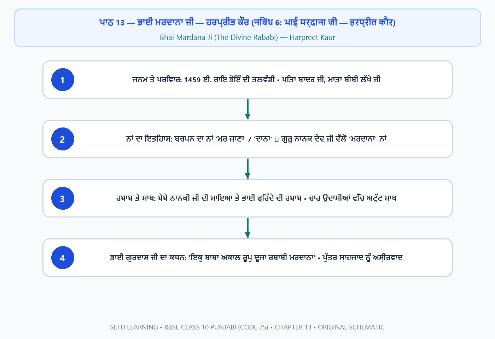

# ਪਾਠ 13 — ਭਾਈ ਮਰਦਾਨਾ ਜੀ — ਹਰਪ੍ਰੀਤ ਕੌਰ (निबंध 6: भाई मर्दाना जी — हरप्रीत कौर) (Bhai Mardana Ji (The Divine Rababi) — Harpreet Kaur)

## भाग 1: अध्याय प्रवेश एवं पाठ्यक्रम मैपिंग (ਪਾਠ-ਪ੍ਰਵੇਸ਼ ਅਤੇ ਪਾਠਕ੍ਰਮ ਮੈਪਿੰਗ)

> RBSE ਜਮਾਤ 10 ਪੰਜਾਬੀ ਪਾਠ-ਪੁਸਤਕ 'ਸਾਹਿਤ ਸੁਗੰਧੀਆਂ' ਦੇ ਸਾਰੇ ਪ੍ਰਸ਼ਨਾਂ ਦੇ ਹੱਲ ਅਤੇ 2014–2026 ਦਾ ਪੂਰਾ ਇਤਿਹਾਸਕ PYQ ਸੰਗ੍ਰਹਿ ਸਰੋਤ-ਪ੍ਰੀਖਣ ਸਮੇਤ ਸੰਕਲਿਤ ਹਨ।

**ਵਿਸ਼ਾ ਕੋਡ (विषय कोड):** 75 (ਤੀਜੀ ਭਾਸ਼ਾ — ਪੰਜਾਬੀ / तृतीया भाषा — पंजाबी) · **ਲੜੀ ਪੁਸਤਕ (श्रृंखला पुस्तक):** 7

**ਪ੍ਰਮਾਣਿਤ ਆਧਾਰ:** RBSE 2025–26 · **ਪਾਠ ਅੰਕ-ਭਾਰ:** 2 ਅੰਕ। ਇਹ ਭਾਰ ਉਸੇ ਸੰਸਕਰਣ ਦਾ ਹੈ; ਅਸਲ ਪ੍ਰਸ਼ਨ-ਵੰਡ ਦੀ ਭਵਿੱਖਬਾਣੀ ਨਹੀਂ।

**ਸਿੱਖਣ ਦੇ ਉਦੇਸ਼ (सीखने के लक्ष्य):** ਹਰਪ੍ਰੀਤ ਕੌਰ ਦੇ ਨਿਬੰਧ 'ਭਾਈ ਮਰਦਾਨਾ ਜੀ' ਦਾ ਸਾਰ, ਭਾਈ ਮਰਦਾਨਾ ਜੀ ਦਾ ਜਨਮ (1459 ਈ., ਤਲਵੰਡੀ), ਮਾਤਾ-ਪਿਤਾ, ਬਚਪਨ ਦਾ ਨਾਂ ('ਦਾਨਾ' / 'ਮਰ ਜਾਣਾ'), ਰਬਾਬ ਵਾਦਨ, ਗੁਰੂ ਨਾਨਕ ਦੇਵ ਜੀ ਨਾਲ ਉਦਾਸੀਆਂ ਅਤੇ ਪੁੱਤਰ ਸ਼ਾਹਜਾਦ ਨੂੰ ਮਿਲੇ ਅਸ਼ੀਰਵਾਦ ਬਾਰੇ ਸਮਝਣਾ।

## भाग 2: शब्दावली एवं अवधारणा कैप्सूल (ਸ਼ਬਦਾਵਲੀ ਅਤੇ ਸੰਕਲਪ ਕੈਪਸੂਲ)

| ਸ਼ਬਦ / ਸੰਕਲਪ | ਅਰਥ / ਵਿਆਖਿਆ |
|---|---|
| ਰਬਾਬੀ (रबाबी) | ਰਬਾਬ ਨਾਂ ਦਾ ਤੰਤੀ ਸਾਜ਼ ਵਜਾਉਣ ਵਾਲਾ ਸੰਗੀਤਕਾਰ (ਇਕੁ ਬਾਬਾ ਅਕਾਲ ਰੂਪੁ ਦੂਜਾ ਰਬਾਬੀ ਮਰਦਾਨਾ)। |
| ਮਰਾਸੀ / ਡੂੰਮ (मरासी / डूंम) | ਬੰਸਾਵਲੀ ਅਤੇ ਲੋਕ-ਸੰਗੀਤ ਗਾਉਣ ਵਾਲੀ ਜਾਤੀ ('ਤੁਸੀਂ ਖ਼ੁਦਾ ਦੇ ਡੂੰਮ ਹੋ, ਮੈਂ ਤੁਹਾਡਾ ਡੂੰਮ ਹਾਂ')। |
| ਰਾਇ ਭੋਇੰ ਦੀ ਤਲਵੰਡੀ (राइ भोइं दी तलवंडी) | ਨਨਕਾਣਾ ਸਾਹਿਬ (ਪਾਕਿਸਤਾਨ) — ਜਿੱਥੇ 1459 ਈ. ਵਿੱਚ ਭਾਈ ਮਰਦਾਨਾ ਜੀ ਅਤੇ 1469 ਈ. ਵਿੱਚ ਗੁਰੂ ਨਾਨਕ ਦੇਵ ਜੀ ਦਾ ਜਨਮ ਹੋਇਆ। |
| ਮਰ ਜਾਣਾ / ਦਾਨਾ (मर जाणा / दाना) | ਭਾਈ ਮਰਦਾਨਾ ਜੀ ਦੇ ਬਚਪਨ ਦੇ ਨਾਂ ਜੋ ਬਾਅਦ ਵਿੱਚ ਗੁਰੂ ਜੀ ਦੇ ਬਚਨਾਂ ਨਾਲ 'ਮਰਦਾਨਾ' ਬਣੇ। |
| ਬੇਬੇ ਨਾਨਕੀ ਜੀ (बेबे नानकी जी) | ਸ੍ਰੀ ਗੁਰੂ ਨਾਨਕ ਦੇਵ ਜੀ ਦੀ ਵੱਡੀ ਭੈਣ ਜਿਨ੍ਹਾਂ ਨੇ ਭਾਈ ਮਰਦਾਨਾ ਜੀ ਨੂੰ ਨਵੀਂ ਰਬਾਬ ਲੈਣ ਲਈ ਮਾਇਆ ਦਿੱਤੀ। |
| ਫ਼ਿਰੰਦਾ (फ़िरंदा) | ਉਹ ਰਬਾਬ-ਸਾਜ਼ ਕਾਰੀਗਰ ਜਿਸ ਨੇ ਭਾਈ ਮਰਦਾਨਾ ਜੀ ਲਈ ਅਲੌਕਿਕ ਰਬਾਬ ਤਿਆਰ ਕੀਤੀ। |
| ਉਦਾਸੀਆਂ (उदासीआं) | ਸ੍ਰੀ ਗੁਰੂ ਨਾਨਕ ਦੇਵ ਜੀ ਦੀਆਂ ਵਿਸ਼ਵ-ਕਲਿਆਣ ਯਾਤਰਾਵਾਂ ਜਿਨ੍ਹਾਂ ਵਿੱਚ ਭਾਈ ਮਰਦਾਨਾ ਜੀ ਸਾਥੀ ਰਹੇ। |
| ਸ਼ਾਹਜਾਦ (शाहजाद) | ਭਾਈ ਮਰਦਾਨਾ ਜੀ ਦਾ ਪੁੱਤਰ ਜਿਸ ਨੂੰ ਗੁਰੂ ਨਾਨਕ ਦੇਵ ਜੀ ਨੇ ਕੀਰਤਨ ਦੀ ਸੇਵਾ ਤੇ ਅਸ਼ੀਰਵਾਦ ਬਖ਼ਸ਼ਿਆ। |
| ਕੁਰਮ (कुरम) | ਅਫ਼ਗਾਨਿਸਤਾਨ/ਇਰਾਕ ਦੇ ਨੇੜੇ ਕੁਰਮ ਦਰਿਆ ਜਿੱਥੇ ਭਾਈ ਮਰਦਾਨਾ ਜੀ ਦਾ ਦਿਹਾਂਤ ਹੋਇਆ ਦੱਸਿਆ ਜਾਂਦਾ ਹੈ। |
| ਸਲੋਕ ਮਰਦਾਨਾ 1 (सलोक मरदाना 1) | ਸ੍ਰੀ ਗੁਰੂ ਗ੍ਰੰਥ ਸਾਹਿਬ ਦੇ ਬਿਹਾਗੜੇ ਕੀ ਵਾਰ ਵਿੱਚ ਭਾਈ ਮਰਦਾਨਾ ਜੀ ਨੂੰ ਸੰਬੋਧਿਤ ਤਿੰਨ ਸਲੋਕ। |

## भाग 3: विस्तृत शिक्षण पाठ (ਵਿਸਤ੍ਰਿਤ ਅਧਿਆਪਨ ਪਾਠ)

### 1. ਨਿਬੰਧ-ਪਛਾਣ: 'ਭਾਈ ਮਰਦਾਨਾ ਜੀ' (ਲੇਖਿਕਾ: ਹਰਪ੍ਰੀਤ ਕੌਰ)
**ਹਰਪ੍ਰੀਤ ਕੌਰ** ਰਚਿਤ ਨਿਬੰਧ **'ਭਾਈ ਮਰਦਾਨਾ ਜੀ'** ਸ੍ਰੀ ਗੁਰੂ ਨਾਨਕ ਦੇਵ ਜੀ ਦੇ ਬਚਪਨ ਦੇ ਸਖਾ, ਜੀਵਨ-ਭਰ ਦੇ ਸਾਥੀ ਅਤੇ ਪਹਿਲੇ ਰਬਾਬੀ ਕੀਰਤਨੀਏ ਭਾਈ ਮਰਦਾਨਾ ਜੀ ਦੇ ਜੀਵਨ, ਸੰਗੀਤ-ਕਲਾ ਅਤੇ ਸਮਰਪਣ ਉੱਤੇ ਆਧਾਰਿਤ ਹੈ।
- **ਭਾਈ ਗੁਰਦਾਸ ਜੀ ਦਾ ਕਥਨ (RBSE 2024 Main Q2-iv, 2026 Supp Q1-VIII):** ਭਾਈ ਗੁਰਦਾਸ ਜੀ ਨੇ ਆਪਣੀ ਵਾਰ ਵਿੱਚ ਭਾਈ ਮਰਦਾਨਾ ਜੀ ਦੀ ਮਹਿਮਾ ਕਰਦਿਆਂ ਲਿਖਿਆ ਹੈ —
  **'ਇਕੁ ਬਾਬਾ ਅਕਾਲ ਰੂਪੁ ਦੂਜਾ ਰਬਾਬੀ ਮਰਦਾਨਾ ॥'**

### 2. ਭਾਈ ਮਰਦਾਨਾ ਜੀ ਦਾ ਜਨਮ, ਮਾਤਾ-ਪਿਤਾ ਅਤੇ 'ਮਰਦਾਨਾ' ਨਾਂ ਕਿਵੇਂ ਪਿਆ? (RBSE 2018 Supp Q8-ਸ, 2020 Supp Q8-ੲ, 2025 Supp Q1-x, 2026 Supp Q2-V)
- **ਜਨਮ ਅਤੇ ਸਥਾਨ:** ਭਾਈ ਮਰਦਾਨਾ ਜੀ ਦਾ ਜਨਮ **ਸੰਨ 1459 ਈ.** (ਗੁਰੂ ਨਾਨਕ ਦੇਵ ਜੀ ਤੋਂ 10 ਸਾਲ ਪਹਿਲਾਂ) **ਰਾਇ ਭੋਇੰ ਦੀ ਤਲਵੰਡੀ** (ਹੁਣ ਨਨਕਾਣਾ ਸਾਹਿਬ, ਪਾਕਿਸਤਾਨ) ਵਿਖੇ ਮਰਾਸੀ (ਡੂੰਮ) ਪਰਿਵਾਰ ਵਿੱਚ ਹੋਇਆ।
- **ਮਾਤਾ-ਪਿਤਾ:** ਉਹਨਾਂ ਦੇ ਪਿਤਾ ਦਾ ਨਾਂ **ਬਾਦਰ ਜੀ (ਮੀਰ ਬਾਦਰੇ)** ਅਤੇ ਮਾਤਾ ਦਾ ਨਾਂ **ਬੀਬੀ ਲੱਖੋ ਜੀ** ਸੀ।
- **ਨਾਂ 'ਮਰਦਾਨਾ' ਕਿਵੇਂ ਪਿਆ?:** ਮਾਤਾ ਲੱਖੋ ਜੀ ਦੇ ਪਹਿਲਾਂ ਜਨਮੇ ਬੱਚੇ ਬਚਪਨ ਵਿੱਚ ਹੀ ਮਰ ਜਾਂਦੇ ਸਨ, ਇਸ ਲਈ ਅੰਧ-ਵਿਸ਼ਵਾਸ ਜਾਂ ਡਰ ਵੱਸ ਮਾਪਿਆਂ ਨੇ ਇਸ ਬਾਲਕ ਦਾ ਨਾਂ **'ਮਰ ਜਾਣਾ'** ਰੱਖ ਦਿੱਤਾ (ਅਤੇ ਕਈ ਸਰੋਤਾਂ ਅਨੁਸਾਰ **'ਦਾਨਾ'**)। ਜਦੋਂ ਬਾਲਕ ਗੁਰੂ ਨਾਨਕ ਦੇਵ ਜੀ ਨੇ ਇਹ ਸੁਣਿਆ ਤਾਂ ਉਹਨਾਂ ਨੇ ਪਿਆਰ ਤੇ ਸਤਿਕਾਰ ਨਾਲ ਕਿਹਾ ਕਿ ਇਹ 'ਮਰ ਜਾਣਾ' ਨਹੀਂ ਸਗੋਂ **'ਮਰਦਾਨਾ'** (ਮਰਦਾਂ ਵਰਗਾ ਸੂਰਮਾ / ਰੱਬ ਦਾ ਪਿਆਰਾ ਮਰਦ) ਹੈ, ਜਾਂ ਉਹਨਾਂ ਦੀ ਸਿਆਣਪ ਤੇ ਰਬਾਬ ਵਾਦਨ ਤੋਂ ਖੁਸ਼ ਹੋ ਕੇ ਕਿਹਾ — *'ਦਾਨਿਆ! ਤੂੰ ਮਰਦਾਨਾ ਹੋਇਆ'*। ਉਦੋਂ ਤੋਂ ਆਪ ਜੀ ਦਾ ਨਾਂ **'ਭਾਈ ਮਰਦਾਨਾ ਜੀ'** ਪੈ ਗਿਆ।

### 3. ਗੁਰੂ ਨਾਨਕ ਦੇਵ ਜੀ ਨਾਲ ਮਿਲਾਪ, ਰਬਾਬ ਅਤੇ ਉਦਾਸੀਆਂ
1. **ਸੱਚੀ ਨਿਮਰਤਾ ('ਤੁਸੀਂ ਖ਼ੁਦਾ ਦੇ ਡੂੰਮ ਹੋ, ਮੈਂ ਤੁਹਾਡਾ ਡੂੰਮ ਹਾਂ'):**
   - ਜਦੋਂ ਗੁਰੂ ਨਾਨਕ ਦੇਵ ਜੀ ਨੇ ਮਰਦਾਨੇ ਦੀ ਮਿੱਠੀ ਰਬਾਬ ਸੁਣੀ ਅਤੇ ਉਹਨਾਂ ਨੂੰ ਆਪਣੇ ਨਾਲ ਰਹਿ ਕੇ ਰੱਬੀ ਬਾਣੀ ਗਾਉਣ ਲਈ ਕਿਹਾ, ਤਾਂ ਭਾਈ ਮਰਦਾਨਾ ਜੀ ਨੇ ਬੜੀ ਨਿਮਰਤਾ ਨਾਲ ਬੇਨਤੀ ਕੀਤੀ — *"ਬਾਬਾ ਜੀ! ਤੁਸੀਂ ਖ਼ੁਦਾ (ਪਰਮਾਤਮਾ) ਦੇ ਡੂੰਮ (ਜਸ ਗਾਉਣ ਵਾਲੇ) ਹੋ ਅਤੇ ਮੈਂ ਤੁਹਾਡਾ ਡੂੰਮ ਹਾਂ।"*
2. **ਰਬਾਬ ਦੀ ਪ੍ਰਾਪਤੀ:**
   - ਸੁਲਤਾਨਪੁਰ ਲੋਧੀ ਵਿਖੇ **ਬੇਬੇ ਨਾਨਕੀ ਜੀ** ਨੇ ਭਾਈ ਮਰਦਾਨਾ ਜੀ ਨੂੰ ਨਵੀਂ ਰਬਾਬ ਲੈਣ ਲਈ ਮਾਇਆ ਦਿੱਤੀ ਅਤੇ ਭਾਈ **ਫ਼ਿਰੰਦੇ** ਪਾਸੋਂ ਸੁੰਦਰ ਰਬਾਬ ਪ੍ਰਾਪਤ ਹੋਈ। ਜਦੋਂ ਗੁਰੂ ਨਾਨਕ ਦੇਵ ਜੀ ਕਹਿੰਦੇ — **'ਮਰਦਾਨਿਆ! ਰਬਾਬ ਵਜਾ, ਬਾਣੀ ਆਈ ਹੈ'** — ਤਾਂ ਮਰਦਾਨਾ ਜੀ ਰਬਾਬ ਦੀਆਂ ਤਾਰਾਂ ਛੇੜ ਦਿੰਦੇ ਤੇ ਇਲਾਹੀ ਕੀਰਤਨ ਗੂੰਜ ਉੱਠਦਾ।
3. **ਚਾਰ ਉਦਾਸੀਆਂ ਵਿੱਚ ਸਾਥ:**
   - ਭਾਈ ਮਰਦਾਨਾ ਜੀ ਨੇ ਲਗਭਗ 45–50 ਸਾਲ ਗੁਰੂ ਨਾਨਕ ਦੇਵ ਜੀ ਦਾ ਸਾਥ ਨਿਭਾਇਆ ਅਤੇ ਦੇਸ਼-ਵਿਦੇਸ਼ ਦੀਆਂ ਲੰਮੀਆਂ ਤੇ ਕਠਿਨ ਉਦਾਸੀਆਂ (ਯਾਤਰਾਵਾਂ) ਵਿੱਚ ਭੁੱਖ-ਪਿਆਸ ਤੇ ਸਰਦੀ-ਗਰਮੀ ਸਹਾਰਦਿਆਂ ਹਮੇਸ਼ਾ ਗੁਰੂ ਜੀ ਦੇ ਨਾਲ ਰਹੇ।

### 4. ਭਾਈ ਮਰਦਾਨਾ ਜੀ ਦਾ ਅੰਤਿਮ ਸਮਾਂ ਅਤੇ ਪੁੱਤਰ ਸ਼ਾਹਜਾਦ ਨੂੰ ਗੁਰੂ ਜੀ ਦਾ ਅਸ਼ੀਰਵਾਦ (RBSE 2018 Main Q8-ਸ, 2020 Main Q8-ਸ, 2026 Supp Q15)
- **ਅੰਤਿਮ ਸਮਾਂ:** ਗੁਰੂ ਨਾਨਕ ਦੇਵ ਜੀ ਨੇ ਅੰਤਿਮ ਸਮੇਂ ਮਰਦਾਨਾ ਜੀ ਨੂੰ ਪੁੱਛਿਆ ਕਿ ਤੇਰੇ ਸਰੀਰ ਦਾ ਸਸਕਾਰ ਕਿਸ ਰੀਤ ਨਾਲ ਕੀਤਾ ਜਾਵੇ (ਹਿੰਦੂ ਵਾਂਗ ਜਲਾਇਆ ਜਾਵੇ ਜਾਂ ਮੁਸਲਮਾਨ ਵਾਂਗ ਦਫ਼ਨਾਇਆ ਜਾਵੇ)? ਭਾਈ ਮਰਦਾਨਾ ਜੀ ਨੇ ਉੱਤਰ ਦਿੱਤਾ ਕਿ ਬਾਬਾ ਜੀ, ਤੁਹਾਡੀ ਸੰਗਤ ਨਾਲ ਮੇਰੇ ਅੰਦਰੋਂ ਹਿੰਦੂ-ਮੁਸਲਮਾਨ ਦਾ ਭੇਦ ਮਿਟ ਚੁੱਕਾ ਹੈ, ਜੋ ਤੁਹਾਨੂੰ ਭਾਵੇ ਸੋ ਕਰੋ। ਗੁਰੂ ਜੀ ਨੇ ਆਪਣੇ ਹੱਥੀਂ ਉਹਨਾਂ ਦਾ ਅੰਤਿਮ ਸਸਕਾਰ ਕੀਤਾ।
- **ਪੁੱਤਰ ਸ਼ਾਹਜਾਦ ਨੂੰ ਅਸ਼ੀਰਵਾਦ (RBSE 2018 Main Q8-ਸ, 2020 Main Q8-ਸ, 2026 Supp Q15):** ਭਾਈ ਮਰਦਾਨਾ ਜੀ ਦੇ ਜੋਤੀ-ਜੋਤਿ ਸਮਾਉਣ ਮਗਰੋਂ ਗੁਰੂ ਨਾਨਕ ਦੇਵ ਜੀ ਨੇ ਉਹਨਾਂ ਦੇ ਪੁੱਤਰ **'ਸ਼ਾਹਜਾਦ'** ਦੇ ਸਿਰ ਉੱਤੇ ਦਸਤਾਰ ਬੰਨ੍ਹਾਈ, ਉਸ ਨੂੰ ਪਿਤਾ ਦੀ ਰਬਾਬ ਤੇ ਕੀਰਤਨ ਦੀ ਸੇਵਾ ਸੌਂਪੀ ਅਤੇ ਅਸ਼ੀਰਵਾਦ ਦਿੱਤਾ ਕਿ **ਜਿੰਨਾ ਚਿਰ ਸੰਸਾਰ ਵਿੱਚ ਗੁਰੂ ਨਾਨਕ ਦਾ ਨਾਮ ਅਤੇ ਸਿੱਖੀ ਰਹੇਗੀ, ਓਨਾ ਚਿਰ ਭਾਈ ਮਰਦਾਨਾ ਜੀ ਦਾ ਨਾਮ ਤੇ ਉਹਨਾਂ ਦੇ ਪਰਿਵਾਰ ਦਾ ਸਤਿਕਾਰ ਅਮਰ ਰਹੇਗਾ**।

ਪਾਠ 13: ਹਰਪ੍ਰੀਤ ਕੌਰ ਦੇ ਨਿਬੰਧ 'ਭਾਈ ਮਰਦਾਨਾ ਜੀ' ਦਾ ਸੰਕਲਪ ਚਿੱਤਰ

## भाग 4: पाठ्यपुस्तक-अवधारणाओं पर मौलिक हल किए उदाहरण (ਹੱਲ ਕੀਤੇ ਮਿਆਰੀ ਉਦਾਹਰਣ)

ਹੇਠਾਂ ਦਿੱਤੇ ਪ੍ਰਸ਼ਨ ਪਾਠ-ਪੁਸਤਕ 'ਸਾਹਿਤ ਸੁਗੰਧੀਆਂ' ਅਤੇ ਵਿਆਕਰਣ ਦੇ ਸੰਕਲਪਾਂ ਉੱਤੇ ਆਧਾਰਿਤ ਮੌਲਿਕ ਆਦਰਸ਼ ਹੱਲ ਹਨ।

**ਹੱਲ ਕੀਤਾ ਉਦਾਹਰਣ 1: ਭਾਈ ਮਰਦਾਨਾ ਜੀ ਦਾ ਨਾਂ 'ਮਰਦਾਨਾ' ਕਿਵੇਂ ਪਿਆ? (RBSE 2018 Supp Q8-ਸ, 2020 Supp Q8-ੲ)**

ਭਾਈ ਮਰਦਾਨਾ ਜੀ ਤੋਂ ਪਹਿਲਾਂ ਉਹਨਾਂ ਦੇ ਮਾਤਾ-ਪਿਤਾ (ਬੀਬੀ ਲੱਖੋ ਤੇ ਬਾਦਰ ਜੀ) ਦੇ ਜਨਮੇ ਬੱਚੇ ਛੋਟੀ ਉਮਰ ਵਿੱਚ ਮਰ ਜਾਂਦੇ ਸਨ, ਇਸ ਲਈ ਮਾਪਿਆਂ ਨੇ ਇਸ ਬਾਲਕ ਦਾ ਨਾਂ 'ਮਰ ਜਾਣਾ' (ਅਤੇ 'ਦਾਨਾ') ਰੱਖ ਦਿੱਤਾ ਸੀ। ਜਦੋਂ ਸ੍ਰੀ ਗੁਰੂ ਨਾਨਕ ਦੇਵ ਜੀ ਨੇ ਇਹ ਸੁਣਿਆ ਤਾਂ ਉਹਨਾਂ ਨੇ ਕਿਹਾ ਕਿ ਇਹ 'ਮਰ ਜਾਣਾ' ਨਹੀਂ ਸਗੋਂ ਰੱਬ ਦੇ ਰਾਹ 'ਤੇ ਚੱਲਣ ਵਾਲਾ ਸੂਰਮਾ 'ਮਰਦਾਨਾ' ਹੈ। ਗੁਰੂ ਜੀ ਦੇ ਬਚਨਾਂ ਨਾਲ ਹੀ ਉਹਨਾਂ ਦਾ ਨਾਂ 'ਭਾਈ ਮਰਦਾਨਾ ਜੀ' ਪੈ ਗਿਆ (RBSE 2018 Supp Q8-ਸ, 2020 Supp Q8-ੲ)।

**ਹੱਲ ਕੀਤਾ ਉਦਾਹਰਣ 2: ਭਾਈ ਮਰਦਾਨਾ ਜੀ ਦੇ ਪੁੱਤਰ ਨੂੰ ਗੁਰੂ ਜੀ ਨੇ ਕੀ ਅਸ਼ੀਰਵਾਦ ਦਿੱਤਾ? (RBSE 2018 Main Q8-ਸ, 2020 Main Q8-ਸ, 2026 Supp Q15)**

ਭਾਈ ਮਰਦਾਨਾ ਜੀ ਦੇ ਅਕਾਲ ਚਲਾਣੇ ਤੋਂ ਬਾਅਦ ਸ੍ਰੀ ਗੁਰੂ ਨਾਨਕ ਦੇਵ ਜੀ ਨੇ ਉਹਨਾਂ ਦੇ ਪੁੱਤਰ **'ਸ਼ਾਹਜਾਦ'** ਨੂੰ ਆਪਣੇ ਗਲ ਨਾਲ ਲਾਇਆ, ਉਸ ਦੇ ਸਿਰ ਉੱਤੇ ਦਸਤਾਰ ਬੰਨ੍ਹਾਈ, ਉਸ ਨੂੰ ਪਿਤਾ ਵਾਂਗ ਰਬਾਬ ਵਜਾ ਕੇ ਗੁਰਬਾਣੀ ਕੀਰਤਨ ਕਰਨ ਦੀ ਸੇਵਾ ਬਖ਼ਸ਼ੀ ਅਤੇ ਅਸ਼ੀਰਵਾਦ ਦਿੱਤਾ ਕਿ ਤੇਰੇ ਪਿਤਾ ਮਰਦਾਨੇ ਦਾ ਨਾਮ ਮੇਰੇ ਨਾਮ ਦੇ ਨਾਲ ਹਮੇਸ਼ਾ ਅਮਰ ਰਹੇਗਾ ਅਤੇ ਗੁਰੂ-ਘਰ ਵਿੱਚ ਤੇਰੀ ਕੁਲ ਦਾ ਸਦਾ ਆਦਰ-ਸਤਿਕਾਰ ਹੋਵੇਗਾ (RBSE 2018 Main Q8-ਸ, 2020 Main Q8-ਸ, 2026 Supp Q15)।

**ਹੱਲ ਕੀਤਾ ਉਦਾਹਰਣ 3: 'ਇਕੁ ਬਾਬਾ ਅਕਾਲ ਰੂਪੁ ਦੂਜਾ ਰਬਾਬੀ ਮਰਦਾਨਾ' — ਇਹ ਸਤਰ ਕਿਸ ਮਹਾਨ ਲਿਖਾਰੀ ਦੀ ਹੈ ਅਤੇ ਇਸ ਦਾ ਕੀ ਭਾਵ ਹੈ?**

ਇਹ ਸਤਰ ਮਹਾਨ ਸਿੱਖ ਵਿਦਵਾਨ ਅਤੇ ਕਵੀ **ਭਾਈ ਗੁਰਦਾਸ ਜੀ** ਦੀ ਪਹਿਲੀ ਵਾਰ ਵਿੱਚੋਂ ਹੈ (RBSE 2024 Main Q2-iv, 2026 Supp Q1-VIII)। ਇਸ ਦਾ ਭਾਵ ਹੈ ਕਿ ਸੰਸਾਰ ਦਾ ਉਧਾਰ ਕਰਨ ਲਈ ਪਹਿਲਾ ਰੂਪ ਅਕਾਲ ਪੁਰਖ ਵਰਗੇ ਸ੍ਰੀ ਗੁਰੂ ਨਾਨਕ ਦੇਵ ਜੀ ਸਨ ਅਤੇ ਉਹਨਾਂ ਦੇ ਨਾਲ ਦੂਜਾ ਅਨਿੱਖੜਵਾਂ ਰੂਪ ਰਬਾਬ ਵਜਾਉਣ ਵਾਲੇ ਭਾਈ ਮਰਦਾਨਾ ਜੀ ਸਨ।

## भाग 5: सत्यापित बोर्ड प्रश्न एवं स्रोत-स्थिति (ਪ੍ਰਮਾਣਿਤ ਬੋਰਡ ਪ੍ਰਸ਼ਨ ਅਤੇ ਸਰੋਤ-ਸਥਿਤੀ)

RBSE 2026 Supp (`S-75`, Q1-VIII, Q2-V, Q15), 2025 Supp (Q1-x) ਅਤੇ 2024 Main (Q2-iv, Q18) ਵਿੱਚ 'ਭਾਈ ਮਰਦਾਨਾ ਜੀ' ਨਿਬੰਧ ਦੇ ਪ੍ਰਸ਼ਨ ਸਿੱਧੇ ਪੁੱਛੇ ਗਏ ਹਨ।

[RBSE 2026 ਮੂਲ ਪੇਪਰ (S-75)](https://rajeduboard.rajasthan.gov.in/books/PAPERS-2026/Sec/S-75.pdf)। ਪ੍ਰਸ਼ਨ ਦਾ ਸੰਖੇਪ ਵਿਸ਼ਾ-ਸੰਦਰਭ ਹੈ; ਸ਼ਬਦ-ਬ-ਸ਼ਬਦ ਪੁਨਰ-ਮੁਦਰਣ ਨਹੀਂ।

## भाग 6: खंडवार मौलिक अभ्यास बैंक (ਖੰਡ-ਵਾਰ ਮੌਲਿਕ ਅਭਿਆਸ ਬੈਂਕ)

**ਅਭਿਆਸ-ਅੰਕ:** ਵਿਦਿਆਰਥੀਆਂ ਦੇ ਸਵੈ-ਅਭਿਆਸ ਲਈ ਹਨ; ਉੱਤਰ ਪਹਿਲਾਂ ਆਪ ਲਿਖੋ, ਫਿਰ ਭਾਗ 9 ਵੇਖੋ।

## ੳ: ਬਹੁ-ਵਿਕਲਪੀ ਪ੍ਰਸ਼ਨ (MCQ) — 15 × 1 ਅੰਕ

**MCQ 1. ਭਾਈ ਮਰਦਾਨਾ ਜੀ ਦਾ ਜਨਮ ਕਿੱਥੇ ਹੋਇਆ? (RBSE 2025 Supp Q1-x)**

ੳ) ਸੁਲਤਾਨਪੁਰ ਲੋਧੀ  
ਅ) ਸ਼ੇਖੂਪੁਰਾ  
ੲ) ਕਰਤਾਰਪੁਰ  
ਸ) ਰਾਇ ਭੋਇੰ ਦੀ ਤਲਵੰਡੀ

**MCQ 2. ਖਾਲੀ ਥਾਂ ਭਰੋ: 'ਭਾਈ ਮਰਦਾਨਾ ਜੀ ਦਾ ਜਨਮ ................ ਈ. ਨੂੰ ਹੋਇਆ।' (RBSE 2026 Supp Q2-V)**

ੳ) 1479  
ਅ) 1534  
ੲ) 1459  
ਸ) 1469

**MCQ 3. 'ਇਕੁ ਬਾਬਾ ਅਕਾਲ ਰੂਪੁ ਦੂਜਾ ਰਬਾਬੀ ਮਰਦਾਨਾ' — ਇਹ ਸਤਰ ਕਿਸ ਮਹਾਨ ਲਿਖਾਰੀ ਦੀ ਹੈ? (RBSE 2026 Supp Q1-VIII)**

ੳ) ਸੰਤ ਮਸਕੀਨ ਜੀ ਦੀ  
ਅ) ਭਾਈ ਗੁਰਦਾਸ ਜੀ ਦੀ  
ੲ) ਪ੍ਰੋ. ਸਾਹਿਬ ਸਿੰਘ ਦੀ  
ਸ) ਭਾਈ ਕਾਨ੍ਹ ਸਿੰਘ ਨਾਭਾ ਦੀ

**MCQ 4. 'ਭਾਈ ਮਰਦਾਨਾ ਜੀ' ਨਿਬੰਧ ਦੀ ਲੇਖਿਕਾ ਕੌਣ ਹੈ?**

ੳ) ਹਰਪ੍ਰੀਤ ਕੌਰ  
ਅ) ਅੰਮ੍ਰਿਤਾ ਪ੍ਰੀਤਮ  
ੲ) ਦਲੀਪ ਕੌਰ ਟਿਵਾਣਾ  
ਸ) ਅਜੀਤ ਕੌਰ

**MCQ 5. ਭਾਈ ਮਰਦਾਨਾ ਜੀ ਦੇ ਮਾਤਾ ਅਤੇ ਪਿਤਾ ਦਾ ਕੀ ਨਾਂ ਸੀ?**

ੳ) ਮਾਤਾ ਤ੍ਰਿਪਤਾ ਜੀ ਅਤੇ ਪਿਤਾ ਮਹਿਤਾ ਕਾਲੂ ਜੀ  
ਅ) ਮਾਤਾ ਦਇਆ ਕੌਰ ਅਤੇ ਪਿਤਾ ਹਰੀਦਾਸ  
ੲ) ਮਾਤਾ ਜੀਵਨੀ ਅਤੇ ਪਿਤਾ ਈਸ਼ਰ ਦਾਸ  
ਸ) ਮਾਤਾ ਬੀਬੀ ਲੱਖੋ ਜੀ ਅਤੇ ਪਿਤਾ ਬਾਦਰ ਜੀ

**MCQ 6. ਭਾਈ ਮਰਦਾਨਾ ਜੀ ਦੇ ਬਚਪਨ ਦਾ ਨਾਂ ਮਾਪਿਆਂ ਨੇ ਕੀ ਰੱਖਿਆ ਸੀ?**

ੳ) ਫ਼ਿਰੰਦਾ  
ਅ) ਸੱਜਣ  
ੲ) ਮਰ ਜਾਣਾ / ਦਾਨਾ  
ਸ) ਸ਼ਾਹਜਾਦ

**MCQ 7. ਭਾਈ ਮਰਦਾਨਾ ਜੀ ਕਿਹੜਾ ਤੰਤੀ ਸਾਜ਼ ਵਜਾਉਂਦੇ ਸਨ?**

ੳ) ਵੰਝਲੀ  
ਅ) ਰਬਾਬ  
ੲ) ਸਿਤਾਰ  
ਸ) ਤੂੰਬੀ

**MCQ 8. ਭਾਈ ਮਰਦਾਨਾ ਜੀ ਦੇ ਪੁੱਤਰ ਦਾ ਕੀ ਨਾਂ ਸੀ ਜਿਸ ਨੂੰ ਗੁਰੂ ਨਾਨਕ ਦੇਵ ਜੀ ਨੇ ਦਸਤਾਰ ਬੰਨ੍ਹਾਈ ਤੇ ਅਸ਼ੀਰਵਾਦ ਦਿੱਤਾ?**

ੳ) ਸ਼ਾਹਜਾਦ  
ਅ) ਸ੍ਰੀ ਚੰਦ  
ੲ) ਲੱਖਮੀ ਦਾਸ  
ਸ) ਬਲਵੰਡ

**MCQ 9. ਭਾਈ ਮਰਦਾਨਾ ਜੀ ਉਮਰ ਵਿੱਚ ਸ੍ਰੀ ਗੁਰੂ ਨਾਨਕ ਦੇਵ ਜੀ ਤੋਂ ਕਿੰਨੇ ਸਾਲ ਵੱਡੇ ਸਨ?**

ੳ) 5 ਸਾਲ  
ਅ) 15 ਸਾਲ  
ੲ) 20 ਸਾਲ  
ਸ) 10 ਸਾਲ (ਜਨਮ 1459 ਈ. ਬਨਾਮ 1469 ਈ.)

**MCQ 10. ਭਾਈ ਮਰਦਾਨਾ ਜੀ ਨੂੰ ਨਵੀਂ ਰਬਾਬ ਖਰੀਦਣ ਲਈ ਮਾਇਆ ਕਿਸ ਨੇ ਦਿੱਤੀ ਸੀ?**

ੳ) ਮਹਿਤਾ ਕਾਲੂ ਜੀ ਨੇ  
ਅ) ਨਵਾਬ ਦੌਲਤ ਖ਼ਾਨ ਨੇ  
ੲ) ਬੇਬੇ ਨਾਨਕੀ ਜੀ ਨੇ  
ਸ) ਰਾਇ ਬੁਲਾਰ ਨੇ

**MCQ 11. 'ਤੁਸੀਂ ਖ਼ੁਦਾ ਦੇ ਡੂੰਮ ਹੋ, ਮੈਂ ਤੁਹਾਡਾ ਡੂੰਮ ਹਾਂ' — ਇਹ ਸ਼ਬਦ ਕਿਸ ਨੇ ਕਿਸ ਨੂੰ ਕਹੇ?**

ੳ) ਫ਼ਿਰੰਦੇ ਨੇ ਮਰਦਾਨਾ ਜੀ ਨੂੰ  
ਅ) ਭਾਈ ਮਰਦਾਨਾ ਜੀ ਨੇ ਸ੍ਰੀ ਗੁਰੂ ਨਾਨਕ ਦੇਵ ਜੀ ਨੂੰ  
ੲ) ਭਾਈ ਗੁਰਦਾਸ ਜੀ ਨੇ ਗੁਰੂ ਅਰਜਨ ਦੇਵ ਜੀ ਨੂੰ  
ਸ) ਸ਼ਾਹਜਾਦ ਨੇ ਭਾਈ ਮਰਦਾਨਾ ਜੀ ਨੂੰ

**MCQ 12. ਭਾਈ ਮਰਦਾਨਾ ਜੀ ਦਾ ਜਨਮ ਕਿਸ ਜਾਤੀ/ਪਰਿਵਾਰ ਵਿੱਚ ਹੋਇਆ ਸੀ?**

ੳ) ਮਰਾਸੀ (ਡੂੰਮ) ਪਰਿਵਾਰ ਵਿੱਚ  
ਅ) ਖੱਤਰੀ ਪਰਿਵਾਰ ਵਿੱਚ  
ੲ) ਜੱਟ ਪਰਿਵਾਰ ਵਿੱਚ  
ਸ) ਬ੍ਰਾਹਮਣ ਪਰਿਵਾਰ ਵਿੱਚ

**MCQ 13. ਭਾਈ ਮਰਦਾਨਾ ਜੀ ਲਈ ਅਲੌਕਿਕ ਰਬਾਬ ਕਿਸ ਕਾਰੀਗਰ ਨੇ ਤਿਆਰ ਕੀਤੀ ਸੀ?**

ੳ) ਗੰਗਾ ਦੀਨ ਨੇ  
ਅ) ਭਾਈ ਲਾਲੋ ਨੇ  
ੲ) ਮੀਆਂ ਮੀਰ ਨੇ  
ਸ) ਭਾਈ ਫ਼ਿਰੰਦੇ ਨੇ

**MCQ 14. ਭਾਈ ਮਰਦਾਨਾ ਜੀ ਦਾ ਅੰਤਿਮ ਸਸਕਾਰ ਕਿਸ ਨੇ ਆਪਣੇ ਹੱਥੀਂ ਕੀਤਾ?**

ੳ) ਬਾਬਰ ਨੇ  
ਅ) ਭਾਈ ਗੁਰਦਾਸ ਜੀ ਨੇ  
ੲ) ਸ੍ਰੀ ਗੁਰੂ ਨਾਨਕ ਦੇਵ ਜੀ ਨੇ  
ਸ) ਰਾਇ ਬੁਲਾਰ ਨੇ

**MCQ 15. ਸ੍ਰੀ ਗੁਰੂ ਗ੍ਰੰਥ ਸਾਹਿਬ ਦੀ ਕਿਹੜੀ ਵਾਰ ਵਿੱਚ 'ਮਰਦਾਨਾ 1' ਸਿਰਲੇਖ ਹੇਠ ਤਿੰਨ ਸਲੋਕ ਦਰਜ ਹਨ?**

ੳ) ਸੂਹੀ ਕੀ ਵਾਰ ਵਿੱਚ  
ਅ) ਬਿਹਾਗੜੇ ਕੀ ਵਾਰ ਵਿੱਚ  
ੲ) ਆਸਾ ਦੀ ਵਾਰ ਵਿੱਚ  
ਸ) ਮਾਝ ਦੀ ਵਾਰ ਵਿੱਚ

## ੳ: ਖਾਲੀ ਥਾਵਾਂ ਭਰੋ — 6 × 1 ਅੰਕ

1. ਰਬਾਬ ਨਾਂ ਦਾ ਤੰਤੀ ਸਾਜ਼ ਵਜਾਉਣ ਵਾਲਾ ਸੰਗੀਤਕਾਰ (ਇਕੁ ਬਾਬਾ ਅਕਾਲ ਰੂਪੁ ਦੂਜਾ ਰਬਾਬੀ ਮਰਦਾਨਾ)। — ਇਸ ਸ਼ਬਦ/ਸੰਕਲਪ ਦਾ ਨਾਂ ਹੈ: ____।  
2. ਬੰਸਾਵਲੀ ਅਤੇ ਲੋਕ-ਸੰਗੀਤ ਗਾਉਣ ਵਾਲੀ ਜਾਤੀ ('ਤੁਸੀਂ ਖ਼ੁਦਾ ਦੇ ਡੂੰਮ ਹੋ, ਮੈਂ ਤੁਹਾਡਾ ਡੂੰਮ ਹਾਂ')। — ਇਸ ਸ਼ਬਦ/ਸੰਕਲਪ ਦਾ ਨਾਂ ਹੈ: ____।  
3. ਨਨਕਾਣਾ ਸਾਹਿਬ (ਪਾਕਿਸਤਾਨ) — ਜਿੱਥੇ 1459 ਈ. ਵਿੱਚ ਭਾਈ ਮਰਦਾਨਾ ਜੀ ਅਤੇ 1469 ਈ. ਵਿੱਚ ਗੁਰੂ ਨਾਨਕ ਦੇਵ ਜੀ ਦਾ ਜਨਮ ਹੋਇਆ। — ਇਸ ਸ਼ਬਦ/ਸੰਕਲਪ ਦਾ ਨਾਂ ਹੈ: ____।  
4. ਭਾਈ ਮਰਦਾਨਾ ਜੀ ਦੇ ਬਚਪਨ ਦੇ ਨਾਂ ਜੋ ਬਾਅਦ ਵਿੱਚ ਗੁਰੂ ਜੀ ਦੇ ਬਚਨਾਂ ਨਾਲ 'ਮਰਦਾਨਾ' ਬਣੇ। — ਇਸ ਸ਼ਬਦ/ਸੰਕਲਪ ਦਾ ਨਾਂ ਹੈ: ____।  
5. ਸ੍ਰੀ ਗੁਰੂ ਨਾਨਕ ਦੇਵ ਜੀ ਦੀ ਵੱਡੀ ਭੈਣ ਜਿਨ੍ਹਾਂ ਨੇ ਭਾਈ ਮਰਦਾਨਾ ਜੀ ਨੂੰ ਨਵੀਂ ਰਬਾਬ ਲੈਣ ਲਈ ਮਾਇਆ ਦਿੱਤੀ। — ਇਸ ਸ਼ਬਦ/ਸੰਕਲਪ ਦਾ ਨਾਂ ਹੈ: ____।  
6. ਉਹ ਰਬਾਬ-ਸਾਜ਼ ਕਾਰੀਗਰ ਜਿਸ ਨੇ ਭਾਈ ਮਰਦਾਨਾ ਜੀ ਲਈ ਅਲੌਕਿਕ ਰਬਾਬ ਤਿਆਰ ਕੀਤੀ। — ਇਸ ਸ਼ਬਦ/ਸੰਕਲਪ ਦਾ ਨਾਂ ਹੈ: ____।

## ੳ: ਅਤਿ-ਲਘੂ ਉੱਤਰਾਂ ਵਾਲੇ ਪ੍ਰਸ਼ਨ — 8 × 1 ਅੰਕ

1. ਭਾਈ ਮਰਦਾਨਾ ਜੀ ਦਾ ਜਨਮ ਕਿੱਥੇ ਹੋਇਆ? (RBSE 2025 Supp Q1-x)  
2. ਖਾਲੀ ਥਾਂ ਭਰੋ: 'ਭਾਈ ਮਰਦਾਨਾ ਜੀ ਦਾ ਜਨਮ ................ ਈ. ਨੂੰ ਹੋਇਆ।' (RBSE 2026 Supp Q2-V)  
3. 'ਇਕੁ ਬਾਬਾ ਅਕਾਲ ਰੂਪੁ ਦੂਜਾ ਰਬਾਬੀ ਮਰਦਾਨਾ' — ਇਹ ਸਤਰ ਕਿਸ ਮਹਾਨ ਲਿਖਾਰੀ ਦੀ ਹੈ? (RBSE 2026 Supp Q1-VIII)  
4. 'ਭਾਈ ਮਰਦਾਨਾ ਜੀ' ਨਿਬੰਧ ਦੀ ਲੇਖਿਕਾ ਕੌਣ ਹੈ?  
5. ਭਾਈ ਮਰਦਾਨਾ ਜੀ ਦੇ ਮਾਤਾ ਅਤੇ ਪਿਤਾ ਦਾ ਕੀ ਨਾਂ ਸੀ?  
6. ਭਾਈ ਮਰਦਾਨਾ ਜੀ ਦੇ ਬਚਪਨ ਦਾ ਨਾਂ ਮਾਪਿਆਂ ਨੇ ਕੀ ਰੱਖਿਆ ਸੀ?  
7. ਭਾਈ ਮਰਦਾਨਾ ਜੀ ਕਿਹੜਾ ਤੰਤੀ ਸਾਜ਼ ਵਜਾਉਂਦੇ ਸਨ?  
8. ਭਾਈ ਮਰਦਾਨਾ ਜੀ ਦੇ ਪੁੱਤਰ ਦਾ ਕੀ ਨਾਂ ਸੀ ਜਿਸ ਨੂੰ ਗੁਰੂ ਨਾਨਕ ਦੇਵ ਜੀ ਨੇ ਦਸਤਾਰ ਬੰਨ੍ਹਾਈ ਤੇ ਅਸ਼ੀਰਵਾਦ ਦਿੱਤਾ?

## ਅ: ਲਘੂ ਉੱਤਰਾਂ ਵਾਲੇ ਪ੍ਰਸ਼ਨ — 6 × 2 ਅੰਕ

**B1.** ਭਾਈ ਮਰਦਾਨਾ ਜੀ ਦਾ ਜਨਮ ਕਦੋਂ ਅਤੇ ਕਿੱਥੇ ਹੋਇਆ?

**B2.** ਭਾਈ ਮਰਦਾਨਾ ਜੀ ਦੇ ਮਾਤਾ ਅਤੇ ਪਿਤਾ ਦਾ ਕੀ ਨਾਂ ਸੀ?

**B3.** 'ਭਾਈ ਮਰਦਾਨਾ ਜੀ' ਨਿਬੰਧ ਦੀ ਲੇਖਿਕਾ ਕੌਣ ਹੈ?

**B4.** ਖਾਲੀ ਥਾਂ ਭਰੋ: 'ਇਕੁ ਬਾਬਾ ਅਕਾਲ ਰੂਪੁ ਦੂਜਾ ................' (RBSE 2024 Main Q2-iv)

**B5.** ਭਾਈ ਮਰਦਾਨਾ ਜੀ ਕਿਹੜਾ ਸਾਜ਼ ਵਜਾਉਂਦੇ ਸਨ ਅਤੇ ਉਹਨਾਂ ਨੂੰ ਨਵਾਂ ਸਾਜ਼ ਲੈਣ ਲਈ ਮਾਇਆ ਕਿਸ ਨੇ ਦਿੱਤੀ?

**B6.** ਭਾਈ ਮਰਦਾਨਾ ਜੀ ਦੇ ਪੁੱਤਰ ਦਾ ਕੀ ਨਾਂ ਸੀ?

## ੲ: ਦੀਰਘ ਉੱਤਰਾਂ ਵਾਲੇ ਪ੍ਰਸ਼ਨ — 4 × 3 ਅੰਕ

ਅੰਦਰੂਨੀ ਵਿਕਲਪ ਅਭਿਆਸ: ਪਹਿਲਾਂ ਇੱਕ ਵਿਕਲਪ ਹੱਲ ਕਰੋ ਅਤੇ ਦੁਹਰਾਈ ਵੇਲੇ ਬਾਕੀ ਪ੍ਰਸ਼ਨ ਵੀ ਹੱਲ ਕਰੋ।

**C1.** 'ਭਾਈ ਮਰਦਾਨਾ ਜੀ' ਲੇਖ ਦਾ ਸਾਰ ਆਪਣੇ ਸ਼ਬਦਾਂ ਵਿੱਚ ਲਿਖੋ। (RBSE 2019 Main Q9, 2024 Main Q18)

**C2.** ਭਾਈ ਮਰਦਾਨਾ ਜੀ ਅਤੇ ਸ੍ਰੀ ਗੁਰੂ ਨਾਨਕ ਦੇਵ ਜੀ ਦੇ ਅਟੁੱਟ ਪਿਆਰ ਅਤੇ ਸਾਥ ਦਾ ਵਰਣਨ ਕਰੋ।

**C3.** ਭਾਈ ਮਰਦਾਨਾ ਜੀ ਦੇ ਅੰਤਿਮ ਸਮੇਂ ਦੀ ਵਾਰਤਾਲਾਪ ਅਤੇ ਸਸਕਾਰ ਬਾਰੇ ਲਿਖੋ।

**C4.** ਸਿੱਖ ਇਤਿਹਾਸ ਅਤੇ ਗੁਰਮਤਿ ਸੰਗੀਤ ਵਿੱਚ ਭਾਈ ਮਰਦਾਨਾ ਜੀ ਦਾ ਕੀ ਸਥਾਨ ਹੈ?

## ਸ: ਨਿਬੰਧਾਤਮਕ / ਵਿਸਤ੍ਰਿਤ ਉੱਤਰਾਂ ਵਾਲੇ ਪ੍ਰਸ਼ਨ — 2 × 4 ਅੰਕ

ਅੰਦਰੂਨੀ ਵਿਕਲਪ ਅਭਿਆਸ: D1 ਜਾਂ D2 ਚੁਣੋ; ਬਾਅਦ ਵਿੱਚ ਦੂਜਾ ਵੀ ਹੱਲ ਕਰੋ।

**D1.** 'ਇਕੁ ਬਾਬਾ ਅਕਾਲ ਰੂਪੁ ਦੂਜਾ ਰਬਾਬੀ ਮਰਦਾਨਾ' — ਇਸ ਕਥਨ ਦੀ ਰੌਸ਼ਨੀ ਵਿੱਚ ਭਾਈ ਮਰਦਾਨਾ ਜੀ ਦੇ ਜੀਵਨ, ਸ਼ਖ਼ਸੀਅਤ ਅਤੇ ਗੁਰਮਤਿ ਸੰਗੀਤ ਨੂੰ ਦੇਣ ਬਾਰੇ ਵਿਸਤਾਰ ਨਾਲ ਲਿਖੋ।

**D2.** ਭਾਈ ਮਰਦਾਨਾ ਜੀ ਦੇ ਬਚਪਨ, ਨਾਂ ਪੈਣ ਦੀ ਘਟਨਾ, ਰਬਾਬ ਦੀ ਪ੍ਰਾਪਤੀ ਅਤੇ ਪੁੱਤਰ ਸ਼ਾਹਜਾਦ ਨੂੰ ਮਿਲੇ ਅਸ਼ੀਰਵਾਦ ਦਾ ਕ੍ਰਮਵਾਰ ਵਰਣਨ ਕਰੋ।

## भाग 7: सावधानियाँ एवं परीक्षा-त्रुटियाँ (ਸਾਵਧਾਨੀਆਂ ਅਤੇ ਪ੍ਰੀਖਿਆ-ਗ਼ਲਤੀਆਂ)

- **ਗ਼ਲਤੀ 1:** ਭਾਈ ਮਰਦਾਨਾ ਜੀ ਦਾ ਜਨਮ ਸਾਲ 1469 ਲਿਖ ਦੇਣਾ — 1469 ਈ. ਵਿੱਚ ਸ੍ਰੀ ਗੁਰੂ ਨਾਨਕ ਦੇਵ ਜੀ ਦਾ ਜਨਮ ਹੋਇਆ ਸੀ; **ਭਾਈ ਮਰਦਾਨਾ ਜੀ ਗੁਰੂ ਜੀ ਤੋਂ 10 ਸਾਲ ਵੱਡੇ ਸਨ, ਉਹਨਾਂ ਦਾ ਜਨਮ 1459 ਈ. ਵਿੱਚ ਹੋਇਆ** (RBSE 2026 Supp Q2-V)।
- **ਗ਼ਲਤੀ 2:** 'ਇਕੁ ਬਾਬਾ ਅਕਾਲ ਰੂਪੁ ਦੂਜਾ ਰਬਾਬੀ ਮਰਦਾਨਾ' ਦਾ ਲੇਖਕ ਹਰਪ੍ਰੀਤ ਕੌਰ ਲਿਖ ਦੇਣਾ — ਨਿਬੰਧ ਦੀ ਲੇਖਿਕਾ ਹਰਪ੍ਰੀਤ ਕੌਰ ਹੈ, ਪਰ ਇਹ ਪ੍ਰਸਿੱਧ ਕਾਵਿ-ਤੁਕ **ਭਾਈ ਗੁਰਦਾਸ ਜੀ** ਦੀ ਹੈ (RBSE 2026 Supp Q1-VIII)।

## भाग 8: फटाफट पुनरावृत्ति — 25 बिंदु (ਫਟਾਫਟ ਦੁਹਰਾਈ — 25 ਬਿੰਦੂ)

1. ਰਬਾਬੀ (रबाबी): ਰਬਾਬ ਨਾਂ ਦਾ ਤੰਤੀ ਸਾਜ਼ ਵਜਾਉਣ ਵਾਲਾ ਸੰਗੀਤਕਾਰ (ਇਕੁ ਬਾਬਾ ਅਕਾਲ ਰੂਪੁ ਦੂਜਾ ਰਬਾਬੀ ਮਰਦਾਨਾ)।  
2. ਮਰਾਸੀ / ਡੂੰਮ (मरासी / डूंम): ਬੰਸਾਵਲੀ ਅਤੇ ਲੋਕ-ਸੰਗੀਤ ਗਾਉਣ ਵਾਲੀ ਜਾਤੀ ('ਤੁਸੀਂ ਖ਼ੁਦਾ ਦੇ ਡੂੰਮ ਹੋ, ਮੈਂ ਤੁਹਾਡਾ ਡੂੰਮ ਹਾਂ')।  
3. ਰਾਇ ਭੋਇੰ ਦੀ ਤਲਵੰਡੀ (राइ भोइं दी तलवंडी): ਨਨਕਾਣਾ ਸਾਹਿਬ (ਪਾਕਿਸਤਾਨ) — ਜਿੱਥੇ 1459 ਈ. ਵਿੱਚ ਭਾਈ ਮਰਦਾਨਾ ਜੀ ਅਤੇ 1469 ਈ. ਵਿੱਚ ਗੁਰੂ ਨਾਨਕ ਦੇਵ ਜੀ ਦਾ ਜਨਮ ਹੋਇਆ।  
4. ਮਰ ਜਾਣਾ / ਦਾਨਾ (मर जाणा / दाना): ਭਾਈ ਮਰਦਾਨਾ ਜੀ ਦੇ ਬਚਪਨ ਦੇ ਨਾਂ ਜੋ ਬਾਅਦ ਵਿੱਚ ਗੁਰੂ ਜੀ ਦੇ ਬਚਨਾਂ ਨਾਲ 'ਮਰਦਾਨਾ' ਬਣੇ।  
5. ਬੇਬੇ ਨਾਨਕੀ ਜੀ (बेबे नानकी जी): ਸ੍ਰੀ ਗੁਰੂ ਨਾਨਕ ਦੇਵ ਜੀ ਦੀ ਵੱਡੀ ਭੈਣ ਜਿਨ੍ਹਾਂ ਨੇ ਭਾਈ ਮਰਦਾਨਾ ਜੀ ਨੂੰ ਨਵੀਂ ਰਬਾਬ ਲੈਣ ਲਈ ਮਾਇਆ ਦਿੱਤੀ।  
6. ਫ਼ਿਰੰਦਾ (फ़िरंदा): ਉਹ ਰਬਾਬ-ਸਾਜ਼ ਕਾਰੀਗਰ ਜਿਸ ਨੇ ਭਾਈ ਮਰਦਾਨਾ ਜੀ ਲਈ ਅਲੌਕਿਕ ਰਬਾਬ ਤਿਆਰ ਕੀਤੀ।  
7. ਉਦਾਸੀਆਂ (उदासीआं): ਸ੍ਰੀ ਗੁਰੂ ਨਾਨਕ ਦੇਵ ਜੀ ਦੀਆਂ ਵਿਸ਼ਵ-ਕਲਿਆਣ ਯਾਤਰਾਵਾਂ ਜਿਨ੍ਹਾਂ ਵਿੱਚ ਭਾਈ ਮਰਦਾਨਾ ਜੀ ਸਾਥੀ ਰਹੇ।  
8. ਸ਼ਾਹਜਾਦ (शाहजाद): ਭਾਈ ਮਰਦਾਨਾ ਜੀ ਦਾ ਪੁੱਤਰ ਜਿਸ ਨੂੰ ਗੁਰੂ ਨਾਨਕ ਦੇਵ ਜੀ ਨੇ ਕੀਰਤਨ ਦੀ ਸੇਵਾ ਤੇ ਅਸ਼ੀਰਵਾਦ ਬਖ਼ਸ਼ਿਆ।  
9. ਕੁਰਮ (कुरम): ਅਫ਼ਗਾਨਿਸਤਾਨ/ਇਰਾਕ ਦੇ ਨੇੜੇ ਕੁਰਮ ਦਰਿਆ ਜਿੱਥੇ ਭਾਈ ਮਰਦਾਨਾ ਜੀ ਦਾ ਦਿਹਾਂਤ ਹੋਇਆ ਦੱਸਿਆ ਜਾਂਦਾ ਹੈ।  
10. ਸਲੋਕ ਮਰਦਾਨਾ 1 (सलोक मरदाना 1): ਸ੍ਰੀ ਗੁਰੂ ਗ੍ਰੰਥ ਸਾਹਿਬ ਦੇ ਬਿਹਾਗੜੇ ਕੀ ਵਾਰ ਵਿੱਚ ਭਾਈ ਮਰਦਾਨਾ ਜੀ ਨੂੰ ਸੰਬੋਧਿਤ ਤਿੰਨ ਸਲੋਕ।  
11. ਭਾਈ ਮਰਦਾਨਾ ਜੀ ਦਾ ਜਨਮ 1459 ਈ. ਵਿੱਚ ਰਾਇ ਭੋਇੰ ਦੀ ਤਲਵੰਡੀ (ਨਨਕਾਣਾ ਸਾਹਿਬ) ਵਿਖੇ ਹੋਇਆ (RBSE 2025 Supp Q1-x)।  
12. ਭਾਈ ਮਰਦਾਨਾ ਜੀ ਦਾ ਜਨਮ ਸੰਨ 1459 ਈ. ਨੂੰ ਹੋਇਆ (RBSE 2026 Supp Q2-V)।  
13. ਇਹ ਪ੍ਰਸਿੱਧ ਸਤਰ ਭਾਈ ਗੁਰਦਾਸ ਜੀ ਦੀ ਪਹਿਲੀ ਵਾਰ ਵਿੱਚੋਂ ਹੈ (RBSE 2024 Main Q2-iv, 2026 Supp Q1-VIII)।  
14. 'ਭਾਈ ਮਰਦਾਨਾ ਜੀ' ਨਿਬੰਧ ਹਰਪ੍ਰੀਤ ਕੌਰ ਦੀ ਰਚਨਾ ਹੈ।  
15. ਉਹਨਾਂ ਦੇ ਪਿਤਾ ਬਾਦਰ ਜੀ ਅਤੇ ਮਾਤਾ ਬੀਬੀ ਲੱਖੋ ਜੀ ਸਨ।  
16. ਪਹਿਲੇ ਬੱਚੇ ਮਰ ਜਾਣ ਕਾਰਨ ਮਾਪਿਆਂ ਨੇ ਨਾਂ 'ਮਰ ਜਾਣਾ' (ਅਤੇ 'ਦਾਨਾ') ਰੱਖਿਆ ਸੀ।  
17. ਭਾਈ ਮਰਦਾਨਾ ਜੀ ਰਬਾਬ ਵਜਾਉਣ ਵਿੱਚ ਨਿਪੁੰਨ ਸਨ, ਇਸ ਲਈ ਉਹਨਾਂ ਨੂੰ 'ਰਬਾਬੀ ਮਰਦਾਨਾ' ਕਿਹਾ ਜਾਂਦਾ ਹੈ।  
18. ਭਾਈ ਮਰਦਾਨਾ ਜੀ ਦੇ ਪੁੱਤਰ ਦਾ ਨਾਂ ਸ਼ਾਹਜਾਦ ਸੀ (RBSE 2020 Main Q8-ਸ, 2026 Supp Q15)।  
19. ਭਾਈ ਮਰਦਾਨਾ ਜੀ ਦਾ ਜਨਮ 1459 ਈ. ਵਿੱਚ ਅਤੇ ਗੁਰੂ ਨਾਨਕ ਦੇਵ ਜੀ ਦਾ 1469 ਈ. ਵਿੱਚ ਹੋਇਆ।  
20. ਗੁਰੂ ਜੀ ਦੀ ਵੱਡੀ ਭੈਣ ਬੇਬੇ ਨਾਨਕੀ ਜੀ ਨੇ ਭਾਈ ਮਰਦਾਨਾ ਜੀ ਨੂੰ ਰਬਾਬ ਲਈ ਮਾਇਆ ਦਿੱਤੀ ਸੀ।  
21. ਇਹ ਸ਼ਬਦ ਭਾਈ ਮਰਦਾਨਾ ਜੀ ਨੇ ਬੜੀ ਨਿਮਰਤਾ ਨਾਲ ਸ੍ਰੀ ਗੁਰੂ ਨਾਨਕ ਦੇਵ ਜੀ ਨੂੰ ਕਹੇ।  
22. ਉਹਨਾਂ ਦਾ ਜਨਮ ਸੰਗੀਤਕਾਰ ਮਰਾਸੀ (ਡੂੰਮ) ਪਰਿਵਾਰ ਵਿੱਚ ਹੋਇਆ ਸੀ।  
23. ਭਾਈ ਫ਼ਿਰੰਦੇ ਨੇ ਉਹਨਾਂ ਨੂੰ ਰਬਾਬ ਭੇਟ ਕੀਤੀ ਸੀ।  
24. ਸ੍ਰੀ ਗੁਰੂ ਨਾਨਕ ਦੇਵ ਜੀ ਨੇ ਆਪਣੇ ਹੱਥੀਂ ਭਾਈ ਮਰਦਾਨਾ ਜੀ ਦਾ ਸਸਕਾਰ ਕੀਤਾ।  
25. ਰਾਗ ਬਿਹਾਗੜੇ ਕੀ ਵਾਰ ਵਿੱਚ ਤਿੰਨ ਸਲੋਕ ਦਰਜ ਹਨ।

## भाग 9: संपूर्ण अभ्यास उत्तर-कुंजी (ਸੰਪੂਰਨ ਅਭਿਆਸ ਉੱਤਰ-ਕੁੰਜੀ)

## MCQ: ਸਹੀ ਵਿਕਲਪ ਅਤੇ ਕਾਰਨ

**1. ਸ — ਰਾਇ ਭੋਇੰ ਦੀ ਤਲਵੰਡੀ।** ਭਾਈ ਮਰਦਾਨਾ ਜੀ ਦਾ ਜਨਮ 1459 ਈ. ਵਿੱਚ ਰਾਇ ਭੋਇੰ ਦੀ ਤਲਵੰਡੀ (ਨਨਕਾਣਾ ਸਾਹਿਬ) ਵਿਖੇ ਹੋਇਆ (RBSE 2025 Supp Q1-x)।

**2. ੲ — 1459।** ਭਾਈ ਮਰਦਾਨਾ ਜੀ ਦਾ ਜਨਮ ਸੰਨ 1459 ਈ. ਨੂੰ ਹੋਇਆ (RBSE 2026 Supp Q2-V)।

**3. ਅ — ਭਾਈ ਗੁਰਦਾਸ ਜੀ ਦੀ।** ਇਹ ਪ੍ਰਸਿੱਧ ਸਤਰ ਭਾਈ ਗੁਰਦਾਸ ਜੀ ਦੀ ਪਹਿਲੀ ਵਾਰ ਵਿੱਚੋਂ ਹੈ (RBSE 2024 Main Q2-iv, 2026 Supp Q1-VIII)।

**4. ੳ — ਹਰਪ੍ਰੀਤ ਕੌਰ।** 'ਭਾਈ ਮਰਦਾਨਾ ਜੀ' ਨਿਬੰਧ ਹਰਪ੍ਰੀਤ ਕੌਰ ਦੀ ਰਚਨਾ ਹੈ।

**5. ਸ — ਮਾਤਾ ਬੀਬੀ ਲੱਖੋ ਜੀ ਅਤੇ ਪਿਤਾ ਬਾਦਰ ਜੀ।** ਉਹਨਾਂ ਦੇ ਪਿਤਾ ਬਾਦਰ ਜੀ ਅਤੇ ਮਾਤਾ ਬੀਬੀ ਲੱਖੋ ਜੀ ਸਨ।

**6. ੲ — ਮਰ ਜਾਣਾ / ਦਾਨਾ।** ਪਹਿਲੇ ਬੱਚੇ ਮਰ ਜਾਣ ਕਾਰਨ ਮਾਪਿਆਂ ਨੇ ਨਾਂ 'ਮਰ ਜਾਣਾ' (ਅਤੇ 'ਦਾਨਾ') ਰੱਖਿਆ ਸੀ।

**7. ਅ — ਰਬਾਬ।** ਭਾਈ ਮਰਦਾਨਾ ਜੀ ਰਬਾਬ ਵਜਾਉਣ ਵਿੱਚ ਨਿਪੁੰਨ ਸਨ, ਇਸ ਲਈ ਉਹਨਾਂ ਨੂੰ 'ਰਬਾਬੀ ਮਰਦਾਨਾ' ਕਿਹਾ ਜਾਂਦਾ ਹੈ।

**8. ੳ — ਸ਼ਾਹਜਾਦ।** ਭਾਈ ਮਰਦਾਨਾ ਜੀ ਦੇ ਪੁੱਤਰ ਦਾ ਨਾਂ ਸ਼ਾਹਜਾਦ ਸੀ (RBSE 2020 Main Q8-ਸ, 2026 Supp Q15)।

**9. ਸ — 10 ਸਾਲ (ਜਨਮ 1459 ਈ. ਬਨਾਮ 1469 ਈ.)।** ਭਾਈ ਮਰਦਾਨਾ ਜੀ ਦਾ ਜਨਮ 1459 ਈ. ਵਿੱਚ ਅਤੇ ਗੁਰੂ ਨਾਨਕ ਦੇਵ ਜੀ ਦਾ 1469 ਈ. ਵਿੱਚ ਹੋਇਆ।

**10. ੲ — ਬੇਬੇ ਨਾਨਕੀ ਜੀ ਨੇ।** ਗੁਰੂ ਜੀ ਦੀ ਵੱਡੀ ਭੈਣ ਬੇਬੇ ਨਾਨਕੀ ਜੀ ਨੇ ਭਾਈ ਮਰਦਾਨਾ ਜੀ ਨੂੰ ਰਬਾਬ ਲਈ ਮਾਇਆ ਦਿੱਤੀ ਸੀ।

**11. ਅ — ਭਾਈ ਮਰਦਾਨਾ ਜੀ ਨੇ ਸ੍ਰੀ ਗੁਰੂ ਨਾਨਕ ਦੇਵ ਜੀ ਨੂੰ।** ਇਹ ਸ਼ਬਦ ਭਾਈ ਮਰਦਾਨਾ ਜੀ ਨੇ ਬੜੀ ਨਿਮਰਤਾ ਨਾਲ ਸ੍ਰੀ ਗੁਰੂ ਨਾਨਕ ਦੇਵ ਜੀ ਨੂੰ ਕਹੇ।

**12. ੳ — ਮਰਾਸੀ (ਡੂੰਮ) ਪਰਿਵਾਰ ਵਿੱਚ।** ਉਹਨਾਂ ਦਾ ਜਨਮ ਸੰਗੀਤਕਾਰ ਮਰਾਸੀ (ਡੂੰਮ) ਪਰਿਵਾਰ ਵਿੱਚ ਹੋਇਆ ਸੀ।

**13. ਸ — ਭਾਈ ਫ਼ਿਰੰਦੇ ਨੇ।** ਭਾਈ ਫ਼ਿਰੰਦੇ ਨੇ ਉਹਨਾਂ ਨੂੰ ਰਬਾਬ ਭੇਟ ਕੀਤੀ ਸੀ।

**14. ੲ — ਸ੍ਰੀ ਗੁਰੂ ਨਾਨਕ ਦੇਵ ਜੀ ਨੇ।** ਸ੍ਰੀ ਗੁਰੂ ਨਾਨਕ ਦੇਵ ਜੀ ਨੇ ਆਪਣੇ ਹੱਥੀਂ ਭਾਈ ਮਰਦਾਨਾ ਜੀ ਦਾ ਸਸਕਾਰ ਕੀਤਾ।

**15. ਅ — ਬਿਹਾਗੜੇ ਕੀ ਵਾਰ ਵਿੱਚ।** ਰਾਗ ਬਿਹਾਗੜੇ ਕੀ ਵਾਰ ਵਿੱਚ ਤਿੰਨ ਸਲੋਕ ਦਰਜ ਹਨ।

**ਖਾਲੀ ਥਾਵਾਂ:** 1. ਰਬਾਬੀ (रबाबी); 2. ਮਰਾਸੀ / ਡੂੰਮ (मरासी / डूंम); 3. ਰਾਇ ਭੋਇੰ ਦੀ ਤਲਵੰਡੀ (राइ भोइं दी तलवंडी); 4. ਮਰ ਜਾਣਾ / ਦਾਨਾ (मर जाणा / दाना); 5. ਬੇਬੇ ਨਾਨਕੀ ਜੀ (बेबे नानकी जी); 6. ਫ਼ਿਰੰਦਾ (फ़िरंदा)

**ਅਤਿ-ਲਘੂ ਉੱਤਰ:**

1. ਰਾਇ ਭੋਇੰ ਦੀ ਤਲਵੰਡੀ। ਭਾਈ ਮਰਦਾਨਾ ਜੀ ਦਾ ਜਨਮ 1459 ਈ. ਵਿੱਚ ਰਾਇ ਭੋਇੰ ਦੀ ਤਲਵੰਡੀ (ਨਨਕਾਣਾ ਸਾਹਿਬ) ਵਿਖੇ ਹੋਇਆ (RBSE 2025 Supp Q1-x)।

2. 1459। ਭਾਈ ਮਰਦਾਨਾ ਜੀ ਦਾ ਜਨਮ ਸੰਨ 1459 ਈ. ਨੂੰ ਹੋਇਆ (RBSE 2026 Supp Q2-V)।

3. ਭਾਈ ਗੁਰਦਾਸ ਜੀ ਦੀ। ਇਹ ਪ੍ਰਸਿੱਧ ਸਤਰ ਭਾਈ ਗੁਰਦਾਸ ਜੀ ਦੀ ਪਹਿਲੀ ਵਾਰ ਵਿੱਚੋਂ ਹੈ (RBSE 2024 Main Q2-iv, 2026 Supp Q1-VIII)।

4. ਹਰਪ੍ਰੀਤ ਕੌਰ। 'ਭਾਈ ਮਰਦਾਨਾ ਜੀ' ਨਿਬੰਧ ਹਰਪ੍ਰੀਤ ਕੌਰ ਦੀ ਰਚਨਾ ਹੈ।

5. ਮਾਤਾ ਬੀਬੀ ਲੱਖੋ ਜੀ ਅਤੇ ਪਿਤਾ ਬਾਦਰ ਜੀ। ਉਹਨਾਂ ਦੇ ਪਿਤਾ ਬਾਦਰ ਜੀ ਅਤੇ ਮਾਤਾ ਬੀਬੀ ਲੱਖੋ ਜੀ ਸਨ।

6. ਮਰ ਜਾਣਾ / ਦਾਨਾ। ਪਹਿਲੇ ਬੱਚੇ ਮਰ ਜਾਣ ਕਾਰਨ ਮਾਪਿਆਂ ਨੇ ਨਾਂ 'ਮਰ ਜਾਣਾ' (ਅਤੇ 'ਦਾਨਾ') ਰੱਖਿਆ ਸੀ।

7. ਰਬਾਬ। ਭਾਈ ਮਰਦਾਨਾ ਜੀ ਰਬਾਬ ਵਜਾਉਣ ਵਿੱਚ ਨਿਪੁੰਨ ਸਨ, ਇਸ ਲਈ ਉਹਨਾਂ ਨੂੰ 'ਰਬਾਬੀ ਮਰਦਾਨਾ' ਕਿਹਾ ਜਾਂਦਾ ਹੈ।

8. ਸ਼ਾਹਜਾਦ। ਭਾਈ ਮਰਦਾਨਾ ਜੀ ਦੇ ਪੁੱਤਰ ਦਾ ਨਾਂ ਸ਼ਾਹਜਾਦ ਸੀ (RBSE 2020 Main Q8-ਸ, 2026 Supp Q15)।

**B1. ਭਾਈ ਮਰਦਾਨਾ ਜੀ ਦਾ ਜਨਮ ਕਦੋਂ ਅਤੇ ਕਿੱਥੇ ਹੋਇਆ?**

ਭਾਈ ਮਰਦਾਨਾ ਜੀ ਦਾ ਜਨਮ **ਸੰਨ 1459 ਈ.** ਵਿੱਚ **ਰਾਇ ਭੋਇੰ ਦੀ ਤਲਵੰਡੀ** (ਨਨਕਾਣਾ ਸਾਹਿਬ) ਵਿਖੇ ਹੋਇਆ (RBSE 2025 Supp Q1-x, 2026 Supp Q2-V)।

**B2. ਭਾਈ ਮਰਦਾਨਾ ਜੀ ਦੇ ਮਾਤਾ ਅਤੇ ਪਿਤਾ ਦਾ ਕੀ ਨਾਂ ਸੀ?**

ਭਾਈ ਮਰਦਾਨਾ ਜੀ ਦੇ ਪਿਤਾ ਦਾ ਨਾਂ **ਬਾਦਰ ਜੀ (ਮੀਰ ਬਾਦਰੇ)** ਅਤੇ ਮਾਤਾ ਦਾ ਨਾਂ **ਬੀਬੀ ਲੱਖੋ ਜੀ** ਸੀ।

**B3. 'ਭਾਈ ਮਰਦਾਨਾ ਜੀ' ਨਿਬੰਧ ਦੀ ਲੇਖਿਕਾ ਕੌਣ ਹੈ?**

'ਭਾਈ ਮਰਦਾਨਾ ਜੀ' ਨਿਬੰਧ ਦੀ ਲੇਖਿਕਾ **ਹਰਪ੍ਰੀਤ ਕੌਰ** ਹੈ।

**B4. ਖਾਲੀ ਥਾਂ ਭਰੋ: 'ਇਕੁ ਬਾਬਾ ਅਕਾਲ ਰੂਪੁ ਦੂਜਾ ................' (RBSE 2024 Main Q2-iv)**

ਇਕੁ ਬਾਬਾ ਅਕਾਲ ਰੂਪੁ ਦੂਜਾ **ਰਬਾਬੀ ਮਰਦਾਨਾ** (RBSE 2024 Main Q2-iv)।

**B5. ਭਾਈ ਮਰਦਾਨਾ ਜੀ ਕਿਹੜਾ ਸਾਜ਼ ਵਜਾਉਂਦੇ ਸਨ ਅਤੇ ਉਹਨਾਂ ਨੂੰ ਨਵਾਂ ਸਾਜ਼ ਲੈਣ ਲਈ ਮਾਇਆ ਕਿਸ ਨੇ ਦਿੱਤੀ?**

ਭਾਈ ਮਰਦਾਨਾ ਜੀ **'ਰਬਾਬ'** ਸਾਜ਼ ਵਜਾਉਂਦੇ ਸਨ ਅਤੇ ਉਹਨਾਂ ਨੂੰ ਨਵੀਂ ਰਬਾਬ ਲੈਣ ਲਈ ਮਾਇਆ **ਬੇਬੇ ਨਾਨਕੀ ਜੀ** ਨੇ ਦਿੱਤੀ ਸੀ।

**B6. ਭਾਈ ਮਰਦਾਨਾ ਜੀ ਦੇ ਪੁੱਤਰ ਦਾ ਕੀ ਨਾਂ ਸੀ?**

ਭਾਈ ਮਰਦਾਨਾ ਜੀ ਦੇ ਪੁੱਤਰ ਦਾ ਨਾਂ **ਸ਼ਾਹਜਾਦ** ਸੀ।

**C1. 'ਭਾਈ ਮਰਦਾਨਾ ਜੀ' ਲੇਖ ਦਾ ਸਾਰ ਆਪਣੇ ਸ਼ਬਦਾਂ ਵਿੱਚ ਲਿਖੋ। (RBSE 2019 Main Q9, 2024 Main Q18)**

1. ਹਰਪ੍ਰੀਤ ਕੌਰ ਰਚਿਤ ਨਿਬੰਧ 'ਭਾਈ ਮਰਦਾਨਾ ਜੀ' ਸ੍ਰੀ ਗੁਰੂ ਨਾਨਕ ਦੇਵ ਜੀ ਦੇ ਅਨਿੰਨ ਸੇਵਕ ਤੇ ਸਾਥੀ ਭਾਈ ਮਰਦਾਨਾ ਜੀ ਦੇ ਜੀਵਨ ਉੱਤੇ ਚਾਨਣਾ ਪਾਉਂਦਾ ਹੈ। 2. ਭਾਈ ਮਰਦਾਨਾ ਜੀ ਦਾ ਜਨਮ 1459 ਈ. ਵਿੱਚ ਰਾਇ ਭੋਇੰ ਦੀ ਤਲਵੰਡੀ ਵਿਖੇ ਪਿਤਾ ਬਾਦਰ ਜੀ ਤੇ ਮਾਤਾ ਲੱਖੋ ਜੀ ਦੇ ਘਰ ਹੋਇਆ। 3. ਉਹਨਾਂ ਦੇ ਬਚਪਨ ਦਾ ਨਾਂ 'ਮਰ ਜਾਣਾ' / 'ਦਾਨਾ' ਸੀ ਜਿਸ ਨੂੰ ਗੁਰੂ ਨਾਨਕ ਦੇਵ ਜੀ ਨੇ 'ਮਰਦਾਨਾ' ਬਣਾਇਆ। 4. ਉਹਨਾਂ ਨੇ ਜੀਵਨ ਭਰ ਰਬਾਬ ਵਜਾ ਕੇ ਗੁਰੂ ਜੀ ਦੀ ਇਲਾਹੀ ਬਾਣੀ ਦਾ ਕੀਰਤਨ ਕੀਤਾ, ਉਦਾਸੀਆਂ ਵਿੱਚ ਸਾਥ ਨਿਭਾਇਆ ਤੇ ਭਾਈ ਗੁਰਦਾਸ ਜੀ ਨੇ ਉਹਨਾਂ ਨੂੰ 'ਇਕੁ ਬਾਬਾ ਅਕਾਲ ਰੂਪੁ ਦੂਜਾ ਰਬਾਬੀ ਮਰਦਾਨਾ' ਕਹਿ ਕੇ ਵਡਿਆਇਆ।

**C2. ਭਾਈ ਮਰਦਾਨਾ ਜੀ ਅਤੇ ਸ੍ਰੀ ਗੁਰੂ ਨਾਨਕ ਦੇਵ ਜੀ ਦੇ ਅਟੁੱਟ ਪਿਆਰ ਅਤੇ ਸਾਥ ਦਾ ਵਰਣਨ ਕਰੋ।**

1. ਭਾਈ ਮਰਦਾਨਾ ਜੀ ਉਮਰ ਵਿੱਚ ਗੁਰੂ ਨਾਨਕ ਦੇਵ ਜੀ ਤੋਂ 10 ਸਾਲ ਵੱਡੇ ਸਨ ਪਰ ਬਚਪਨ ਤੋਂ ਹੀ ਗੁਰੂ ਜੀ ਦੇ ਪਰਮ ਮਿੱਤਰ ਤੇ ਸ਼ਰਧਾਲੂ ਬਣ ਗਏ। 2. ਜਾਤ-ਪਾਤ ਅਤੇ ਹਿੰਦੂ-ਮੁਸਲਮਾਨ ਦੇ ਭੇਦ-ਭਾਵ ਵਾਲੇ ਯੁੱਗ ਵਿੱਚ ਇੱਕ ਮਰਾਸੀ (ਡੂੰਮ) ਪਰਿਵਾਰ ਦੇ ਰਬਾਬੀ ਨੂੰ ਗੁਰੂ ਜੀ ਨੇ ਆਪਣਾ ਭਰਾ ਤੇ ਸਾਥੀ ਬਣਾਇਆ। 3. ਗੁਰੂ ਜੀ ਦੀ ਬਾਣੀ ਅਤੇ ਮਰਦਾਨਾ ਜੀ ਦੀ ਰਬਾਬ ਇੱਕ-ਦੂਜੇ ਦੇ ਪੂਰਕ ਬਣ ਗਏ। 4. ਉਦਾਸੀਆਂ ਦੌਰਾਨ ਜੰਗਲਾਂ, ਪਹਾੜਾਂ ਤੇ ਰੇਗਿਸਤਾਨਾਂ ਵਿੱਚ ਦੋਹਾਂ ਨੇ ਹਰ ਕਸ਼ਟ ਇਕੱਠਿਆਂ ਝੱਲਿਆ।

**C3. ਭਾਈ ਮਰਦਾਨਾ ਜੀ ਦੇ ਅੰਤਿਮ ਸਮੇਂ ਦੀ ਵਾਰਤਾਲਾਪ ਅਤੇ ਸਸਕਾਰ ਬਾਰੇ ਲਿਖੋ।**

1. ਜੀਵਨ ਦੇ ਅੰਤਿਮ ਸਮੇਂ ਜਦੋਂ ਭਾਈ ਮਰਦਾਨਾ ਜੀ ਬਿਮਾਰ ਹੋਏ ਤਾਂ ਗੁਰੂ ਨਾਨਕ ਦੇਵ ਜੀ ਨੇ ਉਹਨਾਂ ਦਾ ਸਿਰ ਆਪਣੀ ਗੋਦ ਵਿੱਚ ਰੱਖ ਲਿਆ। 2. ਗੁਰੂ ਜੀ ਨੇ ਪੁੱਛਿਆ ਕਿ ਤੇਰੇ ਸਰੀਰ ਦਾ ਸਸਕਾਰ ਕਿਸ ਰੀਤ ਨਾਲ ਕੀਤਾ ਜਾਵੇ? 3. ਮਰਦਾਨਾ ਜੀ ਨੇ ਕਿਹਾ ਕਿ ਆਪ ਜੀ ਦੀ ਸੰਗਤ ਸਦਕਾ ਮੇਰਾ ਹਿੰਦੂ-ਮੁਸਲਮਾਨ ਦਾ ਭਰਮ ਮਿਟ ਗਿਆ ਹੈ, ਮੇਰੀ ਆਤਮਾ ਪਰਮਾਤਮਾ ਵਿੱਚ ਲੀਨ ਹੋ ਰਹੀ ਹੈ, ਸਰੀਰ ਦਾ ਜੋ ਚਾਹੇ ਕਰੋ। 4. ਗੁਰੂ ਜੀ ਨੇ ਆਪਣੇ ਹੱਥੀਂ ਉਹਨਾਂ ਦਾ ਸਸਕਾਰ ਕੀਤਾ ਤੇ ਉਹਨਾਂ ਦੇ ਪੁੱਤਰ ਸ਼ਾਹਜਾਦ ਨੂੰ ਕੀਰਤਨ ਦੀ ਜ਼ਿੰਮੇਵਾਰੀ ਸੌਂਪੀ।

**C4. ਸਿੱਖ ਇਤਿਹਾਸ ਅਤੇ ਗੁਰਮਤਿ ਸੰਗੀਤ ਵਿੱਚ ਭਾਈ ਮਰਦਾਨਾ ਜੀ ਦਾ ਕੀ ਸਥਾਨ ਹੈ?**

1. ਭਾਈ ਮਰਦਾਨਾ ਜੀ ਸਿੱਖ ਧਰਮ ਦੇ ਪਹਿਲੇ ਰਬਾਬੀ ਕੀਰਤਨੀਏ ਹਨ। 2. ਉਹਨਾਂ ਨੇ ਸ਼ਾਸਤਰੀ ਰਾਗਾਂ ਅਤੇ ਲੋਕ-ਧੁਨਾਂ ਨੂੰ ਮਿਲਾ ਕੇ ਰਬਾਬ ਉੱਤੇ ਗੁਰਬਾਣੀ ਗਾਇਨ ਦੀ ਪਰੰਪਰਾ ਤੋਰੀ। 3. ਸ੍ਰੀ ਗੁਰੂ ਗ੍ਰੰਥ ਸਾਹਿਬ ਵਿੱਚ 'ਮਰਦਾਨਾ 1' ਸਿਰਲੇਖ ਹੇਠ ਤਿੰਨ ਸਲੋਕ ਦਰਜ ਹਨ ਜੋ ਗੁਰੂ ਜੀ ਨੇ ਉਹਨਾਂ ਨੂੰ ਸੰਬੋਧਨ ਕਰਕੇ ਉਚਾਰੇ। 4. ਉਹਨਾਂ ਦਾ ਜੀਵਨ ਨਿਮਰਤਾ, ਸੇਵਾ, ਸਮਰਪਣ ਅਤੇ ਸਾਂਝੀਵਾਲਤਾ ਦਾ ਪ੍ਰਤੀਕ ਹੈ।

**D1. 'ਇਕੁ ਬਾਬਾ ਅਕਾਲ ਰੂਪੁ ਦੂਜਾ ਰਬਾਬੀ ਮਰਦਾਨਾ' — ਇਸ ਕਥਨ ਦੀ ਰੌਸ਼ਨੀ ਵਿੱਚ ਭਾਈ ਮਰਦਾਨਾ ਜੀ ਦੇ ਜੀਵਨ, ਸ਼ਖ਼ਸੀਅਤ ਅਤੇ ਗੁਰਮਤਿ ਸੰਗੀਤ ਨੂੰ ਦੇਣ ਬਾਰੇ ਵਿਸਤਾਰ ਨਾਲ ਲਿਖੋ।**

1. ਭਾਈ ਗੁਰਦਾਸ ਜੀ ਦੀ ਇਹ ਤੁਕ ਸਿੱਧ ਕਰਦੀ ਹੈ ਕਿ ਗੁਰੂ ਨਾਨਕ ਦੇਵ ਜੀ ਦੇ ਮਿਸ਼ਨ ਵਿੱਚ ਭਾਈ ਮਰਦਾਨਾ ਜੀ ਦਾ ਸਥਾਨ ਦੂਜਾ ਸਭ ਤੋਂ ਉੱਚਾ ਸੀ। 2. 1459 ਈ. ਵਿੱਚ ਤਲਵੰਡੀ ਵਿਖੇ ਮਾਤਾ ਲੱਖੋ ਤੇ ਪਿਤਾ ਬਾਦਰ ਦੇ ਘਰ ਜਨਮੇ ਮਰਦਾਨਾ ਜੀ ਨੇ ਆਪਣਾ ਸਾਰਾ ਜੀਵਨ ਗੁਰੂ ਜੀ ਦੇ ਚਰਨਾਂ ਵਿੱਚ ਅਰਪਣ ਕਰ ਦਿੱਤਾ। 3. ਉਹਨਾਂ ਨੇ ਕਿਹਾ ਸੀ — 'ਤੁਸੀਂ ਖ਼ੁਦਾ ਦੇ ਡੂੰਮ ਹੋ, ਮੈਂ ਤੁਹਾਡਾ ਡੂੰਮ ਹਾਂ'। 4. ਚਾਰ ਉਦਾਸੀਆਂ ਦੌਰਾਨ ਮਰਦਾਨਾ ਜੀ ਦੀ ਰਬਾਬ ਦੀ ਮਿੱਠੀ ਧੁਨ ਸੁਣ ਕੇ ਕੌਡੇ ਰਾਖਸ਼ ਤੇ ਸੱਜਣ ਠੱਗ ਵਰਗੇ ਕਠੋਰ ਹਿਰਦੇ ਵੀ ਪਿਘਲ ਗਏ।

**D2. ਭਾਈ ਮਰਦਾਨਾ ਜੀ ਦੇ ਬਚਪਨ, ਨਾਂ ਪੈਣ ਦੀ ਘਟਨਾ, ਰਬਾਬ ਦੀ ਪ੍ਰਾਪਤੀ ਅਤੇ ਪੁੱਤਰ ਸ਼ਾਹਜਾਦ ਨੂੰ ਮਿਲੇ ਅਸ਼ੀਰਵਾਦ ਦਾ ਕ੍ਰਮਵਾਰ ਵਰਣਨ ਕਰੋ।**

1. ਬਚਪਨ ਤੇ ਨਾਂ: ਮਾਤਾ-ਪਿਤਾ ਦੇ ਪਹਿਲੇ ਬੱਚੇ ਮਰ ਜਾਣ ਕਾਰਨ ਨਾਂ 'ਮਰ ਜਾਣਾ' ਤੇ 'ਦਾਨਾ' ਰੱਖਿਆ ਗਿਆ, ਜਿਸ ਨੂੰ ਗੁਰੂ ਨਾਨਕ ਦੇਵ ਜੀ ਨੇ 'ਮਰਦਾਨਾ' ਬਣਾਇਆ। 2. ਰਬਾਬ ਦੀ ਪ੍ਰਾਪਤੀ: ਬੇਬੇ ਨਾਨਕੀ ਜੀ ਨੇ ਮਾਇਆ ਦੇ ਕੇ ਭਾਈ ਫ਼ਿਰੰਦੇ ਤੋਂ ਰਬਾਬ ਦਿਵਾਈ। 3. ਉਦਾਸੀਆਂ: ਦੇਸ਼-ਵਿਦੇਸ਼ ਦੀਆਂ ਯਾਤਰਾਵਾਂ ਵਿੱਚ ਗੁਰੂ ਜੀ ਨਾਲ ਰਹਿ ਕੇ ਕੀਰਤਨ ਕੀਤਾ। 4. ਪੁੱਤਰ ਸ਼ਾਹਜਾਦ ਨੂੰ ਅਸ਼ੀਰਵਾਦ: ਮਰਦਾਨਾ ਜੀ ਦੇ ਦਿਹਾਂਤ ਮਗਰੋਂ ਗੁਰੂ ਜੀ ਨੇ ਪੁੱਤਰ ਸ਼ਾਹਜਾਦ ਨੂੰ ਦਸਤਾਰ ਬੰਨ੍ਹਾਈ ਤੇ ਅਮਰ ਸਤਿਕਾਰ ਦਾ ਵਰ ਦਿੱਤਾ।

## भाग 10: 10 मिनट / 10 अंक आत्म-मूल्यांकन एवं संदर्भ (10 ਮਿੰਟ / 10 ਅੰਕ ਸਵੈ-ਮੁਲਾਂਕਣ)

ਸਮਾਂ: 10 ਮਿੰਟ। ਪਹਿਲਾਂ ਪੁਸਤਕ ਬੰਦ ਕਰੋ।

1. MCQ 3 ਅਤੇ 11 ਹੱਲ ਕਰੋ। (1 + 1)
2. B1 ਅਤੇ B3 ਦੇ ਉੱਤਰ ਲਿਖੋ। (2 + 2)
3. D1 ਹੱਲ ਕਰੋ। (4)

**ਉੱਤਰ-ਕੁੰਜੀ:** ਭਾਗ 9 ਵਿੱਚ ਸੰਬੰਧਿਤ ਕ੍ਰਮਾਂਕ ਵੇਖੋ। **ਸਵੈ-ਮੁਲਾਂਕਣ:** 8–10: ਅੱਗੇ ਵਧੋ; 5–7: ਛੁੱਟੇ ਵਿਸ਼ੇ ਦੀ ਦੁਹਰਾਈ; 0–4: ਭਾਗ 2–4 ਦੁਬਾਰਾ ਪੜ੍ਹੋ।

[ਪ੍ਰਮਾਣਿਤ RBSE 2025–26 ਪਾਠਕ੍ਰਮ](https://rajeduboard.rajasthan.gov.in/anudeshika-etc/10_2026.pdf) · [RBSE ਸਾਹਿਤ ਸੁਗੰਧੀਆਂ ਪਾਠ-ਪੁਸਤਕ PDF](../../artifacts/rbse10_punjabi/reference/textbook_cls10_punjabi.pdf)

**ਅੱਗੇ ਦੀ ਕੜੀ:** ਆਗੇ ਕੀ ਕੜੀ: ਨਿਬੰਧ-ਭਾਗ ਦੇ ਸਾਰੇ 6 ਨਿਬੰਧ (ਪਾਠ 8 ਤੋਂ 13) ਪੂਰੇ ਕਰਨ ਤੋਂ ਬਾਅਦ, ਪਾਠ 14 ਤੋਂ ਅਸੀਂ 'ਸਾਹਿਤ ਸੁਗੰਧੀਆਂ' ਦੇ ਤੀਜੇ ਭਾਗ — ਕਹਾਣੀ ਭਾਗ ਦੀ ਸ਼ੁਰੂਆਤ ਗੁਰਬਖ਼ਸ਼ ਸਿੰਘ ਪ੍ਰੀਤਲੜੀ ਦੀ ਕਹਾਣੀ 'ਪਹੁਤਾ ਪਾਂਧੀ' ਨਾਲ ਕਰਾਂਗੇ।
