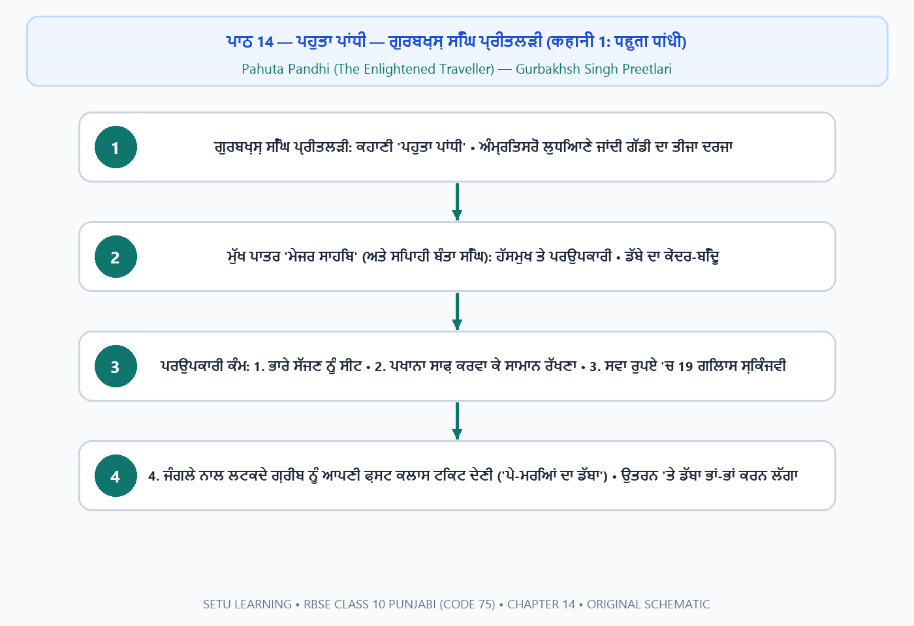

# ਪਾਠ 14 — ਪਹੁਤਾ ਪਾਂਧੀ — ਗੁਰਬਖ਼ਸ਼ ਸਿੰਘ ਪ੍ਰੀਤਲੜੀ (कहानी 1: पहुता पांधी) (Pahuta Pandhi (The Enlightened Traveller) — Gurbakhsh Singh Preetlari)

## भाग 1: अध्याय प्रवेश एवं पाठ्यक्रम मैपिंग (ਪਾਠ-ਪ੍ਰਵੇਸ਼ ਅਤੇ ਪਾਠਕ੍ਰਮ ਮੈਪਿੰਗ)

> ਪਹਿਲਾ ਸੰਪਾਦਕੀ ਪ੍ਰਾਰੂਪ (प्रथम संपादकीय प्रारूप)। RBSE ਜਮਾਤ 10 ਪੰਜਾਬੀ ਪਾਠ-ਪੁਸਤਕ 'ਸਾਹਿਤ ਸੁਗੰਧੀਆਂ' ਦੇ ਸਾਰੇ ਪ੍ਰਸ਼ਨਾਂ ਦੇ ਹੱਲ ਅਤੇ 2014–2026 ਦਾ ਪੂਰਾ ਇਤਿਹਾਸਕ PYQ ਸੰਗ੍ਰਹਿ ਸਰੋਤ-ਪ੍ਰੀਖਣ ਸਮੇਤ ਸੰਕਲਿਤ ਹਨ।

**ਵਿਸ਼ਾ ਕੋਡ (विषय कोड):** 75 (ਤੀਜੀ ਭਾਸ਼ਾ — ਪੰਜਾਬੀ / तृतीया भाषा — पंजाबी) · **ਲੜੀ ਪੁਸਤਕ (श्रृंखला पुस्तक):** 7

**ਪ੍ਰਮਾਣਿਤ ਆਧਾਰ:** RBSE 2025–26 · **ਪਾਠ ਅੰਕ-ਭਾਰ:** 3 ਅੰਕ। ਇਹ ਭਾਰ ਉਸੇ ਸੰਸਕਰਣ ਦਾ ਹੈ; ਅਸਲ ਪ੍ਰਸ਼ਨ-ਵੰਡ ਦੀ ਭਵਿੱਖਬਾਣੀ ਨਹੀਂ।

**ਸਿੱਖਣ ਦੇ ਉਦੇਸ਼ (सीखने के लक्ष्य):** ਗੁਰਬਖ਼ਸ਼ ਸਿੰਘ ਪ੍ਰੀਤਲੜੀ ਦੀ ਕਹਾਣੀ 'ਪਹੁਤਾ ਪਾਂਧੀ' ਦਾ ਸਾਰ, ਮੁੱਖ ਪਾਤਰ 'ਮੇਜਰ ਸਾਹਿਬ' ਦੀ ਪਾਤਰ-ਉਸਾਰੀ, ਰੇਲ-ਗੱਡੀ ਦੇ ਤੀਜੇ ਦਰਜੇ ਦੇ ਡੱਬੇ ਦਾ ਦ੍ਰਿਸ਼, ਸ਼ਿਕੰਜਵੀ ਵਾਲੇ ਦੀ ਘਟਨਾ ਅਤੇ ਪਰਉਪਕਾਰੀ ਜੀਵਨ-ਜਾਚ ਸਮਝਣਾ।

## भाग 2: शब्दावली एवं अवधारणा कैप्सूल (ਸ਼ਬਦਾਵਲੀ ਅਤੇ ਸੰਕਲਪ ਕੈਪਸੂਲ)

| ਸ਼ਬਦ / ਸੰਕਲਪ | ਅਰਥ / ਵਿਆਖਿਆ |
|---|---|
| ਪਹੁਤਾ ਪਾਂਧੀ (पहुता पांधी) | ਮੰਜ਼ਿਲ 'ਤੇ ਪਹੁੰਚਿਆ ਹੋਇਆ ਸਿਆਣਾ ਮੁਸਾਫ਼ਿਰ / ਉੱਚੀ ਜੀਵਨ-ਜਾਚ ਵਾਲਾ ਮਨੁੱਖ। |
| ਮੇਜਰ ਸਾਹਿਬ (मेजर साहिब) | ਕਹਾਣੀ ਦਾ ਮੁੱਖ ਪਾਤਰ ਜੋ ਰੇਲ-ਗੱਡੀ ਦੇ ਡੱਬੇ ਦਾ ਕੇਂਦਰ-ਬਿੰਦੂ ਬਣਿਆ ਹੋਇਆ ਸੀ। |
| ਬੰਤਾ ਸਿੰਘ (बंता सिंह) | ਮੇਜਰ ਸਾਹਿਬ ਦੇ ਨਾਲ ਸਫ਼ਰ ਕਰ ਰਿਹਾ ਸਿਪਾਹੀ। |
| ਪੇ-ਮਰਿਆਂ ਦਾ ਡੱਬਾ (पे-मरिआं दा डब्बा) | ਪਹਿਲੇ ਦਰਜੇ (First Class) ਦਾ ਡੱਬਾ ਜਿੱਥੇ ਮੁਸਾਫ਼ਿਰ ਚੁੱਪ-ਚਾਪ ਤੇ ਉਦਾਸ ਬੈਠੇ ਰਹਿੰਦੇ ਹਨ। |
| ਸ਼ਿਕੰਜਵੀ ਵਾਲਾ (शिकंजवी वाला) | ਸਟੇਸ਼ਨ ਉੱਤੇ ਨਿੰਬੂ-ਪਾਣੀ (ਸ਼ਿਕੰਜਵੀ) ਵੇਚਣ ਵਾਲਾ ਜਿਸ ਕੋਲੋਂ ਮੇਜਰ ਸਾਹਿਬ ਨੇ 19 ਗਿਲਾਸ ਪਿਲਾਏ। |
| ਸਵਾ ਰੁਪਇਆ (सवा रुपइआ) | ਮੇਜਰ ਸਾਹਿਬ ਵੱਲੋਂ 19 ਗਿਲਾਸ ਸ਼ਿਕੰਜਵੀ ਬਦਲੇ ਦਿੱਤੇ ਗਏ ਪੈਸੇ। |
| ਜੰਗਲਾ (जंगला) | ਰੇਲ-ਗੱਡੀ ਦੀ ਬਾਰੀ ਦੀਆਂ ਸੀਖਾਂ ਜਿਸ ਨਾਲ ਇੱਕ ਗ਼ਰੀਬ ਮੁਸਾਫ਼ਿਰ ਬਾਹਰ ਲਟਕ ਰਿਹਾ ਸੀ। |
| ਭਾਰਾ ਸੱਜਣ (भारा सज्जण) | ਡੱਬੇ ਵਿੱਚ ਚੜ੍ਹਿਆ ਮੋਟਾ ਮੁਸਾਫ਼ਿਰ ਜਿਸ ਨੂੰ ਮੇਜਰ ਸਾਹਿਬ ਨੇ ਹੱਸ ਕੇ ਸੀਟ ਦਿਵਾਈ। |
| ਕੇਂਦਰ-ਬਿੰਦੂ (केंदर-बिंदू) | ਸਭ ਦੇ ਧਿਆਨ ਅਤੇ ਖਿੱਚ ਦਾ ਕੇਂਦਰ। |
| ਭਾਂ-ਭਾਂ ਕਰਨਾ (भां-भां करना) | ਸੁੰਨਾ ਹੋ ਜਾਣਾ (ਮੇਜਰ ਸਾਹਿਬ ਦੇ ਉਤਰਨ ਮਗਰੋਂ ਡੱਬਾ ਭਾਂ-ਭਾਂ ਕਰਨ ਲੱਗ ਪਿਆ)। |

## भाग 3: विस्तृत शिक्षण पाठ (ਵਿਸਤ੍ਰਿਤ ਅਧਿਆਪਨ ਪਾਠ)

### 1. ਕਹਾਣੀਕਾਰ-ਪਛਾਣ: ਗੁਰਬਖ਼ਸ਼ ਸਿੰਘ ਪ੍ਰੀਤਲੜੀ (1895–1977 ਈ.)
ਪੰਜਾਬੀ ਵਾਰਤਕ ਦੇ ਮਹਾਨ ਸ਼ੈਲੀਕਾਰ ਅਤੇ 'ਪ੍ਰੀਤ-ਲੜੀ' ਰਸਾਲੇ ਦੇ ਸੰਪਾਦਕ **ਗੁਰਬਖ਼ਸ਼ ਸਿੰਘ ਪ੍ਰੀਤਲੜੀ** ਦਾ ਜਨਮ 26 ਅਪ੍ਰੈਲ 1895 ਈ. ਨੂੰ ਸਿਆਲਕੋਟ ਵਿਖੇ ਪਿਤਾ ਪਸ਼ੌਰਾ ਸਿੰਘ ਦੇ ਘਰ ਹੋਇਆ। ਉਹਨਾਂ ਨੇ ਅਮਰੀਕਾ ਤੋਂ ਇੰਜੀਨੀਅਰਿੰਗ ਕੀਤੀ ਅਤੇ ਅੰਮ੍ਰਿਤਸਰ ਤੇ ਲਾਹੌਰ ਦੇ ਵਿਚਕਾਰ **'ਪ੍ਰੀਤ ਨਗਰ'** ਵਸਾਇਆ। ਉਹਨਾਂ ਦੇ ਪ੍ਰਸਿੱਧ ਕਹਾਣੀ-ਸੰਗ੍ਰਹਿ 'ਨਾਗ ਪ੍ਰੀਤ ਦਾ ਜਾਦੂ', 'ਅਨੋਖੇ ਤੇ ਇਕੱਲੇ', 'ਵੀਣਾ ਵਿਨੋਦ', 'ਪ੍ਰੀਤ ਕਹਾਣੀਆਂ' ਅਤੇ 'ਭਾਬੀ ਮੈਨਾ' ਹਨ।

### 2. 'ਪਹੁਤਾ ਪਾਂਧੀ' ਕਹਾਣੀ ਦਾ ਵਿਸਤ੍ਰਿਤ ਸਾਰ
1. **ਅੰਮ੍ਰਿਤਸਰ ਤੋਂ ਲੁਧਿਆਣੇ ਜਾਂਦੀ ਰੇਲ-ਗੱਡੀ ਦਾ ਦ੍ਰਿਸ਼ (RBSE 2025 Supp Q2-vi):**
   - ਗਰਮੀਆਂ ਦੇ ਦਿਨ ਸਨ। ਲੇਖਕ **ਅੰਮ੍ਰਿਤਸਰੋਂ ਲੁਧਿਆਣੇ ਵੱਲ** ਜਾ ਰਹੀ ਰੇਲ-ਗੱਡੀ ਦੇ ਤੀਜੇ ਦਰਜੇ (Third Class) ਦੇ ਡੱਬੇ ਵਿੱਚ ਸਫ਼ਰ ਕਰ ਰਿਹਾ ਸੀ।
   - ਡੱਬੇ ਵਿੱਚ ਭਾਰੀ ਭੀੜ ਤੇ ਹੁੰਮਸ ਸੀ, ਪਰ ਇੱਕ ਫ਼ੌਜੀ **'ਮੇਜਰ ਸਾਹਿਬ'** (ਆਪਣੇ ਸਿਪਾਹੀ ਬੰਤਾ ਸਿੰਘ ਸਮੇਤ) ਆਪਣੀ ਹੱਸਮੁਖ, ਮਿੱਠੀ ਅਤੇ ਪਰਉਪਕਾਰੀ ਸ਼ਖ਼ਸੀਅਤ ਕਾਰਨ **ਸਾਰੇ ਡੱਬੇ ਦਾ ਕੇਂਦਰ-ਬਿੰਦੂ** ਬਣੇ ਹੋਏ ਸਨ (RBSE 2018 Supp Q8-ਹ, 2022 Main Q3-ix, 2024 Main Q3-viii)।
2. **ਭਾਰੇ ਸੱਜਣ ਨੂੰ ਸੀਟ ਦਿਵਾਉਣਾ ਅਤੇ ਪਖਾਨਾ ਸਾਫ਼ ਕਰਵਾਉਣਾ (RBSE 2019 Main Q8-ਹ):**
   - ਜਦੋਂ ਇੱਕ ਸਟੇਸ਼ਨ ਤੋਂ ਇੱਕ ਭਾਰਾ (ਮੋਟਾ) ਸੱਜਣ ਪਸੀਨੋ-ਪਸੀਨੀ ਹੋਇਆ ਡੱਬੇ ਵਿੱਚ ਚੜ੍ਹਿਆ ਤਾਂ ਕੋਈ ਉਸ ਨੂੰ ਬੈਠਣ ਲਈ ਥਾਂ ਨਹੀਂ ਸੀ ਦੇ ਰਿਹਾ। ਮੇਜਰ ਸਾਹਿਬ ਨੇ ਹੱਸ ਕੇ ਮਜ਼ਾਕ ਭਰੇ ਅੰਦਾਜ਼ ਵਿੱਚ ਮੁਸਾਫ਼ਿਰਾਂ ਨੂੰ ਥੋੜ੍ਹਾ-ਥੋੜ੍ਹਾ ਸਰਕਣ ਲਈ ਪ੍ਰੇਰਿਆ ਅਤੇ ਆਪਣੇ ਕੋਲ ਭਾਰੇ ਸੱਜਣ ਨੂੰ ਬਿਠਾ ਲਿਆ।
   - ਡੱਬੇ ਦੇ ਫ਼ਰਸ਼ ਉੱਤੇ ਪਈਆਂ ਪੇਟੀਆਂ ਤੇ ਬਿਸਤਰਿਆਂ ਕਾਰਨ ਰਾਹ ਬੰਦ ਸੀ। ਮੇਜਰ ਸਾਹਿਬ ਨੇ ਸਟੇਸ਼ਨ ਤੋਂ ਸਫ਼ਾਈ-ਸੇਵਕ ਬੁਲਵਾ ਕੇ ਡੱਬੇ ਦਾ ਗੰਦਾ ਪਖਾਨਾ (ਟੱਟੀ) ਧੁਆ ਕੇ ਸਾਫ਼ ਕਰਵਾਇਆ ਅਤੇ ਸਾਰਾ ਵਾਧੂ ਸਾਮਾਨ ਉੱਥੇ ਟਿਕਵਾ ਦਿੱਤਾ ਤਾਂ ਜੋ ਮੁਸਾਫ਼ਿਰ ਖੁੱਲ੍ਹੇ ਹੋ ਕੇ ਬੈਠ ਸਕਣ।
3. **ਸ਼ਿਕੰਜਵੀ ਵਾਲੇ ਦੀ ਘਟਨਾ — ਪੈਸਿਆਂ ਦੀ ਚਿੰਤਾ ਕਿਉਂ ਕਰ ਰਿਹਾ ਸੀ? (RBSE 2018 Main Q8-ਹ, 2026 Supp Q3-VII):**
   - ਅਗਲੇ ਸਟੇਸ਼ਨ ਉੱਤੇ ਗਰਮੀ ਨਾਲ ਪਿਆਸੇ ਮੁਸਾਫ਼ਿਰਾਂ ਲਈ ਮੇਜਰ ਸਾਹਿਬ ਨੇ ਸ਼ਿਕੰਜਵੀ (ਨਿੰਬੂ-ਪਾਣੀ) ਵਾਲੇ ਨੂੰ ਆਵਾਜ਼ ਮਾਰੀ ਅਤੇ ਡੱਬੇ ਦੇ ਮੁਸਾਫ਼ਿਰਾਂ ਤੇ ਬੱਚਿਆਂ ਨੂੰ ਧੜਾਧੜ ਸ਼ਿਕੰਜਵੀ ਪਿਲਾਉਣ ਲੱਗੇ।
   - **ਸ਼ਿਕੰਜਵੀ ਵਾਲਾ ਪੈਸਿਆਂ ਦੀ ਚਿੰਤਾ ਇਸ ਲਈ ਕਰ ਰਿਹਾ ਸੀ** ਕਿਉਂਕਿ ਗੱਡੀ ਤੁਰਨ ਵਾਲੀ ਸੀ, ਗਿਲਾਸ ਇੱਕ-ਇੱਕ ਕਰਕੇ 19 ਹੋ ਗਏ ਸਨ ਅਤੇ ਉਸ ਨੂੰ ਡਰ ਸੀ ਕਿ ਕਿਤੇ ਗੱਡੀ ਚੱਲ ਪਵੇ ਤੇ ਉਸ ਦੇ ਪੈਸੇ ਜਾਂ ਗਿਲਾਸ ਨਾ ਮਾਰੇ ਜਾਣ।
   - ਮੇਜਰ ਸਾਹਿਬ ਨੇ 19 ਗਿਲਾਸਾਂ ਦੇ ਬਦਲੇ ਸ਼ਿਕੰਜਵੀ ਵਾਲੇ ਨੂੰ **ਸਵਾ ਰੁਪਇਆ** ਦਿੱਤਾ, ਜਿਸ ਨਾਲ ਸ਼ਿਕੰਜਵੀ ਵਾਲਾ ਬਾਗ਼ੋ-ਬਾਗ਼ ਹੋ ਕੇ ਅਸੀਸਾਂ ਦੇਣ ਲੱਗਾ।
4. **ਪਹਿਲੇ ਦਰਜੇ ਦੀ ਟਿਕਟ ਗ਼ਰੀਬ ਮੁਸਾਫ਼ਿਰ ਨੂੰ ਦੇਣੀ ('ਪੇ-ਮਰਿਆਂ ਦਾ ਡੱਬਾ'):**
   - ਇੱਕ ਸਟੇਸ਼ਨ ਉੱਤੇ ਇੱਕ ਗ਼ਰੀਬ ਮੁਸਾਫ਼ਿਰ ਨੂੰ ਕਿਧਰੇ ਥਾਂ ਨਾ ਮਿਲੀ ਤਾਂ ਉਹ ਪਹਿਲੇ ਦਰਜੇ (First Class) ਦੇ ਡੱਬੇ ਦੇ ਜੰਗਲੇ ਨਾਲ ਬਾਹਰ ਲਟਕ ਗਿਆ। ਅੰਦਰ ਬੈਠੇ ਅੰਗਰੇਜ਼/ਅਮੀਰ ਮੁਸਾਫ਼ਿਰ ਅਤੇ ਗਾਰਡ ਉਸ ਨੂੰ ਝਿੜਕ ਕੇ ਹੇਠਾਂ ਉਤਾਰਨ ਲੱਗੇ।
   - ਮੇਜਰ ਸਾਹਿਬ ਨੇ ਆਪਣੀ ਜੇਬ ਵਿੱਚੋਂ **ਆਪਣੀ ਪਹਿਲੇ ਦਰਜੇ (First Class) ਦੀ ਟਿਕਟ** ਕੱਢੀ ਅਤੇ ਉਸ ਗ਼ਰੀਬ ਮੁਸਾਫ਼ਿਰ ਨੂੰ ਦੇ ਕੇ ਪਹਿਲੇ ਦਰਜੇ ਦੇ ਡੱਬੇ ਵਿੱਚ ਬਿਠਾ ਦਿੱਤਾ!
   - ਜਦੋਂ ਲੋਕਾਂ ਨੇ ਪੁੱਛਿਆ ਕਿ ਤੁਸੀਂ ਪਹਿਲੇ ਦਰਜੇ ਦੀ ਟਿਕਟ ਹੁੰਦਿਆਂ ਤੀਜੇ ਦਰਜੇ ਵਿੱਚ ਕਿਉਂ ਬੈਠੇ ਹੋ, ਤਾਂ ਮੇਜਰ ਸਾਹਿਬ ਨੇ ਕਿਹਾ ਕਿ ਪਹਿਲੇ ਦਰਜੇ ਦਾ ਡੱਬਾ ਤਾਂ **'ਪੇ-ਮਰਿਆਂ ਦਾ ਡੱਬਾ'** (ਜਿੱਥੇ ਲੋਕ ਮੂੰਹ ਵੱਟੀ ਚੁੱਪ ਬੈਠੇ ਰਹਿੰਦੇ ਹਨ) ਹੁੰਦਾ ਹੈ, ਅਸਲ ਰੌਣਕ ਤੇ ਜ਼ਿੰਦਗੀ ਤਾਂ ਤੀਜੇ ਦਰਜੇ ਦੇ ਆਮ ਲੋਕਾਂ ਵਿੱਚ ਹੈ।
5. **ਮੇਜਰ ਸਾਹਿਬ ਦਾ ਉਤਰਨਾ:**
   - ਜਦੋਂ ਮੇਜਰ ਸਾਹਿਬ ਆਪਣੇ ਸਟੇਸ਼ਨ ਉੱਤੇ ਉਤਰ ਗਏ ਤਾਂ ਲੇਖਕ ਨੇ ਅੰਤਿਮ ਸਤਰ ਲਿਖੀ — **'ਔਹ ਗਏ-ਔਹ ਗਏ - ਸਾਰੇ ਡੱਬੇ 'ਚੋਂ ਰੂਹ ਨਿਕਲ ਗਈ, ਡੱਬਾ ਭਾਂ-ਭਾਂ ਕਰਨ ਲੱਗ ਪਿਆ।'**

ਪਾਠ 14: ਗੁਰਬਖ਼ਸ਼ ਸਿੰਘ ਪ੍ਰੀਤਲੜੀ ਦੀ ਕਹਾਣੀ 'ਪਹੁਤਾ ਪਾਂਧੀ' ਦਾ ਸੰਕਲਪ ਚਿੱਤਰ

## भाग 4: पाठ्यपुस्तक-अवधारणाओं पर मौलिक हल किए उदाहरण (ਹੱਲ ਕੀਤੇ ਮਿਆਰੀ ਉਦਾਹਰਣ)

ਹੇਠਾਂ ਦਿੱਤੇ ਪ੍ਰਸ਼ਨ ਪਾਠ-ਪੁਸਤਕ 'ਸਾਹਿਤ ਸੁਗੰਧੀਆਂ' ਅਤੇ ਵਿਆਕਰਣ ਦੇ ਸੰਕਲਪਾਂ ਉੱਤੇ ਆਧਾਰਿਤ ਮੌਲਿਕ ਆਦਰਸ਼ ਹੱਲ ਹਨ।

**ਹੱਲ ਕੀਤਾ ਉਦਾਹਰਣ 1: 'ਪਹੁਤਾ ਪਾਂਧੀ' ਕਹਾਣੀ ਦੇ ਮੁੱਖ ਪਾਤਰ 'ਮੇਜਰ ਸਾਹਿਬ' ਦੇ ਸੁਭਾਅ (ਪਾਤਰ-ਉਸਾਰੀ) ਉੱਪਰ ਚਾਨਣਾ ਪਾਓ।**

ਮੇਜਰ ਸਾਹਿਬ 'ਪਹੁਤਾ ਪਾਂਧੀ' ਕਹਾਣੀ ਦੇ ਮੁੱਖ ਪਾਤਰ ਹਨ: (1) ਹੱਸਮੁਖ ਤੇ ਮਿਲਣਸਾਰ: ਉਹਨਾਂ ਦੇ ਚਿਹਰੇ ਉੱਤੇ ਸਦਾ ਮੁਸਕਾਨ ਰਹਿੰਦੀ ਹੈ ਤੇ ਉਹ ਡੱਬੇ ਦੇ ਸਾਰੇ ਮੁਸਾਫ਼ਿਰਾਂ ਨੂੰ ਆਪਣਾ ਬਣਾ ਲੈਂਦੇ ਹਨ। (2) ਪਰਉਪਕਾਰੀ ਤੇ ਸੇਵਾ-ਭਾਵੀ: ਉਹ ਭਾਰੇ ਸੱਜਣ ਨੂੰ ਸੀਟ ਦਿਵਾਉਂਦੇ ਹਨ, ਪਖਾਨਾ ਸਾਫ਼ ਕਰਵਾ ਕੇ ਸਾਮਾਨ ਰਖਵਾਉਂਦੇ ਹਨ ਅਤੇ ਆਪਣੀ ਜੇਬ ਵਿੱਚੋਂ ਸਵਾ ਰੁਪਇਆ ਖਰਚ ਕੇ ਮੁਸਾਫ਼ਿਰਾਂ ਨੂੰ 19 ਗਿਲਾਸ ਸ਼ਿਕੰਜਵੀ ਪਿਲਾਉਂਦੇ ਹਨ। (3) ਨਿਮਰ ਤੇ ਲੋਕ-ਪੱਖੀ: ਪਹਿਲੇ ਦਰਜੇ ਦੀ ਟਿਕਟ ਹੋਣ ਦੇ ਬਾਵਜੂਦ ਉਹ ਪਹਿਲੇ ਦਰਜੇ ਨੂੰ 'ਪੇ-ਮਰਿਆਂ ਦਾ ਡੱਬਾ' ਕਹਿ ਕੇ ਤੀਜੇ ਦਰਜੇ ਵਿੱਚ ਆਮ ਲੋਕਾਂ ਨਾਲ ਸਫ਼ਰ ਕਰਦੇ ਹਨ ਅਤੇ ਆਪਣੀ ਫ਼ਸਟ ਕਲਾਸ ਟਿਕਟ ਇੱਕ ਗ਼ਰੀਬ ਮੁਸਾਫ਼ਿਰ ਨੂੰ ਦੇ ਦਿੰਦੇ ਹਨ (RBSE 2020 Supp Q10, 2026 Supp Q17)।

**ਹੱਲ ਕੀਤਾ ਉਦਾਹਰਣ 2: ਸ਼ਿਕੰਜਵੀ ਵਾਲਾ ਪੈਸਿਆਂ ਦੀ ਚਿੰਤਾ ਕਿਉਂ ਕਰ ਰਿਹਾ ਸੀ? (RBSE 2018 Main Q8-ਹ, 2026 Supp Q3-VII)**

ਸ਼ਿਕੰਜਵੀ ਵਾਲਾ ਪੈਸਿਆਂ ਦੀ ਚਿੰਤਾ ਇਸ ਲਈ ਕਰ ਰਿਹਾ ਸੀ ਕਿਉਂਕਿ ਮੇਜਰ ਸਾਹਿਬ ਡੱਬੇ ਦੇ ਮੁਸਾਫ਼ਿਰਾਂ ਨੂੰ ਇੱਕ ਤੋਂ ਬਾਅਦ ਇੱਕ ਸ਼ਿਕੰਜਵੀ ਦੇ ਗਿਲਾਸ ਪਿਲਾਈ ਜਾ ਰਹੇ ਸਨ (ਕੁੱਲ 19 ਗਿਲਾਸ ਹੋ ਗਏ ਸਨ) ਅਤੇ ਦੂਜੇ ਪਾਸੇ ਗੱਡੀ ਦੇ ਚੱਲਣ ਦਾ ਸਮਾਂ ਹੋ ਰਿਹਾ ਸੀ। ਉਸ ਨੂੰ ਡਰ ਸੀ ਕਿ ਕਿਤੇ ਗੱਡੀ ਤੁਰ ਪਵੇ ਤੇ ਇੰਨੇ ਗਿਲਾਸਾਂ ਦੇ ਪੈਸੇ ਕੌਣ ਦੇਵੇਗਾ। ਪਰ ਮੇਜਰ ਸਾਹਿਬ ਨੇ ਉਸ ਨੂੰ ਖੁਸ਼ੀ ਨਾਲ ਸਵਾ ਰੁਪਇਆ ਦੇ ਦਿੱਤਾ (RBSE 2018 Main Q8-ਹ, 2026 Supp Q3-VII)।

**ਹੱਲ ਕੀਤਾ ਉਦਾਹਰਣ 3: ਗੱਡੀ ਵਿੱਚ ਚੜ੍ਹੇ ਭਾਰੇ ਸੱਜਣ ਨੂੰ ਬੈਠਣ ਲਈ ਸੀਟ ਕਿਵੇਂ ਮਿਲੀ? 'ਪਹੁਤਾ ਪਾਂਧੀ' ਕਹਾਣੀ ਦੇ ਆਧਾਰ 'ਤੇ ਦੱਸੋ।**

ਜਦੋਂ ਭਾਰਾ (ਮੋਟਾ) ਸੱਜਣ ਡੱਬੇ ਵਿੱਚ ਚੜ੍ਹਿਆ ਤਾਂ ਭੀੜ ਕਾਰਨ ਕੋਈ ਉਸ ਨੂੰ ਥਾਂ ਨਹੀਂ ਸੀ ਦੇ ਰਿਹਾ। ਮੇਜਰ ਸਾਹਿਬ ਨੇ ਹੱਸਦੇ ਹੋਏ ਮਿੱਠੇ ਬੋਲਾਂ ਨਾਲ ਬੈਂਚ 'ਤੇ ਬੈਠੇ ਮੁਸਾਫ਼ਿਰਾਂ ਨੂੰ ਥੋੜ੍ਹਾ-ਥੋੜ੍ਹਾ ਖਿਸਕਣ ਲਈ ਕਿਹਾ ਅਤੇ ਆਪਣੇ ਨਾਲ ਭਾਰੇ ਸੱਜਣ ਨੂੰ ਸਤਿਕਾਰ ਸਹਿਤ ਬਿਠਾ ਲਿਆ (RBSE 2019 Main Q8-ਹ)।

## भाग 5: सत्यापित बोर्ड प्रश्न एवं स्रोत-स्थिति (ਪ੍ਰਮਾਣਿਤ ਬੋਰਡ ਪ੍ਰਸ਼ਨ ਅਤੇ ਸਰੋਤ-ਸਥਿਤੀ)

RBSE 2026 Supp (`S-75`, Q1-X, Q3-VII, Q17), 2025 Supp (Q2-vi, Q17), 2024 Main (Q1-viii, Q3-viii) ਅਤੇ 2022 Main (Q3-ix) ਵਿੱਚ 'ਪਹੁਤਾ ਪਾਂਧੀ' ਕਹਾਣੀ ਦੇ ਪ੍ਰਸ਼ਨ ਪੁੱਛੇ ਗਏ ਹਨ।

[RBSE 2026 ਮੂਲ ਪੇਪਰ (S-75)](https://rajeduboard.rajasthan.gov.in/books/PAPERS-2026/Sec/S-75.pdf)। ਪ੍ਰਸ਼ਨ ਦਾ ਸੰਖੇਪ ਵਿਸ਼ਾ-ਸੰਦਰਭ ਹੈ; ਸ਼ਬਦ-ਬ-ਸ਼ਬਦ ਪੁਨਰ-ਮੁਦਰਣ ਨਹੀਂ।

## भाग 6: खंडवार मौलिक अभ्यास बैंक (ਖੰਡ-ਵਾਰ ਮੌਲਿਕ ਅਭਿਆਸ ਬੈਂਕ)

**ਅਭਿਆਸ-ਅੰਕ:** ਵਿਦਿਆਰਥੀਆਂ ਦੇ ਸਵੈ-ਅਭਿਆਸ ਲਈ ਹਨ; ਉੱਤਰ ਪਹਿਲਾਂ ਆਪ ਲਿਖੋ, ਫਿਰ ਭਾਗ 9 ਵੇਖੋ।

## ੳ: ਬਹੁ-ਵਿਕਲਪੀ ਪ੍ਰਸ਼ਨ (MCQ) — 15 × 1 ਅੰਕ

**MCQ 1. 'ਗੁਰਬਖ਼ਸ਼ ਸਿੰਘ ਪ੍ਰੀਤਲੜੀ' ਰਚਿਤ ਕਹਾਣੀ ਕਿਹੜੀ ਹੈ? (RBSE 2024 Main Q1-viii, 2026 Supp Q1-X)**

ੳ) ਖ਼ੂਨ  
ਅ) ਦੁੱਧ ਦਾ ਛੱਪੜ  
ੲ) ਪਹੁਤਾ ਪਾਂਧੀ  
ਸ) ਪੇਮੀ ਦੇ ਨਿਆਣੇ

**MCQ 2. 'ਪਹੁਤਾ ਪਾਂਧੀ' ਕਹਾਣੀ ਦੇ ਮੁੱਖ ਪਾਤਰ ਦਾ ਨਾਂ ਦੱਸੋ। (RBSE 2024 Main Q3-viii)**

ੳ) ਲਾਲ  
ਅ) ਮੇਜਰ ਸਾਹਿਬ  
ੲ) ਕਪੂਰ ਸਿੰਘ  
ਸ) ਕਰਤਾਰਾ

**MCQ 3. ਖਾਲੀ ਥਾਂ ਭਰੋ: 'ਗੱਡੀ ਅੰਮ੍ਰਿਤਸਰੋਂ ................ ਵੱਲ ਆ ਰਹੀ ਸੀ।' (RBSE 2025 Supp Q2-vi)**

ੳ) ਲੁਧਿਆਣੇ  
ਅ) ਜਲੰਧਰ  
ੲ) ਲਾਹੌਰ  
ਸ) ਦਿੱਲੀ

**MCQ 4. ਰੇਲ-ਗੱਡੀ ਦੇ ਡੱਬੇ ਦਾ ਕੇਂਦਰ-ਬਿੰਦੂ ਕੌਣ ਬਣਿਆ ਹੋਇਆ ਸੀ? (RBSE 2022 Main Q3-ix)**

ੳ) ਸ਼ਿਕੰਜਵੀ ਵਾਲਾ  
ਅ) ਗਾਰਡ  
ੲ) ਭਾਰਾ ਸੱਜਣ  
ਸ) ਮੇਜਰ ਸਾਹਿਬ

**MCQ 5. ਮੇਜਰ ਸਾਹਿਬ ਨੇ ਮੁਸਾਫ਼ਿਰਾਂ ਨੂੰ ਕੁੱਲ ਕਿੰਨੇ ਗਿਲਾਸ ਸ਼ਿਕੰਜਵੀ ਪਿਲਾਈ ਅਤੇ ਕਿੰਨੇ ਪੈਸੇ ਦਿੱਤੇ?**

ੳ) 5 ਗਿਲਾਸ ਅਤੇ ਅੱਠ ਆਨੇ  
ਅ) 25 ਗਿਲਾਸ ਅਤੇ ਦੋ ਰੁਪਏ  
ੲ) 19 ਗਿਲਾਸ ਸ਼ਿਕੰਜਵੀ ਪਿਲਾਈ ਅਤੇ ਸਵਾ ਰੁਪਇਆ ਦਿੱਤਾ  
ਸ) 10 ਗਿਲਾਸ ਅਤੇ ਇੱਕ ਰੁਪਇਆ

**MCQ 6. ਮੇਜਰ ਸਾਹਿਬ ਨੇ ਪਹਿਲੇ ਦਰਜੇ (First Class) ਦੇ ਡੱਬੇ ਨੂੰ ਕੀ ਨਾਂ ਦਿੱਤਾ ਸੀ?**

ੳ) ਸ਼ਾਹੀ ਡੱਬਾ  
ਅ) ਪੇ-ਮਰਿਆਂ ਦਾ ਡੱਬਾ  
ੲ) ਸਵਰਗ ਦਾ ਡੱਬਾ  
ਸ) ਅਮੀਰਾਂ ਦਾ ਡੱਬਾ

**MCQ 7. ਮੇਜਰ ਸਾਹਿਬ ਨੇ ਆਪਣੀ ਪਹਿਲੇ ਦਰਜੇ ਦੀ ਟਿਕਟ ਕਿਸ ਨੂੰ ਦੇ ਦਿੱਤੀ?**

ੳ) ਡੱਬੇ ਦੇ ਜੰਗਲੇ ਨਾਲ ਬਾਹਰ ਲਟਕ ਰਹੇ ਗ਼ਰੀਬ ਮੁਸਾਫ਼ਿਰ ਨੂੰ  
ਅ) ਭਾਰੇ ਸੱਜਣ ਨੂੰ  
ੲ) ਸ਼ਿਕੰਜਵੀ ਵਾਲੇ ਨੂੰ  
ਸ) ਲੇਖਕ ਨੂੰ

**MCQ 8. ਮੇਜਰ ਸਾਹਿਬ ਦੇ ਨਾਲ ਸਫ਼ਰ ਕਰ ਰਹੇ ਸਿਪਾਹੀ ਦਾ ਕੀ ਨਾਂ ਸੀ?**

ੳ) ਨਛੱਤਰ ਸਿੰਘ  
ਅ) ਦਰਬਾਰਾ ਸਿੰਘ  
ੲ) ਧੰਮਾ ਸਿੰਘ  
ਸ) ਬੰਤਾ ਸਿੰਘ

**MCQ 9. ਮੇਜਰ ਸਾਹਿਬ ਨੇ ਡੱਬੇ ਵਿੱਚ ਖਿੱਲਰੀਆਂ ਪੇਟੀਆਂ ਤੇ ਬਿਸਤਰੇ ਕਿੱਥੇ ਰਖਵਾਏ?**

ੳ) ਇੰਜਣ ਵਿੱਚ  
ਅ) ਪਲੇਟਫ਼ਾਰਮ ਉੱਤੇ  
ੲ) ਡੱਬੇ ਦਾ ਪਖਾਨਾ ਸਾਫ਼ ਕਰਵਾ ਕੇ ਉਸ ਵਿੱਚ  
ਸ) ਡੱਬੇ ਦੀ ਛੱਤ ਉੱਤੇ

**MCQ 10. 'ਔਹ ਗਏ-ਔਹ ਗਏ - ਸਾਰੇ ਡੱਬੇ 'ਚੋਂ ਰੂਹ ਨਿਕਲ ਗਈ, ਡੱਬਾ ਭਾਂ-ਭਾਂ ਕਰਨ ਲੱਗ ਪਿਆ' — ਇਹ ਸਤਰ ਕਿਸ ਕਹਾਣੀ ਦੀ ਹੈ?**

ੳ) ਖ਼ੂਨ  
ਅ) ਪਹੁਤਾ ਪਾਂਧੀ  
ੲ) ਪੇਮੀ ਦੇ ਨਿਆਣੇ  
ਸ) ਸਾਂਝੀ ਕੰਧ

**MCQ 11. ਸ਼ਿਕੰਜਵੀ ਵਾਲਾ ਪੈਸਿਆਂ ਦੀ ਚਿੰਤਾ ਕਿਉਂ ਕਰ ਰਿਹਾ ਸੀ? (RBSE 2026 Supp Q3-VII)**

ੳ) ਕਿਉਂਕਿ ਗਿਲਾਸ ਵੱਧ (19) ਹੋ ਗਏ ਸਨ ਤੇ ਗੱਡੀ ਤੁਰਨ ਵਾਲੀ ਸੀ  
ਅ) ਕਿਉਂਕਿ ਉਸ ਕੋਲ ਨਿੰਬੂ ਮੁੱਕ ਗਏ ਸਨ  
ੲ) ਕਿਉਂਕਿ ਗਿਲਾਸ ਟੁੱਟ ਗਿਆ ਸੀ  
ਸ) ਕਿਉਂਕਿ ਪੁਲਿਸ ਆ ਗਈ ਸੀ

**MCQ 12. ਗੁਰਬਖ਼ਸ਼ ਸਿੰਘ ਪ੍ਰੀਤਲੜੀ ਨੇ ਅੰਮ੍ਰਿਤਸਰ ਤੇ ਲਾਹੌਰ ਦੇ ਵਿਚਕਾਰ ਕਿਹੜਾ ਨਗਰ ਵਸਾਇਆ ਸੀ?**

ੳ) ਸ਼ਾਂਤੀ ਨਗਰ  
ਅ) ਕਰਤਾਰਪੁਰ  
ੲ) ਗੋਬਿੰਦਪੁਰਾ  
ਸ) ਪ੍ਰੀਤ ਨਗਰ

**MCQ 13. 'ਪਹੁਤਾ ਪਾਂਧੀ' ਸ਼ਬਦ ਦਾ ਕੀ ਅਰਥ ਹੈ?**

ੳ) ਥੱਕਿਆ ਹੋਇਆ ਮਜ਼ਦੂਰ  
ਅ) ਨਵਾਂ ਖਿਡਾਰੀ  
ੲ) ਮੰਜ਼ਿਲ ਉੱਤੇ ਪਹੁੰਚਿਆ ਹੋਇਆ ਸਿਆਣਾ ਮੁਸਾਫ਼ਿਰ  
ਸ) ਰਾਹ ਭੁੱਲਿਆ ਹੋਇਆ ਰਾਹੀ

**MCQ 14. ਮੇਜਰ ਸਾਹਿਬ ਕੋਲ ਪਹਿਲੇ ਦਰਜੇ ਦੀ ਟਿਕਟ ਹੁੰਦਿਆਂ ਹੋਇਆਂ ਵੀ ਉਹ ਕਿਹੜੇ ਦਰਜੇ ਵਿੱਚ ਸਫ਼ਰ ਕਰ ਰਹੇ ਸਨ?**

ੳ) ਗਾਰਡ ਦੇ ਡੱਬੇ ਵਿੱਚ  
ਅ) ਤੀਜੇ ਦਰਜੇ (Third Class) ਵਿੱਚ  
ੲ) ਦੂਜੇ ਦਰਜੇ ਵਿੱਚ  
ਸ) ਮਾਲ-ਗੱਡੀ ਵਿੱਚ

**MCQ 15. ਗੱਡੀ ਵਿੱਚ ਚੜ੍ਹੇ ਕਿਸ ਮੁਸਾਫ਼ਿਰ ਨੂੰ ਮੇਜਰ ਸਾਹਿਬ ਨੇ ਹੱਸ-ਖੇਡ ਕੇ ਆਪਣੇ ਕੋਲ ਸੀਟ ਦਿਵਾਈ?**

ੳ) ਇੱਕ ਭਾਰੇ (ਮੋਟੇ) ਸੱਜਣ ਨੂੰ  
ਅ) ਇੱਕ ਵਕੀਲ ਨੂੰ  
ੲ) ਇੱਕ ਸਿਆਸਤਦਾਨ ਨੂੰ  
ਸ) ਇੱਕ ਦੁਕਾਨਦਾਰ ਨੂੰ

## ੳ: ਖਾਲੀ ਥਾਵਾਂ ਭਰੋ — 6 × 1 ਅੰਕ

1. ਮੰਜ਼ਿਲ 'ਤੇ ਪਹੁੰਚਿਆ ਹੋਇਆ ਸਿਆਣਾ ਮੁਸਾਫ਼ਿਰ / ਉੱਚੀ ਜੀਵਨ-ਜਾਚ ਵਾਲਾ ਮਨੁੱਖ। — ਇਸ ਸ਼ਬਦ/ਸੰਕਲਪ ਦਾ ਨਾਂ ਹੈ: ____।  
2. ਕਹਾਣੀ ਦਾ ਮੁੱਖ ਪਾਤਰ ਜੋ ਰੇਲ-ਗੱਡੀ ਦੇ ਡੱਬੇ ਦਾ ਕੇਂਦਰ-ਬਿੰਦੂ ਬਣਿਆ ਹੋਇਆ ਸੀ। — ਇਸ ਸ਼ਬਦ/ਸੰਕਲਪ ਦਾ ਨਾਂ ਹੈ: ____।  
3. ਮੇਜਰ ਸਾਹਿਬ ਦੇ ਨਾਲ ਸਫ਼ਰ ਕਰ ਰਿਹਾ ਸਿਪਾਹੀ। — ਇਸ ਸ਼ਬਦ/ਸੰਕਲਪ ਦਾ ਨਾਂ ਹੈ: ____।  
4. ਪਹਿਲੇ ਦਰਜੇ (First Class) ਦਾ ਡੱਬਾ ਜਿੱਥੇ ਮੁਸਾਫ਼ਿਰ ਚੁੱਪ-ਚਾਪ ਤੇ ਉਦਾਸ ਬੈਠੇ ਰਹਿੰਦੇ ਹਨ। — ਇਸ ਸ਼ਬਦ/ਸੰਕਲਪ ਦਾ ਨਾਂ ਹੈ: ____।  
5. ਸਟੇਸ਼ਨ ਉੱਤੇ ਨਿੰਬੂ-ਪਾਣੀ (ਸ਼ਿਕੰਜਵੀ) ਵੇਚਣ ਵਾਲਾ ਜਿਸ ਕੋਲੋਂ ਮੇਜਰ ਸਾਹਿਬ ਨੇ 19 ਗਿਲਾਸ ਪਿਲਾਏ। — ਇਸ ਸ਼ਬਦ/ਸੰਕਲਪ ਦਾ ਨਾਂ ਹੈ: ____।  
6. ਮੇਜਰ ਸਾਹਿਬ ਵੱਲੋਂ 19 ਗਿਲਾਸ ਸ਼ਿਕੰਜਵੀ ਬਦਲੇ ਦਿੱਤੇ ਗਏ ਪੈਸੇ। — ਇਸ ਸ਼ਬਦ/ਸੰਕਲਪ ਦਾ ਨਾਂ ਹੈ: ____।

## ੳ: ਅਤਿ-ਲਘੂ ਉੱਤਰਾਂ ਵਾਲੇ ਪ੍ਰਸ਼ਨ — 8 × 1 ਅੰਕ

1. 'ਗੁਰਬਖ਼ਸ਼ ਸਿੰਘ ਪ੍ਰੀਤਲੜੀ' ਰਚਿਤ ਕਹਾਣੀ ਕਿਹੜੀ ਹੈ? (RBSE 2024 Main Q1-viii, 2026 Supp Q1-X)  
2. 'ਪਹੁਤਾ ਪਾਂਧੀ' ਕਹਾਣੀ ਦੇ ਮੁੱਖ ਪਾਤਰ ਦਾ ਨਾਂ ਦੱਸੋ। (RBSE 2024 Main Q3-viii)  
3. ਖਾਲੀ ਥਾਂ ਭਰੋ: 'ਗੱਡੀ ਅੰਮ੍ਰਿਤਸਰੋਂ ................ ਵੱਲ ਆ ਰਹੀ ਸੀ।' (RBSE 2025 Supp Q2-vi)  
4. ਰੇਲ-ਗੱਡੀ ਦੇ ਡੱਬੇ ਦਾ ਕੇਂਦਰ-ਬਿੰਦੂ ਕੌਣ ਬਣਿਆ ਹੋਇਆ ਸੀ? (RBSE 2022 Main Q3-ix)  
5. ਮੇਜਰ ਸਾਹਿਬ ਨੇ ਮੁਸਾਫ਼ਿਰਾਂ ਨੂੰ ਕੁੱਲ ਕਿੰਨੇ ਗਿਲਾਸ ਸ਼ਿਕੰਜਵੀ ਪਿਲਾਈ ਅਤੇ ਕਿੰਨੇ ਪੈਸੇ ਦਿੱਤੇ?  
6. ਮੇਜਰ ਸਾਹਿਬ ਨੇ ਪਹਿਲੇ ਦਰਜੇ (First Class) ਦੇ ਡੱਬੇ ਨੂੰ ਕੀ ਨਾਂ ਦਿੱਤਾ ਸੀ?  
7. ਮੇਜਰ ਸਾਹਿਬ ਨੇ ਆਪਣੀ ਪਹਿਲੇ ਦਰਜੇ ਦੀ ਟਿਕਟ ਕਿਸ ਨੂੰ ਦੇ ਦਿੱਤੀ?  
8. ਮੇਜਰ ਸਾਹਿਬ ਦੇ ਨਾਲ ਸਫ਼ਰ ਕਰ ਰਹੇ ਸਿਪਾਹੀ ਦਾ ਕੀ ਨਾਂ ਸੀ?

## ਅ: ਲਘੂ ਉੱਤਰਾਂ ਵਾਲੇ ਪ੍ਰਸ਼ਨ — 6 × 2 ਅੰਕ

**B1.** 'ਪਹੁਤਾ ਪਾਂਧੀ' ਕਹਾਣੀ ਦੇ ਕਹਾਣੀਕਾਰ ਕੌਣ ਹਨ ਅਤੇ ਇਸ ਦੇ ਮੁੱਖ ਪਾਤਰ ਦਾ ਨਾਂ ਦੱਸੋ।

**B2.** ਖਾਲੀ ਥਾਂ ਭਰੋ: 'ਗੱਡੀ ਅੰਮ੍ਰਿਤਸਰੋਂ ................ ਵੱਲ ਆ ਰਹੀ ਸੀ।' (RBSE 2025 Supp Q2-vi)

**B3.** ਰੇਲ-ਗੱਡੀ ਦੇ ਡੱਬੇ ਦਾ ਕੇਂਦਰ-ਬਿੰਦੂ ਕੌਣ ਬਣਿਆ ਹੋਇਆ ਸੀ ਅਤੇ ਕਿਉਂ?

**B4.** ਮੇਜਰ ਸਾਹਿਬ ਨੇ ਪਹਿਲੇ ਦਰਜੇ ਦੇ ਡੱਬੇ ਨੂੰ ਕੀ ਕਿਹਾ ਸੀ?

**B5.** ਮੇਜਰ ਸਾਹਿਬ ਨੇ ਆਪਣੀ ਪਹਿਲੇ ਦਰਜੇ ਦੀ ਟਿਕਟ ਕਿਸ ਨੂੰ ਦੇ ਦਿੱਤੀ?

**B6.** ਮੇਜਰ ਸਾਹਿਬ ਦੇ ਨਾਲ ਸਫ਼ਰ ਕਰ ਰਹੇ ਸਿਪਾਹੀ ਦਾ ਕੀ ਨਾਂ ਸੀ?

## ੲ: ਦੀਰਘ ਉੱਤਰਾਂ ਵਾਲੇ ਪ੍ਰਸ਼ਨ — 4 × 3 ਅੰਕ

ਅੰਦਰੂਨੀ ਵਿਕਲਪ ਅਭਿਆਸ: ਪਹਿਲਾਂ ਇੱਕ ਵਿਕਲਪ ਹੱਲ ਕਰੋ ਅਤੇ ਦੁਹਰਾਈ ਵੇਲੇ ਬਾਕੀ ਪ੍ਰਸ਼ਨ ਵੀ ਹੱਲ ਕਰੋ।

**C1.** 'ਪਹੁਤਾ ਪਾਂਧੀ' ਕਹਾਣੀ ਦਾ ਸੰਖੇਪ ਸਾਰ ਆਪਣੇ ਸ਼ਬਦਾਂ ਵਿੱਚ ਲਿਖੋ। (RBSE 2020 Main Q10, 2025 Supp Q17)

**C2.** 'ਮੇਜਰ ਸਾਹਿਬ' ਦੀ ਪਾਤਰ-ਉਸਾਰੀ ਕਰੋ। (RBSE 2020 Supp Q10, 2026 Supp Q17)

**C3.** ਮੇਜਰ ਸਾਹਿਬ ਨੇ ਰੇਲ-ਗੱਡੀ ਦੇ ਡੱਬੇ ਵਿੱਚ ਖਿੱਲਰੇ ਸਾਮਾਨ ਦਾ ਪ੍ਰਬੰਧ ਕਿਵੇਂ ਕੀਤਾ?

**C4.** 'ਪਹੁਤਾ ਪਾਂਧੀ' ਸਿਰਲੇਖ ਦੀ ਸਾਰਥਕਤਾ ਸਪੱਸ਼ਟ ਕਰੋ।

## ਸ: ਨਿਬੰਧਾਤਮਕ / ਵਿਸਤ੍ਰਿਤ ਉੱਤਰਾਂ ਵਾਲੇ ਪ੍ਰਸ਼ਨ — 2 × 4 ਅੰਕ

ਅੰਦਰੂਨੀ ਵਿਕਲਪ ਅਭਿਆਸ: D1 ਜਾਂ D2 ਚੁਣੋ; ਬਾਅਦ ਵਿੱਚ ਦੂਜਾ ਵੀ ਹੱਲ ਕਰੋ।

**D1.** 'ਪਹੁਤਾ ਪਾਂਧੀ' ਕਹਾਣੀ ਦੇ ਆਧਾਰ 'ਤੇ ਸਿੱਧ ਕਰੋ ਕਿ ਇੱਕ ਸੱਚਾ ਤੇ ਹੱਸਮੁਖ ਇਨਸਾਨ ਆਪਣੇ ਆਲੇ-ਦੁਆਲੇ ਦੇ ਮਾਹੌਲ ਨੂੰ ਸਵਰਗ ਬਣਾ ਸਕਦਾ ਹੈ।

**D2.** 'ਪਹੁਤਾ ਪਾਂਧੀ' ਕਹਾਣੀ ਦੀਆਂ ਪ੍ਰਮੁੱਖ ਘਟਨਾਵਾਂ ਨੂੰ ਕ੍ਰਮਵਾਰ ਲਿਖਦੇ ਹੋਏ ਦੱਸੋ ਕਿ ਇਸ ਕਹਾਣੀ ਤੋਂ ਸਾਨੂੰ ਕੀ ਸਿੱਖਿਆ ਮਿਲਦੀ ਹੈ?

## भाग 7: सावधानियाँ एवं परीक्षा-त्रुटियाँ (ਸਾਵਧਾਨੀਆਂ ਅਤੇ ਪ੍ਰੀਖਿਆ-ਗ਼ਲਤੀਆਂ)

- **ਗ਼ਲਤੀ 1:** ਗੱਡੀ ਦਾ ਰੂਟ ਗ਼ਲਤ ਲਿਖਣਾ — ਯਾਦ ਰੱਖੋ: ਗੱਡੀ **ਅੰਮ੍ਰਿਤਸਰੋਂ ਲੁਧਿਆਣੇ** ਵੱਲ ਆ ਰਹੀ ਸੀ (RBSE 2025 Supp Q2-vi)।
- **ਗ਼ਲਤੀ 2:** ਸ਼ਿਕੰਜਵੀ ਦੇ ਗਿਲਾਸਾਂ ਦੀ ਗਿਣਤੀ ਤੇ ਪੈਸੇ — ਕੁੱਲ **19 ਗਿਲਾਸ** ਅਤੇ ਪੈਸੇ **ਸਵਾ ਰੁਪਇਆ**।

## भाग 8: फटाफट पुनरावृत्ति — 25 बिंदु (ਫਟਾਫਟ ਦੁਹਰਾਈ — 25 ਬਿੰਦੂ)

1. ਪਹੁਤਾ ਪਾਂਧੀ (पहुता पांधी): ਮੰਜ਼ਿਲ 'ਤੇ ਪਹੁੰਚਿਆ ਹੋਇਆ ਸਿਆਣਾ ਮੁਸਾਫ਼ਿਰ / ਉੱਚੀ ਜੀਵਨ-ਜਾਚ ਵਾਲਾ ਮਨੁੱਖ।  
2. ਮੇਜਰ ਸਾਹਿਬ (मेजर साहिब): ਕਹਾਣੀ ਦਾ ਮੁੱਖ ਪਾਤਰ ਜੋ ਰੇਲ-ਗੱਡੀ ਦੇ ਡੱਬੇ ਦਾ ਕੇਂਦਰ-ਬਿੰਦੂ ਬਣਿਆ ਹੋਇਆ ਸੀ।  
3. ਬੰਤਾ ਸਿੰਘ (बंता सिंह): ਮੇਜਰ ਸਾਹਿਬ ਦੇ ਨਾਲ ਸਫ਼ਰ ਕਰ ਰਿਹਾ ਸਿਪਾਹੀ।  
4. ਪੇ-ਮਰਿਆਂ ਦਾ ਡੱਬਾ (पे-मरिआं दा डब्बा): ਪਹਿਲੇ ਦਰਜੇ (First Class) ਦਾ ਡੱਬਾ ਜਿੱਥੇ ਮੁਸਾਫ਼ਿਰ ਚੁੱਪ-ਚਾਪ ਤੇ ਉਦਾਸ ਬੈਠੇ ਰਹਿੰਦੇ ਹਨ।  
5. ਸ਼ਿਕੰਜਵੀ ਵਾਲਾ (शिकंजवी वाला): ਸਟੇਸ਼ਨ ਉੱਤੇ ਨਿੰਬੂ-ਪਾਣੀ (ਸ਼ਿਕੰਜਵੀ) ਵੇਚਣ ਵਾਲਾ ਜਿਸ ਕੋਲੋਂ ਮੇਜਰ ਸਾਹਿਬ ਨੇ 19 ਗਿਲਾਸ ਪਿਲਾਏ।  
6. ਸਵਾ ਰੁਪਇਆ (सवा रुपइआ): ਮੇਜਰ ਸਾਹਿਬ ਵੱਲੋਂ 19 ਗਿਲਾਸ ਸ਼ਿਕੰਜਵੀ ਬਦਲੇ ਦਿੱਤੇ ਗਏ ਪੈਸੇ।  
7. ਜੰਗਲਾ (जंगला): ਰੇਲ-ਗੱਡੀ ਦੀ ਬਾਰੀ ਦੀਆਂ ਸੀਖਾਂ ਜਿਸ ਨਾਲ ਇੱਕ ਗ਼ਰੀਬ ਮੁਸਾਫ਼ਿਰ ਬਾਹਰ ਲਟਕ ਰਿਹਾ ਸੀ।  
8. ਭਾਰਾ ਸੱਜਣ (भारा सज्जण): ਡੱਬੇ ਵਿੱਚ ਚੜ੍ਹਿਆ ਮੋਟਾ ਮੁਸਾਫ਼ਿਰ ਜਿਸ ਨੂੰ ਮੇਜਰ ਸਾਹਿਬ ਨੇ ਹੱਸ ਕੇ ਸੀਟ ਦਿਵਾਈ।  
9. ਕੇਂਦਰ-ਬਿੰਦੂ (केंदर-बिंदू): ਸਭ ਦੇ ਧਿਆਨ ਅਤੇ ਖਿੱਚ ਦਾ ਕੇਂਦਰ।  
10. ਭਾਂ-ਭਾਂ ਕਰਨਾ (भां-भां करना): ਸੁੰਨਾ ਹੋ ਜਾਣਾ (ਮੇਜਰ ਸਾਹਿਬ ਦੇ ਉਤਰਨ ਮਗਰੋਂ ਡੱਬਾ ਭਾਂ-ਭਾਂ ਕਰਨ ਲੱਗ ਪਿਆ)।  
11. 'ਪਹੁਤਾ ਪਾਂਧੀ' ਕਹਾਣੀ ਗੁਰਬਖ਼ਸ਼ ਸਿੰਘ ਪ੍ਰੀਤਲੜੀ ਦੀ ਰਚਨਾ ਹੈ (RBSE 2024 Main Q1-viii, 2026 Supp Q1-X)।  
12. 'ਪਹੁਤਾ ਪਾਂਧੀ' ਕਹਾਣੀ ਦਾ ਮੁੱਖ ਪਾਤਰ 'ਮੇਜਰ ਸਾਹਿਬ' ਹੈ (RBSE 2024 Main Q3-viii)।  
13. ਕਹਾਣੀ ਅਨੁਸਾਰ ਗੱਡੀ ਅੰਮ੍ਰਿਤਸਰੋਂ ਲੁਧਿਆਣੇ ਵੱਲ ਆ ਰਹੀ ਸੀ (RBSE 2025 Supp Q2-vi)।  
14. ਆਪਣੇ ਹੱਸਮੁਖ ਤੇ ਪਰਉਪਕਾਰੀ ਸੁਭਾਅ ਕਾਰਨ ਮੇਜਰ ਸਾਹਿਬ ਡੱਬੇ ਦਾ ਕੇਂਦਰ-ਬਿੰਦੂ ਬਣੇ ਹੋਏ ਸਨ (RBSE 2022 Main Q3-ix)।  
15. ਮੇਜਰ ਸਾਹਿਬ ਨੇ 19 ਗਿਲਾਸ ਸ਼ਿਕੰਜਵੀ ਪਿਲਾਈ ਅਤੇ ਸਵਾ ਰੁਪਇਆ ਦਿੱਤਾ।  
16. ਉੱਥੇ ਮੁਸਾਫ਼ਿਰ ਚੁੱਪ-ਚਾਪ ਤੇ ਉਦਾਸ ਬੈਠੇ ਰਹਿੰਦੇ ਸਨ, ਇਸ ਲਈ ਮੇਜਰ ਸਾਹਿਬ ਨੇ ਉਸ ਨੂੰ 'ਪੇ-ਮਰਿਆਂ ਦਾ ਡੱਬਾ' ਕਿਹਾ।  
17. ਉਹਨਾਂ ਨੇ ਜੰਗਲੇ ਨਾਲ ਲਟਕਦੇ ਗ਼ਰੀਬ ਮੁਸਾਫ਼ਿਰ ਨੂੰ ਆਪਣੀ ਪਹਿਲੇ ਦਰਜੇ ਦੀ ਟਿਕਟ ਦੇ ਕੇ ਅੰਦਰ ਬਿਠਾ ਦਿੱਤਾ।  
18. ਮੇਜਰ ਸਾਹਿਬ ਦੇ ਨਾਲ ਸਿਪਾਹੀ ਬੰਤਾ ਸਿੰਘ ਸੀ।  
19. ਉਹਨਾਂ ਨੇ ਸਫ਼ਾਈ-ਸੇਵਕ ਤੋਂ ਪਖਾਨਾ ਧੁਆ ਕੇ ਸਾਰਾ ਵਾਧੂ ਸਾਮਾਨ ਉੱਥੇ ਟਿਕਵਾ ਦਿੱਤਾ।  
20. ਇਹ 'ਪਹੁਤਾ ਪਾਂਧੀ' ਕਹਾਣੀ ਦੀ ਅੰਤਿਮ ਸਤਰ ਹੈ ਜਦੋਂ ਮੇਜਰ ਸਾਹਿਬ ਗੱਡੀ ਤੋਂ ਉਤਰ ਜਾਂਦੇ ਹਨ।  
21. ਉਸ ਨੂੰ ਡਰ ਸੀ ਕਿ ਕਿਤੇ ਗੱਡੀ ਚੱਲ ਪਵੇ ਤੇ ਇੰਨੇ ਗਿਲਾਸਾਂ ਦੇ ਪੈਸੇ ਨਾ ਮਿਲਣ (RBSE 2026 Supp Q3-VII)।  
22. ਉਹਨਾਂ ਨੇ 'ਪ੍ਰੀਤ ਨਗਰ' ਵਸਾਇਆ ਅਤੇ 'ਪ੍ਰੀਤ-ਲੜੀ' ਰਸਾਲਾ ਕੱਢਿਆ।  
23. 'ਪਹੁਤਾ' ਦਾ ਅਰਥ ਪਹੁੰਚਿਆ ਹੋਇਆ ਅਤੇ 'ਪਾਂਧੀ' ਦਾ ਅਰਥ ਮੁਸਾਫ਼ਿਰ/ਰਾਹੀ ਹੈ।  
24. ਉਹ ਆਮ ਲੋਕਾਂ ਦੀ ਰੌਣਕ ਵਿੱਚ ਤੀਜੇ ਦਰਜੇ ਦੇ ਡੱਬੇ ਵਿੱਚ ਸਫ਼ਰ ਕਰ ਰਹੇ ਸਨ।  
25. ਉਹਨਾਂ ਨੇ ਭਾਰੇ ਸੱਜਣ ਨੂੰ ਆਪਣੇ ਕੋਲ ਬੈਠਣ ਲਈ ਥਾਂ ਦਿਵਾਈ (RBSE 2019 Main Q8-ਹ)।

## भाग 9: संपूर्ण अभ्यास उत्तर-कुंजी (ਸੰਪੂਰਨ ਅਭਿਆਸ ਉੱਤਰ-ਕੁੰਜੀ)

## MCQ: ਸਹੀ ਵਿਕਲਪ ਅਤੇ ਕਾਰਨ

**1. ੲ — ਪਹੁਤਾ ਪਾਂਧੀ।** 'ਪਹੁਤਾ ਪਾਂਧੀ' ਕਹਾਣੀ ਗੁਰਬਖ਼ਸ਼ ਸਿੰਘ ਪ੍ਰੀਤਲੜੀ ਦੀ ਰਚਨਾ ਹੈ (RBSE 2024 Main Q1-viii, 2026 Supp Q1-X)।

**2. ਅ — ਮੇਜਰ ਸਾਹਿਬ।** 'ਪਹੁਤਾ ਪਾਂਧੀ' ਕਹਾਣੀ ਦਾ ਮੁੱਖ ਪਾਤਰ 'ਮੇਜਰ ਸਾਹਿਬ' ਹੈ (RBSE 2024 Main Q3-viii)।

**3. ੳ — ਲੁਧਿਆਣੇ।** ਕਹਾਣੀ ਅਨੁਸਾਰ ਗੱਡੀ ਅੰਮ੍ਰਿਤਸਰੋਂ ਲੁਧਿਆਣੇ ਵੱਲ ਆ ਰਹੀ ਸੀ (RBSE 2025 Supp Q2-vi)।

**4. ਸ — ਮੇਜਰ ਸਾਹਿਬ।** ਆਪਣੇ ਹੱਸਮੁਖ ਤੇ ਪਰਉਪਕਾਰੀ ਸੁਭਾਅ ਕਾਰਨ ਮੇਜਰ ਸਾਹਿਬ ਡੱਬੇ ਦਾ ਕੇਂਦਰ-ਬਿੰਦੂ ਬਣੇ ਹੋਏ ਸਨ (RBSE 2022 Main Q3-ix)।

**5. ੲ — 19 ਗਿਲਾਸ ਸ਼ਿਕੰਜਵੀ ਪਿਲਾਈ ਅਤੇ ਸਵਾ ਰੁਪਇਆ ਦਿੱਤਾ।** ਮੇਜਰ ਸਾਹਿਬ ਨੇ 19 ਗਿਲਾਸ ਸ਼ਿਕੰਜਵੀ ਪਿਲਾਈ ਅਤੇ ਸਵਾ ਰੁਪਇਆ ਦਿੱਤਾ।

**6. ਅ — ਪੇ-ਮਰਿਆਂ ਦਾ ਡੱਬਾ।** ਉੱਥੇ ਮੁਸਾਫ਼ਿਰ ਚੁੱਪ-ਚਾਪ ਤੇ ਉਦਾਸ ਬੈਠੇ ਰਹਿੰਦੇ ਸਨ, ਇਸ ਲਈ ਮੇਜਰ ਸਾਹਿਬ ਨੇ ਉਸ ਨੂੰ 'ਪੇ-ਮਰਿਆਂ ਦਾ ਡੱਬਾ' ਕਿਹਾ।

**7. ੳ — ਡੱਬੇ ਦੇ ਜੰਗਲੇ ਨਾਲ ਬਾਹਰ ਲਟਕ ਰਹੇ ਗ਼ਰੀਬ ਮੁਸਾਫ਼ਿਰ ਨੂੰ।** ਉਹਨਾਂ ਨੇ ਜੰਗਲੇ ਨਾਲ ਲਟਕਦੇ ਗ਼ਰੀਬ ਮੁਸਾਫ਼ਿਰ ਨੂੰ ਆਪਣੀ ਪਹਿਲੇ ਦਰਜੇ ਦੀ ਟਿਕਟ ਦੇ ਕੇ ਅੰਦਰ ਬਿਠਾ ਦਿੱਤਾ।

**8. ਸ — ਬੰਤਾ ਸਿੰਘ।** ਮੇਜਰ ਸਾਹਿਬ ਦੇ ਨਾਲ ਸਿਪਾਹੀ ਬੰਤਾ ਸਿੰਘ ਸੀ।

**9. ੲ — ਡੱਬੇ ਦਾ ਪਖਾਨਾ ਸਾਫ਼ ਕਰਵਾ ਕੇ ਉਸ ਵਿੱਚ।** ਉਹਨਾਂ ਨੇ ਸਫ਼ਾਈ-ਸੇਵਕ ਤੋਂ ਪਖਾਨਾ ਧੁਆ ਕੇ ਸਾਰਾ ਵਾਧੂ ਸਾਮਾਨ ਉੱਥੇ ਟਿਕਵਾ ਦਿੱਤਾ।

**10. ਅ — ਪਹੁਤਾ ਪਾਂਧੀ।** ਇਹ 'ਪਹੁਤਾ ਪਾਂਧੀ' ਕਹਾਣੀ ਦੀ ਅੰਤਿਮ ਸਤਰ ਹੈ ਜਦੋਂ ਮੇਜਰ ਸਾਹਿਬ ਗੱਡੀ ਤੋਂ ਉਤਰ ਜਾਂਦੇ ਹਨ।

**11. ੳ — ਕਿਉਂਕਿ ਗਿਲਾਸ ਵੱਧ (19) ਹੋ ਗਏ ਸਨ ਤੇ ਗੱਡੀ ਤੁਰਨ ਵਾਲੀ ਸੀ।** ਉਸ ਨੂੰ ਡਰ ਸੀ ਕਿ ਕਿਤੇ ਗੱਡੀ ਚੱਲ ਪਵੇ ਤੇ ਇੰਨੇ ਗਿਲਾਸਾਂ ਦੇ ਪੈਸੇ ਨਾ ਮਿਲਣ (RBSE 2026 Supp Q3-VII)।

**12. ਸ — ਪ੍ਰੀਤ ਨਗਰ।** ਉਹਨਾਂ ਨੇ 'ਪ੍ਰੀਤ ਨਗਰ' ਵਸਾਇਆ ਅਤੇ 'ਪ੍ਰੀਤ-ਲੜੀ' ਰਸਾਲਾ ਕੱਢਿਆ।

**13. ੲ — ਮੰਜ਼ਿਲ ਉੱਤੇ ਪਹੁੰਚਿਆ ਹੋਇਆ ਸਿਆਣਾ ਮੁਸਾਫ਼ਿਰ।** 'ਪਹੁਤਾ' ਦਾ ਅਰਥ ਪਹੁੰਚਿਆ ਹੋਇਆ ਅਤੇ 'ਪਾਂਧੀ' ਦਾ ਅਰਥ ਮੁਸਾਫ਼ਿਰ/ਰਾਹੀ ਹੈ।

**14. ਅ — ਤੀਜੇ ਦਰਜੇ (Third Class) ਵਿੱਚ।** ਉਹ ਆਮ ਲੋਕਾਂ ਦੀ ਰੌਣਕ ਵਿੱਚ ਤੀਜੇ ਦਰਜੇ ਦੇ ਡੱਬੇ ਵਿੱਚ ਸਫ਼ਰ ਕਰ ਰਹੇ ਸਨ।

**15. ੳ — ਇੱਕ ਭਾਰੇ (ਮੋਟੇ) ਸੱਜਣ ਨੂੰ।** ਉਹਨਾਂ ਨੇ ਭਾਰੇ ਸੱਜਣ ਨੂੰ ਆਪਣੇ ਕੋਲ ਬੈਠਣ ਲਈ ਥਾਂ ਦਿਵਾਈ (RBSE 2019 Main Q8-ਹ)।

**ਖਾਲੀ ਥਾਵਾਂ:** 1. ਪਹੁਤਾ ਪਾਂਧੀ (पहुता पांधी); 2. ਮੇਜਰ ਸਾਹਿਬ (मेजर साहिब); 3. ਬੰਤਾ ਸਿੰਘ (बंता सिंह); 4. ਪੇ-ਮਰਿਆਂ ਦਾ ਡੱਬਾ (पे-मरिआं दा डब्बा); 5. ਸ਼ਿਕੰਜਵੀ ਵਾਲਾ (शिकंजवी वाला); 6. ਸਵਾ ਰੁਪਇਆ (सवा रुपइआ)

**ਅਤਿ-ਲਘੂ ਉੱਤਰ:**

1. ਪਹੁਤਾ ਪਾਂਧੀ। 'ਪਹੁਤਾ ਪਾਂਧੀ' ਕਹਾਣੀ ਗੁਰਬਖ਼ਸ਼ ਸਿੰਘ ਪ੍ਰੀਤਲੜੀ ਦੀ ਰਚਨਾ ਹੈ (RBSE 2024 Main Q1-viii, 2026 Supp Q1-X)।

2. ਮੇਜਰ ਸਾਹਿਬ। 'ਪਹੁਤਾ ਪਾਂਧੀ' ਕਹਾਣੀ ਦਾ ਮੁੱਖ ਪਾਤਰ 'ਮੇਜਰ ਸਾਹਿਬ' ਹੈ (RBSE 2024 Main Q3-viii)।

3. ਲੁਧਿਆਣੇ। ਕਹਾਣੀ ਅਨੁਸਾਰ ਗੱਡੀ ਅੰਮ੍ਰਿਤਸਰੋਂ ਲੁਧਿਆਣੇ ਵੱਲ ਆ ਰਹੀ ਸੀ (RBSE 2025 Supp Q2-vi)।

4. ਮੇਜਰ ਸਾਹਿਬ। ਆਪਣੇ ਹੱਸਮੁਖ ਤੇ ਪਰਉਪਕਾਰੀ ਸੁਭਾਅ ਕਾਰਨ ਮੇਜਰ ਸਾਹਿਬ ਡੱਬੇ ਦਾ ਕੇਂਦਰ-ਬਿੰਦੂ ਬਣੇ ਹੋਏ ਸਨ (RBSE 2022 Main Q3-ix)।

5. 19 ਗਿਲਾਸ ਸ਼ਿਕੰਜਵੀ ਪਿਲਾਈ ਅਤੇ ਸਵਾ ਰੁਪਇਆ ਦਿੱਤਾ। ਮੇਜਰ ਸਾਹਿਬ ਨੇ 19 ਗਿਲਾਸ ਸ਼ਿਕੰਜਵੀ ਪਿਲਾਈ ਅਤੇ ਸਵਾ ਰੁਪਇਆ ਦਿੱਤਾ।

6. ਪੇ-ਮਰਿਆਂ ਦਾ ਡੱਬਾ। ਉੱਥੇ ਮੁਸਾਫ਼ਿਰ ਚੁੱਪ-ਚਾਪ ਤੇ ਉਦਾਸ ਬੈਠੇ ਰਹਿੰਦੇ ਸਨ, ਇਸ ਲਈ ਮੇਜਰ ਸਾਹਿਬ ਨੇ ਉਸ ਨੂੰ 'ਪੇ-ਮਰਿਆਂ ਦਾ ਡੱਬਾ' ਕਿਹਾ।

7. ਡੱਬੇ ਦੇ ਜੰਗਲੇ ਨਾਲ ਬਾਹਰ ਲਟਕ ਰਹੇ ਗ਼ਰੀਬ ਮੁਸਾਫ਼ਿਰ ਨੂੰ। ਉਹਨਾਂ ਨੇ ਜੰਗਲੇ ਨਾਲ ਲਟਕਦੇ ਗ਼ਰੀਬ ਮੁਸਾਫ਼ਿਰ ਨੂੰ ਆਪਣੀ ਪਹਿਲੇ ਦਰਜੇ ਦੀ ਟਿਕਟ ਦੇ ਕੇ ਅੰਦਰ ਬਿਠਾ ਦਿੱਤਾ।

8. ਬੰਤਾ ਸਿੰਘ। ਮੇਜਰ ਸਾਹਿਬ ਦੇ ਨਾਲ ਸਿਪਾਹੀ ਬੰਤਾ ਸਿੰਘ ਸੀ।

**B1. 'ਪਹੁਤਾ ਪਾਂਧੀ' ਕਹਾਣੀ ਦੇ ਕਹਾਣੀਕਾਰ ਕੌਣ ਹਨ ਅਤੇ ਇਸ ਦੇ ਮੁੱਖ ਪਾਤਰ ਦਾ ਨਾਂ ਦੱਸੋ।**

'ਪਹੁਤਾ ਪਾਂਧੀ' ਕਹਾਣੀ ਦੇ ਕਹਾਣੀਕਾਰ **ਗੁਰਬਖ਼ਸ਼ ਸਿੰਘ ਪ੍ਰੀਤਲੜੀ** ਹਨ ਅਤੇ ਇਸ ਦੇ ਮੁੱਖ ਪਾਤਰ ਦਾ ਨਾਂ **'ਮੇਜਰ ਸਾਹਿਬ'** ਹੈ (RBSE 2024 Main Q1-viii, Q3-viii, 2026 Supp Q1-X)।

**B2. ਖਾਲੀ ਥਾਂ ਭਰੋ: 'ਗੱਡੀ ਅੰਮ੍ਰਿਤਸਰੋਂ ................ ਵੱਲ ਆ ਰਹੀ ਸੀ।' (RBSE 2025 Supp Q2-vi)**

ਗੱਡੀ ਅੰਮ੍ਰਿਤਸਰੋਂ **ਲੁਧਿਆਣੇ** ਵੱਲ ਆ ਰਹੀ ਸੀ (RBSE 2025 Supp Q2-vi)।

**B3. ਰੇਲ-ਗੱਡੀ ਦੇ ਡੱਬੇ ਦਾ ਕੇਂਦਰ-ਬਿੰਦੂ ਕੌਣ ਬਣਿਆ ਹੋਇਆ ਸੀ ਅਤੇ ਕਿਉਂ?**

ਰੇਲ-ਗੱਡੀ ਦੇ ਡੱਬੇ ਦਾ ਕੇਂਦਰ-ਬਿੰਦੂ **ਮੇਜਰ ਸਾਹਿਬ** ਬਣੇ ਹੋਏ ਸਨ ਕਿਉਂਕਿ ਉਹਨਾਂ ਦਾ ਸੁਭਾਅ ਬਹੁਤ ਹੱਸਮੁਖ, ਮਿੱਠਾ ਤੇ ਮਦਦਗਾਰ ਸੀ (RBSE 2018 Supp Q8-ਹ, 2022 Main Q3-ix)।

**B4. ਮੇਜਰ ਸਾਹਿਬ ਨੇ ਪਹਿਲੇ ਦਰਜੇ ਦੇ ਡੱਬੇ ਨੂੰ ਕੀ ਕਿਹਾ ਸੀ?**

ਮੇਜਰ ਸਾਹਿਬ ਨੇ ਪਹਿਲੇ ਦਰਜੇ (First Class) ਦੇ ਡੱਬੇ ਨੂੰ **'ਪੇ-ਮਰਿਆਂ ਦਾ ਡੱਬਾ'** ਕਿਹਾ ਸੀ।

**B5. ਮੇਜਰ ਸਾਹਿਬ ਨੇ ਆਪਣੀ ਪਹਿਲੇ ਦਰਜੇ ਦੀ ਟਿਕਟ ਕਿਸ ਨੂੰ ਦੇ ਦਿੱਤੀ?**

ਮੇਜਰ ਸਾਹਿਬ ਨੇ ਆਪਣੀ ਪਹਿਲੇ ਦਰਜੇ ਦੀ ਟਿਕਟ ਡੱਬੇ ਦੇ ਜੰਗਲੇ ਨਾਲ ਬਾਹਰ ਲਟਕ ਰਹੇ ਇੱਕ **ਗ਼ਰੀਬ ਮੁਸਾਫ਼ਿਰ** ਨੂੰ ਦੇ ਦਿੱਤੀ।

**B6. ਮੇਜਰ ਸਾਹਿਬ ਦੇ ਨਾਲ ਸਫ਼ਰ ਕਰ ਰਹੇ ਸਿਪਾਹੀ ਦਾ ਕੀ ਨਾਂ ਸੀ?**

ਮੇਜਰ ਸਾਹਿਬ ਦੇ ਨਾਲ ਸਫ਼ਰ ਕਰ ਰਹੇ ਸਿਪਾਹੀ ਦਾ ਨਾਂ **ਬੰਤਾ ਸਿੰਘ** ਸੀ।

**C1. 'ਪਹੁਤਾ ਪਾਂਧੀ' ਕਹਾਣੀ ਦਾ ਸੰਖੇਪ ਸਾਰ ਆਪਣੇ ਸ਼ਬਦਾਂ ਵਿੱਚ ਲਿਖੋ। (RBSE 2020 Main Q10, 2025 Supp Q17)**

1. ਗੁਰਬਖ਼ਸ਼ ਸਿੰਘ ਪ੍ਰੀਤਲੜੀ ਦੀ ਕਹਾਣੀ 'ਪਹੁਤਾ ਪਾਂਧੀ' ਵਿੱਚ ਇੱਕ ਆਦਰਸ਼ ਤੇ ਪਰਉਪਕਾਰੀ ਇਨਸਾਨ (ਮੇਜਰ ਸਾਹਿਬ) ਦੀ ਜੀਵਨ-ਜਾਚ ਪੇਸ਼ ਕੀਤੀ ਗਈ ਹੈ। 2. ਅੰਮ੍ਰਿਤਸਰ ਤੋਂ ਲੁਧਿਆਣੇ ਜਾਂਦੀ ਗੱਡੀ ਦੇ ਤੀਜੇ ਦਰਜੇ ਦੇ ਡੱਬੇ ਵਿੱਚ ਮੇਜਰ ਸਾਹਿਬ ਆਪਣੀਆਂ ਮਿੱਠੀਆਂ ਗੱਲਾਂ ਨਾਲ ਸਭ ਦਾ ਦਿਲ ਜਿੱਤ ਲੈਂਦੇ ਹਨ। 3. ਉਹ ਭਾਰੇ ਸੱਜਣ ਨੂੰ ਸੀਟ ਦਿੰਦੇ ਹਨ, ਪਖਾਨਾ ਸਾਫ਼ ਕਰਵਾ ਕੇ ਸਾਮਾਨ ਟਿਕਵਾਉਂਦੇ ਹਨ ਅਤੇ ਮੁਸਾਫ਼ਿਰਾਂ ਨੂੰ ਸਵਾ ਰੁਪਏ ਵਿੱਚ 19 ਗਿਲਾਸ ਸ਼ਿਕੰਜਵੀ ਪਿਲਾਉਂਦੇ ਹਨ। 4. ਉਹ ਆਪਣੀ ਪਹਿਲੇ ਦਰਜੇ ਦੀ ਟਿਕਟ ਜੰਗਲੇ ਨਾਲ ਲਟਕਦੇ ਗ਼ਰੀਬ ਮੁਸਾਫ਼ਿਰ ਨੂੰ ਦੇ ਦਿੰਦੇ ਹਨ; ਉਹਨਾਂ ਦੇ ਉਤਰਨ 'ਤੇ ਡੱਬਾ ਭਾਂ-ਭਾਂ ਕਰਨ ਲੱਗ ਪੈਂਦਾ ਹੈ।

**C2. 'ਮੇਜਰ ਸਾਹਿਬ' ਦੀ ਪਾਤਰ-ਉਸਾਰੀ ਕਰੋ। (RBSE 2020 Supp Q10, 2026 Supp Q17)**

1. ਜਾਣ-ਪਛਾਣ: ਮੇਜਰ ਸਾਹਿਬ 'ਪਹੁਤਾ ਪਾਂਧੀ' ਕਹਾਣੀ ਦੇ ਮੁੱਖ ਪਾਤਰ ਹਨ ਜੋ ਜ਼ਿੰਦਗੀ ਦੇ ਅਸਲ ਮਕਸਦ ਨੂੰ ਸਮਝ ਚੁੱਕੇ ਸਿਆਣੇ ਮੁਸਾਫ਼ਿਰ ਹਨ। 2. ਹੱਸਮੁਖ ਤੇ ਕੇਂਦਰ-ਬਿੰਦੂ: ਉਹ ਡੱਬੇ ਵਿੱਚ ਘੁਟਣ ਤੇ ਕਲੇਸ਼ ਦੇ ਮਾਹੌਲ ਨੂੰ ਹਾਸੇ-ਠੱਠੇ ਤੇ ਪਿਆਰ ਵਿੱਚ ਬਦਲ ਦਿੰਦੇ ਹਨ। 3. ਦਿਆਲੂ ਤੇ ਖੁੱਲ੍ਹ-ਦਿਲੇ: ਉਹ ਆਪਣੀ ਜੇਬ ਵਿੱਚੋਂ ਪੈਸੇ ਖਰਚ ਕੇ ਪਿਆਸੇ ਮੁਸਾਫ਼ਿਰਾਂ ਨੂੰ ਸ਼ਿਕੰਜਵੀ ਪਿਲਾਉਂਦੇ ਹਨ। 4. ਤਿਆਗੀ ਤੇ ਨਿਮਰ: ਉਹ ਪਹਿਲੇ ਦਰਜੇ ਨੂੰ 'ਪੇ-ਮਰਿਆਂ ਦਾ ਡੱਬਾ' ਦੱਸ ਕੇ ਆਮ ਲੋਕਾਂ ਵਿੱਚ ਬੈਠਦੇ ਹਨ ਤੇ ਆਪਣੀ ਟਿਕਟ ਗ਼ਰੀਬ ਮੁਸਾਫ਼ਿਰ ਨੂੰ ਦੇ ਦਿੰਦੇ ਹਨ।

**C3. ਮੇਜਰ ਸਾਹਿਬ ਨੇ ਰੇਲ-ਗੱਡੀ ਦੇ ਡੱਬੇ ਵਿੱਚ ਖਿੱਲਰੇ ਸਾਮਾਨ ਦਾ ਪ੍ਰਬੰਧ ਕਿਵੇਂ ਕੀਤਾ?**

1. ਤੀਜੇ ਦਰਜੇ ਦੇ ਡੱਬੇ ਵਿੱਚ ਮੁਸਾਫ਼ਿਰਾਂ ਦੀਆਂ ਪੇਟੀਆਂ, ਟਰੰਕ ਅਤੇ ਬਿਸਤਰੇ ਫ਼ਰਸ਼ ਉੱਤੇ ਖਿੱਲਰੇ ਪਏ ਸਨ ਜਿਸ ਕਾਰਨ ਪੈਰ ਰੱਖਣ ਦੀ ਥਾਂ ਨਹੀਂ ਸੀ। 2. ਡੱਬੇ ਦਾ ਪਖਾਨਾ (ਟੱਟੀ) ਗੰਦਾ ਹੋਣ ਕਾਰਨ ਬੰਦ ਪਿਆ ਸੀ। 3. ਮੇਜਰ ਸਾਹਿਬ ਨੇ ਸਟੇਸ਼ਨ ਉੱਤੇ ਸਫ਼ਾਈ-ਸੇਵਕ ਨੂੰ ਪੈਸੇ ਦੇ ਕੇ ਪਖਾਨਾ ਚੰਗੀ ਤਰ੍ਹਾਂ ਧੁਆਇਆ ਤੇ ਸਾਫ਼ ਕਰਵਾਇਆ। 4. ਫਿਰ ਸਿਪਾਹੀ ਬੰਤਾ ਸਿੰਘ ਦੀ ਮਦਦ ਨਾਲ ਸਾਰੀਆਂ ਪੇਟੀਆਂ ਉੱਥੇ ਟਿਕਵਾ ਦਿੱਤੀਆਂ ਜਿਸ ਨਾਲ ਡੱਬਾ ਖੁੱਲ੍ਹਾ ਤੇ ਹਵਾਦਾਰ ਹੋ ਗਿਆ।

**C4. 'ਪਹੁਤਾ ਪਾਂਧੀ' ਸਿਰਲੇਖ ਦੀ ਸਾਰਥਕਤਾ ਸਪੱਸ਼ਟ ਕਰੋ।**

1. 'ਪਹੁਤਾ ਪਾਂਧੀ' ਦਾ ਸ਼ਾਬਦਿਕ ਅਰਥ ਹੈ — ਉਹ ਰਾਹੀ (ਪਾਂਧੀ) ਜੋ ਆਪਣੀ ਰੂਹਾਨੀ ਤੇ ਇਨਸਾਨੀ ਮੰਜ਼ਿਲ ਉੱਤੇ ਪਹੁੰਚ ਚੁੱਕਾ ਹੈ। 2. ਆਮ ਮਨੁੱਖ ਸਫ਼ਰ ਅਤੇ ਜ਼ਿੰਦਗੀ ਵਿੱਚ ਕੇਵਲ ਆਪਣੇ ਸੁਆਰਥ ਬਾਰੇ ਸੋਚਦਾ ਹੈ ਤੇ ਦੂਜਿਆਂ ਨਾਲ ਲੜਦਾ ਹੈ। 3. ਪਰ ਮੇਜਰ ਸਾਹਿਬ ਇੱਕ 'ਪਹੁਤਾ ਪਾਂਧੀ' ਹਨ ਜੋ ਜਿੱਥੇ ਵੀ ਜਾਂਦੇ ਹਨ, ਪਿਆਰ, ਸੇਵਾ ਤੇ ਖ਼ੁਸ਼ੀ ਵੰਡਦੇ ਹਨ। 4. ਇਸ ਲਈ ਕਹਾਣੀ ਦਾ ਸਿਰਲੇਖ ਮੇਜਰ ਸਾਹਿਬ ਦੀ ਸ਼ਖ਼ਸੀਅਤ ਉੱਤੇ ਪੂਰੀ ਤਰ੍ਹਾਂ ਢੁੱਕਦਾ ਹੈ।

**D1. 'ਪਹੁਤਾ ਪਾਂਧੀ' ਕਹਾਣੀ ਦੇ ਆਧਾਰ 'ਤੇ ਸਿੱਧ ਕਰੋ ਕਿ ਇੱਕ ਸੱਚਾ ਤੇ ਹੱਸਮੁਖ ਇਨਸਾਨ ਆਪਣੇ ਆਲੇ-ਦੁਆਲੇ ਦੇ ਮਾਹੌਲ ਨੂੰ ਸਵਰਗ ਬਣਾ ਸਕਦਾ ਹੈ।**

1. ਗੁਰਬਖ਼ਸ਼ ਸਿੰਘ ਪ੍ਰੀਤਲੜੀ ਨੇ ਇਸ ਕਹਾਣੀ ਰਾਹੀਂ 'ਪ੍ਰੀਤ-ਫ਼ਲਸਫ਼ੇ' ਨੂੰ ਸਾਕਾਰ ਕੀਤਾ ਹੈ। 2. ਗਰਮੀ ਦੀ ਰੁੱਤੇ ਤੀਜੇ ਦਰਜੇ ਦੇ ਭੀੜ ਭਰੇ ਡੱਬੇ ਵਿੱਚ ਜਿੱਥੇ ਲੋਕ ਇੱਕ-ਦੂਜੇ ਨੂੰ ਕੌੜਾ ਬੋਲਦੇ ਹਨ, ਉੱਥੇ ਮੇਜਰ ਸਾਹਿਬ ਆਪਣੀ ਮਿਠਾਸ ਨਾਲ ਸਾਰੇ ਡੱਬੇ ਨੂੰ ਇੱਕ ਪਰਿਵਾਰ ਬਣਾ ਦਿੰਦੇ ਹਨ। 3. ਭਾਰੇ ਸੱਜਣ ਨੂੰ ਬਿਠਾਉਣਾ, ਪਖਾਨਾ ਸਾਫ਼ ਕਰਵਾ ਕੇ ਸਾਮਾਨ ਰੱਖਣਾ, 19 ਗਿਲਾਸ ਸ਼ਿਕੰਜਵੀ ਪਿਲਾਉਣਾ ਅਤੇ ਗ਼ਰੀਬ ਮੁਸਾਫ਼ਿਰ ਨੂੰ ਫ਼ਸਟ ਕਲਾਸ ਟਿਕਟ ਦੇਣੀ — ਇਹ ਸਾਰੇ ਕੰਮ ਦੱਸਦੇ ਹਨ ਕਿ ਖ਼ੁਸ਼ੀ ਵੰਡਣ ਨਾਲ ਵਧਦੀ ਹੈ। 4. ਜਦੋਂ ਅਜਿਹਾ ਇਨਸਾਨ ਵਿੱਛੜਦਾ ਹੈ ਤਾਂ ਸਭ ਨੂੰ ਲੱਗਦਾ ਹੈ ਜਿਵੇਂ ਡੱਬੇ ਵਿੱਚੋਂ ਰੂਹ ਨਿਕਲ ਗਈ ਹੋਵੇ।

**D2. 'ਪਹੁਤਾ ਪਾਂਧੀ' ਕਹਾਣੀ ਦੀਆਂ ਪ੍ਰਮੁੱਖ ਘਟਨਾਵਾਂ ਨੂੰ ਕ੍ਰਮਵਾਰ ਲਿਖਦੇ ਹੋਏ ਦੱਸੋ ਕਿ ਇਸ ਕਹਾਣੀ ਤੋਂ ਸਾਨੂੰ ਕੀ ਸਿੱਖਿਆ ਮਿਲਦੀ ਹੈ?**

1. ਪਹਿਲੀ ਘਟਨਾ: ਅੰਮ੍ਰਿਤਸਰ ਤੋਂ ਲੁਧਿਆਣੇ ਜਾਂਦੀ ਗੱਡੀ ਵਿੱਚ ਮੇਜਰ ਸਾਹਿਬ ਵੱਲੋਂ ਭਾਰੇ ਸੱਜਣ ਨੂੰ ਪਿਆਰ ਨਾਲ ਸੀਟ ਦਿਵਾਉਣਾ। 2. ਦੂਜੀ ਘਟਨਾ: ਸਫ਼ਾਈ-ਸੇਵਕ ਤੋਂ ਪਖਾਨਾ ਧੁਆ ਕੇ ਡੱਬੇ ਦਾ ਵਾਧੂ ਸਾਮਾਨ ਟਿਕਵਾਉਣਾ। 3. ਤੀਜੀ ਘਟਨਾ: ਸਵਾ ਰੁਪਏ ਵਿੱਚ ਮੁਸਾਫ਼ਿਰਾਂ ਨੂੰ 19 ਗਿਲਾਸ ਸ਼ਿਕੰਜਵੀ ਪਿਲਾਉਣਾ। 4. ਚੌਥੀ ਘਟਨਾ: ਜੰਗਲੇ ਨਾਲ ਲਟਕਦੇ ਗ਼ਰੀਬ ਮੁਸਾਫ਼ਿਰ ਨੂੰ ਆਪਣੀ ਪਹਿਲੇ ਦਰਜੇ ਦੀ ਟਿਕਟ ਦੇ ਕੇ ਨਿਵਾਜਣਾ। ਸਿੱਖਿਆ: ਸਾਨੂੰ ਹਉਮੈ ਤੇ ਸੁਆਰਥ ਛੱਡ ਕੇ ਦੂਜਿਆਂ ਦੀ ਸੇਵਾ ਕਰਨੀ ਚਾਹੀਦੀ ਹੈ।

## भाग 10: 10 मिनट / 10 अंक आत्म-मूल्यांकन एवं संदर्भ (10 ਮਿੰਟ / 10 ਅੰਕ ਸਵੈ-ਮੁਲਾਂਕਣ)

ਸਮਾਂ: 10 ਮਿੰਟ। ਪਹਿਲਾਂ ਪੁਸਤਕ ਬੰਦ ਕਰੋ।

1. MCQ 3 ਅਤੇ 11 ਹੱਲ ਕਰੋ। (1 + 1)
2. B1 ਅਤੇ B3 ਦੇ ਉੱਤਰ ਲਿਖੋ। (2 + 2)
3. D1 ਹੱਲ ਕਰੋ। (4)

**ਉੱਤਰ-ਕੁੰਜੀ:** ਭਾਗ 9 ਵਿੱਚ ਸੰਬੰਧਿਤ ਕ੍ਰਮਾਂਕ ਵੇਖੋ। **ਸਵੈ-ਮੁਲਾਂਕਣ:** 8–10: ਅੱਗੇ ਵਧੋ; 5–7: ਛੁੱਟੇ ਵਿਸ਼ੇ ਦੀ ਦੁਹਰਾਈ; 0–4: ਭਾਗ 2–4 ਦੁਬਾਰਾ ਪੜ੍ਹੋ।

[ਪ੍ਰਮਾਣਿਤ RBSE 2025–26 ਪਾਠਕ੍ਰਮ](https://rajeduboard.rajasthan.gov.in/anudeshika-etc/10_2026.pdf) · [RBSE ਸਾਹਿਤ ਸੁਗੰਧੀਆਂ ਪਾਠ-ਪੁਸਤਕ PDF](../../artifacts/rbse10_punjabi/reference/textbook_cls10_punjabi.pdf)

**ਅੱਗੇ ਦੀ ਕੜੀ:** ਆਗੇ ਕੀ ਕੜੀ: ਮੇਜਰ ਸਾਹਿਬ ਦੀ ਪਰਉਪਕਾਰੀ ਜੀਵਨ-ਜਾਚ ਤੋਂ ਬਾਅਦ ਪਾਠ 15 ਵਿੱਚ ਅਸੀਂ ਬਾਲ-ਮਨੋਵਿਗਿਆਨ ਉੱਤੇ ਆਧਾਰਿਤ ਸੰਤ ਸਿੰਘ ਸੇਖੋਂ ਦੀ ਪ੍ਰਸਿੱਧ ਕਹਾਣੀ 'ਪੇਮੀ ਦੇ ਨਿਆਣੇ' ਪੜ੍ਹਾਂਗੇ।
