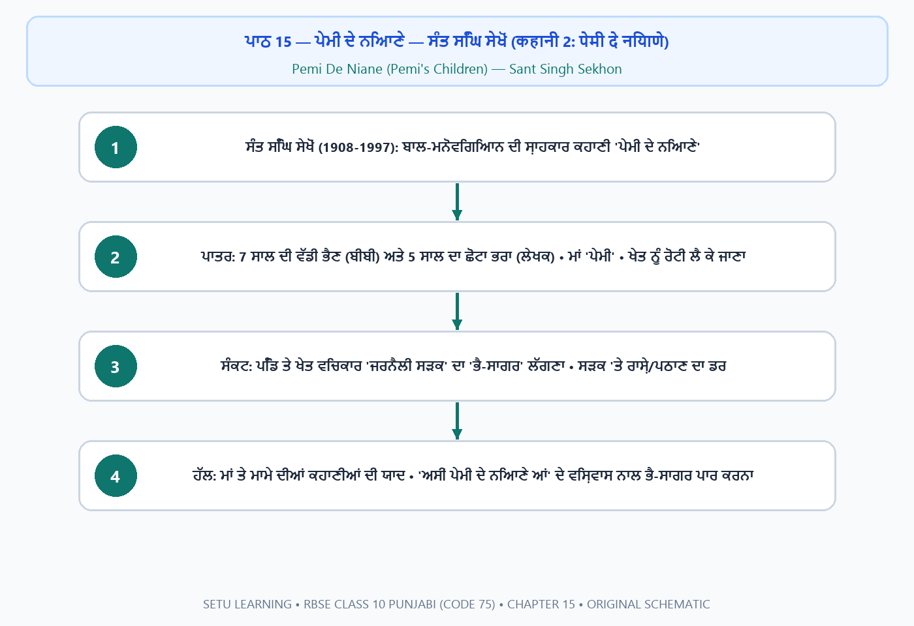

# ਪਾਠ 15 — ਪੇਮੀ ਦੇ ਨਿਆਣੇ — ਸੰਤ ਸਿੰਘ ਸੇਖੋਂ (कहानी 2: पेमी दे नियाणे) (Pemi De Niane (Pemi's Children) — Sant Singh Sekhon)

## भाग 1: अध्याय प्रवेश एवं पाठ्यक्रम मैपिंग (ਪਾਠ-ਪ੍ਰਵੇਸ਼ ਅਤੇ ਪਾਠਕ੍ਰਮ ਮੈਪਿੰਗ)

> RBSE ਜਮਾਤ 10 ਪੰਜਾਬੀ ਪਾਠ-ਪੁਸਤਕ 'ਸਾਹਿਤ ਸੁਗੰਧੀਆਂ' ਦੇ ਸਾਰੇ ਪ੍ਰਸ਼ਨਾਂ ਦੇ ਹੱਲ ਅਤੇ 2014–2026 ਦਾ ਪੂਰਾ ਇਤਿਹਾਸਕ PYQ ਸੰਗ੍ਰਹਿ ਸਰੋਤ-ਪ੍ਰੀਖਣ ਸਮੇਤ ਸੰਕਲਿਤ ਹਨ।

**ਵਿਸ਼ਾ ਕੋਡ (विषय कोड):** 75 (ਤੀਜੀ ਭਾਸ਼ਾ — ਪੰਜਾਬੀ / तृतीया भाषा — पंजाबी) · **ਲੜੀ ਪੁਸਤਕ (श्रृंखला पुस्तक):** 7

**ਪ੍ਰਮਾਣਿਤ ਆਧਾਰ:** RBSE 2025–26 · **ਪਾਠ ਅੰਕ-ਭਾਰ:** 3 ਅੰਕ। ਇਹ ਭਾਰ ਉਸੇ ਸੰਸਕਰਣ ਦਾ ਹੈ; ਅਸਲ ਪ੍ਰਸ਼ਨ-ਵੰਡ ਦੀ ਭਵਿੱਖਬਾਣੀ ਨਹੀਂ।

**ਸਿੱਖਣ ਦੇ ਉਦੇਸ਼ (सीखने के लक्ष्य):** ਸੰਤ ਸਿੰਘ ਸੇਖੋਂ ਦੀ ਕਹਾਣੀ 'ਪੇਮੀ ਦੇ ਨਿਆਣੇ' ਦਾ ਸਾਰ, ਬਾਲ-ਮਨੋਵਿਗਿਆਨ, 7 ਸਾਲ ਦੀ ਵੱਡੀ ਭੈਣ ਤੇ 5 ਸਾਲ ਦੇ ਛੋਟੇ ਭਰਾ ਨੂੰ ਜਰਨੈਲੀ ਸੜਕ ਦਾ 'ਭੈ-ਸਾਗਰ' ਲੱਗਣਾ, ਰਾਸ਼ੇ/ਪਠਾਣ ਦਾ ਡਰ ਅਤੇ 'ਅਸੀਂ ਪੇਮੀ ਦੇ ਨਿਆਣੇ ਆਂ' ਦੇ ਵਿਸ਼ਵਾਸ ਨਾਲ ਸੜਕ ਪਾਰ ਕਰਨਾ ਸਮਝਣਾ।

## भाग 2: शब्दावली एवं अवधारणा कैप्सूल (ਸ਼ਬਦਾਵਲੀ ਅਤੇ ਸੰਕਲਪ ਕੈਪਸੂਲ)

| ਸ਼ਬਦ / ਸੰਕਲਪ | ਅਰਥ / ਵਿਆਖਿਆ |
|---|---|
| ਪੇਮੀ (पेमी) | ਬੱਚਿਆਂ ਦੀ ਮਾਂ ਦਾ ਨਾਂ ('ਅਸੀਂ ਪੇਮੀ ਦੇ ਨਿਆਣੇ ਆਂ')। |
| ਨਿਆਣੇ (निआणे) | ਛੋਟੇ ਬੱਚੇ — ਕਹਾਣੀ ਵਿੱਚ 7 ਸਾਲ ਦੀ ਵੱਡੀ ਭੈਣ (ਬੀਬੀ) ਅਤੇ 5 ਸਾਲ ਦਾ ਛੋਟਾ ਭਰਾ (ਲੇਖਕ)। |
| ਜਰਨੈਲੀ ਸੜਕ (जरनैली सड़क) | ਵੱਡੀ ਪੱਕੀ ਸੜਕ (G.T. Road) ਜੋ ਬੱਚਿਆਂ ਨੂੰ 'ਭੈ-ਸਾਗਰ' (ਡਰ ਦਾ ਸਮੁੰਦਰ) ਲੱਗਦੀ ਸੀ। |
| ਭੈ-ਸਾਗਰ (भै-सागर) | ਡਰ ਦਾ ਸਮੁੰਦਰ — ਜਰਨੈਲੀ ਸੜਕ ਦਾ ਪ੍ਰਤੀਕ (ਲੇਖਕ ਤੇ ਉਸ ਦੀ ਭੈਣ ਨੂੰ ਜਰਨੈਲੀ ਸੜਕ ਭੈ-ਸਾਗਰ ਲੱਗਦੀ ਸੀ)। |
| ਮਦਰੱਸਾ (मदरस्सा) | ਪਿੰਡ ਦਾ ਸਕੂਲ ਜਿੱਥੇ ਦੋਵੇਂ ਬੱਚੇ ਪੜ੍ਹਨ ਜਾਂਦੇ ਸਨ। |
| ਰਾਸ਼ਾ / ਪਠਾਣ (राशा / पठाण) | ਸੜਕ ਉੱਤੇ ਤੁਰਿਆ ਜਾਂਦਾ ਲੰਮਾ-ਚੌੜਾ ਅਜਨਬੀ ਰਾਹੀ ਜਿਸ ਤੋਂ ਬੱਚੇ ਡਰ ਜਾਂਦੇ ਸਨ। |
| ਨਰਕ ਅਤੇ ਸਵਰਗ (नरक अते सवरग) | ਮਾਂ ਵੱਲੋਂ ਸੁਣਾਈ ਕਹਾਣੀ ਜਿਸ ਵਿੱਚ ਕੁੱਤੇ ਤੇ ਬਿੱਲੇ ਜਾਨਵਰਾਂ ਨੂੰ ਲੈ ਕੇ ਦਰਿਆ ਪਾਰ ਕਰਦੇ ਸਨ। |
| ਰਾਜਾ ਅਤੇ ਰਾਣੀ (राजा अते राणी) | ਕਹਾਣੀ ਦੇ ਬੱਚਿਆਂ ਨੂੰ ਰਾਜਾ ਅਤੇ ਰਾਣੀ ਆਪਣੇ ਬਾਪੂ ਅਤੇ ਮਾਂ (ਪੇਮੀ) ਵਰਗੇ ਭਾਸਦੇ ਸਨ। |
| ਵਾਹਿਗੁਰੂ ਤੇ ਗੁਰੂ ਨਾਨਕ ਦਾ ਨਾਂ (वाहिगुरु ते गुरु नानक दा नां) | ਡਰ ਭਜਾਉਣ ਲਈ ਬੱਚਿਆਂ ਵੱਲੋਂ ਜਪਿਆ ਗਿਆ ਨਾਂ। |
| ਆਤਮ-ਵਿਸ਼ਵਾਸ (आतम-विश्वास) | ਮਾਂ ਦੇ ਨਾਂ ('ਪੇਮੀ ਦੇ ਨਿਆਣੇ') ਦੀ ਓਟ ਨਾਲ ਬੱਚਿਆਂ ਅੰਦਰ ਜਾਗਿਆ ਹੌਸਲਾ। |

## भाग 3: विस्तृत शिक्षण पाठ (ਵਿਸਤ੍ਰਿਤ ਅਧਿਆਪਨ ਪਾਠ)

### 1. ਕਹਾਣੀਕਾਰ-ਪਛਾਣ: ਸੰਤ ਸਿੰਘ ਸੇਖੋਂ (1908–1997 ਈ.)
ਪੰਜਾਬੀ ਸਾਹਿਤ ਦੇ ਬੋਹੜ, ਮਾਰਕਸਵਾਦੀ ਆਲੋਚਕ, ਨਾਟਕਕਾਰ ਅਤੇ ਕਹਾਣੀਕਾਰ **ਸੰਤ ਸਿੰਘ ਸੇਖੋਂ** ਦਾ ਜਨਮ 30 ਮਈ 1908 ਈ. ਨੂੰ ਚੱਕ ਨੰਬਰ 70 (ਜ਼ਿਲ੍ਹਾ ਲਾਇਲਪੁਰ, ਪਾਕਿਸਤਾਨ) ਵਿਖੇ ਹੋਇਆ (ਪੈਤ੍ਰਿਕ ਪਿੰਡ ਦਾਖਾ, ਜ਼ਿਲ੍ਹਾ ਲੁਧਿਆਣਾ)। ਉਹਨਾਂ ਦੇ ਪ੍ਰਸਿੱਧ ਕਹਾਣੀ-ਸੰਗ੍ਰਹਿ 'ਸਮਾਚਾਰ', 'ਕਾਮੇ ਤੇ ਯੋਧੇ', 'ਅੱਧੀ ਵਾਟ' ਅਤੇ 'ਤੀਜਾ ਪਹਿਰ' ਹਨ। 1972 ਵਿੱਚ ਨਾਟਕ 'ਮਿੱਤਰ ਪਿਆਰਾ' ਲਈ ਉਹਨਾਂ ਨੂੰ ਭਾਰਤੀ ਸਾਹਿਤ ਅਕਾਦਮੀ ਪੁਰਸਕਾਰ ਮਿਲਿਆ। **'ਪੇਮੀ ਦੇ ਨਿਆਣੇ'** ਪੰਜਾਬੀ ਬਾਲ-ਮਨੋਵਿਗਿਆਨ ਦੀ ਸਭ ਤੋਂ ਸ਼ਾਹਕਾਰ ਕਹਾਣੀ ਹੈ।

### 2. 'ਪੇਮੀ ਦੇ ਨਿਆਣੇ' ਕਹਾਣੀ ਦਾ ਵਿਸਤ੍ਰਿਤ ਸਾਰ ਅਤੇ ਪ੍ਰਮੁੱਖ ਪ੍ਰਸ਼ਨ
1. **ਬੱਚਿਆਂ ਦੀ ਉਮਰ ਅਤੇ ਖੇਤ ਨੂੰ ਰੋਟੀ ਲੈ ਕੇ ਜਾਣਾ (RBSE 2025 Supp Q1-xiii):**
   - ਕਹਾਣੀ ਵਿੱਚ ਲੇਖਕ (ਉਮਰ **5 ਸਾਲ**) ਅਤੇ ਉਸ ਦੀ ਵੱਡੀ ਭੈਣ 'ਬੀਬੀ' (ਉਮਰ **7 ਸਾਲ**) ਸਵੇਰੇ ਮਦਰੱਸੇ (ਸਕੂਲ) ਪੜ੍ਹਨ ਜਾਂਦੇ ਹਨ।
   - ਦੁਪਹਿਰ ਵੇਲੇ ਮਾਂ (ਪੇਮੀ) ਦੋਹਾਂ ਬੱਚਿਆਂ ਨੂੰ ਕਹਿੰਦੀ ਹੈ ਕਿ ਉਹ **ਖੇਤ ਵਿੱਚ ਹਲ ਵਾਹ ਰਹੇ ਆਪਣੇ ਬਾਪੂ ਅਤੇ ਕਾਮੇ ਲਈ ਰੋਟੀ (ਭੱਤਾ)** ਲੈ ਕੇ ਜਾਣ।
2. **ਜਰਨੈਲੀ ਸੜਕ 'ਭੈ-ਸਾਗਰ' ਕਿਉਂ ਲੱਗਦੀ ਸੀ? (RBSE 2020 Supp Q8-ਹ, 2022 Main Q2-vi, 2025 Supp Q2-v, 2026 Supp Q3-VIII):**
   - ਪਿੰਡ ਅਤੇ ਖੇਤ ਦੇ ਵਿਚਕਾਰ ਇੱਕ ਵੱਡੀ ਪੱਕੀ **'ਜਰਨੈਲੀ ਸੜਕ'** ਲੰਘਦੀ ਸੀ।
   - ਦੋਹਾਂ ਛੋਟੇ ਬੱਚਿਆਂ ਨੂੰ ਇਹ **ਜਰਨੈਲੀ ਸੜਕ 'ਭੈ-ਸਾਗਰ' (ਡਰ ਦਾ ਸਮੁੰਦਰ)** ਲੱਗਦੀ ਸੀ ਕਿਉਂਕਿ ਉਸ ਸੜਕ ਉੱਤੇ ਕਦੇ-ਕਦੇ ਟਾਂਗੇ, ਮੋਟਰਾਂ ਅਤੇ ਓਪਰੇ ਰਾਹੀ (ਪਠਾਣ, ਰਾਸ਼ੇ, ਫ਼ਕੀਰ, ਬਾਜ਼ੀਗਰ) ਲੰਘਦੇ ਰਹਿੰਦੇ ਸਨ ਅਤੇ ਬੱਚਿਆਂ ਨੇ ਸੁਣਿਆ ਹੋਇਆ ਸੀ ਕਿ ਰਾਸ਼ੇ/ਪਠਾਣ ਬੱਚਿਆਂ ਨੂੰ ਫੜ ਕੇ ਬੋਰੀ ਵਿੱਚ ਪਾ ਕੇ ਲੈ ਜਾਂਦੇ ਹਨ।
3. **ਰਾਜਾ ਤੇ ਰਾਣੀ ਕਿਹੋ ਜਿਹੇ ਭਾਸਦੇ ਸਨ ਅਤੇ ਮਾਮੇ ਦੀ ਕਿਹੜੀ ਗੱਲ ਸੁਣਾਈ ਜਾਂਦੀ ਸੀ? (RBSE 2018 Main Q8-ਕ, 2020 Main Q8-ਹ, 2022 Main Q3-viii, 2024 Main Q2-v):**
   - ਮਾਂ ਬੱਚਿਆਂ ਨੂੰ ਰਾਜੇ-ਰਾਣੀ ਅਤੇ ਨਰਕ-ਸਵਰਗ ਦੀਆਂ ਕਹਾਣੀਆਂ ਸੁਣਾਉਂਦੀ ਹੁੰਦੀ ਸੀ। ਬੱਚਿਆਂ ਨੂੰ ਕਹਾਣੀ ਦੇ **ਰਾਜਾ ਅਤੇ ਰਾਣੀ ਆਪਣੇ ਬਾਪੂ ਅਤੇ ਆਪਣੀ ਮਾਂ (ਪੇਮੀ) ਵਰਗੇ** ਹੀ ਭਾਸਦੇ ਸਨ (RBSE 2022 Main Q3-viii)।
   - **ਮਾਮੇ ਦੀ ਗੱਲ:** ਡਰ ਹਟਾਉਣ ਲਈ ਮਾਂ ਉਹਨਾਂ ਨੂੰ ਦੱਸਦੀ ਹੁੰਦੀ ਸੀ ਕਿ ਉਹਨਾਂ ਦਾ ਮਾਮਾ ਬਹੁਤ ਤਕੜਾ ਤੇ ਦਲੇਰ ਹੈ ਅਤੇ **'ਅਸਾਡਾ ਮਾਮਾ ਜਰਨੈਲੀ ਸੜਕ ਉੱਤੇ ਰਾਸ਼ਿਆਂ/ਪਠਾਣਾਂ ਦਾ ਰਾਹ ਰੋਕਣ / ਟਾਕਰਾ ਕਰਨ ਲੱਗ ਪਿਆ'** ਜਾਂ ਮਾਮੇ ਤੋਂ ਸਾਰੇ ਡਰਦੇ ਹਨ (RBSE 2018 Main Q8-ਕ, 2020 Main Q8-ਹ, 2024 Main Q2-v)।
4. **ਸੜਕ ਉੱਤੇ ਰਾਸ਼ੇ (ਪਠਾਣ) ਨੂੰ ਵੇਖ ਕੇ ਡਰਨਾ ਅਤੇ ਅੰਤ ਸੜਕ ਕਿਵੇਂ ਪਾਰ ਕੀਤੀ? (RBSE 2019 Main Q8-ਕ):**
   - ਜਦੋਂ ਦੋਵੇਂ ਬੱਚੇ ਜਰਨੈਲੀ ਸੜਕ ਦੇ ਨੇੜੇ ਪਹੁੰਚੇ ਤਾਂ ਉਹਨਾਂ ਨੇ ਸੜਕ ਉੱਤੇ ਇੱਕ ਲੰਮੇ-ਚੌੜੇ ਰਾਸ਼ੇ (ਪਠਾਣ) ਨੂੰ ਤੁਰਿਆ ਆਉਂਦਾ ਵੇਖਿਆ ਤੇ ਉਹ ਡਰ ਕੇ ਰੁਕ ਗਏ।
   - ਪਹਿਲਾਂ ਉਹਨਾਂ ਨੇ 'ਵਾਹਿਗੁਰੂ' ਤੇ 'ਗੁਰੂ ਨਾਨਕ' ਦਾ ਨਾਂ ਲਿਆ, ਫਿਰ ਕਹਾਣੀ ਦੇ ਰਾਜੇ-ਰਾਣੀ ਬਾਰੇ ਸੋਚਿਆ।
   - ਅੰਤ ਵੱਡੀ ਭੈਣ ਨੂੰ ਇੱਕ ਤਰਕੀਬ ਸੁੱਝੀ — ਉਹਨਾਂ ਨੇ ਕਹਾਣੀ ਦੇ ਰਾਜੇ-ਰਾਣੀ ਦੀ ਥਾਂ ਆਪਣੀ ਮਾਂ 'ਪੇਮੀ' ਦਾ ਨਾਂ ਰੱਖ ਲਿਆ ਅਤੇ ਮਨ ਵਿੱਚ ਪੱਕਾ ਵਿਸ਼ਵਾਸ ਧਾਰ ਲਿਆ ਕਿ **'ਅਸੀਂ ਪੇਮੀ ਦੇ ਨਿਆਣੇ ਆਂ, ਸਾਨੂੰ ਕੋਈ ਕੁੱਛ ਨਹੀਂ ਕਹਿੰਦਾ!'**
   - ਮਾਂ ਦੇ ਨਾਂ ਦੇ ਇਸ ਅਟੁੱਟ ਵਿਸ਼ਵਾਸ ਅਤੇ ਮਮਤਾ ਦੀ ਓਟ ਨਾਲ ਦੋਹਾਂ ਬੱਚਿਆਂ ਦਾ ਡਰ ਜਾਂਦਾ ਰਿਹਾ ਅਤੇ ਉਹਨਾਂ ਨੇ ਹੱਥ ਫੜ ਕੇ ਦਲੇਰੀ ਨਾਲ ਜਰਨੈਲੀ ਸੜਕ ਪਾਰ ਕਰ ਲਈ।

ਪਾਠ 15: ਸੰਤ ਸਿੰਘ ਸੇਖੋਂ ਦੀ ਕਹਾਣੀ 'ਪੇਮੀ ਦੇ ਨਿਆਣੇ' ਦਾ ਸੰਕਲਪ ਚਿੱਤਰ

## भाग 4: पाठ्यपुस्तक-अवधारणाओं पर मौलिक हल किए उदाहरण (ਹੱਲ ਕੀਤੇ ਮਿਆਰੀ ਉਦਾਹਰਣ)

ਹੇਠਾਂ ਦਿੱਤੇ ਪ੍ਰਸ਼ਨ ਪਾਠ-ਪੁਸਤਕ 'ਸਾਹਿਤ ਸੁਗੰਧੀਆਂ' ਅਤੇ ਵਿਆਕਰਣ ਦੇ ਸੰਕਲਪਾਂ ਉੱਤੇ ਆਧਾਰਿਤ ਮੌਲਿਕ ਆਦਰਸ਼ ਹੱਲ ਹਨ।

**ਹੱਲ ਕੀਤਾ ਉਦਾਹਰਣ 1: ਲੇਖਕ ਤੇ ਉਸ ਦੀ ਭੈਣ ਨੂੰ ਜਰਨੈਲੀ ਸੜਕ 'ਭੈ-ਸਾਗਰ' ਕਿਉਂ ਲੱਗਦੀ ਸੀ? (RBSE 2020 Supp Q8-ਹ, 2026 Supp Q3-VIII)**

ਲੇਖਕ (5 ਸਾਲ) ਅਤੇ ਉਸ ਦੀ ਭੈਣ (7 ਸਾਲ) ਬਹੁਤ ਛੋਟੇ ਸਨ। ਪਿੰਡ ਤੋਂ ਖੇਤ ਨੂੰ ਜਾਂਦਿਆਂ ਰਸਤੇ ਵਿੱਚ ਪੱਕੀ ਜਰਨੈਲੀ ਸੜਕ ਪੈਂਦੀ ਸੀ। ਬੱਚਿਆਂ ਨੂੰ ਇਹ ਜਰਨੈਲੀ ਸੜਕ 'ਭੈ-ਸਾਗਰ' (ਡਰ ਦਾ ਸਮੁੰਦਰ) ਇਸ ਲਈ ਲੱਗਦੀ ਸੀ ਕਿਉਂਕਿ ਉਸ ਉੱਤੇ ਓਪਰੇ ਰਾਹੀ, ਪਠਾਣ, ਰਾਸ਼ੇ, ਫ਼ਕੀਰ ਤੇ ਗੱਡੀਆਂ ਲੰਘਦੀਆਂ ਸਨ ਅਤੇ ਬੱਚਿਆਂ ਦੇ ਮਨ ਵਿੱਚ ਡਰ ਬਿਠਾਇਆ ਗਿਆ ਸੀ ਕਿ ਰਾਸ਼ੇ ਜਾਂ ਪਠਾਣ ਛੋਟੇ ਬੱਚਿਆਂ ਨੂੰ ਚੁੱਕ ਕੇ ਲੈ ਜਾਂਦੇ ਹਨ (RBSE 2020 Supp Q8-ਹ, 2022 Main Q2-vi, 2025 Supp Q2-v, 2026 Supp Q3-VIII)।

**ਹੱਲ ਕੀਤਾ ਉਦਾਹਰਣ 2: ਅੰਤ ਨੂੰ ਲੇਖਕ ਤੇ ਉਸ ਦੀ ਭੈਣ ਨੇ ਸੜਕ ਕਿਵੇਂ ਪਾਰ ਕੀਤੀ? 'ਪੇਮੀ ਦੇ ਨਿਆਣੇ' ਕਹਾਣੀ ਦੇ ਆਧਾਰ 'ਤੇ ਬਿਆਨ ਕਰੋ। (RBSE 2019 Main Q8-ਕ)**

ਜਰਨੈਲੀ ਸੜਕ ਉੱਤੇ ਰਾਸ਼ੇ (ਪਠਾਣ) ਨੂੰ ਵੇਖ ਕੇ ਦੋਵੇਂ ਬੱਚੇ ਸਹਿਮ ਗਏ। ਪਹਿਲਾਂ ਉਹਨਾਂ ਨੇ ਵਾਹਿਗੁਰੂ ਦਾ ਨਾਂ ਲਿਆ ਅਤੇ ਫਿਰ ਮਾਂ ਵੱਲੋਂ ਸੁਣਾਈ ਰਾਜੇ-ਰਾਣੀ ਦੀ ਕਹਾਣੀ ਨੂੰ ਯਾਦ ਕੀਤਾ। ਵੱਡੀ ਭੈਣ ਨੇ ਰਾਣੀ ਦੀ ਥਾਂ ਆਪਣੀ ਮਾਂ 'ਪੇਮੀ' ਨੂੰ ਰੱਖਦਿਆਂ ਕਿਹਾ ਕਿ 'ਅਸੀਂ ਪੇਮੀ ਦੇ ਨਿਆਣੇ ਆਂ', ਇਸ ਲਈ ਰਾਸ਼ਾ ਸਾਨੂੰ ਕੁਝ ਨਹੀਂ ਕਹਿ ਸਕਦਾ। ਮਾਂ ਦੇ ਨਾਂ ਦੀ ਇਸ ਮਾਨਸਿਕ ਓਟ ਨਾਲ ਉਹਨਾਂ ਅੰਦਰ ਹੌਸਲਾ ਆ ਗਿਆ ਤੇ ਉਹਨਾਂ ਨੇ ਭੈ-ਸਾਗਰ ਰੂਪੀ ਸੜਕ ਪਾਰ ਕਰ ਲਈ (RBSE 2019 Main Q8-ਕ)।

**ਹੱਲ ਕੀਤਾ ਉਦਾਹਰਣ 3: 'ਪੇਮੀ ਦੇ ਨਿਆਣੇ' ਕਹਾਣੀ ਵਿੱਚ ਲੇਖਕ ਤੇ ਉਸ ਦੀ ਭੈਣ ਨੂੰ ਰਾਜਾ ਤੇ ਰਾਣੀ ਕਿਹੋ ਜਿਹੇ ਭਾਸਦੇ ਸਨ? (RBSE 2022 Main Q3-viii)**

ਮਾਂ ਵੱਲੋਂ ਸੁਣਾਈਆਂ ਕਹਾਣੀਆਂ ਵਿੱਚ ਆਉਣ ਵਾਲੇ ਰਾਜਾ ਅਤੇ ਰਾਣੀ ਲੇਖਕ ਤੇ ਉਸ ਦੀ ਭੈਣ ਨੂੰ ਆਪਣੇ ਹੀ ਘਰ ਦੇ ਮਾਲਕ ਭਾਵ ਆਪਣੇ ਬਾਪੂ ਅਤੇ ਆਪਣੀ ਮਾਂ (ਪੇਮੀ) ਵਰਗੇ ਭਾਸਦੇ ਸਨ, ਜੋ ਆਪਣੇ ਬੱਚਿਆਂ ਦੀ ਹਰ ਮੁਸੀਬਤ ਤੋਂ ਰੱਖਿਆ ਕਰਦੇ ਹਨ (RBSE 2022 Main Q3-viii)।

## भाग 5: सत्यापित बोर्ड प्रश्न एवं स्रोत-स्थिति (ਪ੍ਰਮਾਣਿਤ ਬੋਰਡ ਪ੍ਰਸ਼ਨ ਅਤੇ ਸਰੋਤ-ਸਥਿਤੀ)

RBSE 2026 Supp (`S-75`, Q3-VIII), 2025 Supp (Q1-xiii, Q2-v), 2024 Main (Q2-v) ਅਤੇ 2022 Main (Q2-vi, Q3-viii, Q19) ਵਿੱਚ 'ਪੇਮੀ ਦੇ ਨਿਆਣੇ' ਕਹਾਣੀ ਦੇ ਪ੍ਰਸ਼ਨ ਪੁੱਛੇ ਗਏ ਹਨ।

[RBSE 2026 ਮੂਲ ਪੇਪਰ (S-75)](https://rajeduboard.rajasthan.gov.in/books/PAPERS-2026/Sec/S-75.pdf)। ਪ੍ਰਸ਼ਨ ਦਾ ਸੰਖੇਪ ਵਿਸ਼ਾ-ਸੰਦਰਭ ਹੈ; ਸ਼ਬਦ-ਬ-ਸ਼ਬਦ ਪੁਨਰ-ਮੁਦਰਣ ਨਹੀਂ।

## भाग 6: खंडवार मौलिक अभ्यास बैंक (ਖੰਡ-ਵਾਰ ਮੌਲਿਕ ਅਭਿਆਸ ਬੈਂਕ)

**ਅਭਿਆਸ-ਅੰਕ:** ਵਿਦਿਆਰਥੀਆਂ ਦੇ ਸਵੈ-ਅਭਿਆਸ ਲਈ ਹਨ; ਉੱਤਰ ਪਹਿਲਾਂ ਆਪ ਲਿਖੋ, ਫਿਰ ਭਾਗ 9 ਵੇਖੋ।

## ੳ: ਬਹੁ-ਵਿਕਲਪੀ ਪ੍ਰਸ਼ਨ (MCQ) — 15 × 1 ਅੰਕ

**MCQ 1. ਪੇਮੀ ਦੇ ਨਿਆਣੇ ਕਿੱਥੇ ਜਾ ਰਹੇ ਸਨ? (RBSE 2025 Supp Q1-xiii)**

ੳ) ਸੂਏ ਵੱਲ  
ਅ) ਖੇਤ (ਬਾਪੂ ਲਈ ਰੋਟੀ ਲੈ ਕੇ)  
ੲ) ਸਕੂਲ  
ਸ) ਨਹਿਰ 'ਤੇ

**MCQ 2. ਖਾਲੀ ਥਾਂ ਭਰੋ: 'ਲੇਖਕ ਤੇ ਉਸ ਦੀ ਭੈਣ ਨੂੰ ................ ਭੈ-ਸਾਗਰ ਲੱਗਦੀ ਸੀ।' (RBSE 2022 Main Q2-vi, 2025 Supp Q2-v)**

ੳ) ਜਰਨੈਲੀ ਸੜਕ  
ਅ) ਨਹਿਰ ਦੀ ਪਟੜੀ  
ੲ) ਪਿੰਡ ਦੀ ਗਲੀ  
ਸ) ਰੇਲਵੇ ਲਾਈਨ

**MCQ 3. 'ਪੇਮੀ ਦੇ ਨਿਆਣੇ' ਕਹਾਣੀ ਦੇ ਕਹਾਣੀਕਾਰ ਕੌਣ ਹਨ?**

ੳ) ਗੁਰਬਖ਼ਸ਼ ਸਿੰਘ ਪ੍ਰੀਤਲੜੀ  
ਅ) ਸੰਤੋਖ ਸਿੰਘ ਧੀਰ  
ੲ) ਕੁਲਵੰਤ ਸਿੰਘ ਵਿਰਕ  
ਸ) ਸੰਤ ਸਿੰਘ ਸੇਖੋਂ

**MCQ 4. 'ਪੇਮੀ ਦੇ ਨਿਆਣੇ' ਕਹਾਣੀ ਵਿੱਚ ਲੇਖਕ ਅਤੇ ਉਸ ਦੀ ਵੱਡੀ ਭੈਣ ਦੀ ਉਮਰ ਕਿੰਨੀ ਸੀ?**

ੳ) ਲੇਖਕ 8 ਸਾਲ ਅਤੇ ਭੈਣ 6 ਸਾਲ  
ਅ) ਦੋਵੇਂ 15 ਸਾਲ ਦੇ  
ੲ) ਲੇਖਕ 5 ਸਾਲ ਅਤੇ ਵੱਡੀ ਭੈਣ 7 ਸਾਲ  
ਸ) ਲੇਖਕ 10 ਸਾਲ ਅਤੇ ਭੈਣ 12 ਸਾਲ

**MCQ 5. ਕਹਾਣੀ ਵਿੱਚ 'ਪੇਮੀ' ਕੌਣ ਹੈ?**

ੳ) ਗੁਆਂਢਣ  
ਅ) ਬੱਚਿਆਂ ਦੀ ਮਾਂ  
ੲ) ਬੱਚਿਆਂ ਦੀ ਭੂਆ  
ਸ) ਪਿੰਡ ਦੀ ਅਧਿਆਪਕਾ

**MCQ 6. 'ਪੇਮੀ ਦੇ ਨਿਆਣੇ' ਕਹਾਣੀ ਵਿੱਚ ਲੇਖਕ ਤੇ ਉਸ ਦੀ ਭੈਣ ਨੂੰ ਕਹਾਣੀ ਦੇ ਰਾਜਾ ਤੇ ਰਾਣੀ ਕਿਹੋ ਜਿਹੇ ਭਾਸਦੇ ਸਨ? (RBSE 2022 Main Q3-viii)**

ੳ) ਆਪਣੇ ਬਾਪੂ ਅਤੇ ਮਾਂ (ਪੇਮੀ) ਵਰਗੇ  
ਅ) ਪਿੰਡ ਦੇ ਸਰਪੰਚ ਵਰਗੇ  
ੲ) ਅਧਿਆਪਕ ਵਰਗੇ  
ਸ) ਰਾਸ਼ੇ ਵਰਗੇ

**MCQ 7. ਜਰਨੈਲੀ ਸੜਕ ਉੱਤੇ ਬੱਚੇ ਕਿਸ ਨੂੰ ਤੁਰਿਆ ਆਉਂਦਾ ਵੇਖ ਕੇ ਡਰ ਗਏ ਸਨ?**

ੳ) ਇੱਕ ਸ਼ੇਰ ਨੂੰ  
ਅ) ਪੁਲਿਸ ਵਾਲੇ ਨੂੰ  
ੲ) ਸੱਪ ਨੂੰ  
ਸ) ਇੱਕ ਰਾਸ਼ੇ (ਪਠਾਣ) ਨੂੰ

**MCQ 8. ਅੰਤ ਵਿੱਚ ਬੱਚਿਆਂ ਨੇ ਆਪਣੇ ਮਨ ਵਿੱਚ ਕਿਹੜਾ ਵਿਸ਼ਵਾਸ ਧਾਰ ਕੇ ਜਰਨੈਲੀ ਸੜਕ ਪਾਰ ਕੀਤੀ?**

ੳ) 'ਅਸੀਂ ਡਰਦੇ ਨਹੀਂ'  
ਅ) 'ਅਸੀਂ ਦੌੜ ਜਾਵਾਂਗੇ'  
ੲ) 'ਅਸੀਂ ਪੇਮੀ ਦੇ ਨਿਆਣੇ ਆਂ'  
ਸ) 'ਅਸੀਂ ਸਰਪੰਚ ਦੇ ਨਿਆਣੇ ਆਂ'

**MCQ 9. ਸਵੇਰ ਵੇਲੇ ਦੋਵੇਂ ਬੱਚੇ ਕਿੱਥੇ ਪੜ੍ਹਨ ਗਏ ਸਨ?**

ੳ) ਮੌਲਵੀ ਦੇ ਘਰ  
ਅ) ਪਿੰਡ ਦੇ ਮਦਰੱਸੇ (ਸਕੂਲ) ਵਿੱਚ  
ੲ) ਸ਼ਹਿਰ ਦੇ ਕਾਲਜ ਵਿੱਚ  
ਸ) ਗੁਰਦੁਆਰੇ ਵਿੱਚ

**MCQ 10. ਲੇਖਕ ਦੀ ਮਾਂ ਡਰ ਹਟਾਉਣ ਲਈ ਬੱਚਿਆਂ ਨੂੰ ਕਿਸ ਦੀ ਦਲੇਰੀ ਦੀਆਂ ਗੱਲਾਂ ਸੁਣਾਉਂਦੀ ਹੁੰਦੀ ਸੀ? (RBSE 2018 Main Q8-ਕ, 2020 Main Q8-ਹ)**

ੳ) ਉਹਨਾਂ ਦੇ ਮਾਮੇ ਦੀ  
ਅ) ਉਹਨਾਂ ਦੇ ਚਾਚੇ ਦੀ  
ੲ) ਪਿੰਡ ਦੇ ਚੌਕੀਦਾਰ ਦੀ  
ਸ) ਰਾਜੇ ਦੀ

**MCQ 11. 'ਭੈ-ਸਾਗਰ' ਸ਼ਬਦ ਦਾ ਕੀ ਅਰਥ ਹੈ?**

ੳ) ਪਾਣੀ ਦਾ ਤਾਲਾਬ  
ਅ) ਵੱਡਾ ਜੰਗਲ  
ੲ) ਉੱਚਾ ਪਹਾੜ  
ਸ) ਡਰ ਦਾ ਸਮੁੰਦਰ

**MCQ 12. 'ਪੇਮੀ ਦੇ ਨਿਆਣੇ' ਕਿਸ ਵਿਸ਼ੇ ਨਾਲ ਸੰਬੰਧਿਤ ਕਹਾਣੀ ਹੈ?**

ੳ) ਭਰਾਵਾਂ ਦੇ ਝਗੜੇ ਨਾਲ  
ਅ) ਖੇਡ-ਜਗਤ ਨਾਲ  
ੲ) ਬਾਲ-ਮਨੋਵਿਗਿਆਨ ਨਾਲ  
ਸ) ਦੇਸ਼-ਵੰਡ ਨਾਲ

**MCQ 13. ਮਾਂ ਵੱਲੋਂ ਸੁਣਾਈ ਨਰਕ-ਸਵਰਗ ਦੀ ਕਹਾਣੀ ਵਿੱਚ ਜਾਨਵਰਾਂ ਦੇ ਨਾਲ ਦਰਿਆ ਕੌਣ ਪਾਰ ਕਰਦੇ ਸਨ?**

ੳ) ਤੋਤਾ ਅਤੇ ਕਬੂਤਰ  
ਅ) ਕੁੱਤਾ ਅਤੇ ਬਿੱਲਾ  
ੲ) ਹਾਥੀ ਅਤੇ ਘੋੜਾ  
ਸ) ਸ਼ੇਰ ਅਤੇ ਬਘਿਆੜ

**MCQ 14. ਬੱਚਿਆਂ ਨੇ ਰਾਸ਼ੇ ਤੋਂ ਬਚਣ ਲਈ ਸਭ ਤੋਂ ਪਹਿਲਾਂ ਕਿਸ ਦਾ ਨਾਂ ਲਿਆ?**

ੳ) ਵਾਹਿਗੁਰੂ ਅਤੇ ਗੁਰੂ ਨਾਨਕ ਦੇਵ ਜੀ ਦਾ  
ਅ) ਸਰਪੰਚ ਦਾ  
ੲ) ਅਧਿਆਪਕ ਦਾ  
ਸ) ਪੁਲਿਸ ਦਾ

**MCQ 15. ਸੰਤ ਸਿੰਘ ਸੇਖੋਂ ਨੂੰ 1972 ਵਿੱਚ ਕਿਹੜੀ ਰਚਨਾ ਲਈ ਭਾਰਤੀ ਸਾਹਿਤ ਅਕਾਦਮੀ ਪੁਰਸਕਾਰ ਮਿਲਿਆ?**

ੳ) ਸਮਾਚਾਰ  
ਅ) ਕਾਮੇ ਤੇ ਯੋਧੇ  
ੲ) ਲਹੂ ਮਿੱਟੀ  
ਸ) ਮਿੱਤਰ ਪਿਆਰਾ (ਨਾਟਕ)

## ੳ: ਖਾਲੀ ਥਾਵਾਂ ਭਰੋ — 6 × 1 ਅੰਕ

1. ਬੱਚਿਆਂ ਦੀ ਮਾਂ ਦਾ ਨਾਂ ('ਅਸੀਂ ਪੇਮੀ ਦੇ ਨਿਆਣੇ ਆਂ')। — ਇਸ ਸ਼ਬਦ/ਸੰਕਲਪ ਦਾ ਨਾਂ ਹੈ: ____।  
2. ਛੋਟੇ ਬੱਚੇ — ਕਹਾਣੀ ਵਿੱਚ 7 ਸਾਲ ਦੀ ਵੱਡੀ ਭੈਣ (ਬੀਬੀ) ਅਤੇ 5 ਸਾਲ ਦਾ ਛੋਟਾ ਭਰਾ (ਲੇਖਕ)। — ਇਸ ਸ਼ਬਦ/ਸੰਕਲਪ ਦਾ ਨਾਂ ਹੈ: ____।  
3. ਵੱਡੀ ਪੱਕੀ ਸੜਕ (G.T. Road) ਜੋ ਬੱਚਿਆਂ ਨੂੰ 'ਭੈ-ਸਾਗਰ' (ਡਰ ਦਾ ਸਮੁੰਦਰ) ਲੱਗਦੀ ਸੀ। — ਇਸ ਸ਼ਬਦ/ਸੰਕਲਪ ਦਾ ਨਾਂ ਹੈ: ____।  
4. ਡਰ ਦਾ ਸਮੁੰਦਰ — ਜਰਨੈਲੀ ਸੜਕ ਦਾ ਪ੍ਰਤੀਕ (ਲੇਖਕ ਤੇ ਉਸ ਦੀ ਭੈਣ ਨੂੰ ਜਰਨੈਲੀ ਸੜਕ ਭੈ-ਸਾਗਰ ਲੱਗਦੀ ਸੀ)। — ਇਸ ਸ਼ਬਦ/ਸੰਕਲਪ ਦਾ ਨਾਂ ਹੈ: ____।  
5. ਪਿੰਡ ਦਾ ਸਕੂਲ ਜਿੱਥੇ ਦੋਵੇਂ ਬੱਚੇ ਪੜ੍ਹਨ ਜਾਂਦੇ ਸਨ। — ਇਸ ਸ਼ਬਦ/ਸੰਕਲਪ ਦਾ ਨਾਂ ਹੈ: ____।  
6. ਸੜਕ ਉੱਤੇ ਤੁਰਿਆ ਜਾਂਦਾ ਲੰਮਾ-ਚੌੜਾ ਅਜਨਬੀ ਰਾਹੀ ਜਿਸ ਤੋਂ ਬੱਚੇ ਡਰ ਜਾਂਦੇ ਸਨ। — ਇਸ ਸ਼ਬਦ/ਸੰਕਲਪ ਦਾ ਨਾਂ ਹੈ: ____।

## ੳ: ਅਤਿ-ਲਘੂ ਉੱਤਰਾਂ ਵਾਲੇ ਪ੍ਰਸ਼ਨ — 8 × 1 ਅੰਕ

1. ਪੇਮੀ ਦੇ ਨਿਆਣੇ ਕਿੱਥੇ ਜਾ ਰਹੇ ਸਨ? (RBSE 2025 Supp Q1-xiii)  
2. ਖਾਲੀ ਥਾਂ ਭਰੋ: 'ਲੇਖਕ ਤੇ ਉਸ ਦੀ ਭੈਣ ਨੂੰ ................ ਭੈ-ਸਾਗਰ ਲੱਗਦੀ ਸੀ।' (RBSE 2022 Main Q2-vi, 2025 Supp Q2-v)  
3. 'ਪੇਮੀ ਦੇ ਨਿਆਣੇ' ਕਹਾਣੀ ਦੇ ਕਹਾਣੀਕਾਰ ਕੌਣ ਹਨ?  
4. 'ਪੇਮੀ ਦੇ ਨਿਆਣੇ' ਕਹਾਣੀ ਵਿੱਚ ਲੇਖਕ ਅਤੇ ਉਸ ਦੀ ਵੱਡੀ ਭੈਣ ਦੀ ਉਮਰ ਕਿੰਨੀ ਸੀ?  
5. ਕਹਾਣੀ ਵਿੱਚ 'ਪੇਮੀ' ਕੌਣ ਹੈ?  
6. 'ਪੇਮੀ ਦੇ ਨਿਆਣੇ' ਕਹਾਣੀ ਵਿੱਚ ਲੇਖਕ ਤੇ ਉਸ ਦੀ ਭੈਣ ਨੂੰ ਕਹਾਣੀ ਦੇ ਰਾਜਾ ਤੇ ਰਾਣੀ ਕਿਹੋ ਜਿਹੇ ਭਾਸਦੇ ਸਨ? (RBSE 2022 Main Q3-viii)  
7. ਜਰਨੈਲੀ ਸੜਕ ਉੱਤੇ ਬੱਚੇ ਕਿਸ ਨੂੰ ਤੁਰਿਆ ਆਉਂਦਾ ਵੇਖ ਕੇ ਡਰ ਗਏ ਸਨ?  
8. ਅੰਤ ਵਿੱਚ ਬੱਚਿਆਂ ਨੇ ਆਪਣੇ ਮਨ ਵਿੱਚ ਕਿਹੜਾ ਵਿਸ਼ਵਾਸ ਧਾਰ ਕੇ ਜਰਨੈਲੀ ਸੜਕ ਪਾਰ ਕੀਤੀ?

## ਅ: ਲਘੂ ਉੱਤਰਾਂ ਵਾਲੇ ਪ੍ਰਸ਼ਨ — 6 × 2 ਅੰਕ

**B1.** ਪੇਮੀ ਦੇ ਨਿਆਣੇ ਕਿੱਥੇ ਜਾ ਰਹੇ ਸਨ ਅਤੇ ਕਿਉਂ? (RBSE 2025 Supp Q1-xiii)

**B2.** ਖਾਲੀ ਥਾਂ ਭਰੋ: 'ਲੇਖਕ ਤੇ ਉਸ ਦੀ ਭੈਣ ਨੂੰ ................ ਭੈ-ਸਾਗਰ ਲੱਗਦੀ ਸੀ।' (RBSE 2022 Main Q2-vi, 2025 Supp Q2-v)

**B3.** 'ਪੇਮੀ ਦੇ ਨਿਆਣੇ' ਕਹਾਣੀ ਦੇ ਕਹਾਣੀਕਾਰ ਕੌਣ ਹਨ ਅਤੇ ਬੱਚਿਆਂ ਦੀ ਉਮਰ ਕਿੰਨੀ ਸੀ?

**B4.** ਲੇਖਕ ਦੀ ਮਾਂ ਡਰ ਹਟਾਉਣ ਲਈ ਉਹਨਾਂ ਨੂੰ ਮਾਮੇ ਦੀ ਕਿਹੜੀ ਗੱਲ ਸੁਣਾਉਂਦੀ ਹੁੰਦੀ ਸੀ?

**B5.** ਜਰਨੈਲੀ ਸੜਕ ਉੱਤੇ ਬੱਚਿਆਂ ਨੇ ਕਿਸ ਨੂੰ ਤੁਰਿਆ ਜਾਂਦਾ ਵੇਖਿਆ ਜਿਸ ਤੋਂ ਉਹ ਡਰ ਗਏ?

**B6.** ਕਹਾਣੀ ਵਿੱਚ 'ਪੇਮੀ' ਕੌਣ ਹੈ?

## ੲ: ਦੀਰਘ ਉੱਤਰਾਂ ਵਾਲੇ ਪ੍ਰਸ਼ਨ — 4 × 3 ਅੰਕ

ਅੰਦਰੂਨੀ ਵਿਕਲਪ ਅਭਿਆਸ: ਪਹਿਲਾਂ ਇੱਕ ਵਿਕਲਪ ਹੱਲ ਕਰੋ ਅਤੇ ਦੁਹਰਾਈ ਵੇਲੇ ਬਾਕੀ ਪ੍ਰਸ਼ਨ ਵੀ ਹੱਲ ਕਰੋ।

**C1.** 'ਪੇਮੀ ਦੇ ਨਿਆਣੇ' ਕਹਾਣੀ ਦਾ ਸਾਰ ਆਪਣੇ ਸ਼ਬਦਾਂ ਵਿੱਚ ਲਿਖੋ। (RBSE 2018 Supp Q10, 2022 Main Q19)

**C2.** 'ਪੇਮੀ ਦੇ ਨਿਆਣੇ' ਕਹਾਣੀ ਵਿੱਚ ਬਾਲ-ਮਨੋਵਿਗਿਆਨ ਦਾ ਚਿੱਤਰਣ ਕਿਵੇਂ ਹੋਇਆ ਹੈ?

**C3.** ਕਹਾਣੀ ਵਿੱਚ ਮਾਂ ਵੱਲੋਂ ਸੁਣਾਈ ਗਈ ਨਰਕ-ਸਵਰਗ ਅਤੇ ਰਾਜੇ-ਰਾਣੀ ਦੀ ਕਹਾਣੀ ਦਾ ਬੱਚਿਆਂ ਦੇ ਮਨ ਉੱਤੇ ਕੀ ਅਸਰ ਪਿਆ?

**C4.** 'ਪੇਮੀ ਦੇ ਨਿਆਣੇ' ਕਹਾਣੀ ਤੋਂ ਸਾਨੂੰ ਕੀ ਸਿੱਖਿਆ ਮਿਲਦੀ ਹੈ?

## ਸ: ਨਿਬੰਧਾਤਮਕ / ਵਿਸਤ੍ਰਿਤ ਉੱਤਰਾਂ ਵਾਲੇ ਪ੍ਰਸ਼ਨ — 2 × 4 ਅੰਕ

ਅੰਦਰੂਨੀ ਵਿਕਲਪ ਅਭਿਆਸ: D1 ਜਾਂ D2 ਚੁਣੋ; ਬਾਅਦ ਵਿੱਚ ਦੂਜਾ ਵੀ ਹੱਲ ਕਰੋ।

**D1.** 'ਪੇਮੀ ਦੇ ਨਿਆਣੇ' ਕਹਾਣੀ ਦੇ ਆਧਾਰ 'ਤੇ ਸਿੱਧ ਕਰੋ ਕਿ ਬੱਚੇ ਲਈ ਉਸ ਦੀ ਮਾਂ ਹੀ ਸਭ ਤੋਂ ਵੱਡੀ ਸ਼ਕਤੀ ਅਤੇ ਰੱਬ ਦਾ ਰੂਪ ਹੁੰਦੀ ਹੈ।

**D2.** 'ਪੇਮੀ ਦੇ ਨਿਆਣੇ' ਕਹਾਣੀ ਦੇ ਪ੍ਰਮੁੱਖ ਪਾਤਰਾਂ (ਵੱਡੀ ਭੈਣ ਬੀਬੀ ਅਤੇ ਛੋਟੇ ਭਰਾ) ਦੇ ਸੁਭਾਅ ਅਤੇ ਵਾਰਤਾਲਾਪ ਉੱਤੇ ਚਾਨਣਾ ਪਾਓ।

## भाग 7: सावधानियाँ एवं परीक्षा-त्रुटियाँ (ਸਾਵਧਾਨੀਆਂ ਅਤੇ ਪ੍ਰੀਖਿਆ-ਗ਼ਲਤੀਆਂ)

- **ਗ਼ਲਤੀ 1:** 'ਪੇਮੀ ਦੇ ਨਿਆਣੇ ਕਿੱਥੇ ਜਾ ਰਹੇ ਸਨ?' ਦੇ ਉੱਤਰ ਵਿੱਚ 'ਸਕੂਲ' ਲਿਖ ਦੇਣਾ — ਉਹ ਸਵੇਰੇ ਮਦਰੱਸੇ (ਸਕੂਲ) ਤੋਂ ਹੋ ਕੇ ਆ ਚੁੱਕੇ ਸਨ; ਦੁਪਹਿਰ ਵੇਲੇ ਉਹ ਬਾਪੂ ਦੀ ਰੋਟੀ ਲੈ ਕੇ **'ਖੇਤ'** ਜਾ ਰਹੇ ਸਨ (RBSE 2025 Supp Q1-xiii)।
- **ਗ਼ਲਤੀ 2:** 'ਭੈ-ਸਾਗਰ ਕਿਸ ਨੂੰ ਕਿਹਾ ਗਿਆ ਹੈ?' — ਭੈ-ਸਾਗਰ ਕਿਸੇ ਨਦੀ ਨੂੰ ਨਹੀਂ, ਸਗੋਂ **'ਜਰਨੈਲੀ ਸੜਕ'** ਨੂੰ ਕਿਹਾ ਗਿਆ ਹੈ (RBSE 2026 Supp Q3-VIII)।

## भाग 8: फटाफट पुनरावृत्ति — 25 बिंदु (ਫਟਾਫਟ ਦੁਹਰਾਈ — 25 ਬਿੰਦੂ)

1. ਪੇਮੀ (पेमी): ਬੱਚਿਆਂ ਦੀ ਮਾਂ ਦਾ ਨਾਂ ('ਅਸੀਂ ਪੇਮੀ ਦੇ ਨਿਆਣੇ ਆਂ')।  
2. ਨਿਆਣੇ (निआणे): ਛੋਟੇ ਬੱਚੇ — ਕਹਾਣੀ ਵਿੱਚ 7 ਸਾਲ ਦੀ ਵੱਡੀ ਭੈਣ (ਬੀਬੀ) ਅਤੇ 5 ਸਾਲ ਦਾ ਛੋਟਾ ਭਰਾ (ਲੇਖਕ)।  
3. ਜਰਨੈਲੀ ਸੜਕ (जरनैली सड़क): ਵੱਡੀ ਪੱਕੀ ਸੜਕ (G.T. Road) ਜੋ ਬੱਚਿਆਂ ਨੂੰ 'ਭੈ-ਸਾਗਰ' (ਡਰ ਦਾ ਸਮੁੰਦਰ) ਲੱਗਦੀ ਸੀ।  
4. ਭੈ-ਸਾਗਰ (भै-सागर): ਡਰ ਦਾ ਸਮੁੰਦਰ — ਜਰਨੈਲੀ ਸੜਕ ਦਾ ਪ੍ਰਤੀਕ (ਲੇਖਕ ਤੇ ਉਸ ਦੀ ਭੈਣ ਨੂੰ ਜਰਨੈਲੀ ਸੜਕ ਭੈ-ਸਾਗਰ ਲੱਗਦੀ ਸੀ)।  
5. ਮਦਰੱਸਾ (मदरस्सा): ਪਿੰਡ ਦਾ ਸਕੂਲ ਜਿੱਥੇ ਦੋਵੇਂ ਬੱਚੇ ਪੜ੍ਹਨ ਜਾਂਦੇ ਸਨ।  
6. ਰਾਸ਼ਾ / ਪਠਾਣ (राशा / पठाण): ਸੜਕ ਉੱਤੇ ਤੁਰਿਆ ਜਾਂਦਾ ਲੰਮਾ-ਚੌੜਾ ਅਜਨਬੀ ਰਾਹੀ ਜਿਸ ਤੋਂ ਬੱਚੇ ਡਰ ਜਾਂਦੇ ਸਨ।  
7. ਨਰਕ ਅਤੇ ਸਵਰਗ (नरक अते सवरग): ਮਾਂ ਵੱਲੋਂ ਸੁਣਾਈ ਕਹਾਣੀ ਜਿਸ ਵਿੱਚ ਕੁੱਤੇ ਤੇ ਬਿੱਲੇ ਜਾਨਵਰਾਂ ਨੂੰ ਲੈ ਕੇ ਦਰਿਆ ਪਾਰ ਕਰਦੇ ਸਨ।  
8. ਰਾਜਾ ਅਤੇ ਰਾਣੀ (राजा अते राणी): ਕਹਾਣੀ ਦੇ ਬੱਚਿਆਂ ਨੂੰ ਰਾਜਾ ਅਤੇ ਰਾਣੀ ਆਪਣੇ ਬਾਪੂ ਅਤੇ ਮਾਂ (ਪੇਮੀ) ਵਰਗੇ ਭਾਸਦੇ ਸਨ।  
9. ਵਾਹਿਗੁਰੂ ਤੇ ਗੁਰੂ ਨਾਨਕ ਦਾ ਨਾਂ (वाहिगुरु ते गुरु नानक दा नां): ਡਰ ਭਜਾਉਣ ਲਈ ਬੱਚਿਆਂ ਵੱਲੋਂ ਜਪਿਆ ਗਿਆ ਨਾਂ।  
10. ਆਤਮ-ਵਿਸ਼ਵਾਸ (आतम-विश्वास): ਮਾਂ ਦੇ ਨਾਂ ('ਪੇਮੀ ਦੇ ਨਿਆਣੇ') ਦੀ ਓਟ ਨਾਲ ਬੱਚਿਆਂ ਅੰਦਰ ਜਾਗਿਆ ਹੌਸਲਾ।  
11. ਪੇਮੀ ਦੇ ਨਿਆਣੇ ਦੁਪਹਿਰ ਵੇਲੇ ਆਪਣੇ ਬਾਪੂ ਲਈ ਰੋਟੀ ਲੈ ਕੇ ਖੇਤ ਜਾ ਰਹੇ ਸਨ (RBSE 2025 Supp Q1-xiii)।  
12. ਬੱਚਿਆਂ ਨੂੰ ਪਿੰਡ ਤੇ ਖੇਤ ਵਿਚਕਾਰਲੀ ਜਰਨੈਲੀ ਸੜਕ 'ਭੈ-ਸਾਗਰ' ਲੱਗਦੀ ਸੀ (RBSE 2022 Main Q2-vi, 2025 Supp Q2-v, 2026 Supp Q3-VIII)।  
13. 'ਪੇਮੀ ਦੇ ਨਿਆਣੇ' ਕਹਾਣੀ ਸੰਤ ਸਿੰਘ ਸੇਖੋਂ ਦੀ ਰਚਨਾ ਹੈ।  
14. ਛੋਟਾ ਭਰਾ (ਲੇਖਕ) 5 ਸਾਲ ਦਾ ਅਤੇ ਵੱਡੀ ਭੈਣ (ਬੀਬੀ) 7 ਸਾਲ ਦੀ ਸੀ।  
15. 'ਪੇਮੀ' ਦੋਹਾਂ ਬੱਚਿਆਂ ਦੀ ਮਾਂ ਦਾ ਨਾਂ ਹੈ।  
16. ਬੱਚਿਆਂ ਨੂੰ ਕਹਾਣੀ ਦੇ ਰਾਜਾ ਤੇ ਰਾਣੀ ਆਪਣੇ ਮਾਪਿਆਂ ਵਰਗੇ ਹੀ ਭਾਸਦੇ ਸਨ (RBSE 2022 Main Q3-viii)।  
17. ਸੜਕ ਉੱਤੇ ਤੁਰੇ ਜਾਂਦੇ ਇੱਕ ਓਪਰੇ ਰਾਸ਼ੇ (ਪਠਾਣ) ਨੂੰ ਵੇਖ ਕੇ ਬੱਚੇ ਡਰ ਗਏ ਸਨ।  
18. ਮਾਂ ਦੇ ਨਾਂ ('ਅਸੀਂ ਪੇਮੀ ਦੇ ਨਿਆਣੇ ਆਂ') ਦੀ ਓਟ ਲੈ ਕੇ ਉਹਨਾਂ ਨੇ ਸੜਕ ਪਾਰ ਕੀਤੀ (RBSE 2019 Main Q8-ਕ)।  
19. ਉਹ ਸਵੇਰੇ ਪਿੰਡ ਦੇ ਮਦਰੱਸੇ ਪੜ੍ਹਨ ਗਏ ਸਨ।  
20. ਮਾਂ ਬੱਚਿਆਂ ਦਾ ਡਰ ਦੂਰ ਕਰਨ ਲਈ ਉਹਨਾਂ ਦੇ ਮਾਮੇ ਦੀਆਂ ਗੱਲਾਂ ਸੁਣਾਉਂਦੀ ਹੁੰਦੀ ਸੀ (RBSE 2018 Main Q8-ਕ, 2024 Main Q2-v)।  
21. 'ਭੈ' ਦਾ ਅਰਥ ਡਰ ਅਤੇ 'ਸਾਗਰ' ਦਾ ਅਰਥ ਸਮੁੰਦਰ ਹੈ।  
22. ਇਹ ਕਹਾਣੀ ਬਾਲ-ਮਨੋਵਿਗਿਆਨ (Child Psychology) ਦੀ ਉੱਤਮ ਰਚਨਾ ਹੈ।  
23. ਕਹਾਣੀ ਵਿੱਚ ਕੁੱਤਾ ਤੇ ਬਿੱਲਾ ਦਰਿਆ ਪਾਰ ਕਰਦੇ ਸਨ।  
24. ਪਹਿਲਾਂ ਉਹਨਾਂ ਨੇ ਵਾਹਿਗੁਰੂ ਤੇ ਗੁਰੂ ਨਾਨਕ ਦਾ ਨਾਂ ਲਿਆ ਅਤੇ ਫਿਰ ਆਪਣੀ ਮਾਂ 'ਪੇਮੀ' ਦਾ।  
25. ਉਹਨਾਂ ਨੂੰ 'ਮਿੱਤਰ ਪਿਆਰਾ' ਨਾਟਕ ਲਈ ਸਾਹਿਤ ਅਕਾਦਮੀ ਪੁਰਸਕਾਰ ਮਿਲਿਆ।

## भाग 9: संपूर्ण अभ्यास उत्तर-कुंजी (ਸੰਪੂਰਨ ਅਭਿਆਸ ਉੱਤਰ-ਕੁੰਜੀ)

## MCQ: ਸਹੀ ਵਿਕਲਪ ਅਤੇ ਕਾਰਨ

**1. ਅ — ਖੇਤ (ਬਾਪੂ ਲਈ ਰੋਟੀ ਲੈ ਕੇ)।** ਪੇਮੀ ਦੇ ਨਿਆਣੇ ਦੁਪਹਿਰ ਵੇਲੇ ਆਪਣੇ ਬਾਪੂ ਲਈ ਰੋਟੀ ਲੈ ਕੇ ਖੇਤ ਜਾ ਰਹੇ ਸਨ (RBSE 2025 Supp Q1-xiii)।

**2. ੳ — ਜਰਨੈਲੀ ਸੜਕ।** ਬੱਚਿਆਂ ਨੂੰ ਪਿੰਡ ਤੇ ਖੇਤ ਵਿਚਕਾਰਲੀ ਜਰਨੈਲੀ ਸੜਕ 'ਭੈ-ਸਾਗਰ' ਲੱਗਦੀ ਸੀ (RBSE 2022 Main Q2-vi, 2025 Supp Q2-v, 2026 Supp Q3-VIII)।

**3. ਸ — ਸੰਤ ਸਿੰਘ ਸੇਖੋਂ।** 'ਪੇਮੀ ਦੇ ਨਿਆਣੇ' ਕਹਾਣੀ ਸੰਤ ਸਿੰਘ ਸੇਖੋਂ ਦੀ ਰਚਨਾ ਹੈ।

**4. ੲ — ਲੇਖਕ 5 ਸਾਲ ਅਤੇ ਵੱਡੀ ਭੈਣ 7 ਸਾਲ।** ਛੋਟਾ ਭਰਾ (ਲੇਖਕ) 5 ਸਾਲ ਦਾ ਅਤੇ ਵੱਡੀ ਭੈਣ (ਬੀਬੀ) 7 ਸਾਲ ਦੀ ਸੀ।

**5. ਅ — ਬੱਚਿਆਂ ਦੀ ਮਾਂ।** 'ਪੇਮੀ' ਦੋਹਾਂ ਬੱਚਿਆਂ ਦੀ ਮਾਂ ਦਾ ਨਾਂ ਹੈ।

**6. ੳ — ਆਪਣੇ ਬਾਪੂ ਅਤੇ ਮਾਂ (ਪੇਮੀ) ਵਰਗੇ।** ਬੱਚਿਆਂ ਨੂੰ ਕਹਾਣੀ ਦੇ ਰਾਜਾ ਤੇ ਰਾਣੀ ਆਪਣੇ ਮਾਪਿਆਂ ਵਰਗੇ ਹੀ ਭਾਸਦੇ ਸਨ (RBSE 2022 Main Q3-viii)।

**7. ਸ — ਇੱਕ ਰਾਸ਼ੇ (ਪਠਾਣ) ਨੂੰ।** ਸੜਕ ਉੱਤੇ ਤੁਰੇ ਜਾਂਦੇ ਇੱਕ ਓਪਰੇ ਰਾਸ਼ੇ (ਪਠਾਣ) ਨੂੰ ਵੇਖ ਕੇ ਬੱਚੇ ਡਰ ਗਏ ਸਨ।

**8. ੲ — 'ਅਸੀਂ ਪੇਮੀ ਦੇ ਨਿਆਣੇ ਆਂ'।** ਮਾਂ ਦੇ ਨਾਂ ('ਅਸੀਂ ਪੇਮੀ ਦੇ ਨਿਆਣੇ ਆਂ') ਦੀ ਓਟ ਲੈ ਕੇ ਉਹਨਾਂ ਨੇ ਸੜਕ ਪਾਰ ਕੀਤੀ (RBSE 2019 Main Q8-ਕ)।

**9. ਅ — ਪਿੰਡ ਦੇ ਮਦਰੱਸੇ (ਸਕੂਲ) ਵਿੱਚ।** ਉਹ ਸਵੇਰੇ ਪਿੰਡ ਦੇ ਮਦਰੱਸੇ ਪੜ੍ਹਨ ਗਏ ਸਨ।

**10. ੳ — ਉਹਨਾਂ ਦੇ ਮਾਮੇ ਦੀ।** ਮਾਂ ਬੱਚਿਆਂ ਦਾ ਡਰ ਦੂਰ ਕਰਨ ਲਈ ਉਹਨਾਂ ਦੇ ਮਾਮੇ ਦੀਆਂ ਗੱਲਾਂ ਸੁਣਾਉਂਦੀ ਹੁੰਦੀ ਸੀ (RBSE 2018 Main Q8-ਕ, 2024 Main Q2-v)।

**11. ਸ — ਡਰ ਦਾ ਸਮੁੰਦਰ।** 'ਭੈ' ਦਾ ਅਰਥ ਡਰ ਅਤੇ 'ਸਾਗਰ' ਦਾ ਅਰਥ ਸਮੁੰਦਰ ਹੈ।

**12. ੲ — ਬਾਲ-ਮਨੋਵਿਗਿਆਨ ਨਾਲ।** ਇਹ ਕਹਾਣੀ ਬਾਲ-ਮਨੋਵਿਗਿਆਨ (Child Psychology) ਦੀ ਉੱਤਮ ਰਚਨਾ ਹੈ।

**13. ਅ — ਕੁੱਤਾ ਅਤੇ ਬਿੱਲਾ।** ਕਹਾਣੀ ਵਿੱਚ ਕੁੱਤਾ ਤੇ ਬਿੱਲਾ ਦਰਿਆ ਪਾਰ ਕਰਦੇ ਸਨ।

**14. ੳ — ਵਾਹਿਗੁਰੂ ਅਤੇ ਗੁਰੂ ਨਾਨਕ ਦੇਵ ਜੀ ਦਾ।** ਪਹਿਲਾਂ ਉਹਨਾਂ ਨੇ ਵਾਹਿਗੁਰੂ ਤੇ ਗੁਰੂ ਨਾਨਕ ਦਾ ਨਾਂ ਲਿਆ ਅਤੇ ਫਿਰ ਆਪਣੀ ਮਾਂ 'ਪੇਮੀ' ਦਾ।

**15. ਸ — ਮਿੱਤਰ ਪਿਆਰਾ (ਨਾਟਕ)।** ਉਹਨਾਂ ਨੂੰ 'ਮਿੱਤਰ ਪਿਆਰਾ' ਨਾਟਕ ਲਈ ਸਾਹਿਤ ਅਕਾਦਮੀ ਪੁਰਸਕਾਰ ਮਿਲਿਆ।

**ਖਾਲੀ ਥਾਵਾਂ:** 1. ਪੇਮੀ (पेमी); 2. ਨਿਆਣੇ (निआणे); 3. ਜਰਨੈਲੀ ਸੜਕ (जरनैली सड़क); 4. ਭੈ-ਸਾਗਰ (भै-सागर); 5. ਮਦਰੱਸਾ (मदरस्सा); 6. ਰਾਸ਼ਾ / ਪਠਾਣ (राशा / पठाण)

**ਅਤਿ-ਲਘੂ ਉੱਤਰ:**

1. ਖੇਤ (ਬਾਪੂ ਲਈ ਰੋਟੀ ਲੈ ਕੇ)। ਪੇਮੀ ਦੇ ਨਿਆਣੇ ਦੁਪਹਿਰ ਵੇਲੇ ਆਪਣੇ ਬਾਪੂ ਲਈ ਰੋਟੀ ਲੈ ਕੇ ਖੇਤ ਜਾ ਰਹੇ ਸਨ (RBSE 2025 Supp Q1-xiii)।

2. ਜਰਨੈਲੀ ਸੜਕ। ਬੱਚਿਆਂ ਨੂੰ ਪਿੰਡ ਤੇ ਖੇਤ ਵਿਚਕਾਰਲੀ ਜਰਨੈਲੀ ਸੜਕ 'ਭੈ-ਸਾਗਰ' ਲੱਗਦੀ ਸੀ (RBSE 2022 Main Q2-vi, 2025 Supp Q2-v, 2026 Supp Q3-VIII)।

3. ਸੰਤ ਸਿੰਘ ਸੇਖੋਂ। 'ਪੇਮੀ ਦੇ ਨਿਆਣੇ' ਕਹਾਣੀ ਸੰਤ ਸਿੰਘ ਸੇਖੋਂ ਦੀ ਰਚਨਾ ਹੈ।

4. ਲੇਖਕ 5 ਸਾਲ ਅਤੇ ਵੱਡੀ ਭੈਣ 7 ਸਾਲ। ਛੋਟਾ ਭਰਾ (ਲੇਖਕ) 5 ਸਾਲ ਦਾ ਅਤੇ ਵੱਡੀ ਭੈਣ (ਬੀਬੀ) 7 ਸਾਲ ਦੀ ਸੀ।

5. ਬੱਚਿਆਂ ਦੀ ਮਾਂ। 'ਪੇਮੀ' ਦੋਹਾਂ ਬੱਚਿਆਂ ਦੀ ਮਾਂ ਦਾ ਨਾਂ ਹੈ।

6. ਆਪਣੇ ਬਾਪੂ ਅਤੇ ਮਾਂ (ਪੇਮੀ) ਵਰਗੇ। ਬੱਚਿਆਂ ਨੂੰ ਕਹਾਣੀ ਦੇ ਰਾਜਾ ਤੇ ਰਾਣੀ ਆਪਣੇ ਮਾਪਿਆਂ ਵਰਗੇ ਹੀ ਭਾਸਦੇ ਸਨ (RBSE 2022 Main Q3-viii)।

7. ਇੱਕ ਰਾਸ਼ੇ (ਪਠਾਣ) ਨੂੰ। ਸੜਕ ਉੱਤੇ ਤੁਰੇ ਜਾਂਦੇ ਇੱਕ ਓਪਰੇ ਰਾਸ਼ੇ (ਪਠਾਣ) ਨੂੰ ਵੇਖ ਕੇ ਬੱਚੇ ਡਰ ਗਏ ਸਨ।

8. 'ਅਸੀਂ ਪੇਮੀ ਦੇ ਨਿਆਣੇ ਆਂ'। ਮਾਂ ਦੇ ਨਾਂ ('ਅਸੀਂ ਪੇਮੀ ਦੇ ਨਿਆਣੇ ਆਂ') ਦੀ ਓਟ ਲੈ ਕੇ ਉਹਨਾਂ ਨੇ ਸੜਕ ਪਾਰ ਕੀਤੀ (RBSE 2019 Main Q8-ਕ)।

**B1. ਪੇਮੀ ਦੇ ਨਿਆਣੇ ਕਿੱਥੇ ਜਾ ਰਹੇ ਸਨ ਅਤੇ ਕਿਉਂ? (RBSE 2025 Supp Q1-xiii)**

ਪੇਮੀ ਦੇ ਨਿਆਣੇ (ਲੇਖਕ ਤੇ ਉਸ ਦੀ ਵੱਡੀ ਭੈਣ) ਆਪਣੇ ਪਿਤਾ ਲਈ ਰੋਟੀ (ਭੱਤਾ) ਲੈ ਕੇ **ਖੇਤ** ਜਾ ਰਹੇ ਸਨ (RBSE 2025 Supp Q1-xiii)।

**B2. ਖਾਲੀ ਥਾਂ ਭਰੋ: 'ਲੇਖਕ ਤੇ ਉਸ ਦੀ ਭੈਣ ਨੂੰ ................ ਭੈ-ਸਾਗਰ ਲੱਗਦੀ ਸੀ।' (RBSE 2022 Main Q2-vi, 2025 Supp Q2-v)**

ਲੇਖਕ ਤੇ ਉਸ ਦੀ ਭੈਣ ਨੂੰ **ਜਰਨੈਲੀ ਸੜਕ** ਭੈ-ਸਾਗਰ ਲੱਗਦੀ ਸੀ (RBSE 2022 Main Q2-vi, 2025 Supp Q2-v)।

**B3. 'ਪੇਮੀ ਦੇ ਨਿਆਣੇ' ਕਹਾਣੀ ਦੇ ਕਹਾਣੀਕਾਰ ਕੌਣ ਹਨ ਅਤੇ ਬੱਚਿਆਂ ਦੀ ਉਮਰ ਕਿੰਨੀ ਸੀ?**

'ਪੇਮੀ ਦੇ ਨਿਆਣੇ' ਕਹਾਣੀ ਦੇ ਕਹਾਣੀਕਾਰ **ਸੰਤ ਸਿੰਘ ਸੇਖੋਂ** ਹਨ। ਵੱਡੀ ਭੈਣ (ਬੀਬੀ) ਦੀ ਉਮਰ **7 ਸਾਲ** ਅਤੇ ਛੋਟੇ ਭਰਾ (ਲੇਖਕ) ਦੀ ਉਮਰ **5 ਸਾਲ** ਸੀ।

**B4. ਲੇਖਕ ਦੀ ਮਾਂ ਡਰ ਹਟਾਉਣ ਲਈ ਉਹਨਾਂ ਨੂੰ ਮਾਮੇ ਦੀ ਕਿਹੜੀ ਗੱਲ ਸੁਣਾਉਂਦੀ ਹੁੰਦੀ ਸੀ?**

ਮਾਂ ਬੱਚਿਆਂ ਦਾ ਡਰ ਹਟਾਉਣ ਲਈ ਉਹਨਾਂ ਦੇ ਮਾਮੇ ਦੀ ਦਲੇਰੀ ਤੇ ਤਾਕਤ ਦੀਆਂ ਗੱਲਾਂ ਸੁਣਾਉਂਦੀ ਸੀ ਕਿ ਉਹਨਾਂ ਦਾ ਮਾਮਾ ਬਹੁਤ ਤਕੜਾ ਹੈ ਤੇ ਰਾਸ਼ਿਆਂ/ਪਠਾਣਾਂ ਨੂੰ ਭਜਾ ਦਿੰਦਾ ਹੈ (RBSE 2018 Main Q8-ਕ, 2020 Main Q8-ਹ)।

**B5. ਜਰਨੈਲੀ ਸੜਕ ਉੱਤੇ ਬੱਚਿਆਂ ਨੇ ਕਿਸ ਨੂੰ ਤੁਰਿਆ ਜਾਂਦਾ ਵੇਖਿਆ ਜਿਸ ਤੋਂ ਉਹ ਡਰ ਗਏ?**

ਜਰਨੈਲੀ ਸੜਕ ਉੱਤੇ ਬੱਚਿਆਂ ਨੇ ਇੱਕ ਲੰਮੇ-ਚੌੜੇ **ਰਾਸ਼ੇ (ਪਠਾਣ)** ਨੂੰ ਤੁਰਿਆ ਜਾਂਦਾ ਵੇਖਿਆ ਜਿਸ ਤੋਂ ਉਹ ਡਰ ਗਏ।

**B6. ਕਹਾਣੀ ਵਿੱਚ 'ਪੇਮੀ' ਕੌਣ ਹੈ?**

ਕਹਾਣੀ ਵਿੱਚ 'ਪੇਮੀ' ਦੋਹਾਂ ਬੱਚਿਆਂ ਦੀ **ਮਾਂ** ਹੈ।

**C1. 'ਪੇਮੀ ਦੇ ਨਿਆਣੇ' ਕਹਾਣੀ ਦਾ ਸਾਰ ਆਪਣੇ ਸ਼ਬਦਾਂ ਵਿੱਚ ਲਿਖੋ। (RBSE 2018 Supp Q10, 2022 Main Q19)**

1. ਸੰਤ ਸਿੰਘ ਸੇਖੋਂ ਦੀ ਕਹਾਣੀ 'ਪੇਮੀ ਦੇ ਨਿਆਣੇ' ਬਾਲ-ਮਨੋਵਿਗਿਆਨ ਉੱਤੇ ਆਧਾਰਿਤ ਇੱਕ ਉੱਤਮ ਕਹਾਣੀ ਹੈ। 2. ਪੰਜ ਸਾਲ ਦਾ ਲੇਖਕ ਅਤੇ ਉਸ ਦੀ ਸੱਤ ਸਾਲ ਦੀ ਭੈਣ ਦੁਪਹਿਰ ਵੇਲੇ ਆਪਣੇ ਬਾਪੂ ਦੀ ਰੋਟੀ ਲੈ ਕੇ ਖੇਤ ਨੂੰ ਤੁਰਦੇ ਹਨ। 3. ਰਸਤੇ ਵਿੱਚ ਪੈਂਦੀ ਜਰਨੈਲੀ ਸੜਕ ਉਹਨਾਂ ਨੂੰ 'ਭੈ-ਸਾਗਰ' ਲੱਗਦੀ ਹੈ ਕਿਉਂਕਿ ਉੱਥੇ ਇੱਕ ਡਰਾਉਣਾ ਰਾਸ਼ਾ (ਪਠਾਣ) ਜਾ ਰਿਹਾ ਹੁੰਦਾ ਹੈ। 4. ਬੱਚੇ ਪਹਿਲਾਂ ਰੱਬ ਦਾ ਨਾਂ ਲੈਂਦੇ ਹਨ ਅਤੇ ਫਿਰ ਆਪਣੀ ਮਾਂ ਦੇ ਨਾਂ ਦਾ ਮੰਤਰ ('ਅਸੀਂ ਪੇਮੀ ਦੇ ਨਿਆਣੇ ਆਂ') ਸੋਚ ਕੇ ਹੌਸਲੇ ਨਾਲ ਸੜਕ ਪਾਰ ਕਰ ਲੈਂਦੇ ਹਨ।

**C2. 'ਪੇਮੀ ਦੇ ਨਿਆਣੇ' ਕਹਾਣੀ ਵਿੱਚ ਬਾਲ-ਮਨੋਵਿਗਿਆਨ ਦਾ ਚਿੱਤਰਣ ਕਿਵੇਂ ਹੋਇਆ ਹੈ?**

1. ਕਹਾਣੀਕਾਰ ਨੇ ਛੋਟੇ ਬੱਚਿਆਂ ਦੇ ਮਨ ਦੇ ਡਰ, ਕਲਪਨਾ ਅਤੇ ਵਿਸ਼ਵਾਸ ਨੂੰ ਬੜੀ ਸੂਖਮਤਾ ਨਾਲ ਚਿੱਤਰਿਆ ਹੈ। 2. ਬੱਚਿਆਂ ਲਈ ਘਰ ਤੋਂ ਬਾਹਰ ਦੀ ਜਰਨੈਲੀ ਸੜਕ ਇੱਕ ਵਿਸ਼ਾਲ 'ਭੈ-ਸਾਗਰ' ਹੈ ਅਤੇ ਹਰ ਅਜਨਬੀ ਰਾਹੀ ਬੱਚੇ ਚੁੱਕਣ ਵਾਲਾ ਰਾਸ਼ਾ ਲੱਗਦਾ ਹੈ। 3. ਬੱਚਿਆਂ ਲਈ ਰੱਬ ਜਾਂ ਕਹਾਣੀਆਂ ਦੇ ਰਾਜੇ-ਰਾਣੀ ਨਾਲੋਂ ਆਪਣੀ ਮਾਂ ('ਪੇਮੀ') ਸਭ ਤੋਂ ਵੱਡੀ ਰक्षक ਸ਼ਕਤੀ ਹੈ। 4. 'ਅਸੀਂ ਪੇਮੀ ਦੇ ਨਿਆਣੇ ਆਂ' ਦਾ ਵਿਚਾਰ ਆਉਂਦਿਆਂ ਹੀ ਉਹਨਾਂ ਦਾ ਸਾਰਾ ਡਰ ਦੂਰ ਹੋ ਜਾਂਦਾ ਹੈ।

**C3. ਕਹਾਣੀ ਵਿੱਚ ਮਾਂ ਵੱਲੋਂ ਸੁਣਾਈ ਗਈ ਨਰਕ-ਸਵਰਗ ਅਤੇ ਰਾਜੇ-ਰਾਣੀ ਦੀ ਕਹਾਣੀ ਦਾ ਬੱਚਿਆਂ ਦੇ ਮਨ ਉੱਤੇ ਕੀ ਅਸਰ ਪਿਆ?**

1. ਮਾਂ ਬੱਚਿਆਂ ਨੂੰ ਰਾਤ ਵੇਲੇ ਰਾਜੇ-ਰਾਣੀ ਅਤੇ ਨਰਕ-ਸਵਰਗ ਦੀ ਕਹਾਣੀ ਸੁਣਾਉਂਦੀ ਹੁੰਦੀ ਸੀ ਜਿਸ ਵਿੱਚ ਕੁੱਤੇ ਤੇ ਬਿੱਲੇ ਜਾਨਵਰਾਂ ਨੂੰ ਲੈ ਕੇ ਦਰਿਆ ਪਾਰ ਕਰਦੇ ਸਨ। 2. ਬੱਚਿਆਂ ਨੂੰ ਕਹਾਣੀ ਦੇ ਰਾਜਾ ਤੇ ਰਾਣੀ ਆਪਣੇ ਬਾਪੂ ਤੇ ਮਾਂ ਵਰਗੇ ਹੀ ਲੱਗਦੇ ਸਨ। 3. ਜਦੋਂ ਉਹ ਜਰਨੈਲੀ ਸੜਕ ਪਾਰ ਕਰਨ ਲੱਗੇ ਤਾਂ ਉਹਨਾਂ ਨੇ ਉਸੇ ਕਹਾਣੀ ਦੇ ਆਧਾਰ 'ਤੇ ਆਪਣੇ ਆਪ ਨੂੰ ਰਾਣੀ 'ਪੇਮੀ' ਦੇ ਬੱਚੇ ਮੰਨ ਲਿਆ। 4. ਇਸ ਕਲਪਨਾ ਨੇ ਉਹਨਾਂ ਨੂੰ ਅਸਲ ਜ਼ਿੰਦਗੀ ਦੀ ਮੁਸੀਬਤ ਪਾਰ ਕਰਨ ਦਾ ਬਲ ਦਿੱਤਾ।

**C4. 'ਪੇਮੀ ਦੇ ਨਿਆਣੇ' ਕਹਾਣੀ ਤੋਂ ਸਾਨੂੰ ਕੀ ਸਿੱਖਿਆ ਮਿਲਦੀ ਹੈ?**

1. ਇਹ ਕਹਾਣੀ ਸਿਖਾਉਂਦੀ ਹੈ ਕਿ ਬੱਚਿਆਂ ਦੇ ਮਨ ਵਿੱਚ ਭੂਤਾਂ-ਪ੍ਰੇਤਾਂ ਜਾਂ ਰਾਸ਼ਿਆਂ-ਪਠਾਣਾਂ ਦਾ ਝੂਠਾ ਡਰ ਨਹੀਂ ਪਾਉਣਾ ਚਾਹੀਦਾ। 2. ਮਾਂ ਦਾ ਪਿਆਰ ਅਤੇ ਪਰਿਵਾਰਕ ਸੁਰੱਖਿਆ ਬੱਚੇ ਦੇ ਆਤਮ-ਵਿਸ਼ਵਾਸ ਦੀ ਸਭ ਤੋਂ ਵੱਡੀ ਨੀਂਹ ਹੁੰਦੀ ਹੈ। 3. ਮੁਸੀਬਤ ਵੇਲੇ ਘਬਰਾਉਣ ਦੀ ਥਾਂ ਹੌਸਲੇ ਤੇ ਵਿਸ਼ਵਾਸ ਨਾਲ ਅੱਗੇ ਵਧਣ 'ਤੇ ਡਰ ਆਪੇ ਖ਼ਤਮ ਹੋ ਜਾਂਦਾ ਹੈ।

**D1. 'ਪੇਮੀ ਦੇ ਨਿਆਣੇ' ਕਹਾਣੀ ਦੇ ਆਧਾਰ 'ਤੇ ਸਿੱਧ ਕਰੋ ਕਿ ਬੱਚੇ ਲਈ ਉਸ ਦੀ ਮਾਂ ਹੀ ਸਭ ਤੋਂ ਵੱਡੀ ਸ਼ਕਤੀ ਅਤੇ ਰੱਬ ਦਾ ਰੂਪ ਹੁੰਦੀ ਹੈ।**

1. ਸੰਤ ਸਿੰਘ ਸੇਖੋਂ ਨੇ 'ਪੇਮੀ ਦੇ ਨਿਆਣੇ' ਵਿੱਚ ਬਾਲ-ਮਨ ਦੀ ਇੱਕ ਡੂੰਘੀ ਸੱਚਾਈ ਪੇਸ਼ ਕੀਤੀ ਹੈ। 2. ਜਦੋਂ 5 ਤੇ 7 ਸਾਲ ਦੇ ਦੋਵੇਂ ਬੱਚੇ ਜਰਨੈਲੀ ਸੜਕ ਉੱਤੇ ਰਾਸ਼ੇ ਨੂੰ ਵੇਖ ਕੇ ਡਰ ਜਾਂਦੇ ਹਨ, ਤਾਂ ਉਹ ਪਹਿਲਾਂ ਵਾਹਿਗੁਰੂ ਤੇ ਗੁਰੂ ਨਾਨਕ ਦੇਵ ਜੀ ਦਾ ਨਾਂ ਲੈਂਦੇ ਹਨ, ਪਰ ਬਾਲ-ਮਨ ਲਈ ਅਦਿੱਖ ਰੱਬ ਨਾਲੋਂ ਪ੍ਰਤੱਖ ਮਾਂ ਵਧੇਰੇ ਨੇੜੇ ਹੁੰਦੀ ਹੈ। 3. ਜਦੋਂ ਵੱਡੀ ਭੈਣ ਕਹਿੰਦੀ ਹੈ ਕਿ 'ਅਸੀਂ ਪੇਮੀ ਦੇ ਨਿਆਣੇ ਆਂ', ਤਾਂ ਦੋਹਾਂ ਬੱਚਿਆਂ ਨੂੰ ਲੱਗਦਾ ਹੈ ਕਿ ਪੇਮੀ ਦੇ ਨਿਆਣਿਆਂ ਨੂੰ ਦੁਨੀਆ ਦੀ ਕੋਈ ਤਾਕਤ ਹੱਥ ਨਹੀਂ ਲਾ ਸਕਦੀ। 4. ਇਸ ਤਰ੍ਹਾਂ ਮਾਂ ਦੇ ਨਾਂ ਦੀ ਓਟ ਉਹਨਾਂ ਲਈ ਸਭ ਤੋਂ ਵੱਡਾ ਸੁਰੱਖਿਆ-ਕਵਚ ਬਣ ਜਾਂਦੀ ਹੈ।

**D2. 'ਪੇਮੀ ਦੇ ਨਿਆਣੇ' ਕਹਾਣੀ ਦੇ ਪ੍ਰਮੁੱਖ ਪਾਤਰਾਂ (ਵੱਡੀ ਭੈਣ ਬੀਬੀ ਅਤੇ ਛੋਟੇ ਭਰਾ) ਦੇ ਸੁਭਾਅ ਅਤੇ ਵਾਰਤਾਲਾਪ ਉੱਤੇ ਚਾਨਣਾ ਪਾਓ।**

1. ਵੱਡੀ ਭੈਣ (ਬੀਬੀ): 7 ਸਾਲ ਦੀ ਬੀਬੀ ਆਪਣੀ ਉਮਰ ਨਾਲੋਂ ਵੱਧ ਸਿਆਣੀ ਤੇ ਜ਼ਿੰਮੇਵਾਰ ਹੈ। ਉਹ ਛੋਟੇ ਭਰਾ ਦਾ ਹੱਥ ਫੜ ਕੇ ਰੱਖਦੀ ਹੈ, ਉਸ ਨੂੰ ਹੌਸਲਾ ਦਿੰਦੀ ਹੈ ਅਤੇ ਸੜਕ ਪਾਰ ਕਰਨ ਲਈ 'ਪੇਮੀ ਦੇ ਨਿਆਣੇ' ਵਾਲੀ ਮਨੋਵਿਗਿਆਨਕ ਜੁਗਤ ਲੱਭਦੀ ਹੈ। 2. ਛੋਟਾ ਭਰਾ (ਲੇਖਕ): 5 ਸਾਲ ਦਾ ਬਾਲਕ ਜੋ ਭੈਣ ਦੇ ਪਿੱਛੇ-ਪਿੱਛੇ ਤੁਰਦਾ ਹੈ, ਰਾਸ਼ੇ ਨੂੰ ਵੇਖ ਕੇ ਡਰਦਾ ਹੈ ਪਰ ਭੈਣ ਦੇ ਬੋਲਾਂ ਉੱਤੇ ਪੂਰਾ ਭਰੋਸਾ ਕਰਕੇ ਸੜਕ ਪਾਰ ਕਰ ਲੈਂਦਾ ਹੈ।

## भाग 10: 10 मिनट / 10 अंक आत्म-मूल्यांकन एवं संदर्भ (10 ਮਿੰਟ / 10 ਅੰਕ ਸਵੈ-ਮੁਲਾਂਕਣ)

ਸਮਾਂ: 10 ਮਿੰਟ। ਪਹਿਲਾਂ ਪੁਸਤਕ ਬੰਦ ਕਰੋ।

1. MCQ 3 ਅਤੇ 11 ਹੱਲ ਕਰੋ। (1 + 1)
2. B1 ਅਤੇ B3 ਦੇ ਉੱਤਰ ਲਿਖੋ। (2 + 2)
3. D1 ਹੱਲ ਕਰੋ। (4)

**ਉੱਤਰ-ਕੁੰਜੀ:** ਭਾਗ 9 ਵਿੱਚ ਸੰਬੰਧਿਤ ਕ੍ਰਮਾਂਕ ਵੇਖੋ। **ਸਵੈ-ਮੁਲਾਂਕਣ:** 8–10: ਅੱਗੇ ਵਧੋ; 5–7: ਛੁੱਟੇ ਵਿਸ਼ੇ ਦੀ ਦੁਹਰਾਈ; 0–4: ਭਾਗ 2–4 ਦੁਬਾਰਾ ਪੜ੍ਹੋ।

[ਪ੍ਰਮਾਣਿਤ RBSE 2025–26 ਪਾਠਕ੍ਰਮ](https://rajeduboard.rajasthan.gov.in/anudeshika-etc/10_2026.pdf) · [RBSE ਸਾਹਿਤ ਸੁਗੰਧੀਆਂ ਪਾਠ-ਪੁਸਤਕ PDF](../../artifacts/rbse10_punjabi/reference/textbook_cls10_punjabi.pdf)

**ਅੱਗੇ ਦੀ ਕੜੀ:** ਆਗੇ ਕੀ ਕੜੀ: 'ਪੇਮੀ ਦੇ ਨਿਆਣੇ' ਤੋਂ ਬਾਅਦ ਪਾਠ 16 ਵਿੱਚ ਅਸੀਂ ਪੇਂਡੂ ਭਾਈਚਾਰੇ ਅਤੇ ਭਰਾਤਰੀ ਪਿਆਰ ਉੱਤੇ ਆਧਾਰਿਤ ਸੰਤੋਖ ਸਿੰਘ ਧੀਰ ਦੀ ਕਹਾਣੀ 'ਸਾਂਝੀ ਕੰਧ' ਪੜ੍ਹਾਂਗੇ।
